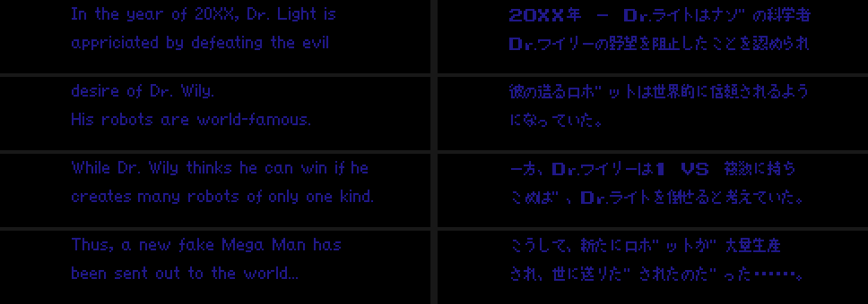
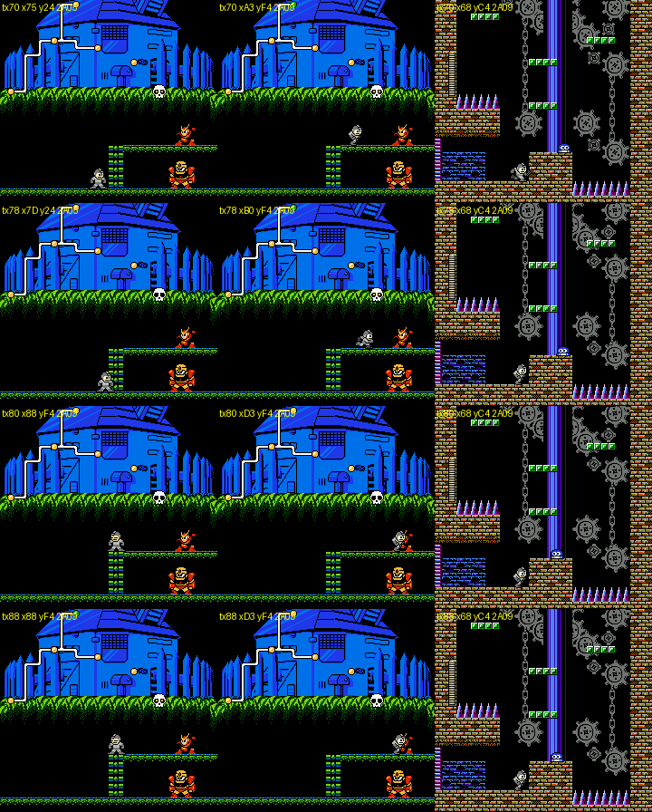
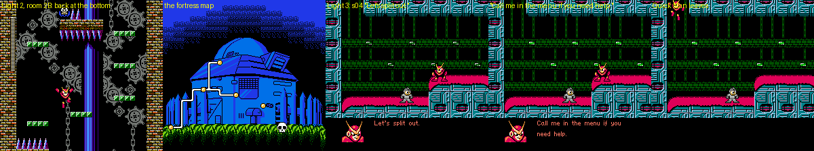
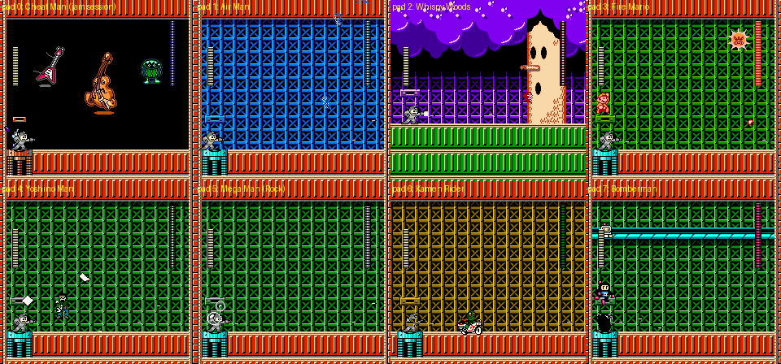
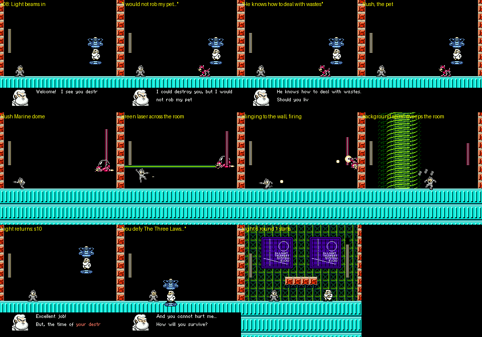
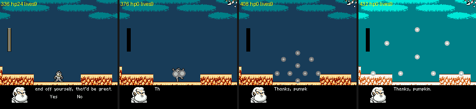

# Rockman CX: the definitive overview (cx-critic)

This is the synthesis of the CX investigation. It sits on top of eight topic docs, which hold the evidence:
[`cheats.md`](cheats.md) (RAM, saves, warps, savestates), [`stages_1.md`](stages_1.md) (the opening, Cheat Man, Air Man, Whispy Woods, Fire Mario), [`stages_2.md`](stages_2.md) (Yoshino Man, Mega Man, Kamen Rider, Bomberman), [`fortress.md`](fortress.md) (Dr. Light stages 1-6, the final boss, the ending), [`systems.md`](systems.md) (weapons, items, dash, Quick Man, heart tanks), [`engine.md`](engine.md) (mapper, banks, IRQ, sound, objects, saves), [`graphics.md`](graphics.md) and [`text.md`](text.md).

Tags, as in every doc: **[seen]** observed in the emulator, **[code]** disassembly or data, **[text]** in-game text, **[doc]** readme, **[guess]** speculation. "(critic)" marks a claim checked or found in the critic pass (§8). ROM: `roms/cx_en.nes`, v1.1. The JP build differs only in text and fonts.

---

## 1. What CX is, structurally

**Premise.** It is Rockman 2 with the sides swapped. Wily decides he keeps losing because he fights "8 vs 1", so he builds a production line of grey **mass-produced fake Rockmen**. You are one of them, and you attack **Dr. Light**. Light defends with "four Light robots active around the world, three newly built ones, and Rock" [doc, JP readme]. The credits show who is who [text]:

- **The four world-famous robots** are the licensed guests: Fire Mario (Nintendo), Kamen Rider (Ishinomori), Bomberman (Hudson) and Whispy Woods (HAL).
- **The three new robots** are credited to the hack's author: Yoshino Man, Cheat Man, and Air Man (re-registered as a Light Number).
- **Rock** himself is the eighth, as DLN.001.

The JP title is **ロックマンCX ワイリー課長の挑戦!**, "Section Chief Wily's Challenge", a parody of *GameCenter CX*. That is where "CX" comes from [text].

### 1.1 Stage list, in play order

| # | Stage (ID) | Rooms | Boss | What happens |
|---|---|---|---|---|
| 0 | Opening (`$0F`): Wily's tower, then a red-sky city | `$17-$29` | Guts Man (`$B3=$0E`). The fight can't be won: at 7 HP, Rock rescues him | You become **Quick Man** mid-stage, then free your own captured body |
| 1-8 | Eight robot-master stages, any order | `$00-$17` each | A 40-HP robot master | You get its weapon. An item "upgrade" follows the 2nd, 4th and 6th boss |
| 9 | Light 1 (`$08`): Light's lab under Wily's UFO attack | `$19-$2B` | **Ultraman** (`$B3=8`), with a 0.73 s PCM cry | A walkable fortress map: climb the ladder to Quick Man, or walk the floor to Guts Man |
| 10 | Light 2 (`$09`, optional): the clock tower | `$2B` up to `$16` | **Quick Man**, brainwashed (`$B3=9`) | You walk back down as Quick Man. The stage ends in the bottom room, `$2B` (critic) |
| 11 | Light 3 (`$0A`): the electrified base | `$18-$2B` | **Guts Tank** (RM2's own tank, `$B3=$0A`), two phases | Quick Man opens the stage with s04 if he was rescued (critic) |
| 12 | Light 4 (`$0B`): the water works | `$17-$2B` | **The masked robot** (`$B3=$0B`) | |
| 13 | Light 5 (`$0C`): the teleporter hall | `$18-$2A` | **All eight refights**, then **Rush**, Light's "pet" (`$B3=$0C`) (critic) | Light appears with s10, and the game cuts straight to Light 6 (critic) |
| 14 | Light 6 (`$0D`): Light's inner lab | `$15-$2B` | **Dr. Light** in person (`$B3=$0D`), twice | He leaves vowing "to become much bigger!" |
| 15 | Final (`$0E`) | `$18-$19` | **Giant Dr. Light**, drawn as background art. Only the Print Cutter and Power Bomb hurt him | The ending |
| 16 | Ending, then the **playable staff roll** (`$0E`, rooms `$1A+`) | | | You walk the credits as Quick Man with 99 lives |

The eight robot masters (stage ID = save bit = weapon ID − 1):

| ID | Boss (credit) | The stage | The boss | Weapon | Heart tank |
|---|---|---|---|---|---|
| 0 | **Cheat Man** = Mega Man X (Himajin Jichiku) | A night city, then an eight-screen bridge of discs over a city that races past in parallax | Moves you across the room, refills his own bar, deletes the floor under you. His arena is wallpapered with hex codes | Cheat Saber | Room `$16`, in plain view |
| 1 | **Air Man** (Himajin Jichiku) | All sky, and the clouds are not floors | Invisible: a dithered stipple that teleports and throws tornadoes. His stage-select portrait is just the words "Air Man" (JP 空気男) | Dead Ringer | None |
| 2 | **Whispy Woods** (HAL) | A Kirby-style forest, Kerog ponds, a leafy shaft | A tree drawn in the background: apples and air puffs | Ringo Shield | None |
| 3 | **Fire Mario** (Nintendo) | SMB World 2-2 underwater with fire bars, then an SMB castle, with **SMB one-way scrolling** | Fights on World 1-4's bridge. The axe does nothing | Fire Ball | Room `$08`, at the top edge of the screen (critic: touched, +4) |
| 4 | **Yoshino Man** (the author's own robot) | Techno interiors, a Friender gate whose head regrows, force beams that turn corners | Every attack is paper | Print Cutter | None |
| 5 | **Mega Man / Rock** (Capcom) | A circuit-board wireframe, run right to left and wired with warping pits (critic) | Uses his whole arsenal, and draws a "pause menu" panel before he changes weapon | Mega Buster | Room `$0B`, in a sealed pocket |
| 6 | **Kamen Rider** (Ishinomori) | A grey base, blue beams you can stand on, a quarry with a half-speed parallax skyline | Rides the Cyclone; his Rider Kick does 7 | Rider Kick | None |
| 7 | **Bomberman** (Hudson) | A Bomberman soft-block playfield, a rail lift, chain crushers | Plus-shaped blasts. He sits on you and blows himself up | Power Bomb | Room `$0C`, in a sealed pocket |

### 1.2 Weapons and the weakness chart

All values come from the ROM tables at `$17:A90B-$A99A` (one 14-byte row per weapon, indexed by boss number `$B3`). Every hit the agents measured matched them [code][seen]. See `systems.md` §1-2; the chart is printed by `tools/analysis/cx/systems_dmgtable.py`.

| Weapon (from) | What it does | Energy cost (of 40) |
|---|---|---|
| 1 **Cheat Saber** (Cheat Man / X) | A Z-Saber slash | 7 per slash |
| 2 **Dead Ringer** (Air Man; the TF2 Spy's watch) | Plays your full death animation, then cloaks you (drawn 1 frame in 16). Enemies that use the shared aim routines lose you. Recharges by itself | 1 per 16 frames cloaked |
| 3 **Ringo Shield** (Whispy; *ringo* = apple) | A leaf shield that follows you, then a thrown apple | 3 per shield |
| 4 **Fire Ball** (Fire Mario) | SMB's fireball. It **sticks to a boss and burns** for 1 per tick | 1 per 2 shots |
| 5 **Print Cutter** (Yoshino Man) | Paper thrown up that flutters down | 1 per 3 shots |
| 6 **Mega Buster** (Rock) | Turns you **blue, like the real Mega Man**, and gives an MM4 charge shot: ×1 / ×2 / ×3 | 0 / 1 / 3 |
| 7 **Rider Kick** (Kamen Rider) | A flying kick, in the air only, with an 8-frame hit-stop and a DPCM thud | 1 per 2 kicks |
| 8 **Power Bomb** (Bomberman) | A "P" bomb with a plus-shaped blast | 3 per bomb |

Damage per hit, on 40-HP bosses. "–" means the shot is deflected. Fire Ball values are burn times in frames.

| Weapon | Cheat | Air | Whispy | F. Mario | Yoshino | Rock | K. Rider | Bomber | Ultraman | Quick Man | Guts Tank | Masked | Rush | Dr. Light |
|---|---|---|---|---|---|---|---|---|---|---|---|---|---|---|
| Buster | 2 | 2 | 1 | 1 | 2 | 2 | 1 | 1 | 1 | 1 | 1 | 1 | 2 | 1 |
| Cheat Saber | **kills you** | 40 | 40 | 40 | 40 | 40 | 40 | 40 | 14 | 40 | 8 | 8 | 37 | **your HP becomes 13** (critic) |
| Ringo Shield | 2 | **7** | – | 2 | – | 3 | 1 | – | 1 | 2 | – | 2 | 5 | – |
| Fire Ball | – | – | **29** | 12 | 14 | 4 | – | 7 | – | 7 | – | 4 | 10 | 10 |
| Print Cutter | 2 | 2 | – | 1 | – | 2 | 3 | 2 | 1 | 2 | – | **3** | 2 | 1 |
| Mega Buster | **3** | 1 | – | 1 | 1 | 1 | – | 1 | – | 1 | 1 | 2 | 1 | – |
| Rider Kick | – | – | 2 | 3 | 3 | **4** | **4** | – | – | 3 | 1 | 1 | 4 | 2 |
| Power Bomb | 1 | 4 | 2 | **4** | **4** | **4** | 2 | **6** | 2 | 2 | **4** | 2 | 3 | 2 |

Read as a design:

- Air Man keeps vanilla RM2's famous leaf-shield weakness.
- Whispy, a tree, burns longest.
- X falls to the original Mega Buster.
- Bomberman and Kamen Rider are weakest to their own signature moves.
- The giant final Light ignores the whole chart. Only the Print Cutter (+4 to a hidden counter) and the Power Bomb (+7) hurt him [code `$31:A948`, re-read by the critic].

### 1.3 Items, moves and the second character

- **Items 1-3 from the start** (`systems.md` §3):
  - *Instant Floor*: up to 3 platforms, 237 frames each.
  - *Subtank*: an X-style pour menu that freezes the game. It is filled only by weapon-energy pickups.
  - *Übercharge*: each press adds 60 frames of invincibility, stacking to about 4 s. It is **charged by getting hit**.
- **Dr. Light's "upgrades"** arrive after the **2nd, 4th and 6th** robot master, because the counting loop skips the top bit (`$1B:BC9B`, re-read by the critic):
  - The Übercharge becomes a TF2-style 10 s Über, deployed from a full bar.
  - The Instant Floor gets **worse**: it lasts 51 frames.
  - The Subtank pours the whole tank in one press and wastes the rest.
  - Clearing Light 2 also forces all three upgrade bits on (`$9B = $2F`, critic).
- **Dash** (DOWN + A while holding a direction): 2.75 px/frame for 32 frames. Dash jumps keep the speed, and you stay in the dash while under a ceiling. Your hitbox does not shrink.
- **Quick Man** (Wily's DWN-012, here your ally):
  - Moves: walks at 1.82 px/frame, wall-slides and wall-kicks (hold DOWN on the wall for a faster kick), does double damage, throws only boomerangs, cannot dash.
  - When you play him: in the opening; after his rescue in Light 2; from the pause menu, once per life, from Light 3 on, as a separate 40-HP body; and in the staff roll.
- **Heart tanks** (+4 max HP, applied at the next respawn): Cheat Man, Fire Mario, Mega Man and Bomberman.
- **Economy**:
  - Weapon-energy pickups become HP when the buster, the Übercharge or a full weapon is equipped.
  - Every game over halves your E-tanks (`LSR $A7`, critic).
  - Three battery save slots (42 bytes of WRAM, with a checksum); no passwords.

### 1.4 Characters

| Who | Role |
|---|---|
| Fake Rockman ("gray man") | You: Wily's mass-produced, grey Rockman, with 24 HP |
| Quick Man | Your partner. He scouts Light's lab, is captured and brainwashed (Light 2), then rejoins as a tag partner |
| Dr. Wily | The sponsor, "Section Chief". Seen only as the skull castle in the ending |
| **Dr. Light** | The villain, given every Wily trope: the fortress, the taunts, the dogeza, the escape capsule, the giant final form |
| Rock / Mega Man, Roll | Light's side. Rock is boss 5 and rescues Guts Man in the opening |
| Guts Man | "A member of Dr. Light Numbers". He captures you and drives the Guts Tank |
| Ultraman | Light's guard in Light 1 ("Ultra Man, SMASH him." / "Dwah!!") |
| **Rush** | Light's "pet" on "garbage-disposal duty", Light 5's boss (critic) |
| The masked robot | Light 4's boss, "the robot who inherited [Quick Man]". Not identified |
| The two-part robot | Speaks s09 ("I might be weak... / But we are strong!"). No spawn site exists in code or level data, so it may be cut content (critic) |

---

## 2. How crazy it gets: 24 moments

1. **You are the villain's mass-produced henchman, and the game plays it straight.** Light orders "SMASH him", Rock warns that your lives "will come over and over again" (s00), and Light reads your *spike-death count* aloud from the battery save before ordering more spikes (s01). 
2. **The first stage swaps your character.** Guts Man buries you in rocks and carries you off. Quick Man beams in, and you finish the stage as him. The Guts Man fight can't be won: at 7 HP Rock drops in ("Guts Man, escape now!!"). You then break your own grey body out of a cage. 
3. **Air Man is literally air.** He is a 50% checkerboard stipple that teleports every 30-60 frames. His stage-select portrait is just the words "Air Man" (JP 空気男, "a nobody"), his stage's clouds are not floors, his weapon is TF2's fake-death watch, and even his roll-call sprite is the invisible stipple. 
4. **Cheat Man cheats.** He moves you across the room, refills his own bar, and deletes the floor under your feet, which kills you through any HP. His arena is wallpapered with hex codes. 
5. **His Cheat Saber one-shots the other seven robot masters, but hitting Cheat Man with it kills *you*.** Hitting Dr. Light with it sets your HP to exactly 13 (critic, seen).  
6. **Fire Mario's stage is SMB in Rockman's engine.** It has World 2-2's sea with fire bars and Bubble Man's angler fish, real SMB one-way scrolling (two instructions: `LDA $0440,X / STA $14`), a castle with warp pipes and "?" blocks, and a boss fight on World 1-4's bridge, where standing on the axe does nothing. 
7. **Fire Mario's heart tank is hidden at the top edge of an underwater room**, where SMB players look for coins (critic: touched, +4). 
8. **Rock pauses the game to change weapons.** A framed panel like RM2's pause menu is drawn row by row over his arena before he switches palette and weapon. His bomb blast hits you again every 8 frames, through your invincibility. 
9. **Mega Man's stage runs backwards and is wired by warping pits.** Seven event-script objects turn certain falls into warps to other segments, and a flag flips when you enter the right-to-left half (critic, code).
10. **Bomberman blows himself up** (4 damage per blast of his own bombs) and sits bouncing on your head for 1,000 frames. 
11. **Kamen Rider rides the Cyclone through a scrolling quarry**, and is weakest to his own Rider Kick. 
12. **The Friender gate.** Wood Man's dog becomes a door whose head regrows every 330 frames. Only the horn on its back opens it, and the horn can be hurt only while the head is gone. 
13. **The Mega Buster weapon recolours you as the real Mega Man** and gives you the MM4 charge shot. 
14. **Ultraman guards Light's lab.** He is drawn as background art in RM2's Mecha Dragon arena, and the game freezes for 0.73 s to play a 21.7 KB raw-PCM cry through a cycle-counted CPU loop. 
15. **The fortress map is a tiny playable scene.** Climb the ladder to Quick Man for the optional Light 2, or walk to Guts Man and skip it. 
16. **You rescue a brainwashed Quick Man, then become him.** The fake Rockman tries to teleport out four times and fails ("(Can't I teleport...!?)"), so you walk the tower back down as Quick Man. He opens Light 3 with "Let's split out. Call me in the menu if you need help." and from then on is a once-per-life tag partner in the pause menu.  
17. **Light electrifies his own base on purpose** ("We're now SERIOUS"). RM2's Guts Tank, driven by Guts Man, puts on a welding mask for round two. 
18. **Light 5 is RM2's eight-teleporter hall, and all eight robot masters return.** Cheat Man's rematch is a Dragon Quest battle against a floating rock band ("The Cheatous Bass and its cohorts used a jam session attack!!"). Fire Mario's rematch adds an SMB3 Angry Sun (critic: all 8 pads; the earlier run found 5). 
19. **Light's "pet" is Rush.** After the eighth refight a ninth teleporter opens. Light beams in: "I could destroy you, but I would not rob my pet of that pleasure. He knows how to deal with wastes." Rush then fights you as a dog, as a domed Rush Marine-style craft firing a screen-wide laser, clinging to the walls, and as a background-drawn spiral that sweeps the room (critic, new). 
20. **Dr. Light talks between your lives.** Every respawn brings a new taunt from a 12-line table:
    - TF2's Scout, Undertale's Sans and Office Space's Lumbergh;
    - a Shoryuken warning and the Three Laws of Robotics;
    - an **X-style capsule offer in the middle of the fight**;
    - **"if you could just... off yourself", with a Yes/No prompt where Yes really kills you**.

    
21. **Light begs for mercy like Wily** (the dogeza), escapes in his teleporter, and comes back promising "to become much bigger!". 
22. **The giant Dr. Light is background art that grows and shrinks**, by streaming hand-drawn sizes into CHR-RAM. Only the author's own Print Cutter and the Power Bomb can hurt him, and his bar stays empty while a hidden counter counts up. 
23. **The ending is RM2's, but Wily won.** The empty helmet lies in the grass with Wily's skull castle on the horizon. The roll call numbers the new robots DLN.009-015, continuing after Elec Man. 
24. **The staff roll is a level.** You walk and climb a silhouette castle as Quick Man, with 99 lives and 99 E-tanks, while the names are written into the scenery. It even needs a wall-kick climb. 

---

## 3. How the systems interlock

- **Damage feeds defence.** Every hit taken adds 1 to the Übercharge (`$3F:E5BC`), so a struggling player banks invincibility. After the 2nd boss, a full bar becomes a 10 s Über. Weapon-energy pickups top up your HP whenever the equipped weapon cannot use them, so no pickup is wasted.
- **Upgrades follow progress, not choice.** The 2nd, 4th and 6th robot master each set one bit in `$9B`: Über, Floor, Subtank. Two of the upgrades change *how* an item is used (the all-or-nothing Über, the one-press Subtank) and one makes it worse (the Floor). The screen only ever says "You got:".
- **The fortress is built around the items.**
  - Light 1's first wall needs the Instant Floor.
  - Light 3 has a "USE" sign.
  - The Dead Ringer only fools enemies that use the shared aim routines.
  - The teleporter pads only accept a player standing squarely on them.
- **Quick Man is a second body.** His HP and yours are kept separately. The call works once per life, and START swaps back with the HP you left with. Taking the Guts Man branch on the fortress map skips Light 2, so that player never unlocks the call and never hears s04.
- **The quick swap is a reset.** Select + Up/Down deletes every weapon object (the platform under you, the Über, the shield, bombs) and cancels the cloak and the charge.
- **Penalties.**
  - A game over halves your E-tanks.
  - The game saves after bosses, after heart tanks, on stage exits and from the game-over menu.
  - HP, weapon energy and the checkpoint are not saved.
- **All bosses in one table.** All 15 bosses run through RM2's boss dispatcher (`$B3`). The weakness table has a row per weapon and a column per boss, and two cells are special cases in code: Cheat Man and Dr. Light under the Saber.

---

## 4. Technical architecture highlights

- **MMC1 → MMC3 by insertion.** RM2's banks `$00-$1B` stay where they were, its last 32 KB moves to `$3C-$3F`, and `$1C-$3B` are new. RM2's 16 KB bank-switch entry at `$C000` is now a single `ASL A` that falls into an 8 KB pair routine, so RM2's untouched callers still work. Bank shadows (`$61/$62`) plus a shadow of the select register (`$63`), restored by the NMI and the IRQ, make switching interrupt-safe (`engine.md` §1).
- **Two one-byte tables lifted the 16 KB limits:**
  - a bank per object type (`$3F:FA50`; 192 types, 86 new handlers);
  - a bank per sound ID (`$18:97B7`; 96 IDs, including 38 new songs in banks `$21-$23`).
- **13 IRQ raster effects in a paged bank** (`$1C`): the title logo sliding in; Kamen Rider's half-speed skyline, placed by an invisible object; Cheat Man's racing bridge; the dialogue box's own palette below line 184; the Guts Tank's still floor; the giant Light's window and wobble; the weapon-get wipe.
- **Data-driven "director" objects:**
  - Object `$40` triggers palette or music changes; its Y coordinate is the parameter.
  - Object `$41` calls one of 51 event scripts, chosen by its Y. Script `$1C` is the dialogue engine, and the dialogue number is the object's X (critic: table `$3D:AEE9` re-read).
  - Scripts drive Fire Mario's no-going-back scrolling, his heart tank, Mega Man's pit warps, Light 2's exit and Light 6's flight.
- **Shared stage banks.** Each 16 KB stage bank holds one robot-master stage and one fortress or opening stage, with a single 6-entry restart table: three entries each (critic).
- **Reverse stages.** Mega Man's stage (special-cased in the death code, with scripted pit warps) and Light 2 count rooms downward.
- **Light 5 reuses RM2's Wily 5 teleporter code** unchanged in structure: the `$BC` refight mask, `$BA` for the pad, two hubs, and a ninth exit once `$BC = $FF` (critic).
- **Background bosses and CHR streaming.** Ultraman, Whispy, the Guts Tank and the giant Light are nametable art. The giant re-uploads up to 160 tiles every 20-30 frames, which gives 370 distinct BG tiles at one checkpoint.
- **Text.**
  - A real variable-width font renderer for English, with a highlight colour from the second bitplane.
  - JP kanji pages streamed into CHR per script (327 glyphs).
  - A script language with far calls: Yes/No menus, teleport attempts, hero checks.
- **Samples.** A 337-byte DPCM thud for the Rider Kick, and a 21.7 KB raw PCM voice clip for Ultraman.

---

## 5. Text and narrative highlights

`text.md` has every line in both languages. The whole script runs on one inversion: Light gets the villain's lines.

Highlights:

- The JP title's *GameCenter CX* pun.
- Guts Man's "I'm a member of Dr. Light Numbers".
- s01's spike counter.
- s05's deliberate short circuit.
- s04: Quick Man splitting off at the start of Light 3.
- s08: Light handing you over to his "pet".
- s10: the Three Laws rant ("Dangerous robots like you AREN'T NEEDED IN THIS PEACEFUL WORLD!!"), spoken as Light 5 ends.
- s11 (TF2), s12 (Office Space, with a Yes/No prompt), s13 (Sans), s16 (the X capsule), s17 (the Shoryuken).
- s21: the dogeza.
- s24: "You respawn repeatedly while I heal myself permanently. How amazing story!"
- s25: "to become much bigger!".

The EN build is a meme-heavy rewrite rather than a translation; s21's forgiveness joke is lost in EN.

---

## 6. Lessons for Rockman 6 GP

1. **One premise, followed everywhere.** "Light is the villain" drives CX's stage list, dialogue, ending and jokes. Pick one twist for GP and let it reach every layer.
2. **Guests and bosses should play like their home games**: SMB scrolling for Fire Mario, plus-shaped blasts for Bomberman, a background tree for Whispy, an invisible Air Man. A boss joke should be a *mechanic*.
3. **Spend the villain's voice on deaths.** A line per respawn (CX's Light 6) turns repeated failure into content.
4. **A partner as a second body.** Quick Man (once per life, separate HP, a different moveset) adds depth without forcing a mode switch.
5. **Reuse the engine's set pieces, with one twist each**: the Wily 5 hall as a refight hall with a secret ninth pad, the Mecha Dragon arena for Ultraman, the Guts Tank with a helmet.
6. **Telegraph secrets and required tools.** The sealed heart tanks, Light 1's Instant Floor wall, the 4-px teleporter pads and the staff roll's wall-kick gap all stopped automated players, and they would stop many humans too.
7. **Keep damage in tables**, with one row per weapon and one column per boss, and generate the chart from them. Special cases (the Saber) belong in visible code, not in table values that fall through.
8. **Engine:** keep a bank table beside every pointer table; put IRQ effects in a paged bank with zero-page parameters; shadow the mapper's select register; keep old entry points when relocating code.
9. **Test harness:** crafted saves with checksums, checkpoint warps (die while holding the room byte), per-room first-visit states, damage sweeps and dialogue injection made this survey possible. Build the same for GP from day one.

---

## 7. Remaining unknowns

- **The two-part robot (s09).** No spawn site in code or level data; it may be cut content.
- **Unidentified bosses.** The masked robot's identity (Light 4); its orange mask is not from any known source.
- **Unplayed routes:**
  - Mega Man's first half, from the down-arrow drop to room `$0D`. The pit-warp mechanism is decoded, but the route was not played.
  - The rest of the staff roll (rooms `$21+`), and whether Wily's victory line ("Now the age of me begins!") appears there.
  - Light 6 rooms `$1D-$1F`: the shutter, and Light's flight (s22) in room `$1E`.
  - Light 4 rooms `$1B-$20` and `$22-$29`.
- **Unreached secrets.** How the sealed heart tanks (Mega Man `$0B`, Bomberman `$0C`) are meant to be reached.
- **Engine and data:**
  - The rule that orders Light 6's round lines (index `$04E1`).
  - Banks `$37`/`$38` (unidentified data), the unseen hex font at `0x21000`, and two unreached IRQ sites.
- **Possible bugs, intent unknown.** The popcount question (upgrades after bosses 2/4/6), and the Fire Ball's handler entry, which points one byte past its start.

---

## 8. Critic's log: verified, corrected, added

| Claim | Source | Verdict |
|---|---|---|
| Light 5 has 5 teleporter pads; Fire Mario, Yoshino Man and Mega Man are not refought | fortress.md §6 | **Wrong.** There are 8 pads (`$3C:8266/$826E`) and all 8 refights were seen; Fire Mario, Yoshino Man and Mega Man are refought in room `$1E`. A pad fires only with the player within 4 px of it (`$3F:E557`) |
| Light 5's boss `$0C` / s08 was never reached | fortress.md §11 | **Found.** With `$BC = $FF` you return to hub 2, whose exit teleporter (`$BE`) leads to room `$2A`: s08, then **Rush**. Beating him gives s10, then Light 6 directly |
| The Cheat Saber does 40 to Dr. Light | fortress.md §0 | **Wrong.** It sets *your* HP to 13; Light stays at 40 (seen 9 times) |
| The Cheat Saber on Cheat Man kills you | systems.md §1 | Confirmed [code `$17:A668`] |
| Item upgrades come after the 2nd/4th/6th boss | cheats.md §6 | Confirmed [code `$1B:BC9B`] |
| The giant Light is hurt only by the Print Cutter and Power Bomb | fortress.md §8 | Confirmed [code `$31:A948`] |
| The Guts Tank tiles are byte-identical to RM2 | graphics.md §5 | Confirmed (3,072 + 256 bytes) |
| Cheat Man has 4 restart rooms and Air Man 5 | cheats.md §5 | **Wrong.** Each has 3; the extra entries are Light 1's and Light 2's |
| `$0098`'s meaning is unknown | cheats.md §4 | It is the spike-death counter that s01 reads (`$1F:B12E`, fake Rockman only, capped at 200) |
| Fire Mario's heart tank vanishes | stages_1.md §4.3 | **Wrong.** It moves to another object slot, drifts to Y `$13` and stays; touching it gave +4 |
| Where Light 2 ends and where s04 plays | systems.md, fortress.md | **Found.** Light 2 ends in room `$2B` (script `$22`, which forces `$9B = $2F`); s04 plays on the first screen of Light 3 |
| Mega Man's stage does not match its segment list | stages_2.md | **Explained.** It is wired by seven script-`$18` pit warps plus a `$70` direction flag |
| Game over halves E-tanks; Übercharge +1 per hit; Quick Man ×2 damage; PCM clip size; Air Man's boss room is `$15` | systems / engine / stages_1 | Confirmed |
| s09 spawn site | text.md | None exists in any stage table or immediate spawn |

New shared savestates (`build/research/cx/states/`):

- `fortress_light5_firemario`, `fortress_light5_yoshino`, `fortress_light5_megaman`: the three missed refights, in room `$1E`.
- `fortress_light5_hub2_all8`: hub 2 with all eight refights done.
- `fortress_light5_rush`: room `$2A`, Rush's bar filling.
- `light2_qm_exit`: Light 2 room `$2B` as Quick Man, at the end of the escape.

The critic's scripts are in `build/research/cx/cx-critic/`.

## Critic's verification notes

WHAT WAS COVERED
- Read all 8 CX docs and the field guide, DECONSTRUCTION §1 and the readmes (EN, JP, history).
- Checked about 15 load-bearing claims in code and/or the emulator:
  - 3 were wrong: Light 5 has only 5 pads; the Cheat Saber does 40 to Dr. Light; Cheat Man and Air Man have extra checkpoints.
  - 3 were incomplete and are now resolved: the Fire Mario heart tank 'vanishes'; where s04 plays and where Light 2 ends; what $0098 is.
  - The rest were confirmed.
- Every fix was written in place with '(corrected by critic)', '(resolved by critic)' or '(added by critic)' notes, in fortress.md, cheats.md, stages_1.md, stages_2.md, systems.md and text.md.
- Filled the biggest gap: Light 5's real progression (all 8 refights, then hub 2, then the Rush boss and s08, then s10 and straight into Light 6).
- Also filled: Light 2's ending and s04, Fire Mario's heart tank, and the Mega Man stage's pit-warp scripts (code). The s09 search found no spawn site at all.
- Added 6 shared states to build/research/cx/states/: fortress_light5_firemario, fortress_light5_yoshino, fortress_light5_megaman, fortress_light5_hub2_all8, fortress_light5_rush, light2_qm_exit.

WHAT WAS NOT COVERED, AND WHY
- The end of the playable staff roll (rooms $21+) and whether Wily's victory line appears there. Quick Man's wall climb in room $20 works (y $C4 to $46), but every jump right from the column top fell to death at room $21 x $05. Three Go-Explore runs did not pass it, and a restart forced into room $28 renders font garbage.
- The Mega Man stage's first-half route. The pit-warp mechanism is decoded, but the route was not played: the explorer stayed stuck in room $11's trace maze.
- Light 6 rooms $1D-$1F. The shutter beside the type-$2D objects was not opened; room $1E holds script $2D, which spawns s22 (Light flees).
- The sealed heart pockets of Mega Man ($0B) and Bomberman ($0C).
- The identities of the masked robot (Light 4) and the two-part robot (s09; its portraits 0A/0B show a face split in two). Possibly cut.
- The rule that orders the Light 6 round lines (index $04E1 of the table at $30:8584).

_Written by the cx-critic agent; saved verbatim from its report by the orchestrator, because subagents may not write report files._
