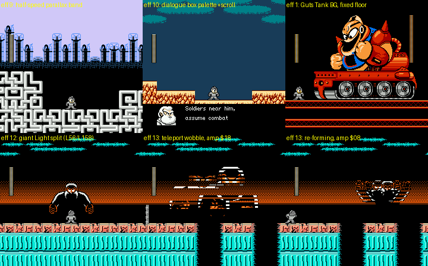
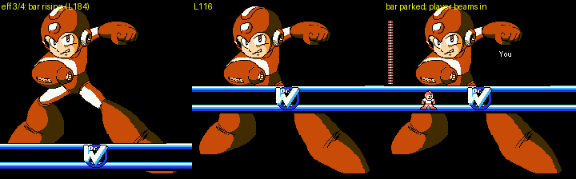
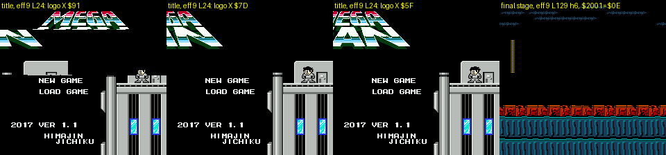
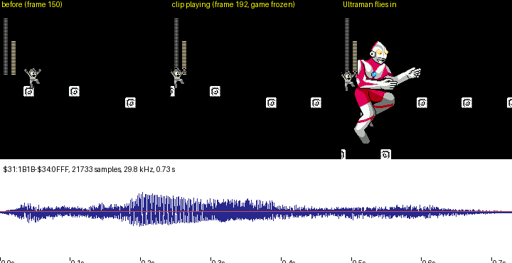

# Rockman CX engine teardown: mapper conversion, bank map, raster effects, sound, objects, saves (cx-engine)

Static and technical deep dive into how Himajin Jichiku turned Rockman 2 (MMC1, 256 KB) into Rockman CX (MMC3,
512 KB). Every address was read from `roms/cx_en.nes` (the code is identical in `roms/cx_jp.nes` unless noted) and
checked against `roms/rm2j.nes`. Bank numbers are **8 KB banks**. `$3C:8588` means "bank `$3C`, mapped so that this
CPU address falls inside it". Tags: **[code]** disassembly or data, **[seen]** emulator, **[guess]** inference.

Behaviour that the other CX agents already measured (dash speeds, wall kick, item effects, heart-tank locations,
save contents, dialogue engine) is only summarised here, with links. This doc is about *how* it is built.

Scripts (all in `build/research/cx/cx-engine/`, run with `python3 -I` from the repo root):

| Script | What it does |
|---|---|
| `dis.py ROM B8000 BA000 ADDR N` | py65 disassembler with any two banks at `$8000`/`$A000` and `$3E`/`$3F` fixed |
| `bankstats.py` | per bank: % equal to RM2, % empty, JP/EN diff count, JSR/RTS counts, tile-likeness |
| `chrall.py FIRST LAST OUT` | every bank in a range as a 2bpp tile sheet (to tell graphics from code and data by eye) |
| `farcalls.py`, `xrefs.py`, `entries.py` | bank-switch call sites; which bank calls which; every entry point into each bank (object, script, far-call and far-jump tables) |
| `romwrites.py` | every store into `$8000-$FFFF` (mapper register writes), by bank |
| `objtable.py` | the 192-entry object handler table, compared with RM2's 128-entry table |
| `sound.py` | the 96-entry sound table (bank, pointer), music vs SFX, which tracks are RM2's |
| `irqscan.py`, `irqtrace.py`, `irqshots.py`, `irqsites.py` | sample the IRQ variables `$80`/`$81`/`$84-$8F` from every savestate; list every code site that selects an effect |
| `irqhunt.py N`, `bootirq.py`, `irqrun.py` | scan every agent's savestates / the power-on attract / an autorun for armed effects, with screenshots |
| `spawnscript.py STATE SCRIPT FRAMES PREFIX` | spawn event-script object `$41` running any script, to see its effect without reaching its room |
| `wram.py` | which WRAM pages are used across the shared savestates |
| `ultrapcm.py`, `pcmfig.py` | walk into Light 1's Ultraman arena and catch the raw-PCM player running (PC sampling, stack dump); draw the figure |
| `gallery.py`, `gallery2.py` | the IRQ galleries in `img/` |

The two-bank disassembler is also in `tools/analysis/cx/engine_dis.py` for other agents.

---

## 0. The short version

- **Mapper conversion** [code]: every MMC1 serial write is gone (RM2 had 15× `STA $FFF0`, 5× `STA $9FFF`,
  5× `STA $BFFF`, 5× `STA $DFFF` and the `INC $FFE1` reset trick). RM2's 16 KB bank-switch entry `$C000` now holds a
  single `ASL A` that falls into a new MMC3 routine at `$C001`, so RM2's untouched `LDA #bank16 / JSR $C000` calls
  still work. The bank in `$8000` is shadowed in `$61`, the bank in `$A000` in `$62`, and the last value written to
  the MMC3 bank-select register in `$63`. NMI and IRQ put all three back, which makes bank switching interrupt-safe
  without RM2's "switch in progress" flag dance.
- **Layout**: PRG mode 0, with `$C000` = `$3E` and `$E000` = `$3F` fixed (RM2's fixed 16 KB bank, moved to the end).
  CHR-RAM, with the six CHR registers set once to identity (`$FB62`). WRAM is enabled (`$A001 = $80`). The
  mirroring shadow `$0723` is written to `$A000` every NMI.
- **The new half** (`$1C-$3B`): IRQ effect code (`$1C`), new engine, menu, script and object code (`$1D-$20`,
  `$24`, `$25`, `$30`, `$31`), three banks of **new music** (`$21-$23`), the dialogue engine and scripts (`$26`),
  graphics (`$27-$2F`, `$34`, `$35`, `$39-$3B`), and two banks of unidentified data (`$37`, `$38`), plus
  CX's rebuilt metasprite tables in `$1C`. **`$31-$34` hold a 21.7 KB raw 8-bit PCM voice
  clip: Ultraman's entrance cry in Light 1**, played by a cycle-counted CPU loop at about 29.8 kHz. `$36` is
  completely empty.
- **IRQ**: one handler (`$F87A` → `$1C:8000`) runs **13 effects**, chosen by `$81` (jump table `$1C:8AFE`) at
  the line in `$80`. In use: the **title logo sliding in** and Kamen Rider's half-speed parallax skyline (effect
  9), Cheat Man's racing-background bridge (9), the dialogue box's own palette and scroll under line 184 (effect
  10, a mid-frame palette rewrite), the giant Guts Tank's fixed floor (effect 1), the giant Dr. Light's window and
  teleport wobble (effects 12/13), the weapon-get colour wipe (effects 3/4 and 6/7), and mid-frame PPUMASK changes
  (effect 8: Fire Mario's draining-water tint, the dialogue set-up). Effect 11, a **second OAM DMA from WRAM
  `$7D00` in mid-frame**, is present but nothing selects it (nor effects 2 and 5).
- **Sound**: RM2's driver (banks `$18`/`$19`) is kept, but patched so that every track has its own **bank byte**
  (`$18:97B7+id`) and split pointer tables (`$8A40`/`$8AA0`); the track's data is paged into `$A000` on the fly. 96
  ids: **42 music** ids (38 new, 4 kept from RM2) and **54 SFX**. Add a 337-byte DPCM "thud" in the fixed bank
  (`$FB80`, the Rider Kick impact) and the PCM clip.
- **Objects**: the handler table grew from 128 to **192 types** (`$3C:92F0` lo / `$93B0` hi) and gained a
  per-type **bank table** (`$3F:FA50`), so object code can live in any bank. 159 types are live, with 144 distinct
  handlers; **86 handler entry points are new** (43 in `$3D`, 26 in `$20`, 9 in the fixed bank, 7 in `$25`, 4 in
  `$24`). The boss dispatcher (`$16:8003`, index `$B3`) has **15** routines (RM2: 14), one per boss, and bank `$16`
  was rewritten almost completely (5% of its bytes still match RM2).
- **Saves**: only 42 bytes of the 8 KB WRAM are battery data (`$7420-$7449`: three interleaved slots of 14
  fields). The rest of WRAM is a PPU upload queue (`$7E00`), the effect-11 sprite page (`$7D00`), palettes
  (`$7FE0`), and live copies of the slot number and heart flags (`$7FF0`, `$7FF8-$7FFF`).

---

## 1. The MMC1 → MMC3 conversion

### 1.1 The cartridge

| | Rockman 2 (J) | Rockman CX |
|---|---|---|
| iNES header | `4E 45 53 1A 10 00 10 00` | `4E 45 53 1A 20 00 42 00` |
| PRG | 256 KB (16 × 16 KB) | 512 KB (32 × 16 KB) |
| CHR | none (8 KB CHR-RAM) | none (8 KB CHR-RAM) |
| Mapper | 1 (MMC1) | 4 (MMC3), battery (`flags6 = $42`) |

The patcher keeps RM2's first 224 KB in place, inserts 256 KB of zeros, and appends RM2's last 32 KB (16 KB banks
14-15, including the fixed bank) before applying the IPS (`docs/DECONSTRUCTION.md` §0). So **8 KB banks `$00-$1B`
are RM2's banks at their old numbers, RM2's `$1C-$1F` became `$3C-$3F`**, and `$1C-$3B` is new space. The readme
also accepts *Mega Man 2 (USA)* as the base [doc].

### 1.2 Reset

RM2 (MMC1) [code `rm2j $1F:FFE0`]: `SEI / INC $FFE1 / JMP $F290`. The `INC` writes a byte with bit 7 set to the
mapper, the standard MMC1 reset trick. `$F290` then serial-writes MMC1 control and bank registers (`$1C:8028-$8054`:
5 writes each to `$BFFF` and `$DFFF`).

CX [code]:

```
FFEC  SEI                      ; RESET vector moved from $FFE0 to $FFEC
FFED  JMP $F290
F290  LDA #$10 / STA $2000
F295  LDA #$40 / STA $4017     ; NEW: turn off the APU frame IRQ (the CPU now runs with I=0)
F29A  LDA #$3C / JSR $C001     ; map $3C/$3D (was LDA #$0E / JSR $C000, 16 KB bank 14)
F29F  JMP $8000
$3C:8000  CLD, $2001=0, $4010=0, $4015=0
          STX $C000 / STX $C001 / STX $E000   ; IRQ latch 0, reload, IRQ off
          TXS, wait 4 vblanks, clear $0000-$07FF and WRAM $7F00-$7FFF
          JSR $FB62            ; refill weapon energies, then CHR R0-R5 = 0,2,4,5,6,7 (identity for 8 KB CHR-RAM)
          $0723 = 1 (horizontal mirroring), $A001 = $80 (WRAM on, writable), CLI
```

`$FFE0-$FFEB`, where RM2's reset stub sat, is now part of a row of **bank-preserving call wrappers** (`$FFBB-$FFF9`):
each pushes `$61` (and `$62`), maps what the callee needs, calls it, and maps the caller's banks back. For example
`$FFBB` maps `$1C`/`$15` for the sprite routine `$CCD5`, and `$FFE2` wraps `$C07F`.
The **IRQ vector** points to `$F87A` (RM2: the reset stub, since MMC1 has no IRQ). NMI stays at `$CFED`.

### 1.3 Bank-switch routines (fixed bank) [code]

| Entry | What it does | Calls in the ROM |
|---|---|---|
| `$C000` | `ASL A`, then falls into `$C001`. RM2's "select 16 KB bank A" entry, kept so RM2 callers need no edits | 16 `JSR` |
| `$C001` | `JSR $F859` (R6 = A), then `LDA $61 / CLC / ADC #1 / JMP $F8AE` (R7 = A+1): an 8 KB **pair** | 42 `JSR`, 46 `JMP` |
| `$F859` | `STA $61; LDA #6; STA $63; STA $8000; LDA $61; STA $8001`: R6 (`$8000`) with shadow | 40 `JSR`, 19 `JMP` |
| `$F8AE` | the same for R7 (`$A000`), shadow `$62` | 48 `JSR`, 14 `JMP` |
| `$F8F0` | R6 **without** touching `$61`/`$63`: the IRQ handler uses it to page `$1C` in and back out; also called twice from stage bank `$06` | 5 |
| `$F8D6` | far jump: caller pushes hi and lo, `LDA #bank / JMP $F8D6`; it saves `$61` in `$60`, maps the pair, pulls the address into `$08/$09` and `JMP ($0008)`; `$F8E8` maps `$60` back | 34 |
| `$F8CC` | `STA $96`, then far-jump to `$1F:8000`: a command call into the menu/scene bank `$1F` (A = command, e.g. `$83`) | 40 |
| `$FA10` | far *call* through an 8-entry table (lo `$FA30`, hi `$FA38`, bank `$FA40`), indexed by Y; saves and restores `$62` | 7 |

The **shadow-and-restore** scheme is what makes it safe: a bank switch is two writes (`$8000` select, `$8001`
data). If an interrupt lands between them and switches banks itself, the select register no longer holds what the
main thread wrote. CX's NMI (`$D0DC`) and IRQ (`$F88D`) end with "restore R6 from `$61`, R7 from `$62`, then rewrite
`$8000` with `$63`", so the interrupted `STA $8001` still hits the register it meant to. RM2 needed a flag (`$68`)
and a deferred-sound mechanism (`$67`) to survive an NMI during its 5-write serial sequence; CX's `$C000` no longer
sets `$68`, so that path is dead code.

### 1.4 What happened to the MMC1 writes [code: `romwrites.py`]

| Register write | RM2 | CX |
|---|---|---|
| `STA $FFF0` (16 KB PRG bank, serial) | 15 (`$1E:C006-C034`, `$1E:D094-D0A4`) | 0 |
| `STA $9FFF` (CHR 0) / `$BFFF` (control) / `$DFFF` (CHR 1) | 5 / 5 / 5 (reset code) | 0 |
| `INC $FFE1` (MMC1 reset) | 1 | 0 |
| `STA $8000` / `STA $8001` (MMC3 bank select / data) | — | 14 / 12 (fixed bank, plus the PCM player in `$31`, `$1B` and `$1F`) |
| `$A000` (mirroring) / `$A001` (WRAM) | — | 2 / 2 |
| `$C000/$C001/$E000/$E001` (IRQ) | — | 3-4 each (reset, NMI, `$1C`) |

The remaining `$FFFF`/`$BFFF` stores the script finds in both ROMs are table-indexed writes into RAM or data bytes
that happen to decode as stores.

### 1.5 The NMI, rewritten [code: `cx_nmi.txt` vs `rm2_nmi.txt`]

New work at `$CFED`:

1. **Arm the scanline IRQ**: if `$80` ≠ 0, write `$80 − 2` to `$C000` and `$C001`, then `$E000`/`$E001`. The effect
   number `$81` is only read by the IRQ itself, so an effect with `$80 = 0` is inert.
2. If `$6A` ≠ 0, a **WRAM upload queue** at `$7E00` goes to the PPU (`$EA3F`): either `$6A/3` (address hi, lo, byte)
   triples, or a fully unrolled block copy for long runs (≥ `$40` bytes) at one address.
3. The **whole palette** (`$0700-$071F`) is uploaded every frame, then OAM DMA from page 2.
4. Scroll as in RM2 (`$1F` camera X, `$22` Y, `$B6/$B8` shake offsets), then `$0723` → `$A000` mirroring.
5. **Sound with explicit banks**: `STY $8000 / STX $8001` with `$18` then `$19`, `JSR $8000` (driver), then drain
   the sound queue `$66` (`JSR $8003`), then restore `$61/$62/$63`.

### 1.6 Where the new code went in RM2's own banks [code]

- **Fixed bank `$3F`**: RM2 left `$F2A2-$F900` (about 1.6 KB) and `$FF87-$FFDF` empty. CX fills them with the
  bank-switch routines, the IRQ entry, the far-call table, the object bank table (`$FA50`), item code, the save
  routine (`$FCD0`) and the DPCM sample (`$FB80`).
- **`$3D`** (RM2's object bank): `$BD24-$BFF9` (about 725 bytes, free in RM2) now holds the heart tank (`$BD85`)
  and the dash/wall-slide player state `$BE81`.
- **`$3C`**: the player state table grew by one entry, and RM2's code was patched in place (30% of the bytes still
  match RM2 at the same offsets).

---

## 2. Bank map

Measured per 8 KB bank [code: `bankstats.py`, `entries.py`; graphics from `chrall.py` and `graphics.md` §1.1]:
"RM2" = percentage of bytes equal to RM2 at the same offset, "empty" = runs of `$00`/`$FF` ≥ 16 bytes, "JP≠EN" =
bytes that differ between the two builds.

### 2.1 RM2's banks (`$00-$1B`, `$3C-$3F`)

| Banks | RM2 | What they hold in CX |
|---|---|---|
| `$00-$0F` | 21-59% | The 8 stage pairs, layout kept (`stage & 7` → banks `2n`/`2n+1`): rooms, enemies, tilesets, each pair now holding **one robot-master stage + one fortress/opening stage** (`cheats.md` §5). Some pairs carry stage-specific scripts and IRQ setup (Cheat Man script `$1B` in `$01`; the title screen runs from `$0E/$0F` and its logo slide is in `$0F`) |
| `$10`, `$12`, `$13` | 11-44% | stage select, common BG and HUD tiles, title and intro crawl (most of the JP/EN differences) |
| `$11`, `$14`, `$15` | 34-71% | RM2 graphics and data, partly kept |
| `$16` | **5%** | **boss AI, rewritten**: 15-entry dispatcher (§5.3) |
| `$17` | 61% | RM2's weapon/boss helpers, extended (Quick Man's ×2 damage at `$17:A635`) |
| `$18`, `$19` | 29%, 35% | sound driver (`$18`, patched) and music/SFX data (`$19`, mostly new) |
| `$1A`, `$1B` | 30%, 40% | RM2's stage-flow, stage select, weapon-get and game-over code, extended (item upgrades `$1B:BC86`, game-over menu, the weapon-get wipe) |
| `$3C` | 30% | player physics, object dispatcher and handler tables (RM2's `$1C`) |
| `$3D` | 44% | object AI (RM2's `$1D`) plus new objects in RM2's free tail |
| `$3E`, `$3F` | 44%, 19% | fixed bank: NMI, IRQ entry, bank switching, weapons and items, save code |

### 2.2 The new banks (`$1C-$3B`)

| Bank | Kind | Contents and evidence |
|---|---|---|
| `$1C` | code + data | **IRQ effect handlers** `$8000-$84A7`, effect table `$8AFE`; and CX's **metasprite tables** (`$9000-$9FFF`): the sprite renderer `$CC74` pages `$1C` into `$8000` where RM2 paged its bank `$14` (`LDA #$0A / JSR $C000` became `LDA #$1C / JSR $F859`); the tables were rebuilt (0% identical to RM2's `$14` at the same offsets) |
| `$1D` | code | **overflow boss code**, reached through the trampoline `$17:ABB0` (map `$1D` at `$8000`, `JMP ($0008)`, map `$16` back). Rock's (Mega Man's) fight runs there [seen: banks `1D/1E` in `mega_man_boss`; code `$1D:95A6` uses `$81` as Rock's state] |
| `$1E` | code | **event scripts**: 34 of the 51 entries of the script table (object `$41`) live here (`$8564-$9D39`), e.g. script `$08` (Fire Mario's no-going-back scroll), `$0B` (Fire Mario's heart tank), `$0C` (effect 8, green tint) |
| `$1F` | code | **menus and scene commands**: the `$F8CC` command dispatcher at `$1F:8000`, pause menu, Subtank pour menu (`$AA29`), save loader (`$8BD1`), Quick Man flag code (`$9100`) |
| `$20` | code | **26 new object types** (`$24 $4D $5C $5F $61 $75 $76 $7D-$81 $89-$8E $90 $92-$96 $9A $BF`): Cheat Man's helpers, Fire Mario's fire bar, Kamen Rider and Bomberman stage objects |
| `$21`, `$22`, `$23` | data | **new music** (paged into `$A000` by the patched driver); `$23` is 53% empty |
| `$24` | code | 4 object types (`$A2-$A5`) and fortress scripts (`$21` Yes/No menu at `$AEF9`, `$22`, `$24`, `$26`); 81% empty |
| `$25` | code | 7 object types (`$9B-$A1`), fortress scripts (`$2E`, Quick Man joining at `$B250`) |
| `$26` | code+data | **dialogue engine** (`$8000`) and scripts; 7,285 bytes differ between JP and EN (`text.md` §1.1) |
| `$27`, `$28` | graphics | Quick Man player sheet (`0x4E900`), opening-stage art, cutscene text strips |
| `$29` | graphics | VWF font (`0x53000`), intro crawl; 63% empty |
| `$2A`-`$2F` | graphics | fortress tilesets, enemies and bosses; the giant Dr. Light (`$2D-$2F`) |
| `$30` | code | **final stage and ending**: scripts `$2C`/`$2D`, Light 6's death lines (`$30:8584`), effect 12 setup |
| `$31` | code+PCM | giant Dr. Light's wobble (effect 13), scripts `$31`/`$32`, the **PCM player** (`$31:BA00`) and the first 1.2 KB of the clip (`$31:1B1B`) |
| `$32`, `$33` | PCM | 16 KB of the clip (no code: zero `JSR`, centred unsigned samples 88-182) |
| `$34` | PCM + graphics | last 4 KB of the clip (to `$34:0FFF`), then tiles |
| `$35` | graphics | tiles; 35% empty |
| `$36` | empty | **100% `$FF`**: 8 KB never used |
| `$37`, `$38` | data | **unidentified**: dense, not tile-like, not code (21 and 33 `JSR`-like bytes, against 99-240 in the code banks), many `$FD-$FF` control-like bytes; no immediate bank switch selects them, and they were never mapped at a frame boundary in any sampled scene (attract, stages, ending, credits). [guess: compressed screens or graphics, or leftovers]; JP and EN are identical here |
| `$39` | data + graphics | dense data in the first half; dialogue portraits and fortress BG in the second (`graphics.md`) |
| `$3A`, `$3B` | graphics + code | pause-menu icons, stage-select art, illustrations; the **quick weapon change** routine sits in a graphics bank (`$3B:B759`, reached by `LDA #$3A / JSR $C001`) |

Roughly: **10 banks of new code** (80 KB, `$1C` and `$31` shared with data), **3 of music**, **2.6 of PCM**,
**about 13 of graphics**, **2 of unidentified data**, **1 empty**.

---

## 3. The MMC3 IRQ: 13 raster effects

### 3.1 Mechanism [code]

- **Arming** (NMI, `$CFF2`): `LDA $80 / BEQ / SEC / SBC #2 / STA $C000 / STA $C001 / STA $E000 / STA $E001`.
- **Handler** (`$F87A`): push A/X/Y, `$63` and `$61`; page `$1C` into `$8000` with `$F8F0`; `JSR $1C:8000`; map
  the saved bank back; rewrite `$8000` with the saved `$63`; `RTI`.
- **Dispatcher** (`$1C:8000`): `STA $E001 / STA $E000` (acknowledge, disable), then `JMP (table $8AFE + 2·$81)`.
- An effect that needs a second split re-arms the counter itself through `$1C:81F0` (`STA $C000 / STA $C001 /
  STA $E000 / STA $E001`) and changes `$81` to its "second half" number. Parameters live in `$84-$8F`.

### 3.2 The effects

| `$81` | Entry | What it does |
|---|---|---|
| 1 | `$801A` | **Scroll split**: from line `$80` down, X scroll = `$85` (or the camera `$1F`, if `$84` bit 2), Y = `$86` (or `$80`, bit 3), nametable from `$84` bits 0-1 (if bit 4). Uses the `$2005/$2005/$2005/$2006` trick so that the Y change takes effect mid-frame |
| 2, 3 | `$80E3` | (2 is an unused alias of 3.) **Weapon-get wipe, rising**: rendering off, BG colours 1-3 set to `$12/$21/$30` (blue, white), split; `$80` −4 each frame; re-arms 29 lines lower as effect 4 |
| 4 | `$812D` | restores the BG colours from `$0700`, scroll split (effect 1 code), back to 3 next frame |
| 5 | `$8181` | resets `$84-$8E`, split, then continues as effect `$8F` (a chained effect). Never selected |
| 6 | `$8195` | the wipe **falling** (`$80` +3 per frame), re-arms as 7 |
| 7 | `$8200` | the falling wipe's lower edge (palette back, split) |
| 8 | `$81DF` | **PPUMASK at line `$80`** = `$84`: hide the BG (`$16`), hide sprites (`$0E`), or set a colour emphasis (`$5E`) |
| 9 | `$825A` | **Parallax band**: at line `$80`, X = `$85`, `$2000` = `$87`, `$2001` = `$88`; re-arms `$84` lines later and restores the camera scroll. A strip of the screen scrolls at its own speed |
| 10 | `$82A8` | **Dialogue box**: rendering off, BG palettes 0-2 rewritten from `$7FE0` (box) or `$0700` (level), scroll moved to the box rows (Y = `$C0`), rendering on after a timed delay; two IRQs a frame (line 184, then 30 lines on), alternating via `$86` |
| 11 | `$8400` | **Second sprite page**: rendering off, `$4014 = $7D` (OAM DMA from WRAM `$7D00` in mid-frame), rendering on, then a scroll split. **Never selected** (no writer sets `$81 = 11`) |
| 12 | `$8430` | **Giant Light window**: line `$80` to `$80 + $66` (102 lines) shows the BG scrolled by `$85`/`$86` (with a nametable flip for negative X); below, the scroll goes back to X 0, Y `$87` |
| 13 | `$8470` | **Wobble**: for 35 frames (`$84` → `$23`), X scroll = `$85 ± $8A` alternately at line `$80`, then a fixed split; the giant Light's teleport/re-form shake |

### 3.3 Where they are used [code: `irqsites.py`][seen: `irqscan.py` over 89 savestates]

| Scene | Effect | Set by | Seen |
|---|---|---|---|
| Kamen Rider stage, and his arena | 9 at lines 46 / 78 | object `$57` (`$3D:B5E5`): the band's top line is the object's Y, its height the object's X, and X scroll = camera/2 | half-speed city skyline above the road |
| Every dialogue box (fortress) | 8, then 10, at line 184 | dialogue engine `$26:8015` / `$26:806E` | box with its own palette under the play field |
| Guts Tank (Light 3 boss) | 1 at line 176 | boss routine `$0A` (`$16:14A5`) | the tank is BG art; the split keeps the floor still while the tank's BG scrolls |
| Final stage, giant Dr. Light | 12 at line 56 (window to line 158); 13 | `$30:12AF`; `$31:0AB6`, `$31:0F63` | the giant is BG art moved by scroll inside a window; it shakes when it teleports |
| Weapon-get screen | 3/4 rising, then 6/7 | `$1B:1B03`, `$1B:1C22` | a blue bar with the Dr. W emblem sweeps up the artwork, the player beams in |
| **Title screen** | 9, lines 24-87 | `$0F:BD2D` (title runs with banks `$0E/$0F`, stage id 7) | the MEGA MAN CX logo **slides in from the right**: band X starts at `$A0` and drops 5 px per frame while the menu below stays put [seen, frame ~2707 from power-on] |
| Cheat Man stage, "the bridge" (room `$0A`, script `$1B`) | 9, lines 96-159 | `$01:BC87` | the whole screen gets a scroll offset (`$B7-$B9`, subtracted by the NMI) that accelerates to 5 px/frame, while the 63-line band holding the disc platforms stays on the camera: the sky and city race past the bridge. When the camera reaches the section end the offset winds back down and the script advances the segment (`INC $38`) [code; seen in part by spawning the script] |
| Fire Mario stage, end of the water part (room `$0B`, script `$0C`) | 8, PPUMASK `$5E` below a line that moves from 20 to 236, one line per frame | `$1E:9D48` | objects frozen (`$AA = 4`) for 216 frames while a **green-emphasis region shrinks downward**: [guess] the SMB water draining before the castle. FCEUmm does not render the emphasis bit, so the emulator shows only the freeze [code; seen by spawning the script] |
| Final stage, before the giant rises | 9, lines 129-134, `$2001 = $0E` | `$30:1351` | a 6-line band at the horizon with **sprites switched off**, so sprite parts of the rising giant are clipped there [seen: fortress agent's `b_l6_end.state`] |
| Final stage / ending | 9 at line 102, height 1 | `$30:1191` | (not reached in our states) |
| Menu scene `$1F:9408` | 8, line 192, PPUMASK `$0E` | `$1F:9414` | sprites hidden below line 192 [code] |
| Bank `$0F` transition | 9 from line 124, a window that opens up and down with acceleration, showing nametable 1, sprites off | `$0F:BE9D` | not reached through title, NEW GAME or the opening; [guess] a Bomberman-stage or opening transition |

Zero page `$80-$8F` is shared: Rock's AI in `$1D` writes `$81` as a state variable (`$1D:95A6`), Air Man's
mid-boss and Fire Mario's boss leave `$81 = 8` with `$80 = 0`. Because the NMI arms the IRQ only when `$80` ≠ 0,
those values never fire.



*Effects in use: 9, Kamen Rider's parallax skyline; 10, the dialogue box (Light 1); 1, Guts Tank drawn in the
background over a fixed floor; 12, the giant Dr. Light's window (lines 56-158); 13, the teleport wobble (two
amplitudes).*



*The weapon-get screen: effects 3/4 move a recoloured band with the Dr. W emblem up over the artwork, line by
line; the band parks and the player beams in.*



*Effect 9 on the title screen: the logo band (lines 24-87) slides in from the right, 5 px per frame, over a static
menu. Right: the final stage's 6-line band at line 129 with sprites switched off.*

The IRQ also has a measurable rule worth knowing for tests: the split line can move every frame. The Guts Tank's
floor split walks from line 176 to 172 as the tank rises [seen: `irqhunt.py` over the fortress agent's states].

---

## 4. Player mechanics, as implemented

(Behaviour, speeds and test results: `systems.md` §3-§7. This section is the plumbing.)

- **Player state machine**: `$2C` indexes a jump table at `$3C:84FB` (hi `$8783`, lo `$8790`, now **13 states**;
  RM2 had 12 with the table at `$8783`/`$878F`). The new **state `$0C`** (`$3D:BE81`) is shared by the dash and by
  Quick Man's wall slide [code].
- **Dash**: the ground state (`$3C:8588`) starts it on a new A press (`$27` bit 0) with DOWN held (`$23 & $20`),
  unless `$9B` bit 7 (Quick Man; `$3C:858D LDA $9B / BMI`) is set: `STA $04E0` (the `$20` from the AND doubles as a 32-frame
  timer), `$2C = $0C`. While `$04E0` ≠ 0, the speed code doubles the
  integer part of the horizontal speed (`$3C:881D`). State `$0C` spawns the dust object `$0B` and keeps the player
  sliding while the tile above the head is solid (`$3D:BEFB`) [code; `systems.md` §4].
- **Quick Man** is one flag, `$9B` bit 7, tested in place across the engine: no dash (`$3C:858D`), wall cling into
  state `$0C` (`$3C:8653`), the faster wall kick (`$04E0` copies DOWN, `$3D:BF4D`), ×2 damage (`$17:A635`), only
  Quick Boomerang, his own CHR sheet loaded at stage start (bank `$27`), max HP 40 (`$99`) [code].
- **Weapons and items share four 12-entry tables** indexed by `$A9` (0 buster, 1-8 boss weapons, 9-11 items)
  [code]:

  | Table | Role | Items |
  |---|---|---|
  | `$3E:DCC7` lo / `$DCD3` hi | B pressed: fire | 9 Floor `$DC3A`, 10 Subtank `$E210`, 11 Ubercharge `$DC69` |
  | `$17:A90B` lo / `$A917` hi (`$17:A5F4`) | a shot hits the boss | 9, 10 none; 11 = the buster's `$A624`. Rider Kick `$A776` plays the DMC thud |
  | `$3F:E95E` lo / `$E96A` hi (`$3F:E638`) | a shot hits an enemy | 9, 10 none (`$FFFF`); 11 = the buster's `$E682` |
  | `$3F:F6D0` hi / `$F6DC` bank (`$3F:E280`) | 64 bytes of menu graphics per weapon | 10 from bank `$3A` |

  So the Ubercharge *is* the buster for damage purposes, which is why it shoots normally when its bar is not
  full. Each item routine tests only its own upgrade bit of `$9B`: Ubercharge `$3E:DC69`, Instant Floor
  `$3F:E192` (platform timer at `$E18D`), Subtank `$1F:AB06` (pour menu `$1F:AA29`) [code; `systems.md` §3].
- **Heart tank**: special object `$BB` → `$3D:BD85` (in RM2's free tail of the bank). On touch it writes `$99 + 4`
  into the save slot's max-HP field, sets `$7FF8 + stage`, and calls the save routine at `$FCD8`; the HUD bar draws
  `$99/4` segments (`$3E:CF3C`) [code; `systems.md` §6].
- **Quick weapon change**: `$3B:B759`, bank `$3B`, which is otherwise graphics [code; `systems.md` §7].

---

## 5. The object system

### 5.1 Dispatcher [code]

RM2 (`$1C:9283`): `LDY $0400,X / LDA $92F0,Y / LDA $9370,Y / JMP ($0008)`, 128 types, all handlers in the fixed
`$8000-$BFFF` object bank. CX (`$3C:9282`):

```
LDY $0400,X          ; type
LDA $93B0,Y / BEQ    ; hi byte; 0 = no handler -> generic $EE98
LDA $92F0,Y          ; lo byte
LDA $FA50,Y          ; NEW: bank of this handler
CMP $62 / BEQ        ;   skip the switch if it is already in $A000
JSR $F8AE            ;   page it in
JSR $92A7            ; JMP ($0008)
```

So **any object can live in any bank** at `$A000-$BFFF`, at the cost of one table byte per type. The hi table moved
from `$9370` to `$93B0` to make room for 64 more lo bytes.

### 5.2 Counts [code: `objtable.py`]

| | RM2 | CX |
|---|---|---|
| Types | 128 (`$00-$7F`) | 192 (`$00-$BF`) |
| Live types (non-zero hi byte) | 128 | 159 |
| Distinct handlers | 98 | 144 |
| Handler entry points not at any RM2 handler address | — | **86** (89 types): 43 in `$3D`, 26 in `$20`, 9 in the fixed bank, 7 in `$25`, 4 in `$24` |
| RM2 slots repointed (`$00-$7F`) | — | 69, of which 13 now point to `$0000` (deleted types) |

Of RM2's 75 handler entry points in `$A000-$BFFF`, only **21** start with the same 16 bytes in CX: most of RM2's
object code was edited in place as well. The special objects `$B5-$BB` (pickups, heart tank) and the event objects
`$40` (palette/music trigger) and `$41` (script caller, 51 scripts) are described in `stages_1.md` §0.3.

### 5.3 Bosses [code][seen]

RM2 runs boss AI as a per-boss routine in bank `$16` chosen by `$B3` (`$16:8003`); the boss object in slot 1 is just
the body. CX keeps the scheme and rewrote the bank: the table (`$16:803D` lo / `$804C` hi) has **15 routines**, and
none of RM2's 14 boss routines survives byte-for-byte anywhere in the ROM.

| `$B3` | Routine | Boss (slot-1 object type seen) |
|---|---|---|
| 0 | `$8139` | Cheat Man (`$51`) |
| 1 | `$82E3` | Air Man (`$66`) |
| 2 | `$84FB` | Whispy Woods (`$6C`) |
| 3 | `$8656` | Fire Mario (`$60-$62`) |
| 4 | `$8B20` | Yoshino Man (`$63`, `$65`) |
| 5 | `$89A6` | Rock (`$5B`, `$5E`; more AI in bank `$1D`) |
| 6 | `$879E` | Kamen Rider (`$54-$56`) |
| 7 | `$8C9A` | Bomberman (`$6A`) |
| 8 | `$8E10` | Ultraman, Light 1 (`$70`); plays the PCM clip |
| 9 | `$9213` | Quick Man (`$28`, `$2A`): Air Man's mid-boss and Light 2's boss |
| `$0A` | `$9390` | Guts Tank, Light 3 (`$71`), sets IRQ effect 1 |
| `$0B` | `$966E` | the masked robot, Light 4 |
| `$0C` | `$96C0` | [guess] Light 5; its refights were seen running each robot master's own index (Kamen Rider = 6) |
| `$0D` | `$9B2A` | Dr. Light, Light 6 (`$30-$32`) |
| `$0E` | `$ABD0` | Guts Man, opening stage |

---

## 6. Sound

### 6.1 The driver: RM2's, made bank-aware [code: `cx_snd.txt` vs `rm2_snd.txt`]

The driver code in `$18` is byte-identical to RM2's at its entry (`$8000 JMP $8235`, `$8003` = play id) except for
the lookup. RM2: `ASL A / TAX / LDA $8A50,X / LDA $8A51,X` (one 16-bit table, all data in `$18/$19`). CX:

```
$18:802F  JSR $F75B      ; TAX / LDA $97B7,X / STA $8001 (R7 = this track's bank) / LDA $8A40,X
          STA $E2 / LDA $8AA0,X / STA $E3   ; split lo/hi tables
          ... STX $F6    ; remember the id
$3F:F73F  LDA #7 / STA $8000 / LDA $97B7,Y / STA $8001   ; re-page a channel's bank when it advances
```

So each of the 96 ids carries its own `$A000` bank (`$19`, `$21`, `$22` or `$23`), and the NMI maps `$18/$19`
explicitly before calling the driver. It is the same driver and the same data format, with 32 KB more room.

### 6.2 What is in it [code: `sound.py`][seen: music id `$F6` in every savestate]

- **96 ids**: `$00-$20` and `$57-$5F` are music (42), `$21-$56` are SFX (54).
- **Music**: 38 of the 42 are new. Kept from RM2: **`$08` Wily stage 1** (plays in Light 1), **`$1F` = RM2's boss
  theme** (moved from id `$0B`; it plays for the two Quick Man fights, Air Man's mid-boss and Light 2's boss, the
  one RM2 robot master in the cast), and `$0E` and `$13`, played from the same places as in RM2 (`$1B:A06C`,
  `$1B:B662`). CX's own boss theme is a new `$0B`.
- **SFX**: 12 of the 54 are byte-identical to RM2's same id (`$23 $25 $26 $2A $2E $30 $31 $34 $39 $3A $3B $3C`);
  the rest are new or changed.
- 77 distinct ids (plus the driver commands `$FD-$FF`) are started by an immediate `LDA #id / JSR $C02F`
  somewhere in the code; the rest come from tables (stage music, object `$40`).

| Id | Where it plays [seen] |
|---|---|
| `$00` `$01` `$02` `$03` `$04` `$05` `$06` `$07` | Mega Man, Whispy Woods, Bomberman, Cheat Man, Air Man, Kamen Rider, Yoshino Man, Fire Mario stages (new, at RM2's per-stage slots) |
| `$18` | Fire Mario, after checkpoint 1 (the castle) |
| `$08` | Light 1 (RM2's Wily 1) |
| `$09` | Light 3 |
| `$0B` | robot-master boss fights, Ultraman |
| `$0C`, `$1A` | stage select (normal; all 8 bosses beaten) |
| `$0D` | title |
| `$10`, `$19` | opening stage, then its Quick Man part and Guts Man fight |
| `$12` | Cheat Man's fight |
| `$1B` | Light 2 |
| `$1D` | Whispy Woods' fight (also his Light 5 refight) |
| `$1F` | Quick Man fights (RM2's boss theme) |
| `$20` | Guts Tank |
| `$14`, `$16` | staff roll, the ending |
| `$58`, `$59` | Light 4, its boss |
| `$5A`, `$5B` | Light 5 "jam session" room, Light 5 |
| `$5C`, `$5D` | Light 6, after Dr. Light's first round |
| `$5E` | final stage (giant Dr. Light) |

### 6.3 Samples [code][seen]

- **DPCM "thud"**: 337 bytes at `$FB80` in the fixed bank (`$4012 = $EE`, `$4013 = $15`). Three players, each
  with a hit-stop (the game loops on `$AB` frames while the sample plays): `$17:A7B8` (the Rider Kick's boss hit,
  entered from the boss-hit table at `$A776`; `systems.md` §1), `$17:AC46` (13 repeats at a lower rate), and the
  fixed bank's `$3F:E893`/`$E8B0` (16 or 8 frames).
- **Raw PCM voice**: 21,733 unsigned 8-bit samples, `$31:1B1B` to `$34:0FFF`, written to `$4011` by a CPU loop at
  `$31:BA00` (code at `$A000`, data paged through `$8000` one bank at a time). Each sample costs exactly 60 cycles
  (`LDA ($C0),Y / STA $4011 / INY / BNE` plus ten `BIT $0000` and a `BIT $00` of padding), so it plays at
  **1,789,773 / 60 ≈ 29.8 kHz for 0.73 s**, with NMI off, music off (`$4015 = 0`) and the game frozen. The only
  way in is entry 5 of the far-call table (`$3F:FA10`), from **Ultraman's boss routine** (`$16:8F94`, boss state
  `$B1 = 2`, sub-state `$04E1 = 2`). It plays on the black screen of Light 1's arena, about 70 frames before
  Ultraman flies in [seen: `ultrapcm.py`, 43 frames with PC inside `$BA23-$BA81`, stack showing the return into
  `$FA28`]. The envelope is a short onset, a loud burst at about 0.2 s and a long decaying tail: [guess] Ultraman's
  "Shuwatch!" cry. The loop ends with `LDA #$16 / JMP $C001`, handing banks `$16/$17` back to the boss code.



*Light 1, room `$2B`: the arena before the fight; frame 192, the game frozen while the CPU plays the clip; Ultraman
flying in afterwards. Below: the waveform of the 21,733 samples (min/max per pixel column).*

---

## 7. Save RAM (`$6000-$7FFF`)

### 7.1 Usage map [seen: `wram.py` over the shared savestates][code]

| Range | Use |
|---|---|
| `$6000-$73FF` | unused (zero in every state) |
| `$7000` | one byte that fixed-bank code at `$F2C0` compares with 1 and decrements; nothing initialises or saves it, and it read 0 in every state [code][seen] |
| `$7420-$7449` | **the battery save: 3 slots × 14 fields** |
| `$7D00-$7DFF` | sprite page for IRQ effect 11 (unused) |
| `$7E00-$7EFF` | PPU upload queue (`$6A` = length; NMI `$EA3F`) |
| `$7F00-$7FFF` | cleared at reset: palette tables (`$7FD0-$7FEF`, `$7FE0` = dialogue box palette), `$7FF0` current slot, `$7FF8-$7FFF` heart flags by stage |

### 7.2 Record format [code `$3F:FCD0` save, `$1F:8BD1` load]

Slot `s` (0-2), field `f`: **`$7420 + 3f + s`**. The three slots are interleaved, so one `STA $7420,X` per field
saves any slot.

| f | Address (slot 0) | Content |
|---|---|---|
| 0 | `$7420` | max HP (`$99`) |
| 1 | `$7423` | bosses beaten / weapons (`$9A`) |
| 2 | `$7426` | flags (`$9B`: Quick Man, fortress progress, item upgrades) |
| 3 | `$7429` | Ubercharge energy (`$A6`) |
| 4 | `$742C` | E-tanks (`$A7`) |
| 5 | `$742F` | lives (`$A8`) |
| 6 | `$7432` | checksum |
| 7-10 | `$7435 $7438 $743B $743E` | heart flags of stages 0, 3, 5, 7 (`$7FF8 $7FFB $7FFD $7FFF`) |
| 11 | `$7441` | `$98`, the spike-death counter Dr. Light quotes |
| 12-13 | `$7444 $7447` | unused, but summed |

Checksum = an 8-bit `ADC` chain that starts from field 10 (still in A after its store) and adds fields 11, 12, 13,
7, 8, 9, 0, 1, 2, 3, 4, 5 (one `CLC`, then the carry propagates). A bad sum resets the slot to a new game. Weapon
energies, HP, stage and checkpoint are not saved.

---

## 8. Notable tricks

1. **One `ASL A` keeps 16 old call sites working**: `$C000` doubles RM2's 16 KB bank number and falls into the new
   8 KB pair routine at `$C001`.
2. **Interrupt-safe banking by shadowing the select register** (`$63`), restored by both NMI and IRQ.
3. **The IRQ code lives in its own bank** (`$1C`), paged in by the handler and paged out again, so effects cost no
   fixed-bank space.
4. **Per-type object banks** (`$3F:FA50`) and **per-track sound banks** (`$18:97B7`): two one-byte tables that
   lifted RM2's 16 KB code and data limits without touching the formats.
5. **Objects as IRQ parameters**: Kamen Rider's parallax band is an invisible object whose X and Y position are
   the band's height and top line, so the level designer places it like an enemy.
6. **The dialogue box is a raster split**: the box lives in the nametable rows below the play field, and effect 10
   swaps palette and scroll at line 184 with rendering briefly off.
7. **A 0.73 s voice clip in 21.7 KB of PRG**, played by a cycle-counted loop: one Ultraman cry costs as much ROM as
   2.7 stage banks of tiles.
8. **WRAM as a work area**: a 256-byte PPU upload queue with an unrolled copier, and a spare OAM page.
9. **RM2's free space reused**: the fixed bank's empty `$F2A2-$F900` and `$3D`'s tail hold most of the new hooks, so
   RM2's code mostly stays at its addresses.
10. **8 KB left empty** (`$36`), and the IRQ effect 11 and RM2's deferred-sound path left as dead code.

---

## 9. Lessons for Rockman 6 GP

- Rockman 6 is already MMC3, so none of the conversion work applies, but CX's **shadow-register discipline**
  (bank shadows plus the select-register shadow, restored in every interrupt) is the pattern to copy before adding
  any IRQ code that switches banks.
- **Put raster effects in a paged bank behind one fixed-bank stub**, selected by an effect number and a line, with
  parameters in a dedicated zero-page block. CX gets 13 effects for about 1.2 KB of `$1C`.
- **Make effects data-driven**: an object placed in the level that writes the IRQ variables (CX's object `$57`)
  lets a level designer add parallax without new code.
- **Bank tables beside pointer tables** (objects, sound tracks, scripts) are the cheapest way to grow past a bank;
  RM6's own object and sound tables can take the same one-byte extension.
- **Keep the old entry points** when relocating code: CX changed the bank-switch implementation under RM2's
  callers instead of patching every call site.
- **Budget samples carefully**: CX spent 21.7 KB on 0.73 s of voice, and 337 bytes on a DPCM hit sound that is
  heard far more often.

---

## 10. How to reproduce, and open questions

- Effect sites: `python3 -I build/research/cx/cx-engine/irqsites.py`. Armed effects in every agent's savestates:
  `irqhunt.py 40`. Title and attract: `bootirq.py`. A script's effect without reaching its room:
  `spawnscript.py STATE SCRIPT FRAMES PREFIX` (spawns object `$41` with `$06E0 = $FF` and the script number in Y).
- Ultraman's clip: `ultrapcm.py` (walks into room `$2B` from the fortress agent's `p_light1c/rooms/2B.state`);
  figure: `pcmfig.py`. Galleries: `gallery.py`, `gallery2.py`.
- Tables: `objtable.py` (objects), `sound.py` (sound ids), `entries.py` (entry points per bank; note that its
  pair attribution can be wrong for code that maps only R6, e.g. `$17:ABB0`).

Open questions:

1. What runs the effect-9 window at `$0F:BE9D` (line 124, opening up and down) and the 1-line band at `$30:1191`?
   Neither was reached from the title, NEW GAME, the opening, or the final-stage and ending states.
2. What are banks `$37` and `$38`? No caller was found statically or dynamically.
3. Is the WRAM byte `$7000` (decremented at `$F2C0`, never initialised) a leftover or a bug?
4. On hardware, does Fire Mario's script `$0C` look like water draining? It depends on the green-emphasis bit,
   which this emulator does not render.
