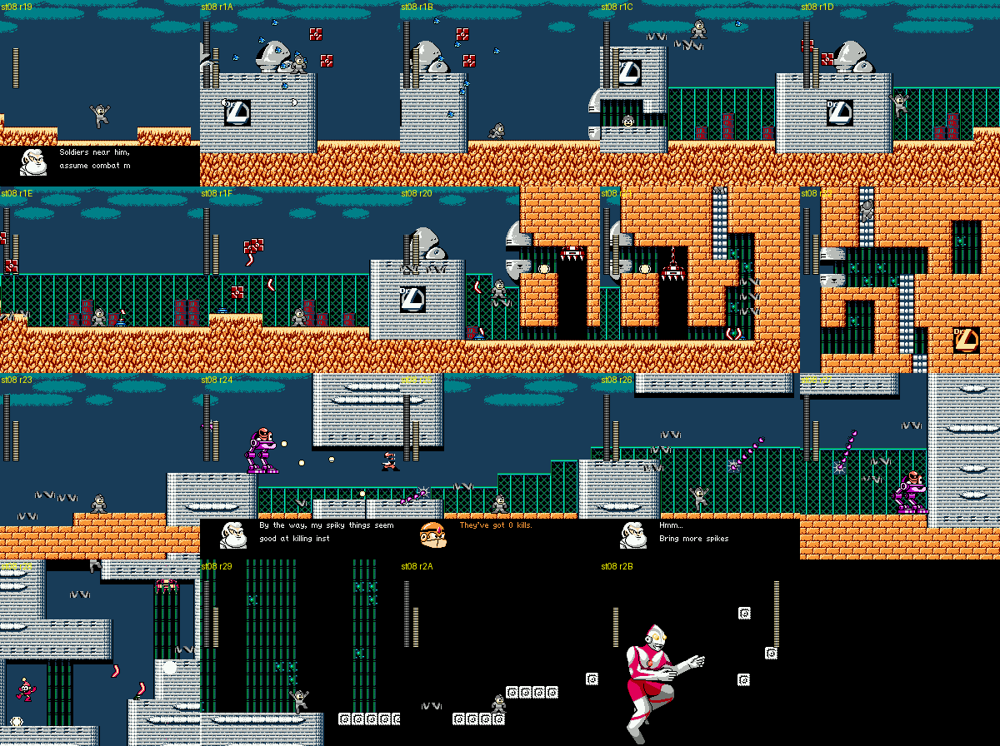
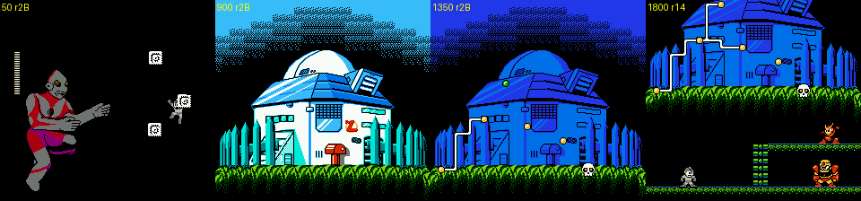
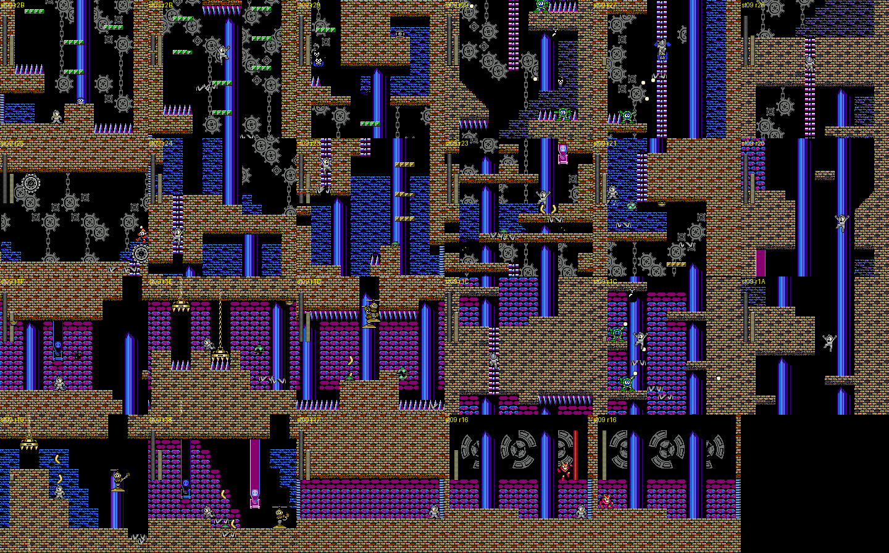
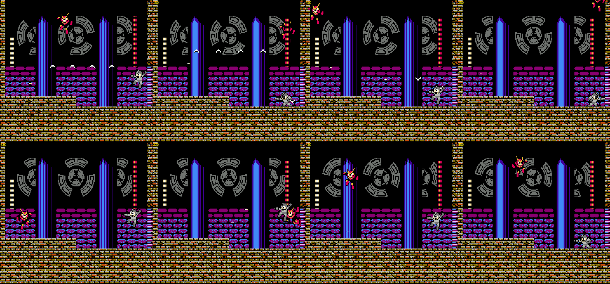

# Rockman CX: the Dr. Light fortress, final battle and ending (cx-fortress)

Status: IN PROGRESS (rewritten as I go so an interruption loses little).

Scope: Dr. Light fortress stages 1-6 (stage IDs `$08`-`$0D`), the fortress map and its route choice, every fortress
boss, the final stage `$0E` (giant Dr. Light) and the ending. Tags: **[seen]** observed in the emulator, **[code]**
disassembly or ROM data, **[text]** in-game text, **[doc]** readme, **[guess]** speculation. ROM `roms/cx_en.nes`.
RAM names follow `docs/research/cx/cheats.md`. Dialogue transcriptions (EN and JP) are in `docs/research/cx/text.md`
§2.6-2.7; this doc cites the script numbers s00-s25 from there.

## 0. Structure

| Stage ID | Fortress stage | Shares bank with | Rooms | Restart rooms [code `$BB06`] | Boss |
|---|---|---|---|---|---|
| `$08` | Light 1, Light's lab under attack | Cheat Man (bank 0) | `$19`-`$2B` | `$19`, `$21` | **Ultraman** (room `$2B`) |
| `$09` | Light 2, the clock tower (optional) | Air Man (bank 1) | `$2B` down to `$16` | `$17`, `$20`, `$2B` | **Quick Man**, brainwashed (room `$16`) |
| `$0A` | Light 3, the electrified base | Whispy Woods (bank 2) | `$18`-`$2B` | `$18`, `$21`, `$28` | **Guts Tank**, two phases (room `$2B`) |
| `$0B` | Light 4, water works | Fire Mario (bank 3) | `$17`-`$2B` | `$17`, `$21`, `$2A` | |
| `$0C` | Light 5, the teleport-system lab | Yoshino Man (bank 4) | `$18`-`$29` | `$18`, `$1D`, `$29` | (mid-boss: green grasshopper robot) |
| `$0D` | Light 6, Light's inner lab | Mega Man (bank 5) | `$15`-`$2B` | `$15`, `$16`, `$20` | **Dr. Light himself**, twice |
| `$0E` | final stage | Kamen Rider (bank 6) | `$18`-`$28` | `$18`, `$1A`, `$28` | **giant Dr. Light** |

Segment layouts (first room, last room, exit) from the bank's segment table `$B400` [code, `stagemap.segments`]:

- Light 1: `$19-$20` up, `$21` up, `$22-$26` up, `$27` up, `$28-$2B` end. A rightward walk with short climbs.
- Light 2: starts at room `$2B` and the room numbers **count down** as you climb: `$2B` .. `$27` are one-screen
  vertical rooms, then `$25-$26`, `$21-$24`, `$1D-$20`, `$1B-$1C`, `$18-$1A`, `$17`, `$16` [seen].
- Light 3: `$18-$1A` down, `$1B-$1C` right, `$1D` down, ... a zig-zag of one- and two-screen segments to `$2B`.
- Light 6: `$15` (one locked screen), `$16-$1D` right, `$1E`, `$1F`, `$20-$2B`.
- Final: `$18-$1A` up, `$1B` up, `$1C` up, `$1D-$20` down, `$21-$23`, `$24` right, `$25`.

Light stages run with all eight robot-master bits set (`$9A = $FF`) and the fortress progress in `$9B` bits 4-6
(= stage − 8) [code, cheats.md §5].

**Damage tables** (boss HP lost in a fixed time with each weapon, jump-and-shoot policy under godmode, energy frozen;
`dmgtest.py`) [seen]. Numbers in brackets are damage per hit.

| Weapon | Ultraman (1200 f) | Quick Man (1200 f) | Guts Tank ph.1 (1500 f) | Dr. Light, room `$15` (900 f) |
|---|---|---|---|---|
| buster | 15 (1) | 9 (1) | 5 (1) | 5 (1) |
| Cheat Saber | **40 (14)** | **40 (40)** | 40 (8) | **40 (40)** |
| Dead Ringer | 11 (1) | 8 (1) | 9 (1) | 7 (1) |
| Ringo Shield | 16 (1) | 6 (2) | 0 | 0 |
| Fire Ball | 0 | 21 (1) | 0 | 16 (1) |
| Print Cutter | 18 (1) | 20 (2) | 0 | 8 (1) |
| Mega Buster | **0** | 3 (1) | 3 (1) | **0** |
| Rider Kick | **0** | 6 (3) | 2 (1) | 4 (2) |
| Power Bomb | 30 (2) | 6 (2) | **28 (4)** | 8 (2) |

- **Cheat Saber one-shots Quick Man and Dr. Light** (40 damage in one hit) and does 14 to Ultraman, 8 to Guts Tank.
  The weapon of Cheat Man is literally a cheat.
- **Rock's own Mega Buster does nothing to Dr. Light** (and nothing to Ultraman); Rider Kick does nothing to Ultraman.
  The heroes' weapons will not hurt their own side [guess at intent; the zeros are seen].
- Every fortress boss has 40 HP (`$28`) per bar.

---

## 1. Light 1 (stage `$08`): Dr. Light's lab under attack

*Light 1, one frame per room in the order you reach them (rooms `$19`-`$2B`), from the explorer's first visit of each
room: the s00 dialogue at the lab door, the domed Dr. L bunkers, the brick block-house, s01 (the spike-death counter)
over the Sniper Armor area, the dark block room, and Ultraman.*

**Look** [seen]: night-blue sky with teal clouds over orange sand; grey bunkers with an observatory dome and a "Dr.L"
emblem (Dr. Light's lab as a military compound), green chain-link fences, stacks of red crates. Mid-stage you go
through an orange brick block-house with ladders (rooms `$20`-`$22`), then out again past grey concrete buildings
(`$23`-`$27`), into a grey interior with green bars (`$28`-`$29`) and a black room of floating white blocks
(`$2A`-`$2B`).

**Story** [seen][text]: the stage opens with **s00** at room `$19`: Roll warns "W...Wily UFO is here!", Light orders
his soldiers into combat mode, Rock (Mega Man) warns they will come "over and over again", and Light calls
"Ultra Man, SMASH him." / "Dwah!!". Around room `$24` comes **s01**: Light: "By the way, my spiky things seem good at
killing instantly." Guts Man: "They've got 0 kills." Light: "Hmm... Bring more spikes." The number is the live
spike-death counter `$98` (text.md §2.6); the explorer had not touched a spike, so it says 0 [seen].

**Enemies** [seen][code, enemy table]: Pierrobots (the clown on a gear, `$29`) on the bunker roofs; flocks of small
blue birds (`$92`, a CX type) and falling red crate blocks; RM2's **Sniper Armor** (`$4F`, the purple walker with a
Sniper Joe inside, firing) in rooms `$21`, `$24`, `$27`; pink spiked maces on chains (`$81`) in rooms `$23`-`$26`;
ceiling claws in the block-house.

**Instant Floor is required** [seen]: the first bunker in room `$1A` is a wall about 90 px tall that a normal jump
cannot clear. The autoplayer stood at it for 3,000 frames; with item 1 (Instant Floor) equipped, jump + B at the apex
puts a platform under you and a second jump lands on the roof (`floor_test.py`). The fortress is designed around the
items the player has had since the opening.

### Boss: Ultraman (object `$70`, room `$2B`) [seen]

- The arena is RM2's **Mecha Dragon** arena: a black screen with single white blocks (object `$63`) floating over a
  bottomless pit. The blocks drift as you cross rooms `$2A`-`$2B`; script `$1D` (object `$41` at x `$FE`) starts the
  fight when you reach the right side. Ultraman flies in from the left exactly where the dragon would, a sprite about
  64x96 px in his flying pose, and the boss bar fills slowly (about 600 frames) while three blocks settle into a
  triangle at the right (x `$B5`-`$D6`).
- Pattern: he hovers and bobs, drifting toward you and back (x `$41`-`$B4`, y `$63`-`$72`). In 3,000 frames he fired
  nothing; the danger is his body and the pit. His chest **color timer** alternates blue and red during the fight
  (Ultraman's "time is running out" signal) [seen; the link to his HP was not checked].
- 40 HP; the buster takes 1 per hit with long flashing between hits (40 → 21 in 3,000 frames of steady fire).
- Death: no explosion. He **turns grey and fades out**, then the player beams out [seen].

The explorer once **reset the game** in room `$2B` (power-on logo, then the intro): an Instant Floor object (type `$09`)
in a player-weapon slot changed type to `$02`/`$01`, then to garbage `$F6`/`$F5`, and the CPU ran off into `$801C`
until the reset [seen, `hunt_reset.py`]. This happened with the weapon byte `$A9` frozen to the floor item by my cheat,
so it may be a cheat artefact rather than a real bug [guess].

---

## 2. The fortress map [seen]

*After Ultraman: Dr. Light's house by day, then at night with the route drawn up its walls toward a skull, and the
walkable route-choice scene under it (fake Rockman, ladder, Quick Man on the ledge, Guts Man on the floor).*

After each fortress stage: a white flash, then **Dr. Light's house** (the series' white domed lab with the red mushroom
mailbox) by day. It fades to night blue and a **route** is drawn up the walls dot by dot, ending at a **skull** at the
top; a blinking green dot marks your position. After Light 1 (progress 1) a small walkable scene appears under the
house: the fake Rockman on the floor at the left, a ladder up to a ledge where **Quick Man** stands, and **Guts Man**
on the floor at the right. Walking into Quick Man (up the ladder) enters Light 2; walking into Guts Man enters Light 3
and skips Light 2 (cheats.md §5, `cx.fortress_route`). After Light 3 the map plays by itself and drops you into
Light 4 [seen: `a_guts.png`]. This is RM2's Wily-castle map, re-drawn as Light's house.

---

## 3. Light 2 (stage `$09`): the clock tower where Quick Man is held

*Light 2 bottom to top (rooms `$2B` → `$17`), then the boss room `$16` and the moment after the fight when you are
Quick Man.*

**Route** [seen]: you enter at the **bottom** of a tower (room `$2B`) and climb; the room counter counts down, so the
stage data is stored top-first. One-screen vertical shafts (`$2B`-`$27`), then short horizontal stretches that go left
(`$26`-`$25`, `$24`-`$21`, ...), alternating with climbs, to `$17` and the boss room `$16`.

**Look** [seen]: the inside of a clock tower: brown brick, huge grey **gears and hanging chains** in the background,
violet crystal pillars, magenta cobbled ledges, blue stone, and rows of spikes. Guts Man's line in Light 3 ("You
should be in our clocktower...!") names it.

**Enemies and hazards** [seen]: Pierrobots on gears, small green round hopping robots, spiked yellow **crushers** that
drop on chains (`$1E`-`$1C`), propeller robots, yellow crescent projectiles, and spike pits.

### Boss: Quick Man, brainwashed (room `$16`) [seen][text]

*Quick Man in the clock-face room: he jumps off the top of the screen and throws a line of four or five Quick
Boomerangs that fly across the room in formation.*

- Entering plays **s02**: Light: "Look who I found wandering around! My friend here has a small problem with you. It
  seems that you let him die and he's not too happy about that! ... Now I think it is time that he repays the favor!"
  The friend is Quick Man, who scouted ahead in the opening and was captured.
- The room is a clock face (gear rings) between two crystal pillars. Quick Man jumps very high (off the top of the
  screen) and throws **lines of four or five boomerangs** that sweep the room horizontally and diagonally, far more than
  RM2's three. 40 HP; the buster does 1 per hit, the Cheat Saber kills him in one hit.
- After the fight, **s03**: "Quick Man... Do you remember me...?" / "Yea... I guess so... Sorry to cause you so much
  trouble." / "Go back to our lab first!" / "(Can't I teleport...!?)": the fake Rockman tries to beam out four times
  and fails. Then **you are Quick Man** (`$9B` bit 7 set, max HP 40) and have to walk back out of the tower: room
  `$16` → `$17` → `$18` → ... back down [seen: `light2_quickman.state`, `rec_qm_esc.png`]. This is the "only stage
  where `$9B` bit 7 survives death" from cheats.md.

---

## 4. Light 3 (stage `$0A`): the electrified base

(stage tour to be filled)

**Look** [seen]: teal machinery walls with pink domed caps, dark corridors, and **yellow lightning-bolt circuits** that
run through the walls with a white spark travelling along them (rooms `$1D`-`$27`, object `$99` at (`$80`,`$80`) plus
script `$25` in each of them). This is s05's joke made into level design: Guts Man: "There's a short circuit zap!! Our
base's gonna ruin!!" Light: "Don't worry, Guts. ...We're now SERIOUS." (JP: he is leaking the current *on purpose*).
A sign reading **"USE"** hangs in room `$22`.

### Boss: Guts Tank, two phases (room `$2B`) [seen][text]

- RM2's Wily-3 **Guts Tank**, with the face replaced by a huge **Guts Man** riding on top (s06: "I'm going to STOP
  you with... The Fierce Dr.Light's Guts Tank!!").
- **Phase 1** (40 HP): the tank rolls forward and back, Guts Man's bare head is the target; it fires white ring
  bullets (object `$09`, about 170 in 1,500 frames) and drops small red Met-like walkers (`$75`, a CX type). Only
  jumping shots at the head hurt it. Power Bomb is the weakness (4 per hit).
- **Phase 2**: at 0 HP the tank flashes white, Guts Man **puts on a gold welding-mask helmet**, and the bar refills
  to 40. New attacks: a huge diagonal **striped beam** sweeping across the screen, a vertical column of three yellow
  orbs, ring bullets and the red walkers.
- Death: the tank explodes and Guts Man's **bare head bounces along the floor** for a few seconds (s23 "Where... did
  that... power come from...!?"). Then the map, which plays by itself, and Light 4.

---

## 5. Light 4 (stage `$0B`)

(to be filled) Red-brick lab with tall water tanks whose water level rises and falls, ring-studded platforms over pits
[seen: `rec_light4.png`].

---

## 6. Light 5 (stage `$0C`): the teleport-system lab

(to be filled) Green-grid walls with the "DR.LIGHT TELEPORT SYSTEM" monitors and orange girders. Room `$1A` is a
vertical shaft lined with ledges on which sit **rows of small blue Mega-Man-like soldiers** that shoot pellets: Light
mass-produces Rocks too [seen: `rec_light5.png`; identification is a guess].

**Mid-boss, room `$24`** (not scroll-locked, `$14-$15` = `$24-$26`) [seen]: a green grasshopper-like robot with big red
compound eyes and antennae (object states `$53`/`$54`/`$55`), leaping in high arcs, curling into a ball in the air,
crouching and firing a red shot. 40 HP, the buster takes 1 per hit. When it dies the stage simply continues.

---

## 7. Light 6 (stage `$0D`): Dr. Light in person

**Round 1, room `$15`** [seen][text]: the stage **begins with the Dr. Light fight** (one locked screen, "DR.LIGHT
TELEPORT SYSTEM" monitors on the wall, a teleporter capsule at the right). Light is a small white old man in a lab
coat who runs, jumps and shoots blue energy balls; 40 HP, 1 per buster hit.

- Each time you die, Light **beams back in through the capsule** and says a new line from the round table at
  `$30:8584` (s10-s24). Deaths in one run gave s17, s16, s19, s18, s11, s19, s11 in that order, so the line is not
  simply sequential [seen: `l6b.log`]. Lines include the Three Laws ("you defy The Three Laws of Robotics?"), TF2's
  Scout ("Grass grows, birds fly, sun shines, and... I crash you."), Undertale's Sans ("it's a beautiful day
  outside..."), a Dragon Punch warning, and **s12, a Yes/No question "So, if you could just do me a favor and off
  yourself, that'd be great."** that waits for your answer (Yes kills you, text.md).
- **s16 offers an upgrade mid-fight**: "Well, step into this capsule. and receive a mid-air acceleration system to
  boost your mobility." The villain hands you a Mega Man X capsule.
- Beating him plays **s21**, the Wily **dogeza**: "*Cough* *cough* ...I am defeated... I have no choice...... but to
  throw myself... on your... MERCY!" (Light kneels). Hero: "That's right, Dr.Light! Your justice is finally..."
  Light: "Phew, it was worth a shot." He steps into the capsule and teleports away. Hero: "We will capture you!"
  Light: "Remember, you are still in my lab." Then the screen unlocks to room `$16` [seen: `a_l6.png`].

**Rooms `$16`-`$1D`** [seen]: green-grid corridors lined with **rows of grey spike mines** (the spikes Light ordered in
s01), a low tunnel holding a row of five 1-up heads, Sniper Armors and Sniper Joes.

**Round 2, room `$2B`** [seen: from cheats.md's `light6_boss` state]: after a drop down a shaft of spike mines (room
`$20`) and a green Dr. L logo, you land in the teleporter hall. Light beams in and says **s24**: "Heh heh heh... You
respawn repeatedly while I heal myself permanently. How amazing story!" His bar fills to 40 and then **drops to 0 in
8 frames** [seen in that state]. **s25**: "Awww, it cannot be..." / "The war is now over." / "Ha! I have the last
plan... It is... to become much bigger!" He steps into the capsule, a white flash, and stage `$0E` starts.

---

## 8. Final stage (`$0E`): giant Dr. Light

(in progress) Room `$18`: a **giant Dr. Light drawn in the background** (black and white, beard, glowing orange eyes,
fists) behind a strip of floor over a cyan machine. He is not an object: the boss bar stays empty and the only objects
are falling rocks (`$A3`, up to eight), smoke puffs (`$A4`) and a fist hitbox (`$A5`) [seen]. Attacks in 3,000
frames: rocks rain from above; he **punches holes in the floor**, leaving pillars over a pit; he **grows**, the face
scaling up until it fills the screen, then shrinks back; a fist swing with white smoke; a stack of orange blocks
thrown [seen: `b_final.png`].

---

## Lessons for Rockman 6 GP

(to be filled)
