# Rockman CX: the Dr. Light fortress, final battle and ending (cx-fortress)

Status: complete for this run (the open points are listed in §11).

Scope: Dr. Light fortress stages 1-6 (stage IDs `$08`-`$0D`), the fortress map and its route choice, every fortress
boss, the final stage `$0E` (giant Dr. Light) and the ending. Tags: **[seen]** observed in the emulator, **[code]**
disassembly or ROM data, **[text]** in-game text, **[doc]** readme, **[guess]** speculation. ROM `roms/cx_en.nes`.
RAM names follow `docs/research/cx/cheats.md`. Dialogue transcriptions (EN and JP) are in `docs/research/cx/text.md`
§2.6-2.7; this doc cites the script numbers s00-s25 from there.

**How crazy it gets, in short:** Light 1's boss is **Ultraman** in the Mecha Dragon arena; Light 2 is a clock tower
where you free a brainwashed **Quick Man** and then *become* him for the walk out; Light 3's **Guts Tank** puts a
helmet on for round two; Light 5 is a teleporter refight hall where Cheat Man's rematch is a **Dragon Quest
battle against a floating rock band**; Light 6 opens with **Dr. Light himself**, who taunts you after every death,
asks you to kill yourself (Yes/No), offers you an X-style capsule, and begs for mercy like Wily; the final boss is a
**giant background-drawn Dr. Light that only the Print Cutter and Power Bomb can hurt**; and the **staff roll is a
playable level** with 99 lives.

## 0. Structure

| Stage ID | Fortress stage | Shares bank with | Rooms | Restart rooms [code `$BB06`] | Boss |
|---|---|---|---|---|---|
| `$08` | Light 1, Light's lab under attack | Cheat Man (bank 0) | `$19`-`$2B` | `$19`, `$21` | **Ultraman** (room `$2B`) |
| `$09` | Light 2, the clock tower (optional) | Air Man (bank 1) | `$2B` down to `$16` | `$17`, `$20`, `$2B` | **Quick Man**, brainwashed (room `$16`) |
| `$0A` | Light 3, the electrified base | Whispy Woods (bank 2) | `$18`-`$2B` | `$18`, `$21`, `$28` | **Guts Tank**, two phases (room `$2B`) |
| `$0B` | Light 4, water works | Fire Mario (bank 3) | `$17`-`$2B` | `$17`, `$21`, `$2A` | **the masked robot** (room `$2B`) |
| `$0C` | Light 5, teleporter refights | Yoshino Man (bank 4) | `$18`-`$2A` | `$18`, `$1D`, `$29` | five robot-master **refights**; **(corrected by critic)** all eight refights, then **Rush** (room `$2A`, §6.1) |
| `$0D` | Light 6, Light's inner lab | Mega Man (bank 5) | `$15`-`$2B` | `$15`, `$16`, `$20` | **Dr. Light himself**, twice |
| `$0E` | final stage + staff roll | Kamen Rider (bank 6) | `$18`-`$28` | `$18`, `$1A`, `$28` | **giant Dr. Light** (only Print Cutter / Power Bomb hurt him) |

Segment layouts (first room, last room, exit) from the bank's segment table `$B400` [code, `stagemap.segments`]:

- Light 1: `$19-$20` up, `$21` up, `$22-$26` up, `$27` up, `$28-$2B` end. A rightward walk with short climbs.
- Light 2: starts at room `$2B` and the room numbers **count down** as you climb: `$2B` .. `$27` are one-screen
  vertical rooms, then `$25-$26`, `$21-$24`, `$1D-$20`, `$1B-$1C`, `$18-$1A`, `$17`, `$16` [seen]. Its checkpoints
  work in that reverse order: a death in room `$27` restarts at `$2B`, a death in `$1E` at `$20` [seen].
- Light 3: `$18-$1A` down, `$1B-$1C` right, `$1D` down, ... a zig-zag of one- and two-screen segments to `$2B`.
- Light 6: `$15` (one locked screen), `$16-$1D` right, `$1E`, `$1F`, `$20-$2B`.
- Final: `$18-$1A` up, `$1B` up, `$1C` up, `$1D-$20` down, `$21-$23`, `$24` right, `$25`.

Light stages run with all eight robot-master bits set (`$9A = $FF`) and the fortress progress in `$9B` bits 4-6
(= stage − 8) [code, cheats.md §5].

**Damage tables** (boss HP lost in a fixed time with each weapon, jump-and-shoot policy under godmode, energy frozen;
`dmgtest.py`) [seen]. Numbers in brackets are damage per hit.

| Weapon | Ultraman (1200 f) | Quick Man (1200 f) | Guts Tank ph.1 (1500 f) | Dr. Light, room `$15` (900 f) |
|---|---|---|---|---|
| buster | 15 (1) | 9 (1) | 5 (1) | 5 (1) |
| Cheat Saber | **40 (14)** | **40 (40)** | 40 (8) | **40 (40)** |
| Dead Ringer | 11 (1) | 8 (1) | 9 (1) | 7 (1) |
| Ringo Shield | 16 (1) | 6 (2) | 0 | 0 |
| Fire Ball | 0 | 21 (1) | 0 | 16 (1) |
| Print Cutter | 18 (1) | 20 (2) | 0 | 8 (1) |
| Mega Buster | **0** | 3 (1) | 3 (1) | **0** |
| Rider Kick | **0** | 6 (3) | 2 (1) | 4 (2) |
| Power Bomb | 30 (2) | 6 (2) | **28 (4)** | 8 (2) |

- **Cheat Saber one-shots Quick Man and Dr. Light** (40 damage in one hit) and does 14 to Ultraman, 8 to Guts Tank.
  The weapon of Cheat Man is literally a cheat.
  **(corrected by critic)** Not on Dr. Light: the Saber's boss-hit handler (`$17:A668`) finds a 0 in its fortress
  table for boss `$0D` and falls through to `STY $06C0`, so a Saber hit on Light **sets the player's HP to 13** and
  leaves Light at 40. Seen 9 times in 40 point-blank slashes from `light6.state` (player HP 20 → 13, boss 40 → 40;
  the other attempts missed or took 3 of contact damage; `build/research/cx/cx-critic/saber4.py`). The "40 (40)" in
  the table above was probably Light's bar resetting at a respawn, which happens every time he kills you.
  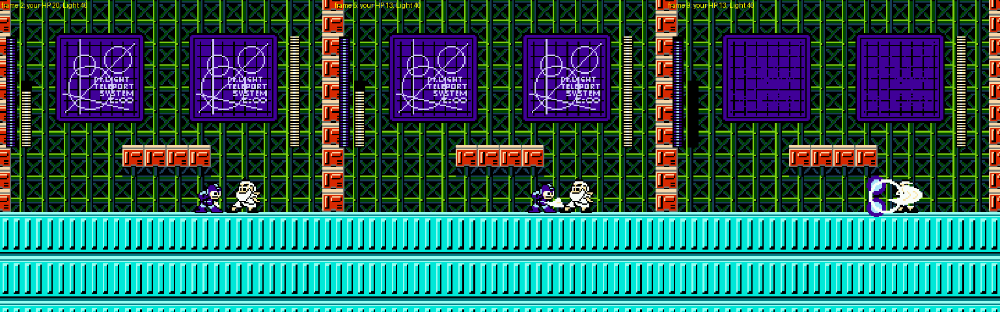
  *Point-blank Cheat Saber on Dr. Light: the slash connects, your HP drops 20 → 13, his bar stays full.*
- **Rock's own Mega Buster does nothing to Dr. Light** (and nothing to Ultraman); Rider Kick does nothing to Ultraman.
  The heroes' weapons will not hurt their own side [guess at intent; the zeros are seen].
- Every fortress boss has 40 HP (`$28`) per bar.

**Boss index `$B3`** [seen: read in every boss room]: the boss-scene code in bank `$16` dispatches on `$B3` through the
table at `$16:803D` (15 entries) [code]. RM2 used it for its six Wily bosses; CX numbers all fifteen of its bosses:

| `$B3` | Boss | `$B3` | Boss |
|---|---|---|---|
| 0-7 | the eight robot masters, in stage order (also their Light 5 refights) | `$0B` | Light 4's masked robot |
| 8 | Ultraman (Light 1) | `$0C` | **not met in this run**: the routine that spawns s08, Light's "pet" (§11). **(corrected by critic)** It is **Rush**, Light 5's real boss after all eight refights (§6.1) |
| 9 | Quick Man (Light 2) | `$0D` | Dr. Light (Light 6) |
| `$0A` | Guts Tank (Light 3) | `$0E` | Guts Man (opening stage) |

---

## 1. Light 1 (stage `$08`): Dr. Light's lab under attack

*Light 1, one frame per room in the order you reach them (rooms `$19`-`$2B`), from the explorer's first visit of each
room: the s00 dialogue at the lab door, the domed Dr. L bunkers, the brick block-house, s01 (the spike-death counter)
over the Sniper Armor area, the dark block room, and Ultraman.*

**Look** [seen]: night-blue sky with teal clouds over orange sand; grey bunkers with an observatory dome and a "Dr.L"
emblem (Dr. Light's lab as a military compound), green chain-link fences, stacks of red crates. Mid-stage you go
through an orange brick block-house with ladders (rooms `$20`-`$22`), then out again past grey concrete buildings
(`$23`-`$27`), into a grey interior with green bars (`$28`-`$29`) and a black room of floating white blocks
(`$2A`-`$2B`).

**Story** [seen][text]: the stage opens with **s00** at room `$19`: Roll warns "W...Wily UFO is here!", Light orders
his soldiers into combat mode, Rock (Mega Man) warns they will come "over and over again", and Light calls
"Ultra Man, SMASH him." / "Dwah!!". Around room `$24` comes **s01**: Light: "By the way, my spiky things seem good at
killing instantly." Guts Man: "They've got 0 kills." Light: "Hmm... Bring more spikes." The number is the live
spike-death counter `$98` (text.md §2.6); the explorer had not touched a spike, so it says 0 [seen].

**Enemies** [seen][code, enemy table]: Pierrobots (the clown on a gear, `$29`) on the bunker roofs; flocks of small
blue birds (`$92`, a CX type) and falling red crate blocks; RM2's **Sniper Armor** (`$4F`, the purple walker with a
Sniper Joe inside, firing) in rooms `$21`, `$24`, `$27`; pink spiked maces on chains (`$81`) in rooms `$23`-`$26`;
ceiling claws in the block-house.

**Instant Floor is required** [seen]: the first bunker in room `$1A` is a wall about 90 px tall that a normal jump
cannot clear. The autoplayer stood at it for 3,000 frames; with item 1 (Instant Floor) equipped, jump + B at the apex
puts a platform under you and a second jump lands on the roof (`floor_test.py`). The fortress is designed around the
items the player has had since the opening.

### Boss: Ultraman (object `$70`, room `$2B`) [seen]

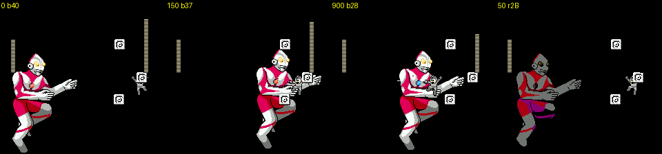
*Ultraman over the floating blocks (the player hovers by cheat), flashing when hit, and his grey fade-out on death.*

- The arena is RM2's **Mecha Dragon** arena: a black screen with single white blocks (object `$63`) floating over a
  bottomless pit. The blocks drift as you cross rooms `$2A`-`$2B`; script `$1D` (object `$41` at x `$FE`) starts the
  fight when you reach the right side. Ultraman flies in from the left exactly where the dragon would, a sprite about
  64x96 px in his flying pose, and the boss bar fills slowly (about 600 frames) while three blocks settle into a
  triangle at the right (x `$B5`-`$D6`).
- Pattern: he hovers and bobs, drifting toward you and back (x `$41`-`$B4`, y `$63`-`$72`). In 3,000 frames he fired
  nothing; the danger is his body and the pit. His chest **color timer** alternates blue and red during the fight
  (Ultraman's "time is running out" signal) [seen; the link to his HP was not checked].
- 40 HP; the buster takes 1 per hit with long flashing between hits (40 → 21 in 3,000 frames of steady fire).
- Death: no explosion. He **turns grey and fades out**, then the player beams out [seen].

The explorer once **reset the game** in room `$2B` (power-on logo, then the intro): an Instant Floor object (type `$09`)
in a player-weapon slot changed type to `$02`/`$01`, then to garbage `$F6`/`$F5`, and the CPU ran off into `$801C`
until the reset [seen, `hunt_reset.py`]. This happened with the weapon byte `$A9` frozen to the floor item by my cheat,
so it may be a cheat artefact rather than a real bug [guess].

---

## 2. The fortress map [seen]

*After Ultraman: Dr. Light's house by day, then at night with the route drawn up its walls toward a skull, and the
walkable route-choice scene under it (fake Rockman, ladder, Quick Man on the ledge, Guts Man on the floor).*

After each fortress stage: a white flash, then **Dr. Light's house** (the series' white domed lab with the red mushroom
mailbox) by day. It fades to night blue and a **route** is drawn up the walls dot by dot, ending at a **skull** at the
top; a blinking green dot marks your position. After Light 1 (progress 1) a small walkable scene appears under the
house: the fake Rockman on the floor at the left, a ladder up to a ledge where **Quick Man** stands, and **Guts Man**
on the floor at the right. Walking into Quick Man (up the ladder) enters Light 2; walking into Guts Man enters Light 3
and skips Light 2 (cheats.md §5, `cx.fortress_route`). After Light 3 the map plays by itself and drops you into
Light 4 [seen: `a_guts.png`]. This is RM2's Wily-castle map, re-drawn as Light's house.

---

## 3. Light 2 (stage `$09`): the clock tower where Quick Man is held

*Light 2 bottom to top (rooms `$2B` → `$17`), then the boss room `$16` and the moment after the fight when you are
Quick Man.*

**Route** [seen]: you enter at the **bottom** of a tower (room `$2B`) and climb; the room counter counts down, so the
stage data is stored top-first. One-screen vertical shafts (`$2B`-`$27`), then short horizontal stretches that go left
(`$26`-`$25`, `$24`-`$21`, ...), alternating with climbs, to `$17` and the boss room `$16`.

**Look** [seen]: the inside of a clock tower: brown brick, huge grey **gears and hanging chains** in the background,
violet crystal pillars, magenta cobbled ledges, blue stone, and rows of spikes. Guts Man's line in Light 3 ("You
should be in our clocktower...!") names it.

**Enemies and hazards** [seen]: Pierrobots on gears, small green round hopping robots, spiked yellow **crushers** that
drop on chains (`$1E`-`$1C`), propeller robots, yellow crescent projectiles, and spike pits.

### Boss: Quick Man, brainwashed (room `$16`) [seen][text]

*Quick Man in the clock-face room: he jumps off the top of the screen and throws a line of four or five Quick
Boomerangs that fly across the room in formation.*

- Entering plays **s02**: Light: "Look who I found wandering around! My friend here has a small problem with you. It
  seems that you let him die and he's not too happy about that! ... Now I think it is time that he repays the favor!"
  The friend is Quick Man, who scouted ahead in the opening and was captured.
- The room is a clock face (gear rings) between two crystal pillars. Quick Man jumps very high (off the top of the
  screen) and throws **lines of four or five boomerangs** that sweep the room horizontally and diagonally, far more than
  RM2's three. 40 HP; the buster does 1 per hit, the Cheat Saber kills him in one hit.
- After the fight, **s03**: "Quick Man... Do you remember me...?" / "Yea... I guess so... Sorry to cause you so much
  trouble." / "Go back to our lab first!" / "(Can't I teleport...!?)": the fake Rockman tries to beam out four times
  and fails. Then **you are Quick Man** (`$9B` bit 7 set, max HP 40) and have to walk back out of the tower: room
  `$16` → `$17` → `$18` → ... back down [seen: `light2_quickman.state`, `rec_qm_esc.png`]. This is the "only stage
  where `$9B` bit 7 survives death" from cheats.md.
- The rescue also sets **`$9B` bit 3** (`$9B` = `$98` after the fight = Quick Man playing + progress 1 + bit 3)
  [seen]. With bit 3 set, the pause menu shows a **Quick Man portrait** in its bottom panel (drawn at `$1F:A24F`
  when bit 3 is set and `$0140` ≠ 0) [code][seen: `menu_qm.png`]. This is s04's "Let's split out. Call me in the
  menu if you need help." and Quick Man's pre-rendered reply "Ok, I'm on my way!" (text.md §3). I could not make
  the call happen by menu input (A, B or START on the bottom row did nothing) [seen]; `$1F:BBCA` spawns a script when
  `$0141` = `$14` and bit 3 is set [code], which looks like the call itself [guess].
- The escape back down the tower as Quick Man was played to room `$25` (explorer, rooms `$16` → `$25` in order)
  [seen]; where it ends and where s04 plays was not reached.
  **(resolved by critic)** The escape ends where the stage began. Script `$22` (object `$41` at room `$2B`, x `$90`;
  code `$25:B317`) waits for Quick Man (`$9B` bit 7) standing on the floor at Y `$C4` of room `$2B`, then freezes
  input, walks him left off the screen, restores max HP from the save, **forces `$9B = $2F`** (Quick Man off, bit 3
  "Quick Man joined", fortress progress 2, and all three item-upgrade bits) and clears the stage [code]. A Go-Explore
  run from the room-`$20` restart walked `$20` → `$2B` in 370,000 frames and the stage changed [seen,
  `build/research/cx/cx-critic/p_l2qm/`]. A Quick Man death in Light 2 restarts at room `$20` whatever room is held.
  The fortress map follows, then **Light 3 opens with s04**: Quick Man stands on the ledge of the first room and says
  "Let's split out. / Call me in the menu if you need help." before beaming away. The trigger is `$1F:BBC7`: at the
  stage start, slot 1's `$0140` field is `$14` and `$9B` bit 3 is set, so it halves that field (so it fires once),
  switches every object off and spawns dialogue s04 [code][seen]. Image: `img/critic_light2_exit_s04.png`.

---

## 4. Light 3 (stage `$0A`): the electrified base

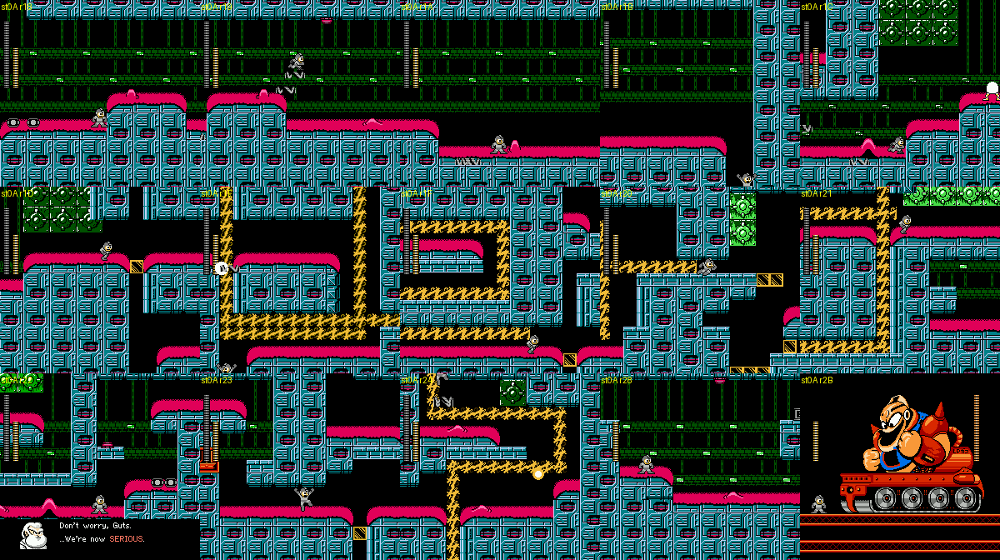
*Light 3 rooms `$18`-`$24` from the explorer (s05 plays in room `$22`), then checkpoint 2 (room `$28`) and the Guts
Tank room `$2B`.*

**Route** [seen]: a zig-zag of short segments, down from `$18`, right, down, then up out of room `$23` into `$24`.
The explorer reached the top of `$23` and crossed into `$24` but always fell back (no foothold where it entered); rooms `$25`-`$27` were not played (the scout's `light3_cp2` restarts at
`$28`).

**Look** [seen]: teal machinery walls with pink domed caps, dark corridors, and **yellow lightning-bolt circuits** that
run through the walls with a white spark travelling along them (rooms `$1D`-`$27`, object `$99` at (`$80`,`$80`) plus
script `$25` in each of them). This is s05's joke made into level design: Guts Man: "There's a short circuit zap!! Our
base's gonna ruin!!" Light: "Don't worry, Guts. ...We're now SERIOUS." (JP: he is leaking the current *on purpose*).
A sign reading **"USE"** hangs in room `$22`.

### Boss: Guts Tank, two phases (room `$2B`) [seen][text]

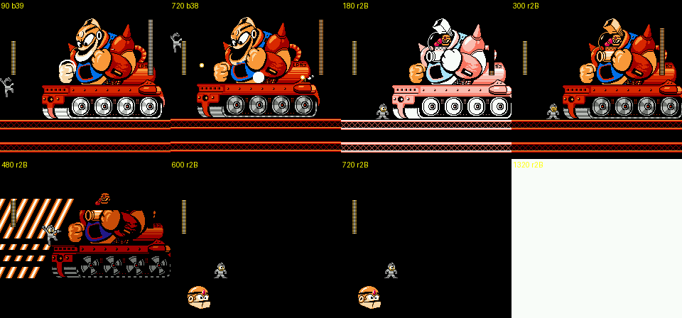
*Phase 1 (Guts Man's bare head, hit flash), phase 2 (white flash, the masked helmet), the striped beam, and Guts Man's
head bouncing after the tank is destroyed.*

- RM2's Wily-3 **Guts Tank**, with the face replaced by a huge **Guts Man** riding on top (s06: "I'm going to STOP
  you with... The Fierce Dr.Light's Guts Tank!!").
- **Phase 1** (40 HP): the tank rolls forward and back, Guts Man's bare head is the target; it fires white ring
  bullets (object `$09`, about 170 in 1,500 frames) and drops small red Met-like walkers (`$75`, a CX type). Only
  jumping shots at the head hurt it. Power Bomb is the weakness (4 per hit).
- **Phase 2**: at 0 HP the tank flashes white, Guts Man **puts on a gold welding-mask helmet**, and the bar refills
  to 40. New attacks: a huge diagonal **striped beam** sweeping across the screen, a vertical column of three yellow
  orbs, ring bullets and the red walkers.
- Death: the tank explodes and Guts Man's **bare head bounces along the floor** for a few seconds (s23 "Where... did
  that... power come from...!?"). Then the map, which plays by itself, and Light 4.

---

## 5. Light 4 (stage `$0B`): the water works

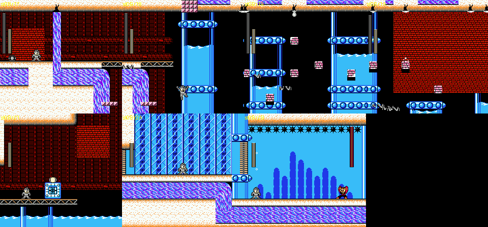
*Rooms `$17`-`$1A` (the water tanks), checkpoint 1 (room `$21`), checkpoint 2 (room `$2A`) and the boss room.*

**Look** [seen: `rec_light4.png`, static map]: red-brick lab with tall glass **water tanks** whose water level rises and
falls, ring-studded blue platforms over bottomless pits, purple pipes; then a flooded section (rooms `$22`-`$2B`) with a
light-blue water background, dark-blue kelp shapes and walls of black spike mines. The autoplayer died in the pits of
room `$18` over and over, and the explorer did not get past room `$1A` in 700,000 frames, so this stage is covered only
from its checkpoints [seen].

**Checkpoint warps** [seen]: falling below the screen does not kill in room `$17` (the scout's `light4_cp*` states are
broken for that reason: room `$22` with limits `$17-$1B`, room `$2A` with limits `$16-$16`). Holding HP at 0 and the
room byte at the target kills the player properly: `cpwarp.py light4 21` gives room `$21` with limits `$21-$21`, and
`cpwarp.py light4 2A` gives room `$2A` with limits `$2A-$2A`.

### Boss: the masked robot (room `$2B`) [seen][text]

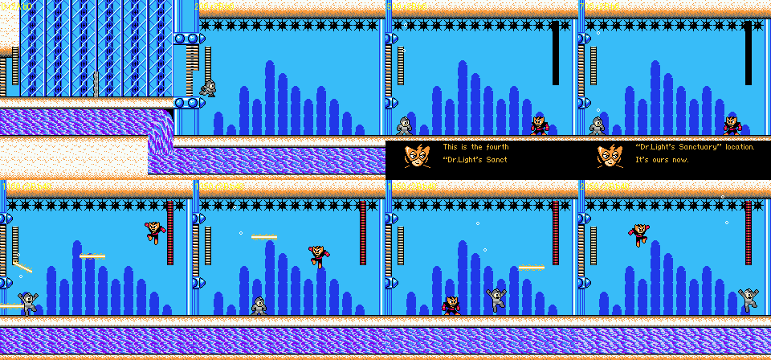
*From checkpoint 2: the flooded corridor, the arena, s07 ("You finally got here. This is the fourth "Dr.Light's
Sanctuary" location. It's ours now. Take it from us, if you dare..."), then the fight.*

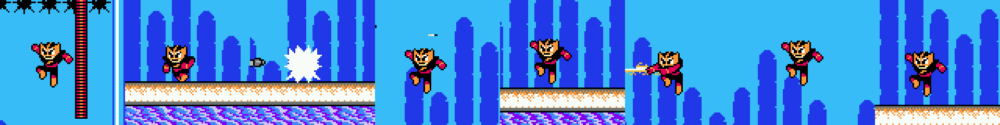
*The boss at 3x: an orange pointed-ear mask, red and black body; a bomb hit and a yellow streak shot.*

- On entry he says **s07**, the variant addressed to the fake Rockman (above). His portrait is the masked face
  (text.md portrait 09). The Quick Man variant of s07 ("You're, um...the robot master who inherits me? You look
  weird..." / "Shut up, you are." / "You are.") would play if you arrive as Quick Man [text].
- The arena is underwater (blue water background with kelp, spike mines along the ceiling, a white floor). He jumps
  high and fast across the room, throws **yellow streak blades** horizontally and diagonally, and lobs a small grey
  bomb that bursts into a white star [seen]. 40 HP, 1 per buster hit.
- Who he is: the text only calls him the robot whose successor is Quick Man; JP "わたしを受けついだロボット" = "the
  robot who inherited me" [text]. The orange mask and red-and-black suit are consistent with a tokusatsu/anime speed
  hero [guess; not identified].
- Death: no dialogue; the fortress map plays and Light 5 starts [seen: `a_l4.png`].

---

## 6. Light 5 (stage `$0C`): the teleporter refights

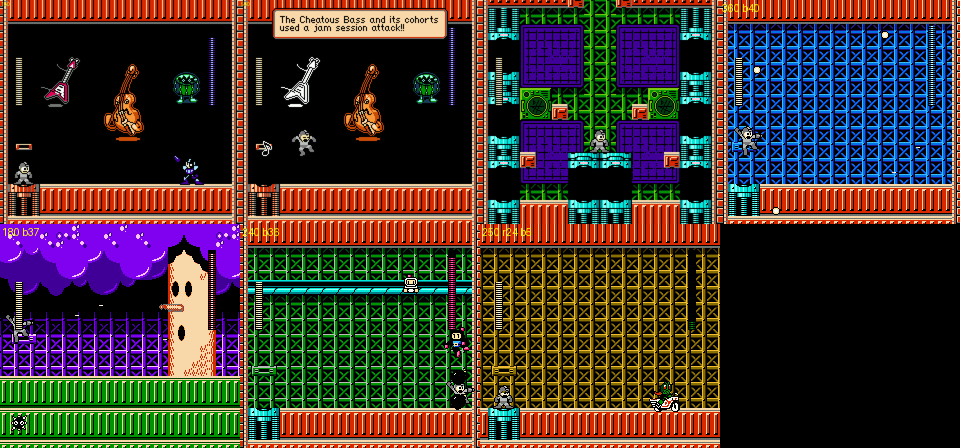
*Top: the jam-session refight in room `$20` ("The Cheatous Bass and its cohorts used a jam session attack!!"), the
teleporter hub, Air Man's refight. Bottom: Whispy Woods, Bomberman, Kamen Rider riding his bike.*

**Route** [seen]: room `$18` (start), then a down-shaft (`$1A`, lim `$1A-$1A`) lined with ledges on which sit **rows of
small blue Mega-Man-like soldiers** shooting pellets [seen; that they are Light's own mass-produced Rocks is a guess], then the **teleporter hub** (room `$1D`, the second restart
point). Every room from `$1D` on is its own one-room segment with no exit flag: the rest of the stage is joined only
by teleporters [code: segment table].

**The hub** [seen]: green girder walls, four "DR.LIGHT TELEPORT SYSTEM" monitors, and cyan teleporter pads on the side
columns. A scan that dropped the player at every point of the screen (`l5_hubs.png`, brute force in this run) found
these destinations:

| Pad (player x, y) | Room | Refight |
|---|---|---|
| upper left (`$20`, `$40`) | `$20` | **"Cheatous Bass" jam session**: a flying-V guitar, a double bass and a drum kit float in a black room while a small purple X-like robot (Cheat Man's figure in a different palette) jumps about; music notes fly at you, and a *Dragon Quest*-style message box announces "The Cheatous Bass and its cohorts used a jam session attack!!". The banner (bank `$2A`, `0x54c00`) was never seen in Cheat Man's own stage by the other agents; this is where it plays |
| upper right / middle left | `$1E` | **Air Man**, invisible as in his own stage (only his little tornadoes show), in a blue-grid room |
| middle right (`$E0`, `$80`) | `$24`-`$26` | **Kamen Rider** on his white Cyclone bike; the room scrolls (`$24-$26`), as his own arena does |
| lower left (`$20`, `$C0`) | `$28` | **Whispy Woods** in a purple-night forest |
| lower right (`$E0`, `$C0`) | `$22` | **Bomberman**, climbing a pole and dropping bombs in a green-grid room |

Five of the eight robot masters are refought here [seen]; Fire Mario, Yoshino Man and Mega Man had no pad in the scan.

**(corrected by critic)** There are **eight** pads, one per robot master, exactly RM2's Wily 5 layout [code][seen].
The hub's setup routine (`$3C:81E0`) spawns a pad object `$BC` for every bit still clear in `$BC` (the refight
mask) at Y `$3C:8266` / X `$826E`: 0 Cheat Man (`$20`,`$44`), 1 Air Man (`$20`,`$84`), 2 Whispy (`$20`,`$C4`),
3 **Fire Mario** (`$70`,`$C4`), 4 **Yoshino Man** (`$90`,`$C4`), 5 **Mega Man** (`$E0`,`$44`), 6 Kamen Rider
(`$E0`,`$84`), 7 Bomberman (`$E0`,`$C4`). The pad fires only when the player stands on it within 4 px of its X
(contact test `$3F:E557`, X tolerance 4); a player dropped onto a pad from above is pushed 8 px aside and misses,
which is why the brute-force scan found only five destinations and why "upper right" looked like a second Air Man pad
(it is Mega Man's). Teleporter `$BA` → `$B3 = $BA − 1`, room from `$3C:824C`: Fire Mario, Yoshino Man and Mega Man
are refought in room `$1E`, the same blue-grid room as Air Man. All eight were entered in the emulator
(`build/research/cx/cx-critic/l5pads.py`; image `img/critic_light5_refights.png`). After a refight the player must
touch the return teleporter (object `$BD`, which appears at the room's left side) to go back.
The second hub (room `$29`, the third restart point) has the same pad table [seen]. After the Whispy Woods refight the
player is beamed back to hub 1 about 100 frames after the kill; `$BC` then holds Whispy's bit (`$04`, bit n = boss n)
and `$B4` = 1, and a second scan found no working pad [seen: `a_l5w.log`, RAM diff]. (Killing Kamen Rider from the
scout's `light5_boss` state left the player in room `$24` for 3,000 frames, probably because that state starts on the
road part of the arena [guess].) How the stage continues after the refights is open (§11).

### 6.1 After the eighth refight: Rush, Light's "pet" (added by critic) [code][seen]

- After each refight `$3C:842B` ORs the boss's bit into `$BC`; while `$BC` ≠ `$FF` the return teleporter leads back
  to hub 1 (room `$1D`), and once all eight are done it leads to **hub 2 (room `$29`)** instead. There the hub routine
  spawns no pads but one **exit teleporter** (object `$BE`) at the top centre (`$80`,`$44`).
- The exit leads to room `$2A`, a black room with brick walls and a cyan floor, `$B3 = $0C`. Dr. Light beams in
  inside his teleporter capsule and says **s08** ("Welcome! I see you destroyed my lab by yourself. Very impressive!
  I could destroy you, but I would not rob my pet of that pleasure. He knows how to deal with wastes. Should you
  live, I will be waiting for you. Don't disappoint me!"). The capsule leaves and **Rush** (red robot dog) runs in;
  the boss bar fills from frame ~1,400 after the teleport.
- **Rush's fight** (40 HP; 1,800 frames recorded under godmode, `build/research/cx/cx-critic/l5pet.py`): he runs and
  jumps along the floor; turns into a **Rush Marine-style craft with a glass dome** that hovers and fires a
  **green laser line across the whole room** plus round shots; **clings to the side walls** and fires from there; and
  at times disappears while a **screen-tall green spiral column**, drawn in the background (no objects are live while
  it is on screen), sweeps across the room. Boss index `$0C` is the routine at `$16:96C0`, and s08 is the spawn at
  `$16:973E` (X = `$11`). Damage row: buster 2, Saber 37, Ringo 5, Rider Kick 4 (ROM table).
- **Beating Rush does not end the stage with a map**: Light beams back into room `$2A` and says **s10**, the first
  line of the Light 6 round table ("Excellent job! But, the time of your destruction has arrived! And you cannot hurt
  me... How will you survive? Welp, you defy The Three Laws of Robotics? Dangerous robots like you... AREN'T NEEDED
  IN THIS PEACEFUL WORLD!! I DESTROY YOU!!"), and about 1,370 frames after the kill the game is in **Light 6 room
  `$15`**, round 1 against Light (`$9B` progress 5). So s10 is the opener of the Light 6 fight, spoken at the end of
  Light 5.
- Image: `img/critic_light5_rush.png`. States (critic scratch): `build/research/cx/cx-critic/l5_hub2_all8.state` (hub 2
  with all eight refights done), `l5_pet_fight.state` (Rush's bar full), `l5pad_<n>_<boss>.state` (each refight).

---

## 7. Light 6 (stage `$0D`): Dr. Light in person

**Round 1, room `$15`** [seen][text]: the stage **begins with the Dr. Light fight** (one locked screen, "DR.LIGHT
TELEPORT SYSTEM" monitors on the wall, a teleporter capsule at the right). Light is a small white old man in a lab
coat who runs, jumps and shoots blue energy balls; 40 HP, 1 per buster hit, one hit from the Cheat Saber.

- Each time you die, Light **beams back in through the capsule** and says a new line from the round table at
  `$30:8584` (s10-s24). Deaths in one run gave s17, s16, s19, s18, s11, s19, s11 in that order, so the line is not
  simply sequential [seen: `l6b.log`]. Lines include the Three Laws ("you defy The Three Laws of Robotics?"), TF2's
  Scout ("Grass grows, birds fly, sun shines, and... I crash you."), Undertale's Sans ("it's a beautiful day
  outside..."), a Dragon Punch warning, and **s12, a Yes/No question "So, if you could just do me a favor and off
  yourself, that'd be great."** that waits for your answer (Yes kills you, text.md).
- **s16 offers an upgrade mid-fight**: "Well, step into this capsule. and receive a mid-air acceleration system to
  boost your mobility." The villain hands you a Mega Man X capsule.
- Beating him plays **s21**, the Wily **dogeza**: "*Cough* *cough* ...I am defeated... I have no choice...... but to
  throw myself... on your... MERCY!" (Light kneels). Hero: "That's right, Dr.Light! Your justice is finally..."
  Light: "Phew, it was worth a shot." He steps into the capsule and teleports away. Hero: "We will capture you!"
  Light: "Remember, you are still in my lab." Then the screen unlocks to room `$16` [seen: `a_l6.png`].

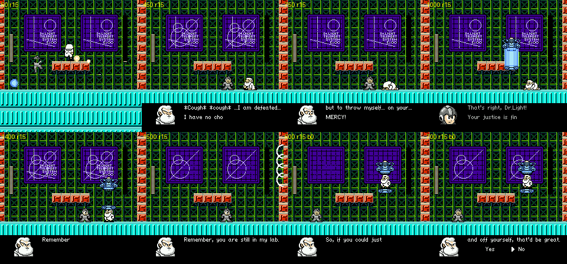
*Room `$15`: Light shooting energy balls; s21 (the dogeza); "Remember, you are still in my lab." as he beams out; and,
from a death run, Light beaming back in for s12 with the Yes/No prompt.*

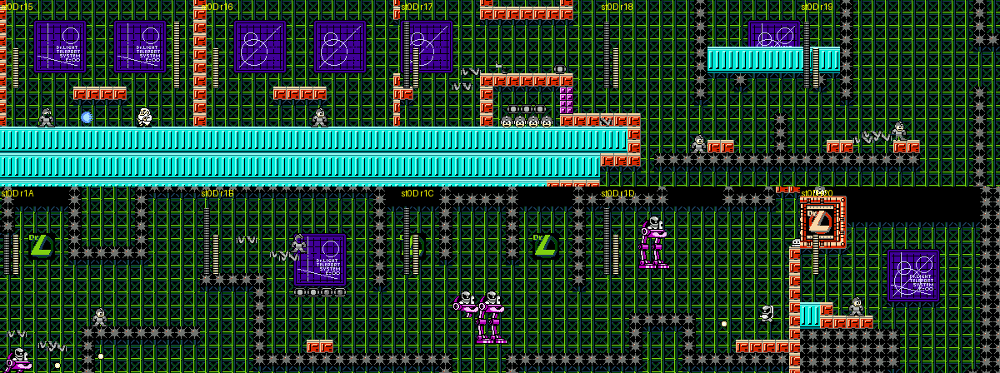
*Light 6 from the start (round 1), after round 1 (room `$16`), the spike-mine corridors `$17`-`$1D`, and the scout's
`light6_boss` state in room `$20` above the spike shaft.*

**Rooms `$16`-`$1D`** [seen]: green-grid corridors lined with **rows of grey spike mines** (the spikes Light ordered in
s01), a low tunnel holding a row of five 1-up heads, Sniper Armors and Sniper Joes. Room `$1D` ends at a brick column
with a cyan shutter at the right; neither the explorer nor a few placed jumps got through it in this run.

**Round 2, room `$2B`** [seen: from cheats.md's `light6_boss` state, which starts in room `$20`]: a drop down a shaft
lined with spike mines and a green Dr. L logo ends in the teleporter hall. Light beams in and says **s24**: "Heh heh
heh... You respawn repeatedly while I heal myself permanently. How amazing story!" His bar fills to 40 and then
**drops to 0 in 8 frames** in that state [seen]. **s25**: "Awww, it cannot be..." / "The war is now over." / "Ha! I
have the last plan... It is... to become much bigger!" He steps into the capsule, a white flash, and stage `$0E`
starts.

---

## 8. Final stage (`$0E`): giant Dr. Light

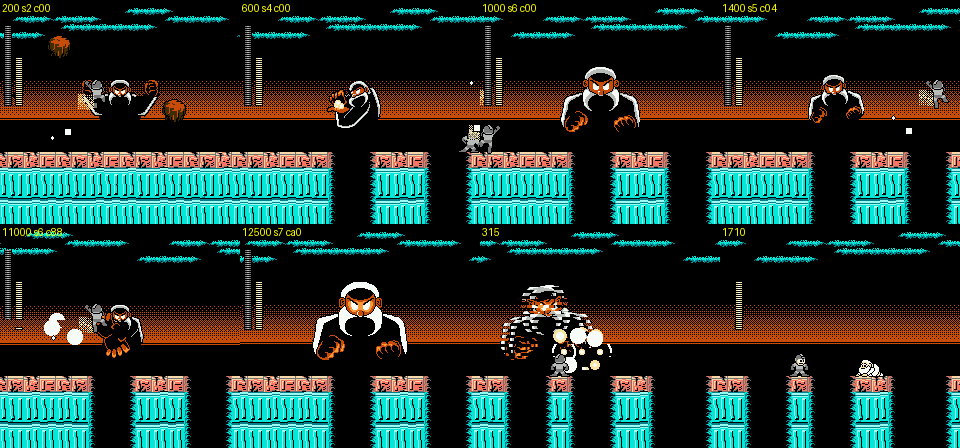
*Top: rocks rain down, the fist swing, the floor punched into pillars, the giant grown to full size. Bottom: the
damage-counter phase hit with Print Cutter (counter `$88`), phase 2 in room `$19` (counter reset), the defeat
explosions, and the normal-sized Light lying on a pillar afterwards.*

**The giant is background art, and only two weapons hurt him** [code][seen]:

- Room `$18`: a giant Dr. Light (black-and-white, beard, glowing orange eyes, fists) is drawn in the nametable behind
  a strip of floor over a cyan machine. He is not an object; the objects are falling rocks (`$A3`, up to eight), smoke
  puffs (`$A4`) and his fist (`$A5`) [seen].
- The fight is a state machine in bank `$31` (`$B2` = state, jump table `$31:A360`) [code]. The hit test at
  `$31:A948` returns at once unless the equipped weapon `$A9` is **5 (Print Cutter, Yoshino Man's, the hack author's
  own robot) or 8 (Power Bomb)**. A Print Cutter hit adds 4 and a Power Bomb hit adds 7 to `$06C1`, which here is a
  hidden **damage counter that counts up**; the boss bar stays empty [code `$31:A9A1`, `$31:AA0C`]. The buster,
  the Cheat Saber and the rest do nothing [seen: 30,000 frames of buster fire left `$B2` cycling 5/6 forever].
- The same counter paces him: every frame `$31:A900` derives two timers from it (`$8E` = `$30` minus the counter
  scaled by `$F340`, `$8D` = `$60` minus a second scaling, floored at `$10`), which the attack states compare against,
  so his cycle shortens as damage builds up [code; the speed-up itself was not measured]. His growing ("to become
  much bigger") happens from the start, at counter 0 [seen].
- **Phase 1** (states 2-6, room `$18`): rocks fall, he punches holes into the floor until only pillars over a pit are
  left, swings a fist with white smoke, throws a stack of orange blocks, and scales his face up until it fills the
  screen and back. At counter `$A0` (160, i.e. 40 Print Cutter hits) state 7 scrolls the arena one room right [seen:
  frame 12,487 of `final_pc.png`].
- **Phase 2** (states 8-9, room `$19`): the counter restarts from 0, more floor is gone; at `$60` (96) state `$0B`
  plays the defeat [code `$31:AD93`][seen: frame 13,606].
- Defeat [seen]: explosions over the giant, his picture breaks up into pixel noise, a white flash, and Dr. Light,
  normal-sized again, lies on the next pillar beside you. Another white flash, and the ending starts.

---

## 9. The ending and the playable staff roll [seen]

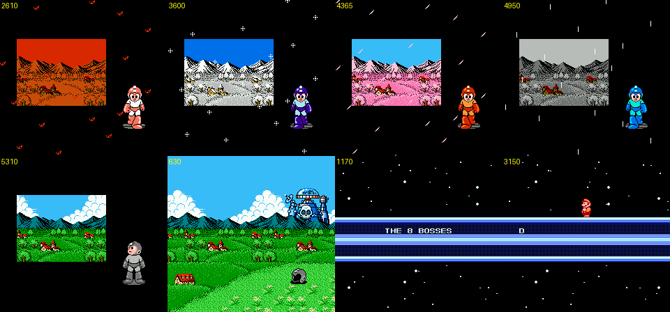
*The seasons walk with the fake Rockman's colour changing (autumn, winter, spring, rain), summer with the helmet off,
the meadow with the helmet in the grass and Wily's skull castle on the horizon, and the "THE 8 BOSSES" roll call.*

1. **Seasons**: the fake Rockman stands beside a picture of a landscape while it changes season (autumn leaves,
   winter snow, spring blossom, grey rain) and his colours change with it (pink-white, purple, orange, Mega Man blue).
   In summer he is grey again and **takes his helmet off**. This follows RM2's own ending, redrawn for the fake
   Rockman [guess: compared from memory of RM2, whose ending was not run here].
2. **The meadow**: a wide view of green fields, red-roofed houses and mountains, the empty helmet lying in the grass,
   and **Dr. Wily's skull castle** standing over the mountains [seen]. Whether RM2's version shows the castle was not
   checked [guess: added by CX, Wily having won].
3. **"THE 8 BOSSES"**: RM2's starfield roll call; each boss walks in and its line is typed: DLN.001 MEGAMAN / CAPCOM,
   DLN.009 YOSHINOMAN / HIMAJIN JICHIKU, DLN.010 CHEATMAN / HIMAJIN JICHIKU, **DLN.011 AIRMAN / HIMAJIN JICHIKU with
   no sprite at all** (Air Man stays invisible to the end), DLN.012 FIREMARIO / NINTENDO, DLN.013 KAMEN RIDER /
   ISHINOMORI PROD., DLN.014 BOMBERMAN / HUDSON SOFT, DLN.015 WHISPYWOODS / HAL LABORATORY.

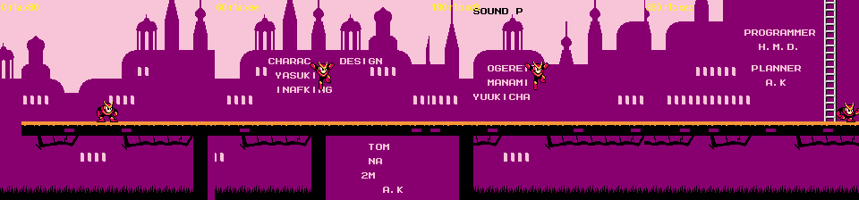
*The playable staff roll: Quick Man walks through the silhouette castle while the names are written into it.*

4. **The staff roll is a level**: back in stage `$0E` (rooms `$1A` on, which is why the final stage has restart rooms
   `$1A` and `$28`), you play **as Quick Man** (`$9B` = `$80`) with **99 lives and 99 E-tanks**, walking and climbing
   through a pink-and-purple silhouette castle while the staff names are written into the scenery: "STAFF", "ORIGINAL
   MEGAMAN2 STAFF", "CHARACTER DESIGNER YASUKICHI INAFKING TOM PON NAGINEKO 2M03CM MAN A.K", "SOUND PROGRAMMER
   OGERETSU MANAMI YUUKICHAN'S PAPA", "PROGRAMMER H.M.D.", "PLANNER A.K", ... (full list in text.md §2.7). The
   explorer reached room `$21` of it (`p_credits`).

---

## 10. Savestates, scripts and how to reproduce

Shared states added to `build/research/cx/states/` (all load straight into play; apply `cx.godmode()` yourself):

| State | What it is |
|---|---|
| `fortress_light1_ultraman` | Light 1 room `$2B`, Ultraman's bar full, player on the right-hand block |
| `fortress_light2_quickman_boss` | Light 2 room `$16`, Quick Man fight (s02 just played) |
| `fortress_light2_as_quickman` | Light 2 room `$16` after the rescue: you are Quick Man (40 HP), escape not yet started |
| `fortress_light4_cp1`, `fortress_light4_cp2` | Light 4 checkpoints (rooms `$21`, `$2A`) with correct scroll limits (replace the scout's broken `light4_cp*`) |
| `fortress_light4_boss` | Light 4 room `$2B`, masked robot, bar full |
| `fortress_light5_hub1`, `fortress_light5_hub2` | Light 5 teleporter hubs (rooms `$1D`, `$29`) |
| `fortress_light5_jam_session`, `_airman`, `_whispy`, `_bomberman` | Light 5 refight rooms `$20`, `$1E`, `$28`, `$22` (Kamen Rider: the scout's `light5_boss`) |
| `fortress_light6_after_round1` | Light 6 room `$16`, right after Light's dogeza and escape |
| `fortress_final_phase2` | Final stage at the switch to phase 2 (`$B2` = 7) |
| `fortress_ending` | The first frame of the ending sequence (the stage byte reads 6 during the ending) |
| `fortress_staff_roll` | The playable staff roll, room `$1A`, as Quick Man with 99 lives and 99 E-tanks |
| `fortress_light5_firemario`, `_yoshino`, `_megaman` | (added by critic) Light 5 room `$1E`: the three refights the scan missed, boss bar full |
| `fortress_light5_hub2_all8` | (added by critic) Light 5 hub 2 (room `$29`) with `$BC = $FF`; the exit teleporter (object `$BE`) is at `$80`,`$44` |
| `fortress_light5_rush` | (added by critic) Light 5 room `$2A` after s08: Rush's bar is filling (the fight starts a few frames later) |
| `light2_qm_exit` | (added by critic) Light 2 room `$2B` as Quick Man at the end of the escape; land on the floor (Y `$C4`) to end the stage |

Corrections to `cheats.md` §1 [seen]: `light1_cp1` (room `$21`, limits `$11-$18`), `light4_cp1`, `light4_cp2`,
`ending_cp1` and `ending_cp2` have inconsistent scroll limits (the kill-to-checkpoint trick failed where falling off the
screen does not kill); `light6_boss` is not in a boss fight but in room `$20` above the drop to round 2; `light5_boss`
is the Kamen Rider refight, not Light 5's boss. Killing with HP held at 0 (`cpwarp.py`) works where the pit drop does
not.

Scripts in `build/research/cx/cx-fortress/`:

- `play.py <state> <outdir> <budget> [seed] [score]`: Go-Explore wrapper around `cheats.explore` that saves the first
  state of every room and every boss bar it meets; score modes `room`, `rroom`, `rx`, `rxu`, `up`, `rdown`, `rup`;
  `FLOOR=1` freezes the Instant Floor as the weapon and adds jump-and-drop-floor macros (needed in Light 1).
- `rec.py` (autorun contact sheet), `bossrec.py` (boss pattern sheet + object log; `HOVER=yy` freezes the player's
  height for pit arenas), `after.py` (kill the boss, following refilled bars as phases, and record the aftermath),
  `dmgtest.py` (damage per weapon), `l6run.py` (play without cheats, log dialogue scripts and deaths; answers Yes/No
  prompts), `cpwarp.py` (die in a held room to restart at that checkpoint), `tour.py` (one frame per state),
  `shots.py`, `hunt_reset.py`, `enemies.py`, `segs.py`.
- Recipe for the final boss: load `ending`, `cx.godmode(e)`, `e.poke(0x9A, 0xFF)`, `e.freeze(0xA9, 5)` (Print
  Cutter), `e.freeze(0xA0, 0x28)`, then jump and fire; phase 2 at about frame 12,500, the defeat at about 13,600 more.

## 11. Open questions

- Light 5's boss `$0C` (the s08 "pet", "garbage-disposal duty") was never reached. The two teleporter hubs showed the
  same five destinations; after one refight the pads stopped working (`$BC` gets the boss's bit, `$B4` counts up)
  [seen], and setting `$BC`/`$B4` by hand did not open anything. Fire Mario, Yoshino Man and Mega Man had no pad.
  **(resolved by critic)** Eight pads, all eight refights, then hub 2's exit teleporter, s08 and **Rush** (§6, §6.1).
- s09 (the two-part robot, text.md) was not seen anywhere in the fortress.
- Light 6 rooms `$1D`-`$20`: the shutter at the end of room `$1D` did not open for the explorer or placed jumps.
- Light 4 rooms `$1B`-`$20` and `$22`-`$29`, Light 3 rooms `$25`-`$27`: not played (pits beat the explorers).
- The end of the Quick Man escape in Light 2, the end of the playable staff roll (rooms `$21`-`$27`, with three Dr. W
  emblems on the floor in room `$26`), and whether Wily's victory line ("Now the age of me begins!Muahahahahaha!",
  text.md §2.7) appears there.
- The masked robot's identity; the Instant Floor reset in Light 1 room `$2B` (cheat artefact or real bug).

## Lessons for Rockman 6 GP

**Design**

- **Make the final boss's weakness a story beat.** CX's giant Light ignores the buster and the other six weapons and
  only takes the Print Cutter (the author's own robot) and the Power Bomb, and his size is driven by the damage you
  deal. The rule is in eight bytes of code (`LDA $A9 / CMP #$08 / CMP #$05`), but it changes the whole fight. RM6 GP
  can do the same with a hidden counter instead of the boss bar.
- **A boss can talk to the player between lives.** Light 6 turns the death screen into content: every respawn brings
  a new taunt, a Yes/No trap, or an upgrade offer from the villain. RM6's Mr. X fortress could use its respawns the
  same way.
- **Re-skin RM's own set pieces for the guests.** Ultraman takes the Mecha Dragon's chase-over-blocks arena, Guts Man
  takes the Guts Tank, the teleporter hub becomes a refight room with a Dragon Quest joke. Reusing the engine's boss
  scenes with new art and one new twist (the color timer, the helmet, the band) is cheaper than new bosses and reads
  as homage.
- **Let the credits be played.** The staff roll as a short walk with 99 lives, as the second character, is a reward
  that costs one tileset and the existing text engine.
- **Telegraph required tools.** Light 1's first wall needs the Instant Floor and nothing says so; Light 4's pits and
  Light 6's shutter stopped every automatic player. A sign (Light 3 has a "USE" sign) or a safe practice spot would
  help.

**Technical**

- **One boss index for every boss.** CX extends RM2's `$B3` table from 6 to 15 entries and drives all its bosses
  (robot masters, refights, fortress, opening) through the same dispatcher. RM6 GP should keep its boss scenes in one
  table too, so new bosses are a table entry plus a routine.
- **Background-drawn bosses** (the giant Light, like RM2's Wily Machine) need their own hit test against weapon
  objects; CX's is a box test around a moving centre per weapon type (`$31:A948`-`$AA17`).
- **Reversed stages need reversed checkpoints.** The death code picks the restart entry by counting table entries
  below the current room and special-cases stage 5 (`$C1A8: LDA $2A / CMP #$05`) because Mega Man's stage runs right
  to left [code]. Light 2 also runs backwards (room numbers fall as you climb) and its deaths do restart behind you:
  dying in room `$27` restarts at `$2B`, dying in `$1E` restarts at `$20` [seen: `cpwarp.py`]. RM6 GP should store the
  direction per stage rather than test stage numbers, and test every checkpoint with a real death, not only a pit
  drop (falling off the screen does not kill in Light 4's first rooms).
- **Test harness**: kill-at-held-room checkpoint warps, per-room first-visit states, and a damage-per-weapon sweep made
  this survey possible in one session; build the same three tools for RM6 GP's QA.
