# Rockman CX: graphics survey (cx-graphics)

Agent: cx-graphics. Build: `roms/cx_en.nes` (EN v1.1), compared against `roms/rm2j.nes` (vanilla Rockman 2 J).
Scripts: `build/research/cx/cx-graphics/` (see section 12). Status: complete (resumed after a container restart; the predecessor's scripts and data were reused).

Tags: **[seen]** observed in the emulator, **[code]** from disassembly or ROM data, **[text]** in-game text,
**[guess]** inference.

## 0. The short version

- **CX is a near-total redraw on top of RM2's engine.** Of the 5,879 distinct non-blank tiles drawn on screen across
  89 savestates (every stage start, checkpoint and boss room), **4,128 (70%) do not exist anywhere in RM2**. The
  backgrounds are 78% new (3,087 of 3,963 BG tiles); the sprites are 54% new (1,043 of 1,921), because the
  common-enemy pages, weapon shots and most of the player's frames are RM2's [seen: `sampler.py` over all states].
- **Every stage tileset was replaced.** In the eight stage banks, 168 to 256 of the 256 BG tiles at RM2's tileset
  slot (`stage * $4000 + $2000`) changed: Cheat Man 168, Air Man 222, Whispy Woods 256, Fire Mario 232, Yoshino Man
  200, Mega Man 255, Kamen Rider 256, Bomberman 235 [code: `tilesets.py`].
- **The art borrows other games on purpose.** Fire Mario's stage is *Super Mario Bros.* redrawn on RM2's grid (World
  2-2's sea, the castle, the 1-4 bridge and axe), Whispy Woods gets a *Kirby*-style forest, Bomberman's stage his
  soft blocks; Cheat Man is *Mega Man X*, Kamen Rider rides his Cyclone, Light 1's boss is Ultraman [seen].
- **Reuse is surgical.** RM2's common enemies (68 of 159 enemy pages), HUD, shots, intro city, ending pictures, the
  roll call and even the **Guts Tank** (byte-identical tiles) survive; 71% of the reused sprite tiles are recoloured.
- **The new half of the ROM (`$1C-$3B`) supplies 2,911 distinct new tiles** that the traced states and scenes load
  (banks `$27-$2F`, `$39-$3B`), plus the dialogue portraits on top: Quick Man as a player, the fortress tilesets and
  bosses, the giant Dr. Light, the weapon-get artwork, the VWF font.
- **Bosses are small**: robot masters are 16x32 to 32x32 px and 8-15 hardware sprites (Bomberman is the tallest at
  21x46, 15 sprites). Everything big is **background art**: Ultraman (in the Mecha Dragon's slot), Whispy's trunk, the
  Guts Tank, and the giant Dr. Light, who grows and shrinks by **streaming pre-drawn sizes into CHR-RAM** every
  20-30 frames.
- **Flicker is RM2's scheme, but CX is busier**: OAM order still reverses every other frame; the median state drops
  sprites in 22% of samples (RM2: 10%), and fortress rooms reach 24 sprites on one scanline [seen].
- **Hidden in plain sight**: Air Man is a 50% checkerboard stipple ("invisible"), and he *does* have a roll-call
  sprite; Fire Mario powers up small → Super → Fire in the roll call; Whispy walks in as a 64x96 sprite tree.

## 1. Where the art lives (ROM map)

CX, like RM2, has **CHR-RAM**: every tile is stored uncompressed in PRG and copied to the PPU. The PPU runs with
`$2000 = $90`-`$93`: BG from pattern table `$1000`, sprites from `$0000`, **8x8 sprites** [seen: every state].

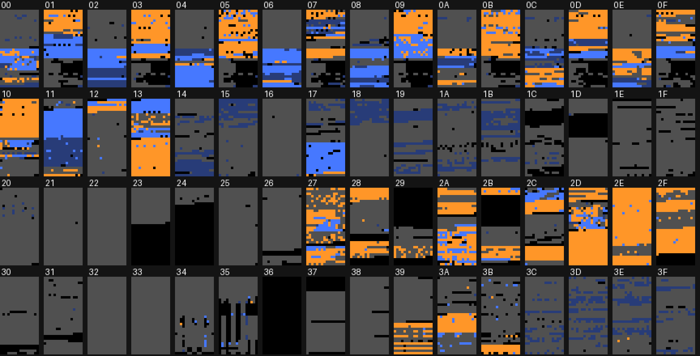
*All 64 8 KB banks, one cell per tile (16 columns x 32 rows each). Orange: new tile, seen on screen. Light blue: RM2
tile, seen on screen. Dark blue: RM2 tile not seen. Grey: not seen (code, data, PCM, or art the states never
showed). Black: blank.*

**Live CHR layout during play** (from 89 savestates, each tile traced back to its ROM offset) [seen]:

| CHR tiles | Contents | Source |
|---|---|---|
| `$000-$08F` | player: fake Rockman, or Quick Man | `0x01000` (bank `$00`, RM2's Rockman slot); Quick Man `0x4E900` (bank `$27`) |
| `$090-$09C` | weapon shots and common sprites | `0x23F00` (bank `$11`) |
| `$0A0-$0FF` | six 16-tile enemy/boss pages, swapped per room | any stage bank's `+$1000` half, plus new banks `$2A`, `$2B`, `$2C`, `$28`, `$39` |
| `$100-$15F` | common BG (HUD, ladders, items, doors) | `0x24100` (bank `$12`) |
| `$160-$1FF` | stage tileset | the stage's own bank, offset `+$2000`, or a new bank for the fortress |

The structure is RM2's, and so is the convention that each 16 KB stage bank holds its own enemies (`+$1000`) and its
tileset (`+$2000`). CX did not move this; it overwrote the contents in place and added pages in new banks.

### 1.1 Bank by bank (graphics content only)

Banks `$14-$16`, `$18-$26`, `$30-$33`, `$36`, `$37` and `$3C-$3F` hold no art (code, level data, music, PCM; `$36` is
empty). Per 4 KB half-bank, "same" = tile identical to RM2 at the same offset, "moved" = RM2 tile found elsewhere in
RM2, "new" = in neither [code: `halves.py`]:

| Half-bank | Same | Moved | New | Contents [seen] |
|---|---|---|---|---|
| `$00b` `0x01000` | 123 | 7 | 116 | the player (fake Rockman): RM2's Rockman sheet with new frames (dash) |
| `$01a` `0x02000` | 84 | 12 | 148 | Cheat Man tileset (RM2 Heat Man slot) |
| `$02b` `0x05000` | 250 | 0 | 4 | Air Man stage enemies: RM2's Air Man-stage enemies kept |
| `$03a` `0x06000` | 32 | 6 | 209 | Air Man tileset (clouds, glass blocks), also Light 2 |
| `$04b` `0x09000` | 218 | 3 | 32 | Whispy-bank enemies (RM2 Wood Man stage), mostly kept |
| `$05a` `0x0A000` | 0 | 41 | 193 | Whispy Woods tileset (*Kirby* forest), also Light 3 and Light 5 bits |
| `$06b` `0x0D000` | 231 | 4 | 17 | Fire Mario-bank enemies (RM2 Bubble Man stage), kept |
| `$07a` `0x0E000` | 18 | 66 | 138 | Fire Mario tileset (*SMB* water and castle) |
| `$08b` `0x11000` | 200 | 5 | 46 | Yoshino-bank enemies (RM2 Quick Man stage), kept |
| `$09a` `0x12000` | 54 | 23 | 167 | Yoshino Man tileset, also Light 5 / Light 6 (`0x12B00`, 144 tiles) |
| `$0Ab` `0x15000` | 75 | 1 | 166 | Mega Man-bank enemies, stage-select sprites |
| `$0Ba` `0x16000` | 0 | 28 | 224 | Mega Man tileset (the rotated-square arena) |
| `$0Cb` `0x19000` | 99 | 24 | 130 | Kamen Rider-bank enemies, Cheat Man boss sprite `0x19800` |
| `$0Da` `0x1A000` | 0 | 49 | 203 | Kamen Rider tileset (city skyline) |
| `$0Eb` `0x1D000` | 0 | 80 | 174 | boss sprites: Kamen Rider `0x1D000`, Fire Mario `0x1D800`, Mega Man `0x1D600` |
| `$0Fa` `0x1E000` | 20 | 7 | 211 | Bomberman tileset |
| `$10a` `0x20000` | 0 | 2 | 248 | stage-select screen (portraits, frame) |
| `$11a` `0x22000` | 188 | 5 | 53 | weapon shots, items (`0x23F00`), ending art |
| `$12a` `0x24000` | 19 | 8 | 219 | common BG (HUD, ladders, doors, items) `0x24100` |
| `$12b` `0x25000` | 0 | 3 | 250 | the fortress map scene (Dr. Light's house by day and by night) |
| `$10b` `0x21000` | 0 | 52 | 182 | staff-roll castle (`0x21400+`), the meadow's skull castle (`0x21700`), an unseen hex-digit font (`0x21000`) |
| `$13a/b` `0x26000` | 137 / 0 | 3 / 5 | 106 / 246 | opening stage tileset, title screen, Ultraman arena |
| `$17b` `0x2F000` | 189 | 0 | 52 | RM2's Guts Tank BG tiles (`0x2F200-0x2FDFF`, unchanged) |
| `$27a/b` `0x4E000` | 0 | 24 / 46 | 232 / 187 | Quick Man player sheet (`0x4E900`), opening-stage tiles, cutscene text strips |
| `$28` `0x50000` | 0 | 4 | 403 | Yoshino Man stage parts, Kamen Rider bits, Guts Man (opening) `0x51600`, villain line |
| `$29b` `0x53000` | 0 | 0 | 187 | VWF font (`0x53000`), intro crawl text, Light 4/6 parts |
| `$2A` `0x54000` | 0 | 87 | 391 | Light 3 / Light 4 / Light 5 tilesets and enemies, Cheat Man banner |
| `$2B` `0x56000` | 0 | 21 | 261 | final stage, Light 4 boss (`0x57800`) |
| `$2C` `0x58000` | 0 | 56 | 393 | Light 6 enemies/boss (`0x59800`), Light 5 "jam session" |
| `$2D-$2F` `0x5A000` | 0 | 65 | 1,500+ | giant Dr. Light and the final stage (`0x5A200` sprites, `0x5BE00-0x5EDFF` BG) |
| `$39b` `0x73000` | 0 | 2 | 235 | dialogue portraits, fortress BG (`0x73300`) |
| `$3A` `0x74000` | 0 | 25 | 230+ | pause-menu icons, "Ok, I'm on my way!", stage-select centre art (`0x74F00`) |
| `$3B` `0x76000` | 0 | 10 | 443 | dialogue portraits (15 faces with `$39b`; catalogued in text.md) |

## 2. How much is new: numbers

| Measure | RM2 art | New art | Source |
|---|---|---|---|
| Distinct tiles drawn on screen, 89 states | 1,751 (30%) | **4,128 (70%)** | `sampler.py`, 60 samples per state [seen] |
| ... background tiles | 876 (22%) | 3,087 (78%) | [seen] |
| ... sprite tiles | 878 (46%) | 1,043 (54%) | [seen] |
| Player sheet `0x01000` (144 tiles) | 102 unchanged | 42 changed | [code] |
| Stage BG tileset slots (8 x 256 tiles) | 324 unchanged | 1,724 changed | [code] |

RM2's sampled stage starts showed 888 distinct tiles; only 277 of them ever appear in CX's sampled states, so roughly
**two thirds of RM2's visible art is gone** from CX [seen]. What survives is the frame: the HUD and items (`$12`), the
weapon shots (`0x23F00`), the common enemies of each stage bank (Telly, Mets, Sniper Joes, Pierobots and friends in
the `+$1000` halves, which are 85-99% unchanged), the player's skeleton, and RM2's starfield roll call.

## 3. The player sprites

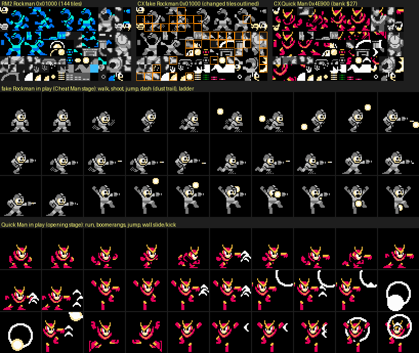
*Top: RM2's Rockman sheet, CX's fake Rockman sheet with the 42 changed tiles outlined, and Quick Man's new player
sheet (bank `$27`). Middle: every distinct fake Rockman frame from a scripted run. Bottom: Quick Man's frames.*

- **Fake Rockman** is RM2's Rockman, recoloured **grey** (sprite palette 0 = `$0F $10 $2D`: black, light grey, dark grey; the
  "mass-produced" look) [seen] and extended in place: 42 of the 144 tiles at `0x01000` changed, almost all for the new
  **X-style dash** (a low lunging frame with a dithered dust cloud at the feet, drawn into the player tiles, not as a
  separate object) and the dash-shot [seen][code]. Frames are RM2's 24x24 standard (8-14 hardware sprites).
- **Quick Man** is a complete new player sheet of 144 tiles at `0x4E900`, laid out tile-for-tile like Rockman's so
  that RM2's player animation tables work unchanged; it is swapped into CHR `$000-$08F` when `$9B` bit 7 is set.
  44 of its tiles come from RM2's Quick Man **boss** art; the rest (run, ladder, wall-slide, kick, hurt) are new
  [seen][code]. Same 24x24 to 32x32 envelope, red/yellow/white palette, the boomerangs from RM2.
- The **final stage** swaps in a third player set at `0x5A800` (bank `$2D`): CHR `$000-$0FF` are reloaded from
  `0x5A200-0x5B1FF`, so even the player's frames change for the giant Dr. Light fight [seen: `livechr.py`].
- The **staff roll** loads Quick Man (`0x4E900`) again, since you play it as Quick Man (fortress.md section 9).

## 4. Bosses

### 4.1 The eight robot masters

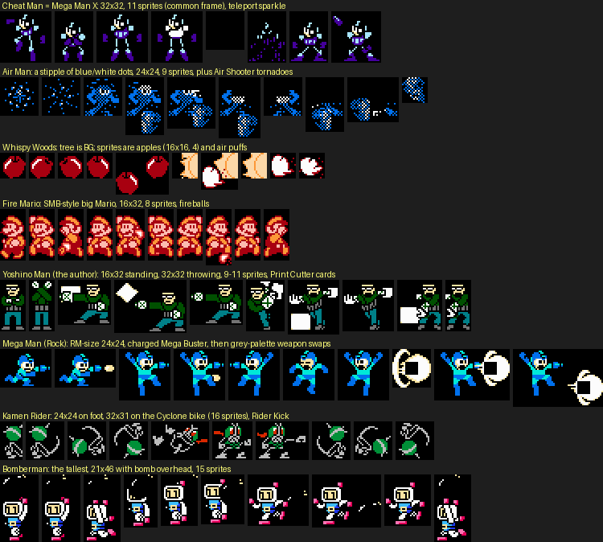
*Distinct frames of each boss, captured from OAM during a godmode fight (`bosscap.py`), 2x. Sizes are the most common
frame's bounding box and sprite count.*

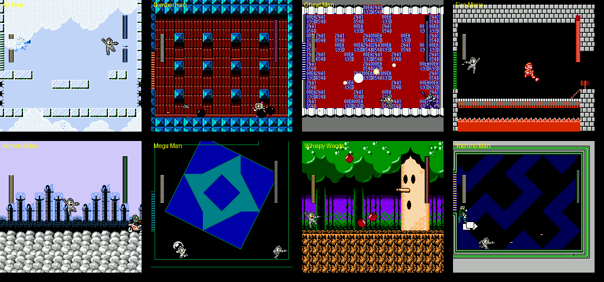
*The eight boss rooms at the frame with the most sprites on screen.*

| Boss | Common frame | Sprites | Max OAM in room | Sprite tiles from | RM2 tiles | What it is |
|---|---|---|---|---|---|---|
| Cheat Man | 32x32 | 11 | 42 | `0x19800` (bank `$0C`) | 1 of 64 | *Mega Man X*, purple-blue, with a teleport sparkle |
| Air Man | 24x24 | 9 | 52 | `0x16B00` (bank `$0B`) | 0 of 45 | a **50% checkerboard stipple** of a robot: "invisible" by dithering |
| Whispy Woods | 16x16 apples | 4 | 53 | `0x1DA10` | 0 of 31 | the tree is BG; sprites are apples, puffs and eyelids |
| Fire Mario | 16x32 | 8 | 37 | `0x1D800` (bank `$0E`) | 0 of 32 | *SMB* Fire Mario, NES-accurate proportions |
| Yoshino Man | 16x32 / 32x32 | 9-11 | 56 | `0x0F000` (bank `$07`) | 0 of 64 | the author's avatar: sunglasses, green jacket, throws cards |
| Mega Man | 24x24 | 11 | 52 | `0x1D600`, `0x19E10` | 43 of 63 | RM2's own Rockman frames as an enemy, with weapon palettes |
| Kamen Rider | 24x24 / 32x31 | 9 / 16 | 43 | `0x1D000` (bank `$0E`) | 0 of 79 | Kamen Rider 1, on foot and on the Cyclone |
| Bomberman | 21x46 | 15 | 64 | `0x16E00` (bank `$0B`) | 0 of 79 | Hudson's Bomberman with a bomb held overhead |

The boss tiles sit in the slots where RM2 kept its own robot-master sprites (the `+$1000` halves of banks `$07`,
`$0B`, `$0C`, `$0E`), so the engine's per-room "enemy page" loader brings them in without new code [code].
**Bosses are small**: nothing beyond 32x32 except Bomberman's raised bomb, so the boss plus the player plus shots
stays near RM2's sprite budget. Palette use per boss (sprite palettes in the boss's sprite cluster, most common frame) [seen: `verify.py`]: **Fire
Mario uses exactly one** 3-colour palette, as in *SMB*; Air Man and Dr. Light one; Cheat Man, Mega Man, the masked
robot and Guts Man two; **Bomberman and Yoshino Man three** of the four sprite palettes, i.e. up to 9 colours on one
character (white body, pink, blue; skin, green jacket, teal trousers). Kamen Rider switches between one on foot and
two on the bike. (Shots that touch the boss can inflate these counts by one.)

### 4.2 Fortress bosses, mid-bosses and refights

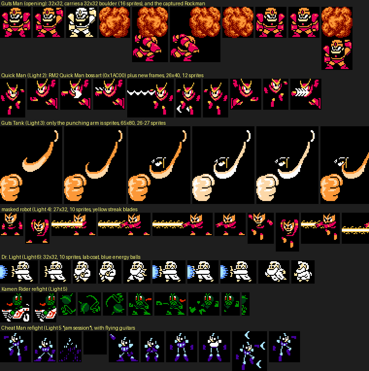
*Guts Man (opening stage), Quick Man (Light 2), the Guts Tank's arm (Light 3), the masked robot (Light 4), Dr. Light
(Light 6) and two Light 5 refights.*

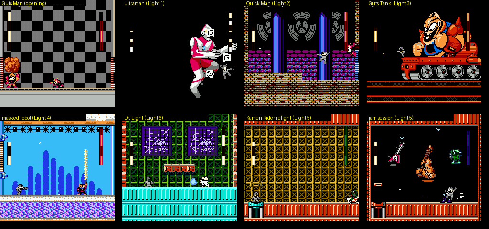
*The fortress boss rooms: Guts Man's grey arena, Ultraman over the void, the clock tower, the Guts Tank, the flooded
arena, the DR.LIGHT TELEPORT SYSTEM room, and Light 5's refight rooms (the jam session's flying guitars).*

| Boss | Kind | Size | Sprite tiles from | Notes |
|---|---|---|---|---|
| Guts Man (opening) | sprite | 32x32, 10-16 sprites | `0x51600` (bank `$28`), new | RM1-style Guts Man; the boulder he lifts is a 32x32 sprite |
| Quick Man (Air Man mid-boss, Light 2) | sprite | 26x40, 12 | `0x1AC00` | **RM2's Quick Man boss art** (47 of 79 tiles) with new frames |
| Ultraman (Light 1) | **BG** | about 96x144 px | BG `0x27800-0x27FFF` (bank `$13`) | drawn into the nametable like RM2's Mecha Dragon, whose arena and code slot he takes; his colour timer is a sprite |
| Guts Tank (Light 3) | **BG** + sprite arm | arm 65x80, 26-27 | BG `0x2F200-0x2FDFF` (bank `$17`), arm `0x1EF00` | **RM2's Guts Tank, tile for tile**: both ranges are byte-identical to RM2. The tank's driver *is* RM2's Guts-Man-faced head; CX only recoloured it and wrote new dialogue around it |
| masked robot (Light 4) | sprite | 27x32, 10 | `0x57800` (bank `$2B`), new | orange pointed mask; long yellow "streak" blade sprites |
| Dr. Light (Light 6) | sprite | 32x32, 10 | `0x59820` (bank `$2C`), new | small white old man in a lab coat, 3 colours |
| giant Dr. Light (final) | **BG** + sprite fists | full screen | BG streamed from banks `$2D-$2F` | see section 5 |

## 5. Big bosses are background art

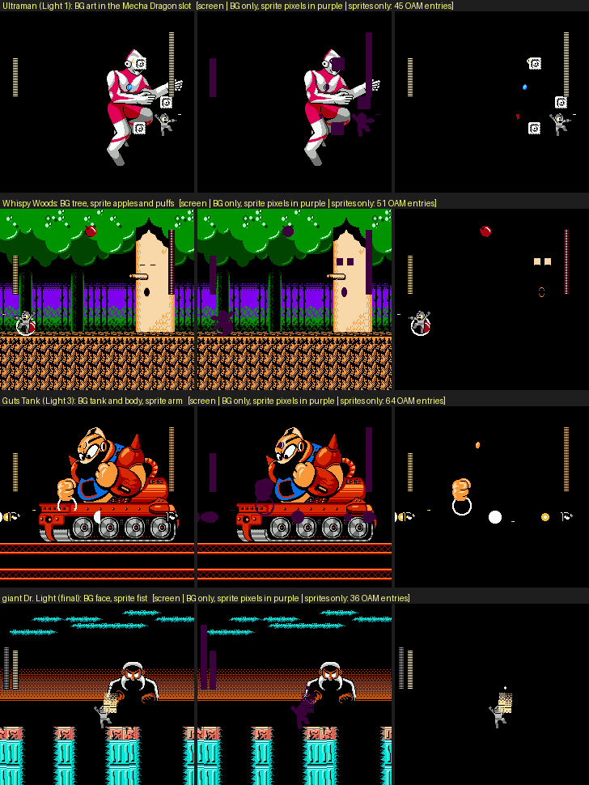
*For each big boss: the screen, the same screen with every sprite pixel painted purple (what is left is the BG), and
the sprite layer alone. Ultraman, Whispy's trunk, the whole Guts Tank with Guts Man, and the giant Dr. Light are
nametable art.*

CX follows RM2's rule (the Mecha Dragon, the Guts Tank and the Wily Machine are BG) and pushes it further [seen]:

- **Ultraman** is drawn into the background in the Mecha Dragon's room; only his blue colour timer and the floating
  blocks are sprites. Because he is BG he can be about 96x144 px (measured from the BG layer) with no flicker
  at all; as 8x8 sprites he would need well over 100 OAM entries, against the hardware's 64.
- **Whispy Woods** is BG; when hit, his eyes "close" because two **skin-coloured sprites are laid over the BG eyes**
  (the two squares in the sprite layer).
- **The Guts Tank** is RM2's Wily 3 boss unchanged in its tiles (`0x2F200-0x2FDFF` and the fist at `0x1EF00` are
  identical to RM2), with RM2's fixed-floor raster split (engine.md: IRQ effect 1). The "giant Guts Man riding the
  tank" that fortress.md describes is RM2's own Guts Tank head, recast as Guts Man by the dialogue ("The Fierce
  Dr.Light's Guts Tank!!") [code: byte compare]. Only the fist and the shots are sprites.
- **The giant Dr. Light** is BG too, and he **changes size**. The final stage keeps the BG pattern table busy: every
  20-30 frames the boss state machine (`$B2` = 8/9) re-uploads CHR `$130-$1FF` from different, unaligned offsets in
  banks `$2D-$2F` (`0x5B200-0x5BDB0`, `0x5D2C0-0x5DF10`, `0x5E530-0x5F9C0`), each a pre-drawn pose or size of the
  face and arms [seen: `giant.py`]. Scaling is done the cheap way: draw every size by hand and stream it. In state
  `$09` three pages are filled from fixed-bank code (`0x7C010-0x7C2FF`), visible as noise in the pattern table;
  whether any of those tiles is drawn was not checked [seen].

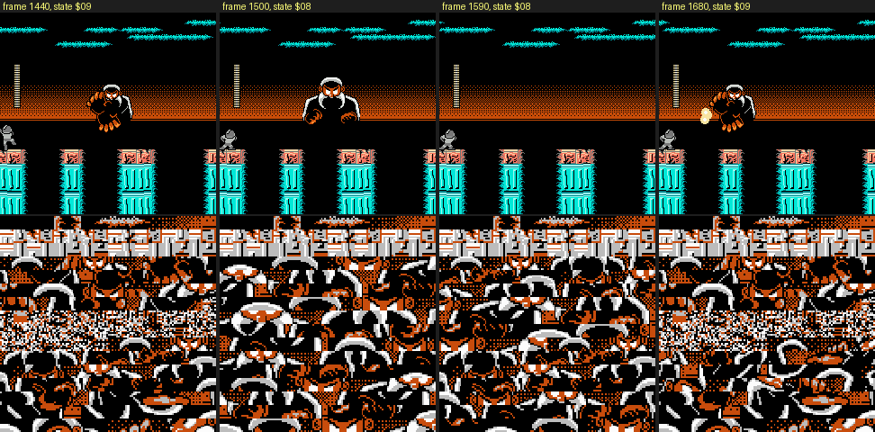
*The giant at four moments of phase 2, with the live BG pattern table (CHR `$100-$1FF`, BG palette 0) under each:
the tile set changes from moment to moment; in state `$09` (first and last) a band of it is code bytes.*

## 6. Enemies: RM2's cast, recoloured, plus a handful of new ones

The enemy pages (CHR `$0A0-$0FF`, six 16-tile pages per room) are where CX changed the least [seen: `g_enemies.py`
over all 89 states]:

- **159 distinct ROM pages** are loaded into the enemy area across the states; **68 are RM2's pages unchanged** (85-100%
  of their tiles in RM2), 91 are mostly new, and about 58 of those 91 are **boss** pages. So only about **33 new pages
  of regular enemies** exist, against RM2's 68 kept ones.
- What is new: the SMB set in Fire Mario's stage (orange-and-white fish, the fire-bar segments of object `$82`, the "?"
  block colours), Light 1's blue birds (`$92`) and crates, Light 3's red Met-like walkers (`$75`), the Light 5 refight
  rooms (Bomberman's room parts at `0x54600-0x54AFF`), the Light 6 teleporter capsule that Dr. Light beams out of, and
  the roll-call walkers of the ending (`0x23C00-0x23EFF`) [seen].
- What is reused: Telly, Mets, Sniper Joe and Sniper Armor, Pierobot, Kerog, Shrimp/Anko, Friender, Hothead, the
  Crash-stage birds and more, mostly **in new palettes**. Of the 250 RM2 sprite tiles seen in both games, **177 (71%)
  are drawn with different colours** in CX (dominant palette compared) [seen: `g_recolour.py`]. Friender in Yoshino
  Man's stage is orange instead of blue; Kerog stands in Whispy Woods' stage.
- One oddity: when a room asks for fewer than six enemy pages, the loader fills the rest from **`0x7FF00`, the last
  page of the fixed bank** (reset vectors and code), so CHR `$0A0-$0FF` often holds 1-5 pages of code bytes as
  "tiles". They are never drawn [seen: 12 states load it, e.g. `bomberman` loads it five times].

CX's design voice is in level layouts and bosses, not in new enemy art: the stage docs (stages_1.md, stages_2.md,
fortress.md) cover where each enemy is placed.

## 7. Stage tilesets and borrowed art

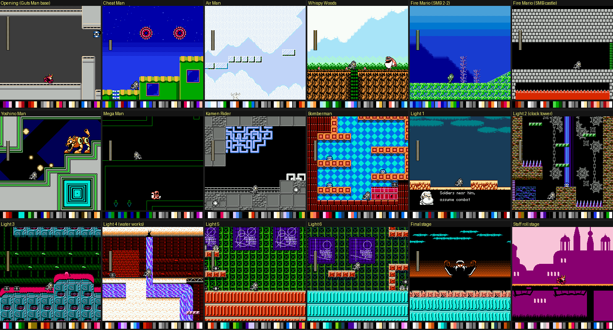
*Every stage in play, with its 4 BG palettes and 4 sprite palettes as swatches. From the opening's grey Guts Man base to
the pink silhouette castle of the playable staff roll.*

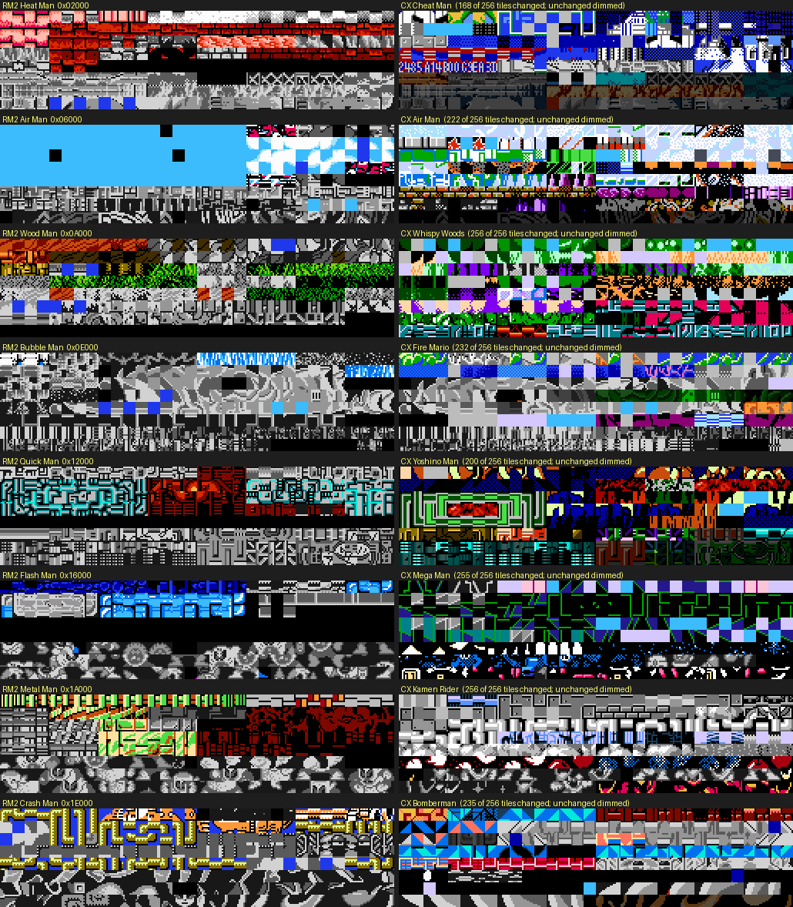
*The 256-tile BG half of each stage bank, RM2 (left, palettes from RM2 play) against CX (right, palettes from CX play;
tiles still identical to RM2 are dimmed). Grey tiles were never seen on screen in the sampled states.*

| Stage | Tileset source | Tiles changed vs RM2 slot | Look [seen] |
|---|---|---|---|
| Opening (`$0F`) | `0x26040` (bank `$13`) + `0x4F880` (bank `$27`) | new | grey steel base, RM1-like Guts Man |
| Cheat Man (`$00`) | `0x02000` (bank `$01`) | 168 / 256 | night sky with red target rings, green blocks; boss room tiled with hex digits |
| Air Man (`$01`) | `0x06000` (bank `$03`) | 222 | pale clouds and **glass blocks**: almost no outlines, the most minimal set |
| Whispy Woods (`$02`) | `0x0A080` (bank `$05`) | 256 | *Kirby*-style forest: canopy, dark trunks, purple undergrowth, brown rock |
| Fire Mario (`$03`) | `0x0E000` (bank `$07`) | 232 | *SMB* World 2-2 sea (coral, water band) then the SMB castle (grey bricks, lava, bridge, axe) |
| Yoshino Man (`$04`) | `0x12300` (bank `$09`) + `0x50000` (bank `$28`) | 200 | green circuit lines, concentric squares, gold stars |
| Mega Man (`$05`) | `0x16000` (bank `$0B`) | 255 | black void with thin green lines: **wireframe** level art |
| Kamen Rider (`$06`) | `0x1A000` (bank `$0D`) + `0x50500` | 256 | grey stone, blue pipe maze, city skyline with half-speed parallax (IRQ) |
| Bomberman (`$07`) | `0x1E000` (bank `$0F`) | 235 | Bomberman's orange soft-blocks over a cyan diamond floor |
| Light 1 (`$08`) | `0x02B00-0x033FF` (Cheat Man's bank) | new | sky, brick lab, bunkers |
| Light 2 (`$09`) | `0x06800-0x073FF` (Air Man's bank) | new | clock tower: gears, chains, brick |
| Light 3 (`$0A`) | `0x0AB00` (Whispy's bank) + `0x55000` (`$2A`) | new | teal machinery, pink domes, lightning circuits |
| Light 4 (`$0B`) | `0x55100-0x55CFF` (bank `$2A`) | new | red brick, water tanks, waterfall |
| Light 5 / Light 6 (`$0C`/`$0D`) | `0x12A00-0x133FF` (Yoshino's bank) + `0x55D00` | new | green lattice, "DR.LIGHT TELEPORT SYSTEM" monitors |
| Final (`$0E`) | `0x56000` (bank `$2B`) + streamed `$2D-$2F` | new | starless black, cyan pillars, the giant (section 5) |
| Staff roll (`$0E` rooms `$1A+`) | `0x21400-0x21FFF` (bank `$10`) | new | pink-and-purple silhouette castle |

Observations:

- **The fortress tilesets live next to their partner robot-master tileset** in the same stage bank (Light 1 right after
  Cheat Man's at `0x02B00`, Light 2 after Air Man's at `0x06800`, Light 5/6 after Yoshino Man's at `0x12A00`), which
  matches the shared-bank design that cheats.md found for the level data: each 16 KB stage bank holds one robot-master
  stage plus one fortress stage [code].
- **Borrowed art is the joke.** Fire Mario's stage is *SMB* redrawn at Rockman's 16x16 metatile scale, SMB palette
  and all; Whispy's stage borrows Kirby's forest; Bomberman's borrows the soft-block look of *Bomberman*; Kamen Rider's
  arena is a tokusatsu city. These are recreations in RM2's tile grid, not straight rips (the tiles are 8x8 like
  everything else and share the stage's 4 BG palettes) [seen][guess: no source ROMs were compared].
- **Two stages go minimal on purpose**: Air Man's (pale clouds, glass) and Mega Man's (black with thin green lines) use
  few tiles (58 and 29 distinct BG tiles in 60 samples) [seen]. Air Man's stage matches its invisible boss.
- **Palettes**: every stage keeps RM2's 4+4 palette layout, BG colour 0 shared. Several stages are recoloured on the
  fly by the `$40` director object as you walk (stages_1.md section 0.3), and the "?" blocks and arrow markers in
  Fire Mario's castle cycle colours through RM2's palette-animation registers `$0720`/`$0721` [code, from stages_1.md].

## 8. Title, menus, cutscenes, ending and fonts

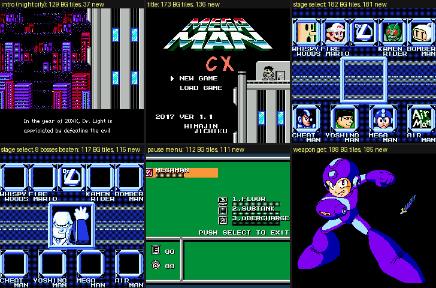
*Intro, title, stage select (fresh, and with all eight beaten), pause menu, weapon get. The caption counts the distinct
BG tiles in the nametables and how many of them are not in RM2.*

| Screen | Distinct BG tiles | New | Art [seen] |
|---|---|---|---|
| Intro crawl | 129 | 37 | **RM2's night city and tower**, kept; only the caption strips are new (pre-rendered proportional text, text.md) |
| Title | 173 | 136 | new **"MEGA MAN CX"** logo (the US *Mega Man 2* logo style, green-white gradient bands, with a red "CX"), the fake Rockman on RM2's rooftop; `0x26A00-0x27FFF` (bank `$13`) |
| Stage select | 182 | 181 | entirely new (`0x20000-0x20FFF`, bank `$10`): 9 frames, not RM2's 3x3. Portraits are 32x32 BG pictures: Whispy's trunk face, Fire Mario, the Dr.L logo, Kamen Rider, Bomberman, Mega Man X (for Cheat Man), Yoshino Man, Rock, and the words "Air Man" |
| Stage select, all beaten | 117 | 115 | the portraits empty and **Dr. Light's face, waving**, in the centre (`0x74F00-0x752FF`, bank `$3A`) |
| Pause menu | 112 | 111 | RM2's green layout redrawn: weapon icons, `1.FLOOR / 2.SUBTANK / 3.ÜBERCHARGE`, "PUSH SELECT TO EXIT" (`0x74000-0x74EFF`, bank `$3A`) |
| Weapon get | 188 | 185 | a **full-screen Rockman illustration** in an X-style lunge (`0x50600-0x512FF`, bank `$28`), recoloured to each weapon's palette, plus the weapon's icon (the Cheat Saber here). RM2 showed a small Rockman instead |

- **Dialogue portraits**: 15 faces in banks `$39` (second half) and `$3B`, grey-scale with one accent colour, loaded
  only while a dialogue box is up; the dialogue box gets its own palette below line 184 through IRQ effect 10
  (engine.md). They are catalogued in text.md (`img/text_portraits.png`), so not repeated here.
- **Fonts** (all in text.md, section 1): RM2's fixed 8x8 caps font kept for the HUD, menus and the roll call; a new
  **English variable-width font** (1bpp, `0x53000`, bank `$29`) rendered into tiles at run time, with a highlight
  colour from the second bitplane; pre-rendered proportional strips for the intro crawl and the opening cutscenes
  (banks `$13`, `$27`); and, in the JP build, 16-glyph kana/kanji pages streamed into CHR per dialogue script.

### 8.1 The ending

The seasons walk is **RM2's ending, tile for tile**: the 183 BG tiles of the pictures (`0x22490+`, bank `$11`) and
the walking hero's sprite tiles (`0x0D900`, `0x1B200`, ...) are byte-identical to RM2, and the hero's season colours
are RM2's palette trick. The fake Rockman *is* RM2's ending Rockman, only grey. What is new is **Dr. Wily's skull
castle on the meadow's horizon** (`0x21700-0x218FF`, bank `$10`, new tiles) [code: byte compare][seen].

The roll call reuses RM2's starfield and scrolling ribbon, and it is where several bosses get art that the fights
never show:

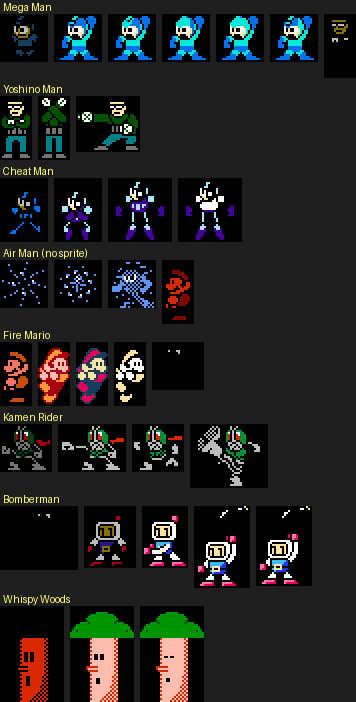
*"THE 8 BOSSES" walk-ins, every distinct sprite cluster per boss (stars filtered out). Mega Man and Bomberman fade in
through dark palettes; Fire Mario walks in as small Mario and powers up to Super and then Fire Mario; Whispy Woods
walks in as a 64x96 **sprite** tree; Air Man is not missing: he is the faint dot stipple (third row), as in his fight.*

- **Air Man has a roll-call sprite** after all: the same blue-and-white checkerboard stipple as in his fight, which on
  a starfield reads as nothing. fortress.md's "no sprite at all" is the intended effect, not the data [seen].
- Fire Mario's power-up sequence (small, Super, Fire) is a SMB quote done with palette swaps on 16x16 and 16x32
  frames [seen].
- Whispy Woods, who is BG in his fight, is a sprite here (64x96: about 40 sprites, possible because nothing else is on
  screen) [seen].

## 9. Techniques: sprites, flicker, palettes, CHR streaming

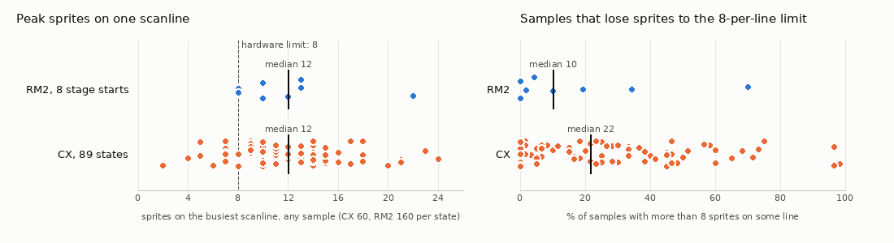
*Left: the most sprites on any one scanline, per state. Right: how often a sample has more than 8 sprites on some
line (the 9th and later are not drawn). RM2: 8 stage starts, 160 samples each; CX: 89 states (stage starts,
checkpoints, boss rooms), 60 samples each, godmode autorun.*

- **Sprite size**: 8x8 sprites only (`$2000` bit 5 clear in every state). Characters are 2-4 tiles wide, like RM2's.
  Typical OAM use per frame: 20-64 entries; 22 of 89 states hit the 64-entry ceiling at some point [seen].
- **Flicker is RM2's scheme, unchanged**: OAM is filled in the opposite order on alternate frames (player first, then
  HUD bars first; checked in both ROMs), so overflow becomes 30 Hz flicker shared between objects [seen].
- **CX is busier than RM2.** The median peak is 12 sprites on one line in both, but CX's median state drops sprites in
  22% of samples against RM2's 10%, and 23 CX states exceed 40%: Light 6 after round 1 (98%, 21 on a line), Light 6
  checkpoint 1 (97%, 24 on a line), Light 3's Guts Tank (97%), Light 5's Bomberman refight (75%), Light 5 cp1 (73%,
  23 on a line), Yoshino Man's Friender gate (65%), Bomberman's boss room (58%, 20 on a line). The worst offenders
  are fortress rooms full of spike mines and 1-up heads, and Bomberman's bombs and blasts [seen].
- **HUD bars are sprites** (tile `$87` stacked, one column per bar), as in RM2, so a boss fight spends 2-3 of the 8
  per-line slots on bars before the first enemy [seen].
- **BG instead of sprites for anything big** (section 5): Ultraman, Whispy, the Guts Tank, the giant Dr. Light. CX's
  largest *sprite* bosses are 32x32 (Bomberman 21x46).
- **Palettes**: most characters use one or two 3-colour sprite palettes, Bomberman and Yoshino Man three; CX recolours RM2's reused enemies per stage (71% of
  reused sprite tiles changed colour) and recolours whole stages mid-level with the `$40` director object. The giant
  Dr. Light's palette is black/white/orange so that it reads as one figure across BG and sprite fists.
- **CHR is streamed, not banked.** CX keeps CHR-RAM and RM2's per-room page loader (six 16-tile enemy pages, a 160-tile
  tileset), and goes further in set pieces: the final stage re-uploads up to 160 BG tiles from unaligned offsets
  every 20-30 frames to animate and scale the giant (370 distinct BG tiles in 60 samples of one checkpoint, more than
  the 256 the pattern table can hold); the JP dialogue streams glyph pages per script [seen][code: text.md].
- **Dithering as a joke and as shading**: Air Man is drawn as a 50% checkerboard of dots; the dash dust is a dither
  cloud; Air Man's and Light 4's backgrounds use checkerboard gradients [seen].

## 10. Unused or rarely seen art

`unseen.py` lists the 16-tile art pages that no savestate and no traced scene (boot and intro, title, pause, weapon
get, stage select, ending, opening cutscene, fortress map, final boss) ever loaded [seen]:

- **`0x21000`: a hex-digit font**, "0123456789ABCDEF" in 16 tiles, in the style of the HUD font. Never seen loaded.
  Cheat Man's hex wallpaper uses its own digits inside the stage tileset (`0x02000`), so this one is either a debug
  display or left over [guess].
- `0x4F200-0x4F7FF` (EN opening-cutscene strips) and `0x53200-0x537FF` (the VWF font sheets): text, seen only through
  the dialogue renderer, which builds tiles from them rather than copying them.
- `0x75900-0x75EFF`, `0x73900`: bank `$3A`/`$39` menu and portrait parts; `0x76000-0x77FFF`: the dialogue portraits.
- Bank `$34` looks tile-like in places but is the raw PCM voice clip (engine.md); bank `$35`, never loaded, renders
  as regular columns typical of layout data rather than art [guess].

## 11. Gallery

| Image | Shows |
|---|---|
| `graphics_rom_map.png` | all 64 banks, tile by tile: new / RM2 / unseen |
| `graphics_banks_28_2F.png` | example of the per-bank sheets: banks `$28-$2F` with on-screen palettes (all 64 are in `build/research/cx/cx-graphics/banks/`) |
| `graphics_tilesets_bg.png` | RM2 vs CX stage tilesets, 8 stage banks |
| `graphics_stage_looks.png` | every stage in play, with palettes |
| `graphics_player.png` | fake Rockman and Quick Man sheets and frames |
| `graphics_bosses_rm.png`, `graphics_boss_rooms.png` | the 8 robot masters: frames and rooms |
| `graphics_bosses_fortress.png`, `graphics_fortress_rooms.png` | fortress bosses: frames and rooms |
| `graphics_bg_bosses.png` | BG/sprite layer split of Ultraman, Whispy, Guts Tank, giant Dr. Light |
| `graphics_giant_streaming.png` | the giant's CHR streaming |
| `graphics_screens.png` | intro, title, stage select x2, pause, weapon get |
| `graphics_rollcall.png` | ending roll-call sprites |
| `graphics_flicker.png` | sprites per scanline and dropped-sprite rate, RM2 vs CX |

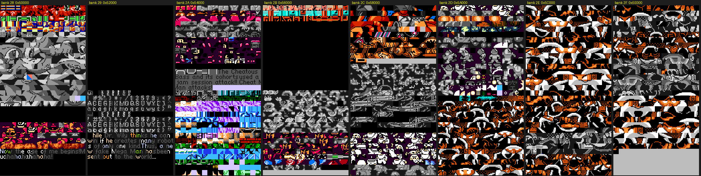
*Banks `$28-$2F` rendered as tiles with the palette each tile was seen with (grey: never seen). `$28`: Yoshino Man
parts, the weapon-get Rockman, Guts Man, the villain's line; `$29`: the VWF font and intro text; `$2A`: Light 3/4/5
sets, the Cheat Man DQ banner; `$2B`: final stage, Light 4 boss; `$2C`: Light 6, Light 5 jam session; `$2D-$2F`: the
giant Dr. Light's poses and sizes.*

## 12. Method, scripts and coverage

All in `build/research/cx/cx-graphics/`, run from the repo root with `python3 -I`:

| Script | What it does |
|---|---|
| `tileidx.py` | per 8 KB bank: % equal to RM2, blank tiles, tiles found in RM2, new tiles, JP/EN differences |
| `livechr.py` | loads every savestate, traces each live CHR tile back to its ROM offset; writes `livechr.json` |
| `wholoads.py BANK..` | inverts `livechr.json`: which states load each 16-tile ROM page, at which CHR address |
| `sampler.py OUT N K [states]` | plays each state N frames (godmode autorun), every K frames records every drawn tile with its palette, sprites per scanline; `seen_all.pkl` (CX), `seen_rm2.pkl` (RM2) |
| `render_banks.py seen.pkl` | colorized sheets of all 64 banks (`banks/bankXX.png`, palette = the one the tile was seen with) and `classmap.png` |
| `halves.py seen.pkl` | the half-bank same/moved/new table above |
| `tilesets.py` | RM2 vs CX tileset sheets per stage bank (`tilesets_bg.png`, `tilesets_spr.png`) |
| `bosscap.py STATE N` | plays a boss state, clusters the boss's sprites per frame, saves unique frames, sizes and sprite counts |
| `rm2states*.py` | vanilla RM2 stage-start states (scratch) |
| `gfxlib.py` | shared helpers (colorized sheets, labels, stacking) |
| `tracer.py SCENE N K` | runs a scene (`boot`, `weapon_get`, `pause`, `state:NAME`, `auto:NAME`, `path:FILE`) and records the first frame each ROM page appears in CHR (`scenes.json`, contact sheets in `scenes/`) |
| `playercap.py ROM STATE OUT` | scripted move set; every distinct player frame (HUD sprites excluded) |
| `enemycap.py OUT N` | autoruns every non-boss state and keeps sprite clusters whose tiles are mostly not in RM2 |
| `g_enemies.py`, `g_recolour.py` | enemy-page census; RM2 vs CX palette of reused sprite tiles |
| `giant.py STATE A B STEP` | giant Dr. Light: BG CHR sources over time |
| `unseen.py` | art pages never loaded in any state or traced scene |
| `verify.py` | checks for this doc: sprite palettes per boss, Ultraman's extent, new-half tile count |
| `g_player.py`, `g_bosses.py`, `g_layers.py`, `g_looks.py`, `g_screens.py`, `g_rollcall.py`, `g_giant.py`, `g_flicker.py` | build the gallery images in `docs/research/cx/img/graphics_*.png` |

States used: the 89 shared states in `build/research/cx/states/` plus `build/research/cx/cx-fortress/light1_boss.state`
(Ultraman), `a_ultra_end.state` and `a_guts_end.state` (fortress map). RM2 comparison states (scratch):
`build/research/cx/cx-graphics/rm2_stage0-7.state`.

**Not covered, and why**: the dialogue portraits and fonts (text.md has them, with glyph tables); per-tile
attribution of every stage tileset to a source game (no SMB / Kirby / Bomberman ROMs were compared, so "borrowed" is
by eye [guess]); the purpose of the unseen hex font at `0x21000` (no code reference was searched); whether the
code-as-CHR noise in the final fight is ever drawn; RM2's sampling covers only its 8 stage starts, so "RM2 tiles that
CX dropped" is a lower bound on what RM2 shows.

## Lessons for Rockman 6 GP

1. **Keep the engine's CHR conventions and replace contents in place.** CX left RM2's page layout (player `$000`,
   shots `$090`, six enemy pages `$0A0`, common BG `$100`, tileset `$160`) untouched and overwrote what was in each slot,
   so RM2's loaders work unchanged. RM6 has CHR-ROM banks instead of CHR-RAM, but the same rule holds for its
   CHR bank tables: put new art where the engine already looks.
2. **Spend new art on bosses, stages and set pieces; reuse common enemies with new palettes.** 70% of what CX shows
   is new, yet only about 33 pages of regular enemies are; recolouring (71% of reused sprite tiles) made the old cast
   feel native to each new stage.
3. **Big things belong in the background.** Every large boss in CX is nametable art with a few sprite parts (eyes,
   fists, a colour timer). That avoids flicker entirely, and sprite overlays (Whispy's eyelids) give BG bosses
   expression. RM6's MMC3 IRQ makes the BG-boss trick even easier (split the floor, scroll the boss).
4. **CHR streaming can animate and scale a BG boss.** The giant Dr. Light swaps hand-drawn sizes into CHR every 20-30
   frames. On RM6 (CHR-ROM, MMC3 1 KB/2 KB CHR banks) the equivalent is bank switching per pose, which is cheaper.
5. **Watch the per-line budget in busy rooms.** CX's fortress rooms (rows of spike mines, 1-up heads) drop sprites
   in up to 98% of frames. Make repeated hazards BG tiles where possible, and remember the HUD bars cost 2-3 sprites
   per line in a boss fight.
6. **Jokes can be graphical.** An "invisible" boss drawn as a dither stipple, a wall of hex as a cheater's arena, a
   roll call that quotes SMB's power-up: the art itself carries the humour, with no text.
7. **Mind the junk.** CX fills unused enemy pages from the fixed bank's code; harmless while nothing draws them, but a
   source of garbage sprites if a room's object list and page list ever disagree.
