# Rockman CX stages, part 1: opening stage, Cheat Man, Air Man, Whispy Woods, Fire Mario (cx-stages-1)

Scope: the opening stage (stage `$0F`) and four robot-master stages: Cheat Man (`$00`), Air Man (`$01`), Whispy Woods
(`$02`) and Fire Mario (`$03`). For each one: the map, the route, the enemies, the gimmicks and hazards, the secrets
(heart tanks), the boss and its pattern, and the jokes and references. Section 0 covers the level-format and engine
findings that made the maps possible. Section 6 corrects two points in `cheats.md`.

Tags: **[seen]** observed in the emulator, **[code]** read from disassembly or ROM data, **[text]** in-game text,
**[doc]** readme, **[guess]** speculation. ROM: `roms/cx_en.nes`. RAM names follow `docs/research/cx/cheats.md`
(`$0440` room, `$0460`/`$04A0` player X/Y, `$06C1` boss HP, `$38` segment, `$14`/`$15` scroll limits).

| Stage | Theme (what it parodies) | Rooms | Boss room | Heart tank | Boss in one line |
|---|---|---|---|---|---|
| Opening `$0F` | red-sky city and grey tower; you are captured, then play as Quick Man | `$17-$29` | `$26` Guts Man | none | Guts Man throws boulders; at 7 HP Rock (Mega Man) rescues him |
| Cheat Man `$00` | night city in Air-Man-stage colours, a long bridge of red discs | `$00-$17` | `$17` | room `$16`, in plain view | Mega Man X who teleports you, heals himself, and deletes the floor under you |
| Air Man `$01` | an all-cloud sky where clouds are not floors | `$00-$15` | `$15` | none | invisible: a swirl of air you can barely see, teleporting and throwing tornadoes |
| Whispy Woods `$02` | Wood-Man-style forest, frog ponds, a leafy shaft | `$00-$17` | `$17` | none | *Kirby*'s tree: apples and air puffs |
| Fire Mario `$03` | SMB World 2-2 underwater, then SMB castle with one-way scrolling | `$00-$15` | `$15` | room `$08`, made by a script | Fire Mario on World 1-4's bridge, with an axe that does nothing |

---

## 0. Tools and engine findings

### 0.1 Static stage-map renderer (`tools/analysis/cx/stagemap.py`)

CX keeps RM2's level format. The module decodes it from the stage bank and renders rooms or whole stages, using the CHR
and palette of a live savestate [code]:

| Data | Address (stage bank at `$8000`) | Evidence |
|---|---|---|
| 32x32 block `b` = four 16x16 tiles in the order TL, BL, TR, BR | `$8000 + 4b` | `$C968-$C9AB`; buffer offsets at `$CA04` = `00 08 02 0A` |
| 16x16 tile `m` = CHR tiles `(4m..4m+3) & $FF`, column-major; there is no 16x16 table | (none) | `$C997-$C9AB` (`ASL ASL`, then +1 +1 +1) |
| attribute byte (palettes) of block `b` | `$8400 + b` | `$C979` |
| room `r` = 8 columns x 8 blocks, column-major | `$8500 + 64r` | `$3C:908C`; restart pointers `$BB18-$BB2F` |
| segment `k`: low 5 bits = rooms - 1; exit flags `$80` up, `$20` right, `$40` down; no flag = shutter or dead end | `$B400 + k` | `$3C:8284-$82A7`; `$3C:8925-$8945` (right edge sets `$37 = 2`); `$3C:8BB8` (bottom sets `$37 = 3`) |
| enemies: room, x, y, object id (256 slots, room `$FF` ends the list) | `$B600 / $B700 / $B800 / $B900` | `$D764` |
| special objects (64 slots): shutters `$2E/$2F`, pickups `$B5-$BA`, heart tank `$BB` | `$BA00 / $BA40 / $BA80 / $BAC0` | `$D7DE` |

Notes:

- The two stages that share a bank also share one room-number space. Cheat Man uses rooms `$00-$18` and Light 1
  starts at `$19`; Air Man uses `$00-$15` and Light 2 uses `$16` onward.
- Each segment's room range is computed at every transition (`$14` = old `$15` + 1, `$15` = `$14` + length).
  Checkpoints set the range directly, so a layout has to start from a stage start or a checkpoint.
- Event scripts (0.3) can also enter a new segment without moving to a new room, or rewrite `$14`/`$15` outright
  (Fire Mario). So the plain running sum drifts in places. The maps below were checked against play. The opening map
  is approximate around rooms `$1C-$1D`, where an upward transition keeps the room number.

`build/research/cx/cx-stages-1/maps.py <name>` rebuilds the five maps in this doc. `rooms2.py` draws a room-by-room
sheet with enemy ids in red and special-object ids in yellow.

### 0.2 Object code is banked per type; CX's new objects live in banks `$20`, `$24` and `$25`

The object dispatcher (`$3C:9282`) reads the handler address from `$3C:92F0` (lo) / `$3C:93B0` (hi) by object type, and
switches in that handler's 8 KB bank from the table at `$3F:FA50` first [code]. RM2's own objects run from bank `$3D`.
The types whose handlers are in **bank `$20`** are new or rewritten CX objects: `$24 $4D $5C $5F $61 $75 $76 $7D-$81
$89-$8E $90 $92-$96 $9A $BF`. Types `$9B-$A1` run from bank `$25`, and `$A2-$A5` from bank `$24` [code]. Cheat Man's
helpers `$8D` / `$8E`, Fire Mario's fire-bar pivot `$81` and power-up flash `$5F`, and the opening stage's `$7D` are
among them.

### 0.3 Two "director" objects: `$40` (palette and music) and `$41` (event scripts)

- **`$40`** (`$3D:AE49`) is an invisible trigger in the enemy table, and its Y coordinate is a parameter. Bits 6-7
  pick a palette set, which is copied into the live palette buffer (`$0376` -> `$0356`). Bits 3-5 and 0-2 go to the
  palette-animation registers `$0720` / `$0721`. If X bit 1 is set, it plays sound/music X >> 2 (`JSR $C02F`) [code].
  CX uses it to recolour a stage as you walk (Cheat Man rooms `$11`, `$15`, `$16`; Whispy `$0A-$0C`, `$11`, `$12`,
  `$16`).
- **`$41`** (`$3D:AECF`) is a script caller. Its Y coordinate is a script number, looked up in three tables
  (`$3D:AEE9` lo, `$AF26` hi, `$AF63` bank) and jumped to through `$F8D6` [code]. 51 scripts are defined (`$00-$32`,
  plus `$3B` and `$3C`). They live in CX's new banks `$1E`, `$24`, `$26`, `$30` and `$31`, in the stage banks `$00`,
  `$02`, `$0A` and `$0C`, and in `$1A` / `$3C`. Three of them were read:
  - script `$08` (`$1E:92F0`): `LDA $0440,X / STA $14 / STA $0420,X`. It pins the left scroll limit to the room the
    trigger sits in, then removes itself. This is Fire Mario's SMB-style no-going-back scrolling.
  - script `$10` (`$1E:8B00`): sets both limits to the camera room (`$20`), a scroll lock for a set-piece, then runs
    further states.
  - script `$0B` (`$1E:8AB0`): makes Fire Mario's heart tank (4.3).

  Script numbers used in these stages: Cheat Man `$07 $1B $23`; Whispy `$07 $11`; Fire Mario `$08 $0A $0B $0C
  $10-$17 $1A`; opening `$00 $04 $07 $08 $09`. Air Man's own rooms (`$00-$15`) have no script objects [code].

### 0.4 Engine behaviour seen in all five stages

- **Deaths fade to white.** A pit death washes the screen out to pale and then white, then black, then READY [seen:
  every autorun death in Cheat Man and Air Man, e.g. `stages1_cheatman_start.png`]. RM2 cuts straight to black.
- All five bosses here have **40 HP**, and the boss bar is drawn at the right edge of the screen [seen].
- Each boss gate is two shutters with a corridor room between them. In Cheat Man, Air Man and Fire Mario a
  **Dr. Light "DL" emblem** is painted on the wall beside the first shutter (rooms `$15`, `$13`, `$13`) [seen: static
  renders].

---

## 1. Cheat Man (stage `$00`)

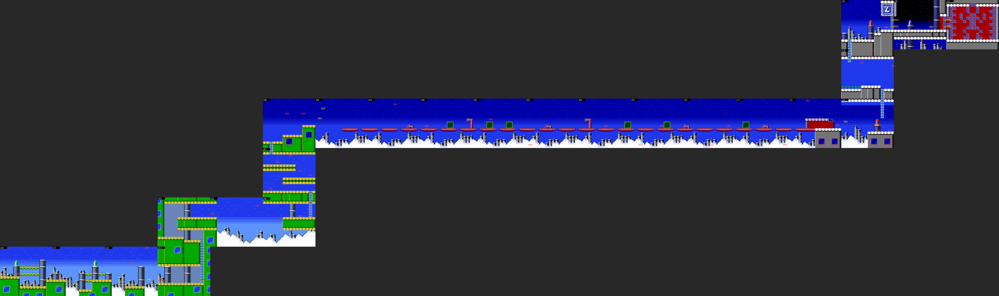

*Map of rooms `$00-$17` (static render, half scale; red = enemy ids, yellow = special objects).*

**Look.** It is a night-sky version of RM2's Air Man and Crash Man tile sets: a blue sky with stars, white snowy
mountains, grey skyscrapers, and green blocks with yellow scalloped tops and blue windows [seen].

**Route** [seen][code: segment table]:

1. Rooms `$00-$03`: a city of green blocks and towers. Enemies are red crab-like robots and white bouncing balls
   (`$4B-$4D`), and three square blocks that drop in sequence (`$31-$33`). The pits between the towers are the main
   killer: autorun died there over and over [seen: `stages1_cheatman_start.png`].
2. A climb up a green tower (`$04-$06`, three rooms wide, then `$07`) into `$08-$09`. Here **Pierrobots** (RM2 Metal
   Man's clowns riding gears, `$29/$2A`) roll at you from above [seen: `stages1_cheatman_pierrobots.png`].
3. **The bridge** (`$0A-$11`): eight screens of small red disc platforms floating over the night city, with gaps
   between them. There are `$8C` enemies (a CX type) on posts along the bridge, `$21` enemies, and `$1D` enemies that
   rise from below (y `$E0`) [code][seen: map].
4. At room `$11`, x `$80`, the camera locks (`$14 = $15 = $11`) and the game moves to the next segment without moving
   to a new room. This is why the plain segment sum for this stage is one room off [seen: `noclip.py` log]. Then come
   a grey building (`$12-$13`), two ladder climbs (`$14`, `$15`), and the boss gate.
5. `$15` -> shutter -> **`$16`** (corridor) -> shutter -> **`$17`** (boss).

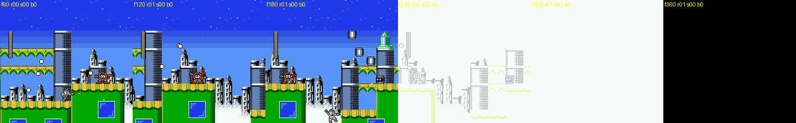

*Rooms `$00-$01`: crab robots, bouncing balls, the three falling blocks, then a pit death and the white fade.*

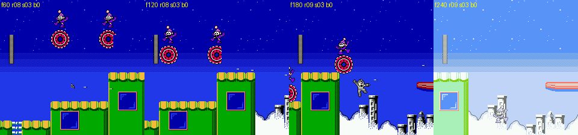

*Rooms `$08-$09`: Pierrobots, the clowns riding gears.*

**Heart tank: room `$16`** [code][seen]. It is special object `$BB` at (`$B0`, `$82`), on the floor of the corridor
between the two shutters, in plain view. A boss-fight run that died and respawned at the checkpoint walked into it,
and the save's max HP went to 28 (`hp 24/28` after the respawn).

### Boss: Cheat Man [seen]

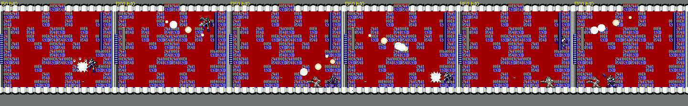

*Cheat Man fight, godmode, frames 50-700: Mega Man X jumping between corners, his bullet fans, and the player moved
to a new spot between frames.*

The arena (room `$17`) is a red wall covered in blue hex strings (`00EA 24A1 C93D 8548 …`): memory addresses and cheat
codes as wallpaper. Cheat Man is **Mega Man X** (blue armour; his stage-select portrait is X's face), object `$50`
(standing) / `$51` (airborne), 40 HP. What he does, from two godmode runs of 1,800 and 3,600 frames (logs:
`build/research/cx/cx-stages-1/b_cm1.log`, `b_cm2.log`):

- **He teleports you.** Every few seconds your position is rewritten with no input from you: X `$1B -> $B0` within 12
  frames of the start, later X `$C8 -> $38` with Y `$B4 -> $5C` (dropped in mid-air), then `$40 -> $C0`. You land in a
  new spot, often next to him or under his shots [seen: RAM log].
- **He refills his own life bar**: 38 -> 39, 33 -> 34 and 28 -> 29 during the fight, with no pickup involved [seen].
- **He deletes the floor under you.** A helper object (`$27`) appears, and a section of the floor directly under the
  player turns into a black hole. You fall through and die whatever your HP is: godmode kept HP at 24 and the life
  was still lost. Both runs ended this way, at about frame 1,050 [seen: `stages1_cheatman_floor_hole.png`].
- Shots: fans of up to five round bullets (`$45`) aimed at the player, a `$8D` projectile that curves, and a ground
  object `$8E`. The `$8D` and `$8E` handlers are in CX's bank `$20` [seen][code].
- The room flashes white and pink at intervals, including at times when nobody died [seen].

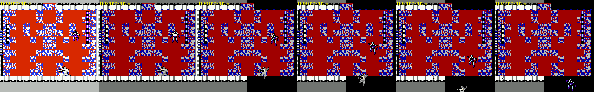

*The floor opens under the player (a black gap in the white ledge); the player falls and the death fade starts.*

Together these give a boss who uses cheats: a position hack, an infinite-health hack, and a "walk through floors" hack
turned against you. The "Cheatous Bass … jam session attack" banner in ROM (see `text.md`) was not seen in these
runs.

---

## 2. Air Man (stage `$01`)

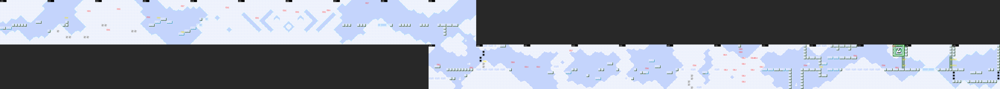

*Map of rooms `$00-$15`: ten screens of open sky, a drop, then a long run to the boss at the right end.*

**Look.** Pale-blue sky, huge dithered white clouds, thin glass ledges and grey block ledges, and white arrows painted
on the background as route hints (→, ↓) [seen]. Rooms `$04-$07` are mostly giant cloud shapes: diagonal bands, a
diamond and chevrons [seen: `stages1_airman_rooms.png`].

**Gimmick: clouds are scenery.** The cloud masses at the bottom of the screen look like ground but are background, so
walking off a glass ledge onto a "cloud" drops you to your death. Every autorun death in this stage was this [seen:
`stages1_airman_clouds.png`]. It is a direct joke on RM2's Air Man stage, whose clouds are also only background.

**Route** [seen][code]: rooms `$00-$09` run right through open sky (enemies `$3E`, `$37`, `$0A`; a pickup `$B6` in
room `$03`). From `$09` the route drops to `$0A`, the first checkpoint. Then it goes right through `$0B-$11`: spike
blocks, a small thrower that sends blue crescents, orange blocks and the `$50`-`$54` sky enemies, with a cluster of
ten `$53`/`$54` enemies in room `$10`. Then `$12-$13`, the shutter, the corridor `$14`, the shutter, and **room
`$15`**. Segments 1 and 2 have both the "right" and the "down" exit flag (`$60`, `$66`); play went right.

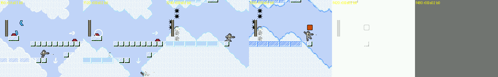

*Rooms `$0A-$0C`: glass ledges, the painted arrows, the crescent thrower, and an autorun walking onto a cloud and
falling.*

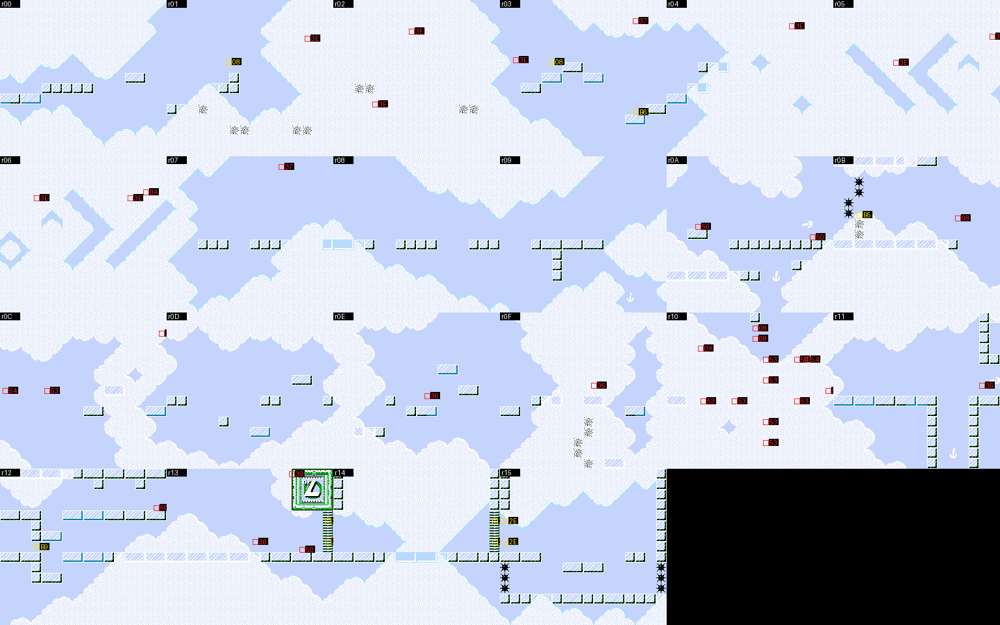

*Every Air Man room, `$00-$15` (static render with enemy and object ids; the DL-emblem wall is at the right of `$13`).*

### Boss: Air Man, who is literally air [seen]

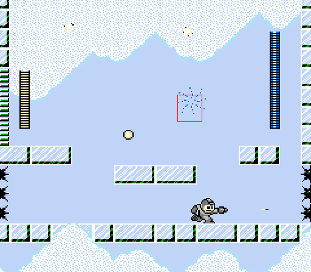

*Room `$15` at 2x: the red box marks Air Man's position (boss object, X `$9C` Y `$5A`). All there is to see is a faint
sprinkle of blue dots.*

- **Air Man is drawn as a sparse swirl of blue and white dots**: nine sprite tiles `$A3-$A9` in palette 3 (black /
  white / blue), against a light-blue sky full of white clouds. In play he reads as a faint shimmer, and what you
  fight is a life bar. This is the joke of his stage-select portrait: in EN it is just the words "Air Man", and in JP
  it reads 空気男. *Kūki* means "air", and it is also slang for someone with no presence.
- **He teleports** every 30 to 60 frames (logged `C8,73 -> 9C,5A -> A9,50 -> 91,6F -> 5C,30 -> E9,00 -> F6,6D`), so
  you cannot follow the shimmer either.
- Attacks: volleys of four tornadoes (`$35`, RM2's Air Shooter object) fanned out from where he is, and small air puffs
  (`$5D`) that drift across the room [seen: `am_cp2.log`].
- The arena has two short glass platforms, a glass floor, and spike blocks on the lower side walls.
- **Reward**: "You got: Dead Ringer", with a gold pocket watch beside the Rockman artwork. That is the *TF2* Spy's
  fake-death watch [seen]. Giving it to a boss who is not there fits the joke [guess].

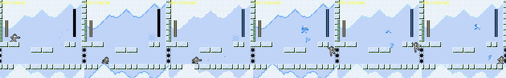

*The fight: the bar fills, then tornadoes and air puffs come out of nowhere.*

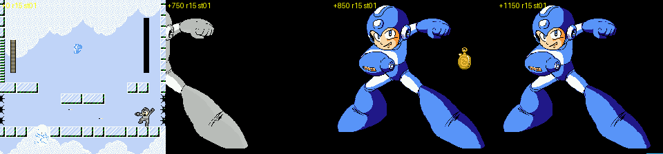

*Air Man dies, then the weapon-get screen: grey artwork recoloured to blue, the Dead Ringer pocket watch, "You got:
Dead Ringer".*

The new state `build/research/cx/states/air_man_boss.state` is room `$15`, boss bar full, player in control. See 6.1
for why the scout could not find this room.

---

## 3. Whispy Woods (stage `$02`)

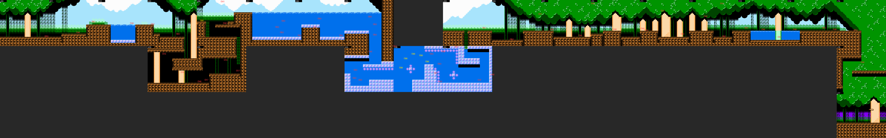

*Map of rooms `$00-$17`: a zig-zag of down / up / down / up segments, then a long forest run, a drop, and the boss.*

**Look.** RM2's Wood Man stage, brightened toward *Kirby*: dense green canopy, pale trunks, dark tree columns, a
purple dusk sky in places, and orange root-dirt ground [seen: `stages1_whispy_forest.png`].

**Route** [code: segments 0-6; seen: `$00-$04` and `$0D-$16`]:

1. `$00-$03`, then down to `$04-$05`, up to `$06-$09`, down to `$0A-$0C`, and up to the first checkpoint `$0D`. Rooms
   `$0B`/`$0C` hold five pickups `$B6` in a row, and the stage's palette triggers `$40` sit there.
2. `$0D-$15`: the long forest run. Its enemies are **Kerogs**, RM2 Bubble Man's big pink frogs that spit three small
   frogs (`$0C` with `$0D`/`$0E`), plus blue crescent projectiles and small birds. From `$13` on, the floor is broken
   by **ponds of water** with Kerogs sitting in them [seen].
3. Down into `$16`, a tall leafy shaft with bark platforms, and down again to the boss room `$17` (segment flags `$48`
   and `$40` are both down exits) [code][seen].

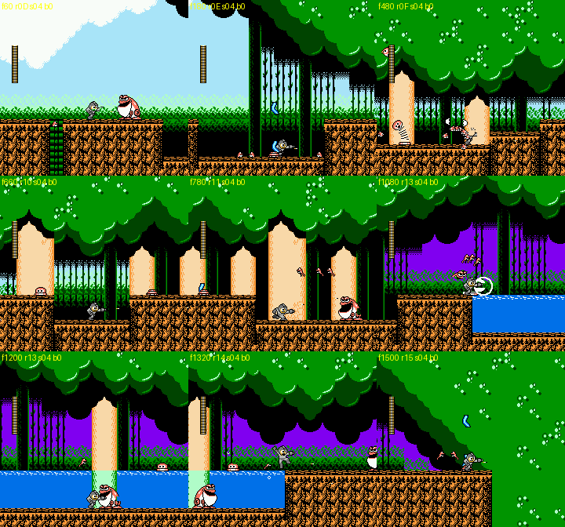

*Rooms `$0D-$16`: Kerogs spitting small frogs, the ponds, the leafy shaft.*

### Boss: Whispy Woods [seen]

Room `$17`. A *Kirby's Dream Land* Whispy Woods fills the right edge: a pale trunk with a face (two black eyes, a stub
nose) under a canopy, in a purple-and-green forest. 40 HP (boss slot: object `$6F` / `$6C`; apples are `$62` and puffs
`$5D` here).

- **Apples** fall from the canopy all over the room, then bounce and roll [seen].
- **Air puffs** come out of the mouth and travel left along the ground [seen].
- His eyes close to lines when he is hit [seen].
- When he dies the face disappears and a plain trunk is left standing [seen: `stages1_whispy_death.png`].
- Reward: Ringo Shield (*ringo* = apple; see `text.md`).

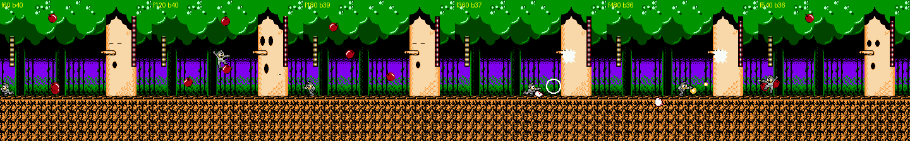

*Whispy Woods: apples from the canopy and air puffs along the ground.*

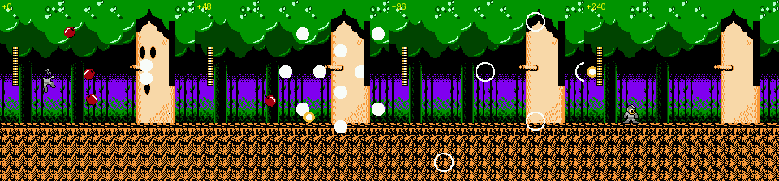

*Death explosion; the face is gone and the trunk stays.*

---

## 4. Fire Mario (stage `$03`)

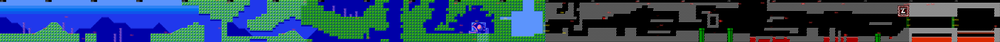

*Map of rooms `$00-$15`, laid out as one horizontal run. CHR comes from four states, so rooms `$05-$0B` use the
underwater tiles.*

### 4.1 Part 1: SMB World 2-2, underwater (rooms `$00-$0B`) [seen]

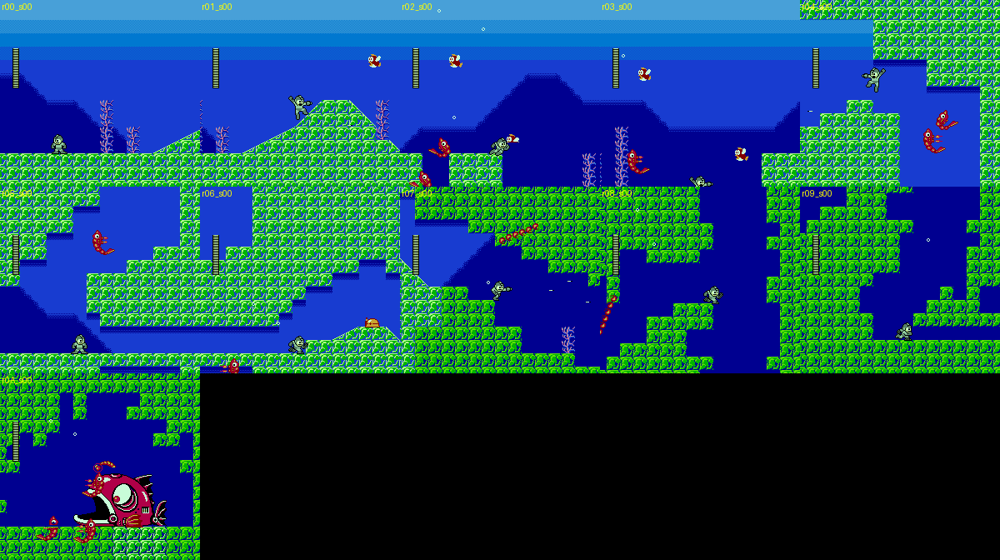

*Rooms `$00-$0A`: the water surface band, coral, Shrink shrimp, fish, the fire bar in `$07`, and the angler fish in
`$0A`.*

- The SMB water level drawn with Rockman tiles: a light-blue surface band at the top, a deep-blue sea, green coral
  blocks, pink coral plants, and rising bubbles. You move with RM2's underwater physics (high, floaty jumps).
- Enemies: red **Shrink** shrimp (RM2 Bubble Man), orange-and-white fish that swim across the top (Cheep-Cheep
  stand-ins), and **rotating fire bars** under water (rooms `$07`, `$08`; the chain is at different angles in
  different frames). A bar is six `$82` segments around an `$81` pivot, which CX added in bank `$20` [seen][code].
- Room `$0A`: RM2 Bubble Man's giant **angler fish** (lantern fish) as a mid-boss, with shrimp around it [seen].
- **One-way scrolling, SMB style.** From room `$05` on, the left scroll limit follows you and the right one is
  open (`lim 05-FF`, then `09-FF`, then `09-0A`). Invisible `$41` script objects at the right edges of rooms do it
  (script `$10` in rooms `$04`/`$08`, script `$08` later), so you can never scroll back [seen: explorer log][code].

### 4.2 Part 2: the SMB castle (rooms `$0C-$14`) [seen]

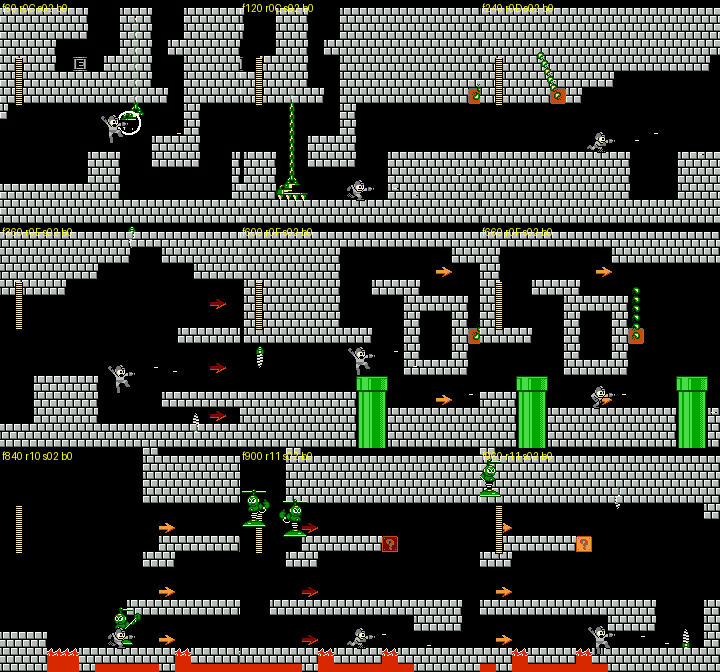

*Rooms `$0C-$11`: grey castle bricks, chains swinging from blocks, green warp pipes, "?" blocks, lava, and the
blinking arrows.*

- Grey castle bricks, lava pits, **green warp pipes**, "**?**" blocks whose colour flashes between orange and red,
  green chains that swing from orange blocks (fire-bar style), blinking orange and red **arrow markers**, green
  propeller robots, and long green-white objects that fall from the ceiling (`$47-$49`) [seen].
- The one-way scrolling continues: `lim 0C-13 -> 0D-13 -> 0E-13 -> 10-13` as you advance, from script `$08`
  triggers at the right edges of rooms `$0D`, `$0E`, `$10` and `$11` [seen][code].
- `$13` has the DL emblem, then come the shutters, the corridor `$14`, and the boss `$15`.

### 4.3 Heart tank: made by a script in room `$08` [code]

Fire Mario's heart tank is **not in the item table** (no `$BB` in the bank). It comes from **script `$0B`**, an
invisible `$41` at the right edge of room `$08` (x `$FF`). Each frame the script (`$1E:8AB0-$8AE0`) checks five
things: the stage's heart flag `$7FFB` is still 0, `$0140` is non-zero, no heart object exists yet, the player is in
room `$08`, and the player's Y is above `$72` (the upper part of the screen). If all hold, it creates object `$BB` at
(X `$7D`, Y `$22`), near the top of the room.

So the tank is hidden above the normal swimming path, where SMB players will look for coins and vines. In the
emulator, forcing the player's Y above `$72` in room `$08` did create the `$BB` object at `$7D,$22`, but it disappeared
within 20 frames without being collected (`$7FFB` stayed 0). How you are meant to reach it and keep it is still open.

**(corrected by critic)** The tank does not disappear: it is re-created in another object slot after about 10 frames
(slot 26, then slot 21) and then drifts up from Y `$22` to `$13`, where it stays for as long as you remain in the room
[seen, 400 frames logged, `build/research/cx/cx-critic/fmheart.py`]. It sits at the very top edge of the screen,
in a gap of the coral ceiling. Touching it (player at X `$7D`, Y `$18`) set `$7FFB = 1` and raised the save's max HP
from 24 to 28 at once [seen], so it is the real tank. To reach it in play you swim up to the top of room `$08` with
RM2's floaty underwater jump [guess for the intended route].

### 4.4 Boss: Fire Mario [seen]

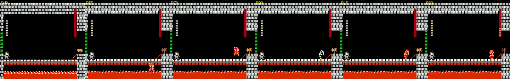

*The entrance: Mario jumps up from below the bridge, flashes white-and-black and red like an SMB power-up while his
bar fills, then fights.*

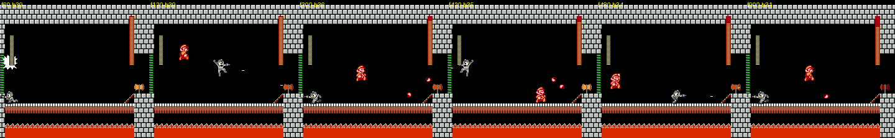

*The fight: high SMB jumps and bouncing fireballs on the 1-4 bridge.*

- The arena is **World 1-4's bridge**: grey castle bricks, lava under a chain bridge, and the axe on the right-hand
  pillar. Fire Mario (the SMB sprite in red and white) stands where Bowser would. 40 HP. His boss slot shows objects
  `$60`/`$61`/`$62` by state, and `$5B` are his fireballs.
- Entrance: he jumps up from below the bridge (Y `$C4` -> `$9B`), then object `$5F` flashes him between a white/black
  and a red palette while the bar fills. That is the SMB power-up flash, read here as "grabbing the Fire Flower"
  [seen][guess for the reading].
- He jumps high and often in SMB arcs, crossing the whole bridge, and throws **bouncing fireballs** that hop along the
  bridge toward you [seen].
- **The axe does nothing.** Standing on it (x `$EC`) for 900 frames neither drops the bridge nor hurts him [seen]. The
  reference is visual only, and players who know SMB will try it.
- Reward: Fire Ball.

---

## 5. Opening stage (stage `$0F`)

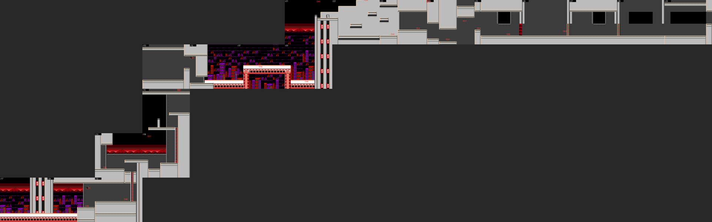

*Map of rooms `$17-$29` (approximate around `$1C-$1D`; see 0.1). It climbs from the red-sky street up the grey tower.*

The story text is in `text.md` and `cheats.md` §9. This section is about the level and the fight.

1. **Fake Rockman** (grey, 24 HP) starts on a red-sky street of purple and red skyscrapers (`$17-$19`), with Mets and
   red jumping robots. Then he climbs into a grey metal tower (`$1A-$1C`, ladder climbs, small blue flying drones).
   In room `$1C` (scripts `$04` and `$07`) the Guts Man scene runs: Guts Man throws a boulder, buries you, carries you
   off, and **Quick Man** beams in. From the checkpoint at `$1D` you play Quick Man with 40 HP, no dash, and wall
   kicks [seen].
2. As Quick Man: a rock pile (`$1D`), a red-girder bridge over the city with a white **Robbit** rabbit (`$1F-$20`),
   then the grey tower again (`$21-$25`) with Mets, a green propeller enemy and red jumpers. Quick Man's buster is
   the white Quick Boomerang (object `$0E`) [seen: `stages1_opening_quickman.png`].
3. **Room `$26`: Quick Man vs. Guts Man**, both at 40 HP [seen: `b_guts.log`]:
   - Guts Man jumps and throws **boulders** that burst into fragments (white chunks), as in Rockman 1.
   - Each Quick Boomerang hit does **3 damage**, and several hits can land in a row (28 -> 25 -> 22 -> 19 in 24
     frames).
   - **The fight cannot be won**: once his HP reaches 7 (here from 10) he stands dazed with stars over his head.
     **Rock** (blue, the real Mega Man) drops in: "Guts Man, escape now!!" / "Thanks, Mega Man!" [text]. Both
     teleport away.
4. Rooms `$27-$29`: Quick Man walks on to a **cage** (a black cell in the wall) and shoots it open (it uses the boss
   HP bar). The fake Rockman steps out. "Are you ok?" / "Thanks, Quick Man. I'm ok." / "I'll scout ahead and collect
   as much information on Dr. Light's lab as I can." / "Now there're 8 Robot Masters including Mega Man." [text]
   Then the stage select.

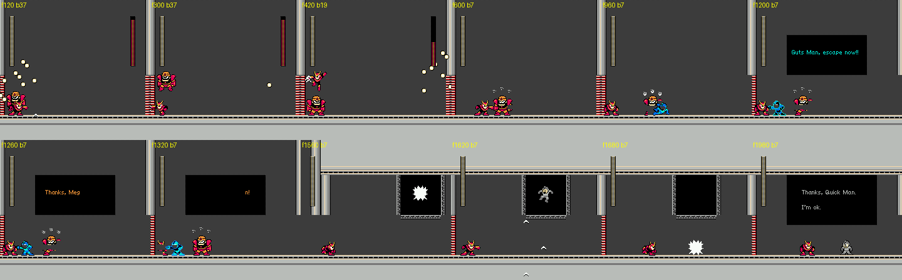

*Room `$26`: boulders, the HP bar, Guts Man dazed at 7 HP, Rock's rescue lines, the cage breaking, and the fake
Rockman freed.*

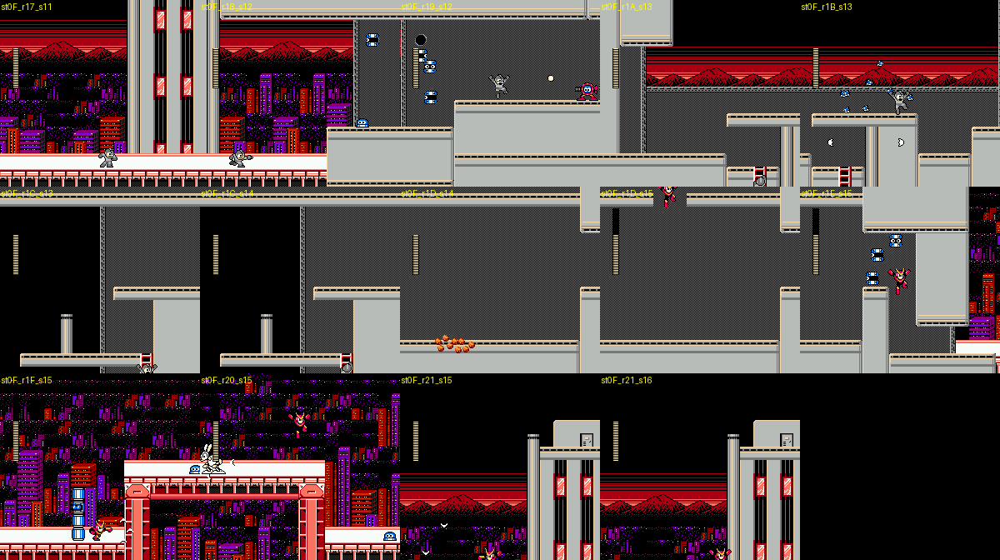

*The opening stage room by room (explorer screenshots; the room and segment are in each label).*

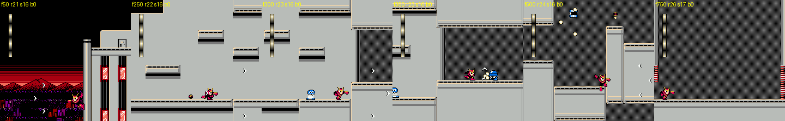

*Playing Quick Man through rooms `$21-$26`, boomerangs flying, into the Guts Man fight.*

---

## 6. Corrections and additions to `cheats.md`

### 6.1 Air Man's boss room is `$15`, and rooms `$16+` belong to Light 2

`cheats.md` lists "Air Man's boss room" as not found and calls `air_man_midboss` (Quick Man, room `$16`) and
`air_man_deep` (room `$26`, the wind maze) part of Air Man's stage. They are not. Air Man's stage ends at room `$15`,
the boss room: killing him there gives the weapon and leaves the stage [seen]. The bank's 6-entry restart table is
`00 0A 14 | 17 20 2B`: the first three entries are Air Man's, and `17 20 2B` belong to Light 2 (stage `$09`). A
checkpoint warp to "Air Man checkpoint 3/4" under stage ID 1 therefore lands in Light 2's rooms, drawn with Air Man's
tiles. `cheats.md`'s `CP_ROOMS[1]` should be `[00, 0A, 14]`, and the states `air_man_cp3`, `air_man_cp4`,
`air_man_midboss` and `air_man_deep` are Light 2 rooms with the wrong tile set. The same kind of mix-up probably
explains `light1_cp1` (room `$21` with limits `$11-$18`) [guess].

### 6.2 Heart tanks of these stages

- Cheat Man: room `$16`, special object `$BB` at (`$B0`, `$82`), on the corridor floor between the shutters
  [code][seen].
- Fire Mario: no table entry; script `$0B` in room `$08` creates it near the top of the screen (4.3) [code].
- Air Man and Whispy Woods have no heart tank (no save field, no `$BB`, no script `$0B`) [code].

### 6.3 New state

| State | What it is |
|---|---|
| `build/research/cx/states/air_man_boss.state` | Air Man stage, room `$15`, boss bar full (40), player in control |

Scratch states (not shared, in `build/research/cx/cx-stages-1/`): `x_fire_mario/r00..r0A_s00.state` (every
underwater room), `x_opening/st0F_r17..r21_*.state` (every opening room up to `$21`), `noclip_end.state` (Cheat Man
room `$12`), and `*_end.state` after each boss recording.

---

## 7. Method and what was not covered

- Maps: static renders from `stagemap.py` with CHR from the nearest savestate. Routes: godmode autorun and Go-Explore
  runs (`walkrec.py`, `xplore2.py`), a "noclip" walk with the player's Y frozen (`noclip.py`), and RAM logs of every
  live object every 4 frames during boss fights (`bossrec.py`).
- Not covered:
  - frame-exact attack timings and damage numbers for each boss (the fights were recorded, not timed);
  - a full on-screen playthrough of Air Man rooms `$00-$09` and Whispy `$05-$0C` (they are mapped statically, and the
    autorun kept falling into pits);
  - what most `$41` scripts do, other than `$08`, `$0B` and `$10`;
  - names for the CX-only enemy types (`$1D`, `$8C`, `$47-$49`);
  - how to collect Fire Mario's heart tank in normal play.

---

## Lessons for Rockman 6 GP

**Design**

- **Make the guest's home-game rule the stage's rule.** Fire Mario's stage does not just reskin tiles: it imports
  SMB's one-way scrolling, an underwater level, fire bars, warp pipes, "?" blocks and the 1-4 bridge. Air Man's stage
  is built on "clouds are not floors", and Whispy's fight is apples and air puffs.
- **A boss joke can be a mechanic, not just a sprite.** Cheat Man's three "cheats" (teleport the player, heal
  himself, delete the floor) and Air Man's near-invisibility are memorable because they bend the rules of the fight
  itself. The risk is fairness: the floor delete kills through any HP, so it needs a readable tell (the `$27` helper
  object is the only warning).
- **Reward players who know the reference, and allow false leads**: the SMB axe that does nothing, the Dead Ringer for
  a boss who isn't there, a heart tank hidden where SMB players look (the ceiling of a water level).
- **The opening stage teaches the second moveset** by taking the first one away (the capture), and ends with an
  unwinnable scripted fight at 7 HP that sets up the story.

**Technical**

- **Data-driven "director" objects** (`$40` for palette/music, `$41` for scripts by number) let a level editor place
  behaviour without new code paths in the stage engine. RM6 GP can do the same with an invisible object type whose Y
  coordinate selects a script.
- Script `$08` shows how small a mechanic can be: `LDA $0440,X / STA $14` is SMB-style one-way scrolling in two
  instructions, because the engine already clamps the camera to `$14`/`$15`.
- **Bank-per-object-type dispatch** (`$FA50`) is how CX grew past RM2's object bank: new AIs go in fresh banks and the
  dispatcher switches banks per object. RM6 GP needs the same once its object code outgrows one bank.
- **Keep segment tables consistent with checkpoint tables.** CX's tables were edited by hand and drift (Cheat Man's
  in-place segment, the shared restart table that sends "Air Man cp3/cp4" into Light 2). A build-time check that
  walks the segment table from each checkpoint would catch this.
- A static level renderer plus enemy and object overlays (here about 200 lines of Python) beats autoplayers for
  understanding a stage. Build one for RM6's format before trying to play through.
