# Rockman CX stages, part 2: Yoshino Man, Mega Man, Kamen Rider, Bomberman (cx-stages-2)

Status: draft complete; first half of the Mega Man route and both heart-tank routes still open (see the end).

Tags: **[seen]** observed in the emulator, **[code]** disassembly/data, **[text]** in-game text, **[doc]** readme,
**[guess]** speculation. ROM `roms/cx_en.nes`. Savestates: `build/research/cx/states/` (see `cheats.md` §1).
Static maps: `tools/analysis/cx/stagemap.py` (by cx-stages-1).

## Yoshino Man (stage 4)

**Who:** DLN.009 YOSHINOMAN, credited to HIMAJIN JICHIKU [text: credits], so he is the hack author's own robot. He
looks like a man rather than a robot: dark hair, glasses, a dark green jacket, and a green "⊗" emblem in his hand.
His weapon is the **Print Cutter** [seen]. Every attack is paper.

**Bank and rooms** [code][seen]: rooms `$00-$17` of 16 KB bank 4 (shared with Light 5, rooms `$18+`). Restart rooms
`$00`, `$07`, `$16`; boss room `$17`. The explorer's route from the start to the boss door took 6,056 frames (about
100 s) under godmode and a one-hit cheat. Room entries on that route: `00 01 02 … 16 17`, in order, with no detours.

*Twelve frames from the route, left to right: Wood Man's forest at the start (Battons in the leaves), the techno
interior with its black bombs, the Sniper Armor in the forest pocket (room `$0A`), the leafy rock slopes (`$0C-$0F`),
the force-beam rooms (`$10-$11`), the Met rooms with the rolling Pierobot gear (`$13-$14`), and the barred corridor before the
boss (`$16`).*

### Layout, room by room [seen]

| Rooms | Look | What happens |
|---|---|---|
| `$00-$01` | Wood Man's forest: red leaf canopy, trees, cream grass, blue bushes | Battons drop out of the leaves; pink Robbits hop; a blue spring-headed hopper (object `$46`) bounces |
| `$02-$09` | A techno interior: grey walls with a triple green outline, cyan concentric-square blocks, blue diagonal stripes; vertical shafts going **down** | Black round bombs and Robbits in the shafts. **Two Friender gates** (rooms `$05` and `$07`), below |
| `$0A` | A pocket of forest, flat floor | **Sniper Armor**: the red Sniper Joe in his green walker mech (`$4E` mech, `$4F` Joe) |
| `$0B-$0F` | Forest with rock-block floors and slopes, leaf ceilings | A red robot carrying a blue Met over its head (`$4B`), **Blocky** towers (Crash Man's stacked-block enemy, `$31/$32`), Battons |
| `$10-$11` | Black maze with a ladder shaft | **Force beams** (below) |
| `$12-$15` | Techno interior again, stair-step corridors with cyan "fan" blocks | **Mets** (`$34`, shots `$35`) and a rolling Pierobot gear (`$29`, a yellow ring) |
| `$16` | A long corridor over a row of fan blocks | Several red-and-blue striped bars (special objects `$2F`) act as a run of shutters before the boss |
| `$17` | Boss room: blue zig-zag backdrop in a green frame | Yoshino Man |

### The Friender gate: an enemy that respawns its own head [seen][code]

Wood Man's robot dog (Friender / "Hot Dog") shows up twice as a **gate** you cannot walk or jump past:

1. It **beams in** like a robot master: a tall orange pillar of light (object `$1C`) drops onto the ledge, and the dog
   appears (head `$19`, back-mounted horn `$1A`, fire breath `$1B`).
2. Its body is a wall. Invisible **shutter objects** (special objects `$2E` at x `$B8`: three in room `$05`, two in `$07`; the same id
   the boss room uses for its shutter) sit inside it, so the player stops at x `$A8` even under godmode, on the ground or in a
   jump.
3. The **head** has 40 HP and takes 1 per buster shot. When it dies it explodes into 16 debris pieces (`$06`), leaving
   a headless body with a round orange neck stump. About **330 frames later the head grows back** at full HP, with a
   burst of white sparks (`$4D`). In a 3,500-frame test it died and regrew 7 times; it never stays dead.
4. The real weak point is the **horn on its back** (`$1A`, 40 HP). It takes damage **only while the head is gone**.
   Damage carries over between cycles. When the horn reaches 0 the whole dog explodes, the `$2E` shutters
   disappear, and it drops a large energy capsule (`$B7`).

So the "mini-boss" is a timing puzzle: blow the head off, then jump-shoot the horn before the head comes back.
Standing still and shooting forward never works, because the shots hit the head or nothing.

*The Friender in room `$07` (autorun, no one-hit cheat): fire breath, the head exploding, the headless body with
its round neck stump, the head regrowing, the jump-shots on the horn, and the final explosion with the energy
capsule.*

### Force beams that turn corners [seen]

Rooms `$10-$11` use Quick Man's force beams, the red/yellow laser lines that RM2 draws into the nametable. CX adds
**vertical beams** (object `$56`) that drop from the ceiling and then **turn** into horizontal runs, as well as
the usual horizontal ones (`$4A`). The lines stay on screen, so after a few seconds the room looks like a pen plotter
has drawn a circuit through it. In room `$10` they fire on a timer even while the player stands still at the
entrance. [guess] The theme fits a "printer" boss whose attacks are all paper. In room `$11` the 1-UP (`$BA`) sits inside
the beam maze.

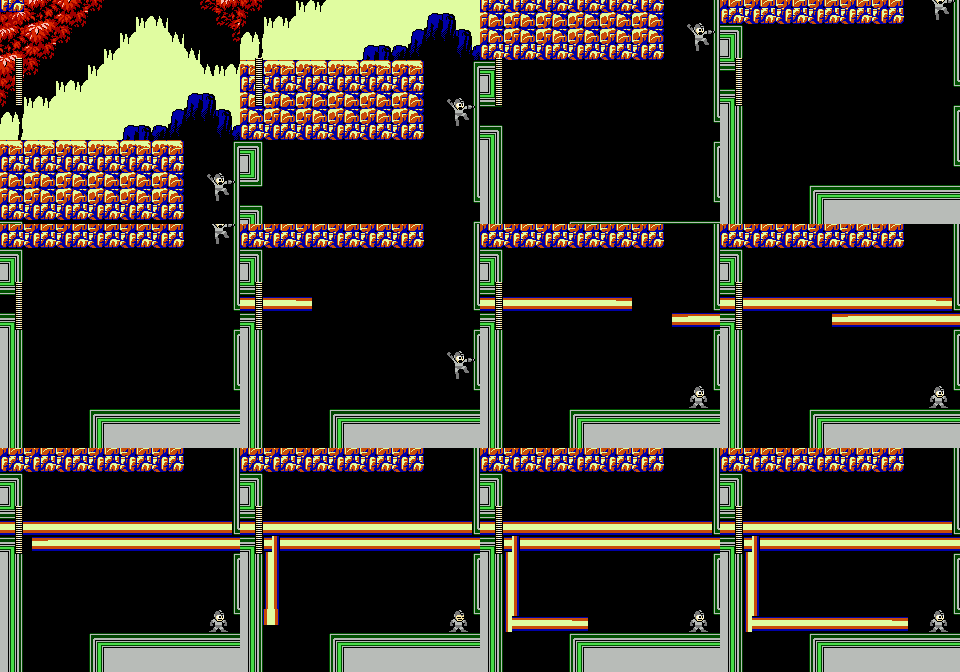
*Room `$10`: the player drops in at the right edge and stands still. A horizontal beam fires, then a vertical beam
drops from the ceiling and turns, and its line stays drawn on screen.*

### Boss: Yoshino Man [seen]

*Yoshino Man at 3×: the arms-crossed intro pose, throwing a paper sheet, the jump-throw, the paper landing, and the
floor-sliding paper blade (`$5A`).*

- **HP 40** (`$06C1 = $28`), like every CX boss. Object `$63` standing or running, `$65` jumping, `$64` landing
  [code: object types logged every frame].
- **Paper sheet** (`$5C`, 3 damage): thrown forward at the player from the hand device. After about 30 frames
  it turns into a **fluttering sheet** (`$61`, 2 damage) that sways down the screen. Several hang in the air at
  once, so the arena fills with slow paper.
- **Paper blade** (`$5A`, 3 damage): a tall white sheet standing on its edge that **slides along the floor** at about
  2 px/frame, all the way across the arena. You have to jump it.
- **Movement:** he alternates short runs and **high jumps across the whole room** (from x `$C8` to `$18`), throwing
  sheets from the top of the arc. In a 1,200-frame idle test he crossed the arena several times.
- Measured hits on a player standing still at the left wall (no godmode, 1,500 frames): 12 hits of 2 or 3 damage,
  so about one hit every 2 s. All but one hit came from paper objects; the remaining one may have been body contact.

Damage per hit, measured by a chase-and-fire script in 900 frames (`tools/analysis/cx/stages2_dmgtable.py`; "–"
means no hit landed under that script, which does not prove immunity):

| Weapon | Buster | Cheat Saber | Dead Ringer | Ringo Shield | Fire Ball | Print Cutter | Mega Buster (tap) | Rider Kick | Power Bomb |
|---|---|---|---|---|---|---|---|---|---|
| Damage | 2 | **40 (one hit)** | 2 | – | 1 | – | 1 | 3 | **4** |

The Power Bomb (Bomberman's weapon) is the practical weakness. The Cheat Saber kills him outright (below, §Weapons).

## Mega Man / Rock (stage 5)

**Who:** DLN.001 MEGAMAN (JP ROCKMAN), credited to CAPCOM [text: credits]. The hero of the series is the boss, and
his stage is the one that runs **backwards**.

**Bank and rooms** [code][seen]: bank 5, shared with Light 6. Restart rooms `$0E` (start), `$08`, `$01`; the boss
room is `$00`, the lowest room number in the bank. On the second half of the stage (checkpoint `$08` to the boss) the
room counter goes `08 07 06 05 04 03 02 01 00`: rooms `$06`, `$05`, `$03` and `$02` are entered at their **right**
edge (x `$FD-$FF`), and the others through vertical shafts, so the stage runs right to left. The explorer took 2,369 frames from `$08` to the boss.

**Look:** black, with **thin green circuit-board traces** for every wall and floor, and huge flat blue/teal
polygons in the background. The polygons include a downward triangle split into four (room `$08`, a Triforce
shape), sideways triangles, diagonal bands and round blobs. Rows of green spiky "asterisk" tiles are the spikes. In
room `$01` a microchip block carries the **Dr. L emblem**, and a 1-UP sits beside it. The stage looks like the inside
of one of Light's circuit boards [guess].

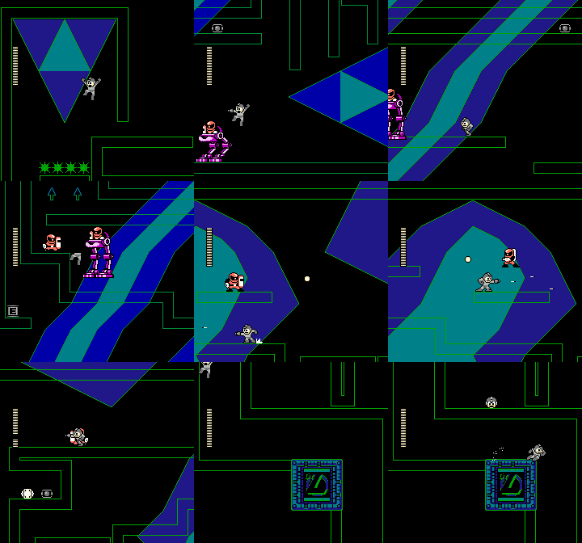
*Checkpoint `$08` to the boss: the Triforce room with its spike row, Sniper Armors (magenta walkers) and Sniper Joes
among the blue bands, the E-tank ledge in room `$05`, the round-blob rooms (`$03`), and the Dr. L chip in room `$01`
just above the boss room.*

### The first half: up, over and through the floor [seen]

From the start (room `$0E`, top corridor, two ladders going up) the way on is not left. You go **right** into room
`$0F`, drop to the lower level, walk back **left** (jumping a pit at x `$6C` of room `$0F`) into the closed lower
half of room `$0E`, and fall through a gap in its floor marked by **two green down-arrows**. The game then reports
room `$11`. The live segment index `$38` and scroll limits `$14/$15` read: segment 0 = rooms `$0E-$10` (the start),
segment 1 = `$11-$13` (after the drop), segment 6 = `$08-$0B` (around checkpoint `$08`), segment 10 = `$15`
[seen: RAM]. A forward reading of the `$B400` segment list gives different strips (`$0E-$11`, `$12-$14`, …), so
the reversed stage does not lay its rooms out the way the static map tools assume. Walking *right* from checkpoint
`$08` (against the stage's direction) reaches rooms `$09`, `$0A` and `$0B`.

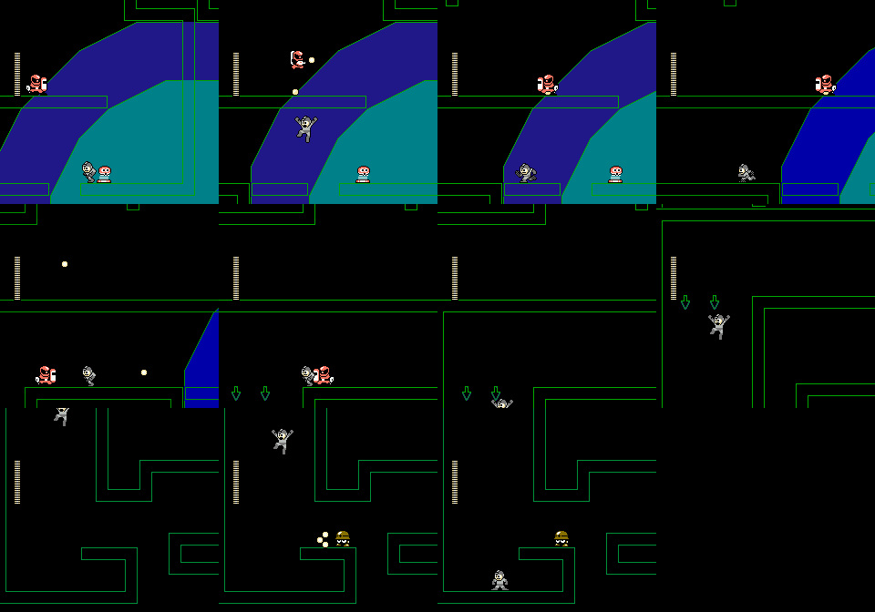
*The start of the route: the lower path of room `$0F` with a Sniper Joe, back into the lower half of room `$0E`, and
the drop through the two down-arrows into the next segment.*

Within the time box the explorer did not link the post-drop rooms (`$11-$13`, `$15`) to room `$0D` and checkpoint
`$08`. So the first half of the route is only partly mapped.

**Enemies** (second half) [seen]: Sniper Joes (`$4F`, their shots are `$35`) and **Sniper Armors** (`$4E`, the
magenta mech with Joe riding it) in nearly every room from `$07` to `$02`, plus green spike rows. Walking right from
checkpoint `$08` into room `$0B` also shows floating green spike mines, a red bird robot and a blue blob. Items:
an **E-tank** on a ledge in room `$05` (`$B9`), a 1-UP (`$BA`) in room `$01`, a **heart tank** in room `$0B` (below).

### Boss: Rock [seen]

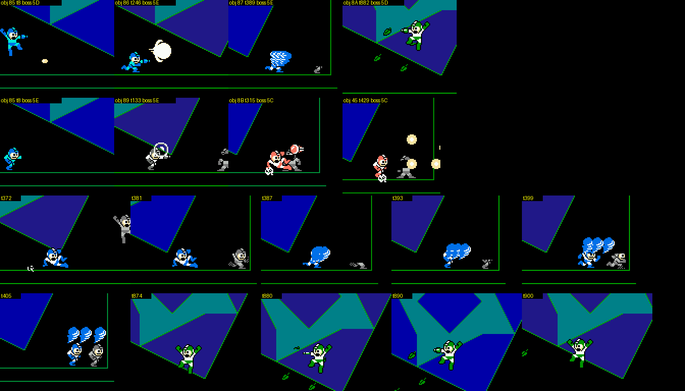
*Rock's attacks, one per object type (godmode, top two rows from two different runs): buster pellets (`$85`), a fully
charged Mega Buster shot (`$86`), a slide with blue after-images (`$87`), green Rock throwing leaves (`$8A`),
grey Rock with a cutter ring (`$89`), red Rock lobbing a bomb (`$8B`) that bursts into four blasts (`$45`). Bottom
row: the slide and the leaf attack frame by frame.*

- **HP 40.** Arena: a giant tilted blue/teal square-in-a-diamond on black, green frame. The player is Rock's
  mirror image: a grey Rockman against the blue one.
- **He changes weapons, and his palette changes with them**: blue = buster, then grey, red and green forms, like
  the player's own palette swap. The order depends on what the player does: idle runs gave
  buster → cutter → bomb, and walking-and-jumping runs gave buster → charge shot → slide → leaves.
- **He opens a menu to do it.** Before some weapon changes a large framed panel (green-studded border, solid blue
  inside) is drawn row by row over the right half of the arena, and is then erased the same way. It looks like
  RM2's own pause-menu window, so Rock appears to pause the game to pick a weapon [seen; the "menu" reading is a
  guess]. The panel shows up within the first 90 frames of the fight and again at about frame 200.
- **Teleports**: he beams out and back in at a new spot (frame ~100).
- Damage to the player [seen]: pellet 1, bomb blast 3. **The bomb blast ignores invincibility**: with the player
  standing in it, it hit every 8 frames (frames 437-502 of an idle test: 11 hits of 3) while the i-frame timer `$4B`
  was reset to 110 each time. Standing in one blast for about a second costs a full 24-HP bar.

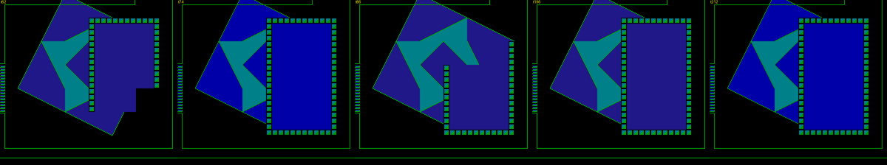
*The framed panel appearing and filling in over Rock's arena (frames 62, 74, 86 of the fight), like a pause menu
being drawn.*

| Weapon | Buster | Cheat Saber | Dead Ringer | Ringo Shield | Fire Ball | Print Cutter | Mega Buster (tap) | Rider Kick | Power Bomb |
|---|---|---|---|---|---|---|---|---|---|
| Damage per hit | 2 | **40** | 2 | 3 | 1 | 2 | 1 | **4** | **4** |

The Rider Kick (Kamen Rider's) and the Power Bomb are his weaknesses, at 4 per hit. Receiving his weapon gives
"You got: Mega Buster" over the Rockman artwork in Rock's own blue (below, §Weapons).

## Kamen Rider (stage 6)

**Who:** DLN.013 KAMEN RIDER (JP 仮面 RIDER), credited to ISHINOMORI PROD. [text: credits]. The 1971 tokusatsu
hero, with his bike.

**Bank and rooms** [code][seen]: bank 6, shared with the final stage `$0E` (rooms `$18+`). Restart rooms `$00`,
`$0A`, `$13`. The explorer's route took 6,084 frames to the start of the fight, through rooms
`00 01 02 03 04 05 … 13 14` in order. The boss bar starts filling at the **left end of room `$14`**, and the fight
scrolls through `$14-$16`, which is why the scout's state found him in room `$16` with no scroll lock.

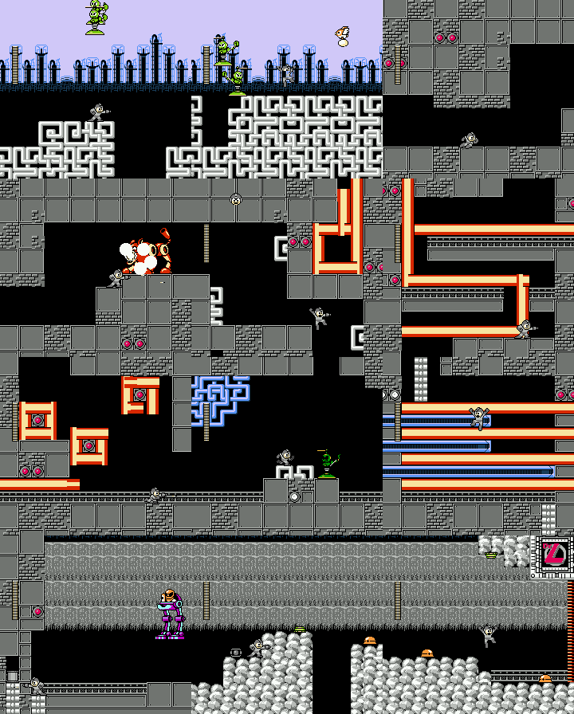
*Twelve frames from the route: the opening skyline with Fly Boys and Pipi, the meander-pattern ground, a red
Friender gate, force beams that draw snakes and spirals, blue beams you can stand on next to red force beams, a
Sniper Armor in the grey base, and the boulder quarry before the fight.*

### Layout [seen]

| Rooms | Look | What happens |
|---|---|---|
| `$00-$04` | Lavender sky, a skyline of dark industrial towers, ground of grey **meander (Greek-key) blocks** | **Fly Boys** (`$2B/$2C`, Crash Man's propeller robots) hop in and fly over, Mets (`$34`), a spring hopper (`$46`), **Pipi** birds (`$37/$38`, Air Man's egg-droppers) |
| `$05` | Grey stone base | **Blocky** (`$31/$32`) |
| `$06` | Grey base | A **red Friender gate**, with the same object ids as Yoshino Man's (`$19-$1C`, `$4D`, `$2E` shutters), so presumably the same respawning-head mechanism |
| `$07-$09` | Grey base, black corridors | **Force beams** (`$4A` horizontal, `$56` vertical) that turn corners: they draw an S, a hook and a spiral around the corridor while you are in it |
| `$0A-$0E` | Grey base with blue meander panels | **Two kinds of beam**: blue ones (`$15`) slide out from the wall and **can be stood on**; red ones are the usual force beams. In room `$0C` the player climbs a stack of blue beams while red ones fill the gaps |
| `$0F` | Grey base | Sniper Armor with Sniper Joe (`$4E/$4F`), E-tank (`$B9`) |
| `$10-$12` | **Boulder quarry** (white rocks) under a grey ceiling | Mets, spring hoppers, Fly Boys, and two unidentified objects (`$93/$94`). Room `$12` has a red emblem block like Mega Man's Dr. L chip, in red |
| `$13-$16` | Quarry floor with the tower skyline: the arena | Kamen Rider |

The quarry is a nod to tokusatsu location shooting, where hero-versus-monster fights are filmed in quarries [guess].

### Boss: Kamen Rider [seen]

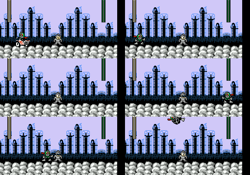
*Kamen Rider rides in on his white Cyclone bike, gets off, jumps, does a somersault, and lands a Rider Kick (frames
200, 280, 515, 561, 627, 707 of an idle-player test).*

- **HP 40.** He has **no projectiles**: everything is his body. Object states: `$56` on the bike, `$54` in the air
  (jump or somersault), `$55` landing, `$53` **Rider Kick**.
- **Bike charge**: he rides the Cyclone across the arena. The arena scrolls and he leaves the screen on one side
  and comes back on the other.
- **Rider Kick**: a jump, a somersault high in the air, and a diving kick. A kick hit costs **7 HP** (logged as 2
  then 5 on consecutive frames), so three kicks kill a 24-HP player.
- In a 1,500-frame test with the player walking back and forth he landed 6 hits: 4 kicks (7 each) and 2 body
  contacts (2 each).

| Weapon | Buster | Cheat Saber | Dead Ringer | Ringo Shield | Fire Ball | Print Cutter | Mega Buster (tap) | Rider Kick | Power Bomb |
|---|---|---|---|---|---|---|---|---|---|
| Damage per hit | 1 | **40** | 1 | 1 | – | **3** | – | **4** | 2 |

His **own Rider Kick hurts him most** (4 per hit; 10 hits killed him in 861 frames under the test script). Yoshino
Man's Print Cutter is the other weakness at 3. Fire Ball and the tapped Mega Buster landed no hits under the script.

## Bomberman (stage 7)

**Who:** DLN.014 BOMBERMAN, credited to HUDSON SOFT [text: credits].

**Bank and rooms** [code][seen]: bank 7, shared with the **opening stage** `$0F` (rooms `$13+`). Restart rooms
`$00`, `$08`, `$11`. Boss room `$12`. Rooms `$00-$07` mix ladder climbs and short side-scrolls (most of their
segment flags say "next segment above"), `$08-$0C` run right, and `$11-$12` lead to the boss.

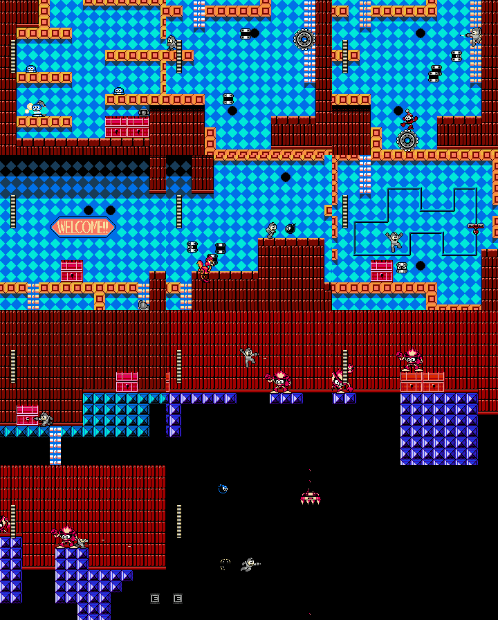
*Top half, rooms `$00-$05`: the blue checkerboard with orange Bomberman blocks and red chests of drawers, Tellies
pouring out of black pipes, Pierobot (the clown on a gear), the **"WELCOME!!"** sign, a red rooster-like runner, and
the rail-lift room. Bottom half, rooms `$08-$0C`: red brick with purple pyramid pillars, flame-haired Changkey
Makers, E-tanks in floor pockets, and the stretch of room `$0B` where the background went black.*

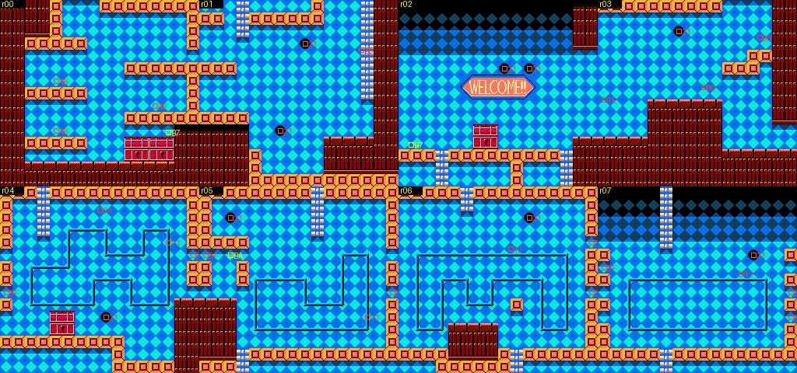
*Rooms `$00-$07` rendered from the level data (`stagemap.py`): the "WELCOME!!" banner in room `$02`, and the cyan
rail tracks in rooms `$04-$07`.*

### Layout [seen]

| Rooms | Look | What happens |
|---|---|---|
| `$00-$03` | A **Bomberman playfield**: blue checkerboard floor tiles as the wall, orange square **soft-block** platforms, dark-red brick, and red **chests of drawers** as furniture | **Tellies** (`$22`, Heat/Crash Man's flying cans) stream out of black pipe holes (`$21`) and drift down onto the player. **Pierobot** (Metal Man's clown on a rolling gear; the gear is `$29`) in room `$01`. A big **"WELCOME!!"** sign in room `$02`. A red rooster-like runner runs along the floor |
| `$04-$07` | Same tileset, with **cyan rail lines** drawn on the wall | A red **rail lift** (`$12`) runs round a closed track (one lap of the room `$05` track is about 600 frames, highest point y `$50`). Black spiked mines (`$28`) fly in from both screen edges (spawners `$8F`). The exit ladder is near the top of the lift's lap, so presumably you ride up to it [guess] |
| `$08-$0C` | Dark red brick wall, blue and **purple pyramid blocks** (the Bomberman hard blocks), black shafts | **Changkey Makers** (`$23`, Heat Man's flame-haired fire throwers) on the pillars, E-tanks (`$B9`) in pockets below the floor. In the recorded run the right part of room `$0B` went completely black, with only sprites drawn (cause not checked) |
| `$0C` | Brick and pyramid blocks | **Chain crushers** (`$30`) drop from the ceiling under pink brick housings (special objects `$78`), and the **heart tank** sits in a pocket below the floor |
| `$11-$12` | | A short run to the boss shutter; autorun walks it in 70 frames |

### Boss: Bomberman [seen]

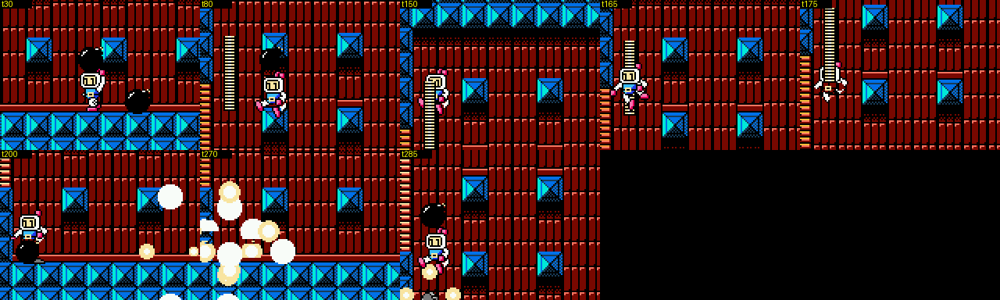
*Bomberman in his arena at 2×: dropping bombs, jumping high with bombs over his head, and the cross-shaped
explosion. The arena is a Bomberman stage seen from the side: red brick with a grid of blue pyramid hard blocks.*

- **HP 40.** Arena: the classic Bomberman grid of indestructible blocks, here as blue pyramid blocks set into a
  red brick wall.
- **Bombs** (`$5E`, 3 damage): he drops them at his feet and **throws them up** while jumping, so they rain down.
  After a fuse they burst into a **plus-shaped blast**: flame segments (`$5F`) run out in four directions, with
  explosion puffs (`$45`). Damage to the player [seen]: bomb 3, flame 4, body contact 4.
- **He chases you**: against a player standing at the left wall he walked over and spent 1,000+ frames bouncing in
  place right on top of the player, with bombs going off around both of them.
- **He blows himself up.** In an idle test where the player never pressed a button, his HP went from 40 to 36 at
  frame ~280, when one of his own bombs went off under him. Self-damage is 4 per blast. In the damage-table runs
  he also lost 4s while the player had non-damaging items equipped (Instant Floor, Ubercharge).

| Weapon | Buster | Cheat Saber | Dead Ringer | Ringo Shield | Fire Ball | Print Cutter | Mega Buster (tap) | Rider Kick | Power Bomb |
|---|---|---|---|---|---|---|---|---|---|
| Damage per hit | 1 | **40** | 1 | – | – | **2** | – (the 4s logged were his own bombs) | 4? (cannot be told apart from self-damage) | **6** |

(The 4s in the Bomberman runs are his own bombs.) His own **Power Bomb** does **6** per hit, the highest weapon
damage measured on any of the four bosses. The Print Cutter does 2.

## Heart tanks (Mega Man and Bomberman) [code][seen]

The scout's save layout put heart flags on stages 0, 3, 5 and 7. Two of the four are in this doc's stages. Both
are special object `$BB` in the bank's special-object table (`$BA00` rooms, `$BA40` x, `$BA80` y, `$BAC0` id):

| Stage | Room | Position | What is around it |
|---|---|---|---|
| 5 Mega Man | `$0B` | x `$70`, y `$D4` | the bottom of a circuit-trace maze, in the part of the stage between the start and checkpoint `$08` (reachable by walking **right** from checkpoint `$08`) |
| 7 Bomberman | `$0C` | x `$B0`, y `$C4` | a sealed pocket **under the floor** of the crusher room, visible from above as a capsule behind the floor blocks |

Placing the player on each tank (poking X/Y) sets `$7FF8+stage = 1` and raises the save slot's max-HP field from 24
to **28** at once [seen], which confirms they are the real tanks. **How you are meant to reach them was not
found.** Walking, jumping, waiting for the room-`$0C` crusher, and a Power Bomb dropped on the floor above did not
open either pocket. A Go-Explore search of 400,000 frames per room aimed at each position also failed.

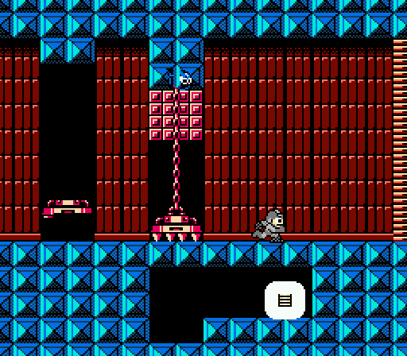
*Room `$0C` of the Bomberman stage at 2×: the chain crusher under its pink brick housing, and the heart tank
(capsule) sealed in the pocket below the floor to the right of the black shaft.*

## Weapons from these four bosses [seen]

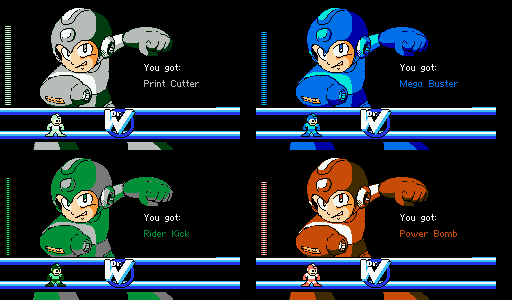
*"You got: Print Cutter / Mega Buster / Rider Kick / Power Bomb": the full-screen Rockman artwork recoloured for
each weapon (grey, blue, green, red-orange), with the Dr. L emblem bar.*

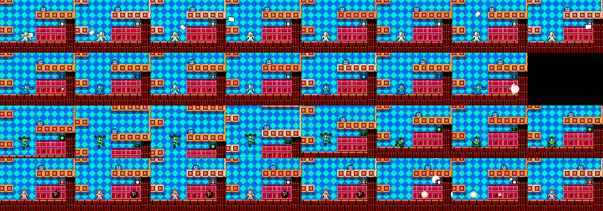
*Rows: Print Cutter (paper sheets thrown up that flutter down), Mega Buster (hold to charge, the player flashes,
then a big shot), Rider Kick (jump, B, diving kick), Power Bomb (a "P" bomb that rolls forward, then a plus-shaped
blast).*

| Id | Weapon | Player colour | Behaviour | Energy per use (of 40) |
|---|---|---|---|---|
| 5 | **Print Cutter** | grey/white | Throws a paper sheet **upward in an arc**; it then flutters down like Yoshino Man's papers | 1 |
| 6 | **Mega Buster** | **blue: you look like the real Mega Man** | Tap B for normal pellets (no energy). **Hold B to charge** (Rockman 4 style, the player flashes): a half charge after about 40 frames costs 1, after 90 frames of holding, a big shot costs 3 | 0 / 1 / 3 |
| 7 | **Rider Kick** | green | **Does nothing on the ground.** In the air, B turns the player into a diving kick down and forward (object `$05`), Kamen Rider style | 1 |
| 8 | **Power Bomb** | red-orange | Drops a black bomb marked **"P"** (Bomberman's Power Bomb power-up) that rolls a short way and sits for about 80 frames, then explodes in a **plus**: four fireballs (`$0C`) run up, down, left and right across the screen | 3 |

**The Cheat Saber kills every boss in one hit.** In all four damage tests the Cheat Saber (Cheat Man's weapon) did
**40 damage**, a full health bar, on its first hit (after 49-162 frames). That fits the name "Cheat Man" [guess].

### Damage summary (per hit on 40-HP bosses)

| Weapon ↓ / Boss → | Yoshino Man | Mega Man | Kamen Rider | Bomberman |
|---|---|---|---|---|
| Buster | 2 | 2 | 1 | 1 |
| Cheat Saber | 40 | 40 | 40 | 40 |
| Dead Ringer | 2 | 2 | 1 | 1 |
| Ringo Shield | – | 3 | 1 | – |
| Fire Ball | 1 | 1 | – | – |
| Print Cutter | – | 2 | **3** | 2 |
| Mega Buster (tapped) | 1 | 1 | – | – |
| Rider Kick | 3 | **4** | **4** | 4? |
| Power Bomb | **4** | **4** | 2 | **6** |

"–" means the scripted chase-and-fire policy (`stages2_dmgtable.py`, 900 frames, godmode) landed no hit. That is not proof
of immunity: the Ringo Shield and the Fire Ball have short or odd ranges. The best measured weapon against each
is: Power Bomb → Yoshino Man, Power Bomb or Rider Kick → Mega Man, Rider Kick or Print Cutter → Kamen Rider, and
Power Bomb → Bomberman.

## New savestates (`build/research/cx/states/`)

All checked with `cx.playable()` (LEFT/RIGHT moves the player) after loading. HP 24, 8-9 lives, nothing beaten.

| State | What it is |
|---|---|
| `yoshino_man_friender` | Yoshino Man room `$07`, on the step in front of the second Friender gate (head 40 HP, horn 40 HP) |
| `yoshino_man_beams` | Yoshino Man room `$10`, dropping into the first force-beam room |
| `mega_man_drop` | Mega Man stage just after falling through the down-arrow gap of room `$0E` (game reports room `$11`, segment 1) |
| `mega_man_r0B` | Mega Man room `$0B`, reached by walking right from checkpoint `$08`; the heart tank is in this room |
| `kamen_rider_arena` | Kamen Rider room `$14`: the fight has just started (bar full at 40), the arena is the scrolling rooms `$14-$16` |
| `bomberman_rail` | Bomberman room `$04`, the first rail-lift room |
| `bomberman_r0C` | Bomberman room `$0C` entrance: chain crushers, pink brick housings, the heart tank in the floor pocket |

## Method and tools

- **Route recording:** `tools/analysis/cx/stages2_tour.py` is a Go-Explore autoplayer (from `cheats.explore`) that
  keeps each cell's input history, so the best route can be replayed deterministically. By default it adds a
  one-hit-kill cheat: every enemy slot `$10-$1F` is capped at HP 1 each frame. Its progress score counts rooms plus
  x or y inside the room, by segment direction; there is also a reverse mode and a flat novelty mode.
  `stages2_replay.py` replays a route into contact sheets with room/x/y stamped on each frame, plus a log of the
  object ids seen in each room. Routes found: Yoshino Man start → boss (6,056 frames), Mega Man checkpoint `$08` →
  boss (2,369), Kamen Rider start → arena (6,084), Bomberman start → room `$05` and checkpoint `$08` → room `$0C`.
- **The one-hit cheat breaks lifts.** The rail lift in Bomberman's stage has HP, so the mashing explorer shot it
  down and then got stuck. Run with `NOOH=1` when a stage depends on useful objects.
- **Bosses:** `bosswatch.py` (object log + contact sheet), `bossgal.py` (one crop per new projectile type), and
  `dmglog.py` (each HP loss of an un-cheated player, with the nearest object) are in `build/research/cx/cx-stages-2/`.
  `tools/analysis/cx/stages2_dmgtable.py` equips each weapon with the Select+Down quick-swap and measures damage per
  hit under a chase-and-fire policy.
- **Weapon behaviour:** `wpn2.py` equips one weapon and plays a button script with zoomed frames and an object and
  energy log.

## Not covered, and open questions

- **Mega Man, first half.** The route from the down-arrow drop (rooms `$11-$13`, `$15`) to room `$0D` and
  checkpoint `$08` was not found in about 1.5 million explorer frames. The room numbers the game uses there do not
  follow the `$B400` segment list, so the static map does not help.
- **Heart-tank routes** (Mega Man room `$0B`, Bomberman room `$0C`). Both tanks are confirmed (touching them gives
  +4 max HP), but the way into either sealed pocket was not found. Candidates not yet tried: Quick Man's wall kick,
  the dash through a low gap, Instant Floor platforms, and weapons other than the Power Bomb (for example the Cheat
  Saber) on the floor blocks.
- **Bomberman rooms `$05-$07` and `$0D-$11`** were seen only in the static render. The explorer's room-`$05` states
  were traps where the player dies in a small pocket (a pile of Tellies under a pipe), so it never rode the lift
  to the exit ladder.
- **Enemy names** are given only where the sprite was clearly an RM2/RM1 enemy. Ids `$18`, `$1E/$1F`, `$4B`, `$4D`,
  `$90`, `$93/$94` were seen but not identified.
- **Rock's weapon order:** it depends on the player's movement. The rule (random, or player distance or height) was
  not decoded. Neither was whether the framed panel always comes before a weapon change.
- **Self-damage:** is Bomberman's own-bomb damage deliberate (a Bomberman joke) or a side effect of his bombs using
  the player-weapon hit table? Not checked in code.
- **JP build:** not compared for these stages. Per `cheats.md` the stage banks are byte-identical outside text.

## Lessons for Rockman 6 GP

**Design**

- **Make guests play like their home games, down to the arena.** Bomberman fights in a side view of a Bomberman
  grid, drops bombs with plus-shaped blasts, and can **blow himself up**. Kamen Rider rides his bike through a
  quarry and finishes with a Rider Kick. Rock **opens a menu to change weapons**. Each fight is the guest's own
  game, played straight.
- **Weapons that change your silhouette are memorable.** The Mega Buster makes the fake Rockman look like the real
  one and gives him the MM4 charge shot. The Rider Kick is an air-only diving kick rather than a projectile.
  Both change how you move, not only what you shoot.
- **A respawning mini-boss as a gate.** The Friender's head grows back every ~330 frames, and only its back horn
  (vulnerable while the head is down) opens the way. It turns a reused RM2 enemy into a timing puzzle without new
  art. RM6 GP could do the same with any RM6 sub-boss.
- **Reuse the base game's enemies, remixed by stage.** Almost every regular enemy here is RM2's (Batton, Robbit,
  Friender, Sniper Armor, Blocky, Telly, Pierobot, Fly Boy, Pipi, Changkey Maker, force beams), placed in new
  tilesets. The new parts are the arenas, the bosses and a few gimmicks (turning beams, standable blue beams, the
  rail lift). That is a cheap way to fill eight stages.
- **Telegraph secrets.** The two heart tanks sit in sealed pockets that are visible but give no hint of how to get
  in, and an automated search of 800,000 frames did not find the way. Whatever the trick is, a hint (a cracked
  block, an arrow like the ones Mega Man's stage uses for its drop) would help.
- **Watch multi-hit hazards.** Rock's bomb blast re-hits every 8 frames through the i-frame timer, so it can delete
  a full health bar in about a second. If RM6 GP adds lingering hazards, decide on purpose whether they respect
  invincibility.
- **An instant-kill weapon trivialises every boss** (the Cheat Saber does 40 to all four). As a joke weapon it
  needs a high energy cost or a late unlock.

**Technical**

- **Reversed stages break tools.** Mega Man's right-to-left stage needed a special case in the death code, and its
  live segment and scroll values do not match a forward reading of the segment list. If RM6 GP makes a stage run
  backwards, document how its rooms are indexed, or the map and warp tools will lie.
- **Explorer bots need cheats that do not break the level.** A one-hit cheat is great against enemies but destroys
  lifts. Mark which object ids are "useful" (lifts, platforms, shutters) and leave their HP alone.
- **Record input histories, not only savestates**, so a route found by search can be replayed, filmed and checked.
  That is how every tour image here was made.
- **Measure damage tables with the real weapon switch** (the Select+Up/Down quick-swap here) rather than poking the
  weapon id. That way the weapon's palette and CHR load exactly as in play.
