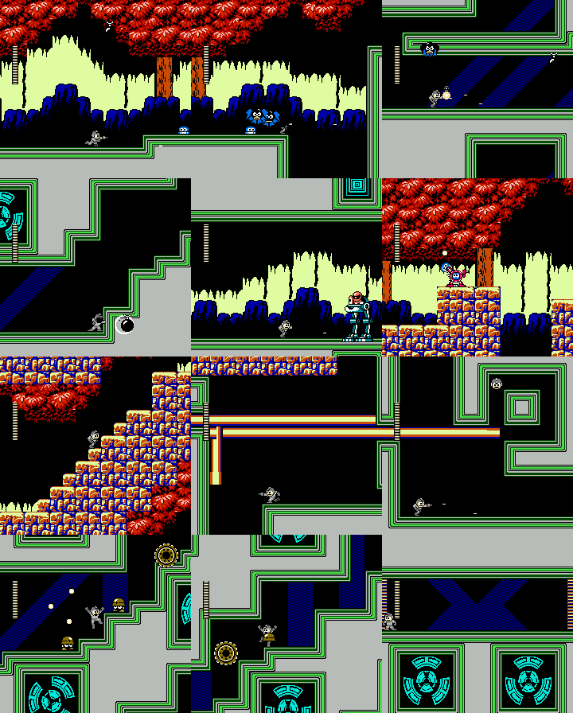
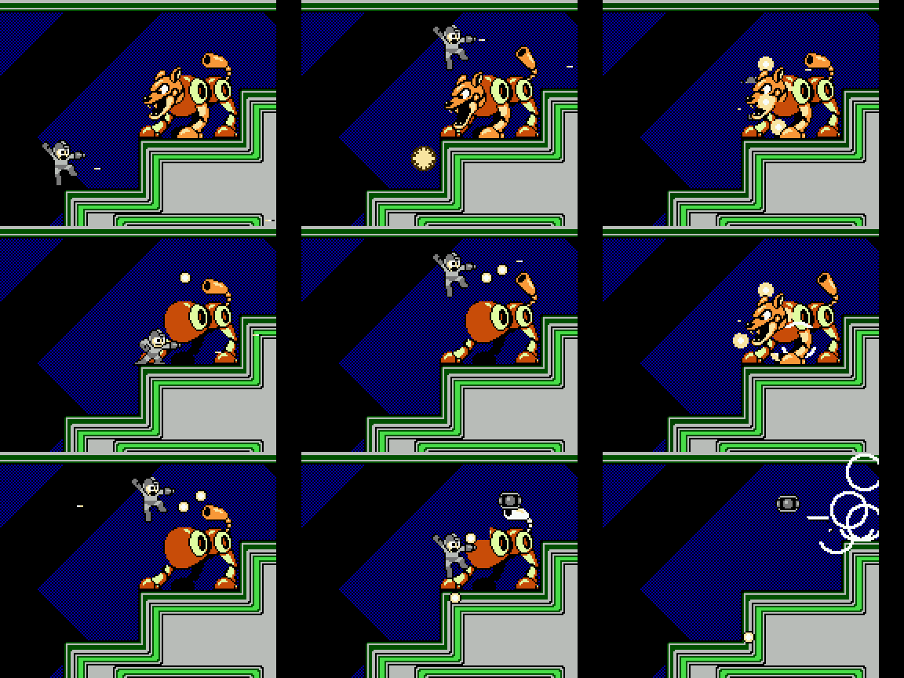
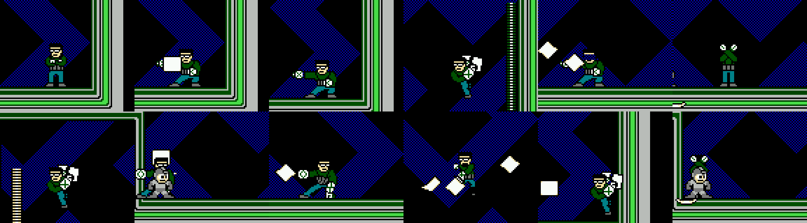

# Rockman CX stages, part 2: Yoshino Man, Mega Man, Kamen Rider, Bomberman (cx-stages-2)

Status: IN PROGRESS (skeleton written early so an interruption loses little).

Tags: **[seen]** observed in the emulator, **[code]** disassembly/data, **[text]** in-game text, **[doc]** readme,
**[guess]** speculation. ROM `roms/cx_en.nes`. Savestates: `build/research/cx/states/` (see `cheats.md` §1).
Static maps: `tools/analysis/cx/stagemap.py` (by cx-stages-1).

## Yoshino Man (stage 4)

**Who:** DLN.009 YOSHINOMAN, credited to HIMAJIN JICHIKU [text: credits], so he is the hack author's own robot. He
looks like a man rather than a robot: dark hair, glasses, a dark green jacket, and a green "⊗" emblem in his hand.
His weapon is the **Print Cutter** [seen]. Every attack is paper.

**Bank and rooms** [code][seen]: rooms `$00-$17` of 16 KB bank 4 (shared with Light 5, rooms `$18+`). Restart rooms
`$00`, `$07`, `$16`; boss room `$17`. The explorer's route from the start to the boss door took 6,056 frames (about
100 s) under godmode and a one-hit cheat. Room entries on that route: `00 01 02 … 16 17`, in order, with no detours.

*Twelve frames from the route, left to right: Wood Man's forest at the start (Battons in the leaves), the techno
interior with its black bombs, the Sniper Armor in the forest pocket (room `$0A`), the leafy rock slopes (`$0C-$0F`),
the force-beam rooms (`$10-$11`), the Met rooms with the rolling ring (`$13-$14`), and the barred corridor before the
boss (`$16`).*

### Layout, room by room [seen]

| Rooms | Look | What happens |
|---|---|---|
| `$00-$01` | Wood Man's forest: red leaf canopy, trees, cream grass, blue bushes | Battons drop out of the leaves; pink Robbits hop; a blue spring-headed hopper (object `$46`) bounces |
| `$02-$09` | A techno interior: grey walls with a triple green outline, cyan concentric-square blocks, blue diagonal stripes; vertical shafts going **down** | Black round bombs and Robbits in the shafts. **Two Friender gates** (rooms `$05` and `$07`), below |
| `$0A` | A pocket of forest, flat floor | **Sniper Armor**: the red Sniper Joe in his green walker mech (`$4E` mech, `$4F` Joe) |
| `$0B-$0F` | Forest with rock-block floors and slopes, leaf ceilings | A red robot carrying a blue Met over its head (`$4B`), **Blocky** towers (Crash Man's stacked-block enemy, `$31/$32`), Battons |
| `$10-$11` | Black maze with a ladder shaft | **Force beams** (below) |
| `$12-$15` | Techno interior again, stair-step corridors with cyan "fan" blocks | **Mets** (`$34`) and a rolling yellow ring (`$29`) |
| `$16` | A long corridor over a row of fan blocks | Several red-and-blue striped bars (special objects `$2F`) act as a run of shutters before the boss |
| `$17` | Boss room: blue zig-zag backdrop in a green frame | Yoshino Man |

### The Friender gate: an enemy that respawns its own head [seen][code]

Wood Man's robot dog (Friender / "Hot Dog") shows up twice as a **gate** you cannot walk or jump past:

1. It **beams in** like a robot master: a tall orange pillar of light (object `$1C`) drops onto the ledge, and the dog
   appears (head `$19`, back-mounted horn `$1A`, fire breath `$1B`).
2. Its body is a wall. Two invisible **shutter objects** (special objects `$2E` at x `$B8`, the same ids the stage
   uses for boss shutters) sit inside it, so the player stops at x `$A8` even under godmode, on the ground or in a
   jump.
3. The **head** has 40 HP and takes 1 per buster shot. When it dies it explodes into 16 debris pieces (`$06`), leaving
   a headless body with a round orange neck stump. About **330 frames later the head grows back** at full HP, with a
   burst of white sparks (`$4D`). In a 3,500-frame test it died and regrew 7 times; it never stays dead.
4. The real weak point is the **horn on its back** (`$1A`, 40 HP). It takes damage **only while the head is gone**.
   Damage carries over between cycles. When the horn reaches 0 the whole dog explodes, the `$2E` shutters
   disappear, and it drops a large energy capsule (`$B7`).

So the "mini-boss" is a timing puzzle: blow the head off, then jump-shoot the horn before the head comes back.
Standing still and shooting forward never works, because the shots hit the head or nothing.

*The Friender in room `$07` (autorun, no one-hit cheat): fire breath, the head exploding, the headless body with
its round neck stump, the head regrowing, the jump-shots on the horn, and the final explosion with the energy
capsule.*

### Force beams that turn corners [seen]

Rooms `$10-$11` use Quick Man's force beams, the red/yellow laser lines that RM2 draws into the nametable. CX adds
**vertical beams** (object `$56`) that drop from the ceiling and then **turn** into horizontal runs, as well as
the usual horizontal ones (`$4A`). The lines stay on screen, so after a few seconds the room looks like a pen plotter
has drawn a circuit through it. In room `$10` they fire on a timer even while the player stands still at the
entrance. They fit the stage's theme, since Yoshino Man is a printer. In room `$11` the 1-UP (`$BA`) sits inside
the beam maze.

### Boss: Yoshino Man [seen]

*Yoshino Man at 3×: the arms-crossed intro pose, throwing a paper sheet, the jump-throw, the paper landing, and the
floor-sliding paper blade (`$5A`).*

- **HP 40** (`$06C1 = $28`), like every CX boss. Object `$63` standing or running, `$65` jumping, `$64` landing
  [code: object types logged every frame].
- **Paper sheet** (`$5C`, 3 damage): thrown forward at the player from the hand device. After about 30 frames
  it turns into a **fluttering sheet** (`$61`, 2 damage) that sways down the screen. Several hang in the air at
  once, so the arena fills with slow paper.
- **Paper blade** (`$5A`, 3 damage): a tall white sheet standing on its edge that **slides along the floor** at about
  2 px/frame, all the way across the arena. You have to jump it.
- **Movement:** he alternates short runs and **high jumps across the whole room** (from x `$C8` to `$18`), throwing
  sheets from the top of the arc. In a 1,200-frame idle test he crossed the arena 5 times.
- Measured hits on a player standing still (no godmode, 1,500 frames): 12 hits, 2 or 3 damage each. He never stood
  in contact with the player.

Damage per hit, measured by a chase-and-fire script in 900 frames (`dmgtable.py`; 0 means no hit landed under that
script, not proven immunity):

| Weapon | Buster | Cheat Saber | Dead Ringer | Ringo Shield | Fire Ball | Print Cutter | Mega Buster (tap) | Rider Kick | Power Bomb |
|---|---|---|---|---|---|---|---|---|---|
| Damage | 2 | **40 (one hit)** | 2 | 0 | 1 | 0 | 1 | 3 | **4** |

The Power Bomb (Bomberman's weapon) is the practical weakness. The Cheat Saber kills him outright (below, §Weapons).

## Mega Man / Rock (stage 5)
(pending)

## Kamen Rider (stage 6)
(pending)

## Bomberman (stage 7)
(pending)

## Lessons for Rockman 6 GP
(pending)
