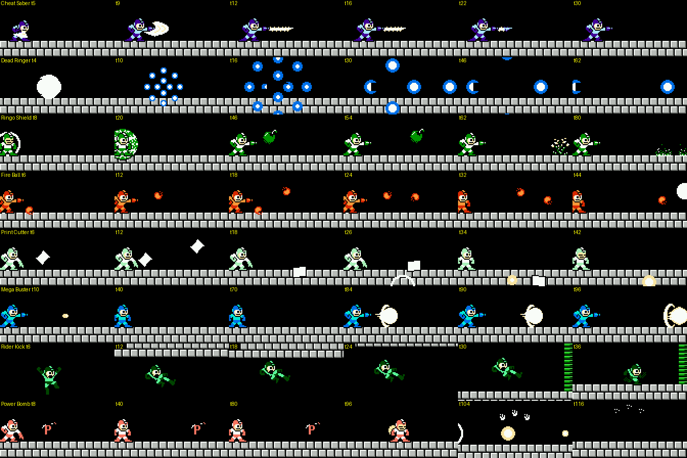
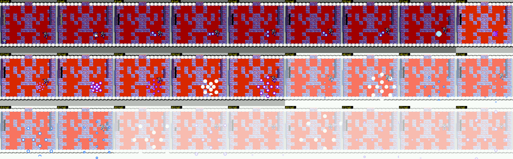
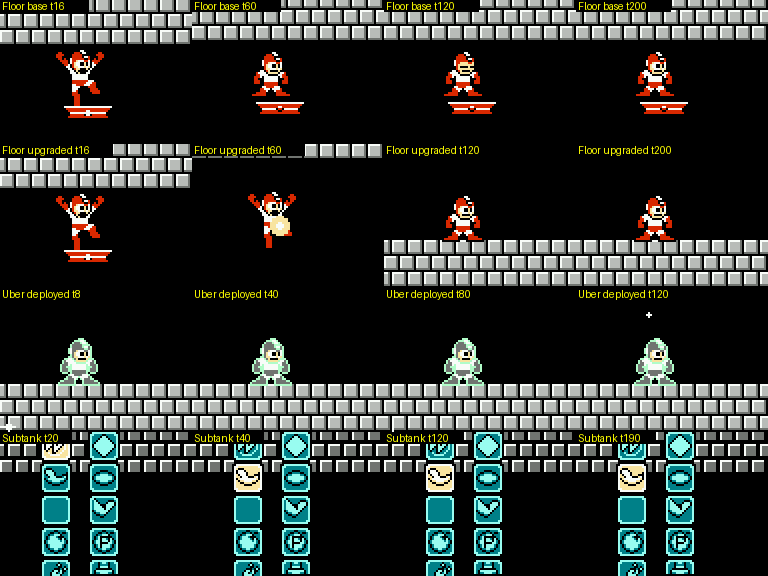
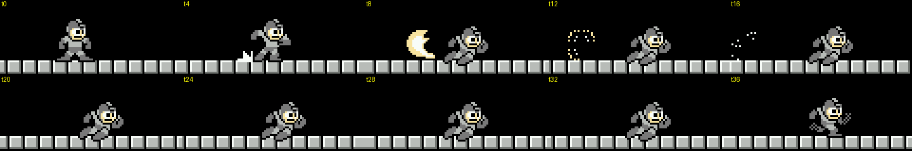
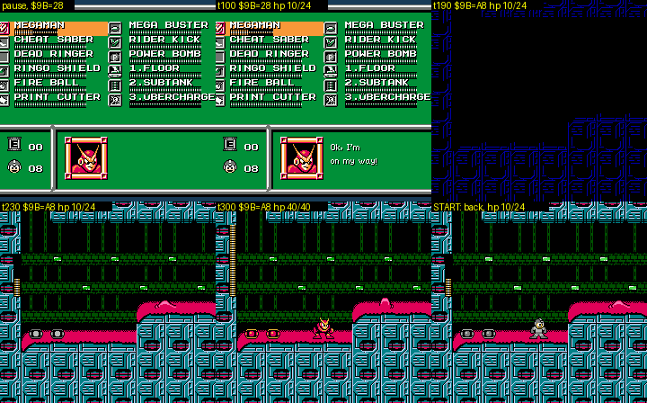
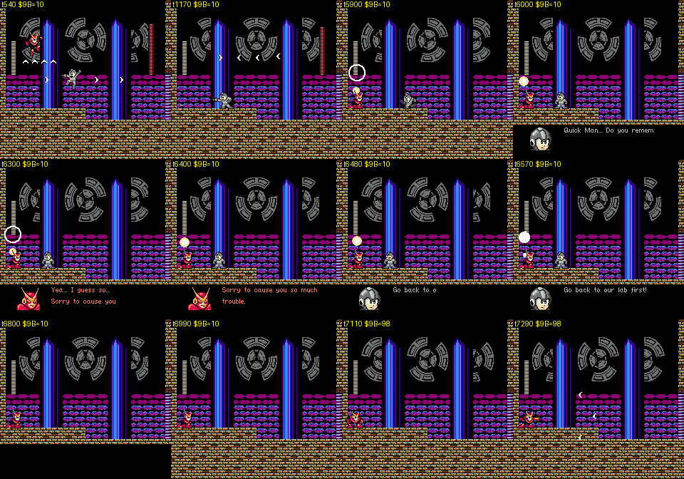
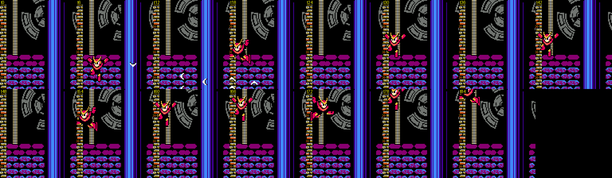
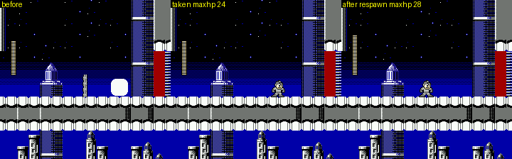
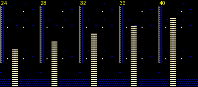

# Rockman CX player systems in practice (cx-systems)

Status: draft complete (sections 1-7 tested in the emulator; open questions at the end). Every routine cited here is
byte-identical in `roms/cx_jp.nes` (17 code and table regions compared).

Scope: the fake Rockman's toolset as it plays: the 8 boss weapons and the weakness chart, Items 1-3 (Instant Floor,
Subtank, Ubercharge) and their Dr. Light "upgrades", the dash, playable Quick Man, heart tanks, quick weapon change,
the HP-from-weapon-energy rule, the save system and menus. Tags: **[seen]** observed in the emulator, **[code]**
disassembly or ROM data, **[text]** in-game text, **[doc]** readme, **[guess]** speculation. ROM `roms/cx_en.nes`.
RAM names follow `docs/research/cx/cheats.md`.

## 1. The eight boss weapons

How they were tested: `cx.give_all_weapons()`, then each weapon equipped with the real Select+Down quick swap,
fired in the quiet brick corridor of `fire_mario_cp2` (frame logs of energy and object slots 2-9), and then fired at
eight boss rooms with a chase-and-fire script (`tools/analysis/cx/systems_bosshit.py`). The code is in two places:
the **fire dispatcher** `$3E:DA56` (12-entry jump table `$DCC7/$DCD3`, indexed by `$A9`) and the **boss-hit
dispatcher** `$17:A5F4` (12-entry jump table `$A90B/$A917`), which reads one 14-entry damage table per weapon,
indexed by the boss number `$B3` [code]. The player's colour changes with the weapon, as in RM2.

*One row per weapon, 2× zoom, frame numbers from the B press: Cheat Saber (slash arc, then a thrust that shrinks
back to the hilt), Dead Ringer (white "death" flash, then the 8-way ring burst of a Rockman death while the player
vanishes), Ringo Shield (leaf shield, then the thrown apple splatting on the wall), Fire Ball (SMB fireballs bouncing
along the floor), Print Cutter (paper sheets thrown up that flutter down), Mega Buster (pellet on the press, then a
full charge shot), Rider Kick (jump, hold B and a direction: a flying kick), Power Bomb (the "P" bomb, then the
blast).*

| Id | Weapon (from) | Colour | What it does [seen] | Energy (of 40) [seen][code] | On screen |
|---|---|---|---|---|---|
| 1 | **Cheat Saber** (Cheat Man, who is drawn as Mega Man X) | X's blue and purple | A melee **Z-Saber**: a crescent slash in front of you, then a straight blade that shrinks back to the hilt over about 28 frames (`$04E0 = $1C`). It works on the ground and in the air | **7 per slash** (1 unit about every 4 frames while the blade is out) | 1 |
| 2 | **Dead Ringer** (Air Man; the *TF2* Spy's watch) | blue | **Fakes your death.** B plays the full Rockman death: a white flash and the 8-way ring burst, while the player turns invisible (drawn 1 frame in 16, a shimmer). B again, or an empty bar, uncloaks after a 46-frame fade (`$AC = $EE`). The rings are real projectiles (flag bit 0 set on slots 3-14 at `$DBC2`): each burst can hit a boss once for buster damage [seen: Whispy took 1 at 24, 48 and 80 px]. While cloaked (`$AC` bit 7), the shared "turn to face the player" routine `$3F:EFC5` leaves enemies facing the way they were, and the aiming routine `$3F:F18B` uses a random number instead of your position [code]. **It is not invulnerability**: four bosses hit a cloaked player as often as an uncloaked one [seen] | **1 per 16 frames while cloaked** (`$1E:812D`), while the passive recharge (section 7) adds 1 per 128 frames, so a full bar is about 12 s of cloak (40 → 0 in about 720 frames) [seen][code] | 1 cloak |
| 3 | **Ringo Shield** (Whispy Woods; *ringo* = apple) | green | B raises a Leaf-Shield-style ball of leaves around you that **follows you** when you walk or jump. B again **throws an apple** straight ahead; it splits in two on the wall and splats on the floor. Bonus [code `$A6C9`]: each time the raised shield touches a boss, 16 frames are added to your invincibility timer `$4B` | **3 per shield** (the throw is free) | 1 |
| 4 | **Fire Ball** (Fire Mario) | Mario red | SMB's fireball: it bounces along the floor and pops on walls. On a boss it **sticks and burns**: the boss's table value becomes the fireball's burn timer (`$04E0`), the ball is moved onto the boss and does 1 damage per tick, about every 4 frames [code `$A6ED`, seen] | **1 per 2 shots** (`$DAF9`) | 2 |
| 5 | **Print Cutter** (Yoshino Man) | white/grey | A paper sheet thrown forward and upward that flutters down. It bounces back off walls | **1 per 3 shots** (`$DB2E`) | 3 |
| 6 | **Mega Buster** (Mega Man / Rock) | **Rock's blue**: you look like the real Mega Man | A Rockman 4 charge shot. Tapping fires pellets. Holding B: under 22 frames = pellet, 22-63 frames = half charge, 64+ frames = full charge [seen: measured hold lengths]. The charge level multiplies the damage ×1 / ×2 / ×3 [code `$A67C`] | pellet 0, half 1, full 3 (table `$1E:8278`) | 3 |
| 7 | **Rider Kick** (Kamen Rider) | green | **A flying kick, not a shot.** In the air, hold B with LEFT or RIGHT: the player strikes the kick pose and flies forward at 3 px/frame on the jump arc, then keeps sliding on landing. Without a direction, or on the ground, the kick object appears for only 2-4 frames. Not usable in player states `$09`, `$0A`+ or `$0C` [code `$DB4B`]. On a boss hit the game **freezes for about 8 frames** (the player hangs in place) and plays a DMC "thud" sample [code `$A776`, seen] | **1 per 2 kicks** | 1 |
| 8 | **Power Bomb** (Bomberman) | red-orange | A black bomb marked "P" rolls a short way, sits for about 80 frames, then explodes in a plus of fireballs | **3 per bomb** | 1 |

Special interactions [code][seen]:

- **The Cheat Saber kills every robot master in one hit except Cheat Man, and hitting Cheat Man with it kills
  you.** Its boss-hit handler (`$17:A668`) does: boss number 0 → `STY $06C0` with Y = 0, i.e. *your* HP becomes 0,
  then `JMP $A870` copies Y into your i-frame timer and spawns effect object `$35` on you; with HP 0 that is a
  death. Boss numbers 1-7 → boss HP set to 0. Fortress bosses 8-12 → table damage (14, 40, 8, 8, 37). Boss 13 has
  a 0 entry, which falls through to the same `STY $06C0` with Y = 13, so the Saber on the Light 6 boss should
  **set your HP to 13** [code; not tested, the boss did not activate in my runs].
  **(confirmed by critic)** Seen in `light6.state` (round 1, `$B3 = $0D`): point-blank slashes took the player
  from 20 to exactly 13 HP while Dr. Light stayed at 40 (`build/research/cx/cx-critic/saber4.py`). Boss 12
  (`$0C`) is Rush, Light 5's boss (fortress.md §6.1), so the "37" entry is Rush's. Seen on Cheat Man: two frames
  after a point-blank slash the player's HP went 24 → 0, the death rings played, a life was lost, and Cheat Man
  still had 40 HP.
  
  *Point-blank Cheat Saber on Cheat Man (frames 0-78, every 3rd): the slash connects, the label reads hp0 from
  frame 3, and the player explodes.*
- **Quick Man does double damage** with his buster (Quick Boomerang), the Ringo Shield and the Mega Buster: the
  shared damage path `$A635` doubles the value (`ASL`) when `$9B` bit 7 is set [code]. Seen: with bit 7 set, the
  boomerang did 2 per hit on Fire Mario and on the Guts Tank, whose buster entries are 1.
- The Fire Ball's entry in the boss-hit jump table points one byte past the start of its handler (`$A6ED` instead of
  `$A6EC`), so it skips the `LDA $0421 / AND #$08` check that makes other weapons bounce off a boss that is
  currently armoured [code; whether this is a bug or a deliberate "fire ignores armour" is unknown].
- A table value of 0 means the shot is **deflected** (it turns into object `$2F` and plays the ricochet sound `$2D`),
  except for the buster table, which has no zero entries [code].
- Items 9 and 10 (Instant Floor, Subtank) have no boss-hit handler (`$FFFF`); the Ubercharge (11) uses the buster
  table, because with the upgraded Über, B fires the normal buster (section 3).

## 2. Weakness chart

Damage per hit on 40-HP bosses, read from the ROM tables at `$17:A92B-$A99A` (Cheat Saber at `$A923` for the
fortress bosses) [code]. "–" = 0, the shot is deflected. Boss numbers `$B3` [seen in each boss state]: 0 Cheat Man,
1 Air Man, 2 Whispy Woods, 3 Fire Mario, 4 Yoshino Man, 5 Mega Man, 6 Kamen Rider, 7 Bomberman; 9 is the Quick Man
fight in Light 2 (`light2_boss`; the scout's `air_man_midboss` is the same room under Air Man's stage id), 10 Light
3's Guts Tank, 13 the Light 6 boss once it activates. Numbers 8, 11 and 12 are the other fortress bosses (not checked one by one; the
Light 5 teleporter-pad fight runs with `$B3 = 6`, so it may be a refight). Fire Ball values are burn timers in
frames, not damage (1 damage per tick).

| Weapon | Cheat Man | Air Man | Whispy | Fire Mario | Yoshino | Mega Man | Kamen Rider | Bomberman | #8 | #9 Quick Man | #10 Guts Tank | #11 | #12 | #13 |
|---|---|---|---|---|---|---|---|---|---|---|---|---|---|---|
| Buster, Dead Ringer rings | 2 | 2 | 1 | 1 | 2 | 2 | 1 | 1 | 1 | 1 | 1 | 1 | 2 | 1 |
| Cheat Saber | **you die** | 40 | 40 | 40 | 40 | 40 | 40 | 40 | 14 | 40 | 8 | 8 | 37 | your HP → 13 [code] |
| Ringo Shield | 2 | **7** | – | 2 | – | 3 | 1 | – | 1 | 2 | – | 2 | 5 | – |
| Fire Ball (burn frames) | – | – | **29** | 12 | 14 | 4 | – | 7 | – | 7 | – | 4 | 10 | 10 |
| Print Cutter | 2 | 2 | – | 1 | – | 2 | 3 | 2 | 1 | 2 | – | **3** | 2 | 1 |
| Mega Buster (×1/×2/×3) | **3** | 1 | – | 1 | 1 | 1 | – | 1 | – | 1 | 1 | 2 | 1 | – |
| Rider Kick | – | – | 2 | 3 | 3 | **4** | **4** | – | – | 3 | 1 | 1 | 4 | 2 |
| Power Bomb | 1 | 4 | 2 | **4** | **4** | **4** | 2 | **6** | 2 | 2 | **4** | 2 | 3 | 2 |

Checked in the emulator [seen] (chase-and-fire script, 900-1,200 frames per weapon, plus the four bosses in
`stages_2.md`): every measured hit matched the table, on Cheat Man (buster 2, Ringo 2, Print Cutter 2, Power Bomb
1), Air Man (Print Cutter 2, a full Mega Buster charge 3 = 1×3, Power Bomb 4), Whispy (buster 1, Saber 40, Rider
Kick 2, Power Bomb 2; the Fire Ball **burned him to death** in 1,016 frames, 40 ticks of 1), Fire Mario (buster 1,
Saber 40, Ringo 2, Print Cutter 1, charged Mega Buster 3, Rider Kick 3, Power Bomb 4, Fire Ball ticks of 1),
Quick Man #9 (buster 1, Saber 40, Ringo 2, Fire Ball 1-ticks, Print Cutter 2, Rider Kick 3, Power Bomb 2) and the
Guts Tank #10 (buster 1, Saber 8 ×5, Mega Buster 1, Rider Kick 1, Power Bomb 4). The "Rider Kick 4?" on Bomberman
in `stages_2.md` was his own bombs: his Rider Kick entry is 0.

The intended order, reading the best non-Saber weapon for each boss:

- **Whispy Woods ← Fire Ball** (fire burns the tree: 29-frame burns, the best ratio in the game).
- **Air Man ← Ringo Shield** (7 per hit). RM2's Air Man is weak to the Leaf Shield, and the Ringo Shield is a leaf
  shield, so the hack keeps vanilla's most famous weakness.
- **Cheat Man ← Mega Buster** (3 per pellet, 9 per full charge): Mega Man X is beaten by the original Mega Man's gun.
- **Fire Mario, Yoshino Man, Mega Man ← Power Bomb** (4); **Mega Man and Kamen Rider ← Rider Kick** (4).
- **Bomberman ← his own Power Bomb** (6) and **Kamen Rider ← his own Rider Kick** (4): two guests are weakest to
  their own signature move.
- Fortress: the Guts Tank takes 4 from the Power Bomb (and only 8 from the Saber); #12 takes 37 from the Saber.

## 3. Items 1-3 and Dr. Light's "upgrades"

All three are owned from the start (menu ids 9-11, energies `$A4`/`$A5`/`$A6`). They change when the weapon-get
routine `$1B:BC86` sets a bit of `$9B` after the 2nd, 4th and 6th robot master (the popcount−1 loop described in
`cheats.md` §6): bit 2 Ubercharge, bit 0 Instant Floor, bit 1 Subtank. Every item routine tests only its own bit,
never the boss count (of every `LDA $9B / AND #imm` in the ROM, only these three test bits 0-2: `$3E:DC69`,
`$3F:E192` and `$1F:AB06`) [code]. So "forcing the count" means poking `$9B`; I tested each item with
the bit clear and set [seen].

*Rows: Instant Floor base (the player still stands on it at frame 200), Instant Floor upgraded (gone by frame 60,
the player falls), the upgraded Übercharge deployed (the player turns pale, TF2's Über glow), and the Subtank's
pour menu (the game freezes and two columns of weapon icons appear; the highlighted icon is the bar being filled).*

| Item | Base behaviour [seen][code] | After the upgrade [seen][code] | Verdict |
|---|---|---|---|
| **1. Instant Floor** (`1.FLOOR`) | B drops RM2's red Item-1 platform just under your feet (`Y + $15`), in the air or on the ground. Up to **3 at once** (slots 2-4), **1 unit each**. Each lasts **237 frames** (4 s): 187 solid frames, then a 36-frame blinking phase (`$3F:E18D`). Standing on one at the top of a jump held the player up for about 250 frames | Bit 0 forces the counter to its end value, so the platform skips the solid phase: it lasts **51 frames** and the player standing on it drops after about 65 frames | **Worse.** It becomes a crumbling stepping stone you must jump off at once |
| **2. Subtank** (`2.SUBTANK`, the *Mega Man X* Sub Tank) | B opens a **pour menu**: the game freezes and two columns of icons appear (`$1F:AA29`). UP/DOWN move one step, LEFT/RIGHT jump 5 (a column), skipping weapons you do not own; the cursor `$AC` = 0 is HP, 1-8 the boss weapons. **Hold B** (or START) to pour: 1 unit every 7 frames, 1 tank unit per unit gained, and it stops when the bar is full (HP 4 → 24 used 20 of 40). A or SELECT closes it | Bit 1: **one press of B pours the whole tank** at 1 unit per 2 frames, and **it keeps draining after the bar is full**: HP 4 → 24 emptied all 40 units; weapon 1 from 10 → 40 also emptied 40 | **Faster, but it wastes the rest of the tank.** Pick the target first |
| **3. Übercharge** (`3.ÜBERCHARGE`, *TF2*'s Medic) | Each B press costs 1 unit and adds **60 frames** to the invincibility timer `$4B` (`$3E:DC69`). A press that would push `$4B` past 255 is ignored and costs nothing, so it stacks to about **4 s** (measured: 56, 112, 168, 224, then no change). It does not shoot | Bit 2: with a **full bar (40)**, B deploys a real Über: object 8 holds `$4B` at 61 every frame and drains 1 unit per 15 frames, so **10 s of invincibility** in one press, with the player recoloured (`$0367 = $3B`). When the bar empties the weapon switches back to the buster. With anything less than a full bar, B fires the **normal buster** instead (`JMP $DA6F`) | **Better**, but all-or-nothing |

How the item energies refill:

- **Übercharge charges only when you get hurt**: the knockback code adds 1 to `$A6` per hit, up to 40
  (`$3F:E5BC`) [code; seen in `cheats.md`]. Weapon-energy pickups do not fill it (with it equipped they heal HP
  instead, section 7). It is saved with the game (save field 3).
- **Instant Floor and Subtank** refill from weapon-energy pickups like any weapon, when equipped: a large capsule
  gave +11 to the Floor and +11 to the Subtank [seen]. That is the only way to fill the Subtank.
- **Quick weapon change cancels items**: every Select+Up/Down swap deletes all weapon objects in slots 2-14
  (platforms, a deployed Über, the Ringo Shield, bombs) and clears `$AC` (the Dead Ringer's cloak and the Mega
  Buster's charge) [code `$3B:B7AE`].

## 4. The dash

*The dash at 3× (every 4 frames from the press): the low X-style lunge, the crescent dust puff that breaks into
specks behind the player, and the return to the standing pose after 32 frames.*

- **Input** [code `$3C:8588`][seen]: a *new* press of A while **DOWN is held** and you stand on the ground starts
  the dash (state `$2C = $0C`). The direction is not needed to start, but you must **hold LEFT or RIGHT to keep
  dashing**: DOWN+A alone gives a 5-pixel lurch, and releasing the direction ends the dash at once. Quick Man cannot
  dash: with `$9B` bit 7 set the same input is an ordinary jump.
- **Speed and length** [seen]: **2.75 px/frame for 32 frames** (about 88 px), against 1.5 px/frame walking. The dash
  timer is `$04E0 = $20`, decremented each frame you hold the direction (`$3D:BEF6`); while it is non-zero the
  horizontal speed table value is doubled (`$3C:881D`).
- **Dash jump** [seen]: pressing A during the dash jumps and keeps the dash speed in the air (2.8 px/frame, a full
  jump covered about 123 px), as in *Mega Man X*.
- **Dust** [code `$3D:BEA1`][seen]: on each animation step the dash spawns object `$0B` (a dust puff) in slot 14,
  19 px behind you. Quick Man's wall slide runs in the same state but skips the dust.
- **The hitbox claim** [code]: the readme says the dash passes low gaps but does not shrink the hitbox, and the code
  agrees on both halves. The terrain probe is lowered in state `$0C` (`$3C:8A27` picks a different, lower probe
  point), and when the dash ends the game checks the tile 8 px above your head (`$3D:BEFB`): if it is solid you
  **stay in the dash** with a 4-frame timer, so you keep sliding until you are out from under the ceiling (the
  MM3 slide's rule). The enemy-contact box does not change: the player's hit-size index `$0590` stays 0 standing,
  walking and dashing [seen], so a shot at head height still hits a dashing player.

## 5. Quick Man

### When you play him

1. **The opening stage** (`$0F`): Guts Man carries the fake Rockman off, and you finish the stage as Quick Man
   (40 HP), ending with the Guts Man fight and the cage rescue (`cheats.md` §2, `stages_1.md` §5).
2. **Light 2** (`$09`), the optional fortress stage reached by climbing to Quick Man on the fortress map. Dr. Light
   has turned him (s02, "My friend here has a small problem with you"), and **he is the boss of the clock-tower
   room `$16`** (boss number 9, 40 HP). When he is beaten, s03 plays ("Quick Man... Do you remember me...?",
   "Go back to our lab first!", "(Can't I teleport...!?)"), and then the code at `$25:B250` clears the weapon, sets
   the player state, and ORs `$88` into `$9B` [code]: **you are now Quick Man** (max HP 40) for the rest of the
   stage, starting in the boss room [seen: `$9B` went `$10` → `$98` 1,170 frames after the kill, and the player
   sprite became Quick Man]. This is why bit 7 survives death only in stage `$09` (`$1F:B100`).
3. **On call from the pause menu**, from Light 3 on (the portrait needs stage `$0A`+, the SELECT call stage `$08`+):
   a tag-team swap. Bit 3 of `$9B`, set
   together with bit 7 above, means "Quick Man has rejoined". In s04 he says *"Let's split out. Call me in the menu
   if you need help."* [text, `text.md` §2.6]. How it works [seen in Light 3 with `$9B = $28`][code `$1A:916E`]:
   - The pause menu shows **Quick Man's portrait** in the lower-right box when bit 3 is set and `$0140` is non-zero
     (`$1F:A24F`).
   - Press **SELECT** in the menu: the portrait says *"Ok, I'm on my way!"* (JP "わかった、いますぐ行くぜ!!"), the fake
     Rockman beams out and Quick Man beams in with a **full 40 HP**, and `$9B` gains bit 7.
   - **One call per life**: the call clears `$0140`; it is set again at the next respawn.
   - Press **START as Quick Man** to swap back (he has no pause menu): the fake Rockman returns with **the HP he had
     when he left** (10 of 24 in the test), whatever happened to Quick Man meanwhile. Swapping back does not give the
     call back.
   - If Quick Man dies, a life is lost and you respawn as the fake Rockman with the call available again.
   - In the robot-master stages the same SELECT is "PUSH SELECT TO EXIT" (it leaves a stage whose boss is already
     beaten, and saves); in the fortress (stage `$08`+) it is the Quick Man call instead (`$1A:917D`).
   - Taking the Guts Man route on the fortress map skips Light 2, so that player never gets bit 3 and never gets the
     call.

   So Quick Man works as a **40-HP spare body** once per life, kept separate from the fake Rockman's HP.

*Light 3, pause menu with Quick Man's portrait; SELECT: "Ok, I'm on my way!"; the fake Rockman beams out and
Quick Man plays.*

4. **Anywhere, by cheat**: poking `$9B` bit 7 gives his physics with the Rockman sprite (the tiles load at stage
   start), as the scout found.

*Light 2, room `$16`: the Quick Man fight in the clock tower, s03 ("Quick Man... Do you remember me...?",
"Yea... I guess so... Sorry to cause you so much trouble.", "Go back to our lab first!", "(Can't I
teleport...!?)"), then the player is Quick Man and the room opens.*

### Physics compared [seen]

Measured in the same room (`light2_quickman.state`), with `$9B` = `$18` (Rockman rules) or `$98` (Quick Man):

| | Fake Rockman | Quick Man |
|---|---|---|
| Walk speed | 1.52 px/frame | **1.82 px/frame** |
| Running jump distance | 74 px | **105 px** (air speed 2.6 px/frame) |
| Jump | apex 50 px at frame 18, 39 frames of air; tapped jump 17 px | identical |
| Dash | yes (DOWN+A) | **no** (DOWN+A just jumps) |
| Wall | none | **wall slide and wall kick** |
| HP | 24 + 4 per heart tank | 40 (`$99` set to 40 while he plays) |
| Damage | table value | **×2** for the buster, Ringo Shield and Mega Buster paths (`$17:A635`) |
| Weapons | all | **Quick Boomerang only** (3 on screen). With any weapon id poked into `$A9`, B still threw boomerangs and spent no energy [seen]; only the Übercharge's i-frame press still worked (it cost 1 unit). The Select quick swap is disabled for him (`$3B:B759` skips it when bit 7 is set), and START swaps back to the fake Rockman instead of pausing |

### Wall slide and wall kick [code][seen]

- **Cling**: in the air, falling, touching a wall and holding toward it, Quick Man enters state `$0C` (the dash's
  state number, reused) with the wall pose and sound `$29` (`$3C:8653`). He slides down at 1 px/frame while you
  hold toward the wall; after 3 frames he turns to face away from it, like X. Let go and he drops.
- **Wall kick**: a new press of A on the wall is a normal jump off it (`$3D:BE94` → `$859F`). Holding toward the
  wall and mashing A **climbs a single wall**: from the floor to the top of room `$16` (`y` `$94` → `$31`, about
  100 px) in 84 frames [seen].
- **Down+A, the fast wall kick**: while sliding, `$04E0` copies the DOWN button every frame (`$3D:BF4D`), and a
  non-zero `$04E0` doubles the integer part of the speed table (`$3C:881D`). So **hold DOWN on the wall, then press
  A**: the kick-off speed is 3.6 px/frame instead of 2.6, 65 px instead of 47 px in the 18 frames after the kick
  [seen]. DOWN pressed on the same frame as A does nothing; it must be held on the wall first.

*Quick Man climbing the left wall of room `$16` by holding LEFT and mashing A (every 6 frames).*

## 6. Heart tanks

Four tanks, one each in the stages that have a heart field in the save record (`$7FF8 + stage`, saved for stages 0, 3,
5 and 7) [code]. Locations, from the special-object tables (`$BA00-$BAFF` of each stage bank, id `$BB`) [code] and
the stage agents' runs:

| Stage | Where | How it is placed | Status |
|---|---|---|---|
| Cheat Man (0) | Room `$16`, x `$B0` y `$82`: on the corridor floor between the two boss shutters, in plain view | special object `$BB` | **collected here** by walking right from `cheat_man_cp2` [seen] |
| Fire Mario (3) | Room `$08` (the water section), near the top of the screen (x `$7D`, y `$22`) | no `$BB` in the table: script `$0B` spawns it while the player is above y `$72` in that room (`stages_1.md` §4.3) | spawned, not kept, by the stage agent |
| Mega Man (5) | Room `$0B`, x `$70` y `$D4`: in a sealed pocket | special object `$BB` | touched by cheat (`stages_2.md`); the way in is unknown |
| Bomberman (7) | Room `$0C`, x `$B0` y `$C4`: in a pocket below the floor | special object `$BB` | touched by cheat (`stages_2.md`); the way in is unknown |

Air Man, Whispy Woods, Yoshino Man and Kamen Rider have none.

**The +4 effect** [seen][code `$3D:BD85`]: touching the tank writes `$99 + 4` straight into the save slot's max-HP
field, sets `$7FF8 + stage = 1`, and saves the record with a new checksum. The live `$99` does **not** change: the
bar stays at 24 until the next respawn or stage start, which reloads max HP from the save (`24/24` after the
touch, `28/28` after a death). The tank is not spawned again once its flag is set [code].

*Cheat Man room `$16`: the capsule on the floor; after touching it max HP still reads 24; after a respawn 28.*

**The HP bar grows with max HP** [code `$3E:CF3C`][seen]: the HUD draws `$99 / 4` segments (the start row is
`15 − $99/4`), so each heart tank adds one 4-unit segment at the top of the bar: 24 → 6 segments, 40 → 10.

*The HP bar with max HP 24, 28, 32, 36 and 40.*

## 7. Quick weapon change, HP from weapon energy, saves and menus

### Quick weapon change [code `$3B:B759`][seen]

- **Hold SELECT, press DOWN** for the next weapon, **UP** for the previous one, in menu order: buster, the eight
  boss weapons you own (`$9A` bits), then Instant Floor, Subtank, Übercharge, then back to the buster. UP from the
  buster wraps to the Übercharge. The E-tank cursor (id 12) is not in the cycle.
- Every swap plays sound `$2F`, reloads the palette, **deletes every weapon object in slots 2-14** and clears `$AC`
  and `$BD`. So swapping cancels a Dead Ringer cloak, a Mega Buster charge, a raised Ringo Shield, a Power Bomb on
  the floor, a deployed Über and any Instant Floor platform, including the one you are standing on.
- It is disabled while playing Quick Man, and while `$1B`, `$47`, `$51` or `$6A` are set (pause, transitions).
- The same routine also **recharges the Dead Ringer by itself**: 1 unit every 128 frames while it is not full
  (`$3B:B74B`), whatever is equipped. Measured: 0 → 11 in 1,500 frames, so about 85 s for a full bar, like TF2's
  watch.

### Pickups and the HP-from-weapon-energy rule [code `$3C:8321`][seen]

| Pickup | Normal effect | With the buster, the Übercharge, or a **full** weapon equipped |
|---|---|---|
| Large weapon energy | +11 to the equipped weapon or item | **+5 HP** (half, `LSR $FD`) |
| Small weapon energy | +3 | **+1 HP** |
| Large / small life energy | +10 / +2 HP | same |
| E-tank, 1-UP | +1, up to 100 (`CMP #$64`) | same |

Tested with the large capsule at Bomberman room `$00`: buster, Übercharge or a full Ringo Shield turned it into
HP 10 → 15; a half-empty Ringo Shield, Instant Floor or Subtank took +11 instead. With full HP and the buster, it is
wasted. The readme's rule ("with the buster or Ubercharge equipped") is therefore slightly wider in the code: any
full weapon also passes the energy to HP.

### Saves [code][seen]

- **What is saved** (battery WRAM, three slots, record format in `cheats.md` §4): max HP, bosses beaten (`$9A`), the
  flag byte `$9B` (item upgrades, fortress progress, Quick Man joined), Übercharge energy, E-tanks, lives, the four
  heart flags, and the spike-death counter `$98` (which Dr. Light reads out in script s01, `text.md`). **Not
  saved:** weapon energies, HP, the current stage or checkpoint.
- **When**: after every boss and every fortress stage (the weapon-get / stage-clear code), when a heart tank is
  taken, when you leave a cleared stage with **PUSH SELECT TO EXIT** from the pause menu (`$1A:91CC` → `$FCD0`; seen: the
  save's Übercharge field took the live value 17), and
  from **SAVE GAME** on the game-over menu.
- **Game over** [seen]: "GAME OVER", then a menu **CONTINUE / STAGE SELECT / SAVE GAME**. CONTINUE restarts the
  stage from its start with 8 lives; STAGE SELECT returns there without saving; SAVE GAME saves and returns.
  **Every game over halves your E-tanks** (`LSR $A7` at `$1B:B01A`): 4 → 2, 9 → 4.

### Menus and options [seen]

- Title: NEW GAME / LOAD GAME only. Then DATA 1 / DATA 2 / DATA 3. There is **no difficulty or option menu**, and
  no password screen (the battery save replaced RM2's passwords).
- Pause menu: two columns of six (MEGAMAN, CHEAT SABER … PRINT CUTTER / MEGA BUSTER, RIDER KICK, POWER BOMB,
  1.FLOOR, 2.SUBTANK, 3.ÜBERCHARGE), E-tanks and lives at the bottom left, "PUSH SELECT TO EXIT" in robot-master
  stages, and Quick Man's portrait in the fortress once he has rejoined.
- The Subtank's pour menu (section 3) is a second, sprite-drawn menu over the frozen game.

## States and tools

New shared savestates in `build/research/cx/states/` (both checked playable):

| State | What it is |
|---|---|
| `light2_boss` | Light 2 (`$09`) room `$16`, the clock tower: the brainwashed Quick Man, bar full (40), player in control (boss number 9). Found with `cx.explore` from a restart at room `$17` (hold room `$16` in `cx.kill` to get that restart) |
| `light2_quickman` | Same room after the fight and s03: **you are Quick Man** (`$9B = $98`, max HP 40), the room unlocked |

Scripts:

- `tools/analysis/cx/systems_dmgtable.py [rom]`: prints the whole weakness chart from the ROM (section 2).
- `tools/analysis/cx/systems_bosshit.py <state> <weapons> [frames] [flags]`: chase-and-fire damage logger (uses
  `build/research/cx/cx-systems/su.py`).
- `build/research/cx/cx-systems/`: `wtest.py` (per-weapon energy and object logs), `wsheet.py` (the weapon
  image), `items.py` (Floor and Über timings), `l2boss.py` / `l2fight.py` / `l2qm.py` (Light 2 route, fight and
  the Quick Man explorer), `onefire.py`, `imgs1.py`, `l2img.py`.
- Quick recipes: `e.poke(0x9B, 0x07)` gives all three item upgrades; `e.poke(0x9B, 0x28)` in a fortress stage
  enables the Quick Man call (pause, SELECT); `e.poke(0x9B, e.peek(0x9B) | 0x80)` gives Quick Man physics anywhere.

## Open questions

- **Light 2 after the switch**: as Quick Man the explorer walked back through rooms `$16`-`$23` (the way you came),
  with scroll limits that keep the room locked; where the stage ends, and where script s04 ("Let's split out") and
  the `$1F:BBC7` check (a boss whose HP reaches 20 while bit 3 is set gets its HP halved and triggers s04) fire, was
  not reached. State: `build/research/cx/states/light2_quickman.state`.
  **(resolved by critic)** The stage ends back at the bottom room `$2B` (script `$22`, `$25:B317`), which sets
  `$9B = $2F`. `$0141` is not boss HP: it is object slot 1's `$0140` field, which reads `$14` at the start of Light 3,
  so `$1F:BBC7` fires there once and Quick Man says s04 on the first screen of Light 3 (fortress.md §3,
  `img/critic_light2_exit_s04.png`).
- **Boss numbers 8, 11 and 12**: which fortress bosses they are (Light 1, Light 4 and Light 5 are the candidates;
  the Light 5 teleporter fight runs with `$B3 = 6`).
- **The Fire Ball's jump-table entry** one byte into its handler (`$A6ED`): a bug or "fire ignores armour"?
- **The sealed heart tanks** (Mega Man `$0B`, Bomberman `$0C`): the dash's lowered terrain probe and the
  stay-in-dash-under-a-ceiling rule (section 4) make the dash the first thing to try on the low openings; not
  tested here.
- **Rider Kick on the ground**: the kick object lives 2-4 frames; whether it can hit anything there was not tested.

## Lessons for Rockman 6 GP

**Design**

- **A joke weapon can be a rule, not just a sprite.** The Cheat Saber one-shots seven robot masters and kills *you*
  on Cheat Man; the Dead Ringer plays your own death animation and the rings hurt. Both are a single branch in the
  boss-hit handler. RM6 GP can get the same surprise from one special case per weapon.
- **Keep one famous vanilla weakness.** Air Man still falls to a leaf shield (Ringo Shield, 7 per hit), which tells
  RM2 players the chart is built with care, while the guests (Bomberman, Kamen Rider) are weakest to their own move.
- **Damage over time is cheap and readable**: the Fire Ball sticks to the boss and ticks 1 per few frames, with the
  burn time per boss in the table. Whispy (a tree) burns longest.
- **An "upgrade" that changes how a tool is used** (one-press Subtank, all-or-nothing Über, crumbling floor) is
  more interesting than +damage, but the screen should say what changed. CX only says "You got: …".
- **A partner on a cooldown**: Quick Man's call is a 40-HP spare body once per life, with your own HP kept aside.
  It doubles as the second moveset (wall kick, no dash) without forcing it on anyone. RM6 GP could do this with
  Rush or Beat as a playable unit.
- **Movement imports**: the X dash (with the dash jump and the stay-low-under-ceilings rule) and the X wall kick
  (with a held-DOWN power variant) feel modern but live in one shared player state (`$0C`) and one speed-doubling
  flag (`$04E0`). Reuse a state machine slot rather than adding a parallel physics system.
- **HP from weapon energy** when nothing needs it removes dead pickups. CX also passes energy to HP when the equipped
  weapon is full, a detail worth copying.
- **Penalties that bite later**: a game over halves your E-tanks. Harsh, but it gives continues a cost without a
  password screen.

**Technical**

- **Table-driven boss damage** (one 14-byte row per weapon, one handler per weapon, a jump table on `$A9`) made CX's
  whole weakness chart readable in minutes, and every entry matched the emulator. RM6 GP should keep its damage
  data in tables like this and generate the chart from them.
- **Off-by-one jump-table entries are silent**: `$A6ED` skips the armour check without crashing. Assert handler
  addresses against labels in our build.
- **Shared routines are the cheapest hooks**: the cloak works by changing the two common "face the player" and "aim
  at the player" routines, so every enemy that uses them obeys it. Bosses with their own aiming ignore it.
- **Swaps must clean up**: CX's quick swap deletes slots 2-14 and clears the weapon state, which avoids stale
  objects but also deletes the platform under your feet. Decide what survives a swap on purpose.
- **Delayed stat changes confuse testers**: the heart tank's +4 goes only into the save until the next respawn.
  If RM6 GP adds max-HP items, update the live value too.
- **Test harness tip**: poking flags (`$9B`) gives every upgrade state in one frame, and the Light 2 and Light 3
  states made here (`light2_boss`, `light2_quickman`) cover the partner mechanic.
