# Rockman CX / Mega Man CX: the complete text

Agent: cx-text (resumed after a container restart; the first run's scripts are in `build/research/cx/cx-text/`, this
run's in `build/research/cx/cx-text2/`). ROMs: `roms/cx_en.nes`, `roms/cx_jp.nes` (v1.1). Offsets are ROM offsets
without the iNES header. Tags: **[seen]** emulator, **[code]** ROM data or disassembly, **[text]** in-game text,
**[doc]** readme, **[guess]** speculation.

## 0. The short version

- CX has **six text systems**: a pre-rendered story crawl, a 26-script portrait **dialogue engine** (bank $26), a
  top-of-screen **cutscene box** for the opening stage, fixed-font menus, a **weapon-get** list, and the ending's
  roll call and staff roll. The English build is not a table swap: it rewrote the dialogue renderer into a real
  **variable-width font** with a highlight colour, and replaced every JP glyph string with pre-rendered English
  strips.
- The JP title is **ロックマンCX ワイリー課長の挑戦!**, a parody of *GameCenter CX* ("Section Chief Arino's
  Challenge"). That is the "CX".
- The script is a running gag on the series formula: **Dr. Light is the villain** and gets every Wily trope (the
  fortress, the taunts, the **dogeza** surrender followed by an escape, the "get BIGGER" final form), while Wily's
  mass-produced gray **Fake Rockman** and Quick Man are the heroes.
- Memes are stacked into the final battle: Light quotes ***Undertale*'s Sans**, ***TF2*'s "Meet the Scout"**,
  ***Office Space*** (EN only), offers you a ***Mega Man X* capsule** mid-fight, threatens you with a **Shoryuken**,
  and asks you to kill yourself with a **Yes/No prompt; "Yes" really kills you** [seen].
- The game **counts your spike deaths** and Light comments on the number (s01).

## 1. Where the text lives

Diffing the JP and EN builds gives about 110 differing runs; almost all are text or glyph graphics [code]:

| What | Where | EN | JP |
|---|---|---|---|
| Story crawl | bank $13 `0x26600` | pre-rendered proportional-font strips | pre-rendered kana/kanji strips |
| Title logo | bank $13 `0x27000` | MEGA MAN CX | ROCKMAN CX + subtitle ワイリー課長の挑戦! |
| Dialogue scripts | bank $26 `0x4c700`; pointers lo `$85B0` / hi `$85D0` (CPU $8000) | ASCII, VWF renderer; 1bpp font + widths at `0x53000` (bank $29) | tile codes; each script loads 16-glyph CHR pages from banks $01/$03/$09/$10/$12/$17/$28/$29/$2A; 327 distinct glyphs |
| Portraits | banks $39/$3B, index tables `$26:86B0/86C0/86D0` | same | same |
| Opening cutscene box | EN strips bank $27 `0x4e000`, `0x4f200`; JP strings bank $1E `0x3cc9b` | pre-rendered strips | 96-glyph set at `0x4f200-0x4f7ff` |
| Title/file/continue menus | bank $1B `0x36e6c`, `GAME OVER` at `0x3719b` | ASCII+$80 / ASCII | identical bytes (English in both) |
| Stage-select names, portraits | bank $10 `0x20700` (graphics) | MEGA MAN, KAMEN RIDER, Dr.L | ROCK MAN, 仮面 RIDER, Dr.R, 空気男 |
| Pause menu | bank $1F `0x3e380` | `A=$01` table | same, MEGA/ROCK differ |
| Weapon-get list | bank $1B `0x37d21` | "You got:" + mixed-case names | katakana + "を 装備します…", glyphs at `0x51300` |
| Quick Man's menu reply | bank $3A `0x749a0` | pre-rendered | pre-rendered |
| Cheat Man battle banner | bank $2A `0x54c00` | pre-rendered | pre-rendered |
| Villain's last line | bank $28 `0x51b00` | pre-rendered | 16 glyphs |
| Boss roll call, staff roll | bank $12 `0x24500`, `0x24c40` | `A=$31` | same, MEGA/ROCK and DLN/DRN differ |

Tables built for this doc (`docs/research/cx/tables/`): `cx_en_dialogue.tbl` (ASCII + highlight range + control
codes), `cx_jp_dialogue.tbl` (most common kana page per code row; JP pages vary per script), `cx_jp_glyphs.tsv` (327
glyph bitmaps by ROM offset → character, the real JP decoder), `cx_menu.tbl`, `cx_credits.tbl`, `cx_title.tbl`. The
JP weapon-get glyphs are listed in §3. Decoder: `python3 -I build/research/cx/cx-text2/turns.py both` prints every
script as speaker turns in both languages, including the branch texts.

### 1.1 The dialogue engine (bank $26) [code]

A dialogue box is game object **type $41**. Its X position `$0460,X` holds the script number x 2 (bit 0 picks the
box row), which is how level code chooses a script: it spawns a $41 and writes the number into the new object's X.
The interpreter (`$26:8000`, a state machine on `$0480,X`) reads bytes; bytes below $20 are opcodes:

| Op | Args | Meaning |
|---|---|---|
| `00` | | END |
| `01` | | new line |
| `02` | | wait, then continue on the next line |
| `03 f` | 1 | portrait *f* |
| `04 hi bank dst` | 3 | copy a CHR page to PPU `$dst00` (JP swaps glyph pages with this) |
| `05` | | short pause |
| `06` | | clear the box |
| `07` | EN 0 / JP 5 | print a decimal number (spike deaths) |
| `08 n` | 1 | text speed |
| `09 lo hi bank` | 3 | far call to a scripted action: Yes/No menu `$24:AEF9`, which-hero test `$24:B5BF`, teleport-out animation `$24:B85F...` |
| `0A n` | 1 | input lock |
| `0B` | | close the box |
| `0C n` | 1 | skip *n* bytes if the last call set carry (hero variants, Yes/No branches) |
| `0D n` | 1 | EN only: VWF start column |

The JP renderer (`$80C4`) writes tile codes into a line buffer. The EN renderer (`$8490`) shifts each 1bpp glyph into
a 16-byte tile buffer pixel by pixel (`LSR` / `ROR $03C8,X`), advances by the character's width from the table at
`0x53000`, and draws bytes >= $80 into bitplane 1, so they appear in a **second colour** (red in the box)
[code, seen]. The EN code after the scripts is the same as JP's, just relocated (`0x4dc00` vs `0x4d800`).

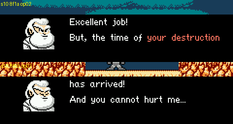
*EN VWF dialogue box: s10 with "your destruction" in the highlight colour (script injected into the fortress-1 box).*

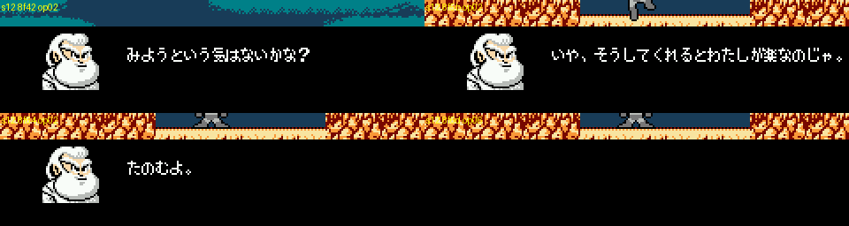
*JP box (s12 injected): "みようという気はないかな？", "いや、そうしてくれるとわたしが楽なのじゃ。", "たのむよ。", matching the
decoder output.*

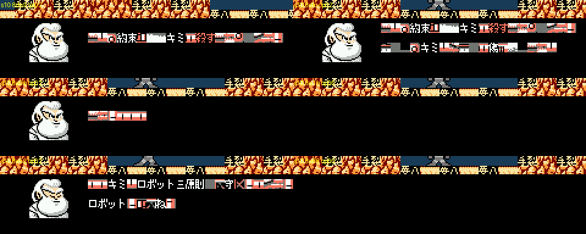
*JP s10 run on its own: the kana slots hold stage tiles, because s10 relies on pages loaded by s08 (only the kanji it
loads itself, such as 約束, 殺す, ロボット三原則, render). Proof of the per-script glyph paging.*

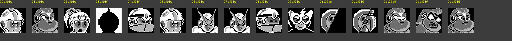
*The 15 portraits: 00 Rock, 01 Light, 02 Roll, 03 Ultraman (silhouette), 04/08 Guts Man, 05 Fake Rockman, 06/07 Quick
Man, 09 masked robot, 0A/0B two-part robot, 0C/0D/0E Light stern/furious/beaten.*

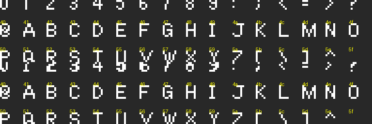
*The EN variable-width font (`0x53000`), with the second sheet at `0x53400` below.*

## 2. The script, in order

### 2.1 Story crawl (attract mode) [seen]

*The four crawl pages, EN left, JP right.*

| EN (verbatim, typo included) | JP | JP gist |
|---|---|---|
| In the year of 20XX, Dr. Light is appriciated by defeating the evil | 20XX年 ー Dr.ライトはナゾの科学者 Dr.ワイリーの野望を阻止したことを認められ | 20XX. Dr. Light is honoured for stopping the ambitions of the mysterious scientist Dr. Wily, |
| desire of Dr. Wily. His robots are world-famous. | 彼の造るロボットは世界的に信頼されるようになっていた。 | and the robots he builds came to be trusted worldwide. |
| While Dr. Wily thinks he can win if he creates many robots of only one kind. | 一方、Dr.ワイリーは1 VS 複数に持ちこめば、Dr.ライトを倒せると考えていた。 | Wily, meanwhile, reasoned that if he could make it **1 VS many**, he could beat Light. |
| Thus, a new fake Mega Man has been sent out to the world... | こうして、新たにロボットが大量生産され、世に送りだされたのだった……。 | And so new robots were **mass-produced** and sent into the world... |

This is the readme's joke ("We lose because we fight 8 vs 1!") stated straight [doc]. ナゾの科学者 ("the mysterious
scientist") echoes the series' stock description of Wily.

### 2.2 Title and file select [seen]

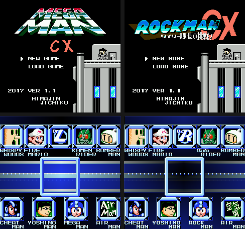
*Title (top) and stage select (bottom), EN left, JP right.*

| | EN | JP |
|---|---|---|
| Logo | MEGA MAN / CX | ROCKMAN / CX, subtitle **ワイリー課長の挑戦!** |
| Menu | NEW GAME / LOAD GAME | same (English in both) |
| Footer | 2017 VER 1.1 / HIMAJIN JICHIKU | same |
| LOAD GAME | DATA 1 / DATA 2 / DATA 3 | same |
| Continue menu | CONTINUE / STAGE SELECT / SAVE GAME, GAME OVER | same |

**The subtitle** "Section Chief Wily's Challenge!" parodies **ゲームセンターCX** (*GameCenter CX*), the TV show in which
comedian Shinya Arino, "Section Chief Arino" (有野課長), plays retro games in "Arino's Challenge" (有野の挑戦). Rockman
2 was one of the show's famous challenges. Wily as a *kachō* (a middle manager running a production line) also fits the
mass-production premise. Rockman 2's own subtitle was "Dr.ワイリーの謎". The EN logo drops the subtitle.

### 2.3 Stage select [seen]

Top row WHISPY WOODS, FIRE MARIO, (centre: Dr. Light emblem), KAMEN RIDER, BOMBER MAN; bottom row CHEAT MAN, YOSHINO
MAN, MEGA MAN, AIR MAN. JP differences: **ROCK MAN**, **仮面 RIDER** in kanji, the centre emblem reads **Dr.R** (Dr.
Right, Light's Japanese name) instead of **Dr.L**, and Air Man's portrait, which in EN is just the words "Air Man" in
place of a face, reads **空気男** (a literal "air man"; 空気 is also slang for someone nobody notices). Cheat Man's
portrait is Mega Man X's face, the ultimate "cheat" robot.

### 2.4 Opening stage [seen]

**Scene 1: the capture** (cutscene box at the top of the screen; gray Fake Rockman, Guts Man):

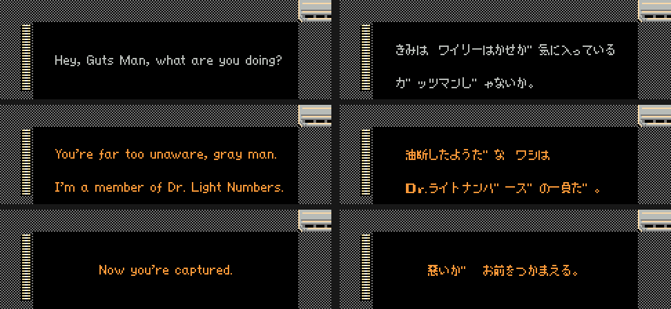
*Opening stage, scene 1: EN left, JP right.*

| Speaker | EN | JP | JP gist |
|---|---|---|---|
| Fake Rockman | Hey, Guts Man, what are you doing? | きみは ワイリーはかせが気に入っているガッツマンじゃないか。 | Aren't you Guts Man, the one Dr. Wily is so fond of? |
| (Guts Man throws a boulder and buries him) | | | |
| Guts Man | You're far too unaware, gray man. I'm a member of Dr. Light Numbers. | 油断したようだな ワシはDr.ライトナンバーズの一員だ。 | You let your guard down. I'm one of the Dr. Light Numbers. |
| Guts Man | Now you're captured. | 悪いが お前をつかまえる。 | Sorry, but I'm taking you in. |

In Rockman 1 Wily stole Guts Man because he wanted him for construction work; the JP line plays on that. "Gray man"
is the Fake Rockman's mass-production palette.

**Scene 2: the rescue.** You now play Quick Man and fight Guts Man as the opening boss. Rock (blue) drops in, Guts
Man escapes, Rock leaves, and Quick Man breaks the Fake Rockman out of a cell:

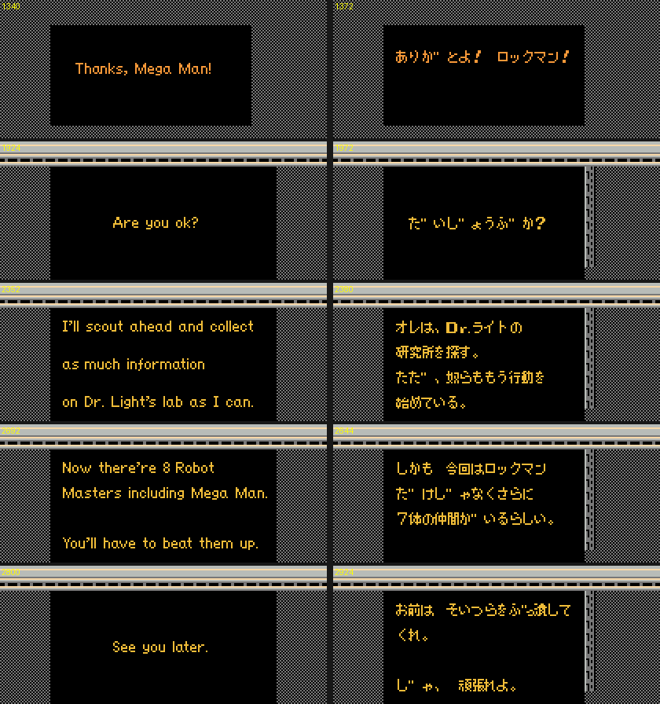
*Opening stage, scene 2: EN left, JP right.*

| Speaker | EN | JP | JP gist |
|---|---|---|---|
| Rock | Guts Man, escape now!! [text: strip at `0x4e000`; not captured on screen] | (not captured) | |
| Guts Man | Thanks, Mega Man! | ありがとよ！ロックマン！ | Thanks, Rockman! |
| Quick Man | Are you ok? | だいじょうぶか？ | You all right? |
| Fake Rockman | Thanks, Quick Man. I'm ok. [text] | あ、ああ。ありがとう。助か… (partly seen) | Y-yeah. Thanks. You saved me... |
| Quick Man | I'll scout ahead and collect as much information on Dr. Light's lab as I can. | オレは、Dr.ライトの研究所を探す。 / ただ、奴らももう行動を始めている。 | I'll look for Dr. Light's lab. But they're already on the move. |
| Quick Man | Now there're 8 Robot Masters including Mega Man. You'll have to beat them up. | しかも 今回はロックマンだけじゃなくさらに7体の仲間がいるらしい。 | And this time it's not just Rockman: he seems to have seven more allies. |
| Quick Man | See you later. | お前は そいつらをぶっ潰してくれ。 / じゃ、頑張れよ。 | You go smash them. Well, good luck. |

Quick Man teleports out and the stage select opens. EN keeps all of this as strips of a proportional font, so each
line is a run of consecutive tile numbers [code].

### 2.5 Robot master stages

**Cheat Man.** His boss room wall is covered in repeating hex strings, "00EA24A1" and "C93D854B" [seen], and he refills
his own health bar when knocked to zero [seen]. Cheat codes as wallpaper; `$4B` is CX's invincibility timer, so
"854B" reads as 6502 `STA $4B` **[guess]**. A *Dragon Quest*-style battle message sits pre-rendered in the stage's
graphics bank (`0x54c00`) [code; not seen in play]: EN "The Cheatous Bass and its cohorts used a jam session attack!!
Cheat Man attacks!"; the JP tiles read "…ちのれんぞくこうげき" (DQ's "...'s consecutive attack!") and "チートマン …
セッション…".

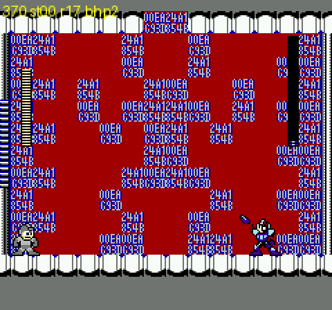
*Cheat Man's boss room: "00EA24A1 / C93D854B" tiled over the walls.*

**Weapon get and item "upgrades".** After each boss a full-screen Rockman artwork, recoloured to the weapon, types
the message. After the 2nd, 4th and 6th boss a second screen hands over an item "upgrade" with the same wording
(cx-scout's finding, `docs/research/cx/cheats.md` §6); there is no separate "from Dr. Light" text in the game.

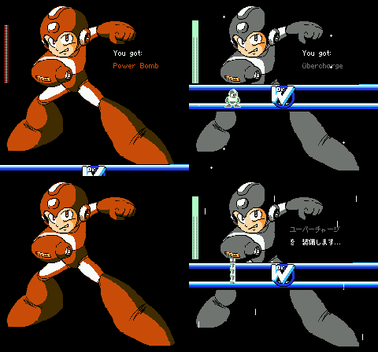
*Top EN: "You got: Power Bomb", then the item screen "You got: Übercharge". Bottom JP: "ユーバーチャージ を 装備します…".*

### 2.6 Dr. Light's fortress (26 dialogue scripts)

**Who triggers what** [code: every `LDA #$41` spawn site and the X it writes; seen where marked]:

| Spawn site | Script(s) | Scene |
|---|---|---|
| `$1F:B985` (`STA $047F` = $01) | s00 | fortress 1 start, room $19 [seen] |
| `$25:B081`, `$25:B1FC` | s02, s03 | Light presents Quick Man; Quick Man wakes up |
| `$1F:BBE2` | s04 | Quick Man joins |
| fortress 3, room $21 (spawn path not located) | s05 | Guts Man and the short circuit [seen] |
| `$25:B41F` | s06 | Guts Tank intro [seen: fortress 3 boss] |
| `$17:ABFC` (RM2's Wily-boss bank) | s23 | Guts Tank destroyed [seen] |
| `$16:9739` (when counter `$06AF` = 7) | s08 | Light sends his "pet" |
| `$30:8660`, table `$30:8584` | s10, s11, s12, s15, s16, s17, s18, s19, s20, s13, s14, s24 | **the fortress-6 Dr. Light battle**: one line per round, in this order in the table |
| `$30:889E` | s21 if screen < $16, else s25 | Light beaten |
| `$30:8C16` | s22 | Light flees |
| not located | s01, s07, s09 | spike counter; masked robot; two-part robot |

**(added by critic)** Scenes now seen in play: **s04** plays on the first screen of fortress 3 when Quick Man has
rejoined (trigger `$1F:BBC7`); **s08** plays in fortress 5 room `$2A` after all eight teleporter refights, and the
"pet" is **Rush** (`$16:973E`, X = `$11`); **s10** plays when Rush is beaten, still in fortress 5, and the game then
cuts straight into fortress 6's round 1; **s22** is spawned by event script `$2D` (`$30:8C16`) placed in fortress 6
room `$1E`. A search of all eight stage banks' enemy tables (object `$41` with Y = `$1C`, the dialogue script) and of
every immediate `LDA #$1C / STA $04B0,Y` spawn finds no site for **s09**, so the two-part robot may be cut content
[code]; s01 and s07 were seen in play but their spawn path was not traced.

In the fortress-6 boss room Light warps in through the **"Dr.LIGHT TELEPORT SYSTEM"** (its monitors say so) for each
round [seen]. From cx-scout's `light6_boss` state, knocking his HP down gave s24 and then s25, which sends you to the
giant-Light stage $0E [seen]; I did not see the earlier rounds play out, so the per-round order is from the table.

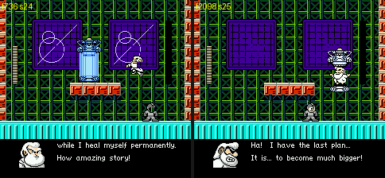
*Fortress 6: Light in his teleporter: "You respawn repeatedly / while I heal myself permanently. How amazing story!",
then "Ha! I have the last plan... It is... to become much bigger!".*

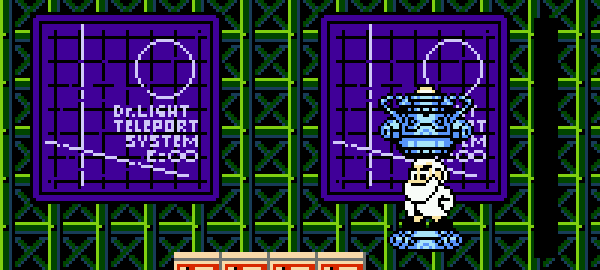
*The monitors behind him: "Dr.LIGHT TELEPORT SYSTEM E:00".*

The scripts follow, roughly in story order. EN is a loose, often meme-ified rewrite of the JP original, so the JP gist
column matters. **Bold** in EN = highlight colour. Speakers are from the portrait codes.

**s00: Light's lab is attacked** (fortress 1 start)

| Speaker | EN | JP | JP gist |
|---|---|---|---|
| Roll | W...Wily UFO is here! / It's heading towards us! | ワ、ワイリーはかせのUFOが来ました！ / まっすぐこちらへ向かってきます！！ | W-Wily's UFO is here! It's heading straight for us! |
| Dr. Light | Soldiers near him, / assume combat mode! | 付近の者はただちに戦闘準備をしたまえ！！ / 戦闘力のない者は避難せよ！！ | Everyone nearby, prepare for battle! Non-combatants, evacuate! |
| Rock | Beware, they will come / over and over again... | 倒しても倒しても彼らはやってきます… / 注意してください…… | No matter how many we beat, they keep coming... be careful. |
| Dr. Light | Ultra Man, SMASH him. | ロックはまだ休んでおれ。 / …ウルトラマン、彼らをティウンさせなさい。 | Rock, you keep resting. ...Ultraman, **make them "tiun"**. |
| Ultraman | Dwah!! | デュワ！！ | (Ultraman's battle cry) |

ティウン (*tiun*) is the fan onomatopoeia for the Rockman death sound, used as a verb. "They keep coming" is the
mass-production premise: your extra lives are the horde.

**s01: the spike counter**

| Speaker | EN | JP | JP gist |
|---|---|---|---|
| Dr. Light | By the way, my spiky things seem / good at killing instantly. | ところで、あのウニみたいなやつ、いい具合に / 即死させることができるみたいじゃな？ | By the way, those sea-urchin things kill instantly rather nicely, don't they? |
| Guts Man | They've got *N* kills. | *N*ティウンしたらしいぞい。 | Apparently *N* "tiuns" so far. |
| Dr. Light | Hmm... / Bring more spikes.  I guess we can / stop him. | ふーむ…………… / たーくさん置いておきなさい。彼らが通りそう / なところに、ぎっしりと詰めるのじゃ。 | Hmm... Put out lo-ots of them. Pack them in wherever they're likely to pass. |

*N* is printed live by op `07` from `$0098`, a spike-death counter: `$1F:B12E` does `INC $98` whenever one of the
player's collision tiles (`$32-$34`) is type 3 (spikes), and `$98` is stored in the battery save, so the count
covers the whole playthrough [code]. The villain reads your death statistics and orders more spikes.

**s02 / s03 / s04: Quick Man is turned, then rejoins**

| Script | Speaker | EN | JP | JP gist |
|---|---|---|---|---|
| s02 | Dr. Light | Look who I found wandering around! / My friend here has a small problem with you. / It seems that you let him die and he's not too happy about that! | …わたしのロボットたちがお世話になっている / ようじゃのう。 / さて、君にどうしてもわたしの新しい仲間を / 紹介したいのじゃ。 | ...It seems my robots have been "well looked after" by you. Now, there's a new friend of mine I simply must introduce. |
| s02 | Fake Rockman | !? | ！？ | |
| s02 | Dr. Light | Now I think it is time that he / repays the favor! | まあ、楽しんでくれたまえ。 | Well, do enjoy yourself. |
| s03 | Fake Rockman (EN) / Quick Man (JP) | Quick Man... Do you remember me...? | どうやら、悪い夢を見ていたようだ……… | (QM) Looks like I was having a bad dream... |
| s03 | Quick Man (EN) / Fake Rockman (JP) | Yea... I guess so... / Sorry to cause you so much trouble. | クイックマン！ / お前には、ずいぶん迷惑をかけたみたいだな。 | (FR) Quick Man! (QM) Seems I caused you a lot of trouble. |
| s03 | Fake Rockman | Go back to our lab first! | まずは研究所に戻ろう！話は後だ！ | Back to the lab first! We'll talk later! |
| s03 | Fake Rockman | (Can't I teleport...!?) | テレポートができない……！？ | I can't teleport...!? |
| s04 | Quick Man | Let's split out. / Call me in the menu if you need help. | 二手に分かれて勢力を分散させるぞ！！ / 必要な時はサブメニューから呼び出してくれ！ | Let's split up and divide their forces! Call me from the sub-menu when you need me! |

Light caught Quick Man while he was scouting the lab (opening scene 2) and turned him against you. Between the last two
s03 lines, four far calls play the teleport-out animation and fail [code: `09 5F/77/96/A9 B8 24`]. s04 is the story
unlock of the second playable character; when you call him from the menu he answers "Ok, I'm on my way!" /
"わかった、いますぐ行くぜ!!" (§3).

**s05 / s06 / s23: Guts Tank** (fortress 3) [seen]

| Script | Speaker | EN | JP | JP gist |
|---|---|---|---|---|
| s05 | Guts Man | There's a short circuit zap!! / Our base's gonna ruin!! | ろ、ローデンを起こしているでガス！ / もうダメでガス！ | Th-there's a current leak, -degasu! We're done for, -degasu! |
| s05 | Dr. Light | Don't worry, Guts. / ...We're now **SERIOUS**. | わざと漏電させているのじゃ。 / ……こちとら / マ / ジじゃからのう。 | I'm leaking current **on purpose**. ...Because we're dead "ma... ji" (serious) here. |
| s06 (vs Quick Man) | Guts Man | Whoa!! / You should be in our clocktower...! | あ！ / こいつはさっき時計塔に / 閉じ込めたはずの…！ | Ah! This one should be locked in the clock tower...! |
| s06 (vs Fake Rockman) | Guts Man | I've lost you once... / Not again... | ……あの時つかまえ損ねたニセロックマンが、 / ここまでたてつくとは……… | ...The fake Rockman who slipped through my hands back then, defying us this far... |
| s06 | Guts Man | I'm going to STOP you with... / The Fierce Dr.Light's Guts Tank!! | こうなったら、博士特製のガッツタンクで / 全力でひねり潰してやるでガス！！ | Then I'll crush you with all my might in the Doctor's special **Guts Tank**, -degasu!! |
| s23 | Guts Man | Where... did that... power come from...!? / Arrrggghhh!!! | お…お前のどこに……そんな力が………… / ぐわあああああああ！！ | W-where in you... did such power... GWAAAAAH!! |

でガス (*-degasu*) is Guts Man's verbal tic, *-desu* + "Guts". Light electrifies his own base on purpose; JP stretches
"マジ" over two box-closes, EN uses the highlight colour. Guts Tank is RM2's Wily-stage-3 boss, now in Light's
stage 3. "お前のどこにそんな力が" is a stock anime defeat line. Variant choice [code]: s06 starts with the which-hero
call `$24:B5BF` and two `0C` skips; in s21/s25 the same pattern picks portrait 05 (Fake Rockman) on the taken branch,
so the taken branch of s06 ("I've lost you once", JP "the fake Rockman who slipped through my hands", i.e. the opening
rescue) is the Fake Rockman's, and the clock-tower line is said to Quick Man. When Quick Man was locked in a clock
tower is not shown by any text I found.

**s07: the masked robot** (two variants)

| Speaker | EN | JP | JP gist |
|---|---|---|---|
| masked robot (vs Quick Man) | You're, um...the robot master who / inherits me? / You look weird... | お前が、その…………わたしを受けついだ / ロボットか。ヘンなツノなんかつけて………。 | So you're... the robot who **inherited** me. Wearing some weird horn... |
| Quick Man | Shut up, you are. | お前こそ、ヘンな仮面をつけているじゃないか。 | Says you, with that weird mask on. |
| masked robot | You are. | ………ふん。それならどっちがヘンか、 / ハッキリさせようではないか。 | ...Hmph. Then let's settle which of us is weird. |
| masked robot (vs Fake Rockman) | You finally got here. / This is the fourth / "Dr.Light's Sanctuary location. / It's ours now. / Take it from us, if you dare... | よく、きた。 / しかし、ここは「わたしの場所」だ。 / うばい取ってみよ。 / …………できるものなら。 | Welcome. But this is "my place". Try and take it... if you can. |

EN turns the JP banter into a schoolyard "no, *you* are". "The fourth" suggests fortress stage 4 **[guess]**. Who the
masked robot is was not established; a Light-built predecessor of Quick Man is implied **[guess]**.

**s09: the two-part robot**

| Speaker | EN | JP | JP gist |
|---|---|---|---|
| part A | I might be weak... | ひとりでダメなら…… | If one of us is no good... |
| part B | **But we are strong!** | 2人がかりでどうだ！！ | ...how about two at once!! |

**s08: Light sends his "pet"**

| Speaker | EN | JP | JP gist |
|---|---|---|---|
| Dr. Light | Welcome!  I see you destroyed my lab by yourself. / Very impressive! / I could destroy you, but I would not rob my pet of that pleasure. / He knows how to deal with wastes. / Should you live, I will be waiting for you.  Don't disappoint me! | フフフ…キミはすばらしいよ。 / この短時間でここまでわたしの研究所を / 荒らして回るとは…………実にすばらしい。 / さてと、すぐにでもわたしとお手合わせ / 願いたいのだが、あいにく…こいつがそれを / 許してくれなくてねえ。なにしろ、 / いつもは研究所のゴミ出し担当なのでね…… / しばらくしても、こいつが戻ってこないよう / なら、キミと試合をすることにしよう。では、 / 楽しみにしているぞ。 / ハハハハハ……… | Fufufu... you're wonderful. To wreck my lab this far in so little time... truly wonderful. I'd love a match right away, but unfortunately this fellow won't allow it; he's normally the lab's **garbage-disposal duty**... If he doesn't come back after a while, I'll have that match with you. Looking forward to it. Hahahaha... |

**The fortress-6 battle, round by round** (table order s10, s11, s12, s15, s16, s17, s18, s19, s20, s13, s14, s24)

| Script | Speaker | EN | JP | JP gist |
|---|---|---|---|---|
| s10 | Dr. Light | Excellent job! / But, the time of **your destruction** has arrived! / And you cannot hurt me... / How will you survive? | ……………………。 / では、約束どおりキミを殺すことにしよう。 / そして、キミはわたしを傷つけることは / できない…… / さて、どうするかね？ | ...... Then, as promised, I shall kill you. And you **cannot harm me**... So, what will you do? |
| s10 | Dr. Light | Welp, you defy The Three Laws of Robotics? / Dangerous robots like you... | ……キミはロボット三原則すら守れないような / ロボットなのかね？ / そんな危険なモノはね………… | ...Are you a robot that can't even obey the **Three Laws of Robotics**? Something that dangerous... |
| s10 | Dr. Light (furious) | AREN'T NEEDED IN THIS / PEACEFUL WORLD!! / I   D E S T R O Y   Y O U ! ! | この平和な世界には必要ないのじゃ！！ / わしがこの手で八つ裂きにしてやるわ！！ | ...is NOT NEEDED in this peaceful world!! I'll tear you limb from limb with my own hands!! |
| s11 | Dr. Light | You listening?  Okay. / Grass grows, birds fly, sun shines, / and... I crash you. | ……非常にカンタンな、自然の摂理じゃ。 / 草木が生え、鳥が飛び、日が差して……… / そして、わたしはお前をブチのめす。 | ...A very simple law of nature. Grass grows, birds fly, the sun shines... and I beat you to a pulp. |
| s12 | Dr. Light | So, if you could just do me a favor / and off yourself, that'd be great. / Yes  No | ところで、せっかくだから自分から死んで / みようという気はないかな？ / いや、そうしてくれるとわたしが楽なのじゃ。 / たのむよ。 | By the way, since you're here, how about dying by your own hand? It'd make things easy for me. Please. |
| s12 (Yes) | Dr. Light | Thanks, pumpkin. | そう。それでいいのじゃよ。 | Yes. That's a good boy. |
| s12 (No) | Dr. Light | No...? / Since when have you thought you / can say no? | そうか………それなら、 / わしが手にかけるしかないか………。 | I see... then I'll just have to do it myself... |
| s15 | Dr. Light | So you want to get more power from me, eh? / If not, too bad - I'm giving you anyway. | またわしの技を受けたいっていうんですかい？ / ま、いやだといっても受けさせますがねえ。 | So you want to take my technique again, huh? Even if you say no, you're taking it. |
| s16 | Dr. Light | So you've come... I hope not to want to fight anymore... | はあ…………… / やはりまた、来てしまったか………。 / できればわたしは、もう戦いたくないのだが… / これも運命なのかのう………。 | Sigh... you came again after all. If I could, I'd rather not fight anymore... is this fate too? |
| s16 | Dr. Light | Well, step into this capsule. / and receive a mid-air acceleration system to boost your mobility. / Good Luck! | さて、カプセルに入るのじゃ。 / そうすれば、お前は空中でダッシュすることが / できるようになるはずじゃ。 / つらいことも多かろうが、がんばるのじゃぞ。 | Now, step into the capsule. Then you should be able to **dash in mid-air**. It will be hard, but do your best. |
| s16 | Dr. Light | Step into capsule? / Yes  No | カプセルに、入りますか？ | Enter the capsule? |
| s16 (No) | Dr. Light | Okay, I'll go back to **my job**. | ………………こんなところじゃろう。 / では、仕事に戻らねばな。 | ...That'll do. Well, back to work. |
| s17 | Dr. Light | I teach you something good. / You must defeat my Dragon Punch to stand a chance! | お前にいいことを教えてやろう。 / 昇龍拳を破らぬ限り、お前に勝ち目はない！！ | Let me tell you something good. Unless you break my **Shoryuken**, you have no chance!! |
| s18 | Dr. Light | Great, another dead Mega Man-shaped robot... / ......Wait a minute, it's not dead! / YES!  I must make it die! | またロックの形をしたガラクタか……… / ワイリーも忙しくしているようじゃのう。 / ………うん？おぬし生きておるな！？ / こりゃわしが本当にガラクタにしなければな。 | Another piece of Rock-shaped junk... Wily's keeping busy, I see. ...Hm? You're alive!? Then I really must turn you into junk. |
| s19 | Dr. Light | You have destroyed so much. / What is it exactly, that you have created? / Can you even name one thing? / ......I thought not. / I guess you are useless. / So, let's finish your whole life. | キミは本当に多くのものを壊してきたが… / ところで、キミが作り出したものは何だ？ / 1つでもあるのか？…………ないだろう。 / そんなものはムダでしかない。 / すぐにでもわしが処分してやろう。 | You've destroyed so much... but what have you created? Even one thing? ...No. Pure waste. I'll dispose of you right now. |
| s19 | Dr. Light | I have laid the foundation for robotics, / and not as we have narrowly defined ourselves, / but as something greater than we could ever imagine. / My robots will become something we can only now begin to glimpse. | ちなみにわたしにはあるぞ。わたしはロボット / 工学の基礎を確立させた。 / それも、ロボットの可能性を限定する方向に / ではなく、想像を超えて大いなるものへと成長 / できるように……………だ。 / わたしのロボット三原則に則ったロボットはね、 / 現時点では予想すらできないような大いなる / 存在に、なれるのだよ。 | I, for the record, have: I founded robot engineering, and not to limit what robots can be, but so they can grow beyond imagination. Robots that follow my **Three Laws** can become great beings no one can predict today. |
| s20 | Dr. Light | You think I'm professional of creating robots, but also expert of destroying. / Let's show you how I do. | わたしはロボットを作る人だと思われている / ようだが、実はロボットを壊す方法についても / よく知っているのじゃよ。それを今から / キミに教えてやろう。 | People think I'm the man who builds robots, but I know a great deal about breaking them too. Let me show you. |
| s13 | Dr. Light | it's a beautiful day outside. / birds are singing, flowers are blooming... / on days like these, scraps like you... / Should be burning in hell. | ………外はとてもよい天気じゃぞ。 / 鳥は歌って、花も咲いて、 / そして、キミみたいなポンコツは………… / ……………………こうじゃ。 | ...It's lovely weather outside. Birds are singing, flowers are blooming, and junk like you... gets **this**. |
| s14 | Dr. Light | No problem. | うむ。問題なし。 | Mm. No problem. |
| s24 | Dr. Light | Heh heh heh... / You respawn repeatedly / while I heal myself permanently. / How amazing story! | ふふふふふ……… / お前は無限に復活してわたしを追い詰める。 / そして、わたしもまた、無限に回復してお前を / 追い詰める。最高のシナリオだと思わんかね？ | You revive endlessly and corner me; I recover endlessly and corner you. Isn't that the best scenario? |

*s12 injected into the fortress-1 box: the Yes/No prompt, then the Fake Rockman explodes on "Thanks, pumpkin."*

**Answering "Yes" in s12 kills you on the spot** [seen: HP drops to 0 and the death explosion plays during "Thanks,
pumpkin."]. s15 is not an item upgrade: JP "わしの技を受けたい" means "you want to be hit by my technique again"; the
EN "more power from me" is loose. In s16 Light, the villain, offers the Fake Rockman a *Mega Man X*-style capsule with
an air dash in the middle of his own boss fight, and sighs "is this fate?".

**s21 / s22 / s25: Light beaten**

| Script | Speaker | EN | JP | JP gist |
|---|---|---|---|---|
| s21 | Dr. Light (stern, then beaten) | *Cough* *cough* ...I am defeated... / I have no choice...... *cough* / but to throw myself... on your... / MERCY! | ゲホッ…ゴホッ…あわれむが、よい……ゴホッ / わしはもう、ダメじゃ……………… / 土下座して……お許しこいます…………！ | *cough* *cough* ...pity me... *cough* I'm finished... I prostrate myself... and beg forgiveness...! |
| s21 | hero (portrait chosen by `0C`) | That's right, Dr.Light! / Your justice is finally... | ……………………分かった！ / もうわれわれの計画のジャマをしないのならば | ......All right! As long as you stop getting in the way of our plans... |
| s21 | Dr. Light | Phew, it was worth a shot. | ………ふう、あぶないところじゃった。 | ...Phew, that was a close one. |
| s21 | hero | We will capture you! | 逃がさないぞ！Dr.ライト！ | You won't get away, Dr. Light! |
| s21 | Dr. Light | Remember, you are still in my lab. | ……………… / ここはわたしの研究所だ。忘れないように。 | ...This is my lab. Don't forget that. |
| s22 | Dr. Light (stern) | Escaping does not only mean that I keep a distance from you. | わたしがキミから遠ざかることだけを / 「逃げる」というのではないのだよ。 | "Running away" doesn't only mean getting further from you. |
| s25 | Dr. Light (beaten) | Awww, it cannot be... | こ、こんなはずでは…………… | Th-this can't be... |
| s25 | hero | The war is now over. | もう、おしまいだ。Dr.ライト。 | It's over, Dr. Light. |
| s25 | Dr. Light (stern, then furious) | Ha!  I have the last plan... / It is... / to become much bigger! | なにをバカなことを……… / よおし、こうなったら…………… / こうなったら、大きくなってやる！！！！ | What nonsense... Right, in that case... in that case, **I'll get BIG**!!!! |

s21 is the **Wily dogeza**: every classic ending has Wily kneeling, and Rock forgiving him before he escapes. In JP the
hero falls for it exactly like Rock ("All right! As long as you stop..."); EN changes the hero's line into a gloat,
which loses the joke. s25 sets up stage $0E, where a giant Light fills the background [seen].

### 2.7 Ending

After fortress 6 the game runs a cutscene at `$1B:B60A` (it loops over the 16 roll-call strings via `$D634` ->
`$12:8603`) and then starts stage $0E, the giant-Light fight [code]. I could not beat the giant in this run, so the
ending text below is from ROM.

A villain's victory line is pre-rendered in both builds at `0x51b00`, and no dialogue script uses it. That it is
Wily's closing line is a **[guess]** from the wording (じゃ, "Muahaha") and its separate storage:

| EN | JP | JP gist |
|---|---|---|
| Now the age of me begins!Muahahahahahaha! | ワガハシの時代到来じゃ！ヌァーッ… | My era has arrived! Nwaaah... (ワガハシ [sic]; the glyph is シ, surely for ワガハイ, Wily's pompous "I") |

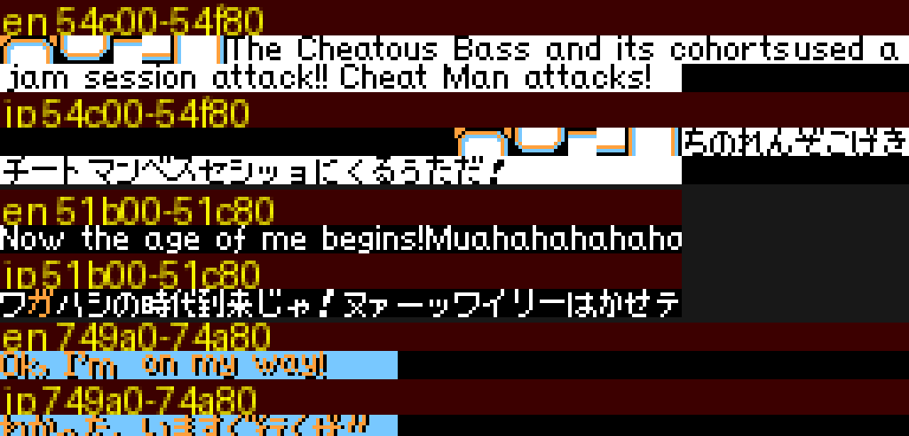
*Pre-rendered strips, EN over JP: Cheat Man's DQ banner (`0x54c00`), the villain's line (`0x51b00`), Quick Man's
menu reply (`0x749a0`).*

**Boss roll call** (`0x24500`; offsets, lengths, then strings) [code]:

| EN | JP | Credit |
|---|---|---|
| DLN.001 MEGAMAN | DRN.001 ROCKMAN | CAPCOM |
| DLN.009 YOSHINOMAN | DRN.009 YOSHINOMAN | HIMAJIN JICHIKU |
| DLN.010 CHEATMAN | DRN.010 CHEATMAN | HIMAJIN JICHIKU |
| DLN.011 AIRMAN | DRN.011 AIRMAN | HIMAJIN JICHIKU |
| DLN.012 FIREMARIO | DRN.012 FIREMARIO | NINTENDO |
| DLN.013 KAMEN RIDER | DRN.013 仮面 RIDER | ISHINOMORI PROD. |
| DLN.014 BOMBERMAN | DRN.014 BOMBERMAN | HUDSON SOFT |
| DLN.015 WHISPYWOODS | DRN.015 WHISPYWOODS | HAL LABORATORY |

The numbering is canon-aware: Light's Rockman 1 robots are DLN-001 (Rock) to DLN-008 (Elec Man), so CX's new Light
Numbers start at 009. JP uses **DRN** because Light is "Dr. Right" in Japanese. Air Man, a Wily robot in RM2, is
re-registered as a Light Number "by Himajin Jichiku".

**Staff roll** (`0x24c40`, 88 strings, PPU addresses alongside) [code]: first the **original Rockman 2 staff**, copied
from the vanilla RM2 ending, under the heading "original megaman2 staff" (JP "rockman2"): CHARACTER DESIGNER YASUKICHI,
INAFKING, TOM PON, NAGINEKO, 2M03CM MAN, A.K; sound programmer OGERETSU KUN, MANAMI IETEL, YUUKICHAN&S PAPA;
PROGRAMMER H.M.D.; PLANNER A.K; then RM2's long special-thanks list (HIROYUKI MAETANI ... FISH MAN). Then **"megaman
cx staff"**: SPECIAL THANKS PROUDMAN, PROETE, ROCK5EASILY, BAD DUMMY; SPECIAL THANKS ENSIS, **PURESABE** (author of
*Rockman 4 Minus Infinity*), NARFNRA (corrected the English readme [doc]), COLASAUR; SPECIAL THANKS ALL BETA TEST
PLAYERS. AND YOU..; HACKED BY (logo tiles $E4-$EE); "original megaman2 presented by capcom".

## 3. Menus, weapon names and other fixed text

**Pause menu** (bank $1F `0x3e380`, seen in `build/research/cx/cx-scout/menu_allw_sheet.png`): `MEGAMAN` (JP
`ROCKMAN`); `MEGA BUSTER` (JP `ROCK BUSTER`), `CHEAT SABER`, `DEAD RINGER`, `RINGO SHIELD`, `FIRE BALL`,
`PRINT CUTTER` / `RIDER KICK`, `POWER BOMB`, `1.FLOOR`, `2.SUBTANK`, `3.ÜBERCHARGE` (tile $1C = Ü).

**Weapon-get list** (bank $1B `0x37d21`) [code, seen for Power Bomb and Übercharge]:

| Boss | EN | JP | Reference |
|---|---|---|---|
| Cheat Man | Cheat Saber | チートサーベル | |
| Air Man | Dead Ringer | デッドリンガー | *TF2*: the Spy's fake-death watch |
| Whispy Woods | Ringo Shield | リンゴシールド | *ringo* = apple; Whispy drops apples in *Kirby*; RM2's Leaf Shield |
| Fire Mario | Fire Ball | ファイアボール | Fire Mario's fireball |
| Yoshino Man | Print Cutter | プリントカッター | |
| Mega Man | Mega Buster | ロックバスター | you take Rock's own buster |
| Kamen Rider | Rider Kick | ライダーキック | Kamen Rider's finishing move |
| Bomberman | Power Bomb | パワーボム | *Bomberman*'s Power Bomb item |
| item 1 | Instant Floor | インスタント足場 | menu `1.FLOOR` |
| item 2 | Sub Tank | サブタンク | *Mega Man X* Sub Tank |
| item 3 | Übercharge | ユーバーチャージ | *TF2*: the Medic's invulnerability |

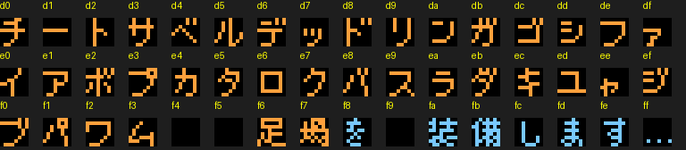
*The 48 JP weapon-get glyphs (`0x51300`, codes $D0-$FF): D0 チ D1 ー D2 ト D3 サ D4 ベ D5 ル D6 デ D7 ッ D8 ド D9 リ
DA ン DB ガ DC ゴ DD シ DE フ DF ァ E0 イ E1 ア E2 ボ E3 プ E4 カ E5 タ E6 ロ E7 ク E8 バ E9 ス EA ラ EB ダ EC キ ED ユ
EE ャ EF ジ F0 ブ F1 パ F2 ワ F3 ム F6 足 F7 場 F8 を FA 装 FB 備 FC し FD ま FE す FF …*

**Quick Man answers a call from the menu** (bank $3A `0x749a0`): EN "Ok, I'm on my way!" / JP "わかった、いますぐ
行くぜ!!" ("Got it, I'm coming right now!!") [code].

## 4. Jokes and references

| Where | Line or element | Reference |
|---|---|---|
| title (JP) | ワイリー課長の挑戦! | *GameCenter CX*, 有野課長の挑戦 |
| crawl | 1 VS 複数, mass production | the readme's "we lose because we fight 8 vs 1" |
| stage select | 空気男 / "Air Man" written instead of a face; Cheat Man = X's face | Air Man as a non-presence; X as the "cheat" |
| opening | "the Guts Man Wily is fond of" | Rockman 1: Wily stole Guts Man for construction |
| s00, s01 | ティウン as a verb | fan word for the Rockman death sound |
| s00 | Ultraman, "Dwah!!" | Ultraman's battle cry; a tokusatsu cameo beside Kamen Rider |
| s01 | live spike-death count | meta: the villain reads your stats |
| s05, s06 | でガス | Guts Man's verbal tic |
| s06, s23 | Guts Tank | RM2 Wily stage 3 boss, here Light's stage 3 boss |
| s10, s19 | Three Laws of Robotics | Asimov; the *Mega Man X* backstory (Light's letter on X's potential) |
| s11 | "Grass grows, birds fly, sun shines, and..." | *Team Fortress 2*, "Meet the Scout" ("...and brother, I hurt people") |
| s12 | "if you could just... that'd be great" | *Office Space*, Lumbergh (EN only) |
| s13 | "it's a beautiful day outside..." | *Undertale*, Sans (both languages); the readme's "bad time" [doc] |
| s16 | capsule with an air dash | *Mega Man X* Light capsules |
| s17 | Dragon Punch / 昇龍拳 | *Street Fighter*, via *Mega Man X*'s hidden Shoryuken |
| s21 | dogeza, then escape | every classic Wily surrender |
| s24 | "You respawn repeatedly while I heal myself" | the player's infinite continues |
| s25 | "I'll get BIG" | the giant final form (stage $0E) |
| weapons | DEAD RINGER, ÜBERCHARGE | *TF2* again |
| Cheat Man | hex-code wallpaper, self-healing HP, DQ battle banner | cheating; *Dragon Quest* |
| roll call | DLN.009-015, DRN in JP | Light Number canon |

## 5. EN vs JP, hidden and unused text

- **The EN is a rewrite, not a translation.** It adds memes (Lumbergh, "Shut up, you are"), drops some JP jokes (the
  Rock-style forgiveness in s21; "my place" becomes "the fourth Dr.Light's Sanctuary location"), and has
  non-native slips kept verbatim here ("appriciated", "How amazing story!", "I teach you something good", "You think
  I'm professional of creating robots"). The readme only credits NARFNra for correcting the readme; the dialogue was
  most likely translated by the author **[guess]**.
- **JP-only typo**: ワガハシ for ワガハイ in the villain's line (glyph-verified).
- **Branches**: three texts live in gaps between scripts and are reached only through `0C SKIP`: the s07 Fake Rockman
  variant, the s12 "No" answer and the s16 "No" answer [code]. All are reachable.
- **Unused**: pointer-table entries 26-31 all point into the tail of s24 (`$9900`); nothing else is hidden in bank
  $26 (the rest of the EN diff region is relocated code) [code].
- Not captured on screen in this run: Rock's "Guts Man, escape now!!" and the JP of it, the Cheat Man banner in play,
  the staff roll and roll call on screen, and the villain line's scene.

## 6. Files

- Scripts (this run): `build/research/cx/cx-text2/turns.py` (dialogue decoder, both languages), `intro_pages.py`,
  `menus.py`, `boxseq.py` (cutscene-box page grabber), `bossdlg.py` (fight a boss and log scripts and pages),
  `yesno.py` (s12 test), `explore_from.py`, `toboss.py`, `scriptlog.py`, `curate.py` (builds the images above),
  `regsheet.py` (EN-over-JP tile renders).
- Predecessor scripts: `build/research/cx/cx-text/dlg.py`, `jprender.py`, `jpalign.py` (built the glyph map),
  `credits.py`, `inject.py`, `faces.py`, `vwf.py`.
- Savestates (this run, `build/research/cx/cx-text2/`): `ex_open/best.state` (Quick Man at the opening boss door),
  `open_door.state` (opening finale), `boss_cheat/best.state` (outside Cheat Man's shutter),
  `log_light1/s00.state` (fortress-1 dialogue running; used for script injection), `log_light3/s05.state`
  (s05 starting). Shared states used: `build/research/cx/states/` (cx-scout's `*_boss`, `ending`, `light*`).

## Lessons for Rockman 6 GP

**Design**

- **Give the boss a voice.** CX turns a pattern fight into a stand-up routine: one line per round, each a different
  joke (s10-s24). RM6 has no boss dialogue at all; a short line per Mr. X / Wily phase would carry the hack's tone.
- **Text can be a mechanic.** The spike-death counter (s01), the Yes/No prompt that really kills you (s12) and the
  mid-fight capsule offer (s16) all play with the player through the dialogue box. Cheap to build, memorable.
- **One inversion goes a long way.** Every line follows from "Light is the villain": Wily tropes given to Light make
  the jokes without new mechanics.
- **Write the JP original and adapt, do not translate.** CX's EN replaces jokes that do not travel with ones that do;
  where it translated literally (s21), the joke died. Plan per-language joke notes.

**Technical**

- **A script interpreter with far calls** (`09 lo hi bank`) lets text drive cutscene actions (teleport attempts, Yes/No,
  hero checks) without new engine code. RM6 GP should copy that shape: text ops + "call routine" + "skip if carry".
- **Select scripts through object data.** CX encodes the script number in the dialogue object's X coordinate, so any
  code that can spawn an object can start a conversation. In RM6 the same trick works with an object parameter byte.
- **Kanji on an NES: page-swap glyphs per script.** JP CX streams 16-glyph pages into CHR as the script runs (op `04`),
  which fits 327 distinct glyphs into a 256-tile pattern table. RM6 GP's text needs a similar scheme if it uses kanji.
- **A real VWF is worth it for English**, and the highlight colour comes free from the second bitplane. Pre-rendered
  strips work for fixed cutscenes but cost ROM and cannot be edited as text, so keep them for set pieces only.
- **Keep text out of code banks.** CX's EN text grew and pushed the code that followed it, which had to be relocated.
  Put each language's text in its own bank with pointer tables.
- **Test tooling:** dialogue injection (point `$C0/$C1` at another script inside a running box) and a page grabber keyed
  on the interpreter's opcode made it possible to capture every script without reaching every scene. Build the same
  hooks for RM6 GP's text QA.
