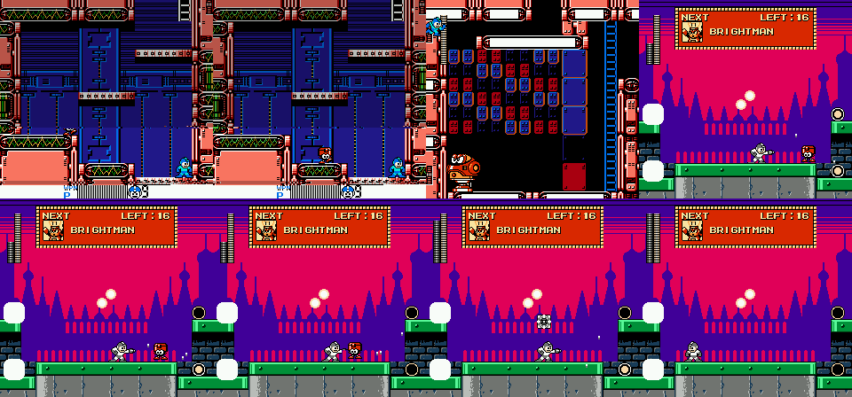
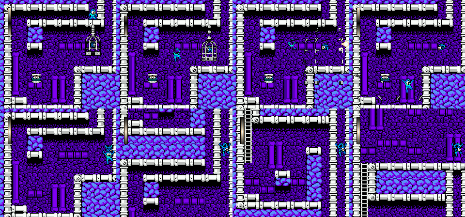
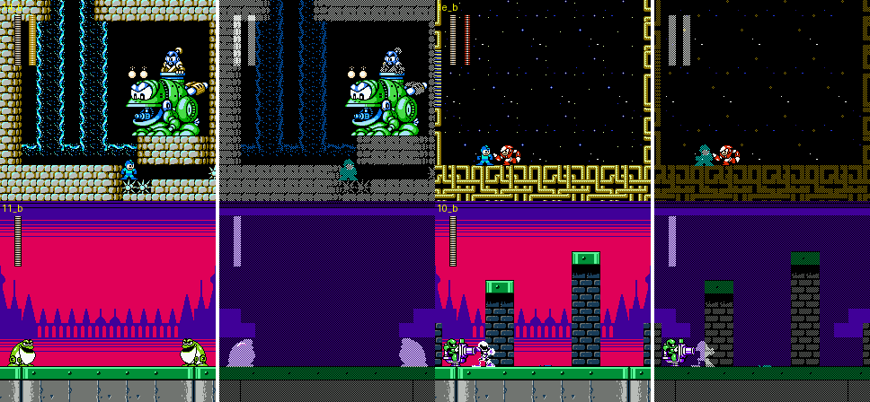
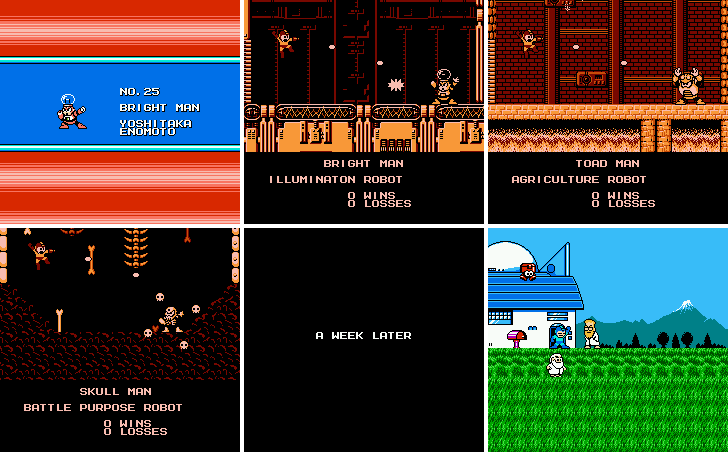
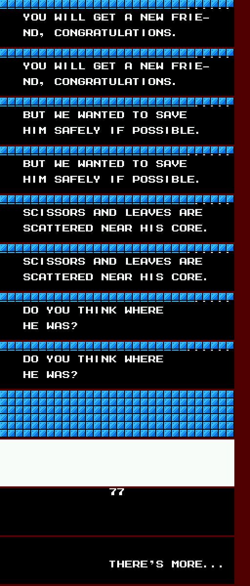
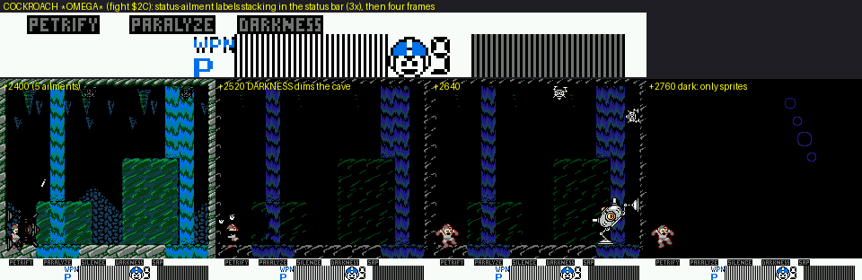

# Rockman 4 Minus Infinity: the definitive overview (r4mi-critic)

This is the synthesis of the 4MI investigation: v1.01, `roms/r4mi_mmc5.nes`, by Puresabe / Neo Borokuzu Koubou, 2008-2016. It sits on top of ten topic docs, which hold the evidence:

- [`cheats.md`](cheats.md): RAM/WRAM, the save format, unlocks, the EXTRA CONFIG level select, the MY ARENA boss select, warps, 105+ savestates.
- [`stages_a.md`](stages_a.md): Ring, Pharaoh, Drill, Dive.
- [`stages_b.md`](stages_b.md): Toad, Dust, Skull, Bright.
- [`cossack.md`](cossack.md): Cossack 1-4.
- [`wily.md`](wily.md): Wily 1-4, the final battle, the escape, the ending.
- [`systems.md`](systems.md): weapons, invincibility, criticals, Rush, equipment.
- [`modes.md`](modes.md): Hero Score, arenas, CONFIGURATION, achievements.
- [`engine.md`](engine.md): banks, MMC5, raster, sections, sound.
- [`graphics.md`](graphics.md).
- [`text.md`](text.md).

Tags, as in every doc:

- **[seen]**: observed in the emulator.
- **[code]**: disassembly or data.
- **[text]**: in-game text.
- **[doc]**: the readme.
- **[guess]**: speculation.

"(critic)" marks something checked, corrected or found in the critic pass (§8-§9). Addresses are `bank:CPU`.

---

## 1. What 4MI is, structurally

**Premise.** 4MI keeps Rockman 4's 8 Robot Masters and its Cossack/Wily arc, and rebuilds everything around them:

- **Stages.** Almost every stage is new, 32-48 screens long, and stored in 2-3 LZ-packed sections.
- **Weapons.** Every weapon is rewritten, with D-pad, hold and B-again variants.
- **Meta-game.** It is new: six hidden equipment items, three rescuable friends, a 100-point Hero Score with a hint-giving debrief, and a post-game of arenas, a gauntlet editor and a save editor.

**The story changes too** [text]:

- Kalinka is still a hostage when the Wily stages begin.
- Mega Man refuses Dr. Light's warp so he can rescue her himself, inside a Zelda-style labyrinth.
- There she has been babysat by a **fake Roll**, who beats him up and gives him the key to Wily.
- **Rush is sealed in a wall**, **Beat is caged**, and **Eddie can be eaten by your own weapon**.
- **Wily ends the game captured, riding the credits train.**

**The one lever that re-centres the game** [code + seen, systems.md §1, §4]:

- Damage to bosses is flat, 1-4 per hit, for every weapon.
- Each boss × weapon pair has its own **post-hit invincibility**: 127 frames (2.1 s) for the buster and the Rush adaptors, 15-40 for most weapons, and **1-8 for the weakness**.
- The buster is therefore the worst boss weapon, yet every weapon remains useful.
- hint.txt's "read the weakness from the flashing time" is the literal rule.

### 1.1 Stages, in play order

Stage IDs (`$22`) follow vanilla RM4. Screen numbers are global (`$0348`). Every RM stage has a one-screen hidden room (hint.txt). The "Eddie" column gives the real item-giving Eddie, as located by the critic.

| `$22` | Stage (staff-roll subtitle) | Shape and gimmicks | Mid-bosses, guests, secrets | Hidden room / Eddie | Boss: weakness (dmg / boss i-frames) |
|---|---|---|---|---|---|
| 4 | **Ring Man** | Sky fortress, then a sunset, then a laser maze that draws itself. Colour-cycling laser bars are solid for only part of their cycle. Played as screens 0-10, 27-30, then 11-26 | WHOPPER, a coil spring that swallows you (`$17`). RONG RANG RUNG, rail UFOs that edit the map (`$18`) | 31: go left off screen 14 / Eddie: 11 | Hell Wheel 3 / 8. In pinch mode he turns green and fills the room with hanging rings |
| 3 | **Pharaoh Man** | A cursed pyramid. Starts on screen 7 and runs leftwards. A curse word under the life bar per room: REVERSE, HOPPING, BERSERKER, ROULETTE, SLIPPING, MINIMUM, FIDGET, FETTER. Quicksand | Shadow Man placed on screens 25 and 47 (critic: sub-id `$20`, twice) | 19 (five items in a pyramid) / none | Drill 4 / 15. At half HP he blows the floor away and the fight drops two screens (35 HP in all) |
| 2 | **Drill Man** | Mine and pipe works, rock you walk behind, a fork at screen 22 | GUNDRILL `$15`, KABATONCUE `$16`. **QUINT** `$24`: you then ride his Sakugarne pogo over spikes. **CRASHMAN** `$1E`, imported from RM2. **The Wire: screen 40** (critic) | 18 / Eddie: 17 | Hell Wheel 2 / **3**. He drills new tunnels into his arena |
| 6 | **Dive Man** | Harbour, then a sea crossing on **Rush as a jet ski** under a flying whale battleship, then the sea floor, then machine halls | HOGALE `$19`, **ENKER** `$23` (buster only), **WAVEMAN** `$1F` on the 38→42 branch. **The Balloon: screen 47** (critic) | 24 / none | Spark Manbow 2 / 8 |
| 1 | **Toad Man** | A flooded castle with water physics and currents, then rain, then an aqueduct boat ride. Pillars of frog eggs | RM6's **GAMARN & GAMADAYU**, imported byte for byte (`$14`). **PAKKUN SHADOW**, Shadow Man riding a frog (`$22`) | 28: ladder up from 13 / none | Pharaoh 3 / 15. **●TOAD turns him into a real frog.** He does nothing until you fire |
| 5 | **Dust Man** | A garbage plant: a furnace TEMP gauge, a detonator you shoot open, a crusher corridor over a conveyor, a trash compactor | none | 31 (side room) / none | ●TOAD 2 / 15. He heals by inhaling debris and **recycles Rockman into an item cube** |
| 7 | **Skull Man** | Skull fortress, then a free-scrolling sky of bones, then a descent | **KING GOJULUS**, a ~150-px robot T-rex drawn as background (`$1A`). **Beat's cage: screen 5**, in the side branch under screen 0 (critic, seen) | 36: up from 37 / Eddie: 20 | Recycle Inhaler 6 / 15. **Inhale him at 6 HP or less for the SKULL AMULET** |
| 0 | **Bright Man** | A lit factory with a raster status bar (WPN / P / lives) and appearing blocks | SHADOWMAN B `$20` on screen 17 | 32: past screen 19's ladder / Eddie: 14 | His own Spark Manbow 3 / **1**: the bulb overloads, 28 → 0 in 10 frames |
| 8 | **Cossack 1** -BLIZZARD SKY- | Train, Russian city, vanilla snowfield, then a **3.5-minute fixed-screen shoot-'em-up on the Balloon** | Shadow Man pops your balloon and **Rush Jet** catches you. Spare Balloon on screen 16. **Second Beat cage on screen 18**, through screen 13's floor (critic) | Eddie: 12 | MOTHRAYA, fought on Rush Jet: Drill 2 / 14 |
| 9 | **Cossack 2** -LAB. MAZE- | Pipe fortress. The checkpoint-1 room can only be left with the Wire or Balloon (a spare Wire sits there) | | Eddie: 22 | SQUARE MACHINE, in the dark, ridden on weaving face-blocks over spikes: Bright 2 / 15. Rush Cannon one-shots it |
| 10 | **Cossack 3** -PURIFICATION PLANT- | A flooded plant that **forks** at screen 10. Water tinted mid-frame by PPUMASK | ESCAROO (upper route) *or* MOBY (lower route) | Eddie: 21 | AQUA DEVIL, a block golem whose debris becomes the floor: Ring 3 / 48 |
| 11 | **Cossack 4** -FOUR TOWERS- | A hub of four tower faces, a compass HUD, a frozen dome done with a scroll split | NIGHTMARE SUZIES. Game Boy Killers **PUNK** (buster only), **BALLADE**, **TERRA** | Eddie: 34 / 38 | C.CATCHER AND C.HOPPER on a crane chain: every weapon does 1. Hell Wheel 15 vs 30 |
| 12 | **Wily 1** -FATAL MISCALCULATION- | A castle over a "bottomless" floor that wraps around | You **hijack Sniper Joe walkers and copters** | Eddie: 17 | JOE NI-NIN VA ALL, two Joes: Water Cutter 2 / 18 |
| 13 | **Wily 2** -RUSHED OUT PRODUCTS- | Arenas of **grey, unpainted enemy copies**. A space station that streams four layouts into the same nine screens | SNATCHMAN, then the **Dr. WILY STEALING SYSTEM E:-∞**: five equipped weapons are stolen for good | Eddie: 12 | Snatchman: Wire 3 / 39. Rush Cannon 28 |
| 14 | **Wily 3** -WILY'S LABYRINTH- | A space story scene, then a **Zelda dungeon** in "disturbed space": MAPPING / COMPASS / WARP SENSOR units, **four lairs (screens 32-38, critic)**, the fake Roll, Kalinka | | Treasure room 19 (six 1UPs) / Eddie: 21 | W.MACHINE 4, whose skull bar regenerates: Hell Wheel 14 / 15 |
| 15 | **Wily 4** -FINAL FARCE- | Three CHIMERABOT halls. **SUPER SHADOWMAN** (deathless runs only). OPTICAL CAPSULE (56 HP). A living, fleshy underground. **Rush in the wall** (screen 25). Eight **Petit Robot Masters**. Proto Man's Wily Buster | ?DAGGER drops from SUPER SHADOWMAN (critic) | Eddie: 7 | OPTICAL CAPSULE: two bars. Measured 1 per hit, Rush Cannon 14 |
| (13's map) | **The escape** | A 50 s self-destruct timer (90 s from the 4th try). Fortress, forest bridge, sky, Wily's saucer down in the snow | Wily is **pinned with the forced Wire and carried off** | | |

### 1.2 Weapons

There are 14 weapon slots: `$A0` = 0-13, energy at `$B0+$A0`, bit 7 = owned. Controller 2's A/B cycle weapons. There are also 11 super-special weapons (EXWP) that replace the buster in set pieces. Costs were measured per use from a 28-unit bar (systems.md §9).

| Weapon (from) | Tap | D-pad / hold / B again | Cost | vs normal enemies (dmg / i-frames) |
|---|---|---|---|---|
| **Rock Buster MI** | 3 pellets on screen | Charge 32 frames = medium shot. **92 frames = Rail Buster**: ×2 damage, pierces, **blocks refiring until it leaves the screen** (23-55 frames) | 0 | 1 / 8 (Rail 20) |
| **Spark Manbow** (Bright) | a lightbulb | UP+B: screen flash, then 3 bulbs orbit you. Hold: the bulb stays on the buster. B again: it bursts | 1 (flash 3) | 2 / 8. Instant kill on 21 enemy types |
| **●TOAD** (Toad) | a screen-wide pulse | | 4 | Turns 89 enemy types into frogs and deletes obstacles |
| **Drill Torpedo** (Drill) | 3 drills that hug the floor and ceiling | back+B fires behind you | 1 | **4** / 6, pierces |
| **Pharaoh Shotgun** | a 3-pellet spread | back+B; chargeable (×2) | 1 | 2 / 5 |
| **Holdable Control Ring Boomerang** | goes out and returns | 8 directions. **Hold: the ring hangs in mid-air.** Catches items | ½ | 2 / 8 |
| **Recycle Inhaler** (Dust) | a suction cone 0-112 px ahead | | 4 | **Inhales enemies into items**; the equipment factory (§1.4) |
| **Water Cutter** (Dive) | a jet at 16 px/frame | 8 directions | ⅓ | 1 / **3** |
| **Hell Wheel** (Skull) | **Rockman charges along the floor as a body attack** | D-pad steers; B stops | 3 | **3** / 10. Instant kill on 20 types |
| **Wire** (Drill's stage, screen 40) | a grappling hook | UP+B, back+B. **DOWN+B drags you along the floor** | 0 | 1-2 / 2 |
| **Balloon** (Dive's stage, screen 47) | ride it and steer with the D-pad | B again fires the buster | 10 to inflate, then 1 per ~4 s | 1 / 9 |
| **Rush Search** (from the start) | Rush digs: 50 % large life, 25 % large weapon energy, 18.75 % 1UP, 6.25 % E-tank. **Always large life in boss rooms** | | 9 (Kalinka: 4) | |
| **Rush Cannon** (after the **3rd** RM clear) | Rush fired from the buster: 28 to most bosses, 63 to enemies. "May be dodged" | | 14 | |
| **Wish Star** (after the **6th** clear) | A starfield "dimension" where Rush rams the target. 14 damage, 20 at HP ≤ 4, **28 with Kalinka** | | 28 | 1 / 60 |

The Rush adaptors arrive by **count of clears** (popcount of `$A9`), not by which boss [code `$41:$B5C3`, critic re-read].

**EXWP** (cheats.md §9, img `cheats_exwp.png`):

| # | Weapon |
|---|---|
| 1 | QUINT (pogo) |
| 2 | ENKER |
| 3 | R.ARMOR (the hijacked Joe walker) |
| 4 | R.COPTER |
| 5 | R.CANNON |
| 6 | R.PWC (the jet ski) |
| 7 | R.S.SHIP |
| 8 | PUNK = SCREW CRUSHER |
| 9 | BALLADE = BALLADE CRACKER |
| 10 | EARTH = SPARK CHASER |
| 11 | **W.BUSTER** = Wily Buster: 4 per hit, 7 i-frames; any hit of 2+ on you becomes 1 |

One routine gives them all (`$49:$AA7C`).

### 1.3 Boss weakness chart (damage / boss i-frames)

The values come from the ROM tables `$43:$9B19` (Robot Masters, by object ID) and `$9BA8` (`$5E` bosses). They match every stage agent's measurements to within a frame; the critic re-read the RM rows. **Bold** = the weakness.

| Boss | Buster | Wire | Dive | Ring | Drill | Pharaoh | Bright | Skull | ●TOAD | Inhaler | R.Cannon |
|---|---|---|---|---|---|---|---|---|---|---|---|
| Bright Man | 1/127 | 2/20 | 1/15 | 3/15 | 2/20 | 2/20 | **3/1** | 2/25 | 3/127 | 3/60 | 28 |
| Toad Man | 1/127 | 2/20 | 1/15 | 2/20 | 2/20 | **3/15** | 2/40 | 2/25 | **frog** | 3/60 | 28 |
| Drill Man | 1/127 | 2/20 | 3/15 | 2/20 | 2/20 | 2/20 | 2/40 | **2/3** | 3/127 | 3/60 | 28 |
| Pharaoh Man | 3/127 | 3/20 | 2/15 | 3/20 | **4/15** | 3/20 | 3/40 | 3/25 | 3/127 | 3/60 | 28 |
| Ring Man | 2/127 | 2/20 | 3/15 | 2/20 | 2/20 | 2/20 | 2/40 | **3/8** | 3/127 | 3/60 | 28 |
| Dust Man | 1/127 | 2/20 | 1/15 | 2/20 | 2/20 | 2/20 | 2/40 | 2/25 | **2/15** | 3/60 | 28 |
| Dive Man | 1/127 | 2/20 | 1/15 | 2/20 | 2/20 | 2/20 | **2/8** | 2/25 | 3/127 | 3/60 | 28 |
| Skull Man | 1/127 | 2/20 | 1/15 | 2/20 | 2/20 | 2/20 | 2/40 | 2/25 | 3/127 | **6/15 + swallow** | 28 (never landed) |
| Mothraya (body) | 1/50 | 1/20 | 1/20 | 1/20 | **2/14** | 1/20 | 1/20 | 1/25 | 1/20 | 2/60 | - (Rush is the jet) |
| Square Machine | 1/127 | 1/20 | 1/20 | 1/20 | 1/20 | 1/20 | **2/15** | 1/25 | 1/127 | 2/60 | **28** |
| Aqua Devil | 1/127 | 2/48 | 2/48 | **3/48** | 2/48 | 2/48 | 2/48 | 2/48 | 2/76 | 2/48 | 10 |
| C.Catcher | 1/127 | 1/30 | 1/30 | 1/30 | 1/30 | 1/30 | 1/30 | **1/15** | 1/127 | 1/30 | 14 |
| Joe Ni-nin VA All | 1/127 | 1/48 | **2/18** | 1/48 | 1/48 | 1/48 | 1/48 | 2/48 | | 2/48 | 28 |
| Snatchman | 1/40 | **3/39** | 2/40 | 2/40 | 2/40 | 2/40 | 2/40 | 2/40 | 1/40 | 1/40 | 28 |
| W.Machine 4 | 6/30 | 6/20 | 2/25 | 4/25 | 4/25 | 7/25 | 1/25 | **14/15** | 10/5 | 14/25 | 28 |

Read as a design:

- **Bright Man** is weakest to his own weapon.
- **Toad Man** reacts to his own weapon differently: he becomes a frog, and the fight becomes a "draw".
- **ENKER and PUNK** take damage only from the buster. Every other weapon does 0, even the Rush Cannon.
- **W.MACHINE 4's skull** regenerates unless you burst it: Hell Wheel does 14 per hit.

The **OPTICAL CAPSULE** table row reads 2/40, but in play it measured 1 per hit with ~59 i-frames, and the Rush Cannon 14 (open, §7).

### 1.4 Equipment: 3 starting items and 8 bits

`$7839` holds one bit per item; all but BEAT are saved. **Five of the six findable items come out of the Recycle Inhaler's per-object "inhale class" table** (`$41:$A7BF`).

| Item | How you get it | What it does | Hero Score |
|---|---|---|---|
| ENERGY CHARGER (start) | = CONFIG E.GEN ON | On every (re)spawn, each owned weapon gets +max(4, half the missing energy) | - |
| ENERGY BALANCER (start) | always | Weapon-energy pickups go to the emptiest weapon | - |
| EXCHANGER (start) | always | Surplus life at full HP becomes weapon energy, 2:1 | - |
| **METALL'S HELMET** `$08` | Inhale any Metall | Halves hits on 1 frame in 8, and always at HP ≤ 4 | 2 |
| **SKULL AMULET** `$02` | **Inhale Skull Man himself** at 6 HP or less | A lethal hit at HP ≥ 2 leaves 1 HP | 2 |
| **SUPER STAR** `$04` | Inhale Shadow Man at 1-6 HP: the star is torn off his forehead | Crits 4× likelier, +2 crit damage | 2 (shared with ?DAGGER) |
| **SHOCK GUARD** `$10` | Own the Wire, then inhale a second Wire capsule (Cossack 2, screen 21) | Spikes leave you at 1 HP | 2 |
| **TRAMPOLINE** `$20` | Own the Balloon, then inhale a second Balloon capsule (Cossack 1, screen 16) | Pit bounce for 8 HP | 2 |
| **ENERGY SPLITTER** `$01` | **Inhale Eddie** (objects `$42`/`$43`). Sets FLAG EDDY = Eddie lost (critic: seen) | Every weapon-energy pickup fills every weapon | 2, but FRIENDS −5 |
| **?DAGGER** `$80` "UNCERTAIN ITEM" | **Spawned by SUPER SHADOWMAN's death** (`$57:$B097`, critic) | **Every hit is a critical** | Counts as one item with SUPER STAR |
| **BEAT** `$40` (a friend) | **Break his cage with the Rail Buster** (Skull screen 5, or Cossack 1 screen 18), then touch him (critic: seen) | Pit rescue for 3 HP | FRIENDS 5 |

FAIL-SAFE (CONFIG) hands out SHOCK GUARD + TRAMPOLINE at every stage start. They stay, and they score.

*(critic) Top: Bright screen 14's real Eddie (the small item-giver, object `$43`); then the 254-HP spring robot (object `$46`) that the stage docs first took for Eddie. Bottom: the arena lobby Eddie pulled in by the Recycle Inhaler, turning into the ENERGY SPLITTER (FLAG `$00 → $80`, equipment `$30 → $31`).*

*(critic) Skull Man's stage, screen 5. Beat's cage on its chain; a charged Rail Buster shatters it; Beat perches on the ledge; touched, he carries Rockman back up the shaft (equipment and FLAG bit6 set).*

### 1.5 Friends, flags and the Hero Score

FLAG `$7898` = `ED BE KA TOAD RU RE-EN SH x` (bit 7 down to bit 0). The RESULT screen (`$4D:$9CD5`) runs **15 predicate tests**. Proto Man's debrief prints the hint for the **first failed test** (`$4D:$9BDB`: entry = failed test + 1). Both facts were re-read by the critic.

| Row | Max | Earned by |
|---|---|---|
| MISSION | 60 | A constant: reaching RESULT |
| FRIENDS | 15 | Beat with you at the end (equipment bit `$40`). Rush freed (panel in Wily 4 screen 25's wall, shot through the wall). Eddie never inhaled |
| EQUIPMENT | 12 | 2 per bit except BEAT. ?DAGGER and SUPER STAR count once |
| PLAY STYLE | 10 | No revisit 2, no Game Over 4, under 100 minutes 4 (`$057F` units of 256 frames) |
| BONUS | 5 | TOADMAN 1, escape in ≤ 3 tries 2, SHADOWMAN 2 |

The rows sum to 102, but the readme says 100. The sixth item (the ENERGY SPLITTER) costs Eddie, so **the real maximum is exactly 100**, a trade-off hidden in the arithmetic.

**A perfect 100 therefore needs** (critic):

- All three friends.
- Five items: Helmet, Amulet, Star or Dagger, Shock Guard, Trampoline.
- No revisit, no Game Over, under 100 minutes.
- The Toad Man bonus (§7: possibly unreachable).
- The escape in three tries.
- **SUPER SHADOWMAN, who only appears if the save's total death counter is 0**. That means a deathless game from NEW GAME on (`$50:$B527` tests `$7E88|$7EA0`, the sum of the 16 per-stage death counters).

### 1.6 Modes and the unlock chain

| Step | You do | You get |
|---|---|---|
| 1 | Beat the game | SPECIAL MODE on the title: TIME ATTACK / SPEEDRUN (buster + 7 RM weapons, **no Hell Wheel**, one life), CONFIGURATION, RECORDS (deaths are headed **TIWNS**) |
| 2 | Beat it with all three friends | THE MECHANICAL ARENA: 16 stage bosses. Between fights you stand in a **lobby in the city at dusk** with Eddie and 4 refills, and leave by jumping into two glowing orbs |
| 3 | Clear it | LIMITED ARENA: nine one-weapon gauntlets. Only SUPPIN keeps the buster |
| 4 | Clear any LIMITED course | MY ARENA (a bit-grid editor over 45 fights; 7 presets, including the Wire-only **SPIXXXMAN**), THE TRUE ARENA, AUDIO PLAYER (a tracker-style sound test), EXTRA CONFIGURATION (a live RAM editor: level select, flags, the EXWP cheat) |
| 5 | Clear THE TRUE ARENA: all 45 fights, one life, shuffled blocks, HARD, criticals on | PROOF OF OMEGA. The last fight's name `???` becomes **COCKROACH ✱ O M E G A ✱** |

Achievements:

- **SUPER HERO**: Hero Score 100, and no EXTRA CONFIG on that save.
- **HARD ROCK**: all six HARD sub-settings from the start (MAIN HARD, ×1.5 damage, no drops, E.GEN off, crits on, FAIL-SAFE normal), and no Game Over.
- **PROOF OF OMEGA**: clear THE TRUE ARENA.

CONFIGURATION:

- Language: JAPANESE / **ENGRISH** ("ENGLISH COMING SOON").
- DIFFICULTY presets: NORMAL / EASY / HARD / STABLE.
- MAIN, DAMAGE ×0.5 / ×1 / ×1.5 (rounded up).
- CRITICAL.
- ITEM DROP: NONE / NORM (28 %) / MORE (every kill drops).
- FAIL-SAFE, E.GEN.
- VITAL (= max HP), ROCKMAN (lives), ETANK (minimum).

---

## 2. How crazy it gets: the best moments

1. **Pharaoh's pyramid curses you room by room.** Each curse is named under the life bar. The start screen is REVERSE, so pressing RIGHT walks you out of the pyramid, which turns out to be the route. 
2. **Pharaoh Man blows his floor away at half HP.** The fight continues two screens down in his burial chamber, under a new curse. 
3. **●TOAD turns Toad Man into a real frog.** His ending card then gets an "AND n DRAW" line. 
4. **Bright Man overloads on his own Spark Manbow**: 1-frame invincibility, 28 → 0 HP in ten frames. 
5. **Dust Man recycles Rockman** into a blue item cube and stomps on it until he dies. 
6. **The garbage plant**: a TEMP gauge that burns you, a floor you blow open by shooting a detonator, a conveyor that carries you right even when you press LEFT, and a compactor you escape by climbing the pistons. 
7. **The Recycle Inhaler swallows Robot Masters whole** at low HP. Inhale Skull Man and you get his chest gem. 
8. **Shadow Man's forehead star can be ripped off** with the inhaler (SUPER STAR). 
9. **Beat's cage only breaks to the Rail Buster**, the weapon the readme tells you to avoid. 
10. **Eddie is a friend you can eat**, and the item you get for it "seems to hear something". 
11. **Enemies imported byte for byte from RM6 and RM2**: Yamato Man's tank becomes Toad Man's mid-boss, and Crash Man guests in Drill. 
12. **KING GOJULUS**, a 150-px robot T-rex drawn entirely as background tiles. 
13. **You ride Quint's Sakugarne pogo jackhammer over spike floors.** 
14. **Rush as a jet ski under a flying whale battleship.** 
15. **Cossack 1's 3.5-minute shoot-'em-up on a balloon.** Shadow Man pops it, Rush Jet catches you, then you fight Mothraya in mid-air. 
16. **A boss fought in the dark**, standing on its weaving face-blocks over spikes. 
17. **AQUA DEVIL's debris becomes the floor.** 
18. **Water without water tiles**: a mid-frame PPUMASK emphasis switch that tints Rockman's sprite too. 
19. **Wily 1's floor wraps around**: fall in and you drop back in from the top. You **hijack Sniper Joe walkers and copters**. 
20. **Wily 2's factory mass-produces unpainted grey copies** of classic enemies. Its station streams four layouts into the same nine screens. 
21. **The Dr. WILY STEALING SYSTEM E:-∞** steals five weapons for good and sends a Rockman copy armed with them. 
22. **Wily 3 is a Zelda dungeon**, and a **fake Roll** who has been babysitting Kalinka beats Mega Man up. 
23. **SUPER SHADOWMAN appears only in a deathless game.** His grab kills through godmode, and his death drops the ?DAGGER. 
24. **The capsule's death collapses the floor into the fortress's living, fleshy insides.** 
25. **Rush is sealed in a wall**, and you free him by shooting through it. 
26. **The "impossible" battle** against eight chibi Robot Masters. At HP < 6, Proto Man barges in with Cossack's **Wily Buster**; a buster-only purist must win before that. 
27. **The escape timer secretly grows from 50 s to 90 s** after three failures. Proto Man's JP debrief admits he turned the self-destruct down. 
28. **Wily is captured in the snow** and rides the credits train as a captive. 
29. **The ending keeps score**: WINS / LOSSES per Robot Master, TIWNS per stage, FABRICATED ENEMIES, then RESULT and one hint. 
30. **The EN debrief ships "WIP WIP WIP / UNDER CONSTRUCTION"** placeholders that give the secrets away; the JP slot is a smudged ninja arrow-letter riddle instead. 
31. **COCKROACH ✱OMEGA✱ inflicts RPG status ailments**: PETRIFY, PARALYZE, SILENCE, DARKNESS, SAP. 

---

## 3. How the systems interlock

- **The i-frame economy.**
  - Bosses: buster and Rush = 127 frames; most weapons 15-40; the weakness 1-8. Damage stays at 1-4 per hit.
  - Normal enemies: a separate small table (`$42:$9D3E`). Buster 8, Water Cutter 3, Wire 2, Wish Star 60, Rail 20 (critic re-read; engine.md corrected). The buster's mook disadvantage is mild; its boss disadvantage is 15×.
  - MY ARENA's SHORT INV. clamps any boss value to 48.
- **Criticals are frame-counter dice** (`$42:$9D89`, critic re-read):
  - 1/256 normally; 1/64 at HP ≤ 4 or with SUPER STAR; 1/16 with both.
  - ?DAGGER: always.
  - Multiplier ×8 on enemies, ×3 on bosses, +2 with SUPER STAR.
  - So the late game rewards cruelty items and near-death play.
- **The resource loop.**
  - Rush Search loot depends on the frame counter, and is always large life in boss rooms.
  - Each death refills weapons through the ENERGY CHARGER: +max(4, half the missing).
  - A Game Over resets Rush Search to full.
  - Together these make the author's "sacrifice Rockmen" E-tank farm, which the Hero Score then punishes (no Game Over: 4 points).
- **The Recycle Inhaler is the crafting system.** Ordinary enemies become drops; specific objects become specific items. Two of the recipes are friend-shaped: Eddie is a trap that costs a friend, and Skull Man and Shadow Man are equipment donors.
- **Mobility is earned, then recycled.** The Wire and Balloon are hidden in Drill's and Dive's stages (screens 40 and 47), and spare copies sit in Cossack 1 and 2. Owning the first and inhaling the second gives the fail-safe items.
- **Friends are mechanics.**
  - Beat is a 3-HP pit save.
  - Kalinka halves every Rush cost (`$42:$817B` `LSR`) and doubles Wish Star into a 28-damage one-shot.
  - Rush is the escape's jet in Cossack 1 and the RUSH flag in Wily 4.
- **Secret boss → secret item → score.** A deathless run unlocks SUPER SHADOWMAN, who drops the ?DAGGER and gives the 2-point bonus.
- **Difficulty is data plus branches.**
  - HARD = per-section WRAM poke lists, picked by `EOR $78DE` (critic re-read), plus 121 `BIT $78DE` tests in AI code.
  - The DIFFICULTY presets and the six-setting HARD ROCK check sit on top.

---

## 4. Technical architecture (engine.md)

- **Two builds from one source.** The MMC3 build is out of spec (MMC3 only addresses 512 KB). The 21,205 differing bytes are all code.
- **What MMC5 really buys** (critic re-checked the register writes):
  - 8 KB PRG banking past 512 KB.
  - An absolute-scanline IRQ.
  - The hardware multiplier, shared with the sound driver and guarded by vanilla's `$F7` busy flag.
  - Pulse 1, for a charge sound that no longer steals a music channel.
  - The vertical split, ExRAM, fill mode and CHR banking are written once, at boot, to "off". `$5105` is mirroring only.
- **A generic double-buffered raster list** (`$7400-$74FF`, IRQ effect 7) drives:
  - Bright's sprite-free status bar.
  - Cossack 4's frozen dome.
  - Wily 1's parallax band.
  - Cossack 3's tinted water, through PPUMASK emphasis.
- **Stages.**
  - 44 LZ-packed sections are spread over 32 banks and unpacked into WRAM (`$6500+`), so bosses can rewrite the map.
  - An explicit 8-byte link table per stage (bank `$71`) gives loops, one-way drops and hidden rooms.
  - Slopes use a spare attribute bit. Switchable cells come from a 128-byte WRAM bitmap. A vertical-wrap mode handles tall structures.
- **Objects.** Every new object is `$5E` plus a sub-id. (critic) Script placements `$08`/`$09` resolve to the sub-id at `$6C:$B5C2`/`$B8C2` + 48·stage + screen; `$0A` and `$0B` use small tables. The sub-id→AI table is at `$6C:$BBDC`/`$BCCA`/`$BDB8`, with each AI running from its own bank at `$A000`. See `tools/analysis/r4mi/r4mi_objects.py`.
- **Sound.** Each of the 47 new tracks carries a bank byte, so they sit in 36 banks. Every fortress stage gets its own track. The play-time clock ticks inside the sound driver.
- **A full cartridge**: 32.9 KB free out of 1 MB. Code and music are stuffed into graphics banks, and every table carries its own bank byte.
- **Art** (graphics.md):
  - 5,266 new tiles (84 KB), mostly spent on bosses and set pieces.
  - Big bosses are drawn as background art.
  - Whole RM6/RM2 enemies are imported byte for byte.
  - Capcom's art is almost never overwritten.

## 5. Text and narrative (text.md)

- **The story is rewritten** around Kalinka (still a hostage after Cossack 4), Cossack's remorse, and Proto Man's role:
  - He tells Cossack "there is work only you can do".
  - He later delivers the **Wily Buster**: "IT'S A GIFT BY DR.COSSACK. TAKE IT."
- **Wily 3** opens with Mega Man refusing Dr. Light's warp ("NO, I'LL NOT WARP… I HAVE IMPORTANT THING TO DO"). There he faces a fake Roll whose JP lines use robot-voice katakana with the names in hiragana.
- **Proto Man's debrief is a 16-entry hint system**, one lead per clear. The EN escape and secret-boss entries are unfinished WIP placeholders; the JP secret-boss entry is Shadow Man's smudged *yabumi*.
- **The ending**:
  - Per-RM cards with job titles and WINS / LOSSES; only Toad Man can show a DRAW.
  - Stage subtitles (-FATAL MISCALCULATION-, -RUSHED OUT PRODUCTS-, -FINAL FARCE-).
  - FABRICATED ENEMIES (RONG/RANG/RUNG…).
  - A closing "THERE'S MORE…" (EN) / "AND MORE…" (JP).
- **Voice.** ENGRISH, a TRANSLATION credit that reads "(RESERVED)", fonts with no zero glyph (`1OO MINUTES`), SPIXXXMAN, "TIWNS".

## 6. Lessons for Rockman 6 GP

1. **Put the weakness in the invincibility, not the damage.** Keep damage at 1-4 and give each boss × weapon its own post-hit i-frames (one 16-byte row per boss). Every weapon stays useful, and the buster becomes a deliberate handicap. Show i-frames clearly (flash length).
2. **Separate the mook and boss tables**, so mook fights stay snappy.
3. **One weapon as a crafting system** (the inhaler's class table) turns every enemy into a potential secret. Make one recipe a moral trade-off (Eddie).
4. **Make friends and story beats mechanical.** Beat is a pit save, Kalinka halves costs, Rush is a jet when the plot needs one, Proto Man's gift is a weapon, and the escape quietly gets easier after failures.
5. **Gate secrets behind behaviour, and hint them after the fact.** A predicate table can drive both the score and the debrief (first failed test = the hint). Write the hints; do not ship WIP text.
6. **Give old weapons new jobs.** The Rail Buster, the weapon you are told to avoid, is the only key for Beat's cage.
7. **Make a stage's theme into mechanics**: curses, heat, a compactor, frog eggs, a boat ride, laser bars. Each is a small object or block rule.
8. **Keep level data in RAM, and connectivity as data.** Bosses can then edit the map; hidden rooms are one link each; HARD is a list of byte pokes per section.
9. **Run boss rushes on one fight table with one lobby.** Presets plus a user editor cost a dozen bytes each.
10. **A level select and RAM editor from day one** (EXTRA CONFIG), plus a one-byte "kill and respawn here" state. They double as the regression harness.
11. **Spend MMC5/MMC3 IRQs on a generic raster list**, not on hard-coded splits.
12. **Pick an accurate target**: test on Mesen and hardware. 4MI's emulator matrix and its NES 2.0 header with PRG-RAM size 0 are cautionary.
13. **Tooling.** Never run "godmode" with gameplay bits set: BEAT hid the Beat rescue. Resolve object placements statically (r4mi_objects.py) before trying to reach them by playing.

## 7. Remaining unknowns

- **The TOADMAN bonus.** Every ending of the Toad fight that we found clears the bit (the frog kill is booked as a win), and the fight's init clears it too. The only exception in code is `$013A ≠ 0`, a "player locked" flag. Is the bonus reachable?
- **BEAT's equipment bit is not saved.** When is it restored after a reload? Can a rescued Beat still fail the FRIENDS test?
- **Wily 3 in play**: which bosses sit in the lairs, which rooms hold the three units, the warp logic, and whether the five weapons stolen in Wily 2 come back.
- **Unplayed stretches.** The Wire (Drill 40) and Balloon (Dive 47) screens were located from data only. Also unplayed: Drill 2-16, Dive 8-21, Pharaoh's maze beyond 25, Cossack 2 screens 9-30, Cossack 3's upper-route join, three of Cossack 4's four faces.
- **Wily 1's red column** (screen 32) and its boss door (screen 40). [guess] Try the Rail Buster, by analogy with Beat's cage.
- **The OPTICAL CAPSULE**: the ROM table says 2 per hit with 40 i-frames, play measured 1 with ~59.
- **COCKROACH OMEGA's ailments**: how they work, and why godmode runs end.
- **HARD**: the behaviour changes behind its 121 branches. Pharaoh's curse byte, and what MINIMUM, FIDGET and FETTER do.
- **Graphics**: which art is ripped from RM3, RM5 or the Game Boy games.
- **Raster**: the 23-band list in `$4A`, and Bright's `$E8` bands.

## 8. Critic pass: what was checked

| # | Claim (doc) | How checked | Result |
|---|---|---|---|
| 1 | Boss i-frame table: buster 127, Bright Man 1 frame on his own weapon (systems) | Dumped `$43:$9B10`/`$9B19` | ✓ |
| 2 | "The buster's long value" in the enemy i-frame table (engine.md line 373) | Dumped `$42:$9D3E` | ✗ The buster gets 8 frames; corrected in engine.md |
| 3 | Critical roll (systems, modes) | Disassembled `$42:$9D89` | ✓ exactly |
| 4 | Kalinka halves costs (systems) | `$42:$817B` (CPU `$A17B` when mapped at `$A000`) | ✓ |
| 5 | Hero Score: 15 tests, debrief = first failed + 1 (modes) | `$4D:$9CD5`, `$9BDB` | ✓, including the play-time thresholds `$7EEF/$7ED7/$7EBF` |
| 6 | Rush adaptors arrive by clear count (systems) | `$41:$B5C3` | ✓ popcount 3 → Rush Cannon, 6 → Wish Star |
| 7 | Proto Man's trigger: `$7722 = 0`, HP < 6 (wily) | `$46:$AB35` | ✓ |
| 8 | Escape bonus lost on the 4th attempt (modes, wily) | `$43:$B33B-$B3E7` | ✓ |
| 9 | Inhaling Eddie → ENERGY SPLITTER + FLAG EDDY (modes, systems) | **Played** | ✓, but the stage docs' "Eddie" was the wrong object; corrected in stages_a, wily, cossack and modes |
| 10 | MMC5 split and ExRAM never used; `$5105` is mirroring only (engine) | Scanned all register writes | ✓ |
| 11 | NORMAL/HARD patch lists (engine) | `$71:$8D9C` | ✓ `EOR $78DE / BMI` |
| 12 | Rush Search odds 8/4/3/1 (systems) | Dumped `$42:$A10C` | ✓ |
| 13 | TIME ATTACK withholds Hell Wheel; LIMITED weapons and masks (modes) | `$4C:$88C2`, `$9866` | ✓ |
| 14 | SUPER SHADOWMAN requires no deaths (wily, modes) | `$50:$B527` | ✓, refined: the whole game (the save's total deaths) |
| 15 | Placement `$06` is probably the Balloon (stages_a) | Placement table `$38:$820F` vs `rm4j` | ✗ It is a vanilla enemy; corrected |

Also fixed:

- modes.md: removed a leftover draft table; corrected bank `$57`'s role.
- text.md §7.3: now points to modes.md §3.6 for the fight-ID mapping.
- cheats.md: the shuriken-ninja guess.

## 9. Critic pass: gaps filled

- **Beat** (seen). The cage is in Skull screen 5 and Cossack 1 screen 18. It breaks only to the Rail Buster or a super-special weapon; then touch Beat. Details in stages_b.md §3, cossack.md §1.1 and modes.md §1.7.
- **Eddie** (seen + code). He is placed at 13 spots, and inhaling him was verified in play (stages_a.md §1.3 note).
- **The Wire and Balloon** (code): Drill screen 40 and Dive screen 47 (stages_a.md §5).
- **?DAGGER** (code): SUPER SHADOWMAN's reward (systems.md §10, wily.md §4.2).
- **SUPER SHADOWMAN's gate** (code): the save's total deaths = 0 (wily.md §4.2).
- **The Toad draw** (code + seen): win/loss bookkeeping via `$78A0`/`$78A1` (stages_b.md §1.4).
- **The Wily 3 lairs** (code): screens 32-38 (wily.md §3.2).
- **Tool**: `tools/analysis/r4mi/r4mi_objects.py` resolves every script placement in every stage.
- **Critic scripts and states**: `build/research/r4mi/r4mi-critic/`. These include `beat_skull.py`, `eddie_lobby.py`, `frog*.py`, `harvest.py`, `capscan.py`, `bankscan.py`, `ghostscan.py`, and `beat_freed.state`.

## Critic's verification notes

WHAT WAS COVERED
- Read all 10 r4mi topic docs, the field guide, DECONSTRUCTION §2 and doc/weapon.txt.
- Checked 15 load-bearing claims in code, the emulator, or both. All are listed in SUMMARY §8.
- Wrong claims corrected in place, each marked "(corrected by critic)":
  - engine.md: the buster's enemy invincibility (8 frames, not "long").
  - stages_a.md and wily.md: "Eddie" mislabels (that object is a 254-HP robot; real Eddie spots listed).
  - stages_a.md: placement $06 is not the Balloon.
  - modes.md: removed a leftover draft table; corrected bank $57's role and the SHADOWMAN address ($57:$B073).
  - text.md §7.3: roster numbering points to modes.md §3.6.
  - cheats.md: the shuriken-ninja guess; added a godmode/BEAT gotcha and the new tool.
- Gaps filled, mostly marked "(critic addition)":
  - Beat's cage location and mechanism (played).
  - Eddie's real placements, and inhaling him for the Energy Splitter (played).
  - The script-object resolver and the sub-id→AI table (new tool r4mi_objects.py).
  - Wire on Drill screen 40, Balloon on Dive screen 47 [code].
  - ?DAGGER as SUPER SHADOWMAN's reward [code].
  - SUPER SHADOWMAN's exact gate (total deaths = 0) [code].
  - The Toad Man draw/win/loss logic [code + seen].
  - The Wily 3 lair code [code].

NOT COVERED, and why
- The Wire and Balloon screens were not reached in play: the ghost/BFS explorers stall at Drill screen 1 and at Dive's screen-38 drop.
- The Wily 3 labyrinth was not played through. Its contents are spawned by code that would need a much deeper trace.
- TOADMAN reachability remains unresolved.
- The Optical Capsule damage discrepancy was not traced: the ROM table says 2 per hit, play measured 1.
- No new savestates were added to the shared states/ directory. The critic's states are in build/research/r4mi/r4mi-critic/: beat_freed.state, plus ghost/*.state from the explorer runs.

_Written by the r4mi-critic agent; saved verbatim from its report by the orchestrator, because subagents may not write report files._
