# 4MI cheat sheet, warps and unlocks (r4mi-scout)

Scope: everything another investigator needs to get anywhere in *Rockman 4 Minus Infinity* v1.01 (MMC5 build,
`roms/r4mi_mmc5.nes`) quickly. That means the RAM map, the save format and checksum, the exact bytes that unlock the
post-game SPECIAL MODE, the built-in level select (EXTRA CONFIGURATION), 60 savestates, and a helper module. Things
I noticed on the way that show "how crazy it gets" are in §9.

Tags: **[seen]** observed in the emulator, **[code]** read from disassembly or data, **[text]** in-game text,
**[doc]** readme, **[guess]** speculation.

---

## 0. Quick start

```python
import sys; sys.path.insert(0, 'tools/analysis'); sys.path.insert(0, 'tools/analysis/r4mi')
from emu import Emu
import cheats as C

e = Emu(C.ROM)                                   # one Emu per process (stable-retro limit)
e.load('build/research/r4mi/states/skull_cp1.state')   # every stage x checkpoint is ready-made
C.godmode(e)        # freezes HP $B0, lives $A1, i-frames $3C, and adds SHOCK GUARD + TRAMPOLINE + BEAT (pits/spikes)
C.give_all(e)       # every weapon / Rush adaptor / Wire / Balloon full, all 8 equipment bits, 9 E-tanks
print(C.status(e))  # {'stage': 'SKULL', 'cp': 1, 'hp': 28, 'lives': 9, 'x': 5248, 'y': 148, ...}

# or build any start from power-on:
e = Emu(C.ROM); C.unlock_all(e)                  # inject an unlocked save, boot to the title menu
C.to_extra_config(e)                             # title -> SPECIAL MODE -> EXTRA CONFIGURATION
C.enter_stage(e, C.STAGE['WILY2'], cp=1, loadout='fortress', exwp=3)   # Wily 2, checkpoint 1, riding R.ARMOR
```

`python3 -I tools/analysis/r4mi/cheats.py [outdir]` rebuilds the whole state set in about 6 seconds.

---

## 1. Savestates (`build/research/r4mi/states/`)

All of them were made from the same unlocked save, with English text, and were verified: each one loads, runs, and
the player moves under a simple autoplayer for 6 seconds without crashing [seen] (images in §8).

| State | What it is |
|---|---|
| `title.state` | Title menu: NEW GAME / CONTINUE / **SPECIAL MODE**, cursor on CONTINUE. Save = fresh NEW GAME + every unlock |
| `stage_select_new.state` | Stage select right after NEW GAME (8 portraits, nothing beaten) |
| `stage_select_all.state` | Stage select via EXTRA CONFIG BOSS SELECT, all 8 beaten. The centre panel starts the Cossack castle intro and then Cossack 1 |
| `special_menu.state` | SPECIAL MODE menu (all 9 items + 3 achievements shown) |
| `extra_config.state` | EXTRA CONFIGURATION, cursor on EXIT. **Use this as the level select** (see §5) |
| `time_attack_menu.state`, `mechanical_arena_menu.state` (defaults to THE TRUE ARENA, LEFT/RIGHT toggles), `limited_arena_menu.state`, `my_arena_menu.state`, `audio_player.state`, `config_menu.state`, `records.state` | The entry screen of every other SPECIAL MODE item |
| `fight_XX_<stage>.state` × 45 | **Boss / mid-boss select**: every fight the arenas know, started through MY ARENA with one BOSS bit set (§5b). Saved 40 frames after START, so the fight's own intro plays when you load it. All 14 weapons, SHOCK GUARD + TRAMPOLINE, 4 E-tanks, 0 lives (apply `godmode()`) |
| `<stage>_cp0/1/2.state` × 16 | Player standing at the start / checkpoint 1 / checkpoint 2 of `bright toad drill pharaoh ring dust dive skull cossack1..4 wily1..4` |

Stage-state loadouts: RM stages use `new` (Rock Buster + Rush Search only, 9 lives, 0 E-tanks, no equipment bits).
Fortress stages use `fortress` (all 8 bosses beaten, every weapon / Rush / Wire / Balloon owned, earlier fortress
stages marked cleared, 9 lives, 4 E-tanks, no equipment bits). No cheats are frozen in the files, so apply `godmode()`
yourself.

Special cases [seen]:

- `wily3_cp0` is a story scene (Rockman floating in space talking to Dr. Right, §9). It is not gameplay: after about
  13 s it fades and drops you at `wily3_cp1`'s position.
- `wily4_cp0` is the teleporter hub, and `cossack1_cp2` / `toad_cp2` / `wily4_cp1` stand in front of bosses.
- `pharaoh_cp0` starts on screen 7, and `cossack4_cp0` starts on screen 30. Their checkpoints 1 and 2 come at *lower*
  screen numbers, so those stages run backwards through their map.

---

## 2. Unlocking SPECIAL MODE: the exact bytes

**Summary.** Set system-save byte `$78 = $7F` (unlocks) and, optionally, `$7E = $07` (achievements), in both
`$7D00+` and `$7F00+`, and fix the checksum. **The game save `$7C00`/`$7E00` must also be valid**, or SPECIAL MODE
opens onto a black screen (see below). `cheats.unlock_all(e)` does all of this at power-on.

How it was found [code]:

- The title text routine (bank `$30` @ `$8B2E`, `LDA $7F78 / BNE`) draws **SPECIAL MODE** instead of CONFIGURATION
  when `$7F78 != 0`. Picking the item runs bank `$4C` @ `$8001`, which tests `$7F78` again (zero → go straight to
  CONFIGURATION).
- At save time (bank `$40` @ `$AE51`): `$7F78 |= $788D`. The sources of `$788D` are:
  - the main ending, bank `$1C` @ `$8EEC`: `ORA #$03`, plus `$7698 = 1`;
  - "three friends", bank `$4D` @ `$BABB`: `ORA #$04`;
  - clearing an arena, bank `$4C` @ `$9B03`: `$788D = $08`, or `$78` if `$78F7 != 0`. When `$78F7 == $0B`,
    `$7698 = $80` (the final mode was beaten).
- The special-menu code masks each hidden menu word with the table at bank `$4C` @ `$811A` = `40 20 10 08 04`
  (`$8040`: `AND #$10` adds the red "True" stamp sprite).

The effect of each bit was tested one at a time [seen] (`cheats_unlock_bits.png`):

| `$7F78` bit | Effect on the SPECIAL MODE menu | Earned by |
|---|---|---|
| `$01`, `$02` | Menu exists. TIME ATTACK / SPEEDRUN, CONFIGURATION and RECORDS always show | Beating the game (both bits at once) |
| `$04` | Reveals "THE MECHANICAL ARENA" and the word "ARENA" in the next two items | Beating the game with three friends [doc]/[code] |
| `$08` | "LIMITED" | Clearing THE MECHANICAL ARENA |
| `$10` | "MY", plus a red **"True"** stamp over "MECHANICAL". That item's menu then toggles THE TRUE ARENA ↔ THE MECHANICAL ARENA with LEFT/RIGHT; THE TRUE ARENA is the readme's "??? ???? ?????" final mode | Clearing LIMITED ARENA (sets `$78`) |
| `$20` | "AUDIO PLAYER" | Same |
| `$40` | "EXTRA CONFIGURATION" | Same |

| `$7F7E` bit | Achievement (bottom right of the menu) [seen] | Rule [code] |
|---|---|---|
| `$01` | **SUPER HERO** (Rockman + "100" plate) | Set at clear unless game-save `$2F` bit0 is set (EXTRA CONFIG sets it) |
| `$02` | **HARD ROCK** (red Rockman, "HARD" plate) | Set at clear unless `$2F` bit1 is set (NEW GAME on non-HARD, or any Game Over: `$7E89\|$7EA1 != 0`) |
| `$04` | **PROOF OF OMEGA** (red Mega Man Ω, Ω plate) | Set when `$7698` is negative (final arena beaten) |

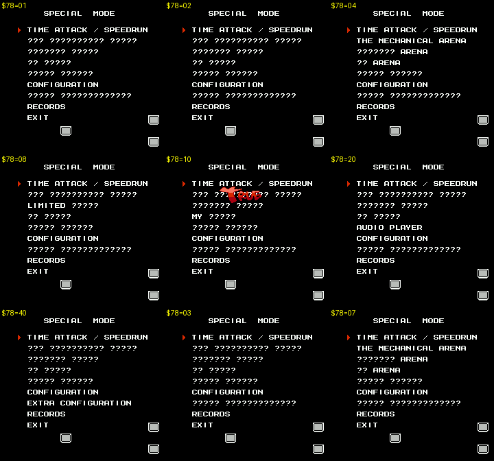
*`$7F78` set to one bit at a time. Hidden words appear one by one.*

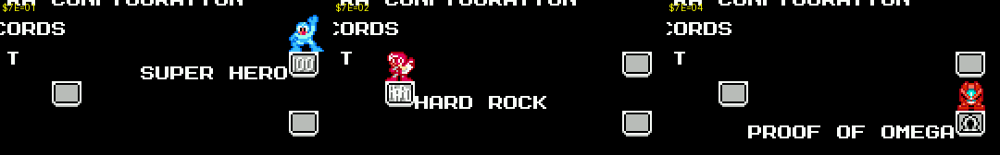
*`$7F7E` = 1, 2, 4 → SUPER HERO, HARD ROCK, PROOF OF OMEGA.*

**Gotcha: black SPECIAL MODE screen** [seen + code]. On the first attempt the game save was blank, so its checksum
failed, and SPECIAL MODE froze on a black screen. Bank `$4C:$9D55` calls the save check at `$40:$AA09`, which branches
to the "SAVE DATA BROKEN" handler, and that handler loops with the palette still black. So always write a valid game
block too. `new_game_block()` is all zeros except `$2F = $02`, which is exactly what NEW GAME writes on NORMAL.

**Gotcha: title input.** NEW GAME needs **START+A** (START alone does nothing once a save exists) [seen, doc].
CONTINUE with no valid save does nothing. Intro skipping only takes START at certain moments, so
`to_title()` polls `at_title_menu()` (banks `$39`/`$33` mapped and task 0 parked with SP = `$D1`).

---

## 3. Save data layout (battery WRAM, bank 0 of 64 KB)

The game keeps **two 256-byte blocks**. Each has a persistent copy and a working copy:

| Block | Persistent | Working copy | Load / verify / write code (bank `$40`, CPU `$A000`) |
|---|---|---|---|
| Game (one save file) | `$7C00` | `$7E00` | `$A9A3` load into RAM, `$AA1A` copy + verify, `$AA33` verify, `$AAAC` checksum, `$AAEF` commit `$7E→$7C`, `$AF1F` RAM → `$7E00` |
| System (config, unlocks, records) | `$7D00` | `$7F00` | `$AB31` boot check (bad → copy `$7D→$7F` → still bad → wipe and init), `$ABFF` checksum, `$ABF3` commit `$7F→$7D` |

**Checksum** [code `$AAFD`/`$AC42`, verified on 4 live blocks]. It covers payload bytes `$00-$EF`:

```
F0 = sum & FF      F1 = sum >> 8      F2 = xor of all      F3 = xor of even offsets      F4 = xor of odd offsets
F5-F9 = F0-F4 xor FF                  FA = F0^F1^F2^F3^F4
```

The game-block check also rejects the block if `$30 & $40` is set (`$AAA3`). Python: `cheats.cks(block)`.

**Autosave** happens on every death and every clear [doc, seen: both blocks change when a life is lost].

### Game block (`$7C00` / `$7E00`)

| Offset | Contents | Source |
|---|---|---|
| `$00-$0D` | `$B0-$BD`: HP + 13 weapon energies (bit7 = owned) | [code] `$A9A9` / `$AF31` |
| `$10` / `$11` | `$A9` boss-clear bits / `$AA` fortress bits | [code] |
| `$12-$1F` | `$7890-$789D` (PROG. = `$12`, FLAG = `$1A`) | [code] |
| `$20-$29` | `$78A3-$78AC` (stage-specific persistent values) | [code] |
| `$2F` | Achievement disqualifiers: bit0 SUPER HERO, bit1 HARD ROCK. NEW GAME on NORMAL writes `$02` | [code][seen] |
| `$30` | Equipment `$7839 & $BF` (BEAT's bit is not saved) | [code] |
| `$38` / `$39` | E-tanks `$A2` / lives `$A1` (on load, lives = max(saved, CONFIG ROCKMAN `$7942`)) | [code] |
| `$40-$47`, `$48-$4F`, `$50-$5D` | Per-stage counters (indexed by `$78A0`, by bits of `$78A1`, and by `$78A2` for RM stages; purpose not traced; Hero Score inputs [guess]) | [code] |
| `$78+s` / `$90+s` | Deaths in stage *s* (16-bit lo/hi, s = 0..15). `$89`/`$A1` = Game Over count, `$88`/`$A0` = total deaths | [code][seen: a Ring death gave `$7C`+1, `$88`+1, `$39`−1] |
| `$A8+s` / `$C0+s` / `$D8+s` | Play time per stage (24-bit; units not checked). `$BF`/`$D7`/`$EF` = total | [code][seen] |

### System block (`$7D00` / `$7F00`)

| Offset | Contents |
|---|---|
| `$00-$0F` / `$18-$27` | Lifetime deaths per stage (lo/hi). `$10`/`$28` = total, `$11`/`$29` = Game Overs, `$12`, `$13` = two more counters [code]. RECORDS shows these deaths under the heading **"TIWNS"** (from *tiun tiun*, the death-explosion sound) [seen] |
| `$30+m` / `$48+m` / `$60+m` | Lifetime play time per mode/stage index `$780F` (24-bit). `$47`/`$5F`/`$77` = total [code][seen] |
| `$78` | **SPECIAL MODE unlock bits** (§2) |
| `$79` | CONFIG packed: `MAIN<<7 \| E.GEN<<6 \| DAMAGE<<4 \| CRITICAL<<3 \| ITEM DROP<<1 \| LANGUAGE` [code `$AE8D` + seen] |
| `$7A` | `FAIL-SAFE<<5 \| VITAL` (VITAL = 28 → `$1C`) |
| `$7B` | `ROCKMAN<<4 \| ETANK` (defaults 4 and 0 → `$40`) |
| `$7E` | **Achievement bits** (§2) |
| `$7F` | `$01` = block initialised (boot code re-inits records if not) |
| `$80-$CF` | Special-mode records (bank `$4C` reads `$7F80,Y`…`$7FC0,Y` per stage, and zeroes `$AB-$AF`, `$BB-$BF`, `$CB-$CF` on init) [code] |
| `$D0-$DB` | MY ARENA saved setup (bank `$4C` @ `$0633`-`$073A`) [code] |

---

## 4. RAM map

### CPU RAM (`$0000-$07FF`)

| Address | Meaning | Evidence |
|---|---|---|
| `$22` | **Stage ID** (0-15, see §5). `$10` = stage select, `$11` = DATA SAVED / Game Over screen | [seen] |
| `$1F` | **Checkpoint** (0-2) | [seen] (EXTRA CONFIG C.P.) |
| `$A0` | **Current weapon slot.** Energy of the current weapon = `$B0 + $A0` | [seen] firing drained the matching byte |
| `$A1` | **Lives** | [seen] |
| `$A2` | **E-tanks** | [seen] |
| `$A9` | **Boss clear bits**: bit *n* = stage *n* (bit0 Bright … bit7 Skull) | [seen] stage-select portraits blank |
| `$AA` | **Fortress clear bits**: thermometer `00 01 03 07 0F 1F 3F 7F` (Cossack 1 … Wily 3) | [text] |
| `$B0` | **HP**: bit7 set, bits 0-4 = 0..28 (`$9C` = full) | [seen] |
| `$B1-$BD` | **Weapon energy**, bit7 = owned (table below) | [seen] |
| `$3C` | **Player i-frame timer**: 30 after the ~9-frame knockback, counts down to 0. Freezing it at 2 blocks all enemy damage | [seen] (HP stayed 28 for 900 frames in Ring) |
| `$0330` / `$0348` / `$0318` | Player X pixel / X screen (page) / X subpixel (object slot 0; slots are `$18` apart) | [seen] |
| `$0378` / `$0360` / `$03F0`+`$03D8` | Player Y pixel / Y sub / Y speed (whole + sub, +4 at jump start) | [seen] |
| `$27`/`$28` | Copy of player X (lo/hi) | [seen] |
| `$FC` / `$F9` | Scroll X pixel / scroll page | [seen] |
| `$10` / `$11` | Stage-select cursor column (0-2) / row×3 (0, 3, 6) | [seen] |
| `$14` / `$16` | Joypad held / newly pressed (vanilla RM4 layout) | [seen] |
| `$80-$8F` | Vanilla RM4 4-slot cooperative task table (state, timer, SP, …), scheduler at `$FEA8` | [code] |
| `$04A0` / `$04A1` | EXTRA CONFIG scratch copy of WPN1/WPN2 (turned into `$B0-$BD` on ENTER STAGE) | [code `$926F`] |

### WRAM work area (`$7800-$79FF`)

| Address | Meaning |
|---|---|
| `$7839` | **Equipment bits** (table below) |
| `$7890` | PROG. (game progress value). The readme says it changes after the Cossack 1 entrance scene, for example [doc] |
| `$7898` | FLAG: bit7 EDDY, bit6 BEAT, bit5 KALINKA, bit4 TOADMAN, bit3 RUSH, bit2 RE-ENTER, bit1 SHADOWMAN, bit0 unused. These are the Hero Score "friends / bonus / revisit" flags. [text] gives the order; bit numbering follows the other fields [guess] |
| `$7820-$782F` | S.VAL ×16 (per-stage scratch values, "MULTIPURPOSE") [text] |
| `$78CA` / `$78CB` / `$78D3` | Cheats C.RFL (refill at pause) / EXWP (super-special weapon 0-11) / TML ("TOO MANY LIVES!", lives stay at 9) [text] |
| `$78B0` | Language (0 JP, 1 EN) |
| `$78CD` `$78CE` `$78C9` `$78C8` `$78CF` `$78CC` | CONFIG MAIN (0 NORM, 1 HARD), DAMAGE (0 ×1.0, 1 ×0.5, 2 ×1.5), CRITICAL (0 ON), ITEM DROP (0 NORM, 1 MORE, 2 NONE), FAIL-SAFE (0 NORM, 1 SAFE), E.GEN (0 ON) [seen: one RIGHT press each] |
| `$78D0` / `$78D1` / `$78D2` | VITAL (max HP, 28) / ROCKMAN (starting lives, 4) / ETANK (guaranteed minimum) |
| `$7942` | CONFIG ROCKMAN as used on load (EXTRA CONFIG entries leave it 0) |
| `$7836` / `$7837-$7838` | Frame counter / play-time accumulator added into the save at each save |
| `$788D` | Unlock bits earned this session (ORed into `$7F78`) |
| `$7697` / `$7698` | Achievement disqualifiers this session / "game or arena cleared" (1 = main game, `$80` = final arena) |
| `$780F` | Current mode/stage index for the play-time tables |

### Weapon slots (`$B0 + $A0`) [seen: `cheats_weapon_slots.png`, plus firing]

| `$A0` | Byte | Pause-menu name | Help-page name | WPN bit |
|---|---|---|---|---|
| 0 | `$B0` | R.BUSTER (HP) | ROCK BUSTER MI | WPN1.0 RB |
| 1 | `$B1` | R.SEARCH | RUSH SEARCH | WPN1.1 RS |
| 2 | `$B2` | W.STAR | WISH STAR | WPN1.2 WS |
| 3 | `$B3` | R.CANNON | RUSH CANNON | WPN1.3 RC |
| 4 | `$B4` | TOAD | ⊛TOAD | WPN1.4 TO |
| 5 | `$B5` | WIRE | WIRE | WPN1.5 WI |
| 6 | `$B6` | BALLOON | BALLOON | WPN1.6 BA |
| 7 | `$B7` | DIVE | WATER CUTTER | WPN1.7 DI |
| 8 | `$B8` | RING | HOLDABLE CONTROL RING BOOMERANG | WPN2.0 RI |
| 9 | `$B9` | DRILL | DRILL TORPEDO | WPN2.1 DR |
| 10 | `$BA` | DUST | RECYCLE INHALER | WPN2.2 DU |
| 11 | `$BB` | PHARAOH | PHARAOH SHOTGUN | WPN2.3 PH |
| 12 | `$BC` | BRIGHT | SPARK MANBOW | WPN2.4 BR |
| 13 | `$BD` | SKULL | HELL WHEEL | WPN2.5 SK |

Controller-2 A cycles weapons in the order 0, 12, 4, 9, 11, 8, 10, 7, 13, 1, 3, 2, 5, 6 [seen].

### Equipment bits (`$7839`) [seen: one bit at a time, `cheats_equip_bits.png`]

| Bit | Item | Help text (abridged) [text] |
|---|---|---|
| `$01` | ENERGY SPLITTER | "All weapons are refilled when you take weapon energy … You seem to hear something in this unit." |
| `$02` | SKULL AMULET | "Processed gem attached on Skull Man's chest … if you have 2 or more vital, this barely protects Megaman from fatal damage." |
| `$04` | SUPER STAR | "What was attached on **Shadow Man's** forehead. This amplifies cruelty … increases the critical chance and the critical damages." |
| `$08` | METALL'S HELMET | "A hard hat of a Metall. For this have broken a bit when recycling, this may be useless. This sometimes reduces damages." |
| `$10` | SHOCK GUARD | Armor made of the Wire: spike protection while vital ≥ 2 (FAIL-SAFE item) |
| `$20` | TRAMPOLINE | Emergency jumping unit made of Balloon: bounces you out of pits, with damage (FAIL-SAFE item) |
| `$40` | BEAT (shown top-right as a bird, help "BIRD ROBOT") | "He salvages you when falled but you take damages. He seems to take to you." Not saved (`AND #$BF`) |
| `$80` | ?DAGGER | "UNCERTAIN ITEM" |

The three starting items, ENERGY CHARGER (= CONFIG E.GEN), ENERGY BALANCER and EXCHANGER, are always shown and have
no bit [seen].

---

## 5. EXTRA CONFIGURATION = level select

SPECIAL MODE item 7. Its 15×2 grid of 8-bit binary fields **points straight at live RAM**: the pointer table is at
bank `$4C` @ `$93A1` (lo) / `$93BF` (hi), and the help-string index table is at `$92BD` [code]. So you don't need to
edit bits in the UI. Poke the RAM and choose **ENTER STAGE** (EXIT → UP → UP → START). **BOSS SELECT** goes to the
stage select and keeps the counters; **NEW GAME** resets them [doc]. Opening the mode loads the save into these
fields, and ENTER STAGE sets `$7697 = 3`, which disqualifies the achievements [code `$927D`].

| Row | Left field → RAM | Right field → RAM | Help text [text] |
|---|---|---|---|
| 0 | STAGE → `$22` | C.P. → `$1F` | "00-0F STAGE (AT 'ENTER STAGE')" / "00-02 CHECK POINT" |
| 1 | CLEAR → `$A9` | (CLEAR 2) → `$AA` | "CLEAR FLAG 1 SK DI DU RI PH DR TO BR" / "CLEAR FLAG 2 00 01 03 07 0F 1F 3F 7F" |
| 2 | WPN. → `$04A0` | (WPN. 2) → `$04A1` | "WEAPONS 1 DI BA WI TO RC WS RS RB" / "WEAPONS 2 XX XX SK BR PH DU DR RI" |
| 3 | LIVES → `$A1` | TANK → `$A2` | "00-09 LIVES" / "00-09 E-TANKS" |
| 4 | EQUIP → `$7839` | TML → `$78D3` | "EQUIPMENTS ?D BE TR SG ME SS SA ES" / "00 OR NON 00 TOO MANY LIVES!" |
| 5 | C.RFL → `$78CA` | EXWP → `$78CB` | "00 OR NON 00 CHEAT REFILL (AT PAUSE)" / "00-0B EXTRA WEAPON (GLITCHY!)" |
| 6 | PROG. → `$7890` | FLAG → `$7898` | "GAME PROGRESS VALUE" / "GAME FLAG VALUE ED BE KA TOAD RU RE-EN SH X" |
| 7-14 | S.VAL → `$7820,$7822,…` | S.VAL → `$7821,…,$782F` | "STAGE VALUE (MULTIPURPOSE)" |

Help-text bit lists read from bit7 down to bit0. Checked against the CLEAR, WPN and EQUIP bits [seen].

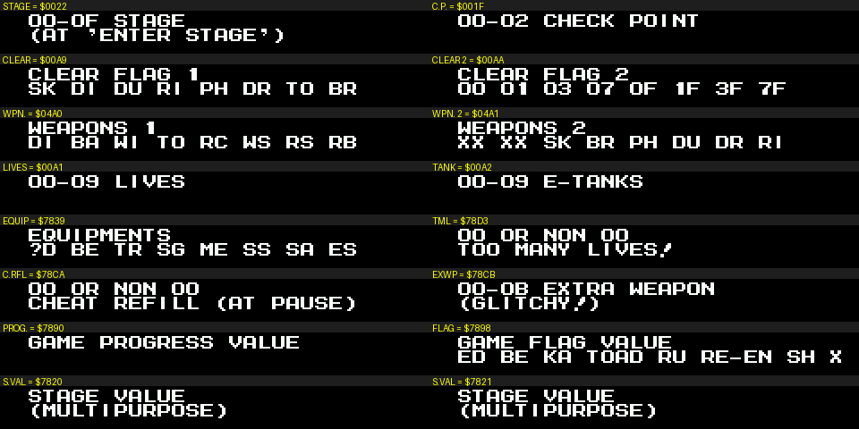
*Every field's help string, labelled with the RAM address it edits.*

### Stage IDs and checkpoint spawn points (all 48 tested) [seen]

Stage IDs follow vanilla RM4's order. "Screen" is `$0348`, which counts horizontal screens and also vertical room
transitions.

| `$22` | Stage | CP0 (screen, x, y) | CP1 | CP2 |
|---|---|---|---|---|
| 0 | Bright Man | 0, 128, 180 | 16, 128, 84 | 30, 128, 180 |
| 1 | Toad Man | 0, 128, 116 | 18, 64, 180 | 46, 128, 180 (boss: a big frog) |
| 2 | Drill Man | 0, 128, 180 | 17, 80, 180 | 32, 128, 148 |
| 3 | Pharaoh Man | **7**, 128, 148 | 20, 64, 180 | 34, 68, 148 |
| 4 | Ring Man | 0, 128, 116 | 11, 128, 148 | 25, 128, 148 |
| 5 | Dust Man | 0, 16, 180 | 15, 220, 180 | 35, 128, 180 |
| 6 | Dive Man | 0, 128, 84 | 25, 128, 180 | 40, 72, 132 |
| 7 | Skull Man | 0, 128, 180 | 20, 128, 148 | 46, 64, 180 |
| 8 | Cossack 1 | 0, 117, 180 | 19, 128, 180 | 22, 64, 184 (boss: big red machine) |
| 9 | Cossack 2 | 0, 104, 164 | 21, 128, 196 | 31, 128, 132 |
| 10 | Cossack 3 | 0, 128, 180 | 37, 128, 100 | 42, 128, 84 |
| 11 | Cossack 4 | **30**, 168, 180 | 2, 128, 164 | 16, 128, 164 |
| 12 | Wily 1 | 0, 128, 180 | 17, 128, 148 | 42, 128, 148 |
| 13 | Wily 2 | 1, 128, 180 | 12, 128, 180 | 36, 128, 180 |
| 14 | Wily 3 | 0, 128, 129 (space story scene) | 12, 128, 132 | 21, 128, 180 |
| 15 | Wily 4 | 0, 48, 52 (teleporter hub) | 7, 64, 180 (Wily machine) | 25, 128, 180 |

STAGE ≥ `$10` and C.P. ≥ 3 load nonsense ("nothing interesting will happen") [doc]. I did not test them.

### Stage select layout [seen]

The same 3×3 grid as vanilla RM4 (checked against `roms/rm4j.nes`):

```
RING      DIVE     SKULL
PHARAOH   [Dr.C]   BRIGHT
TOAD      DRILL    DUST
```

The cursor starts in the centre (`$10 = 1`, `$11 = 3`). NEW GAME skips the intro and goes straight to this screen.
Beaten bosses' portraits go blank. With all 8 beaten, the centre panel shows Dr. Cossack, and START plays the Cossack
castle scene: lightning, the castle in colour, then a night shot where **a Wire line shoots in from the left** to
the castle. After that, Cossack 1 opens on **the roof of a moving train** [seen] (vanilla opens in snow).

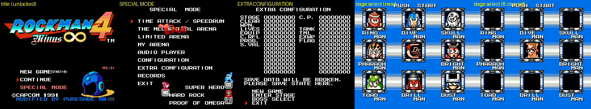
*Title after unlock, SPECIAL MODE, EXTRA CONFIGURATION, stage select (new), stage select (all 8 cleared).*

---

## 5b. MY ARENA = boss and mid-boss select (45 fights)

MY ARENA (SPECIAL MODE item 4) edits a live setup at `$78ED-$78FF`, and its BOSS0-5 rows are a bitmask over **45
fight IDs**. Setting exactly one bit and choosing START drops you straight into that fight in its own stage room
[code + seen]. `cheats.arena_fight(e, fid)` does this from `my_arena_menu.state`, and `fight_XX_<stage>.state` are
ready-made.

How it works [code, bank `$4C`]:

- START runs `$95CC`: `$78F7` = mode (0 MECHANICAL, 1-9 the LIMITED ARENA entries, `$0A` MY ARENA, `$0B` THE TRUE
  ARENA). Every mode except MY ARENA first loads a preset (`$955F`, 7 presets in column tables at `$94E1-$955E`).
- `$9762` walks the fight table at `$97A3` and copies each ID whose bit is set (bit `id & 7` of `$78FA + (id >> 3)`)
  into the run list at `$7900` (terminated by `$0F`). Bit 7 in the table marks the start of a shuffle block for
  RAND = 11.
- Table order (= the order a full run plays): `[10-1D] [00-07] [1E-2A] [08-0E] [0F 2B 2C]`. So the full TRUE ARENA
  is 45 fights: 14 mid-bosses, the 8 Robot Masters, 13 more extra fights, the 7 fortress bosses, then the Wily
  Capsule and two final fights.
- THE MECHANICAL ARENA preset = BOSS0 `FF` + BOSS1 `FF` = IDs `$00-$0F`, the 16 stage bosses, with WEAPON `$91 $3F`
  (buster + the 8 Robot Master weapons), EQUIPM `$30`, TANK 4, CRIT 1 (no criticals). LIMITED ARENA's
  "(15 STAGES)" / "(13 STAGES)" entries drop IDs from BOSS1 via the table at `$9866` (HCR and RECYCLE drop ID 9,
  HELL WHEEL drops IDs 8, 9 and 11).

| Field (MY ARENA row) | WRAM | Notes |
|---|---|---|
| WEAPON | `$78F1` / `$78F2` | Same bit layout as EXTRA CONFIG WPN1/WPN2 |
| BOSS0 … BOSS5 | `$78FA` … `$78FF` | Fight-ID bitmask (BOSS5 has 5 bits: IDs `$28-$2C`) |
| INTERVAL | `$78F0` | 5 bits. 0 = no rest stops between fights |
| RAND. | `$78F9` | 0 fixed, 1 shuffle, 2 all but last, 3 per block |
| EQUIPM. / TANK | `$78F5` / `$78F4` | Equipment bits (as `$7839`) / E-tanks |
| LIFE RCV. / EN.GEN. / E.RFL. AT PAUSE | `$78EF` / `$78EE` / `$78F3` | |
| CRIT. / SHORT INV. / HARD | `$78F6` / `$78F8` / `$78ED` | CRIT 1 = no criticals. SHORT INV 1 = caps enemy i-frames |
| (mode) | `$78F7` | Set by the menu that started the run |

### The 45 fights [seen: one screenshot each, `cheats_fights.png`]

Stage = the stage ID (`$22`) the fight loads in. Labels for the extra fights are descriptive only; the boss
investigators should name them.

| ID | Stage | Fight | | ID | Stage | Fight |
|---|---|---|---|---|---|---|
| `00` | Bright | Bright Man | | `17` | Ring | sky: ring swarm |
| `01` | Toad | Toad Man | | `18` | Ring | pink platforms room |
| `02` | Drill | Drill Man | | `19` | Dive | whale submarine |
| `03` | Pharaoh | Pharaoh Man | | `1A` | Skull | red T-rex mech |
| `04` | Ring | Ring Man | | `1B` | Cossack3 | green snail mech |
| `05` | Dust | Dust Man | | `1C` | Cossack3 | blue whale head |
| `06` | Dive | Dive Man | | `1D` | Cossack4 | orange machine room |
| `07` | Skull | Skull Man | | `1E` | Drill | red-white robot in a star room |
| `08` | Cossack1 | Cossack 1 boss (moth machine) | | `1F` | Dive | grey machine hall |
| `09` | Cossack2 | Cossack 2 boss (block machine) | | `20` | Bright | dark figure in Bright Man stage |
| `0A` | Cossack3 | Cossack 3 boss (white walker mech) | | `21` | Pharaoh | shuriken ninja |
| `0B` | Cossack4 | Cossack 4 boss (Cossack Catcher) | | `22` | Toad | frog + rider, shuriken |
| `0C` | Wily1 | Wily 1 boss (green robots) | | `23` | Dive | spear figure |
| `0D` | Wily2 | Wily 2 boss (dark copy figure) | | `24` | Drill | green-haired robot |
| `0E` | Wily3 | Wily 3 boss (Wily Machine 4) | | `25` | Cossack4 | robot 1 |
| `0F` | Wily4 | Wily 4 boss (Wily Capsule) | | `26` | Cossack4 | robot 2 |
| `10` | Cossack1 | train: Joe in a cannon walker | | `27` | Cossack4 | robot 3 (green hair) |
| `11` | Cossack1 | train: big frog | | `28` | Wily4 | capsule room 1 |
| `12` | Cossack1 | train: flying pod + birds | | `29` | Wily4 | capsule room 2 |
| `13` | Cossack1 | train: 4th set piece | | `2A` | Wily4 | capsule room 3 |
| `14` | Toad | giant frog mech | | `2B` | Wily4 | capsule room 4 |
| `15` | Drill | cave flyer | | `2C` | Drill | green cave: round robot |
| `16` | Drill | purple hippo | |  | | |

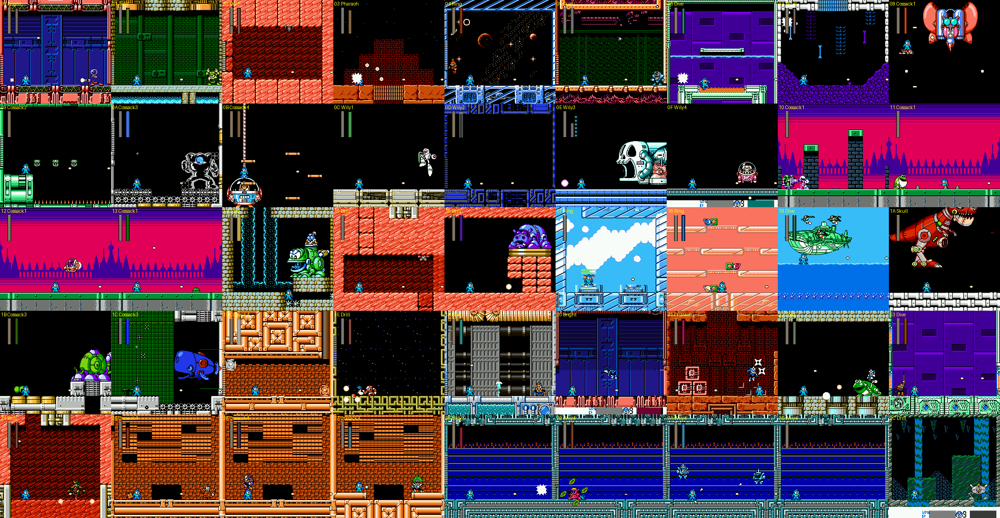
*Every MY ARENA fight ID, about 4 s after its state loads (godmode on).*

---

## 6. Cheat recipes

| Want | Do |
|---|---|
| No damage | `e.freeze(0x3C, 2)` (i-frame timer) or `godmode(e)` |
| No pit / spike deaths | Equipment `$7839 \|= $70` (SHOCK GUARD + TRAMPOLINE + BEAT). Frozen HP alone does **not** stop pits: Skull cp1 killed a frozen-HP Rockman by falling, and with `$70` he got through [seen] |
| Infinite lives | `freeze(0xA1, 9)` or EXTRA CONFIG TML ≠ 0 |
| All weapons | `$B0-$BD = $9C` (`give_all`) |
| Refill at pause | `$78CA ≠ 0` (C.RFL) |
| Pick a weapon | `$A0 = slot` (`set_weapon(e, 'DIVE')`) |
| A super-special weapon | `$78CB = 1..11`, then enter a stage. It replaces the buster (§9) |
| Warp | `enter_stage()` from `extra_config.state`. Or, faster, in any stage: poke `$22` (stage) / `$1F` (checkpoint), then die (`$B0 = $81` and wait for a hit, or fall). The respawn reads both, so you reappear at that stage's checkpoint with your current loadout [seen: Ring → Ring cp2, and Ring → Bright cp1, 240 frames each]. `cheats.warp(e, stage, cp)` does this |
| English | sys `$79` bit0 / `$78B0 = 1`. The opening story crawl stays Japanese even in EN [seen] |

---

## 7. Code landmarks

| Where | What |
|---|---|
| Fixed `$7E` @ `$C000` | NMI. Skips work when `$EA != 0`, sets the MMC5 scanline IRQ (`$5203`/`$5204`), ticks task timers |
| Fixed `$7F` @ `$DF8C` | **Far-call trampoline**: `JSR $DF8C` + 3 bytes `hi, lo, bank` → calls `(hi:lo)+1` in that bank (hi ≥ `$A0` maps the `$A000` slot, else `$8000`) and restores banks after. `$DF5F` is a variant |
| Fixed `$7F` @ `$FEA8` | Vanilla RM4 task scheduler (4 slots at `$80`); `$FF1C` = yield one frame |
| Bank `$40` @ `$A000` | Save system: load `$A9A3`, verify `$AA33`, checksums `$AAFD`/`$AC42`, system boot `$AB31`, per-stage death counters `$AC80`, save `$AF1F`, unlock/achievement merge `$AE51`, config pack `$AE8D` |
| Bank `$30` @ `$8000` | Title-menu text (`$8B2E`: SPECIAL MODE when `$7F78 ≠ 0`). The title task runs with banks `$39`/`$33` |
| Bank `$4C` @ `$8000` | SPECIAL MODE menu (`$8001`), achievement drawing (`$8120`), EXTRA CONFIGURATION (`$90A3`; field table `$93A1`/`$93BF`; actions `$923B`/`$9241`), arena-clear unlocks (`$9B03`) |
| Bank `$1C` | Main ending: `$788D \|= 3`, `$7698 = 1` |
| Bank `$4D` @ `$BAB0` | Friend count == 3 → `$788D \|= 4` |
| ROM `0x17600-0x17A40` | Compressed menu strings (CONFIGURATION / EXTRA / SPECIAL MODE …), letters `A = $0B` |

---

## 8. Verification images

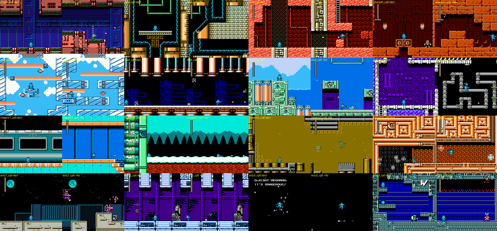
*Every `<stage>_cp0.state` at load (left of each pair) and after 6 s of an autoplayer with godmode (right).*

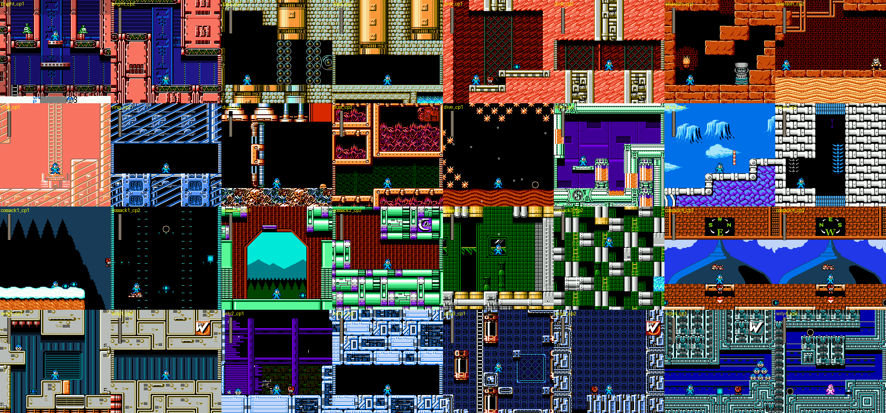
*Every checkpoint-1 and checkpoint-2 state at load.*

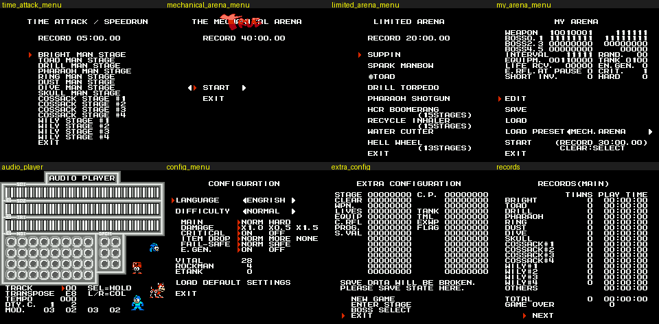
*The entry screen of every SPECIAL MODE item, each saved as a state.*

---

## 9. Surprises found along the way ("how crazy it gets")

1. **EXWP: eleven "super-special weapons" replace the Rock Buster, and they are Game Boy and Rush guests** [seen].
   1 QUINT (a pogo-stick ride), 2 ENKER (a reflecting crescent), 3 **R.ARMOR** (a whole walking purple mech),
   4 **R.COPTER**, 5 R.CANNON (a Rush tank), 6 R.PWC (a Rush water-craft ride [guess from name]), 7 R.S.SHIP
   (a round Rush ship), 8 PUNK = SCREW CRUSHER, 9 BALLADE = BALLADE CRACKER, 10 EARTH = SPARK CHASER ("intense spark
   chases enemies"), 11 **W.BUSTER = WILY BUSTER**: "This is final weapon developed by Cossack with Wily's technology.
   You can fire huge bullets infinitely. For this also has shield function, this reduces the damages to you." These
   are the stage set-piece weapons the readme only hints at ("auto-equipped weapon in Pharaoh", "a weapon you must
   take in Dive/Drill", "someone's meddling" in the final fight). The EXWP cheat lets you carry them anywhere, and
   Mega Man's palette changes to match each one.
   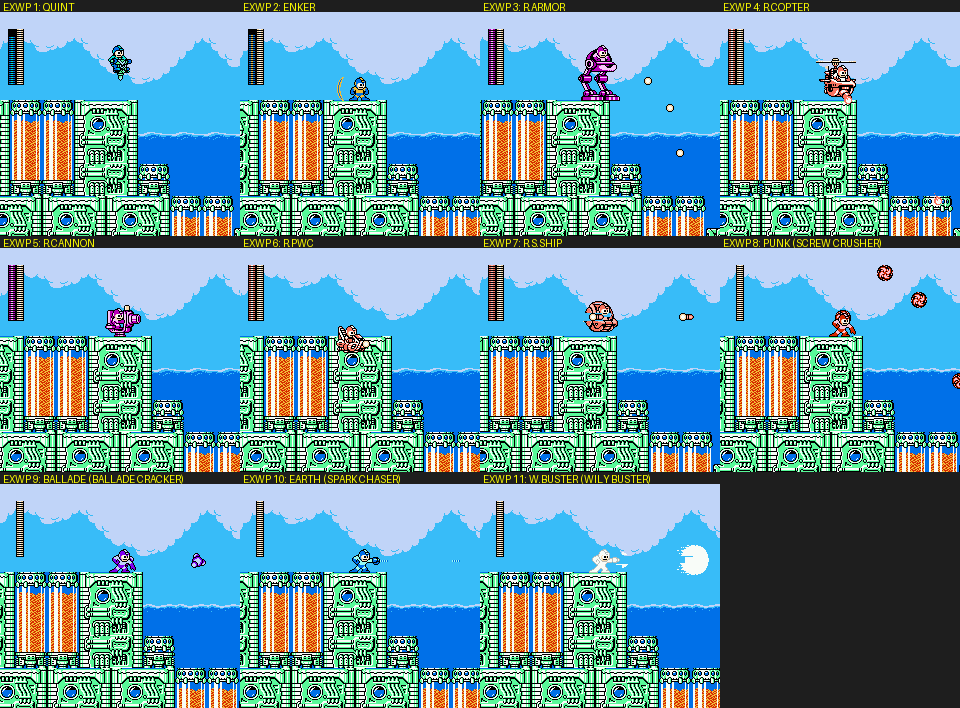
   *EXWP 1-11 fired at the start of Dive Man's stage.*
   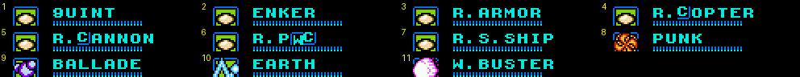
   *Their pause-menu names.*
2. **The help screen is a full manual with joke text** [text]. It covers every weapon and item, with stats
   (POWER / SPEED / RAPIDNESS / COST). Examples: SPARK MANBOW ("lightbulbs which explode … if you hold B, the
   lightbulb hold on Megabuster … B with UP, the flash attack"), ⊛TOAD ("special wave which turns the enemies …
   mystery force may affect the gimmick"), **RECYCLE INHALER** ("inhale close enemies and turn it into an item; the
   traps are also inhalable … let's inhale various things"), HELL WHEEL, RUSH CANNON ("everyone is defeated by this
   instantly, but this may be dodged"; POWER 28, COST 14), WISH STAR ("send the enemies to another dimension and
   charge them repeatedly with Rush; more power when in a pinch"; COST 28). The equipment pages credit Skull Man's
   gem, **Shadow Man's forehead star**, and a Metall's hard hat "broken a bit when recycling".
   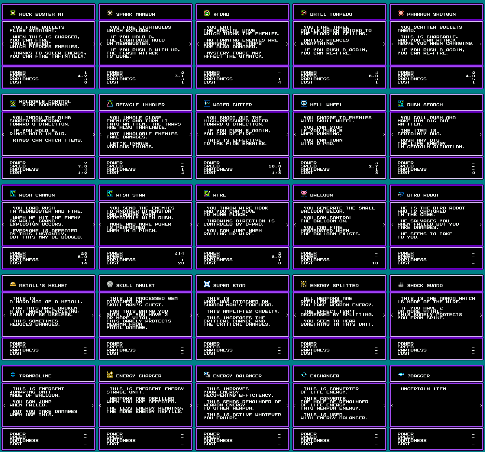
   *All 25 help pages with everything owned.*
3. **Wily 3 opens with a story scene in space where Rockman refuses Dr. Right** [seen/text]. Right: "Space is
   disturbed … your vital sensor caught a signal! … It must be Wily's! I'll send you to near the signal." Rockman:
   "...... No, I'll not warp." Right: "W...what you said!? No kidding, Rock!" Rockman: "I have... I have important
   thing to do." The scene ends with "**Kalinka is inside this space!**" This is the KALINKA friend flag.
   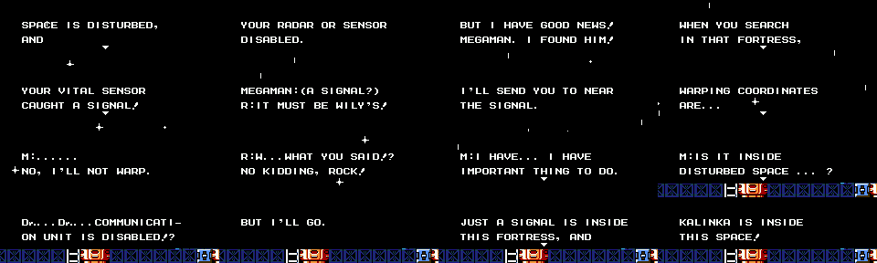
   *The Wily 3 opening scene, about one frame per second.*
4. **The arena family** [seen]: THE MECHANICAL ARENA and THE TRUE ARENA (the final mode, reached by
   LEFT/RIGHT on the same menu once the "True" stamp exists), LIMITED ARENA (one-weapon boss runs: SUPPIN = "bare"
   buster, SPARK MANBOW, ⊛TOAD, DRILL TORPEDO, PHARAOH SHOTGUN, HCR BOOMERANG (15 STAGES), RECYCLE INHALER
   (15 STAGES), WATER CUTTER, HELL WHEEL (13 STAGES)), and MY ARENA (a bit-grid editor of WEAPON / BOSS0-5 /
   INTERVAL / RAND. / EQUIPM. / TANK / LIFE RCV. / EN.GEN. / E.RFL.AT PAUSE / CRIT. / SHORT INV. / HARD, with LOAD
   PRESET ◀MECH.ARENA▶). Default record times are 05:00.00 (Time Attack), 10:00.00 (Mechanical), 20:00.00 (Limited),
   30:00.00 (My Arena) and 40:00.00 (True). There is also a full **AUDIO PLAYER**: an 8-channel mixer display with
   TRACK, TRANSPOSE, TEMPO, DTY.C, MOD., "SEL=HOLD" and "L/R=COL", with Rockman, Roll(?) and Proto-style sprites.
5. **The CONFIG language option is literally "ENGRISH", with "ENGLISH COMING SOON"** [seen].
   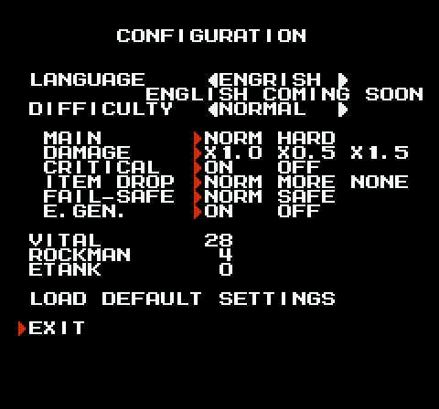
   *CONFIGURATION with the language set to English.*
6. **Stages are big and strange** [seen, from the checkpoint pass alone]:
   - Toad's and Skull's checkpoint 2 are on screen 46.
   - Pharaoh's stage HUD shows a mode word under the life bar that changes as you play ("REVERSE", then "HOPPING").
   - Ring's stage starts in the sky, with colour-cycling laser bars and Saturn-ring UFOs that wear down a standing
     Rockman in about 10 s.
   - Dust's stage is pitch dark with flickering machines.
   - Skull's checkpoint 1 is a blue-sky section of floating bone platforms with Skeleton Joes.
   - Cossack 1 is on a train.
   - Cossack 4 has a N/E/S/W compass HUD and runs from screen 30 back down to 2.
   - Bright's stage has a bottom status bar ("WPN P").
7. **Records count deaths as "TIWNS"** (*tiun*, the death-sound onomatopoeia), per stage, for the main game [seen].
8. **The RM4 engine is still underneath** [code]: the task scheduler, the stage order, the object table layout and the
   `$B0` energy block are all vanilla RM4. 4MI adds a far-call trampoline and moves the save, menus and special modes
   into the new banks `$40+`.

---

## 10. Lessons for Rockman 6 GP

- **Ship a level select as a feature, not a debug hack.** 4MI's EXTRA CONFIGURATION is a live RAM editor with a
  one-line help string per field. It cost the author one pointer table and some text, and it makes the game testable,
  speedrun-practisable and cheat-friendly. RM6 GP should have the same thing (stage, checkpoint, flags, loadout) from
  day one. It doubles as our regression harness entry point.
- **Keep two save copies plus a strong cheap checksum.** sum16 + xor + even/odd xor + inverted copy catches almost any
  corruption in about 40 lines of 6502. But **handle a bad block gracefully**: 4MI hangs on a black screen if the game
  block is invalid when a special mode opens.
- **Gate the post-game with one bit per unlock and reveal menu items word by word.** The "???" names are free
  mystery. One flag byte (`$7F78`) plus a mask table is all it takes.
- **Make set-piece weapons first-class "weapon slots".** 4MI's Rush rides and Game Boy weapons go through a single
  "extra weapon" index that replaces the buster. That is how a stage can hand you a mech or a helicopter without
  special-casing the player code. RM6 already has Power/Jet Rockman adaptors, and this pattern extends them.
- **Equipment as bits, explained in-game**: 8 passive items in one byte, each with a help page. This is cheap to store
  and easy to cheat for testing. FAIL-SAFE items (pit bounce, spike guard) are also an accessibility option.
- **Record player behaviour per stage** (deaths, time, Game Overs): it drives the Hero Score and the records screen,
  and it would let us balance RM6 GP from playtest saves.
- **Tooling note:** with stable-retro FCEUmm, WRAM poked before the first frame survives into the boot code, so a
  save can be injected at power-on. Using that, any game state can be produced from one line of Python. Do the same
  for RM6 GP's test fixtures.
