# 4MI Cossack Citadel stages 1-4 (r4mi-cossack)

Status: complete for what could be reached; gaps are listed per stage and at the end.

Scope: Rockman 4 Minus Infinity v1.01 (`roms/r4mi_mmc5.nes`), Cossack stages 1-4 (`$22` = 8, 9, 10, 11): routes,
gimmicks, enemies, mid-bosses, story events (Rush's arrival, the forced Balloon/Wire segments), raster effects
(pseudo-parallax, water), pickups, HARD differences, the bosses (patterns, vanilla comparison, weapon damage) and the
jokes. Played with godmode (`cheats.godmode()`), so the "intended challenge" notes are a reading of the design.

Tags: **[seen]** emulator, **[code]** disassembly/data, **[text]** in-game text, **[doc]** readme, **[guess]**.

**How crazy it gets (summary).**

- **Cossack 1 turns into a 3.5-minute shoot-'em-up.** Past vanilla's snowfield you pick up the Balloon and jump off a
  cliff into a locked "blizzard sky" screen: fighter squadrons, flying whales, a sky serpent, and **Shadow Man, who
  pops your balloon**, so that **Rush flies in as Rush Jet and catches you**. You then fight **Mothraya in mid-air on
  Rush Jet**. In a hack where "Rush does not support movement", this is the one time he does, as a story rescue.
- **Every boss is a different kind of fight.** Mothraya in open sky; Cossack 2's SQUARE MACHINE **in the dark, invisible**,
  fought while riding three weaving face-blocks over spikes (it does not even start until you step on one); Cossack 3's
  **AQUA DEVIL, a block golem whose collapsing body piles up into new terrain**; and the **Cossack Catcher hanging from a crane
  chain** like a real "UFO catcher", which you ride.
- **Weakness by invincibility, measured.** Against the Cossack Catcher every weapon does 1 damage; only the
  invincibility after the hit differs (Hell Wheel 14 frames, others 29, buster 126). Rush Cannon one-shots Cossack 2's
  boss (28 damage).
- **Cossack 3 forks**: at screen 10 you choose an upper route (water channels, ESCAROO the snail) or a lower one
  (rising and falling water with a **wavy raster shimmer**, MOBY the whale), each with its own vanilla mini-boss. After checkpoint 1 the stage
  runs leftward through a "bubble rush" zone whose windows are a **pseudo-parallax layer faked by rewriting one tile**.
- **Cossack 4 (-FOUR TOWERS-) is a hub**: you shoot open a round hatch, cross the outside of the towers with a
  **compass in the HUD**, the giant onion dome frozen behind you by a **mid-frame scroll split**, ride lifts down into **Game Boy Mega
  Man Killer** rooms (PUNK, BALLADE, EARTH), and the corner screens repeat between faces.
- **Signposts.** Red boxes with "→" and "↑" arrows sit exactly where the forced Balloon/Wire moves are.
- **HARD deletes footholds**: in Cossack 2 and 3 it removes the helper ledges around the Wire/Balloon spot and in the
  bubble halls.

**The intended challenge, honestly** (I played with godmode):

| Stage | What a normal player fights |
|---|---|
| Cossack 1 | A long on-foot run with a 254-HP robot you should not try to kill, then a ~200 s survival shooter on a fragile balloon and on Rush Jet (homing pods that latch on; the readme calls the air part "very hard"), then a 2D dodging boss on Rush Jet. |
| Cossack 2 | Climbing ledge shafts with claws and rockets, a sealed room you must Wire or Balloon out of, and a boss fought on moving blocks over spikes in the dark, aiming at a target you mostly cannot see. |
| Cossack 3 | Underwater floatiness, the Jumbig at the fork, water currents, bubbles in unreachable spots, and a boss that keeps rebuilding the arena floor. |
| Cossack 4 | Orientation: a hub with repeating corner screens and a compass, floating sprite ledges over pits, Mega Man Killer duels, and a boss you fight from its own dome. |

## 0. Method

- Start points: the scout's `cossack1..4_cp0/1/2` and `fight_08/09/0a/0b/10-13/1b/1c/1d/25/26/27` states
  (`build/research/r4mi/states/`, see cheats.md). Godmode = frozen HP, lives and player i-frames plus SHOCK GUARD,
  TRAMPOLINE and BEAT.
- Driving: `build/research/r4mi/r4mi-cossack/drv.py` (a command list: hold buttons, an autoplayer that jumps when stuck
  and climbs, teleports, "kill everything", an infinite Balloon) saves a state on every new screen;
  `tools/analysis/r4mi/stagemap.py`'s BFS explorer (from r4mi-stages-a) found the screen graph where driving stalled
  (`ex.py`, `ex2.py`); `sky.py` scripts the Cossack 1 sky event; `chasekill.py` clears mid-boss rooms.
- Boss damage: `bdmg.py` (Rush Jet "steer" mode or "tele" mode beside the target, crits off, every weapon selected
  through controller-2 A), logging each HP drop and the target's i-frame timer `$05B8+slot`. Object ids are `$0300+slot`
  (`$0558` is an animation field); HP `$0450+slot` (bit 7 = shares the boss bar `$BF`).
- Effects: `raster.py` (per-scanline horizontal shift over time), the dome-band check (row shift vs camera delta) and a
  CHR-RAM diff against camera movement.
- HARD: `hard.py` enters each checkpoint from EXTRA CONFIGURATION with `$78CD` = 0 and 1 and diffs the section layouts.
- Names: the official fight names come from the fight-name roster in bank `$6F` (text.md §7.3) and the stage
  subtitles from the staff roll (text.md §7.1); the roster's order follows the MY ARENA fight table.
- In §1, object numbers quoted as `$xx` are the `$0558` field (an animation/sprite id that in practice identifies the
  object); the real object id is `$0300+slot`.
- Vanilla comparisons are from memory of vanilla RM4 and tagged [guess]: I could reach vanilla Cossack 1-4 starts
  (`van2.py`: stage select with all 8 beaten, poke `$22` during the load) but not their boss rooms.

Savestates added to `build/research/r4mi/states/` (all need godmode): `cossack_c1_s14_snowrobot`,
`cossack_c1_s16_balloon_item`, `cossack_c1_sky_balloon` / `_whales` / `_shadowman` / `_rushjet` / `_serpent` (the sky
event at 0, 63, 77, 83 and 135 s; drive it with `sky.py`'s controller and `zap69()` or it stalls),
`cossack_c1_s21_citadel`, `cossack_c2_s21_wire_hang`, `cossack_c2_boss_started` (the dark boss, already awake),
`cossack_c3_s10_fork`, `cossack_c3_s21_lower_route`, `cossack_c3_s30_whale`, `cossack_c3_s31_waterfall`,
`cossack_c4_s04_dome`, `cossack_c4_s32_hatch`, `cossack_c4_s33_killer`, `cossack_c4_s34_bluehatch`.

## 1. Cossack 1 (`$22` = 8)

Staff-roll subtitle: **-BLIZZARD SKY-** [text].

**In one line:** a night run from a train platform through a Russian city skyline (onion domes), down a shaft into
vanilla RM4's snowfield, where you pick up the BALLOON and jump off a cliff into a **fixed-screen "blizzard sky"
shoot-'em-up** that lasts about 3.5 minutes: squadrons of fighters, flying whales, **Shadow Man popping your balloon**,
**Rush arriving as Rush Jet** to catch you, and a giant sky serpent. Then you fly Rush Jet past the citadel wall into
the boss: **Mothraya, fought in mid-air on Rush Jet**. The readme's "forced Balloon segment until Rush arrives" is this
arena [doc + seen].

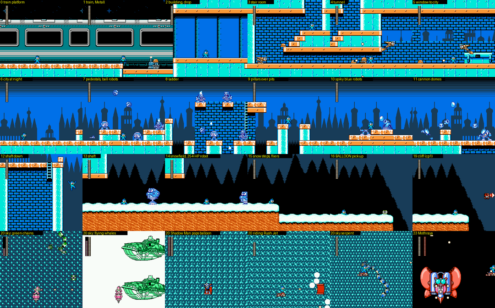
*Cossack 1, one frame per screen in route order (screens 0-19 on foot, then the screen-20 sky arena, 23 = boss).*

### 1.1 Route, screen by screen [seen]

Two sections: screens 0-24 (the whole stage as played) and 25-47 (the "city at dusk", see 1.4). `$0348` = screen.

| Screen | What happens |
|---|---|
| 0-1 | Start beside a parked passenger train (the castle intro ends with Rockman riding a Wire line in; cp0 has PROG = 8, "after the entrance scene" [doc]). Bumpy orange track bed; a Metall riding a small cart on screen 1. |
| 2 | Into a blue-glass building; drop through the floor gap on the right (cols 11-13). |
| 3-4 | Brick hall with stair blocks. The exit is a 2-tile-high tunnel *under* the stair block (rows 10-11) with Metalls in it; jumping up the stairs is a dead end. Orange flying-fish robots swoop. |
| 5 | A window onto the city, a desk-like turret. |
| 6-7 | Outside: night city with onion-dome silhouettes. Blue robots stand on pedestals and toss bouncing striped balls; small pits. |
| 8 | Brick tower with a ladder up (the only way on). |
| 9 | Pillar tops over pits. |
| 10-11 | Spiky-haired blue robots that run and shoot, dome cannons that lob white balls, pits. |
| 12-13 | Drop down a two-screen shaft. |
| 14 | **The vanilla RM4 Cossack 1 snowfield** (black pine silhouettes, snow on orange earth). A big blue robot (object `$1F`) with **254 HP** hops, turns into a jet/drill form and fires ring shots; it shoves you back to screen 13 on contact. The buster does 1 per hit (it took ~1150 frames of continuous fire to kill it), so this is hint.txt's "mooks that are too hard: better not to fight them" (`硬すぎる雑魚がいる`): jump it [doc + seen]. (critic: it is placement `$33` = object `$46`, vanilla RM4's spring robot with its HP raised from 14 to 254; the same object stands in the RM stages and Wily 1, where the stage docs first took it for Eddie.) |
| 15 | Snow steps; small blue helicopter drones that fire three-way spreads; another walker. |
| 16 | **A green "B" capsule = the BALLOON** (picking it up sets `$B6 = $9C`, owned and full, with a ~290-frame freeze, player state 9) [seen]. It is there even if you already own the Balloon (from Dive Man's stage). At x = 153 the game then silently **re-numbers the screen from 16 to 19**: screens 16 and 19 are drawn identically, so the jump is invisible [seen]. The freeze and renumbering are tied to that x position, not to the capsule: with the capsule object deleted they still happen [seen]. |
| 19 | **Checkpoint 1.** A cliff edge over a bottomless drop; a hovering red box with a "→" sign waits at the edge (object id `$5E`, animation `$74`; buster shots pass through it, its HP never drops: a signpost, not an enemy). Falling = death (pit), so you must make a Balloon (select it, jump, press B: a small pink balloon appears under your feet and you steer it with the D-pad) [seen]. |
| 20 | **The blizzard sky arena** (1.2). The camera is locked at x = 5120 for the whole event. |
| 21 | Rush Jet flies past a white citadel wall carrying Dr. Cossack's "Dr C" emblem. |
| 22 | **Checkpoint 2.** A black night sky with dashed "speed lines" (the flight continues), a few ring and spinner drones. |
| 23 | Boss room: Mothraya (1.3). |

**Screens 17-18 are never visited on this route** [seen]: rendered with the right tiles, 17 is solid earth and 18 is a
small brick room under the snow with a ladder up and an exit at the bottom right (the enemy table puts one object in
it). The 16 → 19 renumbering skips them, walking left from 19 stops at a wall, and falling off the cliff is a pit
death even with the capsule removed. A one-screen room off the main path looks like the RM stages' hidden rooms, but
hint.txt promises hidden rooms only in the first 8 stages, and I found no way in [seen; purpose = guess].

**(critic addition)** The link table has `13 down → 18` and `18 up → 13`, so screen 18 is entered by dropping through the floor of the shaft's lower screen (13) instead of walking on to 14. Its one placement (`$08`, x 200) resolves to `$5E` sub-id `$7F`: **a second Beat cage**. Breaking it with the Rail Buster gives BEAT at once (bank `$44:$B43F` special-cases stage 8); the first cage is in Skull Man's stage (stages_b.md §3) [code].

**HARD** (`$78CD = 1`, entered from EXTRA CONFIG): the section layouts and the objects at cp0, cp1 and cp2 are
byte-identical to NORMAL [seen], so any HARD change here is in enemy or boss behaviour (not checked).

### 1.2 The blizzard sky (screen 20): a shoot-'em-up on a balloon [seen]

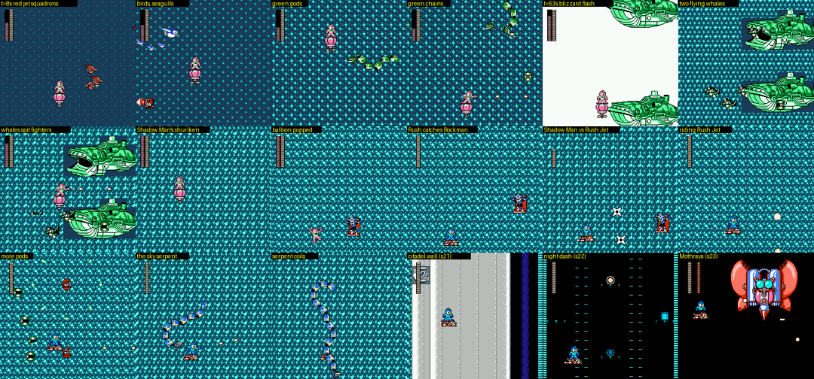
*The screen-20 event in order (frame counts from leaving the cliff on a Balloon), then the citadel wall, the night dash and Mothraya.*

The screen never scrolls: the "flight" is sold by a background that thickens from a sparse dotted night sky into a
dense blizzard pattern (hence the stage's subtitle *-BLIZZARD SKY-*). A spawner object
(`$7A`) feeds waves in, and S.VAL `$782E/$782F` step as they pass (`192,160` → `54,161` → `180` → `50,162` → `78`).
The order, with a hovering player shooting forward:

1. ~0-25 s: red jet squadrons in V and line formations (objects `$78`/`$79`, `$7B` leaders + `$7C` wingmen),
   red-white birds, white seagulls in flocks, green capsule pods and **homing pods** (object `$69`) that stick to you.
2. ~25-60 s: green caterpillar chains that snake across the screen.
3. ~63 s: a white flash and **two green flying whales** (airships with fins and a hatch, the same idea as Dive Man's
   whale battleship). They open their mouths and spit small fighters.
4. ~77 s: **Shadow Man** (spiky head, forehead star, red scarf) appears, throws shuriken and **pops the balloon**.
   Rockman falls, and **Rush flies in as Rush Jet and catches him**. Shadow Man then fights you as a mini-boss
   (object `$4C`, HP `$9C` = shares the boss bar `$BF`): in my run seven buster hits of 4 each emptied his 28-point bar in about 110 frames and he left.
   This is where the RUSH friend joins in story terms; the FLAG byte `$7898` did not change during the event, so the
   RUSH and SHADOWMAN Hero-Score bits are earned elsewhere (bank `$56`'s `ORA #$08` sits in what looks like the
   Rush-call routine) [seen + code, guess on the meaning].
5. ~83-130 s: more squadrons and pods, now on Rush Jet (normal blue Rockman palette; Rush Jet moves freely in 8
   directions).
6. ~130-195 s: a **giant segmented sky serpent** (blue and white beads) that coils around the screen. When it is gone,
   the camera is released and Rush Jet flies on into screen 21.

Rush Jet is the only time Rush gives you mobility in 4MI (hint.txt: "unlike the original, Rush does not support
movement in this hack"), and it is a story event, not a weapon [doc + seen]. While Rush is the jet, selecting WISH STAR
or RUSH CANNON does nothing [seen: zero hits on the boss]. The readme's no-kill notes call this part "very hard in the
air; with luck you can push the homing mooks off the screen" (limited.txt `空中が至難の技`) [doc].

**Tooling gotcha:** with godmode's frozen i-frame timer the homing pods (`$69`) sit on Rockman forever and the wave
controller waits for them, so the arena stalls. Push them off-screen (`zap69()` in `build/research/r4mi/r4mi-cossack/sky.py`).

### 1.3 Boss: MOTHRAYA on Rush Jet (fight `$08`, screen 23) [seen]

You fight in open night sky, standing on Rush Jet, so the fight is 2D dodging instead of vanilla's floor fight.

- **Parts:** body = slot 21 (object `$0E`, HP `$9C`: the bar), head = slot 22 (`$07`, 14 HP), and a separate
  **abdomen pod** = slot 23 (`$16`, 28 HP of its own). Shooting the pod does not touch the bar; when the pod's 28 HP
  are gone it turns into object `$19`/`$1D` and then cycles (slot 23 HP alternating 0/127, a respawning dart launcher).
- **Movement and attacks:** it loops around the whole screen, fires bursts of white pellets from its shoulders, and
  launches red darts (object `$1D`) that fly at you. Its eye lenses switch between cyan and red.
- **Phases:** at bar 20 and again at bar 10 it flashes white and becomes untouchable for a while (frames 136-270 and
  334-991 in a Drill run), then resumes; at 0 the screen turns white with the moth as a black silhouette before it
  explodes.

Damage to the body (slot 21), crits off, measured with `build/research/r4mi/r4mi-cossack/bdmg.py` (steering Rush
Jet beside it and firing):

| Weapon | Damage per hit | Boss i-frames after a hit | Hits to kill (28) |
|---|---|---|---|
| Rock Buster | 1 (one 3, a stray crit) | **49** | 24+ |
| Toad / Wire / Dive / Ring / Bright | 1 | 19 | 28 |
| **Drill** | **2** | **13** | 14 |
| Dust | 2 | **59** | 14 |
| Skull (Hell Wheel) | 1 | 49 | (only 3 hits land: it needs a floor) |
| Pharaoh | 0 | - | (never hit the body) |
| Wish Star, Rush Cannon | - | - | unusable while Rush is the jet |

So **Drill** is the weakness (double damage *and* the shortest invincibility), and Dust hits hard but leaves the
longest window. Versus the abdomen pod (slot 23, 28 HP) the numbers are the hack's fixed "normal enemy" values:
Drill 4, Dust 3, Toad/Ring/Bright/Pharaoh 2, Buster/Dive/Wire/Skull 1, with only 2-8 frames of invincibility.

**Vs vanilla** [guess: from memory of vanilla RM4, not re-played]: vanilla Mothraya is fought standing on a floor and
is weak to the Drill Bomb; the new things are the Rush Jet arena, the separate pod target, and the two invulnerable
phase breaks.

### 1.4 The "city at dusk" section (screens 25-31): arena-only fights

Section 2 of the stage (screens 25-47) is a pink-and-purple sunset skyline with a Kremlin-like silhouette and a
green girder floor. It holds the MY ARENA mid-boss fights `$10`-`$13` (scout, cheats.md §5b): a white runner robot plus
green hoppers (`$10`), a big frog robot blowing bubbles with tadpoles (`$11`), a round pink pod with birds (`$12`) and a
two-bar fight on screen 31 (`$13`). Their roster names are **WILY'S ARMY, WILY'S NAVY, WILY'S AIRFORCE and GREEN
HELMET** (bank `$6F`) [text]: a parade of Wily's forces in front of a Kremlin skyline. **The normal route never goes there** (0 → 23 → clear), so these look like content
made for the arenas [seen; purpose = guess].

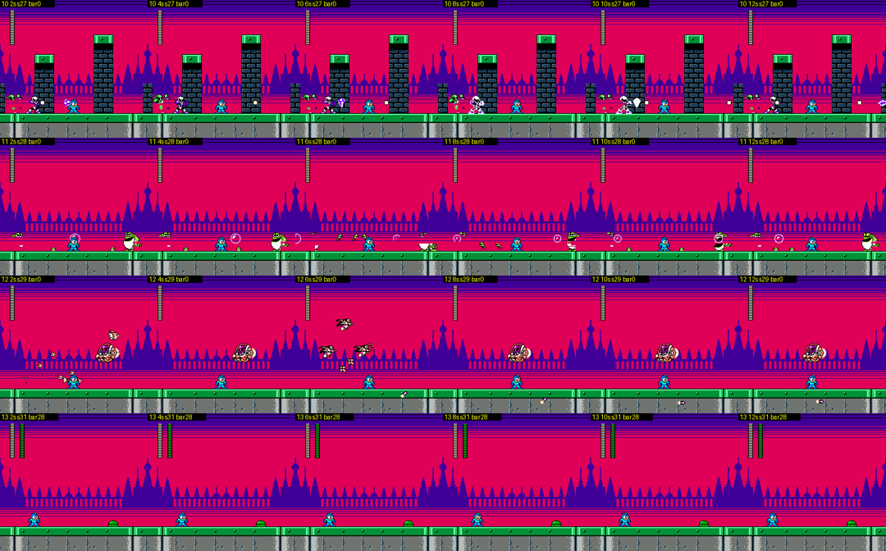
*MY ARENA fights `$10`-`$13`, loaded in Cossack 1's second section (2 s apart).*

### 1.5 Jokes and references

- Shadow Man **pops the balloon you were forced to use**, and Rush, who "does not support movement in this hack",
  turns up as Rush Jet anyway, as a plot rescue.
- Flying whales over a blizzard: the sky version of Dive Man's whale battleship.
- The real vanilla Cossack 1 (snowfield, pines) survives as screens 14-16, sandwiched between the new city and the
  sky.
- Credits [doc]: "Cossack 1's enemy graphics provided by B&K"; "Cossack 1's trap" is credited as similar to *Mega Man
  Forever* (Wing) and *Odyssey* (Duplex).

## 2. Cossack 2 (`$22` = 9)

Staff-roll subtitle: **-LAB. MAZE-** [text].

**In one line:** a green-pipe and red-brick fortress interior with tall pointed windows onto the forest. It starts on
vanilla-style snow, then climbs through rooms of jump-through ledges, ceiling claws and rockets; its checkpoint-1 room
is a **sealed window hall that only the Wire (or Balloon) gets you out of**; the boss is fought **in the dark, riding
three weaving face-blocks over a spike floor**, against a machine you never fully see.

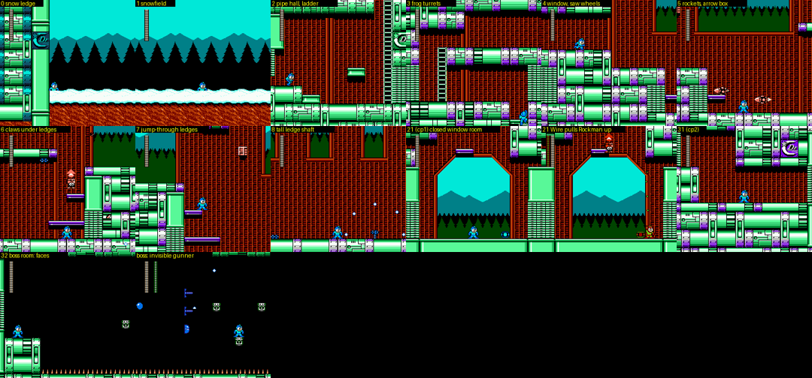
*Cossack 2: screens 0-8 on the way in, the sealed checkpoint-1 room, checkpoint 2, and the boss room before and after it wakes up.*

### 2.1 Route [seen, partial]

Two sections: screens 0-19 and 20-47 (boss on 32). cp0 = screen 0, **cp1 = screen 21**, **cp2 = screen 31**.

| Screen | What happens |
|---|---|
| 0-1 | A short stretch of vanilla-style snowfield (pines on cyan sky) along the citadel's outer wall, which bears the Dr. Cossack emblem. |
| 2 | Into the pipe fortress; a ladder up at the right (col 13). |
| 3 | A two-level room: you come up through the floor, walk *left* to a second ladder and exit right along the top. Green frog-like turrets sit on the floors and ceilings; small white birds swoop. |
| 4-5 | A window onto the forest; white saw wheels roll along the floor; red rockets fly in level. A red **"↑" arrow box** (the same signpost object as Cossack 1's "→") floats here. |
| 6-7 | Purple jump-through ledges with blue claws hanging under them that drop on you. |
| 8 | A tall shaft of zig-zag ledges along the right wall (a "tall room": the camera scrolls vertically inside one screen number, the readme's "terrain checks that depend on the screen Y" credit [doc]). |
| 9-11 | Pipe walls and a big octagonal window; a pole on the right. The autoplayer and the BFS explorer both stalled here, so screens 12-20 were not seen. |
| 21 | **Checkpoint 1: the sealed window hall.** A floor, walls on both sides, a big octagonal window, and one purple ledge high on the left with the "↑" box beside it. There is no ladder and no open edge (the explorer found no exit from it). The **Wire** works: thrown up from under the right-hand pipe block (x ≈ 200) it hooks and reels Rockman up to y = 73 (player state 5 = hanging) [seen]. The Balloon also floats you up to the top (y = 16) [seen]. This is limited.txt's "Cossack 2: partway through, the Balloon or the Wire is mandatory; after that they are never needed" (`途中で、バルーンかワイヤーが必須です`) [doc]. I did not find the move that leaves the room: the Balloon stops at y = 16, a 40,000-frame random Balloon flight never left the screen, and a jump from the high ledge flips the screen counter to 20 for a few frames and then drops back into 21 (no upward link) [seen]. |
| 31-32 | Checkpoint 2, a pipe corridor with the Dr C emblem, then the boss room. |

**HARD** (`$78CD = 1`) [seen]: the layout of screens 20, 21 and 24 changes, and the change is the helpers: HARD
deletes the purple ledges, including the high ledge in the sealed checkpoint-1 room. So on HARD the Wire/Balloon
spot has fewer footholds.

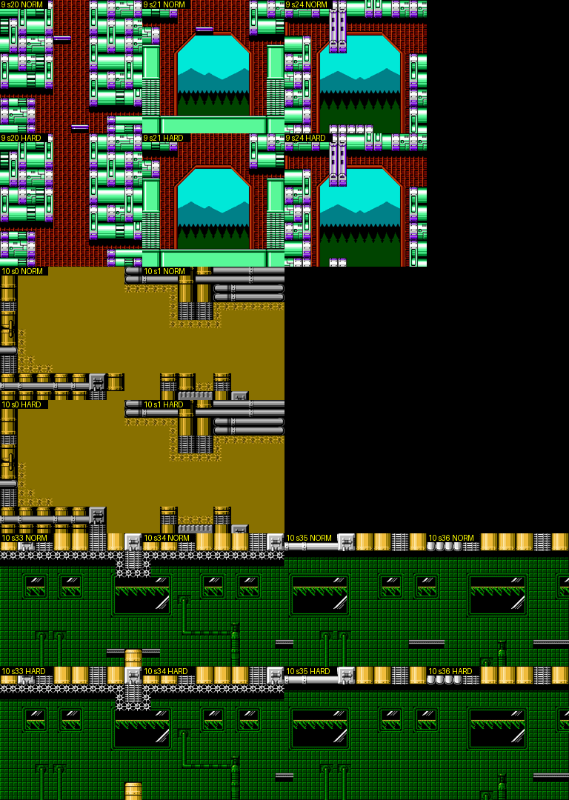
*NORMAL (top of each pair) vs HARD: Cossack 2 screens 20/21/24 lose their purple ledges; Cossack 3 screens 0/1 and 33-36 lose small footholds. Cossack 1 and 4 are identical.*

Weapon note: right after a checkpoint state loads, controller-2 weapon cycling ignores the first ~10 presses (the
respawn animation), so scripted weapon changes must wait [seen].

### 2.2 Boss: SQUARE MACHINE, in the dark (fight `$09`, screen 32) [seen]

- **The trigger:** the room is black, with a spike floor, a small pedestal on the left (where you stand) and three
  small green **face blocks** floating in a row. **Nothing happens until you stand on a face block**: then the
  pedestal vanishes, the bar fills, and the three blocks start weaving up and down over the spikes (a slow sine
  between y = 52 and y = 178, each block out of phase). Shooting the blocks, any weapon, waiting 2,400 frames, or
  standing on the spikes does not start it. (So the MY ARENA state `fight_09` looks dead until you jump onto a block.)
- **The boss:** an almost invisible machine on the left wall (slot 23, object id `$5E`, HP `$9C` = the bar, at
  x ≈ 48, y ≈ 136). What you see are its parts: three blue gun segments that slide out of the darkness in a column,
  firing arcs of small pellets, and a blinking blue-white orb that splits into three white orbs. You fight it while
  hopping between moving blocks over spikes, aiming left.
- **Bright's flash** (Spark Manbow UP+B) turns the screen white for a frame but does not reveal the body [seen].

Damage (crits off; Rockman teleported beside the core and fired; hits only land in the windows when the machine is
exposed, which is why the counts are low):

| Weapon | Damage | Boss i-frames | Note |
|---|---|---|---|
| Rock Buster | 1 | **126** | the hack's "buster gives bosses 2 s of invincibility" rule |
| Toad | 1 | 126 | |
| Dive / Ring / Drill / Pharaoh | 1 | 19 | |
| Dust | 2 | 59 | |
| **Bright (Spark Manbow)** | **2** | **14** | the weakness |
| **Rush Cannon** | **28** | 126 | **one shot kills it** (HELP: "everyone is defeated by this instantly, but this may be dodged") |
| Wire, Skull | 0 | - | no hit registered |
| Wish Star | 0 | - | Rush is summoned and runs about, but no damage registered on any Cossack boss [seen] |

**Vs vanilla**: the roster still calls it **SQUARE MACHINE**, vanilla's Cossack 2 boss [text]; 4MI keeps the "squares"
(the face blocks you ride) but turns the fight into platforming in the dark [seen; vanilla details from memory = guess].

### 2.3 Jokes and references

- The red arrow boxes are literal signposts ("→" at Cossack 1's balloon cliff, "↑" in Cossack 2's sealed room): the
  author points at the forced Wire/Balloon spots instead of explaining them.
- The boss you cannot see, weak to the weapon made of light bulbs.

## 3. Cossack 3 (`$22` = 10)

Staff-roll subtitle: **-PURIFICATION PLANT-** [text].

**In one line:** a flooded machine plant. You start fully underwater (olive water, high floaty jumps), and at screen
10 **the stage forks into two routes, each with its own vanilla RM4 mid-boss**: an upper route through black pipe
halls with flowing water channels that ends at the snail mech, and a lower route through green circuit-board halls
whose **water level rises and falls with a wavy raster shimmer**, ending at the whale. The boss is a **block golem**
whose collapsing body piles up into new terrain.

### 3.1 Route [seen; explorer + driving]

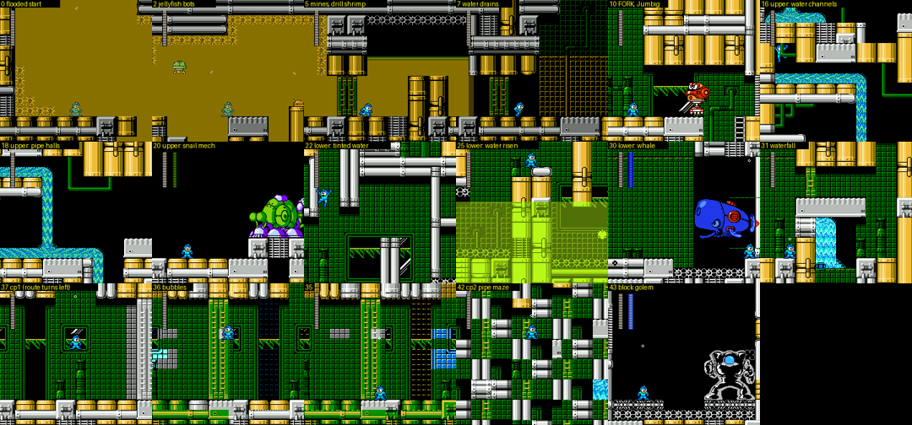
*Cossack 3 in route order: the flooded start, the fork at screen 10, the upper route (water channels, snail mech) and the lower route (tinted water, whale), the waterfall drop to checkpoint 1, the leftward bubble halls, checkpoint 2 and the golem.*

Sections: screens 0-20 and 21-47. cp0 = 0, cp1 = 37, cp2 = 42, boss = 43.

| Screens | What happens |
|---|---|
| 0-4 | Underwater from the start: the whole screen is olive water, Rockman jumps high and falls slowly. Pipes, barrels and gear blocks. Jellyfish-like parachute bots (green and orange) drift down; small fish dart. |
| 5-6 | A dark ceiling band; green mine pods and red-white drill-shrimp robots. |
| 7-9 | The water drains to the lower half: olive water below, a green circuit-board wall above. |
| 10 | **The fork.** A big red hopping robot (limited.txt's "Jumbig", `ジャンビッグ(跳ねるデカザコ)`; the staff roll's FABRICATED ENEMIES list calls it **JUMBIG THE DEATH MACHINE** [text]) patrols the corridor and keeps knocking you back (the readme suggests getting past it with Bright's weapon). Exits: **right → 11** (upper route) or **down/left → 21** (lower route) [seen: explorer edges `10: R→11, D→21`; my autoplayer fell into 21 after ~3,000 frames of Jumbig shoving]. |
| 11-19 (upper) | Black halls of silver pipes with **blue flowing-water channels** pouring through the pipework (the credited "water currents", `水流`, "an idea from many RM2 hacks" [doc]); barrels, small fliers. 15 drops to 16, 16 to 17. The explorer could not leave 19 toward 20. |
| 20 (upper) | Mid-boss: **ESCAROO**, the green snail mech (fight `$1B`; roster name [text], vanilla RM4's snail mini-boss) on a pedestal; its eyes detach and fly at you, it lobs green bombs. |
| 21 (lower) | Green circuit-board hall; drop through the floor at the left (cols 2-3). |
| 22-29 (lower) | **Translucent yellow-green water** whose surface height changes from screen to screen (low in 22-24, high in 25-27), with the wavy shimmer (3.2). Spiked gear wheels on the ceilings, cannon pods, the exit of 24 is at the very top row and 27's at mid-height on the right. |
| 30 (lower) | Mid-boss: **MOBY**, the blue whale head (fight `$1C`; roster name [text], vanilla Dive Man's whale) in a green grid aquarium; it fires red homing mines. Beating it opens the way to 31. |
| 31 | A waterfall pours out of a pipe and pushes you back; the way on is **down** (explorer: `31: D→37`). |
| 37 | **Checkpoint 1.** From here **the route runs leftward**: 37 → 36 → 35 → 34 → 33 → 32 (explorer edges; screen numbers count down). |
| 32-36 | Green halls with tall windows and drifting bubbles: limited.txt's **"bubble rush zone"**, where with bad luck a bubble keeps bouncing in a spot the buster cannot reach (`バブルラッシュ地帯`) [doc]. The cyan window pattern behind them is a **camera-driven pseudo-parallax layer** (3.2). Where 32 leads (and how the upper route rejoins) was not found. |
| 42-43 | Checkpoint 2 is a maze of white pipes and ladders; then the boss. |

So the two mid-bosses are **alternatives**: you meet the snail *or* the whale depending on the branch you take at
screen 10 (both branches end in screens that lead toward checkpoint 1) [seen for the lower branch; the upper
branch's join is a guess].

### 3.2 The water effects [seen]

- **Wavy shimmer.** On the lower route's water screens the background is shifted sideways line by line: sampling
  every 4th scanline over 11 frames on screen 26 gives offsets of -2..+2 px that form a sine-like band and drift
  over time (rows 36-76 and 96-156) [seen, `build/research/r4mi/r4mi-cossack/raster.py`]. The fully-flooded first
  screens show no wobble. This is the readme's "Cossack 3 water shimmer" (credited as similar to *Mega Man Forever*'s
  Propeller/Boil) [doc].
- **Tinted water body with a moving surface**: the lower half of the screen is drawn in a yellow-green palette with
  the background showing through, and the surface sits at a different height on each screen.
- **Underwater physics** in the flooded parts: high, slow jumps (vanilla RM4 water).
- **Currents**: the upper route's blue channels (seen as flowing water graphics in the pipework), and the screen-31
  waterfall that pushes Rockman back.
- **Pseudo-parallax by CHR rewriting** (screens 35-37): while the camera scrolls, background tile `$1A` (26) is
  rewritten every ~8 px of camera movement (its first byte cycles `00 → 20 → 23 → 22 → 21 → 20 …`), and it never
  changes while the camera is still [seen]. The cyan window pattern built from it therefore slides at its own rate:
  a second scrolling layer faked with one animated tile. This matches the readme's "Cossack 3 mid-boss pseudo
  double scroll" credit (*Forever* Chrono / *Odyssey* Volt) [doc].

**HARD** [seen]: the layouts differ on screens 0-1 and 33-36: HARD removes small footholds (grey ledges in the
bubble halls). See the image in 2.1.

### 3.3 Boss: AQUA DEVIL, the block golem (fight `$0A`, screen 43) [seen]

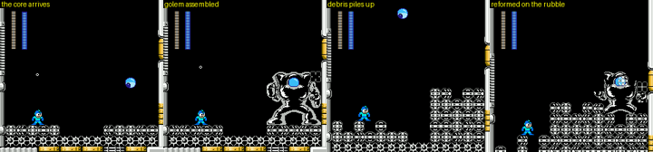
*The block golem: the core arrives, pulls the blocks into a golem, collapses into rubble that stays as terrain, and reforms on top of it.*

A blue orb (the core, slot 23, object `$5E`, HP `$9C`) flies in and **pulls white gear blocks together into a hulking
golem** with the orb in its chest. It then **collapses**: the blocks rain down and **stay on the floor as stacked
terrain**, so the arena floor rises into steps and walls as the fight goes on (Rockman is lifted with it), while the
orb flies off and reassembles the golem elsewhere (top left, right). Only the core takes damage, and only while it is
exposed.

| Weapon | Damage | Boss i-frames |
|---|---|---|
| Rock Buster | 1 | 126 |
| Toad | 2 | 75-126 |
| Dive / Drill / Dust / Pharaoh / Bright / Wire / Skull | 2 | 47 |
| **Ring** | **3** | 47 |
| Rush Cannon | 10 | 126 |
| Wish Star | 0 | - |

So **Ring** is the weakness (3 per hit). **Vs vanilla**: vanilla Cossack 3's boss is the Cockroach Twin pair (the roster
keeps a COCKROACH entry near its end [text]); 4MI replaces it with **AQUA DEVIL**, a Yellow Devil homage by name and
by design, whose debris rebuilds the room.

### 3.4 Mid-bosses (both routes)

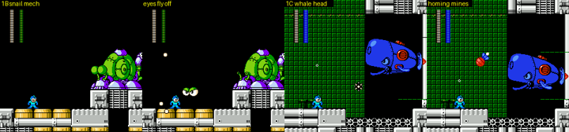
*Upper route: the snail mech (fight `$1B`, screen 20). Lower route: the whale head (fight `$1C`, screen 30). One frame per second.*

### 3.5 Jokes and references

- Two vanilla RM4 mini-bosses (Escaroo and Dive Man's Moby) are
  moved into the water fortress and made **alternatives**: which one you fight depends on the branch.
- AQUA DEVIL is a Yellow Devil homage whose debris does not vanish but becomes the floor.
- The readme's own warning about the bubble rush zone ("if it happens... my condolences", `ご愁傷様でした`) [doc].

## 4. Cossack 4 (`$22` = 11)

Staff-roll subtitle: **-FOUR TOWERS-** [text], which explains the compass: the four faces of 4.0 are four towers.

**In one line:** an orange machine maze with a **N/E/S/W compass in the HUD** that you play *backwards* through
the screen numbers (start on screen 30, checkpoints on 2 and 16), with **repeating screens**: its section table
reuses local screens 1-2-3 four times (`0 1 2 3 4 5 6 7 1 2 3 8 9 10 11 1 2 3 ...`), the classic "maze that loops
until you take the right exit" structure. The Game Boy **Mega Man Killers** wait in its side rooms, and the boss is the
**Cossack Catcher hanging from a crane chain**.

### 4.0 Route: a hub, four tower faces and a compass [seen, partial]

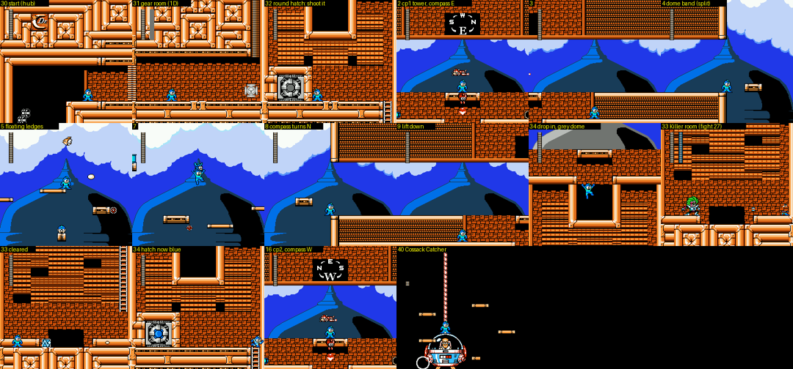
*Cossack 4: the start hub (30-32), the round hatch, the outdoor tower faces under the onion dome with the compass HUD, the drop into a Killer room, the hatch turned blue, checkpoint 2 and the boss.*

| Screens | What happens |
|---|---|
| 30 | Start (cp0) in an orange machine hall under a Dr C emblem. |
| 31 | The gear room, mid-boss **NIGHTMARE SUZIES** (fight `$1D`, roster name [text]: MM1's Adhering Suzy eyes): white and orange disc-eyes roll out of the walls and bounce around the room. When they are gone, a ladder high on the right wall (its bottom hangs about 60 px above the floor, so you jump to it) leads up. |
| 32 | A room with a big **round hatch** on a raised block. **Shooting the hatch opens it and drops you into the tower** (you reappear falling in at screen 2, the checkpoint-1 spot). Buster, Dive, Ring, Drill, Pharaoh and Bright open it (the buster needs about a dozen shots); Toad, Wire, Dust, Skull and the Rush adaptors do not [seen]. |
| 2-9 | **Outside the citadel tower**, against a huge blue onion dome under clouds. The HUD has a **compass** (`W S E N` around a big letter: E at checkpoint 1). Small floating ledges (sprites) carry you across; E-tank capsules sit on some of them; red drones and saw wheels. On screen 8 the compass turns to **N** (you have gone round a corner of the tower), and on screen 9 a lift with a red "↓" sign takes you down. |
| 34 → 33 | The lift drops you into a hatch room (34) and down a ladder into **a Mega Man Killer room** (33, fight `$27`, the green-haired robot). After it, the ladder back up to 34 shows the round hatch **with a blue core** instead of grey; it no longer opens when shot. |
| 16 | **Checkpoint 2**, another tower face with the compass on **W**. |
| 40 | The boss (4.1). |

Structure [code + seen]: section 0 covers screens 0-38, and its screen → local table is
`0 1 2 3 4 5 6 7 | 1 2 3 | 8 9 10 11 | 1 2 3 | 12 13 14 15 | 1 2 3 | 16 17 18 19 | 1 | 20 21 22 23 24 25 24 25 24`.
Local screens 1-3 (the corner + lift) are **reused between every face**, and the Killer rooms 33/35/37 and the
hatch rooms 32/34/36/38 share layouts 22-25. So Cossack 4 is four tower faces (N/E/S/W on the compass) joined by
the same corner, each face ending in a lift down to a Killer room and a hatch: a hub stage. I cleared one face; the
order of the other faces and what the blue hatches unlock (presumably the boss shaft once all are done) were not
established [guess]. limited.txt adds that "if you don't take the **weapon panels**, you can finish Cossack 4 with
the buster alone" (`武器パネルを取らなければロックバスターのみで進めます`), so the stage also hands out weapon panels
somewhere [doc].

**Pseudo double scroll** [seen]: on the dome screens, while the camera scrolls 10 px, the scanline bands above
y ≈ 64 (clouds) and below y ≈ 150 (the foreground strip) move 10 px but the band y ≈ 72-144 (the dome) moves **0**:
a mid-frame scroll split freezes the dome while the level slides past it, and the ledges inside that band are
sprites so they can still scroll. This is the readme's "Cossack 4 pseudo double scroll" [doc].

**HARD**: identical layouts at cp0/1/2 [seen].

### 4.1 Boss: C.CATCHER AND C.HOPPER, the Cossack Catcher on a chain (fight `$0B`, screen 40) [seen]

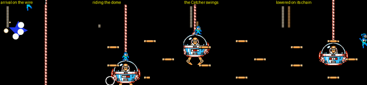
*The Cossack 4 fight: Rockman comes down a wire line, rides on top of the Catcher's glass dome, and drops between small floating ledges.*

Rockman arrives by sliding down a red-white wire line into a black shaft dotted with small orange ledges. The
**Cossack Catcher** (Dr. Cossack in his glass-domed claw machine) hangs from a chain like a real crane game (the
Japanese name for a crane game is "UFO catcher"); Rockman can stand on its dome and ride it while it swings and
lowers. The body is slot 21 (HP `$9C`), with a ring of small parts (HP 8 each) around it. The roster name adds a
"C.HOPPER" partner [text], which I did not identify on screen (the small parts, or a later phase) [guess].

| Weapon | Damage | Boss i-frames |
|---|---|---|
| Rock Buster / Toad | 1 | 126 |
| Wire / Dive / Ring / Drill / Dust / Pharaoh / Bright | 1 | 29 |
| **Skull (Hell Wheel)** | 1 | **14** |
| Rush Cannon | **14** (half the bar) | 126 |
| Wish Star | 0 | - |

Every weapon does 1, so this is the purest case of hint.txt's rule that **the weakness shows in the invincibility
time, not the damage**: Hell Wheel leaves 14 frames, everything else 29, the buster 126.

### 4.2 Mid-bosses: the Mega Man Killers and the gear room [seen]

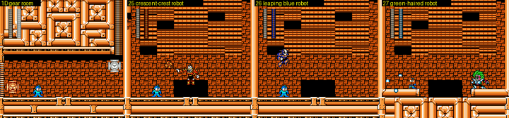
*Fights `$1D` (gear room, screen 31), `$25` (screen 37), `$26` (screen 35) and `$27` (screen 33).*

- `$1D` **NIGHTMARE SUZIES**, screen 31: an orange machine room where white and orange disc-eyes (Adhering Suzy
  style) roll out of the walls and bounce around; two parts with HP `$8E` (14 each, sharing the bar).
- `$25`, `$26`, `$27` (screens 37, 35, 33): one humanoid robot each in a small orange room: a red robot with a
  white crescent crest throwing spinning blades, a blue-white leaping robot, and a green-haired masked robot that
  fires from a ledge. The roster lists **ENKER, QUINT, PUNK, BALLADE, EARTH, TERRA** in fight-table order [text];
  with ENKER and QUINT being the Dive and Drill fights (`$23`, `$24`), these three are **PUNK (`$25`), BALLADE (`$26`)
  and EARTH/TERRA (`$27`)** [text + order = high-confidence guess].

### 4.3 Jokes and references

- The Cossack Catcher literally hangs from a crane chain: a crane game is a "UFO catcher" in Japanese, and the
  Catcher is a domed UFO with a claw.
- The Game Boy Mega Man Killers PUNK, BALLADE and EARTH/TERRA (whose weapons the EXWP cheat carries) as the guards
  of three of the four towers.
- The compass HUD and the repeating corner screens make the tower a small orientation puzzle, the opposite of
  vanilla's straight corridors.

### 4.4 Story around the stages [text, from text.md]

The Cossack 4 victory plays the reworked confession (Wily interrupts; Kalinka is still a hostage), followed by the
new Cossack interlude scripts (Cossack and Beat, Cossack alone, Proto Man's visit), see `docs/research/r4mi/text.md`
scripts 0-3. The Cossack castle intro (lightning, the castle, a Wire line into the night) is in cheats.md §5.

## Bosses at a glance

| Stage | Boss | Arena | Weakness (measured) | Notes |
|---|---|---|---|---|
| Cossack 1 | MOTHRAYA | open night sky, on Rush Jet | **Drill**: 2 dmg, 13 i-frames | separate 28-HP abdomen pod; invulnerable breaks at bar 20 and 10; Rush adaptors unusable (Rush is the jet) |
| Cossack 2 | SQUARE MACHINE (in the dark) | three weaving face-blocks over spikes | **Bright**: 2 dmg, 14 i-frames; **Rush Cannon one-shots it** | starts only when you stand on a block; mostly invisible |
| Cossack 3 | AQUA DEVIL (block golem) | floor that fills with its debris | **Ring**: 3 dmg | Rush Cannon 10 |
| Cossack 4 | C.CATCHER AND C.HOPPER | black shaft, small ledges, crane chain | **Skull**: 1 dmg but 14 i-frames (others 29) | Rush Cannon 14; you can ride its dome |

Buster: always 1 damage; 126 frames of boss invincibility on Cossack 2-4 (the "2 s" rule), 49 on Mothraya's body.

## Not covered / open

- **Cossack 2 screens 9-20 and 22-30**: neither driving, the BFS explorer nor random Balloon flight got past the tall
  ledge shaft (8-11) or out of the sealed checkpoint-1 room (21), so the exact Wire/Balloon move and the middle of the
  stage are undocumented. The boss and cp2 were reached from the checkpoint states.
- **Cossack 3**: the join of the upper route (19 → 20 → ?) and the exit from the leftward bubble halls (32-36) to
  cp2 (42) were not found; 38-41 unseen.
- **Cossack 4**: only one tower face and one Killer room were played; the other faces, the weapon panels and the path
  to the boss shaft (40) are inferred from the section table and the MY ARENA fights.
- **Vanilla comparisons** are from memory: I reached vanilla Cossack 1-4 starts (`van2.py`) but not their bosses.
- **HARD** was checked as layout diffs only (no enemy/boss behaviour comparison).
- Regular enemy names are descriptions (the staff roll's FABRICATED ENEMIES list in text.md names some, e.g. JUMBIG THE
  DEATH MACHINE); object ids (`$0300`) were not mapped to them.

## Lessons for Rockman 6 GP

- **A locked screen plus a wave spawner is a whole set piece.** Cossack 1's 3.5-minute "flight" never scrolls: a
  background that thickens into a blizzard, a spawner object stepping through waves (S.VAL counters), and a scripted
  ability swap (balloon popped → Rush Jet). RM6 GP can stage a flight or chase this way with no new scrolling code.
- **Hand the player a tool through the story, at the moment the level needs it.** Shadow Man takes the Balloon away
  and Rush replaces it with Rush Jet. The tool change *is* the plot beat, and the boss is then built for the new tool.
  RM6's Rush adaptors (Power/Jet) can be introduced the same way.
- **Make each boss a different kind of fight, not a different sprite.** Sky dodging, platforming in the dark, an arena
  that rebuilds itself, riding the boss. Terrain-changing bosses (the golem's debris) are cheap with a writable map in
  RAM (4MI decompresses sections into WRAM, so the boss can edit them).
- **Show the weakness in the invincibility time.** With flat damage (1-3) the i-frame timer carries the weakness
  (Cossack Catcher: 14 vs 29 vs 126 frames). This keeps every weapon usable. Expose it to playtesters as a number.
- **Signpost mandatory tools.** The red "→"/"↑" boxes point at the one place where the Balloon/Wire is required. Any
  forced-tool spot in RM6 GP needs a visual cue like this, and HARD can be made by deleting helper ledges only (pure
  data, no code), as 4MI does in Cossack 2 and 3.
- **Branches with different mid-bosses double the content of one stage** (Cossack 3): one fork, two mid-boss rooms,
  rejoining before the checkpoint.
- **Reuse screens to build hubs.** Cossack 4 reuses its corner screens between four tower faces through a
  screen → local-layout table. RM6 GP's level format can support the same indirection for loops and hubs.
- **Three raster tricks worth copying (and their RM6 equivalents):**
  1. water wobble = a few pixels of per-scanline X scroll in a sine (MMC5 scanline IRQ here; MMC3's IRQ can do bands);
  2. a frozen background band = a mid-frame scroll split, with the platforms in that band made of sprites;
  3. parallax without splits = rewriting one background tile in step with the camera (4MI uses CHR-RAM; RM6's
     CHR-ROM can do it by bank-switching a 1 KB CHR bank of pre-shifted tiles).
- **A boss that waits for the player must say so.** Cossack 2's boss idles until you step on a block, so the MY ARENA
  state looks broken. Give such triggers a visible prompt, or start on a timer as a fallback.
- **Tooling lessons:** (1) freezing the player's i-frame timer breaks events that need a hit to land (Cossack 1's
  homing pods never detach and the wave stalls); (2) teleporting the player desynchronises the camera in scrolling
  rooms, so explorer states need a "settle" step; (3) right after a respawn the game ignores weapon-cycle input for
  ~10 presses; (4) tall rooms scroll vertically inside one screen number, so per-screen layout renders cannot show
  them. Build RM6 GP's test harness with an explicit "camera follow" and an event log from the start.
