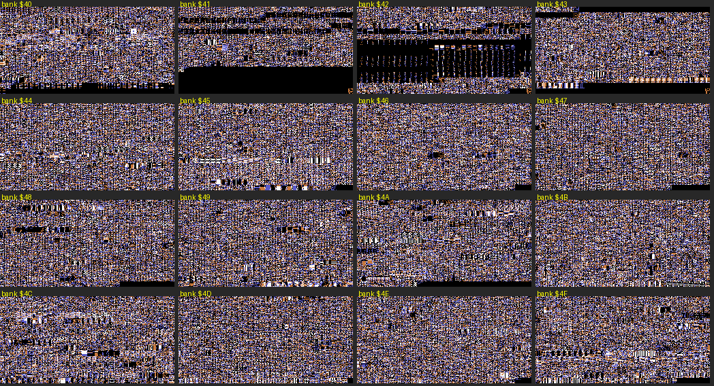
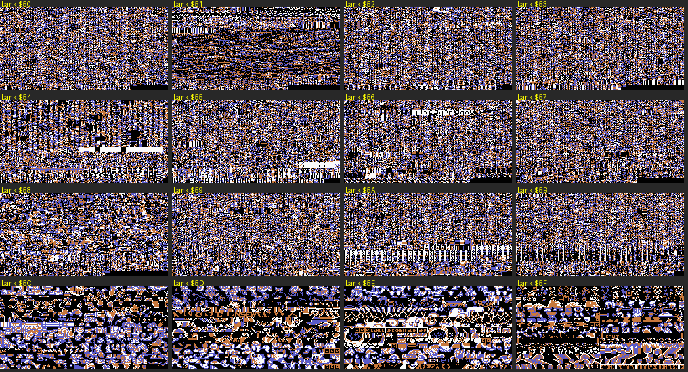
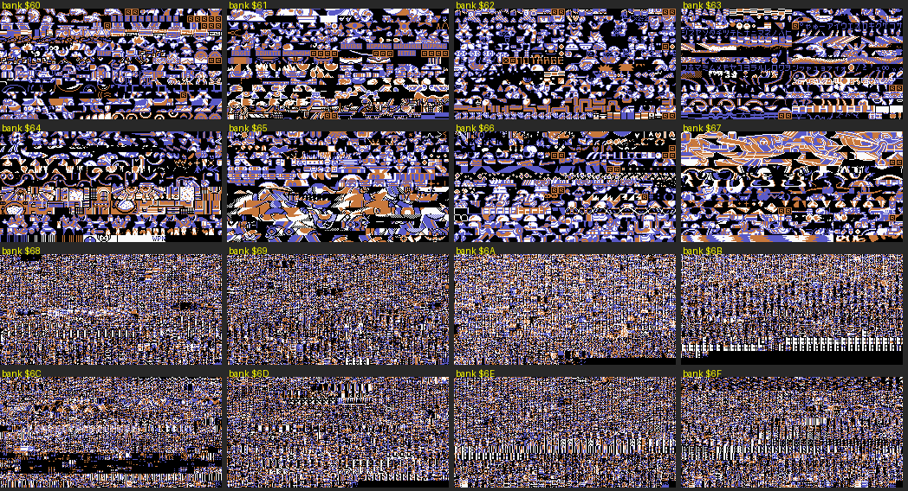
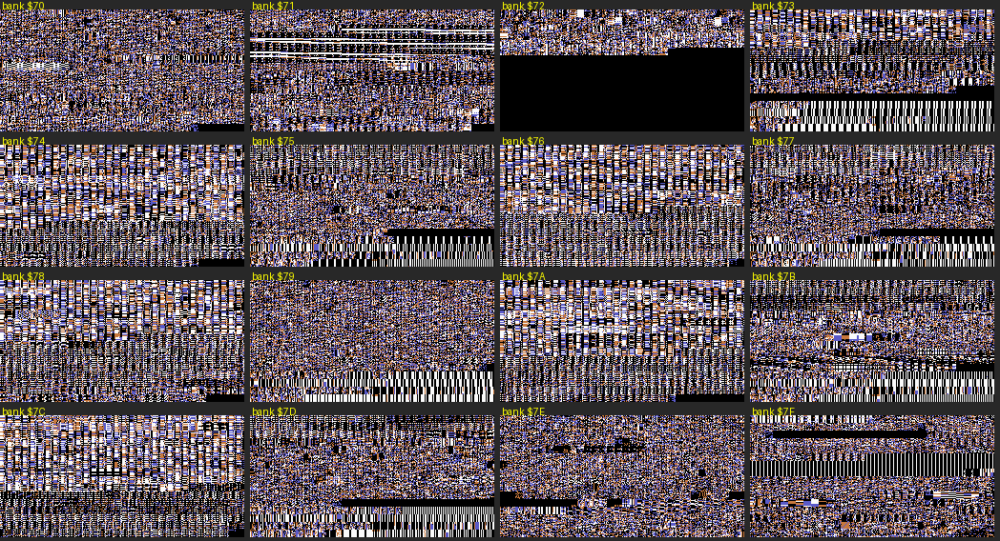
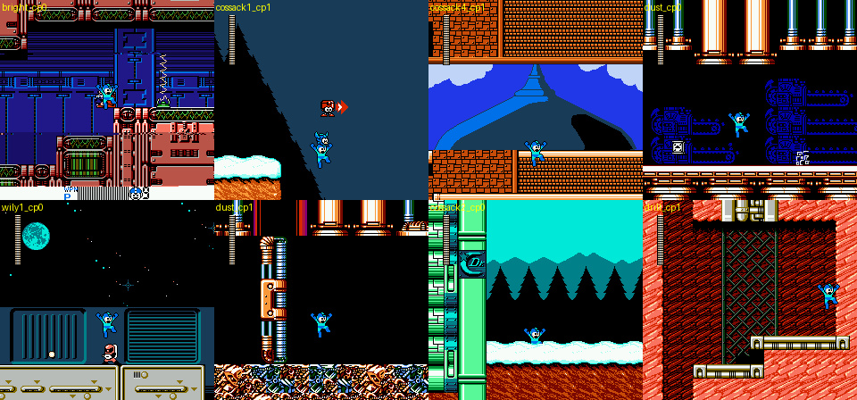
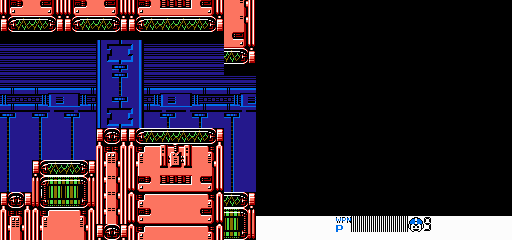
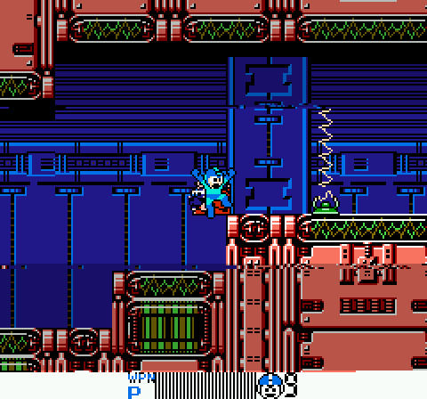
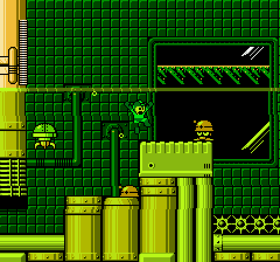

# 4MI engine: banks, MMC5, raster, systems code (r4mi-engine)

Status: complete for this pass (r4mi-engine). Open questions are listed at the end.

Scope: a static/technical deep dive into *Rockman 4 Minus Infinity* v1.01, `roms/r4mi_mmc5.nes` (MMC5, 1 MB PRG,
8 KB CHR-RAM), with `roms/r4mi_mmc3.nes` and vanilla `roms/rm4j.nes` for comparison. Addresses are `bank:CPU`.
Banks `$7E`/`$7F` are fixed at `$C000`/`$E000`. Tags: **[code]** disassembly/data, **[seen]** emulator,
**[doc]** readme, **[guess]**.

Scripts (all in `build/research/r4mi/r4mi-engine/`): `regscan.py` (absolute accesses to any address range, all
banks), `farxref.py` (every far call `JSR $DF8C/$DF66/$DF5F` → target bank and entry), `bankset.py` (every store to the
bank shadows `$F5`/`$F6`), `profile.py` (per-bank profile), `banksheet.py` (render banks as 2bpp tiles),
`sections.py` (the section table and the NORMAL/HARD patch lists), `songs.py` (sound table, song banks, vanilla
match), `songmap2.py` (stage music ids by warping), `featmap.py` (which states use IRQ effect 7, vertical wrap, slope
mode, bitmap blocks), `rlist.py` (dump the live raster list + screenshot), `chrsrc.py` (source bank of every live CHR
tile), `chrsets.py` (CHR upload lists), `lag.py` (frame-overrun count, run once per build), `rsearch.py` (Rush
Search sampler, inconclusive). Disassembler: `tools/analysis/r4mi/r4mi_dis.py`. All run from the repo root with
`python3 -I`.

## 0. Headline findings

- **The MMC5 build uses far less of the MMC5 than its register list suggests.** Of the "MMC5 features" in
  `DECONSTRUCTION.md` §2.2, the vertical split (`$5200-$5202`), ExRAM (`$5104`/`$5C00`), fill mode (`$5106/$5107`)
  and CHR banking (`$5120-$512B`) are written **only once, by the power-on init** (`$40:$806F-$80B3`), with values that
  turn them off. `$5105` is written in 26 places, but only with `$44` (vertical mirroring) and `$50` (horizontal
  mirroring): every site is a one-for-one replacement of an MMC3 `STA $A000` [code, diffed against the MMC3 build].
  ExRAM keeps its power-on garbage for the whole game [seen: identical 1 KB before and after 600 frames, and in every
  savestate]. **What the MMC5 really buys is four things: 8 KB PRG banking beyond 512 KB, an absolute-scanline IRQ, the
  8×8 hardware multiplier, and the extra pulse channel.**
- **The hardware multiplier is shared between the game and the sound driver**, and the game protects it with the
  vanilla bank-switch re-entrancy flag: `$FC7B` does `INC $F7`, multiplies, `DEC $F7`, then runs any sound update the
  NMI had to postpone while the flag was up [code].
- **Stage maps are LZ-packed "sections" stuffed into whatever free space was left in 32 different banks**, including
  vanilla graphics and stage banks and the new code banks. HARD and NORMAL share one
  packed map; the difference is a **list of single-byte WRAM pokes applied after unpacking** (§6).
- **The raster engine got a generic, double-buffered "raster list"** in WRAM (`$7400-$74FF`), driven by IRQ effect 7.
  Vanilla effect 7 was one hard-coded split; 4MI replaced it with a table of up to 24 splits (PPU address, scroll,
  `$2000`/`$2001` value, next scanline) that game code fills in a staging copy and the NMI tail commits (§4).
  In practice the per-band register is **`$2001` (PPUMASK)**: **Cossack 3's translucent water is a mid-frame colour
  emphasis + greyscale switch at the water line**, with ±1 px scroll jitter per 20-line band for the shimmer, and
  Bright Man's status bar is a band that re-points the PPU and **turns sprites off** under the bar (§4.3).
- **Three terrain extensions in the shared collision routine**: slopes flagged by a spare attribute bit (§5.1), a
  run-time **bitmap of switchable 16×16 cells** in WRAM (§5.2), and a "vertical wrap" mode that adds the vertical
  scroll to every probe so tall structures can be stored as stacked horizontal screens (§5.3).
- **The cartridge is packed like a suitcase**: stage sections sit in 32 banks and the 47 new music tracks in 36 banks,
  wherever a gap was left, each found through a table with its own bank byte (§1.4). Only 32.9 KB of 1 MB is free.
- **The MMC5 charge sound**: the "fully charged" loop no longer steals a music channel; one `JSR` became `INC $787B`
  and the driver plays a 10-step sweep on MMC5 pulse 1 (§9.2). The play-time clock is ticked inside the sound
  driver (§9.3).

## 1. Cartridge layout

### 1.1 Header [code]

| Build | Bytes 4-15 | Meaning |
|---|---|---|
| MMC3 | `40 00 43 08 00 00 00 07 00 00 00 01` | NES 2.0, 64×16 KB PRG, mapper 4, battery, **PRG-RAM size 0**, CHR-RAM 8 KB (`$07`), standard controllers |
| MMC5 | `40 00 53 08 00 00 00 07 00 00 00 01` | the same with mapper 5 |
| vanilla `rm4j` | `20 00 40 08 00 00 00 07 00 00 00 01` | NES 2.0, 512 KB, mapper 4, **no battery** |

Both hacks set the battery bit but leave the NES 2.0 PRG-(NV)RAM size at 0. FCEUmm allocates MMC5 WRAM anyway; a
strict NES 2.0 emulator would give the game no save RAM, which may explain part of the readme's emulator matrix
[guess].

### 1.2 Banks `$00-$3F`: the original game, patched in place [code]

`banks.py diff` style comparison with `rm4j.nes` (same offsets): most graphics banks are 90-100 % identical
(`$00-$1C` except `$02/$03/$06/$09/$0B/$0D/$15/$1D`), the stage banks `$20-$2F` are 20-55 % identical (layouts
replaced), and the vanilla code banks `$30-$3D` are 57-99 % identical (patched in place). Banks `$3E/$3F` (the old
fixed pair) are still 99 % vanilla: the new fixed pair `$7E/$7F` is a patched copy of them (PBTPS `SimpleExp` copies
`0x7C010 → 0xFC010`), so the old pair is mostly dead code that stays in the image.

### 1.3 Banks `$40-$7F`: the new half (main role of each bank; §1.4 shows how mixed they are)

How the roles were assigned: tile renders of every bank (`banksheet.py`, below), far-call entry points
(`farxref.py`: 1,802 far calls into 59 banks, 1,056 of them into bank `$6D`), the LZ section table in bank `$71`, the LZ screen
table at `$6D:$8BCA`, the per-object sprite-bank values stored to `$7600,X`, and the other agents' docs.

| Bank(s) | CPU base | Role | Evidence |
|---|---|---|---|
| `$40` | `$8000` at boot, `$A000` after | **Boot and save system**: power-on init (RAM clear, MMC5 registers, WRAM clear, APU), save load/verify/write, checksums, config pack, death counters | reset vector → `JMP $DF5F` → `$40:$8001`; cheats.md §3 |
| `$41` | `$A000` | Items and pickups: Recycle Inhaler recipe book (`$AB90-$AC4D`), item drops, EDDY / TOADMAN flags | modes.md |
| `$42` | `$8000` | **Combat**: damage lookup for multi-part bosses (`$8B45`), hit entry and critical roll (`$9C08`, `$9D89`), enemy i-frames (`$9D20`), damage to Rockman (`$9AF8`) | systems.md |
| `$43` | `$8000` | Boss i-frame tables (`$9A80`), escape sequence (`$B33B`), misc | systems.md, wily.md |
| `$44-$5B` (except the banks listed separately) | `$A000` (object AI) | **Object AI** for new enemies, mid-bosses and bosses (object `$5E` is a generic container whose AI bank is per instance), plus story/event controllers: `$44` Beat rescue, `$45` boss `$5E`, `$46` final battle / meddling, `$48` beam emitters, `$4F` dungeon logic (Wily), `$50` Kalinka scene, `$56` Rush capture / Wily Buster, `$57` Wily 4 hall | [code] + other docs |
| `$4C` | `$8000` | SPECIAL MODE menus, EXTRA CONFIGURATION, MY ARENA builder and fight table | cheats.md §7 |
| `$4D` | `$8000` | Ending, RESULT screen, Hero Score tally | modes.md, text.md |
| `$51` | `$8000` | A multi-channel sequencer over `$7840+X` (45 far calls; see §1.5) [guess: scripted palette/sequence player] | farxref |
| `$54` | `$8000`/`$A000` | Room logic and object scans (§1.5) | farxref |
| `$58` | `$A000` | Per-frame terrain-animation task (§1.5) + section `$11` | `$7F:$E8DE` |
| `$5C-$67` | — | **CHR graphics, 96 KB of new tiles** (12 banks: enemies, bosses, backgrounds, menu art; `$5F` ends with the status-effect words STONE / PETRIFY / PARALYZE / CONFUSE) | tile renders |
| `$68`, `$69` | `$A000` | Object AI + LZ sections | |
| `$6A` | `$A000` | HELP text (dictionary-compressed, JP and EN) | text.md |
| `$6B` | — | Dialogue scripts | text.md |
| `$6C` | `$A000` | HELP renderer, text engine | text.md |
| `$6D` | `$A000` / `$8000` | **The library bank**: 1,056 far calls from 63 banks. LZ decompressor (`$8B0C`), LZ screen loader (`$8BB7`), raster-list helpers, object helpers | farxref |
| `$6E`, `$6F`, `$70` | `$A000` | Object AI / lobby code (`$6F` arena lobby and fight-name roster) + LZ sections | |
| `$71` | `$8000` | **Stage loader**: section table, NORMAL/HARD patch lists, screen-link tables, section unpack (`$8001`, `$8D56`, `$8D9C`) | §6 |
| `$72`-`$7D` | pairs | **Sprite (metasprite/animation) banks**, six new pairs `$72/$73 … $7C/$7D`. The odd bank is mapped at `$A000` with its pointer tables at `$BE00/$BF00`; the even bank at `$8000`. The odd banks also hold code in their lower part (`$79`, `$7B` arena runner, `$7D`) | `STA $7600,X` values, `$BE00/$BF00` tables |
| `$7E`, `$7F` | `$C000`, `$E000` | Fixed: NMI/IRQ, far-call trampolines, task scheduler, bank switch, sprite engine | |

*Banks `$40-$4F` rendered as 2bpp tiles: all code and tables (noise).*

*Banks `$50-$5F`: code until `$5B`, then the first four new graphics banks `$5C-$5F`.*

*Banks `$60-$6F`: graphics `$60-$67`, then code/text `$68-$6F`.*

*Banks `$70-$7F`: the striped banks `$73-$7C` are metasprite tables; `$72` is mostly empty (5.3 KB free).*

**Free space.** Runs of 32+ bytes of `$00`/`$FF` add up to **32.9 KB in the whole 1 MB** (largest: bank `$72` 5.3 KB,
`$41` 2.6 KB, `$43` 1.4 KB, `$42` 1.2 KB, `$33` 1.1 KB). The cartridge is full.

### 1.4 "Fill every gap": nothing respects bank boundaries [code + seen]

The tidy table above hides how mixed the banks really are. Three independent measurements:

| Data | How it was found | Banks that hold it |
|---|---|---|
| 44 LZ-packed stage sections | section table `$71:$8F87/$8FB3/$8FDF` (§6) | **32 banks**: `$00 $06 $07 $15 $1C $1F $25-$2F $32 $4C $57 $58 $59 $5B $68 $69 $6B $6E $6F $70 $71 $72 $77` |
| 47 music tracks | per-song bank byte `$1E:$8E51` (§9) | **36 banks**, from graphics banks (`$02 $03 $04 $07 $09 $0B $11 $13`) to code banks (`$4B $4D $4F $50 $54 $6D`) |
| Live background/sprite tiles | `chrsrc.py`: every 16-byte tile in CHR-RAM looked up in the ROM, 14 savestates | vanilla graphics banks (`$00`, `$04`, `$10-$1A`), **the new graphics banks `$5C-$67`** (Toad 80 tiles from `$60`; Wily 1 76 from `$67`; Cossack 4's dome 76 from `$5C/$5D`; menus `$5E-$67`), and also **stage banks `$22`, `$23`, `$26` and the old code banks `$30`, `$31`** (Wily 2-4 backgrounds) |

So a "code bank" such as `$71` holds the stage loader, five songs, a section and two LZ menu screens, and vanilla
graphics bank `$1F` holds the slope code (§5.1) and a song. The build tools must have packed data into free ranges
automatically; this is only manageable because every pointer in 4MI's new tables carries its own bank byte (sections,
songs, LZ screens `$6D:$8BFA`, sprite banks `$7600,X`, far calls).

### 1.5 Code-bank notes (entry points from `farxref.py`)

| Bank | Far-call entries (count) | What it is |
|---|---|---|
| `$6D` | 1,056 calls from 63 banks | Library: LZ decompress `$8B0C`, LZ screen `$8BB7`, text/HUD drawing, raster helpers, object helpers (`$A0DE`, `$A193`, …) |
| `$40` | 93 | Boot (`$8001`), saves (`$A9A3-$AF1F`), config (`$AE8D`) |
| `$6C` | 65 | HELP renderer and menus |
| `$43` | 49 | Boss i-frames `$9A80`, escape `$B33B` |
| `$1D` | 48 (from 24 banks) | Vanilla bank reused as a shared helper bank (`$AA11`, `$BD1C`, …) |
| `$51` | 45, all at `$8000` | A multi-channel sequencer over `$7840+X` (command bytes, tables `$86A2/$8791`), entry `$8011`/`$841D`; also `$9B41` (HUD) [guess: scripted palette/sequence player] |
| `$42` | 30 | Combat (systems.md §0) |
| `$54` | 27 | Room logic: `$8001` checks stage `$22`, `$750E`, `$7503`; `$B518` scans object `$5E` sub-ids |
| `$3A`, `$3C`, `$3B`, `$35` | 23-27 each | Vanilla player/weapon/object code, patched in place |
| `$56` | 26 | Rush capture, Wily Buster, raster builder `$A741` |
| `$49` | 22 | Super-special weapons (`$AA7C` give, `$AB90` take) |
| `$71` | 16 | Stage/section loader |
| `$58` | 1 (`$A001`) | A per-frame task (`$7F:$E8DE` loops `JSR $A026 / JSR $FF1C`) that rewrites screen-layout bytes `$6980-$698F` in WRAM: moving terrain |

Object AI is not reached by far calls: object type `$5E` is a generic container; its sub-id (`$0468,X`) selects the
real enemy, and new AI banks (`$44-$5B`, `$68-$70`) are mapped through it. The sprite drawing routine (`$7E:$DC67`)
reads the object's sprite bank from `$DFFA,type`, or from **`$7600,X`** (per slot) when that table says `$FF`; the
pair `bank-1/bank` is mapped at `$8000/$A000` and the animation tables are at `$BE00/$BF00` of the odd bank. Values
stored to `$7600,X` (immediate only): `$0B ×5, $0D ×19, $0F ×7, $37 ×22` (vanilla pairs) and **`$73 ×2, $75 ×40,
$77 ×44, $79 ×51, $7B ×73, $7D ×32`** (the six new pairs).

## 2. MMC5 register by register [code]

Found with `regscan.py` over all 128 banks, then checked by disassembly (most hits in `$5000-$5FFF` are data
bytes that happen to look like `STA $5xxx`).

| Register | Write sites | What it does in 4MI |
|---|---|---|
| `$5000-$5003` | sound driver `$1E:$9343-$9367` | **Pulse 1 of the MMC5** = the separate charge-shot SFX channel (§9) |
| `$5000-$5007`, `$5015` | `$40:$822E` (init), `$5015 = $01` | APU init: only MMC5 pulse 1 is enabled |
| `$5100` | `$7F:$FE3E`, `$40:$806F` | PRG mode 3 (four 8 KB slots) |
| `$5101` | `$40:$8074` | CHR mode 0, written once (CHR-RAM, never banked) |
| `$5102`/`$5103` | `$7F:$FE47/$FE4B` | WRAM write-enable (2, 1) |
| `$5104` | `$40:$8079` | ExRAM mode 0, written once; **ExRAM is never used** [code + seen] |
| `$5105` | 26 sites | Mirroring only: `$44` vertical / `$50` horizontal. Each site replaces an MMC3 `STA $A000` (0/1) |
| `$5106`/`$5107` | `$40:$8083/$8086` | Fill tile/attribute 0, written once, never selected |
| `$5113` | `$7F:$FE39` | WRAM bank 0 (`$6000-$7FFF`) |
| `$5114`/`$5115` | `$7F:$FF37` (the bank switch), sound driver | `$F5 → $5114` (`$8000`), `$F6 → $5115` (`$A000`), `ORA #$80` = ROM |
| `$5116` | `$7F:$FE43` | `$C000` = bank `$7E`, set once (the `$E000` slot is fixed by hardware to the last bank) |
| `$5120-$512B` | `$40:$808C/$8095` | CHR registers set to 0-7 / 0-3 once (CHR-RAM, unused) |
| `$5200-$5202` | `$40:$809D-$80A3` | **Vertical split: written 0 once, never enabled** |
| `$5203` | NMI `$7E:$C0D4`, IRQ handlers | Scanline compare (absolute line, see §4) |
| `$5204` | NMI `$C0DC`, IRQ `$C14F` (ack), `$DFE1`, `$C285` | IRQ enable/acknowledge |
| `$5205`/`$5206` | `$7F:$FC7F`, sound `$1E:$8006` | Hardware multiplier (§3) |

### 2.1 What the MMC3 build does instead [code]

`roms/r4mi_mmc3.nes` vs `roms/r4mi_mmc5.nes`: **21,205 bytes differ**, all in code. The two builds have identical
data, graphics and levels.

| Where | MMC5 | MMC3 |
|---|---|---|
| 26 mirroring sites | `LDA #$44/$50 : STA $5105` | `LDA #$00/$01 : STA $A000` |
| NMI IRQ setup `$7E:$C0D2` | `$5C → $5203`; `$9B` bit0 → `$5204` bit7 | `$5C → $C000` latch, `$C001` reload, `STA $E000,X` (X = `$9B`: `$E000` off / `$E001` on) |
| IRQ entry `$C14F` | `LDA $5204` (acknowledge) | `STA $E000 : STA $E001` |
| IRQ handlers | absolute scanline into `$5203` | relative count into `$C000` |
| Bank switch `$FF37` | `ORA #$80 : STA $5114/$5115` | `$8000 = 6/7 : $8001 = bank` |
| Multiply `$FC7B` | hardware, 20 cycles | 8-iteration shift-add, ~150-200 cycles |
| Sound driver bank `$1E` | 3,412 bytes differ: hardware multiply, extra channel | the vanilla multiply loop; the charge SFX shares a 2A03 channel |
| Bank `$40` | 7,200 bytes differ (boot code reassembled) | |
| Banks `$45`, `$56` | 3.9 KB and 6.1 KB differ: the same code assembled at different offsets (`$45` far-calls `$56:$A71B` in MMC3 and `$56:$A71C` in MMC5) | |

The MMC5 build keeps a few dead MMC3 writes (`$7F:$FF4B STA $8000`, `$FE79 STA $8001` behind a `JMP`) and the MMC3
build keeps a few harmless MMC5 writes (`$7E:$DFE1 STA $5204`, `$40:$81EA STA $5000`): the builds come from one
source with conditional blocks, and not every block was converted [code].

## 3. Hardware multiplier [code]

`$7F:$FC7B` (MMC5): `INC $F7 ; $00 → $5205 ; $01 → $5206 ; $5205 → $02 ; $5206 → $03 ; DEC $F7 ; if $F8: JMP $FF60`.

`$F7` is vanilla RM4's "bank switch in progress" flag: the NMI's sound update (`$FF5C`) sees `$F7 ≠ 0`, sets `$F8`
and skips; the interrupted code then runs the postponed update itself. 4MI reuses it to make the multiplier atomic,
because the sound driver (`$1E:$8006`) also uses `$5205/$5206` (it replaced Capcom's 8-step multiply loop, used
for volume/pitch scaling [guess]). Callers of `$FC7B`: 37 sites in 17 banks, 10 of them in the library bank `$6D` [code].

## 4. IRQ and raster effects

### 4.1 Dispatch [code]

- The game sets `$F0` = effect number and `$F1` = scanline; the NMI copies them to `$5D`/`$5C` (`$C028-$C038`).
- NMI tail (`$7E:$C0D2`): `$5C → $5203`; `$9B` (bit0) → `$5204` enable; vector `$9C/$9D` = table `$C318`/`$C324`
  indexed by `$5D`.
- IRQ entry (`$C149`): push registers, `LDA $5204` (acknowledge), `JMP ($009C)`. Chained handlers write the next
  scanline to `$5203` and the next vector to `$9C`, then `JMP $DFDF` (`$5204 = $80`, re-arm) or `$C30E` (stop).

| Effect `$F0` | Handler | What it does |
|---|---|---|
| 0 | `$C30E` | nothing (acknowledge) |
| 1 | `$C158` | split at `$2880` with X scroll `$5E`, then chains to `$C189` at line 190 (`$BE`) |
| 2 | `$C1A8` | `$2100` split, chains at line 160 (`$A0`) to `$C1D0` |
| 3 / 4 | `$C1E0` / `$C1E9` | `$2280` split / `$2000 = $DB`, chains at line 172 |
| 5 | `$C20F` | row-aligned split at `$21E0 + scroll/8` (keeps the camera's X) |
| 6 | `$C235` | `$2240` split with zero scroll |
| **7** | **`$C252`** | **4MI's raster list** (below) |
| 8 / 9 | `$C2A0` / `$C2BF` | `$2800` / `$2300` splits |
| 10 / 11 | `$C2FE` / `$C2DC` | zero-scroll / camera-scroll split chained at line 168 |

The table's 12 entries match vanilla RM4's; only effect 7's handler body is new. Vanilla effect 7 was a fixed
two-band split (negated scroll, line `$4F` then `$2F`).

### 4.2 The raster list (effect 7) [code]

Live table (read by the IRQ): `$7400,X` PPU address high (`$FF` = skip the `$2006` writes), `$7418,X` address low,
`$7448,X` scroll value (written to `$2005` twice), `$7430,X` value for `$2000+$74FE` (so a split can rewrite
`$2000` **or `$2001`**, i.e. change emphasis/greyscale/mask mid-frame), `$7461,X` next scanline (`$FF` = end).
`$7F` is the list cursor.

Staging copy: `$7480/$7498/$74B0/$74C8/$74E1`, count−1 in `$74FD`, register offset in `$74F9`. The NMI tail jumps to
`$7F:$E6EC`, which copies the staging lists into the live ones **only if** the effect is 7 and `$74FD ≥ 0`, then sets
`$74FD = $FF`. So game code can rebuild a list at any time without tearing.

Builders found in code: bank `$4A` (`$B58E`: 23 bands every 8 lines from the scanline table `$B5BA` =
`10 18 20 … B8`, `$7430 = $18`, with per-frame X offsets written by `$B5D1` = a wobble), `$56:$A741`, `$6D:$AD82`,
`$3D:$BAD4`.

### 4.3 Where the raster list is used [seen]

`featmap.py` ran an autoplayer for 1,500 frames from each of the 48 stage/checkpoint states and logged `$F0`/`$F1`;
`rlist.py` dumped the live list. In every case seen, `$74FE = 1`, so **the per-band register is `$2001` (PPUMASK), not
`$2000`**: each band can show/hide sprites and set colour emphasis, as well as change the X scroll.

| Scene | Live list (first line = `$F1`) | Effect |
|---|---|---|
| **Cossack 3, water (screen 27, `r4mi-cossack/C3d_end.state`)** | first line = the water surface (`$F1` moves 82-89 as the level rises and falls), then bands every 20 lines: mask **`$D9`** then `$D8`, X = camera ±1 | **The translucent water is not drawn at all**: below the surface line the whole picture gets PPUMASK colour emphasis (blue+green, plus greyscale on the first band), and each 20-line band jitters the X scroll by ±1 px = the shimmer (see image) |
| Cossack 3, whale (screen 30) | 91: PPU addr `$0880` · 176: addr `$02C0` | Two re-pointed bands (the whale arena is assembled from two nametable regions) |
| Bright cp0 | 63: X 211, mask `$E8` · 68: X 217, `$18` · 156: `$E8` · 158: `$E8` · **216: PPU addr `$0F60`, X 0, mask `$08`** | The **Bright Man status bar**: at line 216 the PPU is pointed at row 27 of the second nametable (where the bar is drawn) and **sprites are switched off** so they cannot cover it. The other bands shift X by 6 px; their `$E8` mask (all three emphasis bits, sprites off) did not visibly darken the captured frame, so their purpose is not settled |
| Cossack 4 cp1-2 | 79: X 0 · 175: X = camera | The **frozen onion dome**: lines 79-174 keep scroll 0 while the level scrolls above and below (pseudo double scroll) |
| Wily 1 cp0 | 126: X 146 | Space backdrop above line 126 scrolls apart from the floor below (parallax) |
| Dust cp0 / cp1 | 192: X 56 · or 48: X 197, 191: X 238 | Ceiling/floor bands at their own scroll |
| Cossack 2 cp0 | 169: X 23, mask `$08` | A lower band with its own scroll |
| Cossack 1 cp1-2, Drill cp1, Wily 3 cp1-2, Wily 4 cp1-2 | short lists (e.g. 232: mask `$18`) | Mostly idle placeholders while a scene is not active |

*Eight scenes that run IRQ effect 7 (labels = savestate): Bright's status bar at the bottom, the frozen dome band in
Cossack 4, the parallax space band in Wily 1, Dust's ceiling band.*

*Bright Man's stage, both nametables: the status bar ("WPN P", the gauge, Rockman's face and the lives digit) is drawn
in the bottom rows of the right-hand nametable; the raster list jumps to it at line 216. This is why the PBTPS
pre-processor moves "the bottom rows of Bright Man's background" (DECONSTRUCTION §2.2).*

*The same frame as the player sees it (2×): the bar below line 216 with no sprites over it; the faint 6 px seam near
line 150 is one of the X-shifted bands.*

*Cossack 3, screen 27 (`r4mi-cossack/C3d_end.state`): everything below the water line is tinted by a mid-frame
PPUMASK write (`$D9`/`$D8`), not by palette or tiles. Rockman's sprite is tinted too, which a palette trick could not
do.*

The 8-line, 23-band list built by `$4A:$B58E` (lines 16-184) is a second wobble effect; which scene uses it was not
pinned down.

## 5. Terrain: slopes, switchable blocks and "terrain depends on screen Y" [code]

### 5.1 Slopes (`$1F:$B07E`)

The slope code lives in **bank `$1F`**, a vanilla graphics bank that was overwritten, mapped at `$A000`; the player
physics in bank `$3A` far-calls it (the only far call into `$1F`).

1. After the normal floor probe (`JSR $F174`), it reads the block under the object and its attribute
   `$6400,Y AND #$F8`.
2. **Attribute bit 3 (`$08`) marks a slope block.** (Block attributes were "palette in bits 0-1, collision in bits
   4-7"; bit 3 was free. Toad has 12 such blocks, Wily 2 has 16, Dive 9, Skull 4.)
3. The **low nibble of the block number** picks the shape: `$B0FC,shape` gives a base index (`$00`/`$10`, or `$FF` =
   not a slope) for full 45° slopes; `$B10C,shape` for half-height slopes.
4. Height = `$B11C[(X & 15) | base]`, a 32-byte table `00 01 … 0F 0F 0E … 00` (rising then falling). Half slopes use
   `(X & 15) >> 1`. The object's Y is set to `(Y & $F0) + height + offset` and `JSR $F324` lands it.
5. `$751D` selects the mode per room: `0` = 45° slopes, `3` = half slopes, anything else (`$FF`, the usual value) =
   slopes off. It is set by room/section code in banks `$1F`, `$4B`, `$4F`, `$54`, `$70`, `$7B` [code]; the sampler saw
   it at 0 in parts of Toad cp0 and Skull cp2 [seen].

The readme credits this to Rock5easily's RM3 slope patch. The table-plus-shape design means a slope is just a block
whose attribute has bit 3 set: level data needs no new format.

### 5.2 Switchable blocks: collision type `$E` and a WRAM bitmap (`$7E:$D5A7`)

When `$780C ≠ 0` and a probed block has collision type `$E0`, the terrain routine calls `$D5A7`, which turns the
probe's pixel position into a bit index (16×16 cell = one bit; 15 rows × 16 columns per screen, 4 screens) and tests
the **128-byte bitmap at `$7580-$75FF`**. The block then collides as `$780D` (bit clear) or `$780E` (bit set). So the
same block graphics can be solid in one cell and air in the next, and code can flip cells at run time without
touching the nametable data. Users: banks `$43`, `$4A`, `$56`, `$68`, `$7B` set `$780C/$780D/$780E` [code]; the
sampler saw it on in Drill cp2 and Toad cp1 [seen] (stages_b.md lists type 14 as Toad's frog eggs and Dust's
garbage, which break).

### 5.3 "Terrain depends on screen Y": the vertical-wrap terrain mode (`$7E:$D552`)

Every terrain probe calls `$D552` first. It copies the object's X page into `$7506`; then, **if `$7504 ≠ 0`**, it adds
the vertical scroll `$FA` to the probe Y (wrapping at 240) and, when that wraps, adds `$7505` to the page. The original Y
is restored at `$D58D`. In effect a tall structure is stored as several horizontal screens (page, page + `$7505`, …)
and the game scrolls vertically over them, but collision still sees the right screen.

Set by `$55:$A046` and `$68:$A098` (`$7504 = $80`, `$7505 = 8`) and by `$0B:$81C9` (`$7505 = 1`, together with
direct edits of the screen layouts at `$6982-$69FB`) [code]. Seen active in Dive cp0, Skull cp1 (counting `$80 → $7D`)
and Cossack 3 cp1-2 (`$7F`, step 4) [seen].

## 6. Stage sections and the NORMAL / HARD switch [code]

`$71:$8001` (stage start): `Y = stage*4 + checkpoint` → section number from `$71:$8D16`. A negative entry means
"vanilla layout": copy `$A500-$B0FF` of the stage bank raw into WRAM `$6500-$70FF`. Otherwise `$8D9C`:

1. Look up the section's packed data: low `$8F87,s`, high `$8FB3,s`, **bank `$8FDF,s`**; unpack with the LZ
   decompressor `$6D:$8B0C` into `$6500` (metatiles, then screen layouts from `$6900`).
2. Apply the **patch list**: pointer `$8F27,s` / `$8F57,s`. Bit 7 of the high byte says which difficulty the list is
   for: `LDA $8F57,Y : EOR $78DE : BMI skip`. `$78DE` is HARD as bit 7 (`$7B:$AB01` turns CONFIG MAIN 0/1 into
   `$00/$80`), so lists with bit7 clear run on NORMAL and lists with bit7 set run on HARD. Each list is
   `hi lo value` triples (WRAM address, byte), ended by `$00`.
3. Before both paths, `$8D56` copies the stage bank's block tables (`$A000-$A4FF → $6000-$64FF`) and the screen map (`$B500 → $7100`).
   Ring Man's stage on HARD (`$7946 ≠ 0`) then clears two block bytes (`$6450`, `$6452`).

44 sections (`sections.py`). The packed data lives in **32 different banks**: `$00 $06 $07 $15 $1C $1F $25-$2F $32
$4C $57 $58 $59 $5B $68 $69 $6B $6E $6F $70 $71 $72 $77` — wherever a gap was left. Patch lists: NORMAL lists on
sections `$05` (6 pokes), `$06`, `$07`, `$0B`, `$0C`, `$10` (3 pokes into the metatile table at `$6506`), `$13`, `$16`
(22 pokes), `$24`; HARD lists on `$08` (Cossack 3 cp1/2, 8 pokes) and `$1B` (Toad cp2, 37 pokes). The other 33
sections have the empty list (`$8DFB`) and are identical on both settings. So whichever layout is "the other one"
gets the patch: for nine sections the packed map is the HARD layout and NORMAL pokes it back, for two it is the
reverse.

Checked in the emulator [seen]: warping with CONFIG MAIN (`$78CD`) = 0 and 1 (poking `$78DE` directly does not work:
`$7B:$AB01` recomputes it at every stage start):

| Section | WRAM bytes | NORMAL | HARD |
|---|---|---|---|
| `$05` Bright cp2 (NORMAL list) | `$6A32 $6A3A $6A36 $6A3E $6AAB $6AB3` | `03 04 03 04 00 00` (patched) | `00 00 00 00 13 10` (as packed) |
| `$1B` Toad cp2 (HARD list) | `$6A19 $6A07 $6A0F $6A54` | `0E 08 08 08` (as packed) | `04 04 04 04` (patched) |
| `$08` Cossack 3 cp1 (HARD list) | `$6C35 $6C36 $6C70 $6C71` | `B0 B1 B1 B6` | `07 07 07 07` (patched) |

Beyond the map, difficulty is read everywhere: **121 `BIT $78DE`** tests in 38 banks (enemy and boss patterns, traps)
and **36 indexed reads of `$7946`** (0/1 table lookups) in 15 banks [code].

## 7. Systems code: where the rules live [code]

Most of these were traced in detail by other agents; this is the engine-level index with the mechanism.

| System | Code | Mechanism |
|---|---|---|
| Critical hit | `$42:$9D89` (roll), `$42:$9CDB` (×8 / ×3, +2 with SUPER STAR, cap 63), `$42:$9C08` (spark + "pikoon" SFX `$2A`) | `crit = (frame counter $92 & mask) == 0`, mask `$FF`, `>>2` at HP < 5, `>>2` with SUPER STAR; ?DAGGER = always (systems.md §2). No RNG call: the NMI's frame counter is the dice |
| Enemy i-frames | `$42:$9D20`, 16-byte per-weapon table `$42:$9D3E`; timer `$05B8,X` | Set after every hit; the buster's long value is what makes it weak |
| Boss i-frames | `$43:$9A80`, per-boss × per-weapon rows `$43:$9B10/$9B19` (and `$9B99/$9BA8` for `$5E` sub-ids), default 40, SHORT INV. caps at 48 | The weakness chart is an i-frame chart, as hint.txt says |
| Item drops | `$3B:$BB78` (vanilla) | Vanilla additive RNG `$E4-$E7` (`E4 += 3`, `E5 += E4+5`, `E6 += E5+7`, `E7 += E6+9`, carries chained; this routine advances it on every drop roll), `mod 50` by `$FC14`, compared with 5 cumulative thresholds `$78E0-$78E4` copied from `$7B:$AF0A` by CONFIG ITEM DROP (modes.md) |
| Hero Score | `$4D:$9CD5` (15 tests via the inline jump table `JSR $C4B8`), rows `$4D:$9A9C-$9B40`, total `$78AD`, debrief = first failed test `$4D:$9BDB` | A predicate table reused for both the score and Proto Man's hints (modes.md §1) |
| Difficulty | `$7B:$AB01` makes `$78DE` (`$00`/`$80`) and `$7946` (0/1) from CONFIG MAIN | 121 `BIT $78DE` + 36 `LDY $7946` sites + per-section patch lists (§6) |
| Save | bank `$40`: load `$A9A3`, verify `$AA33`, checksums `$AAFD`/`$AC42`, commit `$AAEF`/`$ABF3` | Two 256-byte blocks, each with a persistent and a working copy; 11 check bytes (sum lo/hi, XOR all/even/odd, their complements, XOR of the five) (cheats.md §3) |
| Play-time clock | sound driver `$1E:$936D` | 24-bit, saturating; counts NMIs, not game frames (§9.3) |

## 8. VBlank and lag work [code]

- **Unrolled VRAM transfer in WRAM.** The NMI's buffer upload (`JSR $7B70`, twice) runs a routine that the boot code
  (`$40:$81EF`) copies into WRAM at `$7B70`: 16 unrolled `LDA $7A83,X : STA $2007` pairs per loop, buffer at
  `$7A80` (`[PPU hi, PPU lo, count]`; count ≥ `$3F` → `(count >> 4) + 1` blocks of 16 bytes). Vanilla (`$3E:$C330`) used a
  byte loop from `$0780` (`LDA,X / STA / INX / DEY / BPL` = 15 cycles a byte); the unrolled copy costs about 8-9
  cycles a byte, roughly **1.8× the VRAM bandwidth per VBlank** [code]. This is the Rock5easily "VBlank transfer"
  credited in the readme. Short counts fall through to `$E6B5` (the vanilla byte loop at `$C342`, or a jump into WRAM `$6EC0` when the
  first byte is `$7F`; that address was empty in the sampled state).
- **More WRAM-resident code**: `$7A47`/`$7A59` (APU register writes `STA $4000,Y` through a table `$948C,X`) and
  `$7A69` (the task-scheduler hook that the scheduler jumps to, `$7F:$FEE5`). Code in WRAM can be patched at run time
  and is reachable whatever banks are mapped.
- **CHR streaming during play** (vanilla mechanism, re-pointed at the new buffer): room changes upload sprite tiles
  16 bytes a frame through `$7A80` (`$7E:$DABB-$DB10`, lists in `$29:$B800/$B860`, 8 palette bytes first, then
  `[bank, 16-byte rows, source page, PPU page]` entries), instead of blanking the screen.
- **MMC5 build only**: hardware multiply (§3) and 2-write bank switching.

Measurement [seen, `lag.py`]: each build entered the same stage through EXTRA CONFIG and ran the same autoplayer;
at every frame boundary the PC was classified as "in the scheduler's idle loop `$FEA8-$FEBD`" (the frame's work is
done) or not (the frame overran). Both builds reached the same X every time, so the runs are comparable.

| Stage (frames) | MMC3 overruns | MMC5 overruns |
|---|---|---|
| Bright (1,500) | 2 | 0 |
| Wily 1 (1,500) | 5 | 0 |
| Cossack 1 (1,500), Cossack 2, Cossack 4, Wily 2 (2,400 each) | 0 | 0 |

So ordinary play rarely lags in either build, and the MMC5 build's savings show up exactly in the raster-list stages
(Bright's status bar, Wily 1's parallax band): small, but the MMC5 build had **no overrun at all** in 10,800 sampled
frames.

## 9. Sound [code + seen]

### 9.1 Where the music lives

The driver (Capcom's RM3-6 engine, bank `$1E` at `$8000` + `$1F` at `$A000`) looks a sound id up in three new
240-entry tables at `$1E:$8E51` (bank), `$8F41` (pointer high), `$9031` (pointer low), `$9315`:

- bank byte `$00` → fall back to the **vanilla pointer table** `$8A43` (vanilla data in `$1E/$1F`; 44 ids: tune `$0A` and the SFX `$18-$43` except `$3A`);
- bank byte `$FF` → data inside the driver banks (new SFX ids `$B0-$EE`);
- any other value → **the song lives in that bank**: the driver keeps it in `$787D` and, for every data byte, maps it
  at `$A000` (`$9286`: `LDA $787D : ORA #$80 : STA $5115`, read, then `LDA #$9F : STA $5115`). Song pointers are
  written as `$E000-$FFFF` and shifted down by `$40` pages.

**47 music tracks are stored this way, in 36 different banks** (`songs.py`): `$02 $03 $04 $07 $09 $0B $11 $13 $1F $23
$2B $2C $30 $32 $34 $4B $4D $4F $50 $52 $53 $54 $55 $59 $5A $5B $68 $69 $6B $6D $6E $6F $70 $71 $72 $73`, again
in leftover gaps (bank `$71` alone holds five). None of their channel streams match vanilla data (a 16-byte window
from the start of each channel never occurs in `rm4j.nes`), so even the themes that keep vanilla melodies were
re-sequenced [code]. In vanilla RM4, ids `$00-$16` are music and jingles (entries of 100-1,300 bytes) and `$17+` are
SFX (10-240 bytes) [code: gaps in its pointer table]. 4MI moves 16 of the 23 vanilla music ids (`$00-$09`, `$0C`, `$10`, `$11`, `$14-$16`) to new
data, keeps `$0A` as the only vanilla tune, moves `$17` into the driver bank (`$99FD`), points `$0B`, `$0D-$0F`, `$12`, `$13` and SFX `$3A` at one shared
in-driver entry (`$9FCE`, also used by most unused ids) [guess: an empty sound], and adds ids `$45` and `$50-$6D`. The overflow trick
of reading song data from bank `$1D` (`$1E:$8047`) is already in vanilla; the per-song bank byte is new.

Stage music ids, caught by warping into every stage and checkpoint and watching the request ring `$DC-$E3`
(`songmap2.py`) [seen]:

| Stage | Id | Stage | Id |
|---|---|---|---|
| Bright | `$00` | Cossack 1 | `$50` |
| Toad | `$01` | Cossack 2 | `$08` |
| Ring | `$02` | Cossack 3 | `$56` |
| Drill | `$03` | Cossack 4 | `$15` |
| Pharaoh | `$04` | Wily 1 | `$09` |
| Dive | `$05` | Wily 2 | `$58` |
| Skull | `$06` | Wily 3 | `$5C` (cp0), `$16` (cp1+) |
| Dust | `$07` | Wily 4 | none (`$F0` = stop; the hall is silent until a fight) |

Vanilla RM4 shares one track between Cossack 1-2, one between Cossack 3-4, and so on; **4MI gives every fortress stage
its own track**.

### 9.2 The MMC5 pulse: the charge sound gets its own channel

Vanilla charge logic (`$3C:$8083`): the charge counter `$35` plays SFX `$22` at 50 frames, and from 100 frames loops
between `$5C` and `$64`, requesting the "fully charged" SFX `$27` every 8 frames. Each request steals a 2A03 channel
from the music. The MMC5 build replaces that one `JSR $F6BE` with `INC $787B` (`$3C:$809C`; `LDA #$27` is left in
place, dead). The driver (`$1E:$9338`) then plays a 10-step pitch sweep on **MMC5 pulse 1**: periods from `$9380`
(`C1 D3 EE D9 C7 BC BD B1 BE CC`), `$5000 = $75` (duty 1, constant volume 5), silence (`$70`) at the end. So the music
never drops a note while you hold a charge; the MMC3 build still uses SFX `$27`.

### 9.3 Other driver changes

- Hardware multiply (`$1E:$8006`) instead of the 8-step loop (§3).
- **The play-time clock is ticked by the sound driver** (`$936D`: 24-bit `$7836-$7838`, saturating at `$FFFFFF`), so it
  runs every NMI, even during lag and menus [code].
- The SPECIAL MODE AUDIO PLAYER exposes the driver's per-song TRANSPOSE, TEMPO, duty and modulation values live
  (modes.md §8).

## 10. Engine WRAM map (`$6000-$7FFF`, MMC5 WRAM bank 0) [code + seen]

| Range | Contents | Writer |
|---|---|---|
| `$6000-$64FF` | 16×16 block tables (TL/TR/BL/BR planes + attribute: palette bits 0-1, **slope flag bit 3**, collision bits 4-7) | `$71:$8D56` from the stage bank |
| `$6500-$70FF` | Unpacked section: 32×32 metatiles from `$6500`, screen layouts from `$6900` (64 bytes each). Code edits it live (bosses, `$58` task, `$0B:$81D3`) | `$71:$8D9C` (LZ `$6D:$8B0C`) + patch list |
| `$7100-$71FF` | Global screen → local screen index | `$71:$8D56` from `$B500` |
| `$7400-$74FF` | Raster list: live `$7400/$7418/$7430/$7448/$7461`, staging `$7480/$7498/$74B0/$74C8/$74E1`, count `$74FD`, register `$74F9/$74FE` | game code; NMI tail `$7F:$E6EC` |
| `$7500-$751F` | Engine flags: `$7504/$7505/$7506` vertical wrap, `$751D` slope mode, `$750E`, `$7513-$7518` | room code |
| `$7580-$75FF` | Switchable-block bitmap (1 bit per 16×16 cell, 4 screens) | `$43`, `$4A`, `$56`, `$68`, `$7B` |
| `$7600-$7617` | Per-object sprite bank (odd bank of a pair) | object init code (517 references) |
| `$7800-$79FF` | CONFIG, run-time copies, FLAG/PROG, arena setup, sound work (`$787B-$787D`), play-time clock `$7836-$7838` | cheats.md §4 |
| `$7A47-$7A7F` | WRAM-resident code: APU write helpers, scheduler hook | `$40` boot |
| `$7A80-$7B6F` | VRAM transfer buffer | everyone |
| `$7B70-$7BFB` | Unrolled VRAM transfer routine (§8) | `$40:$81EF` |
| `$7C00-$7FFF` | Save blocks: game `$7C00`/`$7E00`, system `$7D00`/`$7F00` | bank `$40` |

## 11. Clever things, in one list

1. **Water without water tiles** (§4.3): PPUMASK emphasis + greyscale below a moving scanline tints background
   *and* sprites; ±1 px band jitter makes it shimmer.
2. **A sprite-free status bar** in a scrolling stage (§4.3): one raster entry re-points the PPU to a strip kept free in
   the other nametable and disables sprites below it.
3. **Difficulty as a byte-poke list** (§6): one packed map per section plus a short list of `(address, byte)` pokes
   for whichever difficulty differs, selected by `EOR`-ing the list's bit 7 with the HARD flag. 11 of 44 sections
   need a list at all.
4. **Slopes without a new level format** (§5.1): a spare attribute bit plus the block's own index as the shape.
5. **Switchable terrain bitmap** (§5.2): 128 bytes of WRAM decide, cell by cell, whether type-`$E` blocks are solid.
6. **Vertical wrap** (§5.3): terrain probes add the vertical scroll and step the page, so a tall shaft is just
   stacked horizontal screens.
7. **The multiplier lock** (§3): reusing the vanilla bank-switch busy flag `$F7` makes the shared MMC5 multiplier
   safe against the sound driver running in NMI.
8. **Sound in any bank** (§9.1): one bank byte per song, and the driver maps that bank at `$A000` for each byte read.
9. **Code that lives in WRAM** (§8): an unrolled VRAM copier and hook stubs, copied at boot.
10. **One source, two mappers** (§2.1): the builds differ only in 21 KB of code; mirroring, IRQ, bank switch, multiply
    and the charge channel are the only conditional parts.
11. **The play-time clock lives in the sound driver** (§9.3), the one routine guaranteed to run every NMI.

## 12. Open questions

- Corrections for `DECONSTRUCTION.md` §2.2 (not edited here; owned elsewhere): `$5105` is mirroring only, `$5200`
  (vertical split) is never enabled, and ExRAM is unused; the MMC5 table there should say so.

- What uses the 23-band, 8-line raster list built by `$4A:$B58E`, and what Bright Man's `$E8` bands are for.
- Which rooms set `$751D` (slope mode) and `$780C` (bitmap blocks); a per-room table was not traced.
- The exact role of bank `$51` (the `$7840+X` sequencer) [guess: palette/screen-effect scripts].
- Rush Search's item choice: a quick emulator test on Ring Man's sky platform produced Rush but no item, so the
  digging condition and the item table were not reached (left to r4mi-systems).
- Which object sub-ids map to which AI bank (the `$5E` dispatch table) was not dumped.
- A lag test with many objects on screen (e.g. the final-battle swarm) in both builds.

## Lessons for Rockman 6 GP

1. **Put a bank byte next to every pointer.** 4MI could only fill 1 MB to the last 3 % because sections, songs, LZ
   screens and sprite sets all carry their own bank. RM6 GP's data tables should do the same from the start; then a
   packer can place data anywhere and the layout never has to be planned by hand.
2. **Prefer a generic raster list to hand-written IRQ handlers.** A double-buffered list of
   `(scanline, scroll, PPUMASK, optional PPU address)` covers status bars, parallax bands, water tint and shimmer.
   RM6's MMC3 IRQ counts relative lines, so store deltas instead of absolute lines (exactly what 4MI's MMC3 build does).
3. **PPUMASK is an effects register.** Colour emphasis and greyscale per band give translucent water, darkness or a
   flash for the cost of one write, and they tint sprites too.
4. **Encode difficulty as patches over one map**, not as two maps. A pokes list per section is tiny and keeps NORMAL
   and HARD in sync when the base map changes.
5. **Extend collision through spare attribute bits** (slopes) and **a run-time bitmap** (breakable or appearing
   blocks) instead of new level formats; the level editor and the decompressor stay unchanged.
6. **Mind shared hardware in NMI.** If RM6 GP's NMI sound code and the main thread share anything (bank registers,
   scratch zero page, a multiplier), protect it with a busy flag and a deferred call, as `$F7/$F8` do here.
7. **Do not count on mapper extras you will not use.** 4MI's MMC5 build uses four MMC5 features (big PRG, absolute IRQ,
   multiplier, pulse channel). RM6 GP on MMC3 loses only the multiplier (a table or shift-add is fine) and the extra
   channel (so an important looping SFX should be short or use a free channel).
8. **Unroll the VBlank copy.** 16 `LDA abs,X / STA $2007` pairs nearly double the bytes per VBlank; that headroom is what
   lets 4MI stream CHR during play instead of blanking the screen.
