# 4MI graphics survey (r4mi-graphics)

Status: complete for this pass (r4mi-graphics). Open questions are at the end.

Scope: what art *Rockman 4 Minus Infinity* v1.01 (`roms/r4mi_mmc5.nes`) adds or changes compared with vanilla
Rockman 4 (`roms/rm4j.nes`). That covers the new CHR banks `$5C-$67`, edits to the vanilla graphics banks, art borrowed
from other Mega Man games, and the art seen in context: stages, bosses, menus, HUD, fonts, title and ending.

Tags: **[seen]** emulator, **[code]** ROM data or tile matching, **[text]** in-game text, **[doc]** readme, **[guess]**.

Fight names are the official roster names decoded by r4mi-modes (modes.md, "Fight names by fight ID").

## 0. Headline findings

1. **84 KB of new tiles.** Banks `$5C-$67` hold 6,144 tile slots. Of these, **5,266 tiles exist in no vanilla RM4,
   RM2, RM6 or Rockman CX ROM**, and 620 more also occur in RM6 (338), RM2 (246) or only in CX (36) [code]. The long runs in §3 prove the copying. The new banks
   have almost no padding: 98 empty slots in 12 banks.
2. **The stages are mostly Capcom's tiles in new arrangements; the new art goes into bosses and set pieces.** On the
   48 stage/checkpoint savestates, typically **0-20 % of the background tiles on screen are new**. The exceptions are
   the set pieces: the Cossack 1 blizzard sky (98 % new), Wily 4's underground caves (78 %), Dive's night sea (80 %) and
   the Wily 4 teal hall. All 8 Robot Masters use their vanilla sprites unchanged. **23 of the 29 extra fights bring new or
   imported sprites**; the other 6 promote vanilla RM4 enemies to arena fights [seen, `ghostbatch.py`,
   `fightsprites.py`].
3. **Whole enemies imported from other NES Mega Man games, byte for byte** [code + seen]:
   - RM6's Yamato Man mid-boss **GAMARN & GAMADAYU** (frog tank and rider; 77 background tiles plus about 40 sprite
     tiles) is Toad Man's mid-boss.
   - RM2's **Crash Man** (86 sprite tiles) is a Drill Man stage guest.
   - RM2's katakana font is the Japanese font.
   - More RM6 enemy sprite sets appear in Pharaoh, Wily 1 and WILY'S ARMY.
4. **The hidden final boss "???" = COCKROACH ✱OMEGA✱ (fight `$2C`) has RPG status ailments** [seen].
   - The labels PETRIFY, PARALYZE, SILENCE, DARKNESS and SAP stack up in a new bottom status bar.
   - DARKNESS really darkens the cave until only sprites remain.
   - The label sheet in ROM also has STONE, CONFUSE and SLIP, which were not seen on screen.
   - This uses the same label technique as Pharaoh Man's eight control curses (REVERSE … FETTER), which sit under the
     life bar.
5. **The author almost never overwrote Capcom's art.**
   - Of the 15,360 slots in the vanilla graphics banks, 12,082 are unchanged.
   - New tiles fill the black gaps between vanilla sets.
   - Code and music fill unused ranges.
   - About 160 tiles were retouched, 54 of them Skull Man's mirrored bones.
6. **Lots of cheap-but-effective reuse** [seen]:
   - The WILY'S ARMY / NAVY / AIRFORCE city at dusk is vanilla tiles under a magenta palette.
   - SNATCHMAN is Rockman's own sprite drawn in a black outline palette.
   - The critical-hit flash is the target drawn solid white plus vanilla shard tiles.
   - The title screen keeps the vanilla logo and adds only the letters its new menu needs (N, I, F, B…).
7. **Dialogue text is drawn as a band of dedicated tiles**, not with a resident font.
   - The message `DR.RIGHT:MEGAMAN, IT'S DANGEROUS!` occupies CHR tiles `$D0-$E7` in order.
   - The stage keeps all its other tiles while a story scene plays [seen].

## 1. Method and scripts

All scripts are in `build/research/r4mi/r4mi-graphics/` and run from the repo root with `python3 -I`.

| Script | What it does |
|---|---|
| `novelty.py census` / `sheet` | Classifies every 16-byte tile slot of every bank (see the class list below) |
| `runs.py lo hi [min]` | Runs of ≥ min consecutive tiles that also appear consecutively in another ROM. A run proves a copy; a single matching tile could be a coincidence |
| `chrcov.py` | **CHR-RAM coverage census** (see below). Output `chrcov.pkl`. Takes about 6 minutes |
| `atlas.py lo hi` | Per 256-byte ROM chunk: how many states loaded it, and which ones. This is the identification index |
| `colatlas.py out lo hi` | The **colourised atlas**: ROM banks drawn tile by tile in the palette the game actually used for each tile |
| `ghost.py`, `ghostbatch.py`, `fightghost.py` | **Ghost frames** (see below) |
| `enemyrips.py` | All non-arena states: clusters of non-vanilla sprites, deduplicated, rendered |
| `fightsprites.py`, `newsprites.py` | For all 45 MY ARENA fights (the scout's `fight_XX` states, 480 frames of godmode play each): a census of the sprite tiles (vanilla / borrowed / new) and crops of the non-vanilla sprites |
| `vdiff.py`, `retouch.py` | Vanilla vs 4MI for the graphics banks edited in place |
| `unseen.py` | Tiles of `$5C-$67` that no state ever loaded |
| `omega.py`, `hud.py`, `hudimg.py`, `fonts.py`, `frontend.py`, `boot.py` | The scene captures in §5-§7 |
| `censuschart.py` | The bar chart in §2 |

The tile classes used by `novelty.py`:

| Class | Meaning |
|---|---|
| **E** | empty |
| **S** | unchanged: the RM4 tile at the same offset |
| **V** | an RM4 tile found at another offset |
| **F** | a flipped RM4 tile |
| **O** | a tile found in another game (`rm6j`, `rm2j`, `cx_en`) |
| **N** | new |

How `chrcov.py` works:

- It loads every one of the **1,398 savestates** that the r4mi agents left under `build/research/r4mi/`.
- It maps each 256-byte CHR-RAM page back to its ROM source (the best-matching base offset, repeated for pages built
  from several sources).
- It records the palette each tile is drawn with: BG tiles from the nametable attributes, sprite tiles from OAM.

How the ghost frames work:

- The script **rewrites the CHR-RAM chunk inside the raw FCEUX savestate**: every tile identical to a vanilla RM4 tile
  becomes a dithered silhouette.
- It then lets the emulator render one frame.
- New art stays in full colour, in context, including raster splits and sprites. This is something a nametable
  render cannot show.
- `mode='borrowed'` ghosts everything except the tiles copied from RM2, RM6 or CX.

## 2. Tile census: how much art is new [code]

*Every tile slot of the vanilla graphics banks `$00-$1C` and of the new CHR banks `$5C-$67`, by origin. Vanilla RM4
already used banks `$0B` and `$0D` for data, not art, so their "new" share is data too.*

| Banks | Unchanged RM4 | RM4 tile moved / flipped | Copied from RM2 / RM6 / CX | New | Empty |
|---|---|---|---|---|---|
| `$00-$1C` (vanilla graphics, 29 banks) | 12,082 | 99 + 65 | 25 | 2,138 (partly code and music, §4) | 439 |
| `$5C-$67` (new CHR, 12 banks) | none | 101 + 59 | **620** (RM6 338, RM2 246, CX only 36) | **5,266** | 98 |

- The 5,266 new tiles are 84 KB, a third of the size of vanilla RM4's 29 graphics banks (232 KB).
- Some of them may be ripped from games that are not in this repo (RM3, RM5, the Game Boy titles) **[guess]**: there is
  no ROM to check against. Candidates are WAVEMAN, the Mega Man Killers and TERRA.
- Tiles also live outside the graphics banks:
  - **2 KB blocks at `$9800-$9FFF` of stage banks `$22-$2F` and code banks `$30-$33`.** Vanilla already used these
    slots for each stage's last 128 tiles. 4MI puts new art in some of them: `$22` has 48 new tiles, `$23` 59 new plus
    46 from RM2/RM6, `$31` 122 new (Wily 3), and `$33` 16 new.
  - **Code bank `$4F:$8000-$87FF` holds 128 new tiles**, loaded only in the Wily 4 teal hall (fights `$28-$2B`)
    [code + seen].
- The six new metasprite bank pairs `$72-$7D` (engine.md §1.3) contain a little tile data as well (`$73`: 61 RM4 tiles
  plus 30 RM6/CX tiles) [code].

**The "R-box" filler tile** [code]:

- `ff81bda5b9ad81ff` in plane 1 is a boxed **R** that marks empty slots inside 4MI's tile sheets.
- It occurs **93 times**: banks `$02` (14), `$23` (7), `$5C-$67` (72). It is never found in vanilla.
- Example: where a sheet had to be split at a page boundary, the leftover slots get R-boxes. `$5E:1000` reads
  `[R][R][R]LENCE DARKNESS SLIP SAP`, and its "SI" sits at the end of `$5F:1F00` (`STONE PETRIFY PARALYZE CONFUSE SI`).
- [guess] The author's tile tool fills reserved slots with it, so that they are visible in a tile editor and are not
  treated as blank.

## 3. Borrowed art: RM6 and RM2, verbatim [code + seen]

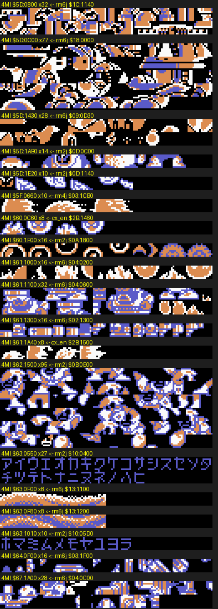
*Every run of ≥ 8 consecutive tiles in `$5C-$67` that also sits consecutively in another ROM (rendered in neutral
colours; label = 4MI address ← source ROM and address). From the top: RM6 Mr. X 4 tiles, RM6 Gamarn & Gamadayu, RM6
rider sprites, RM2 enemy sets, the RM4 run `$5F:0660` (moved vanilla tiles), RM6 sprite sets, RM2 Crash Man (95 tiles),
the RM2 katakana font, RM6 Flame Man oil tiles.*

| 4MI location | Tiles | Source | Where it shows up in 4MI (state that loads it) |
|---|---|---|---|
| `$5D:0C00` | 77 | **RM6** `$18:0000`. This is Yamato Man's dark-room background set, "CHR `$99`" in rm6 stages_b.md | **GAMARN AND GAMADAYU** (fight `$14`), RM6's rider-tank mid-boss, rebuilt as Toad Man's mid-boss. Big parts are background tiles, as in RM6 (`fight_14_toad`) |
| `$5D:11D0-$1430` | 43 | **RM6** `$09:0AD0-$0D30`. This is Yamato's sprite CHR `$61` (rm6 stages_b.md) | the rider and the tank's sprites, same fight |
| `$5D:0800` | 32 | **RM6** `$1C:1140`. This is the Mr. X 4 background set `$C3` (rm6 fortress.md) | Cossack 4 hatch rooms 32-34 (`cossack_c4_s32_hatch`) |
| `$62:1500` | 95 (86 not in RM4) | **RM2** `$0B:0E00` | **CRASHMAN** (fight `$1E`, JP roster "CLASHMAN"), RM2's Crash Man in a red-white palette, in a star room in Drill Man's stage |
| `$63:0550`, `$63:1010` | 37 | **RM2** `$10:0400-$06D0` | **RM2's katakana font** (ア…ヒ, ホ…ヲ). Used by the JP HELP pages (`help_jp0`) |
| `$5D:1AB0-$1E20` | 32 | **RM2** `$0D:0C00-$1140` | CHIMERABOT-2 (fight `$29`): Wood Man's leaf shield [identification by eye: guess] |
| `$60:1F00` | 16 | **RM2** `$0A:1800` | loaded with the Kerog-style frogs of WILY'S NAVY (fight `$11`) and Toad's stage. The big frogs themselves are new drawings: the borrowed-mode ghost greys them out |
| `$61:1000-$13FF` | 64 | **RM6** `$04:0200/0600`, `$02:1300` | sprites in Pharaoh's screens 25-29 (`stages-a/PX_g25..29`) |
| `$67:1A00` + fight `$10` | 28 + 29 | **RM6** `$04:0C00-$0D00` | Wily 1's copter robots (`wily/w1a/s02`) and **WILY'S ARMY**'s Joe in a cannon walker (fight `$10`) |
| `$64:0F00` | 16 | **RM6** `$03:1F00` | Skull's sky screens 13 and 26-28 |
| `$63:0F00/0F80` | 16 | **RM6** `$13:1100/1200`. This is Flame Man's set `$86` (rm6 stages_a.md) | the orange waves of Dive's night-sea screens (`dive_cp1`) |
| `$60:0C60`, `$61:1A40` | 8 + 8 | **Rockman CX** `$2B` only (in neither RM2 nor RM6) | small runs shared with the other big hack in this repo. [guess] A common community source |

*Borrowed-mode ghost frames: only tiles copied from RM2/RM6/CX keep their colour.*

- **GAMARN & GAMADAYU** (top left): the whole frog tank and rider are RM6 tiles.
- **CRASHMAN** (top right): RM2.
- **WILY'S NAVY** (bottom left): the frogs grey out, so they are new art.
- **WILY'S ARMY** (bottom right): the Joe and his walker are RM6 tiles; the white runner is new.

Why this matters here:

- This is the hacking scene's "sprite import": lift a whole enemy set from another NES entry, re-house it in RM4's
  engine, and give it new palettes and AI.
- For Rockman 6 GP the RM6 imports run in reverse: **4MI shows that RM6's own art drops into RM4's engine unchanged**.
- The 2bpp formats are identical. Only the metasprite tables and palettes must be rewritten.

## 4. Edited vanilla graphics banks [code]

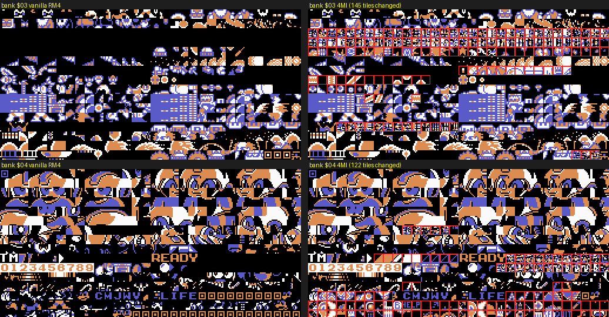
*Left vanilla RM4, right 4MI; changed tiles framed in red.*

- Bank `$03`: the black gaps between Capcom's sets are now full of new tiles.
- Bank `$04`, the common sprite bank (`TM`, digits, `READY`, `CHJWV`, `LIFE`): it gains HUD and icon pieces, for
  example the `HELP` label.

The vanilla graphics banks stay in place, because PBTPS keeps the 64 original banks. **12,082 of their 15,360 slots are
byte-identical to RM4.** The 2,848 changed slots are of three kinds:

1. **Empty slots filled with new tiles.** 692 slots were all-zero in vanilla; the biggest gains are in `$02`, `$03`,
   `$09`, `$11`, `$14`, `$15` and `$1C`.
2. **Code, music or data stuffed into unused tile ranges.** These are the noise blocks in `$06`, `$0B`, `$0D`, `$13`,
   `$1B` and `$1D-$1F`. Engine.md §1.4 found songs and LZ sections in graphics banks; the tile census sees the same
   thing from the other side.
3. **Retouches and mirrors.** About 160 changed tiles are within 24 pixels of the vanilla tile (`retouch.py`). 54 of
   them are Skull Man's bone tiles in bank `$17`, mirrored by the patcher's `revbit` op (DECONSTRUCTION §2.2). The
   rest are scattered single-tile touch-ups.

More pictures (scratch, not in the gallery): `vdiff_a.png` (`$02 $03 $04 $06 $09`), `vdiff_b.png`
(`$0B $0D $11 $13 $15`) and `vdiff_c.png` (`$07 $08 $14 $1B $1C $1D`).

## 5. The new banks `$5C-$67`, colourised from live play [code + seen]

`chrcov.py` saw **15,693 distinct ROM tiles** in CHR-RAM across the 1,398 states. Painting each ROM tile in the palette
it was most often drawn with gives a colour atlas of the new banks:

- **colour**: seen on screen in that palette;
- **grey**: loaded into CHR-RAM but not on screen at the sampled frame (mostly sprite frames that were not showing);
- **dark blue**: no state loaded it.

*Banks `$5C-$61`, bank by bank:*

- *`$5C`: the Cossack 4 dome and hatch sets, the Wily 1 boss, the Cossack 4 Killer rooms.*
- *`$5D`: Gamarn & Gamadayu (RM6) and the chimera sets.*
- *`$5E`: Wily 4's underground caves and the capsule room.*
- *`$5F`: the ending train and staff-roll pieces, the menu medals, the COCKROACH OMEGA status labels (bottom row).*
- *`$60`: Toad (green frogs), Dust, and a 0-9 digit set.*
- *`$61`: Pharaoh's curse labels (REVERSE … FETTER) and the RM6 imports.*

*Banks `$62-$67`:*

- *`$62`: Crash Man (RM2) and the yellow arena strip.*
- *`$63`: the katakana font (RM2) and the orange Dive sea.*
- *`$64`: a gold/teal machine set and the `WPN` label.*
- *`$65`: the red T-rex **KING GOJULUS**, drawn as background tiles (the big red block).*
- *`$66`: small enemies.*
- *`$67`: the green Wily 1 machine background.*

Coverage of the new banks by the state corpus:

| Bank | Tiles loaded | Tiles on screen |
|---|---|---|
| `$5C` | 374 | 87 |
| `$5D` | 461 | 258 |
| `$5E` | 478 | 279 |
| `$5F` | 332 | 112 |
| `$60` | 429 | 265 |
| `$61` | 408 | 319 |
| `$62` | 426 | 144 |
| `$63` | 401 | 155 |
| `$64` | 454 | 227 |
| `$65` | 483 | 385 |
| `$66` | 437 | 330 |
| `$67` | 503 | 337 |

So **about 85 % of the new art was seen loaded in at least one state**. The 860 tiles never loaded form 50 runs (25 of
them ≥ 12 tiles; `unseen.py`). They are mostly enemy frames and background pieces of rooms the agents did not save,
plus the half of the status-label sheet described in §7.

## 6. Art in context: stages, set pieces, bosses [seen]

### 6.1 How much of each screen is new

`ghostbatch.py` counts the distinct tiles in the two nametables (BG) and in OAM (sprites) that are not vanilla RM4
tiles.

| State | New BG tiles | Notes |
|---|---|---|
| title | 20 % (41 of 204) | the logo is vanilla; "Minus ∞", the new menu letters and "2008-2016" are new |
| 8 Robot Master stages, cp0-cp2 | **0-21 %**; typically 0 | Bright cp0/1 9 tiles, Toad 15-16, Pharaoh cp1 23, Skull cp2 8 (blue chevrons) |
| `dive_cp1` (night sea) | **80 %** | RM6 oil tiles and new starbursts |
| `cossack_c1_sky_whales` (blizzard sky) | **98 %** | the whole sky shoot-'em-up set is new |
| `cossack3_cp0` | 85 % | new pipes and fill tiles |
| `wily4_underground_s12` | **78 %** | red caverns with a purple crystal lattice (bank `$5E`) |
| Wily 1 screen 30 (`wily/w1n4/s30`) | 45 % | new machine hall; 49 new sprite tiles (copter robots) |
| stage select, EXTRA CONFIG, the ending train, the debrief | 0 % | Capcom's tiles, new layouts |
| SPECIAL MODE menu | 55 %; 25 new sprite tiles | the medals and the "True" overlay |

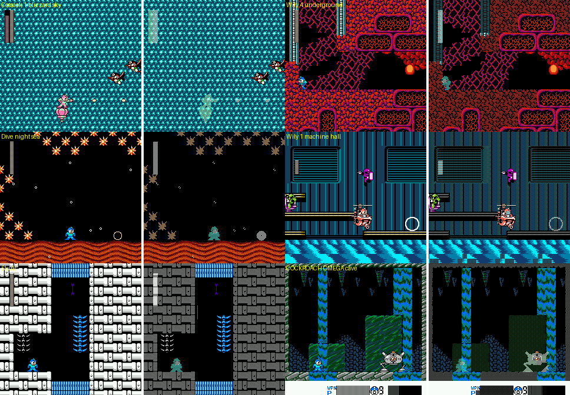
*Ghost pairs (left as played, right with every vanilla RM4 tile dithered away). Top: Cossack 1's blizzard sky (98 % new,
including the fighter planes) and Wily 4's underground caverns. Middle: Dive's night sea (orange waves = RM6 Flame Man
oil tiles, new starbursts) and the Wily 1 machine hall with its copter robots. Bottom: Skull's tunnels (vanilla bone
walls; the blue chevrons are new) and the green waterfall cave of COCKROACH OMEGA.*

**Reading:** 4MI's level design mostly re-arranges Capcom's tiles. The pixel art budget went into:

- one-off set pieces (the blizzard sky, the night sea, the underground caves, the teal hall);
- the bosses and mid-bosses (§6.2);
- the menus (§7).

### 6.2 Bosses and mid-bosses

Sprite census of the 45 MY ARENA fights. The counts are distinct sprite tiles seen in 480 frames, and include about 20
vanilla tiles for Rockman and the HUD.

| Fights | Sprite art |
|---|---|
| `$00-$07`, the 8 Robot Masters | **100 % vanilla sprites** (80-141 tiles each) |
| `$08`, `$09`, `$0E` (fortress bosses MOTHRAYA, SQUARE MACHINE, W.MACHINE 4) | vanilla |
| `$0A` AQUA DEVIL (Cossack 3) | 29 new: a white giant made of blocks |
| `$0C` JOE NI-NIN VA ALL (Wily 1) | 52 new: a green jet-pack Joe |
| `$0D` SNATCHMAN (Wily 2) | 14 new over the whole fight. In the sampled frame, all 34 sprites on screen, the figure included, are **vanilla tiles: Rockman's own sprite in a black-and-white outline palette** |
| `$10-$12` WILY'S ARMY / NAVY / AIRFORCE | 57 + 22 RM6 / 34 + 11 RM2 / 70 + 3 RM2 |
| `$13` GREEN HELMET, `$16` KABATONCUE, `$17` WHOPPER, `$18` RONG RANG RUNG, `$1B` ESCAROO, `$1C` MOBY | vanilla sprites only: vanilla RM4 enemies promoted to arena fights |
| `$14` GAMARN & GAMADAYU | 50 RM6 + 21 new |
| `$19` HOGALE, `$1A` KING GOJULUS | 62 / 26 new sprite tiles, but the bodies are **background** art (below) |
| `$1E` CRASHMAN | 86 RM2 |
| `$1F` WAVEMAN | 100 new [guess: possibly ripped from RM5] |
| `$20-$22`, `$2B` SHADOWMAN B / P / PAKKUN SHADOW / SUPER SHADOWMAN | 61 / 58 / 27 / 88 new |
| `$23-$27` ENKER, QUINT, PUNK, BALLADE, TERRA | 72-83 new each (the Game Boy Mega Man Killers and a Stardroid) |
| `$28-$2A` CHIMERABOT-1/2/3 | 44 new / 41 RM2 + 33 new / 88 new, plus the hall's 128 BG tiles from code bank `$4F` |
| `$2C` COCKROACH OMEGA | 25 new plus vanilla parts; status-label sheet (§7) |

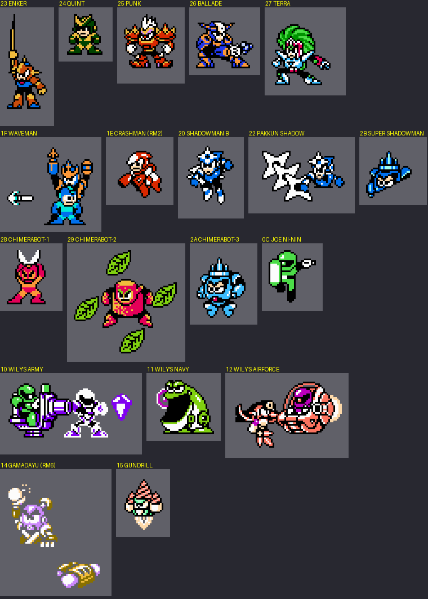
*Sprite rips (3×) of the biggest cluster of non-vanilla sprites in each fight, drawn from OAM with the live palettes.*

- *Row 1: the Game Boy Mega Man Killers ENKER (spear), QUINT (with his Sakugarne pogo beside him), PUNK, BALLADE, and
  TERRA.*
- *Row 2: WAVEMAN (Rockman overlaps him in this frame), CRASHMAN (RM2 tiles), SHADOWMAN B, PAKKUN SHADOW with his
  shuriken, SUPER SHADOWMAN.*
- *Row 3: the three CHIMERABOTs (a horned red body with sparks, a red body with Wood Man's leaves, a spiked blue body),
  and Wily 1's jet-pack Joe.*
- *Row 4: WILY'S ARMY (an RM6 Joe in a cannon walker, a white crystal-carrying runner), NAVY (a new big frog), AIRFORCE
  (birds carrying an egg pod).*
- *Last row: GAMADAYU's rider (RM6) and GUNDRILL.*

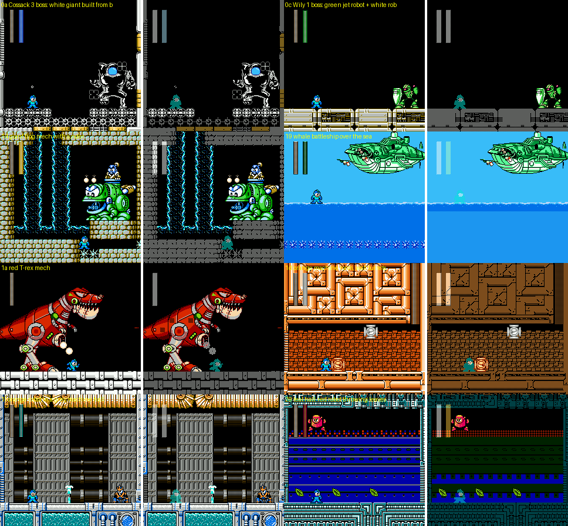
*Ghost pairs of eight fights.*

- *AQUA DEVIL is new block art.*
- *JOE NI-NIN: new Joe, vanilla room.*
- *GAMARN & GAMADAYU is new to RM4 (it is RM6 art).*
- ***HOGALE**, the whale battleship, is new, and so are its sky and sea.*
- ***KING GOJULUS**, the T-rex, is about 150×150 px of new background tiles in bank `$65`, so no sprite budget is
  needed for its body. Its nametable holds 352 cells of new tiles. The camera scroll `$FC` stayed at 0 for the whole
  400-frame sample, so how the body moves (a raster split, or nametable rewrites) was not traced.*
- *NIGHTMARE SUZIES: new eye discs in a vanilla room.*
- *WAVEMAN brings his own new grey machine hall.*
- *CHIMERABOT-2 stands in the teal hall, whose tiles come from code bank `$4F`.*

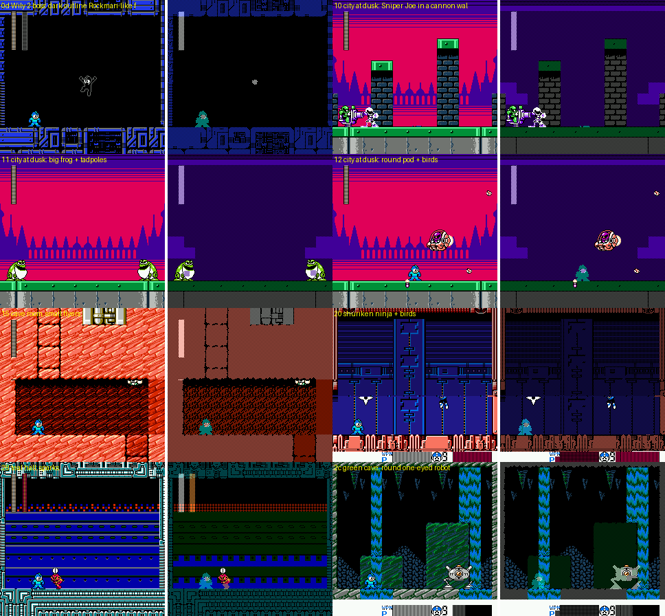
*New-looking scenes made from old tiles.*

- *SNATCHMAN is vanilla Rockman tiles in an outline palette.*
- *The WILY'S ARMY / NAVY city at dusk is vanilla skyline tiles under a magenta-purple palette; only the enemies are new.*
- *GUNDRILL's cave is vanilla.*
- *SHADOWMAN B fights in a vanilla Bright room.*
- *CHIMERABOT-1's hall is partly vanilla.*
- *COCKROACH OMEGA's pod is mostly vanilla tiles in a new waterfall cave.*

### 6.3 New regular enemies

`enemyrips.py` scanned every non-arena state of every agent for clusters of ≥ 4 non-vanilla sprites. It found 685
clusters, 174 of them distinct by tile set (shared tiles < 30 %). A curated selection:

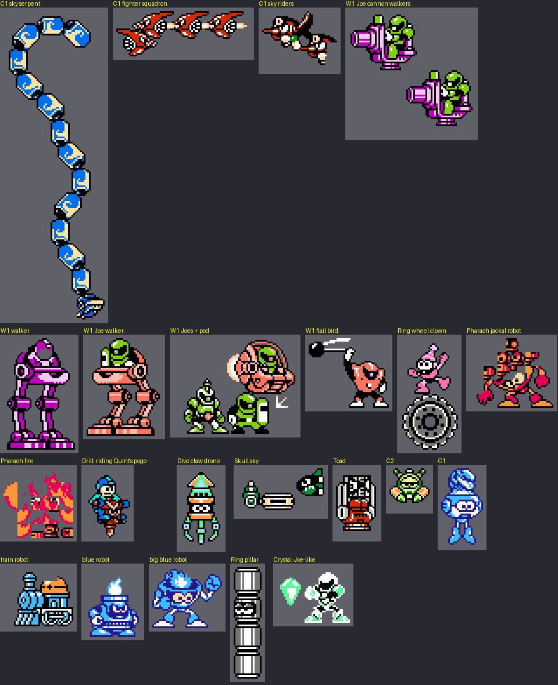
*Sprite rips (3×), labelled by where the state was saved. Cossack-agent states under `r4mi-cossack/ex/` are named
R1/F1 there.*

- *Cossack 1's sky shoot-'em-up: a **sky serpent** of 14 segments, a fighter squadron, and riders on red planes.*
- *Wily 1: Joes in cannon walkers and legged walkers, a Joe pod, and a ball-and-chain bird.*
- *Ring: a robot riding a wheel, and a stacked pillar.*
- *Pharaoh: the jackal robot and a fire spirit.*
- *Drill: Rockman riding Quint's Sakugarne pogo, a new player sprite set.*
- *Dive: a claw drone.*
- *Skull's sky: a fish-bird.*
- *Toad: a caged robot.*
- *Cossack 2: a frog-like crawler.*
- *Cossack 1: the snow robot.*
- *Cossack runs: a train robot, a blue furnace robot, a big blue robot.*
- *Wily 3: a white Joe carrying a green crystal.*

*None of these sprite sets are in vanilla RM4. Together with §6.2, 4MI adds **dozens of new sprite characters**:
the 174 distinct clusters include animation frames and parts, so they are not a character count.*

## 7. HUD, status labels, criticals, menus [seen]

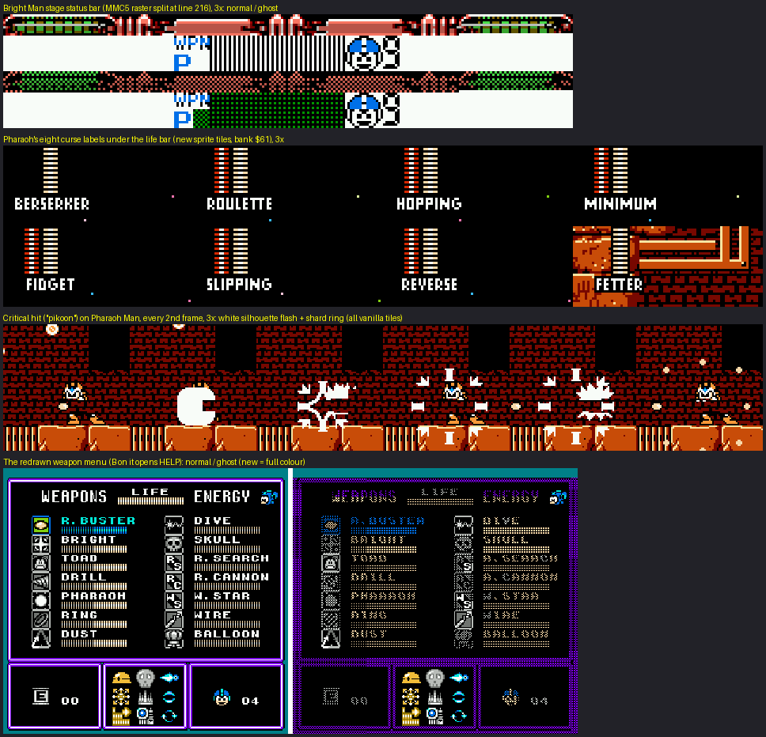
*From top:*

- *(1) **Bright Man's stage status bar** (3×, normal and ghost). It is drawn in the bottom rows of the second nametable
  and shown below line 216 by the MMC5 raster list (engine.md §4.3). Contents: the new `WPN` label and weapon letter, a
  gauge built from vanilla bar tiles, and Rockman's face with the lives digit.*
- *(2) **Pharaoh's eight curse labels**: BERSERKER, ROULETTE, HOPPING, MINIMUM / FIDGET, SLIPPING, REVERSE, FETTER. Each
  is a 4-tile (32-px) sprite word in a condensed hand-drawn font, shown under the life bar. Only the active label is
  uploaded: each room streams its 4 tiles from `$61:0C00-$0DFF`.*
- *(3) **A critical hit** ("pikoon"), forced with the ?DAGGER equipment bit `$80`, every second frame: Pharaoh Man is
  drawn as a **solid white silhouette**, then a ring of white shards flies out. Every tile involved is a vanilla RM4
  tile, so the effect costs no new art.*
- *(4) **The redrawn weapon menu**. It is a new layout:*
  - *WEAPONS / LIFE / ENERGY header and two columns of 7 weapons.*
  - *Three bottom panels: E-tanks, a 3×3 grid of equipment icons, lives.*
  - *It is built mostly from vanilla pause-menu tiles. New: some weapon icons (●TOAD's frog face, ●DUST, the R.S / W.S
    letter icons, the Wire hook) and the nine equipment sprites.*
  - *B on this menu opens HELP. HELP pages are almost entirely vanilla font and frame tiles, plus a 2×2 icon.*

*The hidden final fight `$2C`, "???" in the roster.*

- *Over about 2,400 frames of a godmode autoplayer, the status bar along the bottom fills with ailment labels:
  PETRIFY, PARALYZE, SILENCE, DARKNESS, SAP.*
- *DARKNESS dims the background palette step by step, until only sprites are visible.*
- *Rockman's palette turns red and white (one of the ailments) [guess].*
- *The run then ended back at the SPECIAL MODE menu even though HP was frozen. So some ailment kills, or the fight
  has a time limit, independently of HP [guess].*
- *Savestate: `build/research/r4mi/states/graphics_omega_status.state` (5 labels up).*

The status-label sheet in ROM [code]:

- Contents: `STONE PETRIFY PARALYZE CONFUSE SI` (`$5F:1F00`, white on black) and `LENCE DARKNESS SLIP SAP`
  (`$5E:1000`). That is 8 ailments, split across two banks by the packer.
- STONE, CONFUSE and SLIP were not seen on screen in the runs.
- Pharaoh's curses are a separate sheet (`$61:0C00-$0DFF`). On screen they are bare white words; the OMEGA labels
  sit in dark boxes.

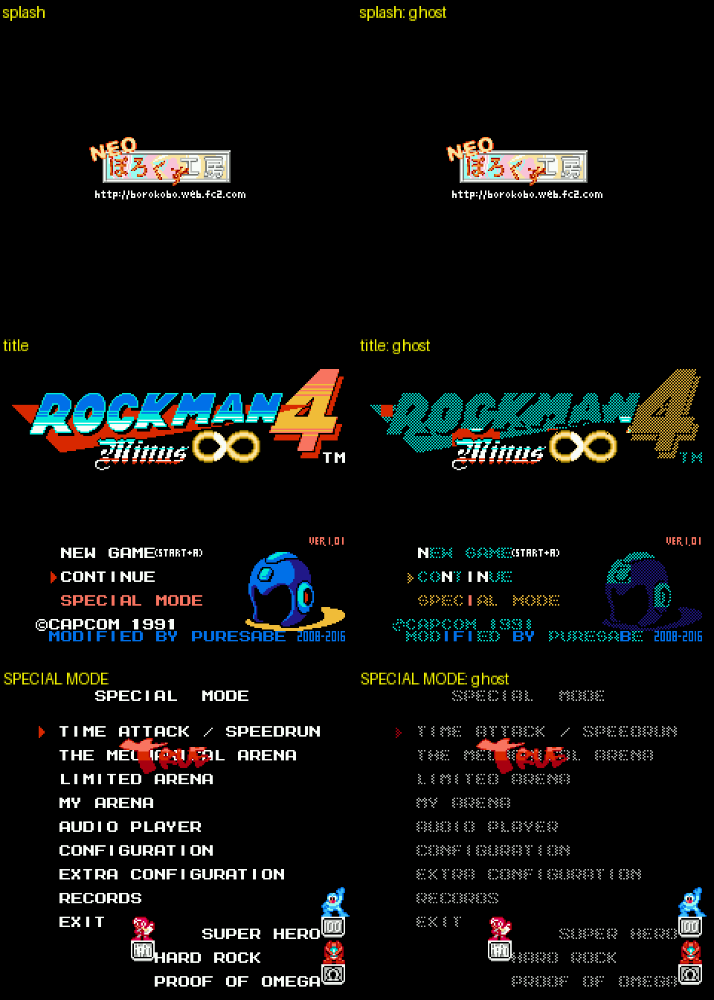
*Normal and ghost frames for the boot splash, the title and the SPECIAL MODE menu.*

- *Splash: after `CAPCOM PRESENTS` comes the **"NEO ぼろくず工房"** logo with `http://borokobo.web.fc2.com`, all new
  tiles. The vanilla intro (AD 200X, the city fading from day to dusk) follows unchanged.*
- *Title: the ROCKMAN 4 logo and Rockman's helmet are vanilla; "Minus ∞" (orange script with an infinity sign), the
  helmet's yellow swoosh, `VER.1.01`, `(START+A)` and `2008-2016` are new.*
- ***The menu text uses vanilla letters where they exist and adds only the missing ones.** In the ghost, N and I of
  NEW GAME / CONTINUE / SPECIAL MODE, and I, F, B of MODIFIED BY PURESABE, stay coloured: the vanilla title set
  lacked them.*
- *SPECIAL MODE: the menu font is vanilla. New:*
  - *A red hand-drawn **"True"** sprite is pasted over "THE MECHANICAL ARENA", so the same menu line reads "THE TRUE
    ARENA" once it is unlocked.*
  - *The three achievement medals: SUPER HERO is Rockman over a "100" plate, HARD ROCK a red Rockman over a "HARD"
    plate, PROOF OF OMEGA a red pod over a plate.*

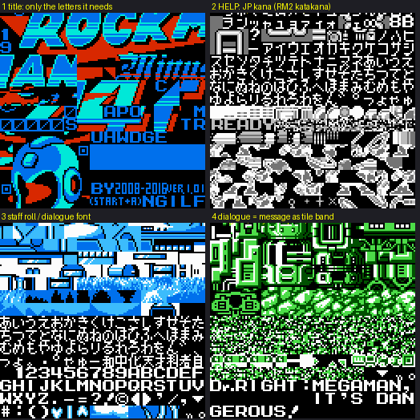
*Live CHR halves, each drawn in its own scene's palette.*

- *(1) The title's BG table: only the letters the title needs (`UAWDGE`, `APO`, `M`, `TR`, `NGILF`), packed between
  the logo tiles.*
- *(2) HELP's sprite table: the Japanese kana. Katakana rows are RM2's font; the hiragana is new.*
- *(3) The staff-roll / dialogue font: hiragana, katakana, 12 kanji (工学用平和中化天才科者自), A-Z and digits.*
- *(4) Wily 3's stage CHR during script 11. The bottom rows are not a font but the **message itself**:
  `DR.RIGHT:MEGAMAN,` / `IT'S DAN|GEROUS!`. The nametable row shows tiles `$D0, $D1 … $E7` in order. The dialogue
  engine (text.md §1) fetches each glyph from PRG banks `$24/$25/$63/$5F` and writes it into the next tile of a fixed
  canvas, so story scenes run inside any stage without a resident font.*

Text encodings and per-screen tables are in text.md §1; this section only covers where the glyph art lives.

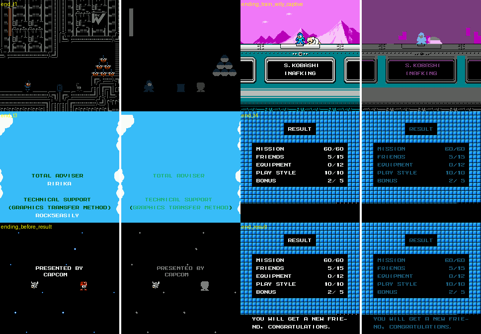
*Ending, normal and ghost.*

- *The fortress collapse, the train credits (`S.KOBASHI / INAFKING`) and the staff-roll sky are vanilla art.*
- *The RESULT screen (MISSION 60/60, FRIENDS 5/15, …) is vanilla blue grid tiles and the vanilla font, with a few new
  glyphs.*
- *Under "PRESENTED BY CAPCOM" walks a new red sprite next to a vanilla one.*
- *The ending was not where the art went.*

## 8. Style and techniques

**Style** [seen, judgment]:

- New art is drawn **in Capcom's RM4 house style**: thick black outlines, 3-colour sprite palettes with a
  light-colour highlight, and chunky 16-px metatiles. At a glance a new boss such as KING GOJULUS, HOGALE or AQUA DEVIL
  cannot be told apart from official art.
- **Imports are re-palettised to blend in**: Crash Man in red and white, RM6's frog tank in RM4's green.
- **Palette is used as a storytelling tool**:
  - the city at dusk;
  - DARKNESS fading the cave;
  - the Cossack 3 water done by PPUMASK emphasis (engine.md);
  - SNATCHMAN as a black-outline Rockman;
  - the critical-hit white flash.
- The menus and HUD are information-dense, clean and functional: the weapon menu's three panels, the HELP pages and
  the curse labels. They look like a modern indie Mega Man fangame rather than 1991.

**Techniques** [code + seen]:

1. **Big bosses as background art.**
   - KING GOJULUS, HOGALE, GAMADAYU's tank and AQUA DEVIL are nametable art. After 400 frames of the fight, the
     nametables hold 352 / 143 / 258 / 136 cells of new tiles, with small sprite parts for eyes, guns and riders.
   - Vanilla RM4 already drew its Wily Machine as background art.
   - It sidesteps the 64-sprite / 8-per-line limit and lets one boss be 150 px tall.
2. **Every tile set is just a list of pages.**
   - The CHR upload lists (engine.md §8) take `[bank, rows, source page, PPU page]`.
   - So a scene can mix vanilla pages, new pages, RM6 pages and even pages from a code bank (`$4F`).
   - Rooms stream sprite pages while you play; Pharaoh's curse labels arrive 4 tiles at a time.
3. **Fill every gap.** New tiles go into black gaps of vanilla banks, and code and music go into unused tile ranges.
   Sheets split at page boundaries are padded with R-box marker tiles.
4. **Minimal glyph sets per screen.** The title adds only the letters it lacks. Dialogue writes each message into a
   48-tile canvas. Each screen family has its own font page (text.md lists six encodings).
5. **Effects from palette and PPU registers instead of tiles**: the crit flash, DARKNESS, the dusk city, water
   emphasis, and the Bright status bar raster split (engine.md §4).

## 9. Savestates added

| State | What |
|---|---|
| `build/research/r4mi/states/graphics_omega_status.state` | COCKROACH OMEGA (fight `$2C`) 2,400 frames in, five ailment labels in the status bar, godmode applied when made |
| `build/research/r4mi/r4mi-graphics/omega_6000.state` | the same fight 6,000 frames into a godmode run (before the labels) |
| `build/research/r4mi/r4mi-graphics/splash.state` | power-on + 250 frames: the NEO ぼろくず工房 splash |

Data products: `chrcov.pkl` (the tile → states / palettes index for all 1,398 states) and `fights/census.json` (the
per-fight sprite census). Both are in the scratch dir.

## 10. Open questions

- **COCKROACH OMEGA's ailments**:
  - What does each one do mechanically (SAP drains? SILENCE locks weapons?)?
  - Where is the ailment state in RAM?
  - Why did the godmode run end, with HP frozen?
  - STONE, CONFUSE and SLIP were not observed.
- **Sources outside this repo.** Which of the 5,266 "new" tiles are ripped from RM3, RM5 or the Game Boy games
  (WAVEMAN, the Killers, TERRA, the Shadow Man sprites)? This needs those ROMs; for the Game Boy, a GB→NES 2bpp plane
  conversion first.
- **The RM6 sprite banks** `$02-$04` that 4MI imports for Pharaoh, Wily 1 and WILY'S ARMY are not yet named in the rm6
  docs. Which RM6 enemies are they?
- **The 860 never-loaded tiles.** Are they in unvisited rooms, or unused?
- **How the background-drawn bosses move.** KING GOJULUS and HOGALE: is it a raster split, or nametable rewrites?
  `$FC` stayed at 0 during the sample.

## Lessons for Rockman 6 GP

1. **Measure novelty, don't eyeball it.** Classify tiles against the base ROM, then ghost the vanilla tiles in a live
   frame (`ghost.py`, which works on any FCEUX state). Run this on our own builds: it tells reviewers exactly what is
   new on every screen and catches accidental edits to Capcom's art.
2. **Spend new pixels on bosses and set pieces; build stages from the existing sets.** 4MI's stages are 0-20 % new
   tiles and still feel new, because the layouts, palettes and enemies changed. The memorable art is the T-rex, the
   whale battleship, the blizzard sky and the Killers.
3. **RM6 art is portable.** 4MI drops RM6's Gamarn & Gamadayu, Mr. X tiles and RM6 enemies into RM4 byte for byte. In
   reverse, RM4, RM2 and 4MI-style art can be imported into RM6 as long as the importer rewrites metasprites and
   palettes. Keep a provenance table like §3 for every imported set (credits, and avoiding duplicates).
4. **Never overwrite vanilla tiles in place unless the asset is truly retired.** 4MI fills gaps and adds banks, so every
   vanilla room still works. Build a tile allocator that knows the free slots, with visible filler tiles (4MI's R-box)
   so that empty slots are easy to spot in a tile editor.
5. **Big bosses as BG art plus a few sprite parts** is still the best answer to the NES sprite limits. Plan the CHR page
   and nametable budget for one such boss per stage.
6. **Status labels and HUD words are cheap and readable.** A 4-tile condensed word under the life bar (Pharaoh's
   curses) or in a status bar (OMEGA's ailments) explains a mechanic without any dialogue. Stream only the active label.
7. **A per-message tile canvas beats a resident font** when CHR is full: dialogue can appear in any stage for 48 tiles.
8. **Palette tricks double the content**: a dusk palette over an existing skyline, a black-outline Rockman as a boss,
   and a white silhouette for a critical hit.
