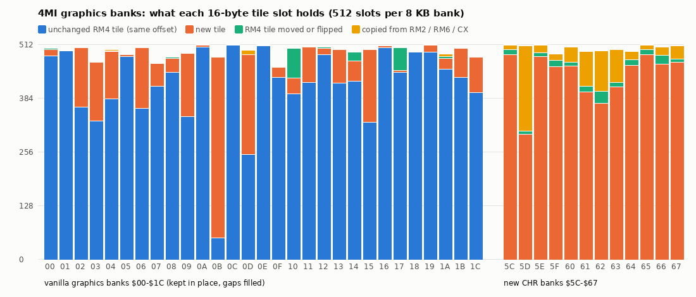
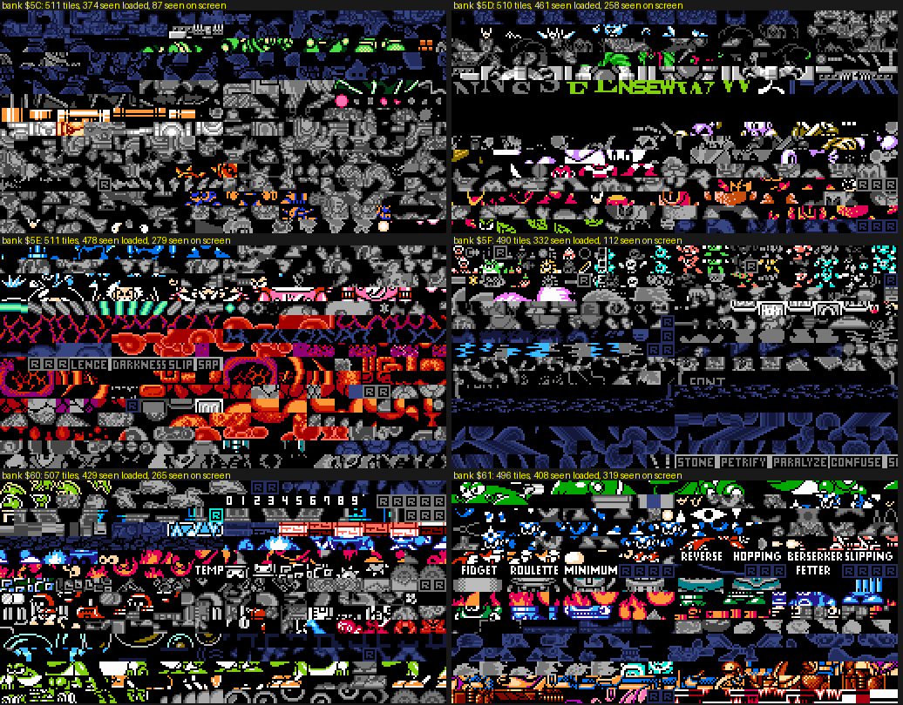
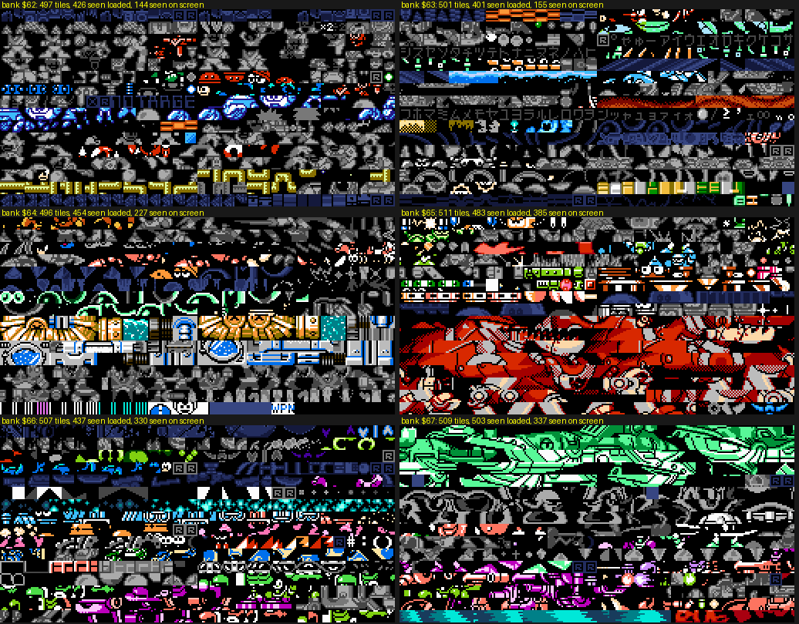

# 4MI graphics survey (r4mi-graphics)

Status: DRAFT 1 (sections 1-4 written; context gallery, HUD, fonts, title/ending and style sections in progress).

Scope: what art *Rockman 4 Minus Infinity* v1.01 (`roms/r4mi_mmc5.nes`) adds or changes compared with vanilla
Rockman 4 (`roms/rm4j.nes`): the new CHR banks `$5C-$67`, edits to the vanilla graphics banks, art borrowed from other
Mega Man games, and the art seen in context (stages, bosses, menus, HUD, title, ending). Tags: **[seen]** emulator,
**[code]** ROM data / tile matching, **[text]** in-game text, **[doc]** readme, **[guess]**.

Scripts (all in `build/research/r4mi/r4mi-graphics/`, run from the repo root with `python3 -I`):

| Script | What it does |
|---|---|
| `novelty.py census` / `novelty.py sheet` | Classifies every 16-byte tile slot of every bank: **E** empty, **S** unchanged RM4 tile at the same offset, **V** RM4 tile found at another offset, **F** RM4 tile flipped, **O** tile found in another game (`rm6j`, `rm2j`, `cx_en`), **N** new |
| `runs.py lo hi [min]` | Runs of ≥ min consecutive tiles that also appear consecutively in another ROM (proves a copy, not a coincidence) |
| `chrcov.py` | **CHR-RAM coverage census**: loads every one of the **1,398 savestates** the r4mi agents left under `build/research/r4mi/`, maps each 256-byte CHR-RAM page back to its ROM source, and records which palette each tile is drawn with. Output `chrcov.pkl` |
| `atlas.py lo hi` | Per 256-byte ROM chunk: how many states loaded it, which ones (the identification index) |
| `colatlas.py out lo hi` | The "colourised atlas": ROM banks drawn tile by tile in the palette the game actually used for that tile |
| `ghost.py`, `ghostbatch.py` | **"Ghost" frames**: rewrites the CHR-RAM chunk inside a savestate so that every tile identical to a vanilla RM4 tile becomes a dithered silhouette, then lets the emulator render one frame. New art stays in full colour, in context. Also counts new vs vanilla tiles on screen |
| `fightsprites.py`, `newsprites.py` | For all 45 MY ARENA fights (scout's `fight_XX` states): sprite-tile census (vanilla / borrowed / new) and crops of the non-vanilla sprites |
| `vdiff.py`, `retouch.py` | Vanilla vs 4MI for the graphics banks edited in place |
| `censuschart.py` | The census bar chart below |

## 1. Tile census: how much art is new [code]

*Every tile slot of the vanilla graphics banks `$00-$1C` and of the new CHR banks `$5C-$67`, by origin. Banks `$0B`
and `$0D` were already data (not art) in vanilla RM4, so their "new" share is data too.*

| Banks | Unchanged RM4 | RM4 tile moved / flipped | Copied from RM2 / RM6 / CX | New | Empty |
|---|---|---|---|---|---|
| `$00-$1C` (vanilla graphics, 29 banks) | 12,082 | 99 + 65 | 25 | 2,138 (part of it code/music, see §3) | 439 |
| `$5C-$67` (new CHR, 12 banks) | — | 101 + 59 | **620** (RM6 338, RM2 246, CX-only 36) | **5,266** | 98 |

- The new CHR banks hold **6,144 slots, of which 5,266 are tiles that exist in no vanilla RM4, RM2, RM6 or CX ROM**.
  That is 84 KB of new tiles, a third of the size of vanilla RM4's 29 graphics banks (232 KB). Some of it may be ripped
  from games not in this repo (RM3, RM5, the Game Boy titles): **[guess]**, we have no ROM to check against.
- Banks `$5C-$67` are almost pure graphics: only 98 empty slots in 12 banks. Unlike vanilla, there is **no padding at all**
  between sets; a boss's tiles are followed directly by a tileset or a menu font.
- Tiles also live outside the graphics banks. The CHR coverage census (§4) finds 2 KB tile blocks in the vanilla stage
  banks (`$22-$2F`, vanilla already did this) and in **old code banks**: `$31` holds 122 new Wily 3 background tiles,
  `$33` 16 more, and **code bank `$4F:$8000-$87FF` holds 128 new tiles** for the Wily 4 teal hall (fights `$28-$2B`)
  [code + seen].

## 2. Borrowed art: RM6 and RM2 verbatim [code + seen]

`runs.py` finds 36 runs of 4 to 95 consecutive tiles in `$5C-$67` that also sit consecutively in another Capcom ROM,
all of them tiles that vanilla RM4 does not have. These are copies, not coincidences:

| 4MI location | Tiles | Source | What it is in 4MI (state that loads it) |
|---|---|---|---|
| `$5D:0C00` | 77 | **RM6** bank `$18:0000` (Yamato Man's dark-room BG set, rm6 stages_b.md "CHR `$99`") | **GAMARN AND GAMADAYU** (roster name, fight `$14`): RM6's frog-tank mid-boss with its rider, rebuilt as Toad Man's mid-boss (`fight_14_toad`) |
| `$5D:11D0-$1430` | 4+5+6+28 | **RM6** bank `$09:0AD0-$0D30` (Yamato's "sprite CHR `$61`", the rider tank's sprites) | the same fight's sprites |
| `$5D:0800` | 32 | **RM6** bank `$1C:1140` | Cossack 4 hatch rooms (`cossack_c4_s32_hatch`) |
| `$62:1500` | 95 | **RM2** bank `$0B:0E00` | **CRASHMAN** (fight `$1E`, roster "CLASHMAN"/"CRASHMAN"): RM2's Crash Man sprite set, 86 tiles verbatim, recoloured red-white (`fight_1e_drill`) |
| `$63:0550`, `$63:1010` | 27 + 10 | **RM2** bank `$10:0400` | **RM2's katakana font** (ア-ヒ, ホ-ヲ…), used by the JP HELP pages and dialogue (`help_jp0`) |
| `$60:1F00`, `$5D:1AB0-$1E20` | 16, 14+4+4+10 | **RM2** banks `$0A:1800`, `$0D:0C00-$1140` | RM2 stage enemies: the **Kerog** frogs of WILY'S NAVY (fight `$11`, also Toad stage), Wood Man's leaves on CHIMERABOT-2 (fight `$29`) [identification by eye: guess] |
| `$61:1000-$13FF` | 16+32+16 | **RM6** banks `$04:0200/0600`, `$02:1300` | sprites in Pharaoh's screens 25-29 (`stages-a/PX_g25..29`) |
| `$67:1A00` | 28 | **RM6** bank `$04:0C00` | Wily 1 sprites (copter enemies, `wily/w1a/s02`) |
| `$64:0F00` | 16 | **RM6** bank `$03:1F00` | Skull's sky screens 13, 26-28 |
| `$63:0F00/0F80` | 8 + 8 | **RM6** bank `$13:1100/1200` (Flame Man's stage set, CHR `$86`) | the orange wave floor of Dive's night-sea screens (`dive_cp1`) |
| `$60:0C60`, `$61:1A40` | 8 + 8 | **Rockman CX** bank `$2B` only | small runs shared with the other big hack in this repo; [guess] a common community source |

So 4MI does what the Mega Man hacking scene calls a "sprite import": it lifts **whole enemy sets** from other NES
entries (RM6's Gamarn & Gamadayu, RM2's Crash Man, Kerog and Pipi-style birds) and re-houses them in RM4's engine with
new palettes. For this project the RM6 import is directly relevant: the same tiles are in our base ROM.

## 3. Edited vanilla graphics banks [code]

The vanilla graphics banks stay in place (PBTPS keeps the 64 original banks) and **12,082 of their 15,360 tile slots are
byte-identical** to RM4. The 2,848 changed slots are of three kinds:

1. **Empty slots filled with new tiles** (692 slots were all-zero in vanilla). Banks `$02`, `$03`, `$09`, `$11`, `$14`,
   `$15` and `$1C` had black gaps between sets; 4MI packs new tiles into exactly those gaps. Bank `$04` (the common
   sprite bank with `TM`, the digits, `READY`, `LIFE`) gains HUD pieces, for example a `HELP` label.
2. **Code, music or data stuffed into unused tile ranges** (the noise blocks in `$06`, `$0B`, `$0D`, `$13`, `$1B`,
   `$1D-$1F`). Engine.md §1.4 found songs and LZ stage sections in graphics banks; the tile census sees the same thing
   from the other side.
3. **Retouches and mirrors.** Only about 160 changed tiles are within 24 pixels of the vanilla tile (`retouch.py`), and
   54 of them are Skull Man's bone tiles in bank `$17`, mirrored by the patcher's `revbit` op (engine.md / §2.2 of the
   deconstruction). The rest are scattered single-tile touch-ups.

Pictures: `build/research/r4mi/r4mi-graphics/vdiff_a.png` (`$02 $03 $04 $06 $09`), `vdiff_b.png` (`$0B $0D $11 $13 $15`),
`vdiff_c.png` (`$07 $08 $14 $1B $1C $1D`), changed tiles framed in red (scratch only, not in the gallery).

**Style note:** the author almost never overwrote Capcom's art. New content goes into new banks or into gaps, so every
vanilla set still loads as before and RM4's own enemies keep working in rooms the hack did not touch.

## 4. The new banks `$5C-$67`, colourised from live play [code + seen]

`chrcov.py` ran all 1,398 savestates (every agent's scratch states plus the shared `states/`): 15,693 distinct ROM tiles
were seen in CHR-RAM. Painting each ROM tile in the palette it was most often drawn with gives a colour atlas of the
new banks. Colour = seen on screen in that palette; grey = loaded into CHR-RAM but not on screen at the sampled frame;
dark blue = never loaded by any state.

*Banks `$5C-$61`. Top left `$5C`: Cossack 4 dome and Wily 1 boss sets; `$5D`: Gamarn & Gamadayu (RM6) and the Wily 4
chimera sets; `$5E`: the Wily 4 underground and capsule; `$5F`: ending, staff roll and the train, then the unused curse
words; `$60`: Toad (green frogs), Dust, the 0-9 digits; `$61`: Pharaoh's curse labels (REVERSE … FETTER) and RM6
imports.*

*Banks `$62-$67`. `$62`: Crash Man (RM2), the yellow arena-name strip; `$63`: katakana font (RM2), the orange
Dive sea; `$64`: a gold/teal machine tileset and the `WPN` label; `$65`: the red T-rex KING GOJULUS (drawn as background
tiles); `$66`: small enemies; `$67`: the green Wily 1 machine background.*

Coverage of the new banks by the state corpus (tiles loaded / on screen): `$5C` 374/87, `$5D` 461/258, `$5E`
478/279, `$5F` 332/112, `$60` 429/265, `$61` 408/319, `$62` 426/144, `$63` 401/155, `$64` 454/227, `$65` 483/385,
`$66` 437/330, `$67` 503/337. So **about 85 % of the new art was seen loaded in some state**.

(More sections follow: art in context, bosses, HUD, fonts, title/ending, unused art, style.)

## Lessons for Rockman 6 GP
(pending)
