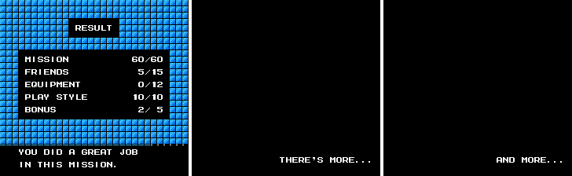
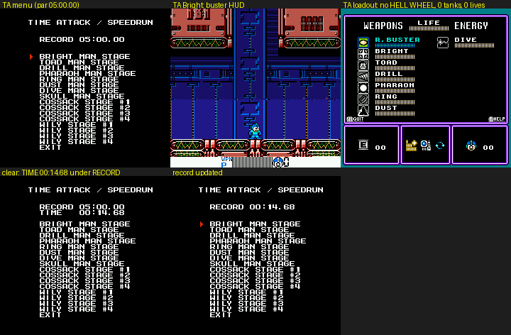
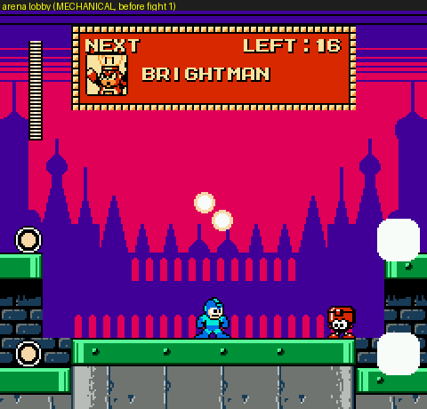
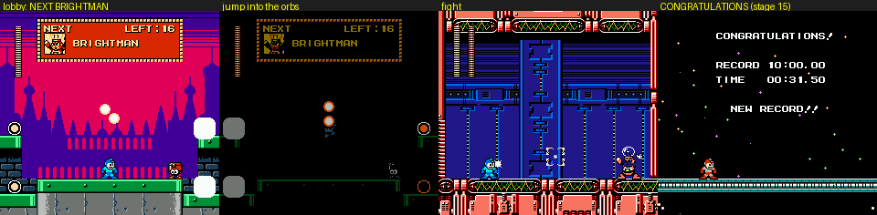
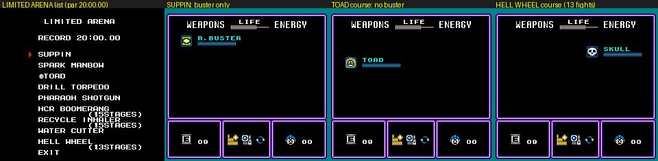
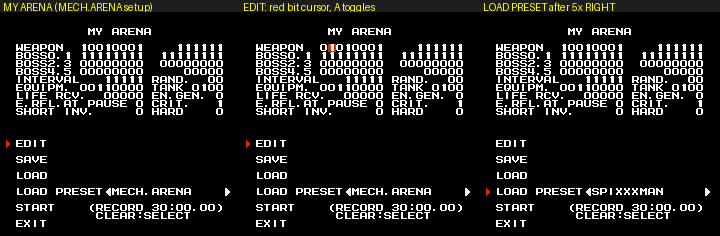
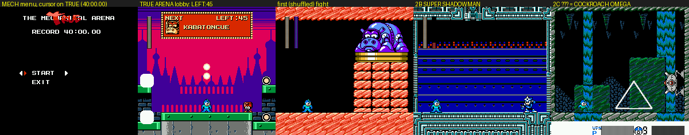
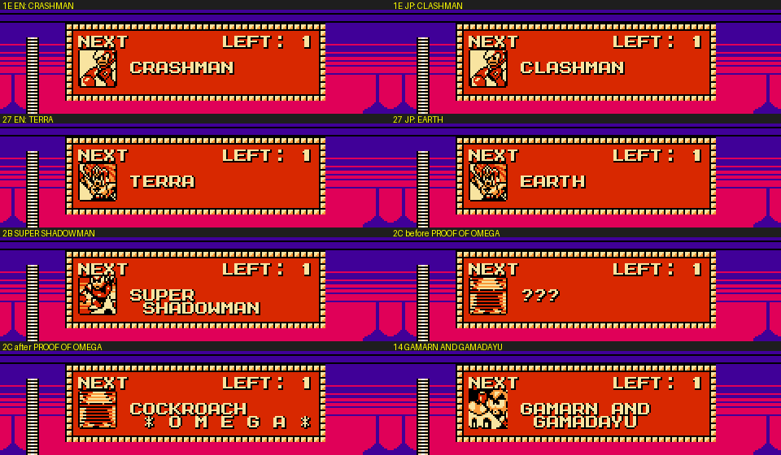
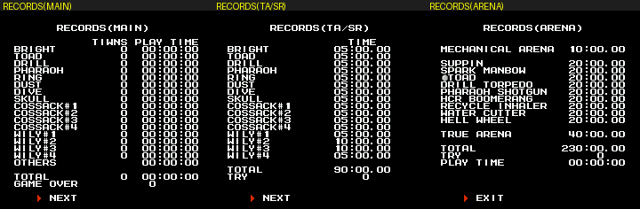
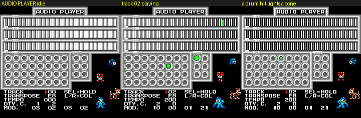

# 4MI special modes and meta systems, in practice (r4mi-modes)

Scope: every SPECIAL MODE item and every meta system of *Rockman 4 Minus Infinity* v1.01 (MMC5 build), as it
actually plays: the title menu, CONFIGURATION, the RESULT / Hero Score, TIME ATTACK, the arena family (MECHANICAL,
LIMITED, MY, TRUE), EXTRA CONFIGURATION, RECORDS, AUDIO PLAYER and the achievements.

This doc builds on `cheats.md` (RAM/WRAM map, unlock bytes, MY ARENA field map, 45 fight IDs) and `text.md` (every
menu string, the debrief text). It does not repeat their tables; it adds what each mode *does* when played, and the
code behind the scores and unlocks.

Tags: **[seen]** emulator, **[code]** disassembly/data, **[text]** in-game text, **[doc]** readme, **[guess]**.

## Highlights: how crazy the meta layer gets

- **The Hero Score is a 15-test checklist with a built-in trade-off.** The rows add up to 102, but one item, the
  ENERGY SPLITTER, can only be made by sucking Eddie into the RECYCLE INHALER, which loses him as a friend. So the
  real maximum is exactly 100, and the readme's odd `60 + 15 + 10 + 10 + 5` is the hint (§1.2).
- **Proto Man's debrief is the first failed test.** The 15 tests run in a fixed order, and the first one you fail picks
  his hint, so each clear hands you exactly one lead (§1.5).
- **The arenas share one engine and one hub.** Between fights you stand in a one-screen lobby, a city at dusk with an
  onion-dome skyline, under a `NEXT / LEFT:16` panel. Eddie and four life refills wait there, and you leave by jumping
  into two glowing orbs in the sky. The four "city at dusk" fights (WILY'S ARMY / NAVY / AIRFORCE, GREEN HELMET) exist
  only here (§3.1).
- **THE TRUE ARENA is 45 fights on one life, with shuffled blocks and HARD behaviour.** Its fixed finale ends in a
  boss whose name reads `???` until you have beaten it. The achievement then renames it **COCKROACH ✱ O M E G A ✱**
  (§3.6).
- **?DAGGER makes every hit a critical**, and SUPER STAR and low HP each make crits 4× likelier (§3.7).
- **The escape bonus is a pity system.** After three failed escapes the self-destruct timer goes from 50 s to 90 s
  and you lose the 2 BONUS points. Proto Man's JP debrief admits he turned it down (§1.4).
- **HARD ROCK needs the full HARD preset**, not just MAIN = HARD: every one of six sub-settings is checked at game
  start (§5).
- TIME ATTACK quietly withholds HELL WHEEL, and the LIMITED courses even take away the buster (§2, §3.4).

---

## 0. The unlock chain at a glance

| Step | You do | You get (`$7F78` bit) | Evidence |
|---|---|---|---|
| 1 | Beat the game | SPECIAL MODE replaces CONFIGURATION on the title; TIME ATTACK / SPEEDRUN, CONFIGURATION, RECORDS (`$01`+`$02`) | [code][doc] |
| 2 | Beat the game with all three friends (Beat, Rush, Eddie) | THE MECHANICAL ARENA (`$04`) | [code `$4D:$9ABB`][doc] |
| 3 | Clear THE MECHANICAL ARENA | LIMITED ARENA (`$08`) | [seen: `$788D = $08` after a MECH clear][doc] |
| 4 | Clear any one LIMITED ARENA course | MY ARENA + the red "True" stamp (THE TRUE ARENA), AUDIO PLAYER, EXTRA CONFIGURATION (`$10 $20 $40`) | [code `$4C:$9B03`; seen for MY ARENA in cheats.md][doc] |
| 5 | Clear THE TRUE ARENA | achievement PROOF OF OMEGA | [code][doc] |

---

## 1. The Hero Score (RESULT screen), fully decoded [code]

The RESULT screen runs from bank `$4D` (mapped at `$8000`) after the staff roll. It fills five bytes `$6900-$6904`
(one per row), sums them into **`$78AD`**, and then picks Proto Man's debrief entry. Every check goes through one
dispatcher, **`$4D:$9CD5`** (`JSR $C4B8` = inline jump table, 15 entries). Each test returns carry set = "you earned
it".

### 1.1 The 15 tests (`$4D:$9CD5`, table at `$9CD8`)

| # | Routine | Condition for carry (= point earned) | Meaning |
|---|---|---|---|
| 0 | `$9D0A` | `$7839 & $40` set | **BEAT** is with you (equipment bit `$40`, the bird icon) |
| 1 | `$9CF6` | FLAG `$7898 & $08` set | **RUSH** recovered |
| 2 | `$9D00` | FLAG `$7898 & $80` **clear** | **EDDY** not lost |
| 3 | `$9D12` | `$7839 & $08` | METALL'S HELMET |
| 4 | `$9D1A` | `$7839 & $02` | SKULL AMULET |
| 5 | `$9D1E` | `$7839 & $84` (either bit) | SUPER STAR **or** ?DAGGER |
| 6 | `$9D22` | `$7839 & $10` | SHOCK GUARD |
| 7 | `$9D26` | `$7839 & $20` | TRAMPOLINE |
| 8 | `$9D2A` | FLAG `$7898 & $04` **clear** | never RE-ENTERed a cleared stage |
| 9 | `$9D32` | game save `$89 \| $A1` = 0 | **no Game Over** in this save (16-bit Game Over count) |
| 10 | `$9D3B` | total play time `< $00057F` units | **under 100 minutes** (see 1.3) |
| 11 | `$9D56` | FLAG `$7898 & $10` set | **TOADMAN** (Toad Man turned into a real toad) |
| 12 | `$9D5E` | `$78B3` = 0 | **Escape** done in at most 3 tries (see 1.4) |
| 13 | `$9D64` | FLAG `$7898 & $02` set | **SHADOWMAN** (the secret boss) |
| 14 | `$9D6C` | never (`CLC`) | sentinel: "perfect" |

### 1.2 How the rows are built (`$4D:$9A9C-$9B40`)

| Row | Max | Code |
|---|---|---|
| MISSION | 60 | `LDA #$3C / STA $6900`: a constant. Reaching the RESULT is the mission |
| FRIENDS | 15 | `Y` = number of passed tests 1, 2, 0 (Rush, Eddie, Beat); row = `Y*4 + Y` = 5 per friend. **If `Y` = 3, `$788D \|= $04`**: that is the "beat the game with three friends" unlock of THE MECHANICAL ARENA |
| EQUIPMENT | 12 | popcount of `$7839 & $BF` (every equipment bit except BEAT), **minus 1 if both `$80` ?DAGGER and `$04` SUPER STAR are held**, times 2. The three starting items have no bits and score nothing |
| PLAY STYLE | 10 | test 8 → +2, test 9 → +4, test 10 → +4 |
| BONUS | 5 | test 11 → +1 ("XXXXman" = TOADMAN), test 12 → +2 (Escape), test 13 → +2 ("XXXXXXman" = SHADOWMAN) |

`$78AD` = the sum of the five bytes. The ending (bank `$1C:$8E34`) then shows the total; if `$78AD ≥ 100` it prints
"100", otherwise it sets `$7697 |= 1`, which withholds the **SUPER HERO** achievement [code].

So the readme's riddle decodes as: **"XXXXman" = TOADMAN (1 point), "XXXXXXman" = SHADOWMAN (2 points)**, exactly the
FLAG bit names [code][doc].

**The arithmetic hides a trade-off.** The row maxima add up to 60 + 15 + 12 + 10 + 5 = **102**, but the readme says
`60 + 15 + 10 + 10 + 5 = 100`, i.e. EQUIPMENT only 10 [doc]. The code explains why: the bit-`$01` item, the **ENERGY
SPLITTER**, comes from inhaling **Eddie** with the RECYCLE INHALER. The inhaler's item routine (bank `$41:$AC10`) checks
the victim's inhale class; class `$80` (Eddie) sets **FLAG bit7 EDDY** and drops item `$12` [code]. The Energy
Splitter's help text even says "YOU SEEM TO HEAR SOMETHING IN THIS UNIT" [text], and the debrief entry for a lost
Eddie asks "ARE YOU TREMBLING? … YOU SAW HIS LAST MOMENT" [text]. So the sixth item costs a friend: EQUIPMENT 12 means
FRIENDS 10, and the true maximum is exactly 100. The ?DAGGER / SUPER STAR "count once" rule closes the other
loophole (7 bits, 6 slots).

**The RECYCLE INHALER is the item recipe book** [code `$41:$AB90-$AC4D`]. When it swallows an object, a per-object
inhale class (`$0498`, bit7 = special) is turned into item `$12 + class`, and the pickup routine (`$41:$AB04`: `SBC
#$12 / LDA $FCBF,Y / ORA $7839`) maps item `$12+n` to equipment bit n:

| Class | Item | Equipment | Debrief hint |
|---|---|---|---|
| 0 (`$80`) | `$12` | ENERGY SPLITTER (bit0), **and sets FLAG EDDY** | none (it is the trap) |
| 3 | `$15` | METALL'S HELMET (bit3); a normal kill if you already own it | "HOW ABOUT TRYING IT TO A METALL?" |
| 4 / 5 | `$16` / `$17` | SHOCK GUARD / TRAMPOLINE (special-cased spawn) | "RECYCLEABLE … IF YOU HAVE 2 OR MORE" (a spare Wire / Balloon) |
| an object whose inhale result is type `$71` | `$13` | SKULL AMULET (bit1), only if not owned (`$41:$ABF5`; which object: open) | "I WANT TO LEND IT BUT HE MAY REFUSE IT" |

So five of the six findable items come out of the inhaler; SUPER STAR / ?DAGGER come from Shadow Man [text].

### 1.3 Play time (test 10)

The game save keeps 24-bit play-time counters at `$A8+s` (lo), `$C0+s` (mid), `$D8+s` (hi), `s` = 0-23; `s` = 23 is
the total [cheats.md]. **The unit is 256 frames (4.27 s)**: the text agent's ending state reads total = 94 units, and
its RECORDS screen showed `TOTAL TIME 00:06:41` = 401 s = 94 × 4.27 s [seen]. Slot 16 ("OTHERS") holds the time spent
outside stages (stage select, cutscenes, menus): 93 of the 94 units in that warped run [seen]. Test 10 passes when
hi = 0 and (mid, lo) < (`$05`, `$7F`), i.e. under `$057F` = 1,407 units = 360,192 frames = **100.05 minutes** [code]. Proto
Man's hint says "WITHIN 1OO MINUTES" [text].

### 1.4 The Escape bonus: "few challenges" = at most three attempts [code]

After the final battle, bank `$46:$92CD` far-calls **`$43:$B33B`**, which starts the escape sequence. It zeroes
`$78B2` (attempt counter) and `$78B3` (bonus lost), then falls into `$B343`: `INC $78B2`; if `$78B2 ≥ 4`, set `$78B3 = 1`.
During the escape (bank `$43:$A60A`) lives are pinned at 9 (`LDA #$09 / STA $A1`), and a death (`$30 = 7`) jumps back
to `$B343` instead of costing a life. So the escape can never Game Over you, but **the 4th attempt costs the 2 BONUS
points**. On that 4th try the setup at `$B3D8` also writes `$06F2 = $8A` and zeroes `$06F6`/`$06FA`, which changes
the escape itself [code; what it changes visually: not yet seen]. The escape loads with `$22 = $0D` (Wily 2's stage
slot) and full HP from `$7944`.

The JP debrief for a missed escape bonus: "If the self-destruct output had stayed high, we'd both have shared the
base's fate. Who lowered the output? …Heh, who knows." [text]. So after three failures **Proto Man secretly turns the
self-destruct down for you**, and the hint text is his in-character confession.

### 1.5 Proto Man's debrief picks the first failed test (`$4D:$9BDB`)

```
LDY #$FF
loop: INY / TYA / JSR $9CD5 / BCS loop     ; first test that fails
INY                                         ; debrief entry = failed test + 1
```

So entry *n* (text.md §4) is the hint for test *n−1*, and the order of the table is the priority order: Beat, Rush,
Eddie, the five findable items, revisits, Game Overs, time, Toad, escape, Shadow Man, and finally entry 15 ("I HAVE
NO ADVICE. YOU ARE REAL HERO!") when everything passed. The ENERGY SPLITTER has no hint entry, which fits: it is the
item you are *not* meant to want [code + guess on intent].

### 1.6 Friends in the ending picture [code]

The same three flags also decide who stands in the epilogue: bank `$4D:$8001` builds a mask from EDDY (bit7), RUSH
(bit3) and BEAT (`$7839 & $40`) to pick the palette/sprite list, and the object routines at `$4D:$85C7` (despawn if
EDDY set), `$85D1` (despawn unless RUSH) and `$861B` (despawn unless BEAT) remove whoever you failed to save.

### 1.7 Where each flag comes from

| Flag | Set by [code] | In play |
|---|---|---|
| BEAT (FLAG bit6 + `$7839 \|= $40`) | bank `$44:$98B3` | The rescue sets both bits. **The equipment bit is what the score reads, and it is not saved** (game save `$30 = $7839 & $BF`) and not rebuilt from FLAG bit6 on a respawn [seen: FLAG `$40` survived a death, `$7839` stayed `$00`]. So Beat has to be *with you* at the end, not merely rescued once [code + seen; the full rule is open]. Proto Man's hint for a missing Beat: "SCISSORS AND LEAVES ARE SCATTERED NEAR HIS CORE", which matches Wily 4's first two refight halls (a scissor-throwing and a leaf-shield CHIMERABOT) [seen + guess] |
| RUSH (FLAG bit3) | bank `$56:$9737` | Rush was captured; the hint says "HE MIGHT HAD BEEN NEAR WILY". With the bit set, Rush's three slots are restored on load (`$40:$A55E`) |
| EDDY (FLAG bit7) | bank `$41:$AC14` | Inhaling Eddie (inhale class `$80`) with the RECYCLE INHALER. Setting it is *bad*: you lose the friend and gain the ENERGY SPLITTER (§1.2) |
| KALINKA (FLAG bit5) | bank `$50:$84D8` | Wily 3's Kalinka scene (the same routine refills `$B1-$B3`, the three Rush slots). **Not scored**; used by the story |
| TOADMAN (FLAG bit4) | bank `$41:$A16D` | ●TOAD hits Toad Man: he becomes a frog and the fight becomes a **draw** (`ROR $78A0`). Killing the frog clears the bit again (`$1D:$BD44`) unless `$013A ≠ 0` (stages_b.md §Toad) |
| RE-ENTER (FLAG bit2) | bank `$39:$9827` | Choosing a stage whose boss is already beaten. Scored when *clear* |
| SHADOWMAN (FLAG bit1) | bank `$57:$9073` | Bank `$57` is Wily 4's hall controller (it also writes PROG `$A6`, wily.md §4.1). The EN placeholder says "ARRIVE AT THE CERTAIN PLACE OF WILY LEVEL 4 WITHOUT DYING", the JP *yabumi* says the same in ninja speech, and fight `$2B` **SUPER SHADOWMAN** loads in Wily 4's third teal hall (screen 5) [code + text; not reproduced in play: my no-death run stalled in the corridor after hall 2] |
| Escape `$78B3` | bank `$43:$B34F` | Set on the 4th escape attempt (§1.4). Scored when *clear* |


*The RESULT screen and debrief from a live ending (text.md §6): MISSION 60, FRIENDS 5, EQUIPMENT 0, PLAY STYLE 10,
BONUS 2 = 77 with the scout's fortress loadout; the debrief picked entry 1 (Beat), the first failed test.*

---|---|---|
| BEAT (`$7839 \|= $40`, FLAG bit6) | bank `$44:$98B3` | Beat's rescue; the bit is **not saved** (`$30 = $7839 & $BF`), so it must be re-earned after any reload? [open] |
| RUSH (FLAG bit3) | bank `$56:$9737` | |
| EDDY (FLAG bit7) | bank `$41:$AC14`, inhaling Eddie | setting it is *bad* |
| KALINKA (FLAG bit5) | bank `$50:$84D8` | same routine refills `$B1-$B3` (Rush Search, Wish Star, Rush Cannon). **Not scored** |
| TOADMAN (FLAG bit4) | bank `$41:$A16D` (●TOAD hits Toad Man) | the frog's death (bank `$1D:$BD44`) clears it again unless `$013A ≠ 0` |
| RE-ENTER (FLAG bit2) | bank `$39:$9827`, stage select | picking a stage whose boss is already beaten |
| SHADOWMAN (FLAG bit1) | bank `$57:$9073` | |
| Escape `$78B3` | bank `$43:$B34F` | 4th escape attempt |

(Section to be extended: how each in-game event is triggered.)

---

## 2. TIME ATTACK / SPEEDRUN (SPECIAL MODE item 1)

**What it is** [seen]: single-stage speedruns of any of the 16 stages, each with its own record. The menu lists
`BRIGHT MAN STAGE` … `WILY STAGE #4`, with `RECORD mm:ss.cc` for the stage under the cursor (default par 05:00.00,
10:00.00 for Wily 2 and Wily 3).

**Loadout** [seen, all 16 stages sampled; code `$4C:$963F`]: always the same, whatever the stage: Rock Buster plus 7 of
the 8 Robot Master weapons, full. The table at `$4C:$88C2` is `91 1F` in WPN1/WPN2 bit order = RB, TOAD, DIVE +
RING, DRILL, DUST, PHARAOH, BRIGHT. **HELL WHEEL (Skull) is withheld**, and so are Rush Search, Wish Star, Rush
Cannon, Wire and Balloon. Lives 0, E-tanks 0, no equipment bits, FLAG and boss-clear bits zeroed (`$4C:$9669`).
Max HP is forced to 28 (`$7941 = $1C`), so CONFIG VITAL does not apply. PROG. is preset per stage so the fortress
stages start in the right story state: Cossack 1 `$08`, Cossack 2 `$10`, Cossack 3 `$18`, Cossack 4 `$40`, Wily 2
`$68`, Wily 4 `$A0`; Wily 3 starts at **checkpoint 1**, skipping the space story scene (`$4C:$96D5`: `$22 = $0E` →
`INC $1F`).

**Rules** [seen]:

- No timer on screen during play. The HUD is the normal one.
- **One life.** A death returns you straight to the TIME ATTACK menu.
- Beating the boss skips the weapon-get screen: the boss explodes and you are back on the menu, which now shows
  `RECORD 05:00.00` / `TIME 00:14.68` for a moment, then the new record (`RECORD 00:14.68`). There is no "NEW
  RECORD" banner here, unlike the arenas.
- The time counts from the stage load (READY included) to the boss kill. My 14.68 s run started at checkpoint 2
  (forced by poking `$1F` during the load), so these are not real times.
- Records live in the system block: lo `$7D80+s`, mid `$7D90+s` (16-bit frame counts, 60 per second): `$0371` = 881
  frames = 14.68 s [seen].


*TIME ATTACK menu, the fixed loadout (no HELL WHEEL, 0 lives, 0 tanks), and the menu right after a clear (TIME under
RECORD).*

---

## 3. The arena family: one engine, four modes

THE MECHANICAL ARENA, LIMITED ARENA, MY ARENA and THE TRUE ARENA are all the same boss-rush engine with different
setups (cheats.md §5b has the field map and the 45-fight table). `$78B8` holds the SPECIAL MODE item + 1 and stays set
while you play (1 TA, 2 MECH/TRUE, 3 LIMITED, 4 MY, 7 EXTRA CONFIG; 0 = main game) [seen]; `$78F7` holds the arena
mode (0 MECH, 1-9 LIMITED courses, `$0A` MY, `$0B` TRUE) [code].

### 3.1 How a run plays [seen + code]

The runner is bank `$7B:$AB43`. `$78C4` is a step counter: **even steps are lobbies, odd steps are fights** (fight
index = step / 2, ID from the list at `$7900`). With INTERVAL = 0 the lobby steps are skipped and you get LIFE RCV.
HP between fights instead (`$7B:$ABBE`).

1. **The lobby is the "city at dusk"** (stage 8 = Cossack 1's map, screen 26): a one-screen green girder platform in
   front of an onion-dome skyline under a red sky. A panel at the top reads **`NEXT  LEFT:16` + portrait +
   `BRIGHTMAN`**: the next opponent and how many fights remain. This panel is what draws the **fight-name roster**
   (bank `$6F`, text.md §7.3, which could not find its caller): the lobby code at `$6F:$AC23` (bank `$6F` runs at `$A000`) indexes the
   name pointers at `$ACEC`/`$AD1D` with the fight ID [code + seen]. See 3.6 for the full list.
2. **The lobby holds up to five gifts, one per INTERVAL bit** (`$78C2 = (INTERVAL << 3) ^ $F8`, copied to `$0100`
   during lobbies) [code `$6F:$AB28`, `$43:$9564` + seen]:
   - bit0: **Eddie** stands at the right. Touch him and he hops away, leaving a random item: I saw a 1UP, an E-tank,
     +10 HP and weapon energy across 14 tries [seen].
   - bits1-4: four **life-energy pickups** in the corners (left ledge high/low, right ledge high/low). Each one
     refills HP to full [seen].
3. **You leave the lobby by jumping into the two glowing orbs** in the sky above the centre (object slot 23 at
   x 128, y 120). Touching it (`$6F:$AC7B`, `JSR $F95D` → `INC $78C4`) teleports you into the next fight [seen + code].
   START in the lobby opens the normal weapon menu, so you can pick a weapon before you go.
4. **The fight** loads in the boss's own stage room (stage from the table at `$7B:$AF19`). The four "dusk city" fights
   `$10-$13` (WILY'S ARMY, WILY'S NAVY, WILY'S AIRFORCE, GREEN HELMET) take place right next to the lobby, in the same
   city. They exist **only in the arenas**; cossack.md guessed this, and the lobby confirms the city is the arena's
   home stage [seen].
5. **Lives are 0. Any death ends the run** and drops you back on the arena menu [seen].
6. After the last fight the game loads stage 15 for a **CONGRATULATIONS!** screen over a starfield: `RECORD 10:00.00 /
   TIME 00:33.06 / NEW RECORD!! / – PRESS START –`, with a small Rockman on a teal floor [seen]. START returns to
   the arena menu. The clear handler (`$4C:$9B03`) sets the unlock bits (MECH → `$788D = $08`, any other arena →
   `$78`) [seen: `$788D` = `$08` after a MECH clear]. Arena records are 24-bit frame counts at `$7DA0+m` / `$7DB0+m`
   / `$7DC0+m`, m = `$78F7` [seen: `$0007C0` = 33.07 s].


*The arena lobby: NEXT / LEFT:16 / BRIGHTMAN, Eddie at the right, life pickups in the corners, the exit orbs in the
sky.*


*A MECHANICAL ARENA run: lobby, jump into the orbs, Bright Man, CONGRATULATIONS.*

### 3.2 THE MECHANICAL ARENA ("beat the game with three friends")

Preset 0 (`$4C:$94E1` column 0) [code + seen]: the 16 stage bosses (IDs `$00-$0F`: 8 Robot Masters, then the 8
fortress bosses including the Wily Capsule) in fixed order; WEAPON `91 3F` (buster + the 8 RM weapons, no Rush, no
Wire/Balloon); equipment `$30` (SHOCK GUARD + TRAMPOLINE); 4 E-tanks; INTERVAL `$1F` (Eddie + 4 refills in every
lobby); criticals off. Par time 10:00.00. Clearing it unlocks LIMITED ARENA.

The readme's unlock list reads `[2] Beat the game with three friends` → TMA (THE MECHANICAL ARENA), `[3] Beat TMA` →
LA (LIMITED ARENA), `[4] Beat one of the LA` → the rest [doc]. The "three friends" are Beat, Rush and Eddie, checked
by the RESULT screen itself (§1.2): a clear with FRIENDS 15/15 sets `$788D |= $04` [code]. Its harder version is
**THE TRUE ARENA** (§3.6), which shares this menu: the red "True" stamp is painted over the word MECHANICAL, and
LEFT/RIGHT switches between the two.

### 3.3 The seven presets (bank `$4C:$94E1-$955E`, one column each) [code]

Every arena is one of these presets (MY ARENA can load any of them with LOAD PRESET ◀▶). `$4C:$95CC` picks preset 0
for MECH, preset 1 for all nine LIMITED courses (then overrides WEAPON from `$4C:$88C4 + 2·mode` and BOSS1 from
`$4C:$9866 + mode`), preset 6 for TRUE, and leaves MY ARENA's own setup alone.

| Field (WRAM) | MECH.ARENA | LIMITED ARENA | RANDOM ARENA | LIMITED AMMO | CANNON MASTER | SPIXXXMAN | TRUE ARENA |
|---|---|---|---|---|---|---|---|
| WEAPON (`$78F1/F2`) | `91 3F` buster + 8 RM | `01 00` buster | `91 3F` | `90 3F` 8 RM, **no buster** | `0A 00` Rush Search + Rush Cannon | `20 00` **Wire only** | `91 3F` |
| BOSS0-5 (`$78FA-FF`) | `00-0F` (16) | `00-0F` | `00-0F` | `00-0F` | `00-0F` minus `$08` | `00-0F` | **all 45** |
| INTERVAL (`$78F0`) | `1F` | `00` (no lobby) | `1F` | `1E` (no Eddie) | `1F` | `1F` | `1F` |
| RAND. (`$78F9`) | 0 fixed | 0 | 2 | 3 | 3 | 3 | 3 |
| EQUIPM. (`$78F5`) | `30` SG+TR | 0 | 0 | 0 | 0 | 0 | `30` SG+TR |
| TANK (`$78F4`) | 4 | 9 | 2 | 6 | 4 | 9 | 9 |
| LIFE RCV. (`$78EF`) | 0 | 5 | 0 | 3 | 0 | 0 | 0 |
| EN.GEN. (`$78EE`) | 0 | 0 | 1 | 1 | 0 | 0 | 0 |
| E.RFL.AT PAUSE (`$78F3`) | 0 | 1 | 0 | 0 | 1 | 0 | 0 |
| CRIT. (`$78F6`, 1 = off) | off | off | on | off | off | off | **on** |
| SHORT INV. (`$78F8`) | 0 | 1 | 0 | 0 | 0 | 1 | 0 |
| HARD (`$78ED`) | 0 | 0 | 0 | 0 | 0 | 0 | **1** |

What the fields do [code]:

- **WEAPON** uses the EXTRA CONFIG bit order. Bit0 of WPN1 is the buster: **without it Rockman cannot fire the
  buster at all** (`$B0` bit7 clear) [seen in LIMITED: `$B0 = $13`].
- **INTERVAL** is five independent bits, each one a lobby gift (3.1): bit0 Eddie, bits1-4 the four life refills. 0
  removes the lobby entirely.
- **RAND.** picks one of four list shufflers (`$4C:$97DB`, jump table `$97E1`). The fight table is cut into five
  blocks by bit7 markers: `[10-1D]` 14 mid-bosses, `[00-07]` 8 Robot Masters, `[1E-2A]` 13 guest fights, `[08-0E]` 7
  fortress bosses, `[0F 2B 2C]` the finale. 0 = table order; 1 = shuffle everything; 2 = shuffle everything except
  the finale block; 3 = shuffle inside each of blocks 0-3, finale fixed [code + seen: TRUE ARENA opened once with
  GAMARN AND GAMADAYU, once with GREEN HELMET, once with KABATONCUE].
- **LIFE RCV.** is the HP restored between fights when there is no lobby (`$7B:$ABBE`) [seen: +5 per fight in
  LIMITED].
- **EN.GEN.** copies into `$78DC`, the same global as CONFIG E.GEN. (the ENERGY CHARGER item).
- **E.RFL.AT PAUSE** copies into `$78DA`, the same global as the EXTRA CONFIG cheat C.RFL: weapons refill whenever
  you pause.
- **CRIT.** copies into `$78D9`, the global the critical-hit roll reads (3.7). 1 = no criticals.
- **SHORT INV.** (`$78DB`) caps the enemy invincibility time after a hit at `$30` = 48 frames (`$43:$BAD2`). This
  matters because 4MI's weapons give long per-weapon i-frames (the buster gives bosses over 2 s) [code][doc].
- **HARD** copies into `$7946` / `$78DE`, the same globals as CONFIG MAIN = HARD (`$7B:$AAFB`).

**SPIXXXMAN** is the Wire-only gauntlet, and the name is "SPIDERMAN" with the middle censored (text.md) [text +
guess]. **CANNON MASTER** gives only Rush Search and Rush Cannon (POWER 28, "everyone is defeated by this instantly,
but this may be dodged") and drops the Cossack 1 moth fight, where you ride a sled.

### 3.4 LIMITED ARENA: nine one-weapon gauntlets [seen + code]

Nine courses over the 16 stage bosses, each with **exactly one weapon** (`$4C:$88C4`): SUPPIN (buster only, the FF5
"no job" joke), SPARK MANBOW, ●TOAD, DRILL TORPEDO, PHARAOH SHOTGUN, HCR BOOMERANG, RECYCLE INHALER, WATER CUTTER,
HELL WHEEL. Only SUPPIN has the buster; the others take it away. No lobby (INTERVAL 0): each kill teleports you
straight into the next boss room, with +5 HP (LIFE RCV.). 9 E-tanks, weapon refill at pause, short enemy i-frames,
no criticals, no SHOCK GUARD / TRAMPOLINE.

Three courses skip fights the weapon cannot finish (`$4C:$9866` masks BOSS1) [seen: run lists]:

| Course | Fights | Dropped |
|---|---|---|
| HCR BOOMERANG (15 STAGES) | 15 | `$09` SQUARE MACHINE (Cossack 2's block machine over spikes) |
| RECYCLE INHALER (15 STAGES) | 15 | `$09` |
| HELL WHEEL (13 STAGES) | 13 | `$08` MOTHRAYA (you ride a sled), `$09`, `$0B` C.CATCHER (you hang from a wire) |

Clearing **any one** course sets `$788D = $78` (MY ARENA + True stamp, AUDIO PLAYER, EXTRA CONFIGURATION) [code
`$4C:$9B03`]. Par time 20:00.00 per course.


*The LIMITED ARENA list, then the weapon menu in three courses: SUPPIN has only the buster, the ●TOAD course has no
buster at all, the HELL WHEEL course only SKULL. 9 E-tanks each.*

### 3.5 MY ARENA: the gauntlet editor

A bit-grid editor over the 19 setup bytes (layout in text.md §5.4, field map in cheats.md §5b), with EDIT, SAVE and
LOAD (one saved setup in the system block, `$7DD0-$7DDB`), LOAD PRESET ◀▶ (3.3), START (`RECORD 30:00.00`) and
`CLEAR:SELECT`. Any subset of the 45 fights can be chosen, but **they always run in table order** (or shuffled by
RAND.), never in the order you tick them [code + seen, cheats.md]. A one-fight MY ARENA is a boss select: that is
how the scout built the 45 `fight_XX` states. Its clear also sets `$788D = $78` [seen, cheats.md].

In practice [seen]: EDIT puts a red cursor on one bit of the grid; the D-pad moves it and A toggles the bit
(WEAPON bit7 → `$78F1` `$91` → `$11`). LOAD PRESET ◀▶ only cycles the preset *name* (MECH.ARENA, LIMITED ARENA,
RANDOM ARENA, LIMITED AMMO, CANNON MASTER, SPIXXXMAN, TRUE ARENA); the fields change when you confirm it. I did not
work out what `CLEAR:SELECT` under the record clears [open].


*MY ARENA: the bit grid with the MECH.ARENA setup, EDIT mode toggling WEAPON bit7, and LOAD PRESET on SPIXXXMAN.*

### 3.6 THE TRUE ARENA: the final mode

Unlocked with MY ARENA (the red "True" stamp over MECHANICAL; LEFT/RIGHT on the MECHANICAL ARENA menu switches to it).
Preset 6: **all 45 fights**, RAND. 3 (each block shuffled), HARD on, criticals on, 9 E-tanks, SHOCK GUARD +
TRAMPOLINE, a full lobby before every fight, one life. Par time 40:00.00. Beating it sets `$7698 = $80` → the
**PROOF OF OMEGA** achievement [code, cheats.md].

The fixed finale is OPTICAL CAPSULE (Wily Capsule), then **SUPER SHADOWMAN**, then **"???"**. The last fight's name
is drawn as `???` until PROOF OF OMEGA is on the save; after that the lobby calls it **COCKROACH ✱ O M E G A ✱**
(`$6F:$AC23`: fight `$2C` + `$7F7E & 4` → roster entry `$30`) [code + seen]. So the author hides the final boss's name
behind the very achievement you get for beating it.


*THE TRUE ARENA: the menu (LEFT/RIGHT toggles it with MECHANICAL), a lobby with LEFT:45 and a shuffled first opponent
(KABATONCUE this time), and the two hidden finale fights: SUPER SHADOWMAN in a Wily 4 hall and "???" (COCKROACH
OMEGA, a one-eyed pod on the wall of a green cave, loaded in Drill Man's stage).*

**Fight names by fight ID** (the roster, decoded through the lobby's pointer table, which corrects text.md §7.3's
sequential numbering from `$23` on) [code + seen]:

| ID | Name | ID | Name | ID | Name |
|---|---|---|---|---|---|
| `00-07` | BRIGHTMAN … SKULLMAN | `14` | GAMARN AND GAMADAYU | `20` | SHADOWMAN B |
| `08` | MOTHRAYA | `15` | GUNDRILL | `21` | SHADOWMAN P |
| `09` | SQUARE MACHINE | `16` | KABATONCUE | `22` | PAKKUN SHADOW |
| `0A` | AQUA DEVIL | `17` | WHOPPER | `23` | ENKER |
| `0B` | C.CATCHER AND C.HOPPER | `18` | RONG RANG RUNG | `24` | QUINT |
| `0C` | JOE NI-NIN VA ALL | `19` | HOGALE | `25` | PUNK |
| `0D` | SNATCHMAN | `1A` | KING GOJULUS | `26` | BALLADE |
| `0E` | W.MACHINE 4 | `1B` | ESCAROO | `27` | EARTH (EN: **TERRA**) |
| `0F` | OPTICAL CAPSULE | `1C` | MOBY | `28-2A` | CHIMERABOT -1/-2/-3 |
| `10` | WILY'S ARMY | `1D` | NIGHTMARE SUZIES | `2B` | **SUPER SHADOWMAN** |
| `11` | WILY'S NAVY | `1E` | CLASHMAN (EN: **CRASHMAN**) | `2C` | `???` → **COCKROACH ✱OMEGA✱** |
| `12` | WILY'S AIRFORCE | `1F` | WAVEMAN | | |
| `13` | GREEN HELMET | | | | |

In EN mode the lobby patches two names (`$6F:$AC54`): the JP-style romanisations CLASHMAN and EARTH become CRASHMAN
and TERRA [seen]. Roster entries `$2D-$2F` all point at BRIGHTMAN (unused) [code].


*Lobby panels: CRASHMAN/CLASHMAN and TERRA/EARTH (EN/JP), SUPER SHADOWMAN, and fight `$2C` before and after PROOF
OF OMEGA.*

### 3.7 Criticals, decoded (`$42:$BD89`) [code]

The hit routine rolls a critical (×8 vs. enemies, ×3 vs. bosses [doc]) like this:

1. `$78D9 ≠ 0` (CONFIG CRITICAL OFF, or arena CRIT. 1, or STABLE) → never.
2. **?DAGGER (`$7839` bit7) → always.** The "UNCERTAIN ITEM" turns every hit into a critical.
3. Otherwise mask = `$FF`; HP < 5 → mask >> 2; SUPER STAR → mask >> 2 again; critical if `(RNG $92 & mask) = 0`.
   So the base rate is 1/256, 1/64 near death or with SUPER STAR, and 1/16 with both.

That is why the Hero Score counts SUPER STAR and ?DAGGER as one item (1.2): ?DAGGER is the stronger form of the same
"cruelty" item.

---

## 4. The title menu [seen + code]

`NEW GAME / CONTINUE / CONFIGURATION`, with `NEW GAME(START+A)` once a save exists: START alone does nothing there, so
a stray START cannot wipe your autosave. CONTINUE with no valid save does nothing [seen, cheats.md]. After the first
clear (`$7F78 ≠ 0`), CONFIGURATION is replaced by **SPECIAL MODE** (`$30:$8B2E`); CONFIGURATION moves into the
SPECIAL MODE menu as item 6 [code][seen]. There is no password screen: `PASS WORD ERROR` survives in the ROM as dead
text (text.md §7.2). Each title action runs through a far call that also resets `$780F = $10` (the "OTHERS" play-time
slot), so time on menus is still counted in the save's total (1.3) [code `$39:$96FE-$9732`].

---

## 5. CONFIGURATION: what each option really does

Values live in `$78C8-$78D2` and are packed into the system save byte `$79-$7B` (cheats.md §3). At the start of
main-game play, bank `$7B:$AADD` copies them into the globals the engine actually reads [code]. TIME ATTACK and the
arenas overwrite those globals with their own values (`$4C:$96C1-$972B`), which is the readme's "configurations of
special mode games aren't depend on the CONFIGURATION of main game" [doc][code].

| Option | Values (stored) | Engine global | Real effect [code unless tagged] |
|---|---|---|---|
| LANGUAGE | JAPANESE 0 / ENGRISH 1 | `$78B0` | Help, dialogue, debrief, lobby names (CRASHMAN/TERRA). Menus stay English; the opening crawl stays Japanese [seen] |
| DIFFICULTY | NORMAL / EASY / HARD / STABLE / EDIT | — | A preset for the six rows below (table below). Any hand edit shows EDIT [seen, text.md] |
| MAIN | NORM 0 / HARD 1 | `$7946`, `$78DE` | Map, enemy and boss changes in every stage; see `stagesa_hard.png`, `stages_b_hard_diffs.png`, `cossack_hard.png` in the stage docs [seen there] |
| DAMAGE | ×1.0 0 / ×0.5 1 / ×1.5 2 | `$78DF` (bits 6-7) | Damage *to Rockman* (`$7510`) is scaled at `$42:$BAF8`: ×0.5 = `LSR / ADC #0` (rounds up), ×1.5 = `d + d/2` with the carry (rounds up), as config.txt says [doc] |
| CRITICAL | ON 0 / OFF 1 | `$78D9` | Gate of the critical roll (3.7) |
| ITEM DROP | NORM 0 / MORE 1 / NONE 2 | `$78D8` → `$78E0-$78E4` | 5 cumulative thresholds from `$7B:$AF0A` tested against `RNG mod 50` (`$3B:$BB96`). NORM `0E 0A 08 03 02`: an item on 28 % of kills. MORE `47 3D 29 1F 1E`: every threshold above 49, so **every kill drops an item**. NONE: all 0 |
| FAIL-SAFE | NORM 0 / SAFE 1 | `$7940` | At every stage start `$7839 \|= $30` (SHOCK GUARD + TRAMPOLINE) (`$7B:$ADA7`). Because the bits are saved, they stay after switching back to NORM [doc][code]. They also count for EQUIPMENT in the Hero Score (4 free points) [code] |
| E.GEN. | ON 0 / OFF 1 | `$78DC` | The ENERGY CHARGER starting item. ON: at each (re)spawn every owned weapon gets back half of its missing energy, at least 4 units (`$7B:$AE25`) |
| VITAL | 1-28 (0 wraps to 28) | `$7941`, `$7944` | Max HP and spawn HP [seen, cheats.md: VITAL 10 → 10 HP] |
| ROCKMAN | 0-9 | `$7942` | Lives after NEW GAME / Game Over; on load lives = max(saved, ROCKMAN) |
| ETANK | 0-9 | `$7943` | Guaranteed minimum E-tanks after NEW GAME / Game Over |
| LOAD DEFAULT SETTINGS | | | Everything except LANGUAGE back to 28 / 4 / 0 and all-zero sub-rows (`$4C:$8EFB`) |

**DIFFICULTY presets** (`$4C:$902D` / `$9031`, two packed bytes each) [code]:

| Preset | MAIN | DAMAGE | CRITICAL | ITEM DROP | FAIL-SAFE | E.GEN. |
|---|---|---|---|---|---|---|
| NORMAL | NORM | ×1.0 | ON | NORM | NORM | ON |
| EASY | NORM | ×0.5 | ON | MORE | **SAFE** | ON |
| HARD | **HARD** | ×1.5 | ON | **NONE** | NORM | **OFF** |
| STABLE | NORM | ×1.0 | **OFF** | **NONE** | NORM | ON |

STABLE is the readme's time-attack setting with no luck: no criticals and no drops [doc]. TIME ATTACK itself uses the
same two settings (`$78D9 = 1`, `$78D8 = 2` at `$4C:$96C1`) plus VITAL 28 and MAIN NORM [code].

**HARD ROCK is stricter than "HARD mode".** At game start (`$39:$96C9`) the HARD ROCK disqualifier (`$7697 |= 2`)
is set unless **all six** rows match the HARD preset: MAIN HARD, DAMAGE ×1.5, ITEM DROP NONE, E.GEN OFF, CRITICAL
ON and FAIL-SAFE NORM. VITAL, ROCKMAN and ETANK are not checked, so you may raise lives and E-tanks and still earn
it [code]. The bit is ORed into the save (`$2F`) at every save, so one session on easier settings voids it for that
file (`$40:$AE5F`).

---

## 6. EXTRA CONFIGURATION (the cheat / save editor)

cheats.md §5 has the full field map; in practice [seen + code]:

- Every field is **live RAM**, edited in binary with a one-line help string. Opening the screen loads the save
  into the fields; nothing is written back until you start.
- **ENTER STAGE** starts `STAGE`/`C.P.` with the edited state. **BOSS SELECT** opens the stage select with the edited
  clear bits and keeps the counters. **NEW GAME** resets the counters [doc].
- `SAVE DATA WILL BE BROKEN. / PLEASE SAVE STATE HERE.` is literal: ENTER STAGE sets `$7697 = 3`, so the next save
  carries both achievement disqualifiers for good [code `$4C:$927D`, `$40:$AE5F`]. The author tells emulator users to
  make a savestate first.
- Cheats: **TML** (lives pinned at 9 at every stage start, `$7B:$ADB4`), **C.RFL** (weapons refill when you pause;
  the same global as the arenas' E.RFL), **EXWP** (one of 11 "super-special weapons" replaces the buster: QUINT's
  pogo, ENKER, R.ARMOR, R.COPTER, R.CANNON, R.PWC, R.S.SHIP, PUNK, BALLADE, EARTH and the W.BUSTER; `(GLITCHY!)`
  says the help line; images in cheats.md §9). With EXWP = 11 (W.BUSTER) incoming damage is also reduced
  (`$42:$BB15`, "this also has shield function") [code + text].
- **PROG.** is the story-progress byte. TIME ATTACK shows the values each fortress stage expects at its start:
  Cossack 1 `$08`, Cossack 2 `$10`, Cossack 3 `$18`, Cossack 4 `$40`, Wily 1 `$00`, Wily 2 `$68`, Wily 4 `$A0` [seen].
- **FLAG** is the Hero Score flag byte (`ED BE KA TOAD RU RE-EN SH X`, §1.7), so the editor can fake any FRIENDS and
  BONUS combination; the disqualifier makes sure that does not earn SUPER HERO.

---

## 7. RECORDS (SPECIAL MODE item 8) [seen]

Three pages, NEXT between them (text.md §5.7 has the strings):

1. **RECORDS(MAIN)**: per stage, lifetime **TIWNS** (deaths, after *tiun tiun*) and PLAY TIME, plus OTHERS (menus and
   scenes), TOTAL and GAME OVER. These are the system-block lifetime counters, not the current save.
2. **RECORDS(TA/SR)**: the 16 TIME ATTACK records, TOTAL (default 90:00.00) and TRY.
3. **RECORDS(ARENA)**: MECHANICAL, the nine LIMITED courses, TRUE (MY ARENA's record is not listed), TOTAL (default
   230:00.00), TRY and PLAY TIME.

Units: TA records are 16-bit frame counts, arena records 24-bit frame counts, play time 24-bit in 256-frame units
(§1.3, §2, §3.1).


*The three RECORDS pages.*

---

## 8. AUDIO PLAYER (SPECIAL MODE item 5) [seen]

A sound test dressed as a tracker. Three piano keyboards (pulse 1, pulse 2, triangle) light the notes being played in
green, and a grid of speaker cones lights up on noise/drum hits. Readouts: `TRACK`, `TRANSPOSE` (default `E8`),
`TEMPO`, `DTY.C.` (duty per pulse channel) and `MOD.` (four per-channel modulation values), with the hints `SEL=HOLD`
and `L/R=COL`. Mega Man, Roll, Rush and Proto Man stand on the right, and Mega Man animates with the music. LEFT/RIGHT
on TRACK picks a song, A plays it, and the other rows can be edited while it plays (I changed TRANSPOSE to `E9`
live) [seen]. Unlocked with MY ARENA and EXTRA CONFIGURATION (bit `$20`).


*AUDIO PLAYER: idle, then a track playing (keys and a drum cone lit; Mega Man reacting).*

---

## 9. Achievements (bottom right of the SPECIAL MODE menu)

| Achievement | Plate | Exact rule [code] |
|---|---|---|
| **SUPER HERO** | Rockman + "100" | Main-game clear with Hero Score ≥ 100 (`$1C:$8E34`), and never ENTER STAGE from EXTRA CONFIG on this save. Since the maximum is exactly 100 (§1.2), it needs every item except the ENERGY SPLITTER, all three friends (so Eddie must never be inhaled), no revisits, no Game Over, under 100 minutes, Toad Man turned into a toad, the escape in ≤ 3 tries, and Shadow Man found |
| **HARD ROCK** | red Rockman + "HARD" | Main-game clear with the full HARD preset from the start (§5), no Game Over (`$1C:$8EF4`), and no EXTRA CONFIG |
| **PROOF OF OMEGA** | red Mega Man Ω + Ω | Clear THE TRUE ARENA (`$7698 = $80`, `$40:$AE7D`). It also unmasks the final boss's name (§3.6) |

At the clear, `$7F7E |= ($7E2F ^ 3)` (`$40:$AE6F`): the two main-game achievements are awarded together from the two
disqualifier bits, so one perfect HARD run earns both [code].

---

## 10. Savestates and scripts

Shared (`build/research/r4mi/states/`):

- `arena_lobby_mech.state`: THE MECHANICAL ARENA lobby before fight 1 (NEXT BRIGHTMAN, LEFT:16; Eddie and the four
  refills present). Poke `$7900+n` / `$78C4` to retarget the run (`$78C4 = 2k` = lobby before list entry k).

Scratch (`build/research/r4mi/r4mi-modes/`): `ta_00.state` … `ta_15.state` (each TIME ATTACK stage at control),
`ta_bright_cp2.state` (TA Bright at checkpoint 2, the boss room is the next screen), `mech_clear_end.state` (the
CONGRATULATIONS screen), `lim_spark_fight1.state` (LIMITED SPARK MANBOW, fight 1), `w4ss_end.state` (Wily 4 hall 2,
no deaths, PROG `$A2`). Scripts: `bosskill.py` (poke slot-23 HP and fire at it), `make_imgs.py` / `make_lim.py` /
`make_my.py` (rebuild every image in this doc), `mech_clear.py` (a full arena clear), `lobby_items.py` /
`lobby_eddie.py` (lobby gifts), `panels.py` (lobby name panels), `ptime.py` (play-time units).

---

## 11. Open questions

- The in-stage triggers for BEAT (`$44:$98B3`), RUSH (`$56:$9737`) and SHADOWMAN (`$57:$9073`) were located in code but
  not reproduced in play. Does SUPER SHADOWMAN replace or follow CHIMERABOT #3 in Wily 4's third hall when you arrive
  without dying, and does beating him drop the SUPER STAR or ?DAGGER?
- When is BEAT's unsaved equipment bit restored after a reload (bank `$4B:$AA4A` tests FLAG bit6)? Can you rescue Beat
  and still fail the FRIENDS test?
- MY ARENA's `CLEAR:SELECT`, and whether the saved MY ARENA setup (`$7DD0-$7DDB`) is per slot.
- Which ITEM DROP index is which item (`$3B:$BCA1` table): MORE gives index 4 on 60 % of kills.

---

## Lessons for Rockman 6 GP

- **Score the run with a table of predicate tests and reuse the table for hints.** 4MI's whole Hero Score is a
  15-entry jump table of "did the player do X" checks; the same order picks the debrief line. One table gives the
  score, the hints and their priority. RM6 GP can do the same for a post-game rating.
- **Design one score item as a trap.** Making the sixth equipment cost a friend turns a checklist into a choice, and
  the readme's off-by-two sum is a clue players can solve. This costs nothing in code.
- **Give failure a soft landing that costs score, not progress.** The escape becomes easier after three deaths but
  takes the bonus; arena deaths end the run but cost nothing else. RM6's harder set pieces can scale the same way.
- **Build every boss rush on one fight table and one lobby.** Seven presets, four menu modes and a user editor are
  all a dozen bytes of setup over the same 45-entry table, a shuffler with block markers, and a one-screen lobby
  that shows the next opponent. RM6 GP should ship its refight/boss rush this way from the start.
- **Put the "rest stop" in the world, not in a menu.** Eddie and four refills on a city ledge, plus "jump into the
  orbs to continue", keep the boss rush inside the game's own physics, and each gift is one bit that a preset can
  remove.
- **Let modes override config through one set of engine globals.** 4MI copies CONFIG into `$78D8-$78DF` at stage
  start, and TA/arenas write their own values there instead. One choke point keeps "special modes ignore your
  settings" honest and testable.
- **Hide names behind achievements.** `???` → COCKROACH OMEGA after you win is a one-byte check that turns the last
  fight into a mystery. The JP/EN name patch (CLASHMAN → CRASHMAN) shows the cost of romanised names; keep separate
  per-language strings.
- **Be exact about achievement rules, and show them.** HARD ROCK silently requires all six HARD sub-settings; the
  readme only says "HARD mode". If RM6 GP has achievements, the menu should state the conditions.
- **Store times as frame counts** (16-bit for stages, 24-bit for runs, 256-frame units for lifetime totals). They
  are cheap to compare and format, and the records screen and the time test (`< $057F`) read them directly.
