# 4MI stages A: Ring Man, Pharaoh Man, Drill Man, Dive Man (r4mi-stages-a)

Status: complete for what could be reached; gaps are listed per stage.

**How crazy it gets (summary).**

- **Every stage is split into 2-3 compressed sections** (up to 23 screens each), each with its own metatiles, CHR and
  palette, swapped through duplicated "seam" strips. Ring Man's stage is played out of screen order (0-10, then
  27-30, then 11-26) and ends its sunset leg by dropping you back onto screen 10's edge.
- **Pharaoh Man's pyramid curses you room by room**: REVERSE (swapped left/right, and it is the start screen, so
  RIGHT walks you out of the pyramid), HOPPING, BERSERKER (auto-fire), ROULETTE (random weapon), MINIMUM, FIDGET,
  SLIPPING, FETTER, shown as a word under the life bar. The boss blows the floor away at half HP and the fight goes on
  a storey lower, under a new curse, with his bar refilled to 21 (35 HP in all).
- **Bosses and mid-bosses rewrite the map**: Drill Man drills new tunnels into his arena, and Ring Man's rail-UFO
  mid-boss edits the room layout in WRAM every frame.
- **Guests**: Shadow Man ambushes you in Pharaoh's stage; Mega Man Killers from the Game Boy games (Quint with his
  pogo stick, an Enker-like spear robot) are mid-bosses; you take Quint's pogo and ride it over spikes, and you cross
  Dive's sea on Rush as a jet ski under a flying whale battleship. Eddie stands in every stage.
- **Weakness by invincibility, measured**: per-hit damage is 1-4 for everything, but the invincibility left on the
  boss ranges from 126 frames (buster) down to 2 frames (Hell Wheel on Drill Man).
- **Hidden rooms**: Ring 31 (off the left edge of an empty sky screen) and Dive 24 (top-left of checkpoint 1) seen;
  Pharaoh 19 and Drill 18 located from their item placements.

**The intended challenge, honestly** (I played with godmode, so this is a reading of the design, not a feat):

| Stage | What a normal player fights |
|---|---|
| Ring | Rhythm: laser bars are solid only for part of their colour cycle, over spikes and pits, with UFOs nudging you; then a laser maze whose floor redraws itself. hint.txt: Ring Man himself is fragile, "but the stage may be hard". |
| Pharaoh | Disorientation: a new control curse in almost every room (reversed, auto-hop, auto-fire, random weapon, slippery), quicksand, and a boss with fierce attacks and a second phase. |
| Drill | Navigation: fake rock hides the real passages, the route forks, and one stretch must be crossed on Quint's pogo stick over spike floors. |
| Dive | Vehicles and water: a sea crossing on Rush under a whale battleship, a mined sea floor, and Mega Man Killer mid-bosses. |

Scope: Rockman 4 Minus Infinity v1.01 (`roms/r4mi_mmc5.nes`), the stages of Ring Man (`$22` = 4), Pharaoh Man (3),
Drill Man (2) and Dive Man (6): route, gimmicks, enemies, mid-bosses, hidden rooms, pickups, HARD differences, the
boss fights (patterns and weapon damage) and the jokes. Played with godmode (frozen HP and i-frames plus the FAIL-SAFE
items, `cheats.godmode()`), so the "intended challenge" notes are my reading of what a normal player faces.

Tags: **[seen]** emulator, **[code]** disassembly/data, **[text]** in-game text, **[doc]** readme, **[guess]**.

## 0. Method and tools

### How 4MI stores a stage (needed to draw the maps) [code + seen]

- The stage bank is still `$20 + stage` at `$A000` (MMC5 `$5115`), as in vanilla RM4. Its first `$500` bytes are the
  16×16 block table (four 256-byte tile planes TL/TR/BL/BR at `$A000-$A3FF`, block attributes at `$A400`: low 2 bits
  palette, high nibble collision type).
- **New in 4MI: the stage is split into sections of up to 23 screens, each with its own 32×32 metatile set, screen
  layouts and CHR.** When you enter a section the game decompresses it into battery WRAM: blocks `$6000-$64FF`
  (copied raw from the bank), metatiles `$6500-$68FF` (4 bytes each), screen layouts from `$6900` (up to about `$6EBF`; 64 bytes per
  screen, 8×8 metatiles, row-major). The table at bank `$B500` maps each global screen number (`$0348`/`$F9`) to its
  local index in the section, so the reset points in that table are the section boundaries.
- The enemy table keeps the vanilla RM4 format: `$B100` screen, `$B180` X, `$B200` Y, `$B280` type, `$FF`-terminated,
  and `$B300` = index of the first enemy of each screen.
- Collision types seen (block attribute high nibble): 0 air, 1 solid, 2 ladder, 3 spikes, 4 ladder top, 5 boss
  shutter, 14 and 15 stage-specific (in Ring: the colour-cycling laser bars).

Tools: **`tools/analysis/r4mi/stagemap.py`** (new, reusable) packages the section renderer, the text collision
maps, the enemy table, the section list, the weapon selector (controller-2 A), the boss damage meter, a kill-all helper
and a **BFS screen-graph explorer** (godmode; teleport to every ladder top, open bottom and open edge row, both D-pad
directions, plus plain walking; kills mid-bosses first). Scratch scripts are in `build/research/r4mi/r4mi-stages-a/`
(`nav.py` route driver, `explore.py`, `dmg.py`, `curse.py`, `hard.py`, `compose.py` for the maps).

Two lessons about the tools: (1) **setting `$A0` does not switch every weapon's behaviour** (Toad, Recycle Inhaler and
Wish Star kept firing buster shots); pressing controller-2 A, as the game expects, does. (2) **Teleports can leave the
camera on another page** in scrolling rooms; the player then crosses screens off-camera and the screen counter changes
without a real room transition. Explorer edges were therefore checked by walking where it mattered, and edges that
were only seen off-camera are marked unconfirmed.

Savestates added to `build/research/r4mi/states/` (all with godmode needed): `stagesa_ring_hidden31`,
`stagesa_ring_s27_sunset`, `stagesa_pharaoh_s19_treasure` (off-camera, see 2.2), `stagesa_pharaoh_boss_phase2` (lower
chamber, bar refilled), `stagesa_drill_s26_quint`, `stagesa_drill_s27_pogo`, `stagesa_drill_s41_branch`,
`stagesa_dive_s24_treasure`, `stagesa_dive_s33_spear`.

## 1. Ring Man stage (`$22` = 4)

**In one line:** a sky fortress that you descend, then climb through a sunset, then cross a dark laser maze, with
platforms made of colour-cycling laser bars, two set-piece mid-bosses, an Eddie stop, a hidden room off the left edge
of an empty sky screen, and Ring Man fought in a window onto outer space. The sky colour changes as you go (blue,
deeper blue, magenta, then a salmon sunset), so the stage reads as one continuous flight through an evening.

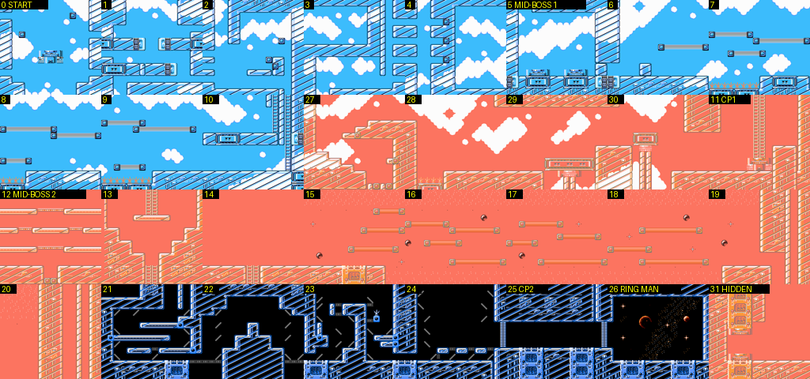
*Every screen of the stage in route order, rendered from the decompressed section data (label = global screen number).
Screens 27-30 are shown with the sunset palette they are played in; 21-26 with the dark CHR of the last section.*

### 1.1 Structure [code + seen]

| Section (loaded into WRAM) | Global screens | Contents |
|---|---|---|
| A | 0-10 | sky fortress, descent and laser-bar run |
| B | 11-20 | sunset climb, second mid-boss, long bar crossing |
| C | 21-32 | dark laser maze (21-24), boss corridor (25), boss (26), the sunset interlude (27-30), hidden room (31) |

The screen numbers are not the play order. The route is **0 → 10, up into 27-30, back to 11 → 26** [seen]: climbing
the ladder at the right of screen 10 loads section C and puts you on screen 27, and walking off the right of screen 30
puts you back on screen 10's right edge (the two screens share that strip), from where the camera scrolls on into 11.
4MI uses such duplicated "seam" strips to change section, palette and CHR without a visible cut.

### 1.2 Route, screen by screen [seen unless tagged]

| Screen | What happens |
|---|---|
| 0 | Start on a teleporter pad. Two laser bars cross the screen; Saturn-ring UFOs (HP 1) circle. Drop off the pad through the floor gap. |
| 1 | Two rail platforms with ladder rungs, more bars; drop through the gap on the left. |
| 2 | Enclosed room. A **periscope turret** hangs from the ceiling: HP 28, i.e. one of the readme's "too hard to be worth fighting" enemies. Drop on the right. |
| 3 | A cluster of three **black balls** (3 objects, HP 28 each) that hover as a group. Drop on the left. |
| 4 | Narrow shaft down the left; to the right is a closed-off pocket of sky (no exit). |
| 5 | **Mid-boss 1** (fight `$17`): a face-on coil spring on two teleporter pads (below). |
| 6-9 | The laser-bar run: a long horizontal room with floating bar platforms over **spike floors** (screens 7-9). The bars are type-14 blocks whose colour cycles orange → yellow → green → pink → red; they are only solid for part of the cycle, so you stand on one, drop through it a moment later, and must hop to the next in rhythm. More UFOs and small hopping robots. The sky darkens screen by screen. |
| 10 | Shutter-like column with two ladders; a **1UP** sits at (148, 88) (object `$7C`). Climb. |
| 27 | (Section C, sunset palette.) Staircase structure. **Rabbit robots riding big gear-wheels** (unicycle acrobats; objects `$6B/$6C` + wheel `$6A`), a circus touch for a Ring stage. |
| 28-29 | Open sky with spike pits and columns; more wheel riders and bombs dropped from above. |
| 30 | A **totem of stacked blocks** and wheel riders; walk off the right edge. |
| 11 | Back in section B (sunset): a red-faced turret on the wall, ladder up. |
| 12 | **Mid-boss 2** (fight `$18`): four rails, UFOs riding green carts. |
| 13 | Ladder room. |
| 14 | **Eddie** (object `$33`) stands at the left. The screen is open sky. Going **left** off the edge enters the hidden room (31). |
| 15-18 | Long crossing on laser bars over the void, with UFOs, in pink sunset. |
| 19-20 | Drop down two narrow shafts. |
| 21-24 | The **laser conduit maze**: a dark room where a colour-cycling laser beam *draws itself* through a channel network, segment by segment (screenshots below). The lit conduit is the floor you can stand on, and it keeps changing shape, so you follow the beam through the maze. |
| 25 | Boss corridor between two shutters (checkpoint 2). |
| 26 | Ring Man, in a room with a window onto space (moon, ringed planet, galaxy). |
| 31 | **Hidden room** (one screen): an E-tank and a 1UP on a pedestal, beside a column of fake boss shutters. Its exit on the right returns you to 13/14. |

Enemy table facts [code, `$B100-$B2FF` of bank `$24`]: 92 placements on screens 0-31; generic script objects `$08`/`$09`
(their Y value is a parameter) start the set pieces, and `$88`/`$89`/`$8A` at X = 8 sit on most screens (stage
controllers). Items are ordinary placements: `$56` E-tank, `$7C` 1UP (seen in the hidden room), `$7A`/`$5A` the big
life/weapon capsules [guess from their placement in other stages' treasure rooms].

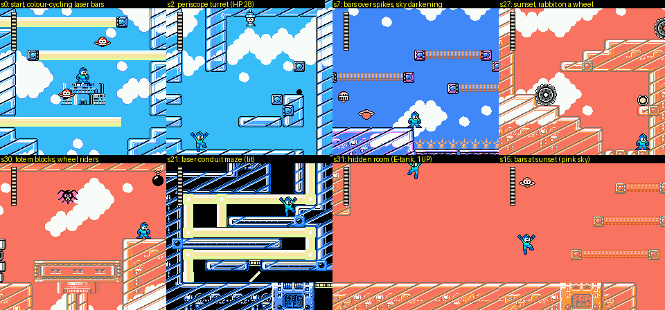
*Start with the laser bars; the periscope turret; bars over spikes as the sky darkens; the sunset wheel riders; the
totem; the self-drawing laser maze (screen 21); the hidden room; bars at sunset.*

### 1.3 Hidden room, pickups, secrets

- **Hidden room = screen 31** [seen]: go left off screen 14 (where Eddie stands) at any height above the floor.
  Inside: E-tank + 1UP. The room is in section C's data although it is entered from section B.
- The 1UP on screen 10 [code].
- Eddie on screen 14 [seen]. (The EDDY friend flag and the Energy Splitter joke are in text.md.)
- No Wire or Balloon here (they are in Drill's and Dive's stages).
- The hint file suggests Ring Man's stage as one of three good places to suicide-farm Rush Search E-tanks, because the
  start is safe and the first pit is close [doc].

### 1.4 Mid-bosses [seen]

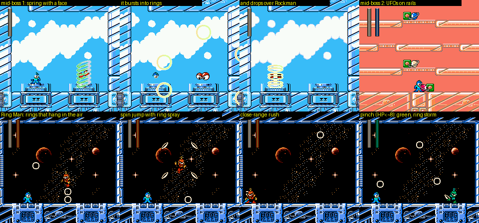
*Mid-boss 1 (spring), mid-boss 2 (rail UFOs), Ring Man's patterns, and his green pinch mode.*

- **Mid-boss 1, screen 5 (fight `$17`)**: a coil spring with a face that cycles through four colours. It hops between
  two teleporter pads, **bursts into four rings** that fly out and back, reassembles somewhere else, and drops onto
  Rockman so he ends up *inside* its coils. Parts: objects `$52/$53/$54`, HP 9 and 18.
- **Mid-boss 2, screen 12 (fight `$18`)**: the screen is four horizontal rails; three Saturn-ring UFOs (red, blue,
  white) each ride a green cart along a rail and change rails. They share the boss bar: their HP bytes are `$8E`,
  `$84`, `$8A` (bit 7 = "counts toward the bar"; 14 + 4 + 10 = 28). The game also rewrites the room layout in WRAM
  every frame during this fight (my section detector fired continuously), so the rails are part of the map, not sprites.

### 1.5 Ring Man [seen]

Patterns (fight `$04`, 1000 frames observed passively, then again at low HP):

- Throws rings that **stop and hang in the air** ("holdable" like his weapon), then drift, so the room fills with slow
  obstacles. Several rings stack into a column in front of him.
- **Spin jump**: a high jump that ends in a midair spin, spraying flat spinning rings in several directions (the
  8-direction throw of the Holdable Control Ring Boomerang).
- Rushes in close at floor level.
- **Pinch mode**: at low HP his palette turns green and the screen fills with eight or more rings at once.

Weapon table (HP 28; criticals switched off; damage per hit and the boss invincibility set by the hit, read from
`$05B8 + slot` (`$05CF` for slot 23), the per-object i-frame timer):

| Weapon | Damage | Boss i-frames | Note |
|---|---|---|---|
| Rock Buster | 2 | 126 | the "more than 2 seconds" of the readme |
| Rush Cannon | 28 | - | one shot kills ("but this may be dodged") |
| Toad | 3 | 126 | |
| Wire | 2 | 19 | |
| Water Cutter (Dive) | 3 | 14 | |
| Ring | 2 | 19 | |
| Drill | 2 | 19 | |
| Recycle Inhaler (Dust) | 3 | 59 | needs to be close |
| Pharaoh | 2 | 19 | |
| Spark Manbow (Bright) | 2 | 39 | |
| **Hell Wheel (Skull)** | **3** | **7** | **the weakness by the readme's rule (shortest i-frames)** |
| Wish Star | - | - | did not connect with my auto-aim |

Vanilla RM4's Ring Man is weak to Pharaoh Shot. In 4MI the weakness is Skull's Hell Wheel, signalled by the i-frames
rather than the damage number, exactly as hint.txt says.

## 2. Pharaoh Man stage (`$22` = 3)

**In one line: a cursed pyramid.** Almost every room puts a *curse* on Rockman, named in small letters under the life
bar, and the bar beside it changes colour with the curse. The stage starts in the middle of the tomb with reversed
controls, so pressing RIGHT walks you left, back out of the pyramid into the desert night. It ends with a two-floor
boss fight in which Pharaoh Man blows the floor away and the fight continues one storey down, under a new curse.

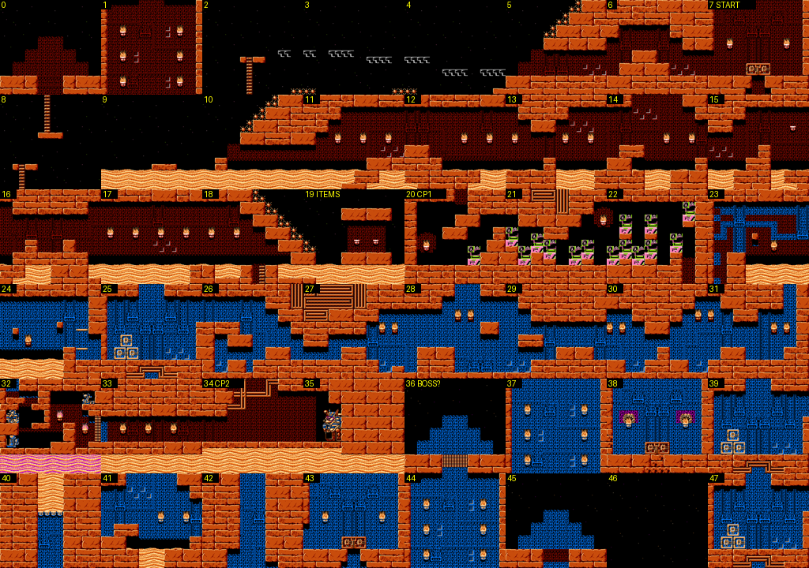
*Both sections of the stage (outer tomb and desert in orange, inner tomb in blue; label = global screen number).
Screen 39 reuses screen 25's layout (table `$B500` maps both to local 2).*

### 2.1 The curses [seen]

The word is drawn with sprites (tiles `$3E/$3F/$4E/$4F`, loaded per room), so it is not a text string in ROM.

| Word | Where (screen) | What it does (measured with 120 idle frames + 40 frames of RIGHT + a jump) |
|---|---|---|
| **REVERSE** | 7 (the start), 18 | LEFT and RIGHT are swapped: RIGHT for 40 frames moved Rockman 46 px **left** |
| **HOPPING** | 6, 14 | Rockman hops by himself (Y went 148 → 95 and back while idle) |
| **BERSERKER** | 11, 12, 22 | Fires the current weapon by itself (a shot appeared with no input). This is why limited.txt tells no-kill players to hold Rush Search or an empty weapon here ("バーサーカー対策に、Rサーチや、武器を空にしておく") [doc + seen] |
| **ROULETTE** | 13 | The weapon changes by itself: in 120 idle frames `$A0` went through slots 0, 1, 2, 3, 5, 6, 12. This is the readme's "place where the weapon changes on its own" (limited.txt warns buster-only players not to fire there) |
| **MINIMUM** | 15 | jump height 43 px instead of 52 [seen; meaning of the name not confirmed] |
| **FIDGET** | 16, and the lower boss chamber | no idle effect measured [guess: you cannot stand still or stop] |
| **SLIPPING** | 17 | Rockman slides: 152 px of drift while idle (ice physics) |
| **FETTER** | 33 | jump height 43 px [seen]; "fetter" = shackles [guess: slowed or shortened moves] |
| (none) | outside screens 2-5, 8-10 | |

How the curse is stored was not traced (a RAM diff between a REVERSE and a HOPPING room was inconclusive).

### 2.2 Route [seen, BFS explorer + walking]

Explored edges (godmode, teleport to every open edge, both D-pad directions):

```
7 (REVERSE start) -L-> 6 -L-> 5 -L-> 4 -L-> 3 -L-> 2 (outside, night) -D-> 8 -D-> 9 -R-> 10 -R-> ... -R-> 18
18 -R(upper rows)-> 19 (dead end: treasure room)       18 -D(ladder)-> 20 (checkpoint 1) -R-> 21 -R-> 22 -D-> 31
31 -L-> 30 -L-> 29 -L-> 28 -L-> 27 -L-> 26 -L-> 25      (section B, inner tomb, walked leftwards)
34 (checkpoint 2) -L-> 33 (FETTER)      boss = 36, Shadow Man = 47
```

| Screens | Contents |
|---|---|
| 7 → 2 | Inside the outer tomb (torches, brick), going **left** under REVERSE/HOPPING. Small purple bat-robots, a **jackal robot** that prowls the floor. Screens 2-5 are outside: a starry night beside the pyramid's spiked slope, crumbling pink brick ledges over spikes, small hopping cage-robots. |
| 8-10 | Drop back down into the desert: a ladder hanging in the sky, open night. |
| 10-18 | A long run along the **quicksand** floor (block type 12, wavy orange; you sink) under the pyramid's spiked slope, with a new curse almost every screen (BERSERKER, ROULETTE, HOPPING, MINIMUM, FIDGET, SLIPPING, REVERSE). |
| 19 | **Treasure room** (one screen, dead end): five items in a pyramid formation, `$7A` (120,152), `$5A` (136,120), `$56` E-tank (160,40), `$7C` 1UP (184,120), `$7A` (200,152) [code]. This matches the "one-screen hidden room with 1UPs and E-tanks" of hint.txt. The explorer registered an edge from the upper rows of screen 18's right side into 19, but only after teleporting while the camera was on another page, so **the entrance is unconfirmed** (I never saw the room drawn on screen). |
| 20-22 | Checkpoint 1. Inner tomb rooms with stone jars (screen 22, BERSERKER). Drop down at the right of 22. |
| 31 → 25 | Section B: the inner tomb, played right-to-left. The quicksand here **cycles orange → pink**. Green pot robots on ledges, wall turrets. Screen 25 is where my explorer stopped (see gaps). |
| 33-34 | Checkpoint 2 at 34 in a pipe room; 33 is FETTER with another jackal robot. |
| 36 | Pharaoh Man (pyramid backdrop). 37-38 are the lower chamber of the same fight. |
| 47 | Shadow Man (fight `$21`), in a room stacked with red crates. |

**Eddie** is on screen 13 (object `$33` at 240,164) [code].

Reliability: the walk 7 → 2 → 8 was done with normal controls and the camera following. The edges from 9 onwards come
from the explorer's teleports, and in this stage the camera often stayed on an earlier page (for example at page 9
while Rockman was on 18), so read them as the physical layout of the rooms rather than a verified route.

**Gaps (honest):** in section B the explorer reached 25-31 and 33-34 but not 32 or 35, and never found the edge from 25
onwards; screen 25's floor is open in the collision data but the camera does not follow a teleport there, so I could
not settle whether the way on is through the quicksand. How you reach Shadow Man's room (47) in normal play was not
found. The stage is 48 screens long and is clearly a maze (screen 39 is a repeat of 25), but I did not map the maze.

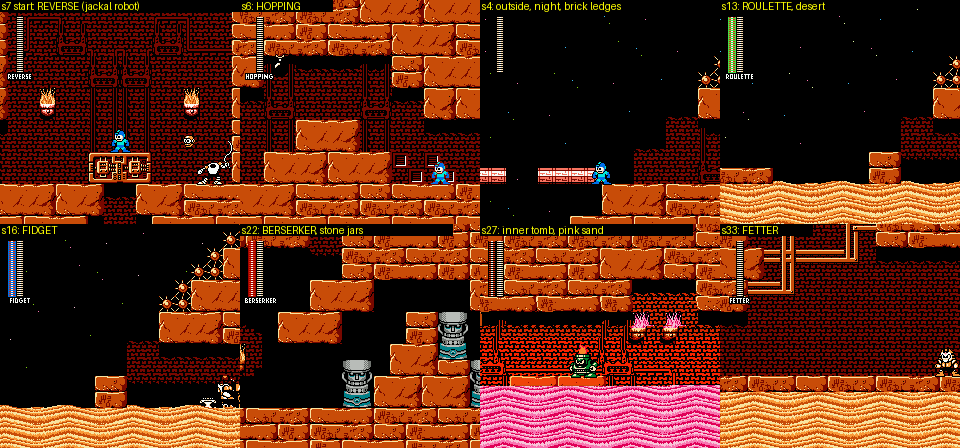
*The start under REVERSE, HOPPING, the night outside, ROULETTE, FIDGET, BERSERKER among stone jars, the pink
quicksand of the inner tomb, FETTER.*

### 2.3 HARD [code + seen]

Entering the stage with CONFIGURATION MAIN = HARD (`$78CD = 1`) changes two screens of section A: the bottom row under
the quicksand of screens 18 and 19 becomes **spikes** (`##` → `^^`). The pits look the same as on NORMAL, but on HARD
sinking all the way is fatal. See the HARD image in §4.4.

### 2.4 Mid-boss: Shadow Man (fight `$21`, screen 47) [seen]

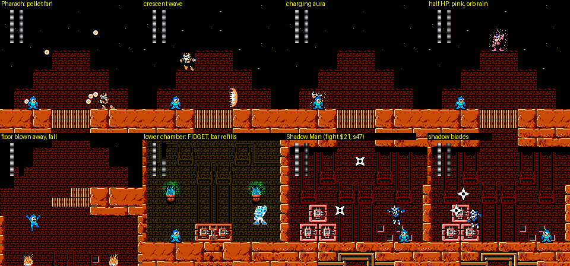
*Pharaoh Man's patterns, the floor collapse into the lower chamber, and Shadow Man.*

The blue ninja with a star on his forehead is MM3's **Shadow Man**, appearing as an intruder. He jumps between the red
crates and throws **shadow blades** (four-point shuriken) in pairs. He shows no life bar of his own in the arena. The
same fight exists in Bright's (`$20`) and Toad's (`$22`, riding a frog) stages. This is the "SHADOWMAN" flag and the
source of the **SUPER STAR** equipment ("what was attached on Shadow Man's forehead"), see text.md [text].

### 2.5 Pharaoh Man [seen]

Phase 1 (pyramid top, 28 HP):

- **Pellet fan**: a spread of five or six small orbs thrown upward that rain down across the room.
- High jumps across the pyramid.
- **Crescent wave**: a large crescent-shaped energy wave that slides along the floor (the charged Pharaoh Shot).
- A sparkling **charging aura**, then a cyan flash (a fast dash).

Phase 2, at half HP (14): he turns pink and becomes invulnerable (the boss i-frame timer stays at 1; no weapon,
not even Rush Cannon, did damage in 2400 frames), rains large pink orbs, **blows the brick floor away**, and Rockman
falls two screens (36 → 37 → 38) into a dark burial chamber with green torches. The HUD now says **FIDGET**. Pharaoh
Man reappears as a pale cyan figure, and his bar **refills from 14 to 21**. So he really has 28 + 7 = 35 HP.

Weapon table (criticals off; phase 1 unless noted):

| Weapon | Damage | Boss i-frames |
|---|---|---|
| Rock Buster | 3 | 126 |
| Wish Star | 14 (one hit seen in phase 1) | - |
| Rush Cannon | 21 in phase 2 (one shot); no hit in phase 1 | - |
| Toad | 3 | 126 |
| Wire | 3 | 19 |
| Water Cutter (Dive) | 2 | 14 |
| Ring | 3 | 19 |
| **Drill** | **4** | **14** |
| Recycle Inhaler | 3 | 59 |
| Pharaoh | 3 | 19 |
| Spark Manbow (Bright) | 3 | 39 |
| Hell Wheel (Skull) | 3 | 24 |

Phase 2 gave the same per-hit numbers (Drill 4 / 14 frames, Dive 2 / 14). The weakness is the **Drill Torpedo** (the
only 4-damage weapon, with the shortest i-frames). Vanilla RM4's Pharaoh Man is weak to Flash Stopper (Bright).
Pharaoh Man takes 3 from the buster, more than the other three bosses here (Ring 2, Drill 1, Dive 1), which fits
hint.txt's "low durability, but his attacks are fierce".

## 3. Drill Man stage (`$22` = 2)

**In one line:** a mine and pipe works inside pink rock, where much of the rock is **fake foreground** you walk
behind, with a fork in the route, five mid-boss fights in the data (the hint says a well-chosen path meets only two),
a Mega Man Killer whose pogo stick you take and ride over spike floors, and a boss who drills new tunnels into his own
arena.

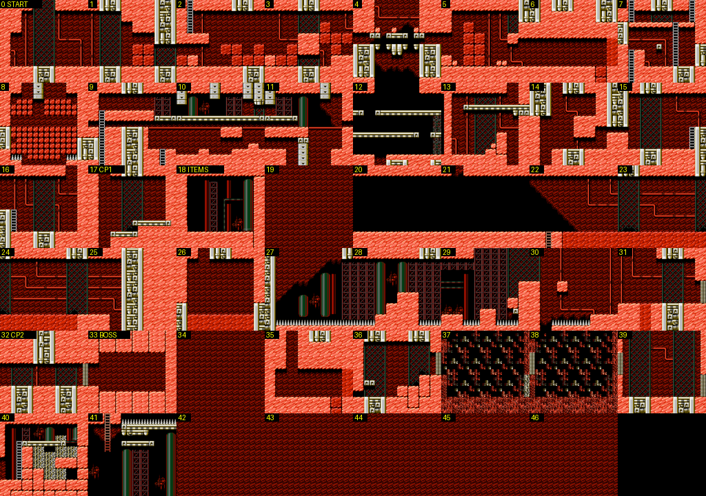
*Both sections (label = global screen). Black or flat-red tiles (19-20, 34, 42-46) are screens whose layout is not in
WRAM when the section loads; 20, 35, 38 and 47 are mid-boss rooms that are built at run time.*

### 3.1 Structure and route [code + seen]

| Section | Screens | Notes |
|---|---|---|
| A | 0-20 | pipe works; 18 = treasure room; 20 = hippo mid-boss room |
| B | 21-41 | dark caves, Quint, the spike-floor factory, checkpoint 2 (32), boss (33), the second branch (35-41) |
| (B) | 42-47 | all mapped to local `$0D` (the room of screen 34) |

Explored edges (BFS from checkpoint 1):

```
17 (cp1) -D-> 21 -R-> 22 -R-> 23 -R-> 24 -R-> 25 -D-> 26 (Quint) -R-> 27 -R-> 28 -R-> 29 -R-> 30 -R-> 31
22 -D(column 12)-> 41          (the fork: a hole in screen 22's floor drops into the other branch)
32 (cp2) -R-> 33 (Drill Man)
```

| Screens | Contents [seen] |
|---|---|
| 0-1 | Pipe works behind chain-link fences; floating green **lantern** robots and Metalls. I could not get past screen 1's right half with the tools (a block 4 tiles high; see gaps). |
| 8 | A room filled with **red boulders**, collision type 14 (the breakable-rock type of this stage [guess]). HARD adds a row of boulders (§4.4). |
| 17 | Checkpoint 1: a fenced room with a weapon-energy capsule on a ledge. The pink rock on both sides is partly not solid: the collision map shows a shaft hidden behind the left rock (cols 2-3, from top to bottom; the drop to 21 goes down it) and a one-block-high gap under the right ledge leading to 18. Rockman disappears behind the rock (BG priority) when he stands in it. |
| 18 | **Treasure room** (one screen): `$5A` (152,184), E-tank `$56` (184,88), 1UP `$7C` (208,184) and an object `$0A` [code]. It sits behind 17's right wall; the gap is one block high, and I could not get Rockman through it. |
| 20 | Purple **robot hippo** on a brick pillar (fight `$16`): Kabatoncue-style (MM5) [guess], fires from its mouth. |
| 21-25 | Dark caves and brick; the spiky **Mole** drill robots (vanilla RM4 Drill-stage enemy) and Metalls. |
| 26 | **Quint** (fight `$24`): the green Mega Man Killer of *Mega Man II* (GB), with his pogo stick **Sakugarne** standing beside him [guess for the name, based on the look and EXWP's QUINT]. |
| 27-31 | Factory with green tanks, scaffolding and **spike floors**; red crab walkers. After the Quint room, Rockman is on the pogo stick (state saved by the explorer at 27). This is limited.txt's "in Drill, you must pick up a weapon and advance a little with it" [doc + seen]. **Eddie** at 30 (188,164). 31 was a dead end for the explorer. |
| 32-33 | Checkpoint 2, boss. |
| 35, 38, 41, 47 | The other branch [seen in the fight states]: a cave room with small bomb-dropping flyers (`$15`, s35); a red-white humanoid robot in a **starry room framed by golden meander walls** (`$1E`, s38); gold platforms under a spike ceiling (s41); a green cave with waterfalls and a round one-eyed robot (`$2C`, s47; this room shows a bottom status bar "WPN P"). |

**Gaps (honest):** the start (screens 0-16) beyond screen 1 and the branch beyond 41 were not traversed; the treasure
room entrance was not achieved; the Wire was not found. text.md's debrief says "Drill Man hid it [the Wire] in
somewhere" [text].

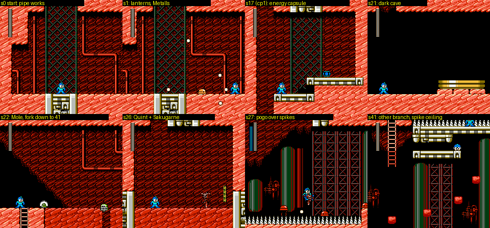
*Start, lanterns and Metalls, checkpoint 1, the dark cave, the Mole and the fork, Quint and his pogo stick, riding the
pogo over spikes.*

### 3.2 Mid-bosses [seen]

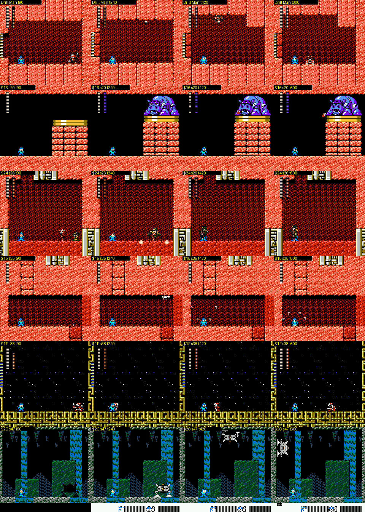
*Rows: Drill Man, hippo (`$16`), Quint (`$24`), cave flyers (`$15`), red-white robot (`$1E`), one-eyed robot (`$2C`), at
four moments each.*

Five fights live in this stage's data (`$15 $16 $1E $24 $2C`), more than any other stage here, which fits hint.txt's
remark that choosing your path leaves only two mid-bosses [doc]. HP: `$16`, `$1E`, `$24`, `$2C` use the boss bar (HP
byte `$9C` = 28); `$15` is a swarm.

### 3.3 Drill Man [seen]

Patterns: throws small drill missiles horizontally; burrows into the floor and **comes out of the ceiling**; a rock
burst at the wall. Most strikingly, **the arena changes shape during the fight**: the ceiling and floor gain notches
and tunnels where he has drilled (the room is a low corridor at the start and much taller later). As with Ring's
second mid-boss, this means the fight edits the decompressed room layout in WRAM.

| Weapon | Damage | Boss i-frames |
|---|---|---|
| Rock Buster | 1 | 126 |
| Toad | 3 | 126 |
| Wire | 2 | 19 |
| Water Cutter (Dive) | 3 | 14 |
| Ring | 2 | 19 |
| Drill | 2 | 19 |
| Recycle Inhaler | 3 | 59 |
| Pharaoh | 2 | 19 |
| Spark Manbow | 2 | 39 |
| **Hell Wheel (Skull)** | **2** | **2** |
| Rush Cannon, Wish Star | no hit with my auto-aim | |

Weakness: Hell Wheel, whose hits leave him only 2 frames of invincibility (14 hits in 816 frames). Water Cutter is the
best damage per hit (3 every 14 frames). Vanilla RM4's Drill Man is weak to Dive Missile; the Water Cutter is still
good here. hint.txt: "his attacks are monotonous and easy to read, but his durability is normal" [doc], and the buster
doing only 1 per 2 seconds confirms the second half.

## 4. Dive Man stage (`$22` = 6)

**In one line:** a harbour city on the coast, a sea crossing on Rush's watercraft under a flying whale battleship, a
sea floor of mines and periscope pillars, machine halls with Mega Man Killer-like robots, and Dive Man's submarine bay.

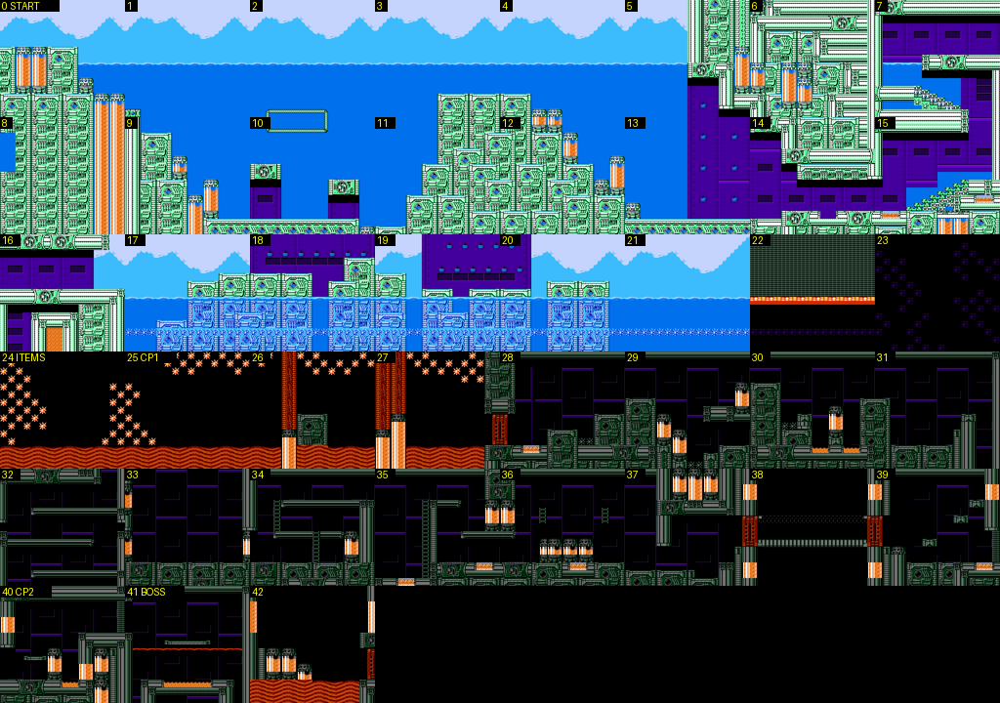
*Sections A (0-21) and B (22-42) (label = global screen). Section C (43-47) holds a further machine hall (fight `$1F`
at 46).*

### 4.1 Structure and route [code + seen]

| Section | Screens | Notes |
|---|---|---|
| A | 0-21 | harbour city and pier (0-7), the sea (the whale fight `$19` is at 22's coordinates in the arena, see below) |
| B | 22-42 | sea floor (24-31), machine halls (32-33), submarine bay (40), Dive Man (41) |
| C | 43-47 | extra hall: orange robot `$1F` at 46 |

```
0 -R-> 1 -R-> 2 -R-> 3 -R-> 4 -R-> 5 -R-> 6 -R-> 7 (pier; my walker stopped here)
25 (cp1) -R-> 26 -R-> ... -R-> 31 -D-> 32 -D-> 33 (spear robot)
25 -L(top rows)-> 24 (treasure room) -R-> 25
40 (cp2) -R-> 41 (Dive Man)
```

| Screens | Contents [seen] |
|---|---|
| 0-5 | Coastal city of green machinery and orange tanks, blue sky over the sea horizon. |
| 6-7 | The pier: kiosks marked with a round "MSN" logo, green clam turrets that open to fire, a small rocket robot. |
| 22 | (fight `$19`) **Whale battleship**: a green flying whale-ship over open sea, launching seagull robots, while Rockman stands on **Rush as a watercraft** on the water. This is EXWP 6 "R.PWC" (personal water craft) from cheats.md, and limited.txt's "in Dive you must pick up a weapon; if you leave it alone its time runs out and you can continue with the buster" [doc + seen]. |
| 24 | **Treasure room** (one screen): 1UP `$7C` (56,184) and E-tank `$56` (64,40) [code], reached by leaving checkpoint 1's screen (25) through the **top of its left edge** [seen: with the camera in place, the room scrolls in properly]. It is a narrow chamber walled with sea mines; Rockman picked up the 1UP on the floor, the E-tank floats at the top. |
| 24-31 | The sea floor: black water, a ceiling of spiked sea mines, rippled orange sand, rising bubbles; tall red **periscope pillars** with lamps at 29-31. |
| 32 | Pipe hall with robot fish. |
| 33 | Orange **spear robot** (fight `$23`) in a dark hall with the MSN floor: Enker, the *Mega Man* (GB) Mega Man Killer whose weapon is a spear (EXWP 2 ENKER) [guess]. |
| 34-35 | Objects `$07` (16,104) and `$06` (224,108) [code]. `$06` also sits at the start of Cossack 2 (screen 1), and hint.txt says the Wire and Balloon also lie early in the Cossack stages, so `$06` is probably the **Balloon** pickup [guess]. text.md's debrief: "Dive Man hid it [the Balloon] in somewhere". Not reached. |
| 40-41 | Checkpoint 2 in a purple submarine bay; Dive Man. |
| 46 | (fight `$1F`) orange-and-blue robot in a grey machine hall that raises water geysers. |

**Eddie** is on screen 36 (236,164) [code].

**Gaps:** I did not get past the pier (7), so screens 8-21 and the sea crossing in stage order are only known from the
fight state; 34-39 and 42-47 were not reached in play.

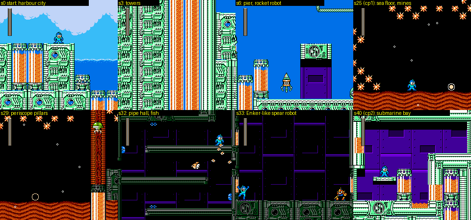
*Harbour start, the towers, the pier, the sea floor at checkpoint 1, periscope pillars, the pipe hall, the spear
robot, the submarine bay.*

### 4.2 Mid-bosses and Dive Man [seen]

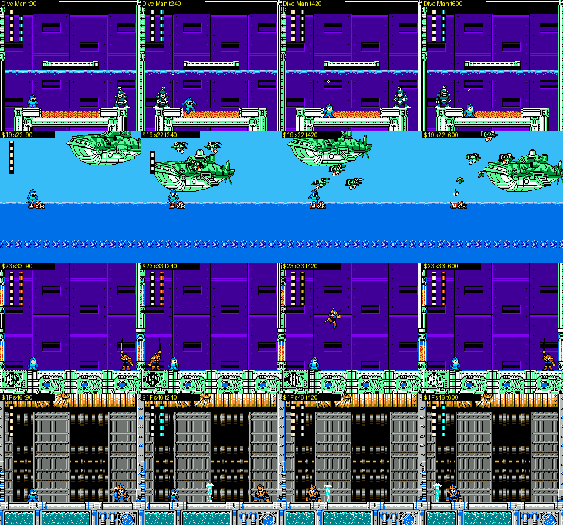
*Rows: Dive Man, the whale battleship (`$19`) with Rockman on Rush's watercraft, the spear robot (`$23`), the geyser
robot (`$1F`).*

Dive Man fights in a half-flooded bay: the water line runs across the middle of the room, with a small platform above
it and an orange pit between the floor ledges below. He does a **spinning torpedo dash** along the floor (the Dive
Missile turned into a body attack), fires small shots, and leaps out of the water onto the upper platform. Bubbles
rise throughout.

| Weapon | Damage | Boss i-frames |
|---|---|---|
| Rock Buster | 1 | 126 |
| Toad | 3 | 126 |
| Wire | 2 | 19 |
| Water Cutter (Dive) | 1 | 14 |
| Ring | 2 | 19 |
| Drill | 2 | 19 |
| Recycle Inhaler | 3 | 59 |
| Pharaoh | 2 | 19 |
| **Spark Manbow (Bright)** | **2** | **7** |
| Hell Wheel (Skull) | 2 | 24 |
| Rush Cannon, Wish Star | no hit with my auto-aim | |

Weakness: Spark Manbow (shortest i-frames). His own Water Cutter does 1. Vanilla RM4's Dive Man is weak to Rain Flush
(Toad); 4MI's Toad does 3 per hit but with buster-length i-frames.

### 4.3 Cross-stage notes

- In all four fights, **damage per hit barely changes** between weapons (1-4). What changes is the invincibility the
  hit leaves on the boss: 126 frames for the buster and Toad, 59 for the Inhaler, 39 for Spark Manbow, 19 for most
  weapons, 14 for the Water Cutter and Drill, and 2-8 frames for the weakness. That is hint.txt's "watch the
  invincibility time after you hit", measured [doc + seen].
- The i-frame timer is `$05B8 + slot` (boss slot 23 → `$05CF`): set by the hit, counts down by 1 per frame [seen].
- Rush Cannon one-shots a boss when it connects (28 on Ring Man, 21 on Pharaoh's second phase), as its help text says
  ("everyone is defeated by this instantly, but this may be dodged").

### 4.4 HARD differences in these four stages [code + seen]

Comparing the decompressed sections after entering each checkpoint on NORMAL and on HARD (`$78CD = 1`):

| Stage | Change on HARD |
|---|---|
| Ring | Two block attributes (`$6450`, `$6452`: `$13` solid → `$00` air). Those blocks are used only in the laser-bar rooms (6-9, 15-18), so on HARD some bar parts you could stand on are no longer solid [guess which part]. |
| Pharaoh | Screens 18 and 19 (the treasure room): the row under the quicksand becomes spikes. |
| Drill | Screen 8: one more row of boulders (rows 6-7 filled). |
| Dive | No layout change at the three checkpoints. |

The object lists at the checkpoints were identical; HARD's "enemy and boss patterns" change [doc] would be in behaviour,
which I did not compare.

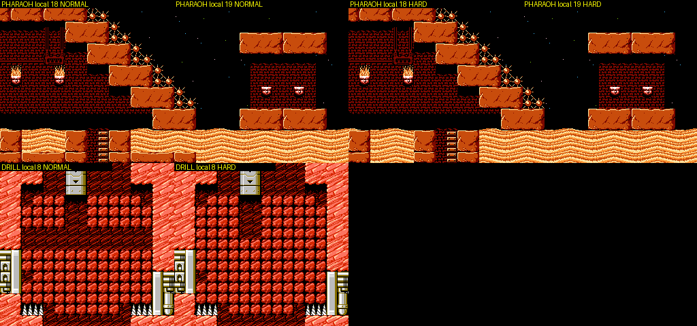
*NORMAL vs HARD: Pharaoh 18 and 19 (the spikes are under the sand, so they look the same) and Drill 8's boulder room.*

## 5. Jokes and references

| Stage | Joke or reference | Tag |
|---|---|---|
| Ring | A **circus**: rabbit robots riding gear unicycles, a coil-spring mid-boss that swallows Rockman, rings everywhere. | [seen] |
| Ring | "Ring" as in **planetary rings**: Saturn-ring UFOs, and Ring Man's room has a window onto a ringed planet and the galaxy. | [seen] |
| Ring | The sky turns from noon blue through magenta to a salmon **sunset**, and the boss is fought against outer space: the stage is a flight into the night. | [seen] |
| Ring | The hidden room is decorated with a stack of **fake boss shutters**, and Eddie stands exactly where you step off the screen to find it. | [seen] |
| Ring | The credits' fabricated enemies **RONG RONG RONG / RANG RANG RANG / RUNG RUNG RUNG** conjugate "ring" (text.md); they are presumably this stage's ring enemies. | [text][guess] |
| Pharaoh | The **pharaoh's curse** made literal, one curse per room, with the name printed under the life bar. | [seen] |
| Pharaoh | The very first screen is **REVERSE**, so a player who presses RIGHT walks out of the pyramid the way he came, which turns out to be the route. | [seen] |
| Pharaoh | **Jackal (Anubis) robots** prowl the tomb. | [seen] |
| Pharaoh | **Shadow Man** (MM3) intrudes; the debrief: "WHAT HE WANTED TO DO? HOW MAD THOUGHT HE HAVE!" (JP `まったく　わけわかんねーやろうだぜ`, "what a weirdo"). His forehead star becomes the SUPER STAR equipment. | [seen][text] |
| Pharaoh | The boss **drops you into his burial chamber** for round two. | [seen] |
| Drill | **Quint and Sakugarne**: in *Mega Man II* (GB) Quint rides the Sakugarne, a pogo jackhammer, which is a drill. Here you beat him and ride it yourself. | [seen][guess on names] |
| Drill | A **robot hippo** on a pillar (MM5's Kabatoncue look) and vanilla RM4's Mole drills. | [seen][guess] |
| Drill | Pink rock that is only scenery: Rockman walks *behind* it and vanishes. | [seen] |
| Dive | Vanilla RM4's Dive stage mid-boss is the robot whale Moby; 4MI's whale is a **flying battleship** over the sea. | [seen][guess on lineage] |
| Dive | **Rush as a jet ski** (EXWP "R.PWC"), a nod to Rush Marine. | [seen] |
| Dive | An **Enker**-like spear robot (the *Mega Man* (GB) Killer, whose EXWP weapon is also in the game). | [seen][guess] |
| Dive | Kiosks and floors carry a round **"MSN"** logo (unidentified). | [seen] |

## 6. Open questions

- Where exactly are the **Wire** (Drill) and **Balloon** (Dive) pickups? Candidates from the data: object `$06` on Dive
  35 (the same type sits at the start of Cossack 2) and `$07` on Dive 34; nothing similar in Drill's table, so the
  Wire may be dropped by a mid-boss or a script object (`$08`/`$09`).
- How to enter Drill's treasure room (18): the passage behind 17's right wall is one block high.
- Pharaoh's maze beyond screen 25, and the way to Shadow Man's room (47).
- What MINIMUM, FIDGET and FETTER do exactly, and where the curse byte lives.
- Which of Drill's five mid-bosses each branch meets (hint.txt: "two, if you choose the path").
- HARD's behaviour changes for enemies and bosses (only map deltas were compared).

## Lessons for Rockman 6 GP

1. **Stream a stage in sections.** 4MI compresses each 12-23-screen section separately and decompresses it into RAM
   on entry, with its own metatiles, CHR and palette, joined by duplicated seam strips. That is how a 48-screen stage
   with three tilesets fits. If RM6 GP needs longer or more varied stages than RM6's format allows, this is the model;
   the seams also give free scenery changes (Ring's sunset).
2. **One byte of "room curse" is a whole design toolbox.** Pharaoh's stage gets eight distinct challenges (reversed
   controls, auto-hop, auto-fire, random weapon, slippery floor...) from per-room flags on code that already exists,
   and a 4-letter-high HUD word makes each one fair. RM6 GP could do the same with a per-room modifier byte.
3. **Keep the room layout in RAM so bosses can change it.** Drill Man's tunnels and Pharaoh's exploding floor cost
   no new art. A boss that edits the map is memorable.
4. **Two-phase bosses with an arena change.** Falling to a lower floor plus a partial bar refill (14 → 21) reads as a
   new fight while reusing the same boss.
5. **Signal weakness through invincibility, not damage.** All weapons doing 1-4 keeps every weapon useful; the 2-to-126
   frame spread is the real lever. If RM6 GP adopts this, show the player the i-frames (flash length) clearly.
6. **Hidden rooms as one-screen side rooms off an edge**, near a landmark (Eddie in Ring) and holding E-tank + 1UP, are
   cheap to add and discoverable. Make their entrances visible in the collision data so tools can find them.
7. **Difficulty as small data deltas.** HARD changes two block attributes in Ring, puts spikes under Pharaoh's
   quicksand and adds boulders in Drill. A HARD flag that swaps a handful of blocks per section is easy to build and
   test.
8. **Set-piece vehicles as weapon slots**: Quint's pogo stick and Rush's jet ski are "extra weapons" that replace the
   buster for a stretch (cheats.md's EXWP). RM6's Rush adaptors could host the same idea.
9. **Tooling:** select weapons through the game's own input path (controller 2 here), read the per-object i-frame
   timer for damage tables, and when an explorer teleports, also move the camera, or verify edges by walking.
