# 4MI stages B: Toad Man, Dust Man, Skull Man, Bright Man (r4mi-stages-b)

Scope: Rockman 4 Minus Infinity v1.01 (`roms/r4mi_mmc5.nes`), the stages of Toad Man (`$22` = 1), Dust Man (5),
Skull Man (7) and Bright Man (0): route, gimmicks, enemies, mid-bosses, hidden rooms, pickups, HARD differences, the
boss fights (patterns and weapon damage) and the jokes. I played with godmode (`cheats.godmode()`: frozen HP, lives and
i-frames, plus the SHOCK GUARD / TRAMPOLINE / BEAT safety items), so the "intended challenge" notes are my reading of
what a normal player faces. Where it mattered, I turned godmode off and measured the real damage.

Tags: **[seen]** emulator, **[code]** disassembly/data, **[text]** in-game text, **[doc]** readme, **[guess]**.

## Highlights ("how crazy it gets")

- **Some Robot Masters have a secret reaction to their own weapon.**
  - ●TOAD on Toad Man does 28 damage in one hit and turns him into a real, harmless frog. This is the "TOAD MAN WANT
    TO BECOME REAL TOAD" bonus: it sets FLAG bit TOADMAN and marks the fight as a *draw* (the ending has an
    "AND n DRAW" line for him alone).
  - SPARK MANBOW on Bright Man overloads his bulb. His HP drains 28 → 0 in ten frames, and he bursts in a cyan power
    surge [seen].
- **Dust Man recycles Rockman.** His suction drags Rockman in and turns him into a small blue item cube. Dust Man
  then stomps on the cube until Rockman dies (HP 18 → 1 → death in about 140 frames). He also inhales the room's
  debris to **heal himself** [seen].
- **Toad Man doesn't fight until you shoot.** If you stand still and don't fire, he never moves [seen].
- **Dust Man's stage is a working garbage plant**:
  - a TEMP heat gauge in the furnace (once full, it burns you for 1 HP every 2 s);
  - a detonator that you shoot to blow open the floor;
  - a 7-screen corridor of ceiling crushers over a conveyor;
  - a **trash compactor**: pistons slide in one row above another until they fill the room and crush you, so you
    climb the pistons and jump out through the ceiling [seen].
- **Toad Man's stage**:
  - floods the castle (water physics and currents through the whole first half);
  - has a **giant frog mech with a ninja rider** as its first mid-boss, and **Shadow Man riding a frog** as a second;
  - makes you shoot your way through **pillars of frog eggs**;
  - ends with a **surf ride down an aqueduct** on a little red boat [seen].
- **Skull Man's stage** has a **screen-filling robot T-rex** (KING GOJULUS) and a free-scrolling sky of floating
  bones. **Bright Man's stage** has **Shadow Man** as a mid-boss and a hidden room of appearing blocks [seen].
- **4MI replaced vanilla's room table with an explicit screen-link list** (bank `$71`). That list is how every stage
  gets its loops, one-way drops and hidden rooms (§0.1). For example, Toad's hidden room is just two entries:
  "screen 13, exit up → screen 28" and "screen 28, exit down → screen 13" [code].
- **HARD rewrites level geometry**, not just enemies. It rearranges the obstacles of Toad's boat ride, removes a bone
  platform from Skull's sky, and rearranges the stepping blocks of Bright's block rooms [seen, §6].

## 0. Method and new tools

### 0.1 How a 4MI stage is wired [code + seen]

These findings apply to every stage.

**Screens and sections.**

- `$B500-$B53F` of the stage bank (`$20 + stage`) is a 64-entry table that maps each global screen to a local
  layout index. A local index of 0 starts a new *section*.
- Entering a section unpacks its blocks, metatiles and *all* of its screen layouts into battery WRAM: `$6000` blocks,
  `$6400` block attributes, `$6500` metatiles, and `$6900 + 64·local` layouts. Sections can therefore be long (Toad's
  first has 22 screens, Dust's has 32).
- A copy of the 64-entry map sits at WRAM `$7100`. r4mi-stages-a found the WRAM part.

**Vanilla's room table is gone; exits are an explicit link list.**

- The fixed-bank transition code is still vanilla, but at `$7E:CD24` it far-jumps (`JSR $DF5F` + `80 6D 71`) into
  **bank `$71` @ `$806E`**. That code looks the current screen up in a per-stage **link table**.
- Table pointers are at `$71:$849E` (lo) / `$84AE` (hi), indexed by `$22`. When `$750E ≠ 0`, a second table in WRAM
  at `$6FC0` is used instead.
- Entries are 8 bytes:

  | Byte | Meaning |
  |---|---|
  | 0 | type |
  | 1 | screen |
  | 2 | exit: `4` = leaving through the bottom, `8` = through the top, `1` / `2` = right / left edge. Top or bottom is chosen by Rockman's Y (`$0378 ≥ $80` → bottom) |
  | 3 | room |
  | 4 | target screen |
  | 5 | b5 |
  | 6 | section to load (`$FF` = none) |
  | 7 | b7 |

- Types 2-4 run the scrolling handler at `$81A6`.
- **An up-exit does not need a ladder.** Jumping through the top of a screen that has an `8` entry scrolls up, and
  Dust's compactor room relies on this [seen].
- Dumper for all 16 stages: `tools/analysis/r4mi/r4mi_links.py`.

**Collision types** in these stages (high nibble of the block attribute):

| Type | Meaning |
|---|---|
| 0 | air |
| 1 | solid |
| 2 | ladder |
| 3 | spikes |
| 4 | ladder top |
| 5 | boss shutter |
| 6 | water |
| 8 / 10 / 14 | slope pieces (RM3-style slopes) |
| 12 | water edge / waterfall (passable) |
| 14 / 15 | also stage-specific blocks (Toad's frog eggs, Dust's garbage) |

**Enemies and items.**

- Almost every 4MI enemy is placed as table type `$08`/`$09` and runs object AI **`$5E`**, a generic "4MI enemy"
  whose real kind is a sub-type in `$0468`. Evidence [code]: the ●TOAD effect table at `$41:$A2E8` branches on AI
  `$5E`, then indexes a second table by `$0468`.
- Placed types `$56`, `$5A`, `$7A` and `$7C` are the hidden-room items: `$7C` = 1UP, `$7A` = E-tank, `$56`/`$5A` =
  large energy [seen in Bright's and Toad's rooms].

**Boss HP and weapon selection.**

- The boss is object slot 23 (`$0467`, low 7 bits).
- Poking `$A0` does **not** change the projectile: the weapon-change routine is what loads the weapon's graphics and
  palette. So my damage tool selects weapons the way the game does, by cycling with controller-2 A.
- `emu.py` gotcha: `step(buttons, player=1)` only sets player 2's mask, and the mask *stays* set until you send `[]`
  for player 2 again.

**Equipment pickups** are item objects with sprite ids `$12-$19` [code]:

- Collecting one runs bank `$41` @ `$AB04`, which does `$7839 |= bit[$0558 - $12]` (bit table at `$7F:$FCBF`).
- Ids `$16`/`$17` (SHOCK GUARD / TRAMPOLINE) also set checkpoint 2 in RM stages.

### 0.2 Scripts (scratch dir `build/research/r4mi/r4mi-stages-b/`)

| Script | What it does |
|---|---|
| `ghost.py`, `route.py` | "Ghost" explorer (details below the table) |
| `stitch.py` | Stage maps built from the per-screen BG renders and the route log, one strip per section |
| `census.py` | Enemy census: for each screen, the object AI ids, sprite ids and HP seen in 4 s, plus one screenshot |
| `bossdmg.py` + `wsel.py` | Boss damage table (weapon selected by controller-2 cycling, Rockman kept beside the boss, criticals off) |
| `watch.py`, `win.py` | Fight recordings (logs and frame windows) |
| `hardmap.py`, `hardcmp.py` | Compare the unpacked section data after a death-warp with MAIN = NORMAL vs HARD |
| `kill.py`, `visit.py`, `t*.py` | Experiments quoted below |

How the ghost explorer works:

- It runs a BFS through the collision grid of the current screen and its neighbours, then moves Rockman along the
  path by poking X/Y, waiting for the camera to follow.
- The engine itself crosses screen edges, because the links live there.
- It climbs ladders for top exits, falls through bottoms, walks into shutters, and uses `kill.py` on bosses that block
  the way. As a last resort it no-clips.
- It rejects any "transition" the camera does not follow.
- `route.py` saves a state and a BG render at every screen (`scr/<stage>_NN.state`, `bg/`), plus a route log.

---

## 1. Toad Man stage (`$22` = 1): a flooded castle, a rain-soaked aqueduct, a boss you can turn into a frog

The stage has 48 screens in three sections [seen]:

- `0-21`: a flooded stone-and-copper castle.
- `22-28`: outdoors in the rain.
- `29-47`: an aqueduct over waterfalls, the indoor approach, and the boss.

Checkpoints are at screens 18 and 46. Vanilla Toad Man is a rainy sewer; 4MI keeps the rain only for the outdoor part
and floods the whole first half.

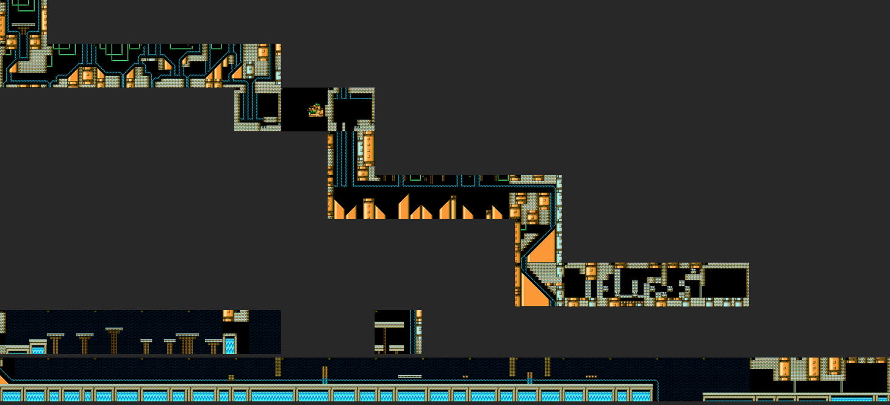
*Toad Man's stage, one strip per section, stitched from the per-screen BG renders along the ghost route (screen
numbers in yellow). The hidden room (28) is drawn right of 27, where its layout sits; you enter it from screen 13.*

### 1.1 Route, screen by screen [seen unless tagged]

| Screens | What happens |
|---|---|
| 0 | Start at the top of a sealed shaft; drop through the slot in the floor. |
| 1-6 | **Flooded** tunnels (details below the table). |
| 7 | **Mid-boss GAMARN AND GAMADAYU** (fight `$14`): a giant green frog mech with a hooded ninja rider (a separate object). It throws white lances and lobs bubble bombs; spikes line part of the floor. When it dies the rider flies off, and **the camera auto-scrolls right on its own** through an empty arena (8) to 9. |
| 9-11 | Two more drops. |
| 11-15 | A long flooded hall with **giant orange pyramid slopes**, frog statues and tadpoles. Ladders hang from the ceiling of screen 13; they are the way to the hidden room (§1.3). |
| 15-17 | Slope descents and a big diagonal staircase room. |
| 18-20 | Checkpoint 1 (18) and the **frog-egg pillars** (details below the table). |
| 21 | **Mid-boss PAKKUN SHADOW** (fight `$22`): **Shadow Man (MM3) riding a green frog**. The frog hops around, Shadow Man throws spreads of 4-point shuriken, smoke "poofs" mark the landings, and small tadpoles crawl in. The buster does 1 damage per hit, with about 2 s of i-frames. |
| 22-27 | **Outdoors in the rain**: stilted platforms over a bottomless pit, small waterfalls, white gull-birds, parachuting red bombs, and a big red dome walker (screen 26, HP 254, meant to be avoided [guess]). Screen 27 has no floor, so you **fall into the aqueduct** (link 27 → 29, which loads section `$1B`). |
| 29-39 | **The aqueduct**, a surf ride (details below the table). |
| 40-46 | Copper halls again, with red bird and crab robots (AI `$8E`, `$B0`). Checkpoint 2 is at 46. |
| 47 | **Toad Man** (§1.4), in a green tiled room. |

**Screens 1-6, flooded tunnels.**

- The castle is under water: slow falls, high jumps, and walls trimmed with a dotted water line.
- The scenery is green pipes, copper columns with faces, and **slopes** (orange wedges).
- **Water currents** push a standing Rockman sideways (about 12 px in 30 frames in screen 5).
- Small orange bird-fish robots swarm, and green **frog statues on pillars** spit tadpoles (screens 3, 5, 6).

**Screens 18-20, frog-egg pillars.**

- Pillars of frog eggs (block types 14/15) block the corridor.
- Each egg is a separate breakable block. A buster shot cracks the bottom one into a bubble, and you shoot your way
  through egg by egg.
- Spiral eggs (a curled-up tadpole [guess]) cap some columns.
- Screen 19 has a spike floor, and a boss shutter closes the end of 20.

**Screens 29-39, the aqueduct.**

- A water channel runs along the top of arches over a row of waterfalls, still in the rain.
- Rockman lands on a **little red boat** (AI `$20`) that carries him along the channel at about 2.5 px/frame: a surf
  ride.
- Green fish robots leap out of the channel, and green dome crabs on red legs wade in it.
- Spike strips (38) and rising pillars (30-35) have to be jumped.
- On HARD the obstacles are different (§6).

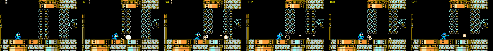
*Screen 18: buster shots crack the bottom egg of a pillar into a bubble; the corridor opens one egg at a time.*

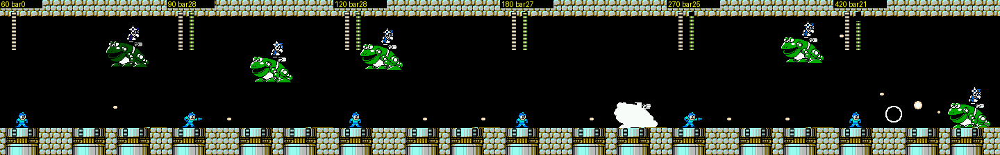
*GAMARN AND GAMADAYU (fight `$14`): the frog mech and its rider, and its destruction.*

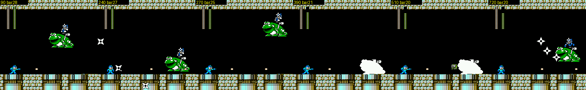
*PAKKUN SHADOW (fight `$22`): Shadow Man on a frog, shuriken spreads and smoke.*

### 1.2 Enemies [seen]

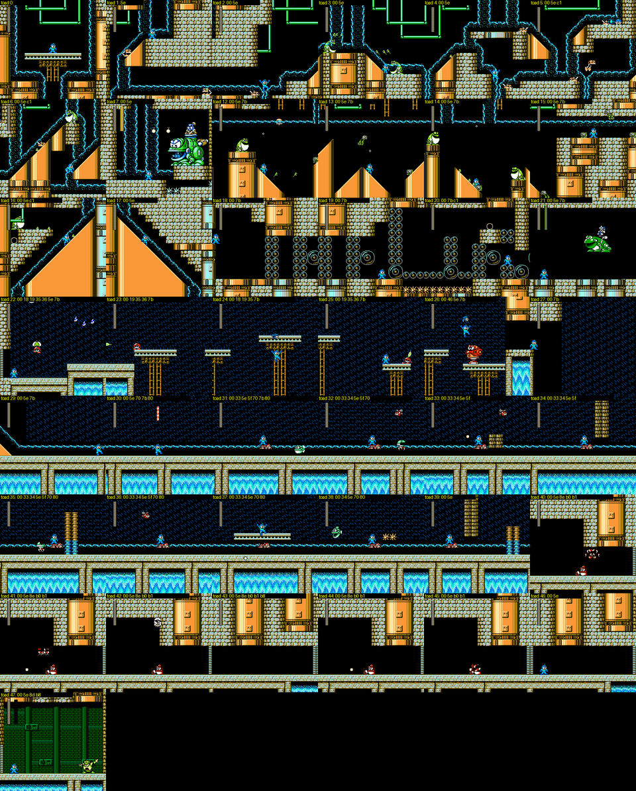
*Enemy census: one screenshot per screen 1.5 s after arriving, labelled with the object AI ids present (`5e` = the
generic 4MI enemy).*

### 1.3 Hidden room: screen 28 [code + seen]

- The link table has `screen 13, exit up → 28` and `screen 28, exit down → 13 (reload section $0A)`.
- So the ladder at the top of the flooded hall (screen 13, column 3) climbs into **one screen that is not on the main
  path**: a dark shaft with a ladder and two ledges holding an **E-tank, a 1UP and a large energy capsule**.
- Its floor is open; falling out drops you back into screen 13.
- Its layout sits at the end of section 2, which is why it appears right of screen 27 in the section render. It cannot
  be reached from 27, though: 27 has no floor, and every fall from 27 lands in 29 [seen].

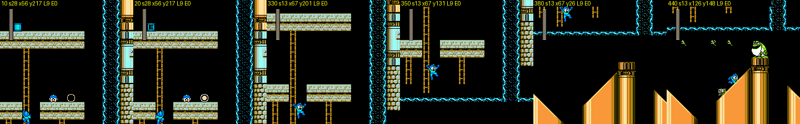
*Screen 28 (E-tank top left, 1UP and big energy on the right ledge), then the fall back into screen 13.*

### 1.4 Toad Man [seen + code]

**Behaviour.**

- Toad Man **does nothing until you shoot**. With Rockman only jumping, he stood still for 1,600 frames.
- Once you fire (even shots that miss), he plays as in vanilla: high hops toward Rockman, the Rain Flush dance (arms
  up, acid drops fall), and splash bursts where he lands.
- The hint file's "very strong if you fight him with the buster" comes from the i-frame rule. The buster does 1
  damage, and he is then invulnerable for about 130 frames.

**●TOAD turns him into a real toad** [seen + code].

- One hit does 28 damage, and he becomes a small hopping frog. The frog's AI is bank `$1D` @ `$BD1C`.
- The ●TOAD weapon code (bank `$41` @ `$A11F`) classifies every object through a table at `$41:$A2FC`, indexed by AI
  id. For AI `$5E`, a second table at `$A3FC` is indexed by sub-type. The table values mean:

  | Value | Effect |
  |---|---|
  | `$FF` | Toad Man (only AI `$8D`): `$7898 \|= $10` (**FLAG bit TOADMAN**) and `SEC / ROR $78A0` (the fight result becomes a **draw**) |
  | `1` | transform the enemy |
  | `2` | damage |
  | other | damage of that size |

- The frog keeps the boss bar at 28, hops harmlessly, and never ends the fight on its own (I waited 12,000 frames).
- **Any touch or hit kills it.** Bank `$1D` @ `$BD2D` checks player contact (`JSR $F95D`) and weapon contact
  (`JSR $E9D1`). The kill clears the TOADMAN bit again (`AND #$EF`), sets `$78A1 |= 2`, and ends the fight normally
  ("YOU GOT ●TOAD").
- Toad Man's fight init (`$1D:$B80D`) also writes `$78A0 = 1` and clears the bit. So the flag cannot be carried into a
  new fight. It does survive a death, because it is in the autosave.

**What the flag is for.**

- The ending (bank `$0D` @ `$B10F`) prints the extra **"AND n DRAW"** line on Toad Man's result card only if the
  TOADMAN bit is set at the end.
- The RESULT screen (bank `$4D` @ `$867E`) awards the BONUS "XXXXman" point from the same bit.
- Together with Proto Man's hint "TOAD MAN WANT TO BECOME REAL TOAD" [text], the bonus is clearly about transforming
  him. How the bit is meant to survive the fight is still open. All 15 weapons, touching, waiting and leaving either
  killed the frog (bit cleared) or never ended the fight.
- **(critic addition)** What the "draw" is in code: `$78A0` holds the index of the boss being fought (Toad's init writes
  1). The save routine (`$40:$AF63`) counts a **loss** for that boss when you die with `$78A0 ≥ 0`, and the boss-death
  path (`$43:$8017`) ORs the boss's bit into `$78A1`, which the save adds to the **wins** (`$7E48+n`). ●TOAD's `ROR $78A0`
  makes it negative, so a death after the transformation is **neither a win nor a loss**. Killing the frog clears TOADMAN
  and also writes `$78A1 |= 2`, i.e. it is booked as a normal **win** (re-checked in play: frog touched, FLAG `$10 → $00`,
  `$78A1 = $02`, then `$A9 |= 2` after "YOU GOT ●TOAD"). Firing Wish Star and switching weapons did not change this.
  The frog-kill is skipped only while `$013A ≠ 0`, a "player locked in a scripted state" flag that dozens of sites set
  (Dust Man's capture, Rush sequences, the escape). So the code offers no clean path that ends the fight with the bit
  still set; whether the bonus is reachable at all is open [code + seen, `build/research/r4mi/r4mi-critic/frog*.py`].

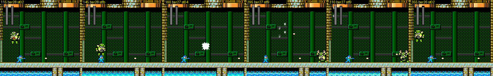
*Toad Man once provoked: hops, the Rain Flush dance, splash bursts.*

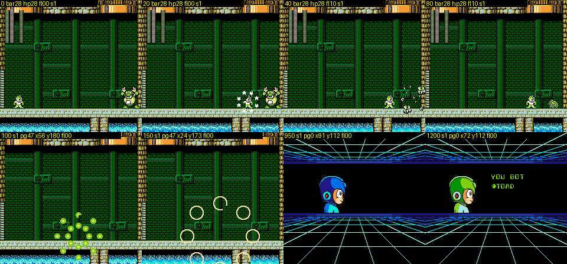
*●TOAD on Toad Man: one hit turns him into a frog. Touching the frog kills it, and the fight ends with "YOU GOT ●TOAD".*

---

## 2. Dust Man stage (`$22` = 5): a garbage plant that tries to cook, crush and recycle you

The stage has 37 screens in one long section: 32 layouts, where screens 16-22 reuse two layouts and 23-25 are side
pieces. Checkpoints are at 15 and 35 [seen].

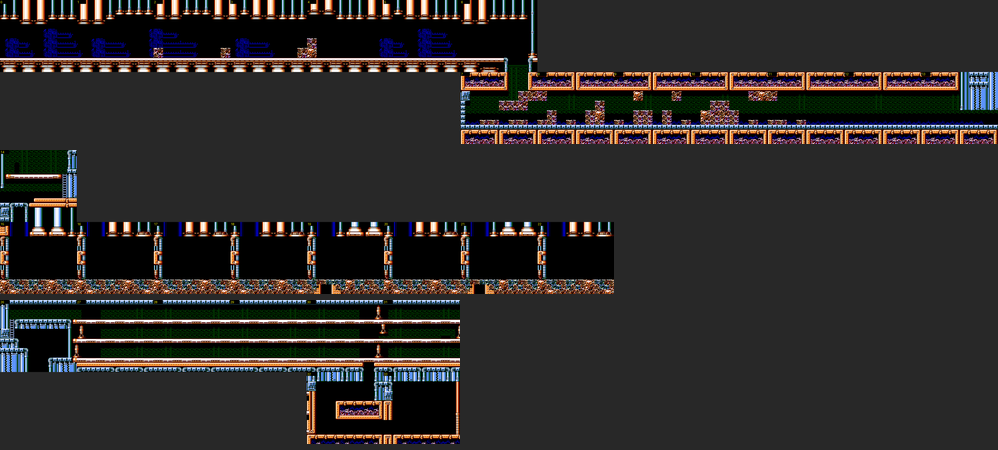
*Dust Man's stage, stitched per part (0-14, 14-23, 26-33); BG only, so the furnace's flashing and the pistons are not
drawn.*

| Screens | What happens [seen unless tagged] |
|---|---|
| 0-8 | Blue-and-copper pipe halls with Metall-type enemies; a drop at 6 → 7. |
| 9-13 | **The furnace** (details below the table). |
| 14 | **The detonator room** (details below the table). |
| 15-22 | Checkpoint 1 (15), a garbage dump. Then a **7-screen crusher corridor** (details below the table). |
| 23 | **The trash compactor** (details below the table). |
| 26-30 | Pipe rooms, then a three-storey girder hall with red hammer robots and red canisters. |
| 31 | A one-screen side room right of 30 (links 30 right → 31 and 31 left → 30) with a large energy item (`$56`). It fits the hidden-room pattern of "one screen off the path, items only" [code]. I could not find how to get in, because the only opening is a one-block gap [open]. |
| 32-34 | Down from 30 (link 30 down → 32): a pipe-frame room, then a room packed with garbage blocks (block type 14) that keep falling. |
| 35-36 | Checkpoint 2, then Dust Man. |

**Screens 9-13, the furnace.**

- The BG flashes red and magenta, and a **TEMP gauge** appears under the life bar. It uses the boss-bar byte `$BF`.
- TEMP rises one notch about every 56 frames. At 28, Rockman is **burned** (1 damage + knockback).
- The gauge then drops to 0 and refills in about 120 frames, so lingering costs 1 HP every 2 s [measured].

**Screen 14, the detonator room.**

- The way on is down, through the floor, but the floor is solid.
- A plunger box sits on the upper ledge, next to a hopping red dome robot.
- **Shooting the box blows a hole in the lower-left floor** (layout bytes `$6CA9/$6CAA` change), and you drop through
  (link 14 down → 15).

**Screens 16-22, the crusher corridor.** Only two layouts are used (`16 16 16 17 16 17 16`):

- Ceiling pistons slam down over a **conveyor of compacted garbage** that carries you right. Pressing LEFT still moves
  Rockman right.
- Enemies are spring-mounted grey robots, small purple fliers, and blue flames on the floor.

**Screen 23, the trash compactor.**

- Pistons slide in from the right wall, one row above another, stacking up until they fill the room. They push
  Rockman into the left wall and crush him: instant death, with or without godmode.
- The only exit is the opening in the ceiling (link 23 up → 26). You climb the stacking pistons and **jump out
  through the top** [seen; jumping through the top triggers the up-link without a ladder].

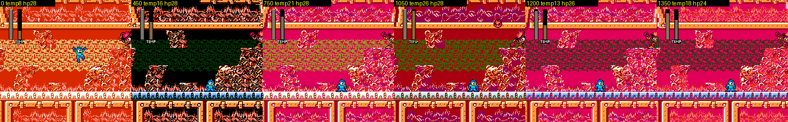
*The furnace's TEMP gauge (under the life bar) filling up; at 28 Rockman is burned and it restarts.*

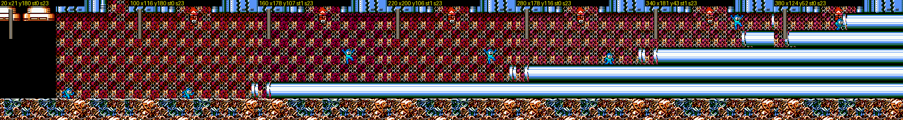
*Screen 23: pistons stack in from the right until the room is full. Climb them and jump out of the ceiling gap.*

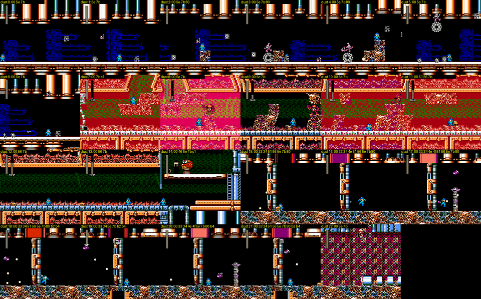
*Dust Man's stage, enemy census.*

### 2.1 Dust Man [seen]

- He **inhales the junk in the room to heal**. In the first 4 s he went from 27 to 28 after the debris flew into him.
  In the damage runs, some weapons "dealt" 37-49 damage before he died, because he kept refilling.
- He **inhales Rockman and recycles him**:
  - The suction drags a standing Rockman across the room (x 50 → 220 in about 4 s).
  - When it catches him, Rockman turns into a small blue item cube, and Dust Man stomps on it.
  - Rockman then dies. Measured without godmode: HP 18 → 1 → death within about 140 frames.
  - With godmode on, the cube stays buried in the floor.
- He also jumps and shoots Dust Crusher shots that burst on the walls.

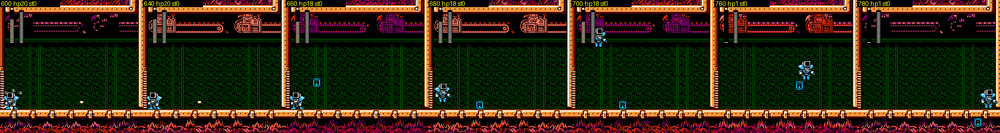
*Dust Man's suction, Rockman as a blue item cube, and Dust Man stomping on it (godmode off).*

---

## 3. Skull Man stage (`$22` = 7): skull fortress, sky of bones, robot T-rex

**Screens `0-10`: purple skull fortress.** This part includes a pipe maze full of skulls. In the link table, screen
0's floor leads down to a side branch `4-5`, while the main path goes right through `0-3` and then up `3 → 6 → 7`.

**(critic addition) Beat's cage is in this stage.** The side branch under the first screen (link `0 down → 4`, `4 down → 5`, a dead end) holds a placement `$09` at screen 5 (x 200) that resolves to `$5E` sub-id `$7F` = Beat (`tools/analysis/r4mi/r4mi_objects.py`). In play [seen]: a bird cage hangs from a chain with Beat inside. Normal weapons only swing it; it breaks only to the **charged Rail Buster** (the hit test `$44:$B3D2` calls `$42:$9D4E`, which accepts projectile anims `$20`/`$23`) or to a super-special weapon (`$7722 ≠ 0`). Beat then perches on the ledge; touch him and he grabs Rockman and flies him back up the shaft, and equipment `$7839` and FLAG `$7898` both get bit6 (`$30 → $70`, FLAG `$00 → $40` in the test, `build/research/r4mi/r4mi-critic/beat_skull.py`, `img/critic_beat.png`). A second cage sits in Cossack 1 (screen 18); there the code hands BEAT over as soon as the cage breaks (`$44:$B43F`: `$22 = 8`). Testing tip: `cheats.godmode()` sets BEAT already, which hides all of this.

**Screens `11-37`: a free-scrolling sky section** [seen].

- Floating bone platforms, rib-cage spike floors, skeleton bone-throwers, orange dome hoppers, propeller drones and
  skull pots.
- The camera here scrolls in both directions, so screen numbers do not map to a simple strip, and my ghost could not
  follow it reliably.
- `28 → 37` (right edge, loading section `$06`) leaves the sky.
- Screens `29-35` are laid out and drawn, but have no enemies and no links from the main path [code]. They may be cut
  content, or HARD-only [guess].
- `36` is the slope from the sky into the fortress. The enemy table puts four items there (`$5A`, `$7A`, `$56`, `$7C`:
  big energy, E-tank, big energy, 1UP), and the links make it reachable only upward from 37 (`37 up → 36`,
  `36 down → 37`), so it is the hidden room [code; not visited].

**Screens `38-47`: the descent to the boss.** `38-46` is a long descent built from a chain of down-links. Checkpoint 1 is
at 20 (in the sky), checkpoint 2 at 46, and Skull Man is at 47.

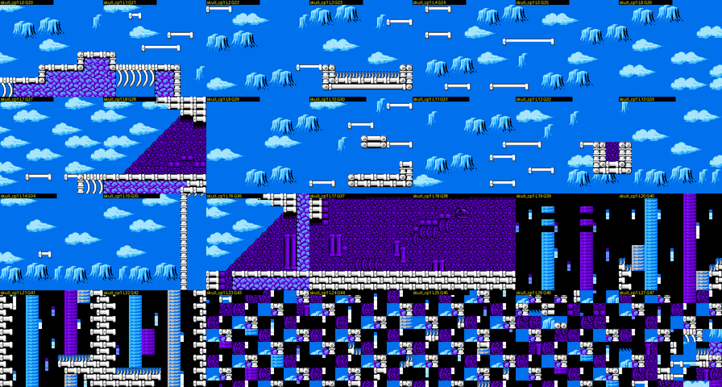
*Skull's section 2 layouts (local 0-27 = screens 20-47) rendered from WRAM. The later layouts are drawn with the wrong
tiles, because that part uses another section's metatiles.*

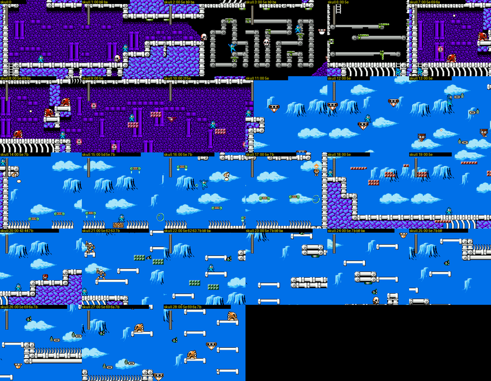
*Skull Man's stage, enemy census for screens 0-28.*

**KING GOJULUS** (fight `$1A`) is a screen-filling red robot T-rex in a bone-brick hall [seen]:

- It stomps forward and back, pushing Rockman toward the wall.
- It spits white fire orbs and releases small red drones.
- Its life bar is a second, green bar.

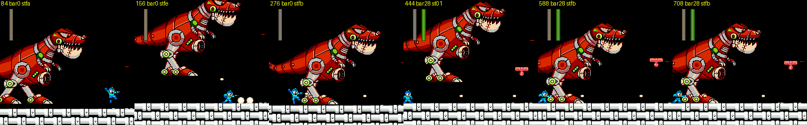
*The robot T-rex mid-boss.*

### 3.1 Skull Man [seen]

- His room now has a **purple rubble mound** in the middle, and rib-cage decorations that flash.
- He jumps, fires shots that burst on the walls, raises the Skull Barrier (skulls orbit him) and charges with it.
- Weakness: Dust, which does 6 damage per hit, as in vanilla RM4 [measured; the vanilla weakness is from memory].
- Rush Cannon never connected.
- The SKULL AMULET hint ("I WANT TO LEND IT BUT HE MAY REFUSE IT") implies a special way of beating him; I did not
  find it [open].

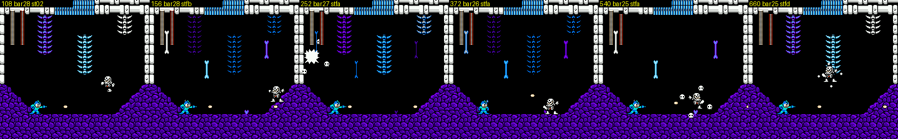
*Skull Man: jumps, wall-bursting shots, the Skull Barrier.*

---

## 4. Bright Man stage (`$22` = 0): a lit factory with a status bar

The stage has 32 screens in two sections [seen]:

- section 1, `0-17`: blue-and-red machinery;
- section 2, `18-33`: black rooms of red and blue blocks.

Checkpoints are at 16 and 30. A **bottom status bar** shows "WPN", "P" and Rockman's face, and turns red for boss life
during fights. Gimmicks visible in the census are swinging arc platforms (12, 27), a bubble fountain (25), grids of
appearing/disappearing blocks (26, 29, and the hidden room), and spikes [seen].

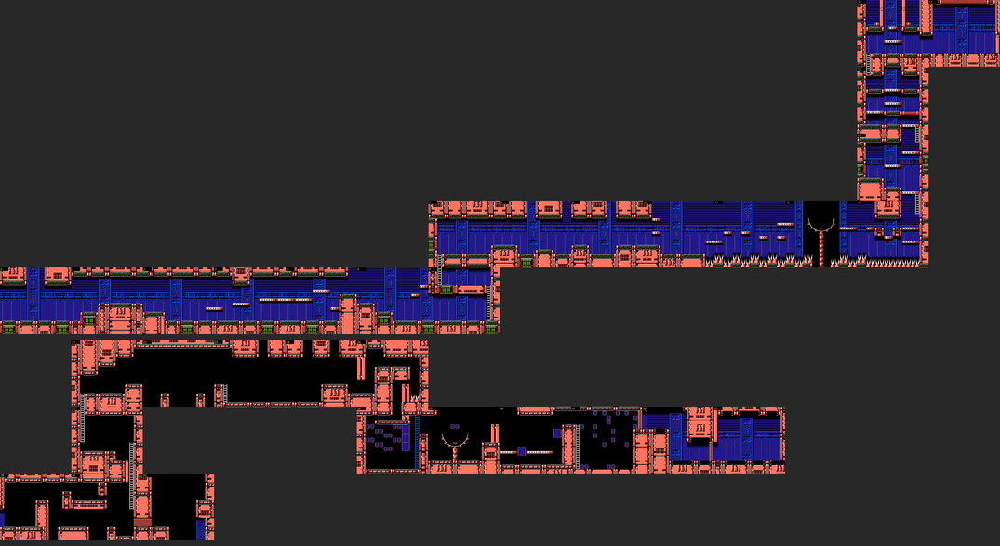
*Bright Man's stage (sections 1 and 2), stitched along the ghost route; 32 is the hidden room.*

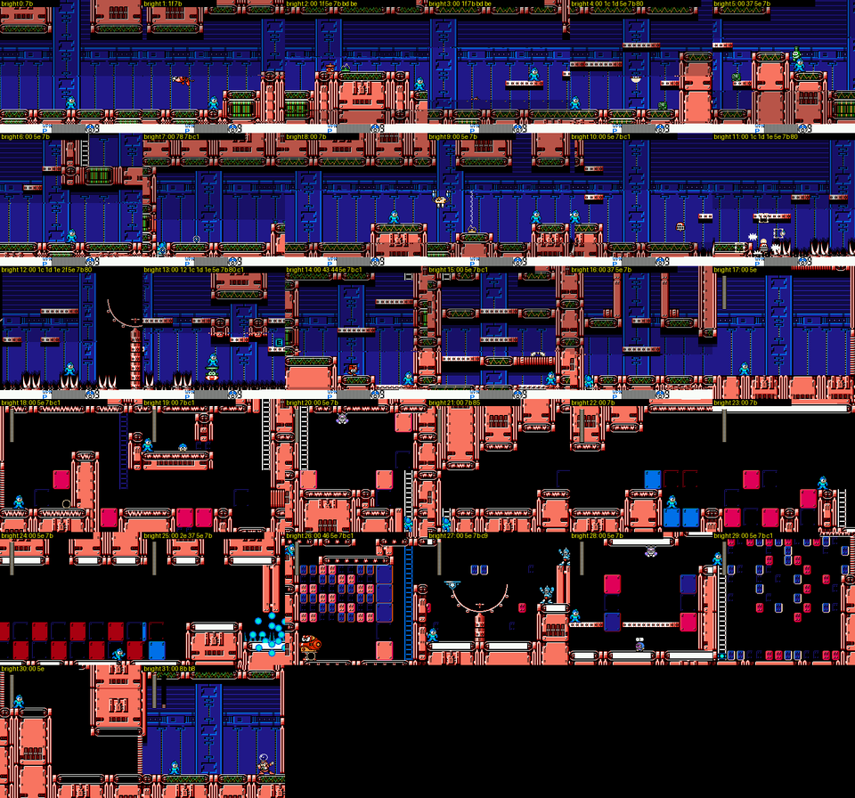
*Bright Man's stage, enemy census.*

**Mid-boss SHADOWMAN B** (fight `$20`, screen 17) [seen]:

- Shadow Man, with two white birds. He jumps around the room, throws shuriken, and vanishes in smoke when beaten.
- The buster does 1 damage per hit, with only about 40 frames of i-frames.
- He appears every time, with every clear state I tried.
- Defeating him did not set FLAG SHADOWMAN and did not give equipment. Per Proto Man, SUPER STAR comes from Shadow Man,
  who "interrupted you several times" [text], so it may need all three encounters [guess].

**Hidden room: screen 32** [code + seen].

- The links are `19 right → 32` and `32 left → 19`: walk past the ladder of screen 19 into a gap two blocks high at the
  bottom right.
- Screen 32 is a shaft of **appearing blocks** (red, blue and teal blocks blink in sequence) leading up to a ledge with
  a **1UP and an E-tank**. The enemy table lists `$7A` E-tank, `$7C` 1UP and `$56` large energy.

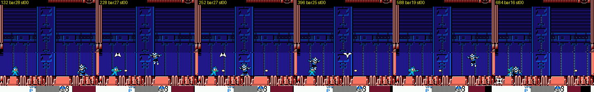
*SHADOWMAN B: Shadow Man and his birds in Bright Man's stage.*

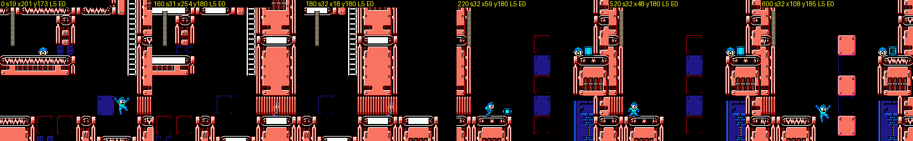
*Screen 19 → the gap at the bottom right → screen 32, with blinking blocks and the 1UP / E-tank ledge.*

### 4.1 Bright Man [seen]

- He throws bulbs, and puts **lock-on brackets** around Rockman before attacking.
- He **turns invisible** for long stretches; only his flash bursts show.
- **SPARK MANBOW overloads him**: 3 damage per frame for 10 frames, then a cyan power-surge explosion.
- Rush Cannon and Wish Star never connected [measured].

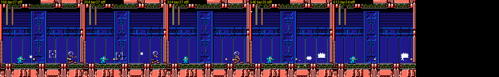
*Bright Man: bulbs, the lock-on brackets, his invisible phase (only his flashes show).*

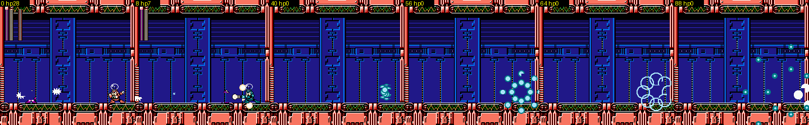
*Spark Manbow on Bright Man: the bulb glows cyan, his HP drains in ten frames, then the power-surge burst.*

---

## 5. Boss damage tables [measured]

Each cell is the damage per hit to the boss (slot 23, criticals off). In brackets is the median number of frames
between two damaging hits. That gap is the "i-frames" the hint file tells you to read weaknesses from, though my fire
rate of 6-20 frames caps it. `-` = never connected in 1,500 frames. Rail = charged buster.

| Weapon | Toad Man | Dust Man | Skull Man | Bright Man |
|---|---|---|---|---|
| Rock Buster | 1 (132) | 1 (133) | 1 (139) | 1 (129) |
| Rail Buster | 1 (165) | 1-2 (250) | 1 (168) | 1 (166) |
| Spark Manbow (Bright) | 2 (40) | 2 (40) | 2 (40) | **3 per frame, overload kill** |
| ●Toad | **28, transforms** | 2-6 (40) | 3 (160) | 3 (160) |
| Drill Torpedo | 2 (23) | 2 (22) | 2 (29) | 2 (20) |
| Pharaoh Shotgun | **3 (15)** | 2 (20) | 2 (20) | 2 (20) |
| Ring Boomerang | 2 (20) | 2 (20) | 2 (20) | **3 (15)** |
| Recycle Inhaler (Dust) | 3 (80) | 3 (80) | **6 (40)** | 3 (80) |
| Water Cutter (Dive) | 1 (20) | 1 (20) | 1 (20) | 1 (20) |
| Hell Wheel (Skull) | 2 (49) | 2 (80) | 2 (86) | 2 (240) |
| Rush Cannon | **28** | **28** | - | - (dodged) |
| Wish Star | 14 | 14 | 14 | - |
| Wire | 2 (48) | 2 (21) | 2 (21) | 2 (23) |

All four bosses have 28 HP. Every non-buster weapon does at least 2 (Dive does 1), so the buster, with 1 damage and
~130 frames of i-frames, is by far the worst choice. That is the point of the hack's design. Marked cells are the
weaknesses by the hint file's rule (more damage or shorter i-frames).

---

## 6. HARD mode [seen]

The in-game HARD flag is `$78DE` (bit 7), copied from CONFIG `$78CD` by bank `$7B` together with `$7946`. Many stage
banks test it [code].

To compare the modes, I death-warped to every checkpoint with NORMAL and with HARD (the flag set in RAM and in the
system save) and diffed the unpacked section data. The changes are all in the level geometry:

| Stage | NORMAL vs HARD |
|---|---|
| Toad | Section 3 (the aqueduct, screens 33-42, 37 bytes): the obstacles on the boat ride are moved and swapped. Pillars hang from the ceiling, steps move, and spike strips change places |
| Skull | One sky screen (34) **loses a bone platform**, and section 1's metatile set changes in two metatiles |
| Bright | Section 2's block rooms (screens 22, 24): the stepping blocks are rearranged |
| Dust | No change at any checkpoint |

The first six screens of Toad's stage had the same enemies in both modes. Enemy and boss behaviour on HARD was not
compared.

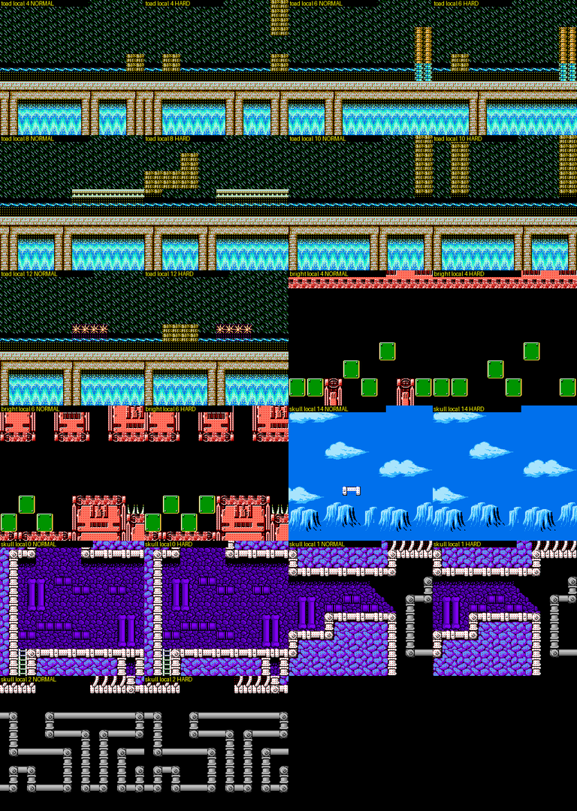
*Layouts that differ between NORMAL and HARD (collision dots overlaid): Toad's aqueduct screens, Bright's block rooms,
Skull's sky screen 34 (the platform disappears), and Skull's first section.*

---

## 7. Savestates

Shared, in `build/research/r4mi/states/` (no cheats frozen in the files; apply `godmode()`):

| State | What it is |
|---|---|
| `toad_hidden28.state` | Inside Toad's hidden room (screen 28), just arrived from screen 13's ladder |
| `toad_toadman_frog.state` | Toad Man already turned into a frog by ●TOAD (FLAG `$7898` = `$10`), ●TOAD selected |
| `toad_aqueduct30.state` | Start of the boat ride in the aqueduct |
| `dust_furnace10.state` | Inside the furnace (TEMP gauge running) |
| `dust_detonator14.state` | The detonator room (shoot the plunger box on the upper ledge) |
| `dust_compactor23.state` | Entering the trash compactor |
| `bright_hidden32.state` | Inside Bright's hidden room (screen 32) |

Per-screen states in my scratch dir, `build/research/r4mi/r4mi-stages-b/scr/`:

- `toad_00..47` (no 8-11 or 28), `dust_00..33` (no 23-25), `skull_00..28` (no 4-5), and `bright_00..32`.
  Each is one state per screen, taken on arrival with the godmode loadout from the cp states.
- Special states in the scratch dir itself: `toadtoad.state` (Toad Man as a frog), `t30.state` / `t31.state` (Shadow Man B
  fight / after it), `hid_bright.state` (Bright's hidden room).

The per-screen states carry this run's quirks (godmode loadout, Rockman wherever the ghost left him), so only the seven
states above were copied to the shared directory.

---

## Open questions

- **TOADMAN bonus.** How is the TOADMAN bit meant to survive until the ending? Every way of ending the fight cleared
  it. Possibly a fortress refight, or a route I did not find [open].
- **SUPER STAR and SKULL AMULET.** The equipment item ids are `$14` and `$13`, but I did not find their spawn
  conditions.
- **Dust's side room 31.** How do you get into it?
- **Skull's hidden room 36.** I never visited it, and I did not map the exact route through the free-scrolling sky.
  What are screens 29-35 for?
- **Link-table fields.** What do `b5`/`b7` and the `$750E` alternative link table (WRAM `$6FC0`) mean? Do the time
  attack or arena modes use it [guess]?

## Lessons for Rockman 6 GP

- **Make level connectivity data, not geometry.** 4MI's one-row-per-exit link table (screen, edge, target screen,
  section to load) gives loops, secret one-screen rooms, one-way drops and HARD-only variants for 8 bytes each. RM6's
  vanilla room/scroll tables could take the same extension: a "hidden room" is just one extra link.
- **Hidden rooms work best as a short detour that returns you.** Toad's room drops you back where you left. Bright's
  sits beside the main ladder. Both pay out a 1UP / E-tank, and you lose no progress.
- **A boss reacting to his own weapon is a cheap, memorable secret.** Toad becomes a frog and Bright overloads. It
  costs one branch in the weapon's hit code (a per-AI effect table, as at `$41:$A2FC`). RM6 GP could give every boss
  a "self-weapon" reaction, and hook a score or ending line onto it.
- **Turn a stage's theme into mechanics**, as Dust's garbage plant does with heat, a detonator, crushers, a conveyor
  and a compactor, and as Toad's stage does with flooding, currents, frog eggs and a boat ride. Each gimmick is a
  small object or a block-type rule, not new engine code.
- **Use the boss-bar byte for stage meters.** Dust's TEMP gauge reuses `$BF`, so the HUD code is free.
- **HARD can be a geometry patch.** 4MI's HARD swaps a few bytes of unpacked layout per section: no second stage and
  no new enemy code. This is the cheapest meaningful difficulty mode for RM6 GP.
- **Passive-until-provoked bosses** (Toad Man) make a good first boss and a good joke. They also teach that firing
  starts the fight.
- **Tooling:** a camera-checked ghost traversal plus per-screen states and BG renders gives a full stage atlas in
  minutes. RM6 GP should keep such a traversal as a regression test, so that every screen stays reachable and every
  link resolves.
