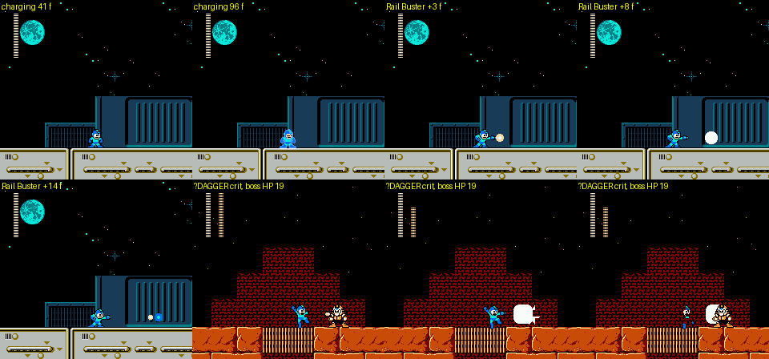
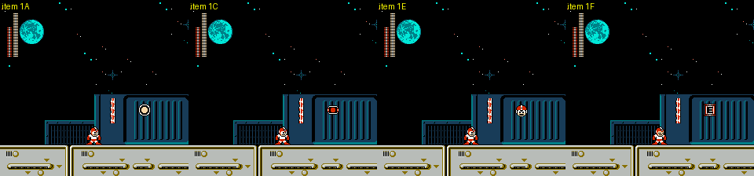
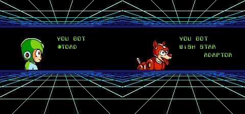
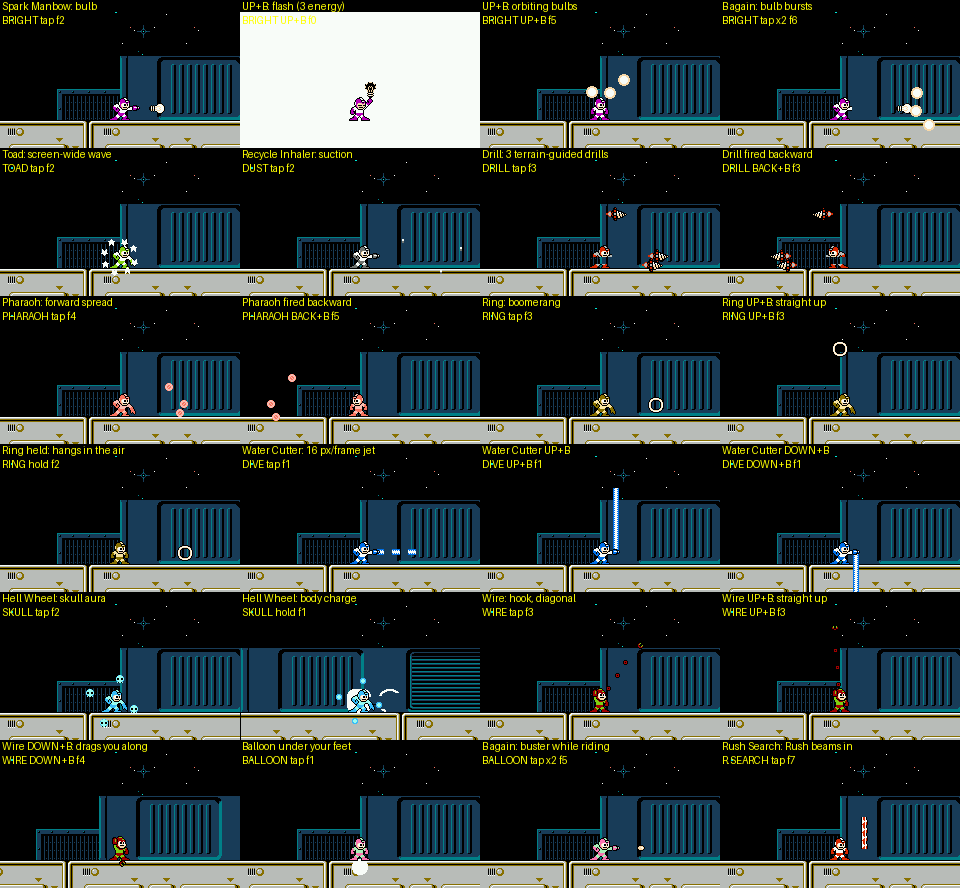
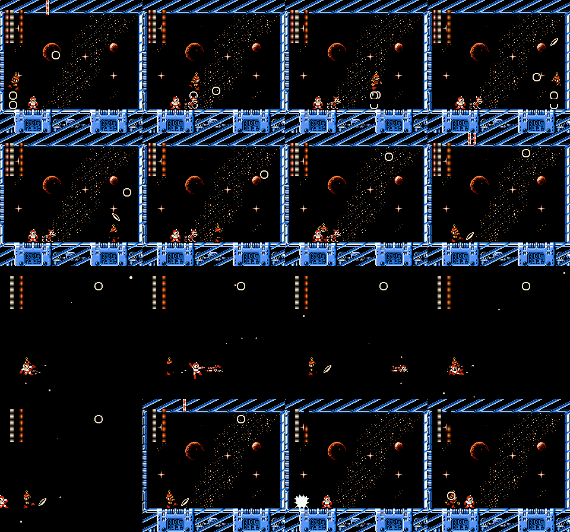
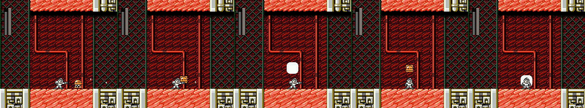
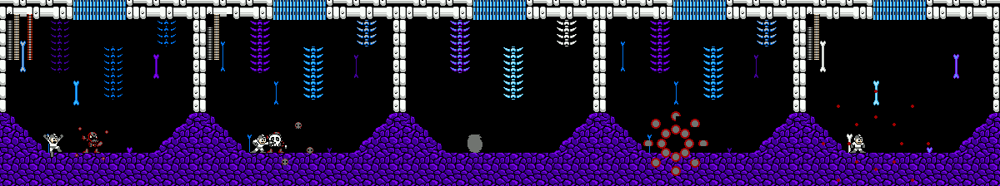
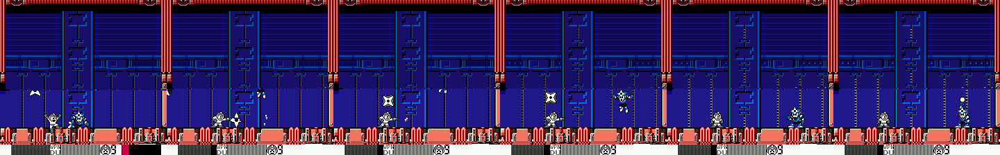
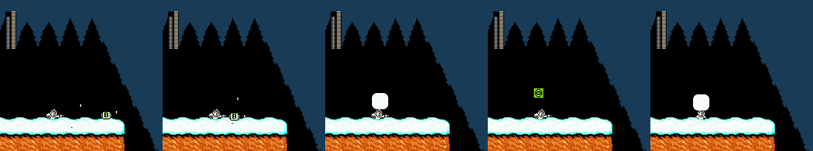

# 4MI combat and equipment systems (r4mi-systems)

Status: complete for the scope below; open points are listed in §12.

**How crazy it gets (summary).**

- **The weakness system is an invincibility table, not a damage table.** Damage to Robot Masters is 1-4 for every
  weapon; what changes is the boss's invincibility after the hit: 127 frames (2.1 s) for the buster and the Rush
  adaptors, 15-25 for most weapons, and 1-8 frames for the weakness. **Bright Man's weakness is his own Spark Manbow
  with a 1-frame window**, so a held bulb drains him in ten frames (§4).
- **The RECYCLE INHALER is the item factory.** It turns enemies into pickups, swallows Robot Masters whole when they
  are low, and five of the six hidden equipment items (and the friend-killing sixth) come out of it: inhale a Metall,
  **Skull Man himself**, **Shadow Man's forehead star**, a spare Wire, a spare Balloon, or **Eddie** (§5, §10).
- **?DAGGER, the "UNCERTAIN ITEM", makes every hit a critical** (×8 on enemies, ×3 on bosses), and the crit "dice" is
  simply the frame counter: 1/256 normally, 1/64 at HP ≤ 4 or with SUPER STAR, 1/16 with both (§2).
- **Kalinka is a power-up.** Once she joins (Wily 3), every Rush cost halves and **WISH STAR doubles to a 28-damage
  one-shot** ("THIS IS MY DAD'S ENERGY AMPLIFYING UNIT") (§9).
- **Rush digs deterministic loot.** 50 % large life, 25 % large weapon, 18.75 % 1UP, 6.25 % E-tank, by the frame
  counter, and **always large life in boss and mid-boss rooms**. The famous "death refill" is really the Energy
  Charger: +max(4, half the missing energy) to every weapon on each death (§6).
- **SKULL AMULET is a real "guts" item**: every lethal hit leaves you at 1 HP as long as you had 2 (§8). Knockback is
  only 4-5 px over 9 frames, then 30 i-frames.
- **Enker and Punk ignore every weapon but the buster**; W.MACHINE 4 takes 14 per Hell Wheel hit; ●TOAD one-shots the
  frog mech; ITEM DROP = MORE means every single kill drops something (§4, §11).

Scope: how fighting works in *Rockman 4 Minus Infinity* v1.01 (`roms/r4mi_mmc5.nes`): the buster and Rail Buster,
the weapon damage and invincibility tables, criticals, the player-damage pipeline (DAMAGE config, METALL'S HELMET,
SKULL AMULET, WILY BUSTER shield), Rush Search, the Rush adaptors, Wire and Balloon, and every equipment item.

Tags: **[seen]** emulator, **[code]** disassembly/data, **[text]** in-game text, **[doc]** readme, **[guess]**.
Scripts: `build/research/r4mi/r4mi-systems/` (`tables.py` + `chart.py` + `toaddust.py` dump the ROM tables, `bench.py`
hits a normal enemy with every weapon, `buster.py` / `rail.py` time the buster, `gallery.py` films every weapon ×
input, `crit.py` / `crit_boss.py` count criticals, `rush.py` / `rush2.py` Rush Search and the death refill,
`adaptor.py` the Rush adaptor schedule, `wstar.py` Wish Star, `hurt.py` / `hurt2.py` player damage, `amulet.py` /
`helmet.py` / `tramp.py` / `dagger.py` the equipment, `xref.py` finds absolute references to an address).

## 0. Where the combat code lives [code]

| Where | What |
|---|---|
| bank `$3A` @ `$8000` | Vanilla RM4's weapon-vs-enemy collision loop, patched. It maps bank `$20 + weapon` at `$A000` and reads that weapon's damage at `$B700 + object id` |
| bank `$42` @ `$8B45` | 4MI damage lookup. Object `$5E` (4MI's generic "new enemy" object, real type in `$0468`) uses per-weapon tables at `$42:($8B+w)·$100 + $DC + sub-id`. Bit 7 of a damage byte is a flag |
| bank `$3A` @ `$82EF` | ×2 for the Rail Buster (projectile anim `$20`/`$23`) and the charged Pharaoh Shot (anim `$49`) |
| bank `$42` @ `$9C08` | Hit entry: skip if the target is invincible, else roll a critical, spawn the crit spark and play "pikoon" (sound `$2A`, normal hit `$26`), then per-weapon dispatch (pierce or delete the shot) |
| bank `$42` @ `$9CDB` | Critical multiplier |
| bank `$3A` @ `$831E` | Subtract HP, then set the target's invincibility |
| bank `$42` @ `$9D20` | Normal-enemy invincibility per weapon (table `$42:$9D3E`) |
| bank `$43` @ `$9A80` | Boss invincibility per boss × weapon (tables `$43:$9B10/$9B19` by object id, `$9B99/$9BA8` by `$5E` sub-id); default 40; SHORT INV. caps at 48. Used only for the object in the boss slot (`$0146`) while `$0132` bit7 (boss fight) is set |
| bank `$42` @ `$9D89` | The critical roll |
| bank `$42` @ `$9AF8` | Damage taken by Rockman: DAMAGE ×0.5/×1.5, WILY BUSTER shield, METALL'S HELMET, SKULL AMULET |
| bank `$3C` @ `$8CCC` | Buster fire/charge; `$3C:$8CBD` dispatches the fire routine per weapon (table `$3C:$91EB/$91F9`) |
| fixed `$7F:$FD75` | Energy cost per use (table `$FD8E`); bank `$42:$817B` is a variant that halves the cost when FLAG bit5 (KALINKA) is set |
| bank `$7B` @ `$8ADD` | Stage start: copies CONFIG to run-time bytes `$78D9` CRITICAL, `$78D8` ITEM DROP, `$78DA` C.RFL, `$78DC` E.GEN, `$78DD` EXWP, `$78DE` HARD (bit7), `$78DF` DAMAGE (`$40` ×0.5, `$80` ×1.5), `$7940` FAIL-SAFE, `$7941` VITAL |

## 1. Rock Buster MI and the Rail Buster

**Firing** [seen + code `$3C:$8D35`]: up to **3 shots** on screen (projectile slots 1-3), a new one on every press.
Shot speed 4.25 px/frame (HELP "SPEED 4.2"). Charging starts on the press.

| Hold time | Release fires | Damage | Normal-enemy i-frames | Pierces | Blocks refire |
|---|---|---|---|---|---|
| < 32 frames | nothing (the press already fired a pellet) | 1 (table) | 8 | no | no |
| 32-91 frames | medium shot (anim `$21`) | ×1 | 8 | no | no |
| ≥ 92 frames (1.53 s) | **Rail Buster** (anim `$20` → `$23`, sound `$3D`) | **×2** | **20** | **yes** | **yes** |

**Rail Buster lockout** [code `$3C:$8D3C` + seen]: before firing *anything*, the routine scans slots 1-3 and refuses
while any projectile has anim `$20`/`$23`. The Rail sits at the muzzle for 5 frames, moves 12 px/frame for 2 frames,
then 5 px/frame. Fired from mid-screen it left in 23 frames and the next shot came out on frame 25; fired from an edge
toward the far side it takes about 55 frames (≈ 0.9 s). Medium shots do not lock (a new pellet fired 3 frames later).


*Charging (palette change at 32 frames, full at 92), the Rail Buster leaving the muzzle and flying, then a ?DAGGER
critical on Pharaoh Man (white spark, 28 → 19 HP from one 3 × 3 buster hit).*

**Pierce** [code `$42:$9C7F`]: the Rail is never deleted on contact. Normal pellets are deleted only when they deal
damage; a pellet that touches an *invincible* enemy passes through it.

**Invincibility given** [code `$42:$9D3E`, `$43:$9B19`; seen]:

| Target | Buster | Rail Buster |
|---|---|---|
| Normal enemy | 8 frames (measured: timer reads 7 the frame after the hit) | 20 |
| Robot Master or listed boss | **127 frames (2.1 s)**, every boss in the table | 127 |
| Unlisted boss (default) | 40 | 40 |

So the readme's "presents invincibility to the enemy" is mostly a boss rule: against normal enemies the buster's 8
frames is the same as Ring and Bright. Against Robot Masters 1 damage per 127 frames means **28 hits = 59 s** for a
buster-only kill (Pharaoh 3 per hit: 10 hits = 21 s; Ring 2 per hit: 14 hits = 30 s).

## 2. Criticals ("pikoon") [code + seen]

`$42:$9D89` decides; it runs only when the target has no invincibility left:

```
if CRITICAL is OFF ($78D9 != 0)          -> no crit
if equipment bit7 (?DAGGER) is owned     -> ALWAYS crit
mask = $FF
if HP ($B0 & $3F) < 5                    -> mask >>= 2      ($3F)
if SUPER STAR (equipment bit2) is owned  -> mask >>= 2      ($3F or $0F)
crit if (frame counter $92 & mask) == 0
```

`$92` is incremented once per NMI (fixed bank `$7E:$C0ED`), so the "random" crit is the frame counter.

| Situation | Crit chance per hit |
|---|---|
| Normal | 1/256 |
| HP 4 or less | 1/64 (the readme's "4× near death") |
| SUPER STAR | 1/64 |
| SUPER STAR and HP ≤ 4 | 1/16 |
| ?DAGGER | **every hit** |

A crit is skipped when the normal hit would already kill (target HP ≤ damage). Multiplier (`$42:$9CDB`): ×3 when the
target is the boss (`$0132` bit7 or `$7691`), otherwise ×8 (a base of 32+ is capped to 63); SUPER STAR adds +2 to
the crit damage; the result is capped at 63.

Measured [seen, `crit.py`, `crit_boss.py`]: 256 buster hits on enemy `$48` (Bright stage), one hit every 9 frames so the
frame counter sweeps all 256 values, target HP re-poked to 60:

| Setup | Crits / 256 | Crit damage (base 1) |
|---|---|---|
| Normal | 0 (expected 1) | - |
| HP 4 | 4 | 8 |
| SUPER STAR | 4 | **10** (8 + 2) |
| SUPER STAR + HP 4 | 17 | 10 |
| ?DAGGER | **256** | 8 |
| ?DAGGER + SUPER STAR | 256 | 10 |

On Pharaoh Man with ?DAGGER every hit crit: buster 3 → **9**, Drill 4 → **12**, Hell Wheel 3 → 9, and with SUPER
STAR too, buster → 11. So ?DAGGER turns the buster into 9 damage per 127 frames against Robot Masters and 8 per hit
against anything else.

## 3. Weapon damage vs normal enemies [code + seen]

Each weapon has a 256-byte table (bank `$20+w` @ `$B700`, by object id). Counting the non-zero entries:

| Weapon | Typical damage (entries) | Normal-enemy i-frames | Measured on enemy `$48` (Bright stage) |
|---|---|---|---|
| Buster | 1 (76 ids) | 8 (Rail 20) | 1 / 8 |
| Wire | 1 (66), 2 (11) | 2 | - |
| Balloon (the buster shots fired while riding) | 1 (54) | 9 | 1 / 9 |
| Dive (Water Cutter) | 1 (65) | 3 | 1 / 3 |
| Ring | 2 (52), 1 (20) | 8 | 2 / 8 |
| Drill | **4 (44)**, 1 (20), 2 (13) | 6 | 4 / 6 |
| Pharaoh | 2 (52), 1 (18) | 5 | 2 / 5 |
| Bright | 2 (50); `$FF` (= 127, **instant kill**) for 21 ids | 8 | 2 / 8 |
| Skull (Hell Wheel) | **3 (45)**, 1 (13), 2 (9); `$FF` instant kill for 20 ids, `$80` = no damage for 9 | 10 | - |
| Rush Cannon | **63 (59 ids)**, 28 (17), 40 (2) | 8 | 28 / 8 |
| Wish Star | 1 (74) | **60** | - |
| ●TOAD / RECYCLE INHALER | own classification tables (§4.1, §5): transform, delete, damage, or inhale | 9 / 9 | - |

These are hint.txt's "Drill 4, Skull 3, Ring/Pharaoh/Bright 2, Dive 1" [doc], confirmed. Bit 7 in a table entry
means "special" (`$42:$8B62`): for a special weapon it becomes 127 (instant kill) or 0; for the buster it is 0 unless
an EXWP super-special weapon is equipped, in which case it is 127, so 4 object ids are immune to the plain buster
but die at once to the set-piece weapons. Normal enemies have tiny HP
(1-8 for most of what a walker meets in Bright, Drill and Skull), so the weapon number is roughly "hits to kill".

## 4. Boss weakness chart [code]

Cell = damage per hit / invincibility frames set by the hit, read from the two ROM tables (chart.py). Robot-Master
values match every earlier measurement in stages_a.md / stages_b.md / cossack.md / wily.md to the frame (their
"126" is the 127 timer read one frame later). "Best" = frames to kill 28 HP if every hit lands the moment
invincibility ends (fire rate floor 8 frames for Buster/Ring/Bright, 4 otherwise). ●TOAD and the RECYCLE INHALER go through their own
code (§4.1), as do Wish Star (§9) and Rush Search (§6). Rush Cannon is shown for completeness (14 energy).

| Fight | Buster | Wire | Dive | Ring | Drill | Pharaoh | Bright | Skull | R.Cannon | Best (frames to kill 28) |
|---|---|---|---|---|---|---|---|---|---|---|
| $00 Bright Man | 1 / 127 | 2 / 20 | 1 / 15 | 3 / 15 | 2 / 20 | 2 / 20 | 3 / 1 | 2 / 25 | 28 / 127 | Bright 80, Ring 150 |
| $01 Toad Man | 1 / 127 | 2 / 20 | 1 / 15 | 2 / 20 | 2 / 20 | 3 / 15 | 2 / 40 | 2 / 25 | 28 / 127 | Pharaoh 150, Drill 280 |
| $02 Drill Man | 1 / 127 | 2 / 20 | 3 / 15 | 2 / 20 | 2 / 20 | 2 / 20 | 2 / 40 | 2 / 3 | 28 / 127 | Skull 56, Dive 150 |
| $03 Pharaoh Man | 3 / 127 | 3 / 20 | 2 / 15 | 3 / 20 | 4 / 15 | 3 / 20 | 3 / 40 | 3 / 25 | 28 / 127 | Drill 105, Pharaoh 200 |
| $04 Ring Man | 2 / 127 | 2 / 20 | 3 / 15 | 2 / 20 | 2 / 20 | 2 / 20 | 2 / 40 | 3 / 8 | 28 / 127 | Skull 80, Dive 150 |
| $05 Dust Man | 1 / 127 | 2 / 20 | 1 / 15 | 2 / 20 | 2 / 20 | 2 / 20 | 2 / 40 | 2 / 25 | 28 / 127 | Drill 280, Pharaoh 280 |
| $06 Dive Man | 1 / 127 | 2 / 20 | 1 / 15 | 2 / 20 | 2 / 20 | 2 / 20 | 2 / 8 | 2 / 25 | 28 / 127 | Bright 112, Drill 280 |
| $07 Skull Man | 1 / 127 | 2 / 20 | 1 / 15 | 2 / 20 | 2 / 20 | 2 / 20 | 2 / 40 | 2 / 25 | 28 / 127 | Drill 280, Pharaoh 280 |
| $08 Mothraya body | 1 / 50 | 1 / 20 | 1 / 20 | 1 / 20 | 2 / 14 | 1 / 20 | 1 / 20 | 1 / 25 | 28 / 50 | Drill 196, Bright 560 |
| $08 Mothraya pod | 1 / 40 | 1 / 40 | 1 / 40 | 2 / 40 | 4 / 40 | 2 / 40 | 2 / 40 | 2 / 40 | 28 / 40 | Drill 280, Bright 560 |
| $09 Square Machine | 1 / 127 | 1 / 20 | 1 / 20 | 1 / 20 | 1 / 20 | 1 / 20 | 2 / 15 | 1 / 25 | 28 / 127 | Bright 210, Dive 560 |
| $0A Aqua Devil | 1 / 127 | 2 / 48 | 2 / 48 | 3 / 48 | 2 / 48 | 2 / 48 | 2 / 48 | 2 / 48 | 10 / 127 | Ring 480, Bright 672 |
| $0B C.Catcher/C.Hopper | 1 / 127 | 1 / 30 | 1 / 30 | 1 / 30 | 1 / 30 | 1 / 30 | 1 / 30 | 1 / 15 | 14 / 127 | Skull 420, Bright 840 |
| $0C Joe Ni-nin VA All | 1 / 127 | 1 / 48 | 2 / 18 | 1 / 48 | 1 / 48 | 1 / 48 | 1 / 48 | 2 / 48 | 28 / 127 | Dive 252, Skull 672 |
| $0D Snatchman | 1 / 40 | 3 / 39 | 2 / 40 | 2 / 40 | 2 / 40 | 2 / 40 | 2 / 40 | 2 / 40 | 28 / 40 | Wire 390, Bright 560 |
| $0E W.Machine 4 | 6 / 30 | 6 / 20 | 2 / 25 | 4 / 25 | 4 / 25 | 7 / 25 | 1 / 25 | 14 / 15 | 28 / 30 | Skull 30, Pharaoh 100 |
| $0F Optical Capsule | 2 / 40 | 2 / 40 | 2 / 40 | 2 / 40 | 2 / 40 | 1 / 40 | 2 / 40 | 2 / 40 | 28 / 40 | Bright 560, Buster 560 |
| $13 Green Helmet | 1 / 40 | 1 / 40 | 1 / 40 | 2 / 40 | 4 / 40 | 2 / 40 | 2 / 40 | 3 / 40 | 63 / 40 | Drill 280, Skull 400 |
| $14 Gamarn & Gamadayu | 2 / 40 | 2 / 40 | 1 / 40 | 3 / 40 | 3 / 40 | 3 / 40 | 3 / 40 | 5 / 40 | 28 / 40 | Skull 240, Bright 400 |
| $15 Gundrill | 2 / 40 | 2 / 40 | 2 / 40 | 3 / 40 | 1 / 40 | 4 / 40 | 3 / 40 | 6 / 40 | 18 / 40 | Skull 200, Pharaoh 280 |
| $18 Rong Rang Rung | 1 / 40 | 1 / 40 | 1 / 40 | 2 / 40 | 2 / 40 | 2 / 40 | 2 / 40 | 3 / 40 | 14 / 40 | Skull 400, Bright 560 |
| $19 Hogale (whale) | 1 / 40 | 1 / 40 | 1 / 40 | 1 / 40 | 2 / 40 | 2 / 40 | 1 / 40 | 3 / 40 | 28 / 40 | Skull 400, Drill 560 |
| $1A King Gojulus | 1 / 40 | 1 / 40 | 1 / 40 | 1 / 40 | 2 / 40 | 1 / 40 | 1 / 40 | 3 / 40 | 28 / 40 | Skull 400, Drill 560 |
| $1B Escaroo | 1 / 40 | 1 / 40 | 1 / 40 | 1 / 40 | 2 / 40 | 1 / 40 | 1 / 40 | 3 / 40 | 28 / 40 | Skull 400, Drill 560 |
| $1C Moby | 1 / 40 | 1 / 40 | 1 / 40 | 1 / 40 | 2 / 40 | 1 / 40 | 1 / 40 | 3 / 40 | 40 / 40 | Skull 400, Drill 560 |
| $1D Nightmare Suzies | 1 / 40 | 1 / 40 | 2 / 40 | 2 / 40 | 2 / 40 | 2 / 40 | 3 / 40 | 2 / 40 | 14 / 40 | Bright 400, Dive 560 |
| $1E Clashman | 1 / 18 | 1 / 18 | 0 | 0 | 2 / 18 | 3 / 18 | 0 | 0 | 28 / 127 | Pharaoh 180, Drill 252 |
| $1F Waveman | 1 / 48 | 1 / 48 | 1 / 48 | 1 / 48 | 1 / 48 | 3 / 48 | 1 / 48 | 5 / 48 | 28 / 127 | Skull 288, Pharaoh 480 |
| $20/$21 Shadow Man | 1 / 40 | 1 / 40 | 1 / 40 | 3 / 40 | 2 / 40 | 2 / 40 | 2 / 40 | 3 / 40 | 28 / 40 | Ring 400, Skull 400 |
| $22 Pakkun Shadow | 1 / 40 | 1 / 40 | 1 / 40 | 2 / 40 | 4 / 40 | 2 / 40 | 2 / 40 | 3 / 40 | 63 / 40 | Drill 280, Skull 400 |
| $23 Enker | 1 / 40 | 0 | 0 | 0 | 0 | 0 | 0 | 0 | 0 | Buster 1120 |
| $24 Quint | 5 / 40 | 4 / 40 | 4 / 40 | 8 / 40 | 10 / 40 | 8 / 40 | 4 / 40 | 5 / 40 | 28 / 40 | Drill 120, Pharaoh 160 |
| $25 Punk | 1 / 40 | 0 | 0 | 0 | 0 | 0 | 0 | 0 | 0 | Buster 1120 |
| $26 Ballade | 1 / 40 | 1 / 40 | 1 / 40 | 1 / 40 | 2 / 40 | 1 / 40 | 1 / 40 | 1 / 40 | 28 / 40 | Drill 560, Bright 1120 |
| $27 Earth/Terra | 1 / 40 | 1 / 40 | 1 / 40 | 1 / 40 | 1 / 40 | 1 / 40 | 1 / 40 | 2 / 40 | 28 / 40 | Skull 560, Bright 1120 |
| $28 Chimerabot #1 | 2 / 62 | 2 / 62 | 2 / 62 | 4 / 62 | 4 / 62 | 2 / 62 | 2 / 62 | 2 / 62 | 28 / 62 | Drill 434, Ring 434 |
| $29 Chimerabot #2 | 1 / 15 | 1 / 15 | 0 | 1 / 15 | 1 / 15 | 2 / 15 | 2 / 15 | 1 / 15 | 28 / 15 | Bright 210, Pharaoh 210 |
| $2A Chimerabot #3 | 1 / 30 | 1 / 30 | 2 / 30 | 1 / 30 | 2 / 30 | 1 / 30 | 1 / 30 | 1 / 30 | 28 / 30 | Dive 420, Drill 420 |
| $2B teal-hall boss | 1 / 40 | 2 / 40 | 2 / 60 | 2 / 20 | 2 / 40 | 1 / 40 | 2 / 40 | 2 / 40 | 2 / 127 | Ring 280, Bright 560 |
| $2C ??? (green cave) | 1 / 40 | 2 / 40 | 2 / 40 | 2 / 40 | 2 / 40 | 1 / 40 | 2 / 40 | 2 / 40 | 28 / 40 | Bright 560, Dive 560 |

Reading the chart [code]:

- **Robot Masters**: the buster and the Rush adaptors give all eight 127 frames; every other weapon gives 15-40
  (Spark Manbow 40, the inhaler 60), except one or two "weakness" columns with 1-8 frames: **Bright Man ← Spark Manbow (1 frame: his own weapon
  overloads him)**, Drill Man ← Hell Wheel (3), Ring Man ← Hell Wheel (8), Dive Man ← Spark Manbow (8), Pharaoh Man ←
  Drill (15 and the only 4-damage cell), Toad Man ← Pharaoh / ●TOAD (15), Dust Man ← ●TOAD (15), Skull Man ← Recycle
  Inhaler (15, and 6 damage instead of 3). Damage barely moves (1-4); **the weakness is in the i-frame column**,
  exactly hint.txt's "watch the invincibility after you hit".
- **Fortress bosses** use the `$5E` sub-id rows. W.MACHINE 4 (Wily 3) is the outlier: buster 6, Pharaoh 7, Hell
  Wheel **14 per hit with 15 frames** (two hits kill a bar). AQUA DEVIL takes only 10 from the Rush Cannon, C.CATCHER
  14, and the Wily-4 teal-hall boss `$2B` 2 with 127 frames.
- **ENKER (`$23`) and PUNK (`$25`) take damage only from the buster** (every other weapon, even the Rush Cannon, is 0).
  That is the Game Boy Mega Man Killers' gimmick (Enker's Mirror Buster absorbs weapons) [code; reference = guess].
- Parts that are not in the boss slot (Mothraya's pod, multi-part fights) get the *normal-enemy* weapon i-frames
  (§3), which is why cossack.md measured 2-8 frames on the pod.
- MY ARENA's SHORT INV. (`$78DB`) clamps any boss value above 48 to 48; so the buster's 127 becomes 48 (`$43:$9AD2`).

### 4.1 ●TOAD and the RECYCLE INHALER vs bosses [code]

These two weapons do not use the damage tables; each classifies its targets through its own 256-entry table (by object
id, and by sub-id for `$5E`), then applies the same boss i-frame table.

| Boss | ●TOAD (`$41:$A2FC`; value − `$10` = damage) / i-frames | RECYCLE INHALER (`$41:$A7BF`) / i-frames |
|---|---|---|
| Bright, Drill, Pharaoh, Ring, Dive Man | 3 / 127 | 3 / 60, and **the boss is inhaled whole once HP ≤ 3** |
| Toad Man | **turns him into a frog** (`$FF`: FLAG TOADMAN, fight result "draw") / 15 | 3 / 60, inhaled at HP ≤ 3 |
| Dust Man | 2 / **15** | 3 / 60, inhaled at HP ≤ 3 |
| Skull Man | 3 / 127 | **6 / 15**, inhaled at HP ≤ 6 → **SKULL AMULET** (§5) |
| Mothraya / Square Machine / C.Catcher | 1 / 20, 127, 127 | 2, 2, 1 / 60, 60, 30 |
| Aqua Devil / Joe Ni-nin VA All | 2 / 76, 127 | 2 / 48 |
| Snatchman / Optical Capsule | 1 / 40 | 1 / 40 |
| **W.MACHINE 4** | **10 / 5** | **14 / 25** |
| GAMARN & GAMADAYU (frog mech) | **28 (one pulse kills it)** / 40 | 8 / 40 |
| PAKKUN SHADOW (Shadow Man on a frog) | **14** / 40 | Shadow Man class `$A2` (§5) |
| Escaroo / Quint / Green Helmet | 9 / 10 / 7 | 4 / **15** / Metall class `$A3` (→ METALL'S HELMET) |
| King Gojulus, Hogale, Kabatoncue | 5, 4, 5 | **8** each |
| Clashman / Waveman | 3 / 127 | **10** / 18; 3 / 48 |
| Enker, Punk | 0 | 0 (buster only, §4) |

●TOAD is a screen-wide pulse: it walks every object slot (23 down to `$7694`) and, per the table, transforms the
enemy (value 1: 40 object ids and 49 sub-ids, e.g. into a harmless frog), deletes it (value 2: "obstacle-type"
enemies, hint.txt's "two Toad hits remove obstacle enemies"), or damages it. A transform or kill only happens when
the target has no invincibility, so a second pulse is needed for what the first only stunned [code `$41:$A11F`].

## 5. The RECYCLE INHALER is the equipment factory [code `$41:$A540-$AC4D` + text]

Pressing B (4 energy) makes a suction field **56 px either side of a point 56 px ahead of Rockman, 32 px tall** (so
0-112 px in front). Each object in it is classified by the inhaler table:

| Class | Objects | Effect |
|---|---|---|
| `$01` | 111 ordinary enemy ids | sucked in, turned into a random pickup |
| `$21`-`$3E` | 74 ids/sub-ids, including most fortress bosses and mid-bosses | that much damage (`& $1F`), never inhaled |
| `$4n` | Whopper's part (`$45`) | n damage while it survives, inhaled when n ≥ HP |
| `$60` | 11 projectiles/props | deleted outright |
| `$83` / `$86` | the 8 Robot Masters (Skull Man `$86`) | 3 (6) damage; **when HP ≤ damage the boss itself is inhaled** and dies on arrival (28 damage) |
| `$A0` | ids `$42`, `$43` = **Eddie** | inhaled → item `$12` **ENERGY SPLITTER** and **FLAG EDDY (= Eddie lost)** |
| `$A2` | sub-ids `$11`, `$20`, `$8C`, `$E6` = **Shadow Man** (Pakkun Shadow, SHADOWMAN B/P, and two other appearances) | if SUPER STAR not owned and Shadow Man's HP is 1-6 and he is not flashing: his star is torn off (a new object) and inhaled → item `$14` **SUPER STAR**; he takes 6 |
| `$A3` | ids `$50 $56 $5C $65`, sub-ids `$49 $53 $84 $AC $E8` = **Metalls** (incl. GREEN HELMET, the giant Metall of the arena city) | inhaled → item `$15` **METALL'S HELMET** (if already owned: an ordinary drop) |
| `$A4` | sub-id `$4D` = the **Wire / Balloon capsule** | if you **already own** that tool: inhaled → item `$16` **SHOCK GUARD** (Wire) / `$17` **TRAMPOLINE** (Balloon); otherwise it is just hit for 0 |
| `$C0` | `$5E/$4E`, an already-inhaled object | re-inhaled |

When an inhaled Robot Master arrives, the code restores its object id and, **if it is Skull Man (`$71`) and you do not
own the SKULL AMULET, drops item `$13` SKULL AMULET** (`$41:$ABF5`), then deals 28. So "I WANT TO LEND IT BUT HE MAY
REFUSE IT" means: finish Skull Man by inhaling him. With 6 damage per pull he must be at 6 HP or less.

Random drops from an ordinary inhale (`$41:$AB9A`): index `(slot xor $E4) & 31` into a 32-entry table at `$41:$AC4E`
(object `$1D` ×20, `$1B` ×8, `$1A`, `$1C`, `$1E`, `$1F` ×1 each); in STABLE/arena mode (`$78C7 ≠ 0`) a fixed
8-step cycle (`1D 1B 1D 1B 1C 1A 1B 1E`) instead [code].

## 6. Rush Search, the death refill and the Energy Charger

**Rush Search** (slot 1, owned from the start, **9 energy per dig**, so 3 digs per bar) [code `$42:$A04A` + seen]:
Rush runs in, digs, and an item object (`$44`) pops out. The item is chosen when he digs:

1. If the current screen is in the stage's "always life" list (`$42:$A11C` index, `$42:$A12C` lists), the item is
   **large life energy** (the help text's "RUSH MAY DIG THE LIFE ENERGY IN CERTAIN SITUATION"). The lists are the boss
   and mid-boss rooms: Bright 17/21/31, Toad 9/47, Drill 6/21/26/33/35/37, Pharaoh 20/25/34/36/38, Ring 5/12/26,
   Dust 36, Dive 33/41/46, Skull 37/38/47, Cossack 2 32-34, Cossack 3 20/30/43, Cossack 4 31-42, Wily 1 44, Wily 2
   37, Wily 3 23 (Cossack 1 and Wily 4 have none). So "respawn at the boss shutter, dig" (hint.txt) is a guaranteed
   heal.
2. Otherwise a 16-entry table (`$42:$A10C`) indexed by the frame counter `$95 & 15`:

| Item (anim) | Entries | Odds | Measured, 64 digs one frame apart |
|---|---|---|---|
| Large life energy (`$1A`) | 8 | 50 % | 32 |
| Large weapon energy (`$1C`) | 4 | 25 % | 16 |
| 1UP (`$1E`) | 3 | 18.75 % | 12 |
| E-tank (`$1F`) | 1 | **6.25 %** | 4 |

With FLAG KALINKA set (she joins in Wily 3) the cost routine `$42:$A17B` halves weapon costs, so Rush Search costs 4
(7 digs per bar) [code].


*The four things Rush can dig up: large life, large weapon energy, 1UP, E-tank.*

**The "death refill" is the ENERGY CHARGER (= CONFIG E.GEN)** [code `$7B:$AB9A`/`$AE25` + seen]. On every stage
start or restart (after a death, and when the fortress moves on to its next stage, config.txt's "後半のステージが
進んだ時"), if any owned weapon is not full, every owned weapon (not HP) gets **+max(4, ⌊missing/2⌋)**,
capped at 28. Measured with E.GEN ON: R.SEARCH 1 → 14, 10 → 19, 19 → 23; Drill 3 → 15; Dive 20 → 24. With E.GEN OFF:
no refill at all. A **Game Over** resets R.SEARCH to a full 28 (fixed bank `$C53D`: `LDA #$9C / STA $B1`).

So the farm the author endorses works like this: each death costs a life and refills Rush Search by about one dig;
each dig is 3/16 a 1UP (the life comes back) and 1/16 an E-tank. Roughly 13 net lives per E-tank, but CONFIG ROCKMAN
refills lives on Game Over and a Game Over gives three fresh digs, so **E-tanks are unlimited** if you accept Game
Overs (which cost the 4-point PLAY STYLE item, modes.md). hint.txt names Ring, Skull and Toad as the stages where you
can "kill yourself efficiently" [doc].

## 7. The Rush adaptors [seen + text]

Rush does not help you move in 4MI ("原作と異なり、この改造のラッシュは移動サポートをしません") [doc]. The two adaptors are
attacks, and they arrive by **count of Robot Masters beaten**, not by which one [seen: Toad Man beaten as the 2nd,
3rd, 5th, 6th and 7th clear by poking `$A9`]:

| Clear # | You get | Cost | What it does |
|---|---|---|---|
| 3rd | **RUSH CANNON** (`$B3`) | 14 (2 shots) | Rush is loaded into the buster and fired; explodes on enemy or wall. Damage 28 to every boss table entry except AQUA DEVIL (10), C.CATCHER (14), Nightmare Suzies/Rong Rang Rung (14), Gundrill (18), teal-hall `$2B` (2), Enker/Punk (0); 63 to 59 normal enemy ids. Help: "EVERYONE IS DEFEATED BY THIS INSTANTLY, BUT THIS MAY BE DODGED" |
| 6th | **WISH STAR** (`$B2`) | 28 (1 use) | "SEND THE ENEMIES TO ANOTHER DIMENSION AND CHARGE THEM REPEATEDLY WITH RUSH"; JP adds "effective against every enemy you can see"; POWER "≥14". Gives normal enemies 60 frames of i-frames per hit (table `$42:$9D3E`) |
| other | the normal "YOU GOT <weapon>" only | | |


*Beating the 6th Robot Master: "YOU GOT ●TOAD", then Rush: "YOU GOT WISH STAR ADAPTOR".*

## 8. Getting hurt: the player-damage pipeline [code `$42:$9AF8` + seen]

Incoming damage `$7510` goes through, in order:

1. **DAMAGE config**: ×0.5 = `⌈d/2⌉`, ×1.5 = `d + ⌈d/2⌉` (both round up, as config.txt says). Measured on a 3-damage
   contact: ×0.5 → 2, ×1.5 → 5.
2. **WILY BUSTER shield** (EXWP 11 active, `$7722 = $0B`): any hit of 2+ becomes **1**.
3. **METALL'S HELMET** (`$08`): if HP ≤ 4, or on 1 frame in 8 (`$92 & 7 = 0`), a hit of 2+ becomes `⌈d/2⌉`. Measured:
   HP 4 hit for 3 → HP 2. The help text's "SOMETIMES" is 12.5 %, rising to 100 % near death.
4. **SKULL AMULET** (`$02`): if HP ≥ 2 and the hit would kill, HP is set to **1** instead (sound `$17`). Measured: HP 3
   or 2 hit for 3 → 1; HP 1 → death. It triggers on every lethal hit, so with the amulet you die only from 1 HP, from a
   pit or spike, or to an instant kill (SUPER SHADOWMAN's grab).
5. HP −= d; 0 → death.

**Knockback and invincibility** [seen `hurt.py` + code `$3C:$84F4`]: a hit puts Rockman in state 6 for **9 frames**,
pushed back only **4-5 px**; then `$3C` = **30** frames of invincibility (127 with the WILY BUSTER). That is 39 frames of
safety per hit and almost no displacement: limited.txt lists "small damage and little knockback" as what makes a
no-kill run feasible [doc]. The readme credits the knockback Y speed to *2 Core* and the i-frame policy to *NC*/*DEM*.

### 8.1 Pits and spikes: BEAT, TRAMPOLINE, SHOCK GUARD [code `$42:$9EDD`, `$9F0E`, `$9F6B`]

| Item | Trigger | Condition | Cost | Effect |
|---|---|---|---|---|
| **BEAT** (`$40`, the bird; a friend, not saved) | falling into a pit | HP ≥ 4 and Beat not already carrying | **3 HP** | Beat (object `$5E/$7F`) flies in and lifts you; 63 i-frames |
| **TRAMPOLINE** (`$20`) | falling into a pit, if Beat did not | HP ≥ 9 | **8 HP** | bounce from the bottom of the screen (Y `$DF`, upward speed 8.25 px/frame), sound `$EA`, 63 i-frames |
| **SHOCK GUARD** (`$10`) | touching spikes | HP ≥ 2 | HP → **1** | survive, sound `$E2`, **120 i-frames** |

Beat is checked before the Trampoline. FAIL-SAFE = SAFE gives SHOCK GUARD + TRAMPOLINE at every stage start
(`$7B:$ADA7`: `$7839 |= $30`), and config.txt notes that they stay even if you switch it back [doc].

## 9. The weapons one by one [seen + text + code]

Filmed in Wily 1's dark start room (`gallery.py`: every weapon × tap / UP+B / DOWN+B / forward+B / back+B / hold /
double tap). "Cost" is measured energy per use from a full bar of 28 (10 uses 44 frames apart for the fractional
ones). HELP stats (POWER / SPEED / RAPIDNESS / COST) are from text.md.


*One or two frames per weapon and input: Spark Manbow (bulb, UP+B flash and orbit, B-again burst), ●TOAD, Recycle
Inhaler, Drill, Pharaoh, Ring (hold = hangs), Water Cutter in three directions, Hell Wheel, Wire, Balloon, Rush.*

| Weapon | Tap | D-pad + B | Hold / B again | Cost (measured) | vs normal enemies |
|---|---|---|---|---|---|
| **SPARK MANBOW** (Bright) | a lightbulb, 3.1 px/frame | **UP+B: screen flash** (white, then fading), then three bulbs orbit Rockman; 3 energy | hold B: the bulb stays on the buster; **B again: the bulb bursts into sparks** | 1 per bulb, 3 per flash | 2, 8 i-frames; **1-frame i-frames on Bright Man = overload** (stages_b.md saw his HP drain in 10 frames) |
| **●TOAD** (Toad) | a burst of stars around Rockman: a screen-wide pulse (§4.1) | - | - | 4 (7 uses) | transforms 40 ids + 49 sub-ids, deletes "obstacle" enemies, damages the rest; turns Toad Man into a frog |
| **DRILL TORPEDO** (Drill) | three drills that fan out and follow the floor and ceiling | back+B fires them behind you | B again re-fires (the old set vanishes) | 1 | **4**, 6 i-frames, pierces |
| **PHARAOH SHOTGUN** (Pharaoh) | a forward spread of three pellets | back+B behind | chargeable (charged shot object `$0D/$4F`, ×2 via `$3A:$82EF`); "attack above you while charging"; B again re-fires | 1 | 2, 5 i-frames |
| **HOLDABLE CONTROL RING BOOMERANG** (Ring) | a ring that flies out and returns | **8 directions** (UP+B straight up, DOWN+B down, back) | **hold B: the ring stops and hangs in the air**; catches items | **½** | 2, 8 i-frames |
| **RECYCLE INHALER** (Dust) | a suction cone in front (0-112 px ahead, 32 px tall) | - | - | 4 | inhales 111 enemy ids into items; the equipment factory (§5) |
| **WATER CUTTER** (Dive) | a 16 px/frame water jet | **8 directions** | B again re-fires | **⅓** ("good fuel economy", JP help) | 1, **3 i-frames**; "effective against fire enemies" |
| **HELL WHEEL** (Skull) | Rockman spins up a skull aura and **charges along the floor as a body attack** | D-pad turns him | B again stops | 3 | **3**, 10 i-frames; 14 per hit on W.MACHINE 4 |
| **WIRE** (hidden in Drill Man's stage) | a hook thrown diagonally up-forward, 8 px/frame; it reels you to where it catches (player state 5 = hanging) | UP+B straight up, back+B up-back, **DOWN+B hooks the floor ahead and drags you along it** | you can jump while reeling | **0** | 1-2 damage, 2 i-frames |
| **BALLOON** (hidden in Dive Man's stage) | a small pink balloon under your feet (pops at once on the ground); ride it and steer with the D-pad (it rose to y = 16 with UP) | - | **B again fires the buster while riding** | **10 to inflate, then 1 per ~4 s** | the buster shots use the Balloon damage table (1, 9 i-frames) |
| **RUSH SEARCH** | Rush beams in and digs (§6) | - | - | 9 (Kalinka: 4) | - |
| **RUSH CANNON** | Rush fired from the buster, explodes on contact | - | - | 14 (Kalinka: 7) | 63 to 59 ids |
| **WISH STAR** | the screen turns into a starfield "dimension" and Rockman and Rush ram the target again and again | - | - | 28 (Kalinka: 14) | 1 each, but **60 i-frames** |

**Wish Star in numbers** [seen `wstar.py`, Ring Man]: one use takes **14** at full HP, **20** at HP 4 ("MORE AND
MORE POWER IS PERFORMED WHEN IN A PINCH"), and with **KALINKA** it costs 14 and takes **28, a one-shot**. Kalinka's
line when she joins, "WAIT. THIS IS MY DAD'S ENERGY AMPLIFYING UNIT." [text], is literal: FLAG bit5 halves every Rush
cost (`$42:$A17B`: `LSR`) and doubles Wish Star.


*Wish Star on Ring Man, one frame per half second: Rush arrives, the room is replaced by a starfield where Rockman and
Rush charge him repeatedly, then the explosion back in the room.*

**Wire and Balloon, reworked** [doc + seen + other docs] (critic: exact spots from the resolved placements: Wire capsule on Drill screen 40, Balloon capsule on Dive screen 47; spares on Cossack 2 screen 21 and Cossack 1 screen 16; stages_a.md §5): in vanilla RM4 they are pickups found in Cossack/Wily
stages and help you move. In 4MI both are *hidden* in a Robot Master stage (Wire in Drill Man's, Balloon in Dive
Man's; Proto Man's debrief says so) and *also* placed early in the Cossack stages (Cossack 1 screen 16 has a Balloon
capsule even if you own it; Cossack 2's sealed hall needs one of them, cossack.md). Getting them early pays twice:
earlier mobility, and **a second capsule to feed to the Recycle Inhaler for SHOCK GUARD / TRAMPOLINE** (§5) - hint.txt's
"早期入手的なメリットはあります。また、それ以外のメリットも……" ("there is the merit of getting them early, and other merits
too…"). The Wire also deals damage (2 to Robot Masters with only 20 i-frames, 3 to SNATCHMAN with 39).

## 10. Equipment: all eleven items [code + seen]

Equipment shows on the weapon menu and works just by being owned. Bits live in `$7839` (cheats.md); the three
starting items have no bit and cannot be lost. Pickups are object `$0A` with anim `$12 + bit number`; touching one runs
`$41:$AB04`: `$7839 |= bit` [code].

| Item | How you get it | Effect (exact) | Hero Score |
|---|---|---|---|
| **ENERGY CHARGER** (start) | always shown; works only while CONFIG **E.GEN = ON** (`$78DC = 0`) - "can only be obtained through this setting" (config.txt) | on every stage start/restart (deaths, fortress stage changes), every owned weapon gets +max(4, ⌊missing/2⌋) (`$7B:$AE25`) [seen: 1 → 14, 3 → 15, 20 → 24] | - |
| **ENERGY BALANCER** (start) | hard-wired | a weapon-energy unit picked up while the buster (or a full weapon) is selected goes to the **owned weapon with the least energy** (`$41:$B594`) | - |
| **EXCHANGER** (start) | hard-wired | life energy picked up at full HP: every 2 surplus units become 1 weapon unit (then the Balancer routes it) (`$41:$B553`) [seen: a Rush-Search large life at full HP put +5 into R.SEARCH] | - |
| **BEAT** (`$40`) | free him from his cage (a friend; not saved in the game block). **(critic)** The cage hangs in Skull Man's stage, screen 5 (side branch under screen 0), with a second one in Cossack 1 screen 18; only the charged Rail Buster or a super-special weapon breaks it, then you touch Beat (stages_b.md §3) | pit rescue for 3 HP if HP ≥ 4 (§8.1) | FRIENDS 5 |
| **METALL'S HELMET** (`$08`) | **inhale a Metall** with the RECYCLE INHALER (any of the 9 Metall types) [seen: the first Metall of Drill Man's stage] | halves hits of 2+ (round up) on 1 frame in 8, and always at HP ≤ 4 | EQUIPMENT 2 |
| **SKULL AMULET** (`$02`) | **inhale Skull Man himself**: the inhaler does 6 to him, and once his HP ≤ 6 the next pull swallows him and drops the amulet [seen: `fight_07_skull`, HP poked to 5] | survive any lethal hit at 1 HP if HP ≥ 2 | EQUIPMENT 2 |
| **SUPER STAR** (`$04`) | **inhale Shadow Man** (sub-ids `$11`/`$20`/`$8C`/`$E6`) while his HP is 1-6: the star on his forehead is torn off and sucked in (`$41:$A6D0`) [code; seen: SHADOWMAN B in Bright Man's stage, `fight_20`, HP poked to 5] | crit chance ×4 (§2), +2 crit damage | EQUIPMENT 2 (shared with ?DAGGER) |
| **ENERGY SPLITTER** (`$01`) | **inhale Eddie** (object `$42`/`$43`): you get the item and FLAG EDDY = "Eddie lost" [code; modes.md] | every weapon-energy unit is added to *every* owned weapon (`$41:$B57C`) | EQUIPMENT 2, but FRIENDS −5 |
| **SHOCK GUARD** (`$10`) | own the **Wire**, then **inhale a Wire capsule** (the second copy: Drill Man's stage and the Cossack stages each have one) | spikes drop you to 1 HP instead of killing (HP ≥ 2), 120 i-frames | EQUIPMENT 2 |
| **TRAMPOLINE** (`$20`) | own the **Balloon**, then **inhale a Balloon capsule** [seen: Cossack 1 screen 16's "B" capsule with the Balloon owned] | pit bounce for 8 HP if HP ≥ 9 | EQUIPMENT 2 |
| **?DAGGER** (`$80`) | object `$5E/$E2` (AI `$43:$B4DA`) sets out **two pickups side by side**: the left one refills every weapon and HP, the right one is the ?DAGGER (`$43:$B530`) [code; seen with the object spawned by hand: walking to the right one also took the left one in passing, so the pair is not exclusive]. Where the game places it: **(critic)** SUPER SHADOWMAN's death routine spawns it (`$57:$B097`: `LDA #$E2 / JSR $888B`), so the ?DAGGER is the reward for the no-death secret boss (wily.md §4.2) | **every hit is a critical** | counts with SUPER STAR as one item |


*Drill Man's stage, screen 1: the Metall is pulled in, flashes, and a helmet pops out; touching it sets bit `$08`.*


*Skull Man at 5 HP meets the RECYCLE INHALER: he is swallowed whole, and the amulet drops when he "arrives".*


*SHADOWMAN B (Bright Man's stage) at 5 HP: the inhaler rips the white star off his forehead and pulls it in; he fights on without it.*


*Cossack 1, screen 16, Balloon already owned: the "B" capsule is inhaled and comes back as the green TRAMPOLINE item.*

So **five of the six hidden items, and the friend-killing sixth, all come out of the RECYCLE INHALER**: a Metall, Skull
Man, Shadow Man, a spare Wire, a spare Balloon, Eddie. hint.txt's "don't hunt for them; once you find one by accident
it hints at the others" fits: the first accidental one is almost always the Metall's helmet, and its help text
("BROKEN A BIT WHEN RECYCLING") names the mechanism [doc + text].

Picking up SHOCK GUARD or TRAMPOLINE also moves you on: in a Robot Master stage it sets checkpoint 2 and runs
`$3B:$BC7A`; in a fortress stage `$72:$A66F` [code, effect not watched]. In the Cossack 1 test the game was at
checkpoint 1, screen 19 afterwards [seen].

## 11. What CONFIGURATION changes in combat [code]

| Setting | Run-time byte | Effect |
|---|---|---|
| CRITICAL OFF | `$78D9 ≠ 0` | the roll in §2 always fails (even with ?DAGGER) |
| DAMAGE ×0.5 / ×1.5 | `$78DF` = `$40` / `$80` | §8 step 1, rounded up |
| E.GEN OFF | `$78DC ≠ 0` | no death refill at all (§6) |
| FAIL-SAFE SAFE | `$7940` | SHOCK GUARD + TRAMPOLINE at every stage start |
| VITAL | `$7941` / `$7944` | max HP; also the life-refill cap and the Exchanger's "full" test |
| ITEM DROP | `$78D8` → five thresholds `$78E0-$78E4` (`$7B:$ADBE`, table `$7B:$AF0A`) | see below |

**Enemy drops** [code `$3B:$BB80`]: `r = rng mod 50`, then the first threshold (checked from the rarest down) with
`r < t` picks the item:

| ITEM DROP | Large weapon | 1UP | Small life | Large life | Small weapon | Nothing |
|---|---|---|---|---|---|---|
| NORMAL (`0E 0A 08 03 02`) | 4 % | 2 % | 10 % | 4 % | 8 % | **72 %** |
| MORE (`47 3D 29 1F 1E`) | 60 % | 2 % | 20 % | 18 % | 0 % | **0 %**: every kill drops something |
| NONE (all 0) | - | - | - | - | - | 100 % (scripted drops still happen) |

(Item anims: `$1A` large life, `$1B` small life, `$1C` large weapon, `$1D` small weapon, `$1E` 1UP, `$1F` E-tank;
`$1A/$1C/$1E/$1F` seen as Rush Search items, `$1B/$1D` by elimination [guess].) The RECYCLE INHALER's own drop table
(§5) is 62.5 % small weapon energy, 25 % small life, and 1/32 each of large life, large weapon, 1UP and E-tank.
STABLE (for time attack) is CRITICAL OFF + ITEM DROP NONE [doc]; arena/time-attack runs (`$78C7 ≠ 0`) make the inhaler
drops a fixed 8-step cycle.

## 12. Open points

- Where the game places the ?DAGGER offering (object `$5E/$E2`). The pair works when spawned by hand; its stage
  placement was not found (its sub-id table entry points at bank `$43:$B4DA`) [guess: after SUPER SHADOWMAN].
- SHOCK GUARD was not obtained in play (no spare Wire capsule was reached); the code path is the same as the
  TRAMPOLINE one, which was.
- What the checkpoint-2 jump after picking up SHOCK GUARD / TRAMPOLINE in a Robot Master stage looks like.
- Where Shadow Man's other two inhalable forms (sub-ids `$8C`, `$E6`) appear; SUPER STAR was confirmed only on
  SHADOWMAN B (`$20`).
- Damage numbers for weapon variants (charged Pharaoh ×2 is in the code; the Spark Manbow flash and orbiting bulbs,
  the Wire's hook, Hell Wheel's run were not measured individually).

## Lessons for Rockman 6 GP

- **Put the weakness in the invincibility, not the damage.** 4MI keeps per-hit damage in a narrow 1-4 band and gives
  each boss × weapon pair its own post-hit invincibility (one 16-byte row per boss). The result: every weapon is
  usable on every boss, the weakness is still dramatic (1 frame vs 127), and the buster becomes a deliberate
  handicap. RM6 GP can bolt this onto RM6's damage tables with one extra table and one store.
- **Separate "normal enemy" and "boss" invincibility tables.** 4MI uses a tiny per-weapon table for mooks (2-10
  frames) and the per-boss table only for the object in the boss slot. That keeps mook fights snappy.
- **Give the "dumb" weapon a reason to exist.** The buster's lockouts (3 shots, the Rail Buster blocking refire)
  make charging a commitment; the ×2 Rail is a tool for piercing, not for DPS.
- **One weapon as a crafting system is a great secret engine.** The Recycle Inhaler's per-object "inhale class"
  table (normal → random drop, special classes → specific items, bosses → swallowed at low HP) turns every enemy
  into a potential secret and costs one 256-byte table. RM6 GP could do the same with one RM6 weapon.
- **Make friends and items mechanical.** Beat is a pit save that costs 3 HP; Kalinka halves Rush costs; Eddie is an
  item you can trade for a friend. Story beats become rules the player feels.
- **Use the frame counter as RNG only where players can't exploit it.** Crits and Rush loot are frame-counter
  driven; a TAS or a patient player can force E-tanks. Fine for a generous hack; RM6 GP should use a real LFSR for
  anything that affects records.
- **Accessibility knobs belong in the combat code.** DAMAGE ×0.5/×1.5, FAIL-SAFE items, E.GEN and item-drop presets
  are each one byte read at one place; they made 4MI's harsh design finishable without touching the stages.
- **Document weapons in-game.** The HELP pages (text.md) plus the measured costs here show how much behaviour (hold,
  B-again, D-pad aim) one weapon slot can carry; RM6 GP should ship a HELP page per weapon from day one.
