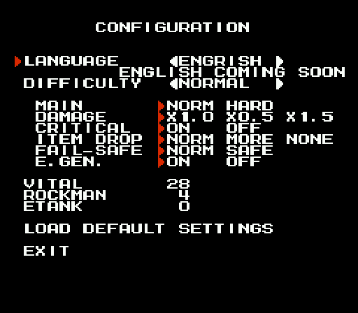

# 4MI text: every string, both languages (r4mi-text)

Scope: all of the text in *Rockman 4 Minus Infinity* v1.01 (`roms/r4mi_mmc5.nes`), in English and Japanese. That covers
the 30 HELP pages, the story scripts, Proto Man's post-game debrief (the Hero Score hint system), every menu, the RESULT
screen, the staff roll, and the hidden or unfinished text. All verbatim text below comes from the decoders in
`build/research/r4mi/r4mi-text/` (`extract_all.py`, `gen_md.py`), not from retyping. Screens were checked in the
emulator.

Tags: **[seen]** observed in the emulator, **[code]** from disassembly/data, **[text]** in-game text, **[doc]** readme,
**[guess]** inference.

Deliverables: this doc; tables in `docs/research/r4mi/tables/` (`r4mi_menu.tbl`, `r4mi_help_en.tbl`, `r4mi_help_title.tbl`,
`r4mi_help_jp.tbl`, `r4mi_dialog_en.tbl`, `r4mi_dialog_jp.tbl`, `r4mi_credits.tbl`); full raw dump
`build/research/r4mi/r4mi-text/out/all_text.txt`. Regenerate everything with
`python3 -I build/research/r4mi/r4mi-text/gen_md.py` (it re-runs `extract_all.py`).


---

## 0. Highlights: how crazy the text gets

- **The language option is literally named `ENGRISH`**, with the subtitle `ENGLISH COMING SOON` [seen]. The staff roll's
  TRANSLATION credit reads `(RESERVED)` [text]. The author did the English himself and labels it as Engrish up front.
- **The English debrief ships two unfinished entries**. They read `WIP WIP WIP / UNDER CONSTRUCTION`, then state the hidden
  conditions outright in brackets: *"IN ORDER TO COMBAT THE SECRET BOSS, YOU SHOULD ARRIVE AT THE CERTAIN PLACE OF WILY
  LEVEL 4 WITHOUT DYING!"* In Japanese, the same slot is a riddle: Shadow Man's *yabumi* (矢文, a letter shot on an arrow),
  smudged so that every few characters are missing (§4) [text].
- **The post-game debrief is a hint system.** After the ending, Proto Man comments on your RESULT. For each Hero Score
  point you missed, he drops a "by the way…" rumour that points at the hidden equipment, the friends, or the bonuses
  (§4) [text].
- **The Energy Splitter's help text hides a dark joke.** "YOU SEEM TO HEAR SOMETHING IN THIS UNIT." Proto Man's Eddie
  entry says Eddie's core was never found, that his signal "DISAPPEARED NEAR YOU", and that "YOU SAW HIS LAST MOMENT".
  The Recycle Inhaler turns enemies into items ("LET'S INHALE VARIOUS THINGS"), and Proto Man suggests inhaling a Metall
  to get METALL'S HELMET. The reading that follows: the Energy Splitter is what is left of Eddie after you inhale him
  [text + guess].
- **Wily 3 is a Zelda-style dungeon** with a MAPPING UNIT, a COMPASS UNIT ("PINPOINT THE LAIR OF THE LABYRINTH'S ROBOT
  MASTERS") and a WARP SENSOR, each with a *"YOU GOT …!"* text box [text]. The staff roll names the stage *WILY'S LABYRINTH*.
- **A fake Roll** guards Kalinka in Wily 3. In Japanese she speaks in robot-voice katakana, with the people's names in
  hiragana (`アラ　ろっく　ナニカ　ヨウカシラ`). She beats Mega Man up ("OUCH! STOP BEATING!"), and as she breaks down she
  hands him the key to Wily's lair [text].
- **"DR.RIGHT"**: in the EN space-scene script Dr. Light is introduced as `DR.RIGHT`, the early US-manual misreading of
  ライト [text].
- **The self-destruct announcement is addressed to Wily**: *"DR.WILY PROCEED TO THE EMERGENCY PLANE AT THE SECRET
  PASSAGE."* [text]
- **The staff roll gives every stage a subtitle**, from *-BLIZZARD SKY-* to *-FATAL MISCALCULATION-*, *-RUSHED OUT
  PRODUCTS-* and *-FINAL FARCE-*. It also prints per-stage TIME and **TIWNS** (deaths, from the *tiun tiun* death sound),
  and lists the hack's new enemies under **FABRICATED ENEMIES**: SI'N'COSINE, DIG'N'DUGN, RONG/RANG/RUNG, NIGHTMARE SUZY,
  JUMBIG THE DEATH MACHINE and more (§7) [text].
- **The fonts have no zero.** In the dialogue and credits fonts, byte `$00` is the space, so the author writes `1OO
  MINUTES` and `TIME OO:OO:OO` with the letter O [text][code].
- **The MY ARENA presets include `SPIXXXMAN`**, a censored name (§5.6).
- Super-special weapons borrowed from the **Game Boy** games have their own HELP pages: SCREW CRUSHER (Punk, MM III GB),
  BALLADE CRACKER (Ballade, MM IV GB) and SPARK CHASER (Terra/Earth, MM V GB). So does the **WILY BUSTER**, "FINAL WEAPON
  DEVELOPPED BY COSSACK WITH WILY'S TECHNOLOGY", which reduces the damage you take [text].

---

## 1. Text engines and tables

4MI uses at least **six text encodings**, because each screen family keeps its own font in CHR-RAM. Every table is saved
in `docs/research/r4mi/tables/` (generated by `extract_all.py`).

| Table file | Used by | Layout | Storage |
|---|---|---|---|
| `r4mi_menu.tbl` | CONFIGURATION, SPECIAL MODE, TIME ATTACK, ARENA menus, EXTRA CONFIGURATION, RECORDS | `$00` space, `0-9`=`$01-$0A`, `A-Z`=`$0B-$24`, `. - = ? ! © ◀ ▶ ' / ,`=`$25-$2F`, `▼ # : ( ) ●`=`$30-$35` | LZ-compressed nametable images (screens #09, #16, #17, #15, #11, #12) |
| `r4mi_help_en.tbl` | HELP page body, EN | hex-friendly: `0-9`=`$40-$49`, `A-F`=`$4A-$4F`, `G-Z`=`$60-$73`, `.`=`$74`, `-`=`$75`, `'`=`$7C`, `,`=`$7E` | bank `$6A`, dictionary-compressed |
| `r4mi_help_title.tbl` | HELP title row | `A-O`=`$01-$0F`, `P-Z`=`$11-$1B`, `Y` also `$42` | same |
| `r4mi_help_jp.tbl` | HELP page body, JP | katakana `$01-$45`, hiragana `$40-$79`; dakuten/handakuten are separate tiles `$7A`/`$7B`; `∞`=`$1C`, `■`=`$10`, `Ⓑ`=`$1F`, `8`=`$1E` | bank `$6A` |
| `r4mi_dialog_en.tbl` / `r4mi_dialog_jp.tbl` | story scripts, debrief, "YOU GOT" boxes | `A`=`$0A` (no zero glyph); JP hiragana `$40-$6D`, katakana `$85-$B0`, ~12 kanji (`工学用平和中化天才科者自`) | bank `$6B` scripts; debrief LZ-packed (banks `$24` JP / `$2D` EN) |
| `r4mi_credits.tbl` | staff roll, RESULT screen | `A`=`$CA`, `$C0` space, `1-9`=`$C1-$C9`, `.`=`$E4`, `-`=`$E5`, `'`=`$EC`, `#:()`=`$F0-$F3` | LZ screens #04 (bank `$72`) and #05 (bank `$06`) |

The title screen and the intro use pre-drawn tile art (the intro has kanji such as 送各地世界生守長作出) rather than a
font [seen][code].

**HELP engine** [code]. The renderer runs in bank `$6C` with bank `$6A` mapped at `$A000`. There are 30 pages, with
pointer tables at `$6C:$8FD2/$8FF0` (JP lo/hi) and `$6C:$900E/$902C` (EN lo/hi). A page is a list of lines, each ended
by `$FF`. EN pages have 13 lines and JP pages 8. A byte `$80|n, hi, lo` copies *n* bytes from elsewhere in the bank,
which acts as a dictionary of repeated phrases. Lines 0-1 are the icon (2×2 tiles) plus the title. The POWER / SPEED /
RAPIDNESS / COST numbers are **sprites**, not nametable text, so I read them from screenshots [seen].

**Dialogue engine** [code]. The starter is bank `$2D:$8C6E`. Scripts are listed in pointer tables at `$2D:$9025/$9039`
(JP, 20 entries) and `$2D:$904D/$9061` (EN). The text is in bank `$6B`. Control bytes: `$E0-$E9` are name macros
(Dr.コサック, コサック, Dr.ワイリー, ワイリー, Dr.ライト, ライト, ロックマン, …, カリンカ, ブルース); `$C8-$DF` are a dictionary
back-reference (length `c-$C4`, then hi, lo); `$FB` waits for a key and clears; `$FC`/`$FD` add dakuten/handakuten to the
next glyph; `$FE` is a newline; `$FF` ends. Lines wrap automatically at 22 columns, which is why the EN dumps show run-ons
like `ONLYYOU`. Glyphs are fetched per character from four PRG banks (`$25`, `$24`, `$63`, `$5F`) by code range
(`$2D:$8EB7`).

**Game-call convention** [code]: `JSR $DF8C` followed by three inline bytes (`hi, lo-1, bank`) is a far call. Loading an
LZ screen is `LDY #n; JSR $DF8C; .byte $8B,$B6,$6D` (loader `$6D:$8BB7`, 24-entry table at `$6D:$8BCA/$8BE2/$8BFA`). The
LZ format (`lz.py`) starts with a destination word, then control bytes: `<$40` literal run n+1, `$40-$7F` short copy n+2,
`$80-$BF` incrementing run n+2, `$C0+` long copy n+3 (`$FF` high byte ends).

---

## 2. HELP screens (weapon menu → B)

Press B on the weapon menu to open a 3-box page: title + icon, description, and four stat rows. LEFT/RIGHT pages through
the weapons and equipment you own [seen]. The page index is a fixed slot order, and **page 7 is an unused duplicate of
the buster page** (the vanilla 8-RM slot order with Dive pushed to 8) [code]. In JP mode, the title box keeps the EN
title and the body starts with a kana header line between `■` marks [seen].

Stats are as shown in game [seen] (sprites, `stats_w.png`). Equipment pages show `-` for all four. The author's readme
warns that some descriptions are deliberately useless and some hide secret functions [doc]. Commentary follows the pages
(§2.1).

**Page 0: ROCK BUSTER MI** (weapon slot 0 (buster) | POWER 1 · SPEED 4.2 · RAPIDNESS 3 · COST 0) `EN $6A:AA83` `JP $6A:A000`

| EN [text] | JP [text] |
|---|---|
| YOU FIRE BULLETS FLIES STRAIGHT.<br>WHEN THIS IS CHARGED, YOU CAN FIRE 'RAIL BUSTER' WHICH PIERCES ENEMIES.<br>THANKS TO SOLER ENERGY, YOU CAN FIRE INFINITELY. | ■　ロックバスター　ー∞　■<br>－ちょくしんするたまを　はっしゃする<br>－チャージすると　かんつうせいのうの　たかいレールバスターを　うつことができる<br>－ソーラーエネルギーを　りようしているのでいくらでも　うつことが　できる |

**Page 1: SPARK MANBOW** (Bright Man | POWER 2 · SPEED 3.1 · RAPIDNESS 3 · COST 1) `EN $6A:AAF4` `JP $6A:A055`

| EN [text] | JP [text] |
|---|---|
| YOU FIRE LIGHTBULBS WHICH EXPLODE.<br>IF YOU HOLD B, THE LIGHTBULB HOLD ON MEGABUSTER.<br>IF YOU PUSH B WITH UP, THE FLASH ATTACK IS DONE. | ■　スパーク　マンボウ　■<br>－ばくはつする　でんきゅうを　はっしゃする<br>－Ⓑを　おしたままにするとバスターに　ホールドかのう<br>－うえを　おしながら　Ⓑでフラッシュこうげきが　かのう |

**Page 2: ●TOAD** (Toad Man | POWER - · SPEED - · RAPIDNESS 1 · COST 4) `EN $6A:AB55` `JP $6A:A0AA`

| EN [text] | JP [text] |
|---|---|
| YOU EMIT THE SPECIAL WAVE WHICH TURNS THE ENEMIES.<br>NO TURNING ENEMIES ARE DAMAGED. THE TRAPS ARE ALSO DAMAGED.<br>MYSTERY FORCE MAY AFFECT THE GIMMICK. | ■　トード■<br>－とくしゅなでんじはで　てきをへんかさせる<br>－へんかしないてきには　ダメージを　あたえる<br>－ワナのようなメカに　ダメージを　あたえる<br>－みちのちからがしかけに　さようすることがある |

**Page 3: DRILL TORPEDO** (Drill Man | POWER 4 · SPEED 6.0 · RAPIDNESS 3 · COST 1) `EN $6A:ABCC` `JP $6A:A0F9`

| EN [text] | JP [text] |
|---|---|
| YOU FIRE THREE DRILLS WHICH GUIDED TO THE FLOOR OR CEILING.<br>DRILLS PIERCES EVERYTHING.<br>IF YOU PUSH B AGAIN, YOU CAN RE-FIRE. | ■　ドりル　トーピード■<br>－ちけいにそってとぶみっつのドりルを　はっしゃする<br>－かんつうせいのうが　とてもたかい<br>－もういちど　Ⓑをおすと　うちなおせる<br>－いりょくが　たかい |

**Page 4: PHARAOH SHOTGUN** (Pharaoh Man | POWER 2 · SPEED 4.0 · RAPIDNESS 5 · COST 1) `EN $6A:AC38` `JP $6A:A146`

| EN [text] | JP [text] |
|---|---|
| YOU SCATTER BULLETS AHEAD.<br>THIS IS CHARGABLE, AND YOU CAN ATTACK ABOVE YOU WHEN CHARGING.<br>IF YOU PUSH B AGAIN, YOU CAN RE-FIRE. | ■　ファラオ　ショットガン　■<br>－ぜんぽうに　たまを　ばらまく<br>－チャージ　かのう<br>－チャージちゅう　ずじょうにこうげきが　かのう<br>－もういちど　Ⓑをおすと　うちなおせる |

**Page 5: HOLDABLE CONTROL RING BOOMERANG** (Ring Man | POWER 2 · SPEED 7.0 · RAPIDNESS 4 · COST 1/2) `EN $6A:ACBC` `JP $6A:A1A7`

| EN [text] | JP [text] |
|---|---|
| YOU THROW THE RING SHAPED BOOMERANG TOWARD 8 DIRECTION.<br>IF YOU HOLD B, RINGS HOLD IN AIR.<br>RINGS CAN CATCH ITEMS. | ■　ホールダブル　コントロールりング　ブーメラン　■<br>－8ほうこうに　りングがたのブーメランを　なげる<br>－Ⓑを　おしつづけると　ホールド　かのう<br>－アイテムを　かいしゅう　かのう |

**Page 6: RECYCLE INHALER** (Dust Man | POWER - · SPEED - · RAPIDNESS 1 · COST 4) `EN $6A:AD37` `JP $6A:A209`

| EN [text] | JP [text] |
|---|---|
| YOU INHALE CLOSE ENEMIES AND TURN IT INTO AN ITEM. THE TRAPS ARE ALSO INHALABLE.<br>NOT INHALABLE ENEMIES TAKE DAMAGES.<br>LET'S INHALE VARIOUS THINGS. | ■　りサイクル　インへイラー　■<br>－ちかくにいる　てきを　すいこみアイテムへと　へんかんする<br>－すいこめないてきには　ダメージを　あたえる<br>－ワナのようなメカを　すいこむことが　かのう<br>－いろいろなものを　すいこんでみよう |

**Page 7: ROCK BUSTER MI** (duplicate of page 0 (unused slot) | POWER 1 · SPEED 4.2 · RAPIDNESS 3 · COST 0) `EN $6A:AA83` `JP $6A:A000`

| EN [text] | JP [text] |
|---|---|
| YOU FIRE BULLETS FLIES STRAIGHT.<br>WHEN THIS IS CHARGED, YOU CAN FIRE 'RAIL BUSTER' WHICH PIERCES ENEMIES.<br>THANKS TO SOLER ENERGY, YOU CAN FIRE INFINITELY. | ■　ロックバスター　ー∞　■<br>－ちょくしんするたまを　はっしゃする<br>－チャージすると　かんつうせいのうの　たかいレールバスターを　うつことができる<br>－ソーラーエネルギーを　りようしているのでいくらでも　うつことが　できる |

**Page 8: WATER CUTTER** (Dive Man | POWER 1 · SPEED 16.0 · RAPIDNESS 1 · COST 1/3) `EN $6A:ADBD` `JP $6A:A276`

| EN [text] | JP [text] |
|---|---|
| YOU SHOOT OUT THE HIGH-PRESSURED WATER TOWARD 8 DIRECTION.<br>IF YOU PUSH B AGAIN, YOU CAN RE-FIRE.<br>THIS IS EFFECTIVE TO THE FIRE ENEMIES. | ■　ウォーター　カッター　■<br>－8ほうこうに　こうあつすいをいきおいよく　はっしゃする<br>－もういちど　Ⓑをおすと　うちなおせる<br>－ほのおをまとったてきに　ゆうこう<br>－ねんぴが　よい |

**Page 9: HELL WHEEL** (Skull Man | POWER 3 · SPEED 2.7 · RAPIDNESS 1 · COST 3) `EN $6A:AE2C` `JP $6A:A2C3`

| EN [text] | JP [text] |
|---|---|
| YOU CHARGE TO ENEMIES WITH SKULL WHEEL.<br>YOU CAN STOP IF YOU PUSH B WHEN RUNNING.<br>YOU CAN TURN WITH D-PAD. | ■　へル　ホイール　■<br>－ドクロのしゃりんを　みにまといこうそくに　てきに　たいあたりをする<br>－そうこうちゅう　もういちど　Ⓑをおすととまることが　できる<br>－ターンを　することも　できる |

**Page 10: RUSH SEARCH** (Rush (start) | POWER - · SPEED - · RAPIDNESS - · COST 9) `EN $6A:AE7F` `JP $6A:A31A`

| EN [text] | JP [text] |
|---|---|
| YOU CALL RUSH AND MAKE HIM DIG OUT AN ITEM.<br>THE ITEM IS CERTAINLY DUG.<br>RUSH MAY DIG THE LIFE ENERGY IN CEATAIN SITUATION. | ■　ラッシュ　サーチ　■<br>－ラッシュをよび　じめんからかいふくアイテムを　ほりださせる<br>－アイテムは　かくじつに　ほりだせる<br>－いっていの　じょうけんかでは　ラッシュはかならず　ライフエネルギーを　ほりだす |

**Page 11: RUSH CANNON** (Rush adaptor #1 | POWER 28 · SPEED 6.0 · RAPIDNESS 1 · COST 14) `EN $6A:AEF0` `JP $6A:A37D`

| EN [text] | JP [text] |
|---|---|
| YOU LOAD RUSH IN MEGABUSTER AND FIRE.<br>WHEN HE HIT THE ENEMY OR WALL, GRAND EXPLOSION OCCURS.<br>EVERYONE IS DEFEATED BY THIS INSTANTLY, BUT THIS MAY BE DODGED. | ■　ラッシュ　キャノン　■<br>－ラッシュを　バスターにこめ　うちだす<br>－てきや　ちけいに　あたると　だいばくはつ<br>－これなら　どんなヤツでもいちげきで　たおせるだろう<br>－よけられてしまう　ことがある |

**Page 12: WISH STAR** (Rush adaptor #2 | POWER ≥14 · SPEED - · RAPIDNESS 1 · COST 28) `EN $6A:AF75` `JP $6A:A3E8`

| EN [text] | JP [text] |
|---|---|
| YOU SEND THE ENEMIES TO ANOTHER DIMENSION AND CHARGE THEM REPEATEDLY WITH RUSH.<br>MORE AND MORE POWER IS PERFORMED WHEN IN A PINCH. | ■　ウィッシュ　スター　■<br>－てきを　いじげんに　おくりこみラッシュと　ともにれんぞくして　たいあたりを　くりだす<br>－めにみえるてき　すべてに　ゆうこう<br>－ピンチのとき　さらに　パワーアップ |

**Page 13: WIRE** (hidden in Drill Man stage [text] | POWER 2 · SPEED 8.0 · RAPIDNESS 1 · COST 0) `EN $6A:AFF7` `JP $6A:A44D`

| EN [text] | JP [text] |
|---|---|
| YOU THROW WIRE HOOK AND YOU CAN MOVE TO HUNG PLACE.<br>THROWING DIRECTION IS CONTROLED BY D-PAD.<br>YOU CAN JUMP WHEN ROLLING UP WIRE. | ■　ワイヤー　■<br>－ワイヤーフックを　なげひっかかった　ところへ　いどうできる<br>－フックをなげるほうこうはじゅうじキーで　ちょうせいかのう<br>－まきとりちゅう　ジャンプが　かのう |

**Page 14: BALLOON** (hidden in Dive Man stage [text] | POWER - · SPEED - · RAPIDNESS - · COST 10) `EN $6A:B06C` `JP $6A:A4A4`

| EN [text] | JP [text] |
|---|---|
| YOU GENERATE THE SMALL BALLOON BELOW.<br>YOU CAN CONTROL THE BALLOON ON.<br>YOU CAN FIRE MEGABUSTER WHEN THE BALLOON EXISTS. | ■　バルーン　■<br>－あしもとに　ロックマンがのれるこがたの　ききゅうを　はっせいさせる<br>－のったあと　じゅうじキーで　そうさかのう<br>－すでに　バルーンが　あるときはロックバスターを　うてる |

**Page 15: BIRD ROBOT** (equipment: BEAT | stats: all "-") `EN $6A:B0CD` `JP $6A:A50B`

| EN [text] | JP [text] |
|---|---|
| HE IS THE BIRD ROBOT WHO IS CAPTURED IN THE CAGE.<br>HE SALVAGES YOU WHEN FALLED BUT YOU TAKE DAMAGES.<br>HE SEEMS TO TAKE TO YOU. | ■　とりがた　ロボット　■<br>－とりかごに　とらわれていたとりがたの　ロボット<br>－あなにおちた　ロックマンを　ひきあげてくれる<br>－ただし　てんらくのたびダメージはうける<br>－ロックマンに　なついたようだ |

**Page 16: METALL'S HELMET** (hidden equipment | stats: all "-") `EN $6A:B142` `JP $6A:A573`

| EN [text] | JP [text] |
|---|---|
| THIS IS A HARD HAT OF A METALL.<br>FOR THIS HAVE BROKEN A BIT WHEN RECYCLEING, THIS MAY BE USELESS.<br>THIS SOMETIMES REDUCES DAMAGES. | ■　へルメット　■<br>－メットールの　へルメット<br>－りサイクルするときに　すこしこわれたためあまり　やくにたちそうもない<br>－ダメージを　うけたときまれに　ダメージを　けいげんする |

**Page 17: SKULL AMULET** (hidden equipment | stats: all "-") `EN $6A:B1BB` `JP $6A:A5C7`

| EN [text] | JP [text] |
|---|---|
| THIS IS PROCESSED GEM ATTACHED ON SKULL MAN'S CHEST.<br>FOR THIS BRING YOU GUTS, IF YOU HAVE 2 OR MORE VITAL, THIS BARELY PROTECTS MEGAMN FROM FATAL DAMAGE. | ■　スカル　アミュレット　■<br>－スカルマンが　むねに　みにつけていたほうせきを　かこうしたもの<br>－こんじょうが　みにつく<br>－ライフが　にめもり　いじょうあればおおきなダメージを　うけても　たえられる |

**Page 18: SUPER STAR** (hidden equipment | stats: all "-") `EN $6A:B228` `JP $6A:A617`

| EN [text] | JP [text] |
|---|---|
| THIS IS WHAT WAS ATTACHED ON SHADOW MAN'S FOREHEAD.<br>THIS AMPLIFIES CRUELTY.<br>THIS INCREASES THE CRITICAL CHANCE AND THE CRITICAL DAMAGES. | ■　スーパー　スター　■<br>－シャドーマンが　ひたいに　つけていたもの<br>－れいこくさが　みにつく<br>－てきの　きゅうしょをつく　かくりつとそのさいの　いりょくが　あがる |

**Page 19: ENERGY SPLITTER** (hidden equipment | stats: all "-") `EN $6A:B2AF` `JP $6A:A678`

| EN [text] | JP [text] |
|---|---|
| ALL WEAPONS ARE REFILLED WHEN YOU TAKE WEAPON ENERGY.<br>THE EFFECT ISN'T DECREASED BY SPLITTING.<br>YOU SEEM TO HEAR SOMETHING IN THIS UNIT. | ■　エネルギー　スプりッター　■<br>－ぶきエネルギーを　とったときに　すべてのぶきの　エネルギーが　かいふくする<br>－ぶんさんされたことによりこうりょくが　さがることはない<br>－なかから　なにかが　きこえるきがする |

**Page 20: SHOCK GUARD** (hidden equipment / FAIL-SAFE | stats: all "-") `EN $6A:B326` `JP $6A:A6DB`

| EN [text] | JP [text] |
|---|---|
| THIS IS THE ARMOR WHICH IS MADE OF THE WIRE.<br>IF YOU HAVE 2 OR MORE VITAL, THIS BARELY PROTECTS YOU FROM SPIKE. | ■　ショック　ガード■<br>－ワイヤーを　かこうしてつくられた　アーマー<br>－ライフが　にめもり　いじょうあればトゲなどに　ふれてもギりギりで　たえられる |

**Page 21: TRAMPOLINE** (hidden equipment / FAIL-SAFE | stats: all "-") `EN $6A:B39C` `JP $6A:A72F`

| EN [text] | JP [text] |
|---|---|
| THIS IS EMERGENT JUMPPING UNIT MADE OF BALLOON.<br>YOU CAN JUMP WHEN FALLED.<br>BUT YOU TAKE DAMAGES WHEN USE THIS. | ■　トランポりン　■<br>－バルーンを　かこうしてつくられたきんきゅうジャンプそうち<br>－てんらくじに　とびあがることがかのう<br>－つかうたびに　ダメージをうける |

**Page 22: ENERGY CHARGER** (starting equipment | stats: all "-") `EN $6A:B400` `JP $6A:A784`

| EN [text] | JP [text] |
|---|---|
| THIS IS EMERGENT ENERGY STRAGE UNIT.<br>WEAPONS ARE REFILLED WHEN YOU ARE DEFEATED.<br>THE LESS ENERGY REMAINS, THE MORE ENERGY REFILLS. | ■　エネルギー　チャージャー　■<br>－きんきゅうようエネルギーちょちくそうち<br>－やられてしまったとき　などにぶきエネルギーを　かいふくする<br>－エネルギーののこりが　すくないぶきほどかいふくりょうが　おおい |

**Page 23: ENERGY BALANCER** (starting equipment | stats: all "-") `EN $6A:B48C` `JP $6A:A7F1`

| EN [text] | JP [text] |
|---|---|
| THIS IMPROVES YOUR ENERGY RECOVERING EFFICIENCY.<br>THIS SENDS REMAINDER OF WEAPON ENERGY TO OTHER WEAPON.<br>THIS IS ACTIVE WHATEVER YOU EQUIPS. | ■　エネルギー　バランサー　■<br>－ロックマンの　エネルギーほきゅうのこうりつを　かいぜんするそうち<br>－ぶきエネルギーの　よじょうぶんをほかの　ぶきにまわす<br>－どのぶきを　そうびじにも　ゆうこう |

**Page 24: EXCHANGER** (starting equipment | stats: all "-") `EN $6A:B50C` `JP $6A:A84F`

| EN [text] | JP [text] |
|---|---|
| THIS IS CONVERTER OF LIFE ENERGY.<br>THIS CONVERTS THE HALF OF REMAINDER OF LIFE ENERGY INTO WEAPON ENERGY.<br>THIS IS USED WITH ENERGY BALANCER. | ■　エクスチェンジャー　■<br>－ライフエネルギーの　へんかんそうち<br>－ライフエネルギーのよじょうぶんの　はんぶんをぶきエネルギーに　へんかんする<br>－エネルギーバランサーと　へいようされる |

**Page 25: SCREW CRUSHER** (EXWP super-special weapon) `EN $6A:B58B` `JP $6A:A8AE`

| EN [text] | JP [text] |
|---|---|
| YOU THROW SPINNING SAW.<br>THIS FLIES ALONG PARABOLIC ORBIT.<br>THIS INVALIDATES THE ENEMY'S ARMOR.<br>YOU CAN THROW THIS INFINITELY. | ■　スクりュー　クラッシャー　■<br>－こうそくかいてんする　ノコギりを　なげる<br>－なげたあと　ほうぶつうんどうするためじょうげに　こうげきすることが　かのう<br>－あいての　そうこうや　ぼうぎょを　つらぬく<br>－いくらでも　なげることが　できる |

**Page 26: BALLADE CRACKER** (EXWP super-special weapon) `EN $6A:B5F8` `JP $6A:A923`

| EN [text] | JP [text] |
|---|---|
| YOU THROW BOMBERS TOWARD 8 DIRECTION.<br>WHEN BOMBERS HIT TO ENEMY OR WALL, IT'S EXPLOSION ATTACK A LARGE RANGE.<br>YOU CAN THROW THIS INFINITELY. | ■　バラード　クラッカー　■<br>－8ほうこうに　ばくだんを　なげる<br>－てきや　ちけいにあたると　ばくはつを　おこしひろいはんいに　こうげき　かのう<br>－いくらでも　なげることが　できる |

**Page 27: SPARK CHASER** (EXWP super-special weapon) `EN $6A:B675` `JP $6A:A985`

| EN [text] | JP [text] |
|---|---|
| INTENSE SPARK CHASES ENEMIES AND ATTACKS REPEATEDLY.<br>IF YOU PUSH B AGAIN, YOU CAN RE-FIRE.<br>YOU CAN EMIT THIS INFINITELY. | ■　スパーク　チェイサー　■<br>－はげしいほうでんが　てきをおいかけれんぞくして　こうげきする<br>－もういちど　Ⓑをおすと　うちなおせる<br>－いくらでも　うつことが　できる |

**Page 28: WILY BUSTER** (EXWP super-special weapon (final battle)) `EN $6A:B6D6` `JP $6A:A9DC`

| EN [text] | JP [text] |
|---|---|
| THIS IS FINAL WEAPON DEVELOPPED BY COSSACK WITH WILY'S TECHNOLOGY.<br>YOU CAN FIRE HUGE BULLETS INFINITELY.<br>FOR THIS ALSO HAS SHIELD FUNCTION, THIS REDUCES THE DAMAGES TO YOU. | ■　ワイりー　バスター　■<br>－コサックはかせが　ワイりーの　ぎじゅつをおうようし　かいはつした　さいしゅうへいき<br>－きょだいな　たまを　れんぱつ　かのう<br>－バりアきのうまで　ついておりうけるダメージを　けいげん　かのう |

**Page 29: ?DAGGER** (hidden equipment (?DAGGER) | stats: all "-") `EN $6A:B76F` `JP $6A:AA59`

| EN [text] | JP [text] |
|---|---|
| UNCERTAIN ITEM | ■　？たんとう　■<br>－しきべつされていないのでよくわからない |


### 2.1 What the help text is really saying

**Translation drift.** The EN and JP pages are not translations of each other line for line. JP often has an extra
bullet, and the extras are the *useful* bits:

| Page | JP-only line | Meaning |
|---|---|---|
| 3 DRILL TORPEDO | `－いりょくが　たかい` | "High power." EN says nothing about damage. |
| 8 WATER CUTTER | `－ねんぴが　よい` | "Good fuel economy" (*nenpi*, a car-ad word). EN omits it; the COST stat is 1/3. |
| 11 RUSH CANNON | `－これなら　どんなヤツでも　いちげきで　たおせるだろう` | "With this you could probably one-shot *anyone*." It is POWER 28 = full boss HP, which EN states as "EVERYONE IS DEFEATED BY THIS INSTANTLY, BUT THIS MAY BE DODGED." |
| 12 WISH STAR | `－めにみえるてき　すべてに　ゆうこう` | "Effective against every enemy you can see": it is a screen-clear. EN drops this, and keeps only "MORE AND MORE POWER IS PERFORMED WHEN IN A PINCH" (POWER is shown as `≥14`). |
| 14 BALLOON | `あしもとに　ロックマンがのれる　こがたの　ききゅう` | "A small balloon at your feet that Rockman can ride". EN's "YOU CAN CONTROL THE BALLOON ON." lost the word *ride*. |
| 25 SCREW CRUSHER | `なげたあと　ほうぶつうんどうするため　じょうげに　こうげきすることが　かのう` | "Because it flies in a parabola, you can hit above and below." |

**Secret functions hinted at in the text** [text]. These are the readme's "descriptions that hide secret functions":

- **●TOAD**: "MYSTERY FORCE MAY AFFECT THE GIMMICK." / `みちのちからが　しかけに　さようすることがある` ("an unknown power may
  act on the stage gimmicks"). Its main effect is that a "SPECIAL WAVE" `へんかさせる`, *transforms*, enemies, and what
  will not transform takes damage. The debrief adds that "TOAD MAN WANT TO BECOME REAL TOAD", and FLAG bit `TOAD` is
  a Hero Score BONUS (§4.1) [guess: Toad on Toad Man turns him into a real toad].
- **RUSH SEARCH**: "THE ITEM IS CERTAINLY DUG. RUSH MAY DIG THE LIFE ENERGY IN CEATAIN SITUATION." / JP: under certain
  conditions Rush *always* (`かならず`) digs up life energy.
- **RECYCLE INHALER**: "THE TRAPS ARE ALSO INHALABLE … LET'S INHALE VARIOUS THINGS." This is the equipment
  factory: METALL'S HELMET is "broken a bit when recycling", and the debrief tells you to try it on a Metall and on
  spare Wire/Balloon (§4).
- **ENERGY SPLITTER**: "YOU SEEM TO HEAR SOMETHING IN THIS UNIT." / `なかから　なにかが　きこえるきがする`. This is the Eddie
  joke (§0, §4.1).
- **HOLDABLE CONTROL RING BOOMERANG**: "RINGS CAN CATCH ITEMS." / `アイテムを　かいしゅう　かのう` (item retrieval, like the Rush-search drops).
- **SPARK MANBOW** (= Bright Man; *manbō* マンボウ is the ocean sunfish [guess: a pun on Bright Man's bulb head]): hold B to keep the bulb on the
  buster, UP+B for a flash attack (Bright Man's time-stop flash).

**Deliberately useless descriptions** [text]:

- **?DAGGER**: the whole page is `UNCERTAIN ITEM` / `？たんとう　■　－しきべつされていないので　よくわからない` ("?Dagger:
  unidentified, so you can't tell"). The joke is the roguelike *unidentified item* (Shiren / Nethack).
- **METALL'S HELMET**: "FOR THIS HAVE BROKEN A BIT WHEN RECYCLEING, THIS MAY BE USELESS. THIS SOMETIMES REDUCES
  DAMAGES." JP: `あまり　やくにたちそうもない` ("doesn't look very useful"), `まれに` ("rarely").
- **BIRD ROBOT** (Beat): "HE SEEMS TO TAKE TO YOU." / `ロックマンに　なついたようだ`: flavour only.
- **ENERGY BALANCER**: "THIS IS ACTIVE WHATEVER YOU EQUIPS." In vanilla RM4 the Balancer only works with the buster.
- **EXCHANGER**: "THIS IS USED WITH ENERGY BALANCER": half the surplus life energy becomes weapon energy.

**Equipment origins in the text** [text]: SKULL AMULET is the gem from Skull Man's chest ("BRING YOU GUTS", JP
`こんじょう`, the RPG "guts" survive-at-1-HP effect, with 2+ vital). SUPER STAR is "WHAT WAS ATTACHED ON SHADOW MAN'S
FOREHEAD" and "AMPLIFIES CRUELTY" (`れいこくさ`); it raises crit chance and crit damage. SHOCK GUARD is armour made from
the WIRE, TRAMPOLINE an emergency jump unit made from the BALLOON. Both are also the CONFIG FAIL-SAFE items.

**Engrish catalogue** (EN pages, as shipped): SOLER ENERGY, FLIES STRAIGHT (for "that fly"), HIGH-PRESSURED, CONTROLED,
CEATAIN, RECYCLEING, MEGAMN, JUMPPING, EMERGENT (for "emergency"), STRAGE (for "storage"), WHATEVER YOU EQUIPS,
DEVELOPPED, IT'S EXPLOSION, WHEN FALLED. MEGABUSTER and MEGAMAN are the EN names, but the menu keeps ROCKMAN. All of it
fits the `ENGRISH` label the author gave the language option.

**Name puns**: SPARK MANBOW (sunfish), HELL WHEEL (JP `へル　ホイール`: Skull Man's weapon becomes a skull-wheel ride),
RECYCLE INHALER (Dust Man was a garbage-compactor robot), WATER CUTTER (Dive), WISH STAR ("you send the enemies to
another dimension and charge them repeatedly with Rush"), "ROCK BUSTER MI" with JP header `ロックバスター　ー∞` (Rock
Buster −∞, the hack's title gag).


---

## 3. Story scripts (bank `$6B`)

Twenty script slots per language. Slots 4-8 all point at the same MAPPING UNIT text, slot 16 points into RAM (`$6400`,
where the LZ-packed debrief is unpacked), and slots 17-19 are empty (just `$FF`) [code]. Speaker tags are spelled out in
JP (`Dr.コサック「`). EN uses the full name on first appearance (`DR.COSSACK:`) and initials after that (`C:`, `W:`, `R:`,
`M:`, `K:`) [text]. `▼` marks a key-wait.

#### Script 0: Cossack 4 boss defeated: the confession (Wily interrupts)

`EN $6B:A76C` `JP $6B:A000`

<table><tr><th>EN [text]</th><th>JP [text]</th></tr><tr><td><pre>DR.COSSACK:W...WAIT!
PLEASE TALK WITH ME!
TO TELL THE TRUTH,

KALINKA, MY DAUGHTER
KIDNAPPED BY DR.WILY.
SO I HAD COOPERATED
WITH DR.WILY
WITHOUT MY WILL!

 ▼
MEGAMAN:DR.WILY DID...
WHAT!?
 ▼
?:DON'T YOU HOLD YOUR
DAUGHTER'S LIFE DEAR?
 ▼
C:HMM...
W:MEGAMAN,
COME ON MY FORTRESS
IF YOU WANT TO SAVE HER.BUT YOU'LL DIE THERE.
HA HA HA HA HA!!!
 ▼
R:WAIT! HOW INHUMANE!
 ▼
I'LL SAVE KALINKA, SIR. ▼
 SIR.
C:YOU ARE... OH, HE HAD
GONE WITH TRUST IN ME.</pre></td><td><pre>Dr.コサック「ま...まってくれ
はなしをきいてくれ　ロックマン
じつは　わたしの　むすめの　カりンカが
Dr.ワイりーに　ゆうかいされてしまい
おどされて　しかたなく　Dr.ワイりーの
せかいせいふくけいかくに　ちからをかしていたのだ ▼
ロックマン「Dr.ワイりーが...なんだって！？

 ▼
？「むすめのいのちは　おしくはないのかい？
Dr.コサック！
 ▼
Dr.コサック「うう...
Dr.ワイりー「ロックマンよ...
こやつのむすめのいのちを　すくいたければ
わたしの　けんきゅうじょに　くるがよい
そこが　きさまの　はかばとなるじゃろうがな
はーーーーーっはっはっは！
 ▼
ロックマン「まて！　きたないぞ！　Dr.ワイりー
 ▼
カりンカさんのことは　まかせてください！ ▼
い！
Dr.コサック「ロックくん...！
いってしまったか...わたしをしんじて</pre></td></tr></table>

#### Script 1: Cossack and Beat

`EN $6B:A894` `JP $6B:A115`

<table><tr><th>EN [text]</th><th>JP [text]</th></tr><tr><td><pre> ▼
C:OH, BEAT... YOU
WOULDN'T OBEY WILY.
 ▼
YOU SAID THAT THE BLUE
ROBOT SAVED YOU AND
YOU HELPED HIM,
DIDN'T YOU?
THAT'S GOOD, BEAT...!
HELP HIM AGAIN.
 ▼
 ▼
HOW INNOCENT HE IS!
BUT I AM ...</pre></td><td><pre> ▼
おお...ビートや...おまえはさいごまで
ワイりーのいうことを　きかなかったな...
 ▼
ふむ...あおいロボットに　たすけてもらったからそのロボットに　きょうりょくしてあげた...と？...それはよかったな　ビート...！
そうだ　つづけて　かれに　きょうりょくしてくれ
 ▼
 ▼
なんと　つみのないこだ...
...わたしは...</pre></td></tr></table>

#### Script 2: Cossack alone

`EN $6B:A91A` `JP $6B:A19F`

<table><tr><th>EN [text]</th><th>JP [text]</th></tr><tr><td><pre>C:HOW TERRIBLE THING
I DID...!</pre></td><td><pre>わたしは...
なんということを　してしまったんだ...！</pre></td></tr></table>

#### Script 3: Proto Man visits Cossack

`EN $6B:A935` `JP $6B:A1BB`

<table><tr><th>EN [text]</th><th>JP [text]</th></tr><tr><td><pre>......

?:HOW LONG YOU ARE
DEPRESSED, DR.COSSACK?
 ▼
 ▼
PROTO MAN:NO, I'M NOT
YOUR ENEMY.
YOU WERE WRONG EVEN IF
YOU WERE THREATENED BUT
THERE IS WORK WHICH ONLYYOU CAN DO, ISN'T THERE?C:......!

 ▼
PROTO MAN/DR.COSSACK:???</pre></td><td><pre>......

？「いつまで　おちこんでいるきなんだ
Dr.コサック
 ▼
 ▼
ブルース「おっと　あんしんしな
てきじゃないぜ
たしかに　おどされていたとはいえ
おまえのしたことは　ただしくなかった　だが
いまの　おまえにしかできないことだって
あるんじゃないのか？
Dr.コサック「......！

 ▼
ブルース/Dr.コサック「？？？</pre></td></tr></table>

#### Script 4: Wily 3: MAPPING UNIT found (slots 4-8 share one text)

`EN $6B:A9DD` `JP $6B:A240`

<table><tr><th>EN [text]</th><th>JP [text]</th></tr><tr><td><pre>YOU GOT
THE MAPPING UNIT!
YOU CAN USE IT TO SEE
YOUR CURRENT POSITION
AND THE LABYRINTH MAP
(PRESS SELECT).
THIS RECORDS PASSED
ZONES AUTOMATICALLY.</pre></td><td><pre>マップユニットを　てにいれた！　SELECTを
PUSHすると　げんざいちが　わかるはずだ！
つうかした　ばしょを
じどうで　キロクできるぞ</pre></td></tr></table>

#### Script 9: Wily 3: COMPASS UNIT found

`EN $6B:AA3F` `JP $6B:A289`

<table><tr><th>EN [text]</th><th>JP [text]</th></tr><tr><td><pre>YOU FOUND
THE COMPASS UNIT!
NOW YOU CAN PINPOINT
THE LAIR OF
THE LABYRINTH'S ROBOT
MASTERS!
PRESS SELECT TO USE!</pre></td><td><pre>コンパスユニットを　みつけた
ボスのばしょは　これでばっちりだぜ！
セレクトボタンで　かくにんしてみよう！</pre></td></tr></table>

#### Script 10: Wily 3: WARP SENSOR (JP: tilt sensor) found

`EN $6B:AA85` `JP $6B:A2B2`

<table><tr><th>EN [text]</th><th>JP [text]</th></tr><tr><td><pre>YOU'VE GOT
THE WARP SENSOR UNIT!
NOW, YOU CAN SEE WHERE
THE DISTURBED ZONE ARE.
THIS UNIT HAS
MORE FEATURE--
A TONE WILL TELL YOU
IF YOU PASS IT.
PRESS SELECT TO USE!</pre></td><td><pre>チルトセンサーを　はっけん！
くうかんのゆがみの　ばしょがわかるぞ！
さらにっ！　ゆがみを　とおったときに
おとでしらせる　きのうつき！
セレクトボタンで　かくにんしてみよう！</pre></td></tr></table>

#### Script 11: Wily 3 opening: Dr. Light on the radio (space scene)

`EN $6B:AB19` `JP $6B:A30D`

<table><tr><th>EN [text]</th><th>JP [text]</th></tr><tr><td><pre>DR.RIGHT:MEGAMAN,
IT'S DANGEROUS!
SPACE IS DISTURBED,
AND
YOUR RADAR OR SENSOR
DISABLED.
BUT I HAVE GOOD NEWS!
MEGAMAN. I FOUND HIM!
WHEN YOU SEARCH
IN THAT FORTRESS,
YOUR VITAL SENSOR
CAUGHT A SIGNAL!
MEGAMAN:(A SIGNAL?)
R:IT MUST BE WILY'S!
I'LL SEND YOU TO NEAR
THE SIGNAL.
WARPING COORDINATES
ARE...
M:......
 ▼
NO, I'LL NOT WARP.
R:W...WHAT YOU SAID!?
NO KIDDING, ROCK!
M:I HAVE...  ▼
I HAVE
IMPORTANT THING TO DO.</pre></td><td><pre>Dr.ライト「ロックマン
そのさきはきけんじゃ！
くうかんがみだれて
レーダーや　センサーが　いっさいつかえんのじゃ
しかし　よいニュースじゃ　ロックマン
ワイりーのやつを　ついにはっけんしたぞ
きちのないぶに　せいめいはんのうを
ひとつ　はっけんしたのじゃ
ロックマン（ひとつ...？）
Dr.ライト「ワイりーのものにちがいないだろう
すぐにちかくにワープさせてやる
てんそうざひょうは...
ロックマン「......
 ▼
ワープはできません　ライトはかせ
Dr.ライト「な...なにをいっておる　ロック
こんなときに　わがままなど...
ロックマン「ぼくには...
 ▼
ぼくには　やらなければならないことがあるんです！</pre></td></tr></table>

#### Script 12: Wily 3: entering the distorted space

`EN $6B:AC5E` `JP $6B:A402`

<table><tr><th>EN [text]</th><th>JP [text]</th></tr><tr><td><pre>M:IS IT INSIDE
DISTURBED SPACE ... ?
 ▼
DR....DR....COMMUNICATI-
ON UNIT IS DISABLED!?
BUT I'LL GO.

 ▼
JUST A SIGNAL IS INSIDE
THIS FORTRESS, AND
THIS SPACE DISABLES
RADARS OR SENSORS.
 ▼
KALINKA IS INSIDE
THIS SPACE!</pre></td><td><pre>ロックマン「みだれたくうかんの
なかにはいった...？
 ▼
はかせ...はかせ...つうしんそうちが
つかえない！？　...でも　いかなきゃ
 ▼
きちのないぶに　たったひとつのせいめいはんのう
そして　レーダーがきかない　このくうかん
 ▼
カりンカさんは　このくうかんのどこかだ！</pre></td></tr></table>

#### Script 13: Wily 3: Kalinka and the fake Roll

`EN $6B:ACF4` `JP $6B:A47E`

<table><tr><th>EN [text]</th><th>JP [text]</th></tr><tr><td><pre>ROLL?:HI ROCK!
HOW ARE YOU?
MEGAMAN:ARE YOU ROLL...
 ▼
ROLL'S COPY!?
R:I'VE CHATTED
WITH KALINKA.
PLEASE GET OUT IF YOU
INTERRUPT US! ▼
!
M:OUCH! STOP BEATING!
 ▼
WHAT I'LL SHOULD DO...
BUT...
 ▼
...ROLL, I'M SORRY!
 ▼
R:YOU ARE KALINKA,
AREN'T YOU? ARE YOU OK?
K:Y...YES. ROLL, WHO IS
THE ROBOT YOU BROKE NOW,HAD TAKEN CARE OF ME
WELL.  ▼
WHO ARE YOU?
 ▼
M:ROLL HAD...      ▼

 ▼
I MIGHT HAD MISTAKEN...
 ▼
I'M MEGAMAN.

I CAME TO SAVE YOU AT
YOUR FATHER'S REQUEST.
K:MY DAD'S...? IS MY
FATHER FINE!?
M:YES. ESCAPE HERE RIGHTAWAY. RUSH! COME ON!
 ▼
TAKE HER TO SAFE PLACE.
OK?
K:WAIT. THIS IS MY DAD'SENERGY AMPLIFYING UNIT.
I SUPPOSE IT ATTACH TO
THIS DOGGY.
 ▼
... ALL OK.
 ▼
THANK YOU MEGAMAN!
 ▼
R:(BEEP...) KALINKA,
I COOKED YOUR MEAL.
 ▼
M:ROLL... I'M...
R:WAIT, ROCK. TAKE THIS. ▼
M:OH!? THIS IS...
R:IT TAKES YOU TO WILY.
DO YOUR BEST, ROCK...

 ▼
M:KIDNAPPING KALINKA,
CREATING ROLL'S COPY.
 ▼
I'LL NEVER FORGIVE
DR.WILY ONCE MORE!</pre></td><td><pre>にせロール「アラ　ろっく
ナニカ　ヨウカシラ
ロックマン「ロールちゃん ▼
...の
コピーだって！？
にせロール「ワタシハ　かりんかチャント
オハナシヲ　シテイタノ
ヨウガ　ナイナラ
デテイッテ　チョウダイ！ ▼

ロックマン「いたいよ　やめてよ　ロールちゃん！
 ▼
...こまったなあ　やりづらいよ
...でも
 ▼
...ごめんね　ロールちゃん！
 ▼
ロックマン「あなたが　カりンカ...ちゃんだね？けがは　ないかな？
カりンカ「ええ...ロールちゃん...あなたが
いまこわしたロボットが　よくしてくれたので... ▼
あなたは...？

 ▼
ロックマン「ロールちゃんが...　　 ▼

 ▼
それは　わるいことしちゃったなあ...
 ▼
ぼくは　ロックマン
コサックはかせにたのまれて　たすけにきたんだ
カりンカ「ちちが...
おとうさまは　ぶじですか！？
ロックマン「うん　だいじょうぶだよ
すぐに　だっしゅつしよう　　こい！ラッシュ！
 ▼
カりンカちゃんを　あんぜんなところまで
たのんだぞ　ラッシュ！
カりンカ「まって...これ...ちちが　あわててわたしにあずけた　エネルギーぞうふくそうちよ
そうね...
このワンちゃんに　つけてあげようかしら？
 ▼
...これでいいわ
 ▼
ありがとう　ロックマン！
 ▼
にせロール「ビー...ガー...
かりんかチャン　ゴハンガデキタワヨ...
 ▼
ロックマン「...ロールちゃん...
にせロール「ろっくマッテ...コレヲ...
 ▼
ロックマン「え？　これは...
にせロール「わいりーノ　モトへ　ムカウ　カギヨ
ガンバッテネ　ろっく...

 ▼
ロックマン「カりンカちゃんを　ゆうかいして
さらに　ロールちゃんの　コピーまで...
 ▼
Dr.ワイりー　こんどという　こんどは
ぜったいに　ゆるさないぞ！</pre></td></tr></table>

#### Script 14: Proto Man hands over the gift

`EN $6B:AFDA` `JP $6B:A6EF`

<table><tr><th>EN [text]</th><th>JP [text]</th></tr><tr><td><pre>BLUES:IT'S A GIFT BY
DR.COSSACK. TAKE IT.</pre></td><td><pre>ブルース「Dr.コサックからの　おくりものだ！
...うけとりな</pre></td></tr></table>

#### Script 15: Self-destruct announcement (escape sequence)

`EN $6B:B000` `JP $6B:A706`

<table><tr><th>EN [text]</th><th>JP [text]</th></tr><tr><td><pre>ANNOUNCE:
THE SELF-DESTRUCT SEQUE-NCE HAS BEEN ACTIVATED.
REPEAT.
THE SELF-DESTRUCT SEQUE-NCE HAS BEEN ACTIVATED.
THIS SEQUENCE
MAY NOT BE ABORTED.
DR.WILY PROCEED TO THE
EMERGENCY PLANE
AT THE SECRET PASSAGE.</pre></td><td><pre>アナウンス「
ばくはそうちが　さどうしました
くりかえします　ばくはそうちが　さどうしました
ていしすることは　できません
ワイりーはかせは　さいかそうの　ひみつけいろよりひじょうようひこうきで　だっしゅつしてください</pre></td></tr></table>


### 3.1 Notes on the story

**What changed from vanilla RM4's story** [text]:

- **Script 0** reworks vanilla RM4's Cossack confession. In vanilla, Proto Man arrives with the rescued Kalinka. In
  4MI a voice (`?:` / `？「むすめのいのちは　おしくはないのかい？」`, "Don't you value your daughter's life?") cuts in. Wily
  then gloats over the radio: *"COME ON MY FORTRESS IF YOU WANT TO SAVE HER. BUT YOU'LL DIE THERE. HA HA HA HA HA!!!"*;
  JP `そこが　きさまの　はかばとなるじゃろうがな　はーーーーーっはっはっは！`. Kalinka is still a hostage when the Wily
  stages begin. Mega Man runs off: "I'LL SAVE KALINKA, SIR." The last word repeats after the page break (`SIR.` /
  JP `い！`), so it reads as a shout trailing off as he leaves [guess: deliberate echo].
- **Scripts 1-3** are a new Cossack interlude. Cossack talks to Beat, who "WOULDN'T OBEY WILY" and was saved by "THE
  BLUE ROBOT": `あおいロボットに　たすけてもらった`, which could be Mega Man or Proto Man. He despairs ("HOW TERRIBLE
  THING I DID...!" / `なんということを　してしまったんだ`). Proto Man then calls him out: *"YOU WERE WRONG EVEN IF YOU WERE
  THREATENED BUT THERE IS WORK WHICH ONLY YOU CAN DO, ISN'T THERE?"*; JP is cooler, `おっと　あんしんしな　てきじゃないぜ`.
  Both then react with `???` to something off-screen. That work is the **WILY BUSTER**, which Proto Man later delivers
  (script 14: "IT'S A GIFT BY DR.COSSACK. TAKE IT." / `…うけとりな`), and which HELP page 28 calls "FINAL WEAPON
  DEVELOPPED BY COSSACK WITH WILY'S TECHNOLOGY". This fits the readme's final battle, where "someone's meddling
  disables your buster" [doc].
- **Script 11** (Wily 3's space scene, `wily3_cp0.state`): Dr. Light reports that the space is distorted and radar is
  down, and that he found "a single life signal inside the base", which he assumes is Wily. Mega Man refuses the warp
  (`ワープはできません　ライトはかせ`) because he has "IMPORTANT THING TO DO". In script 12 he works it out: *"KALINKA IS
  INSIDE THIS SPACE!"* The plot change is that Mega Man rescues Kalinka himself, inside a labyrinth.
- **Script 13**, the fake Roll. A Roll copy has been looking after Kalinka ("ROLL, WHO IS THE ROBOT YOU BROKE NOW, HAD
  TAKEN CARE OF ME WELL"). It shoos Mega Man out ("PLEASE GET OUT IF YOU INTERRUPT US!") and beats him ("OUCH! STOP
  BEATING!" / `いたいよ　やめてよ　ロールちゃん！`). He fights it ("...ROLL, I'M SORRY!"). Kalinka then fits Rush with her
  father's **energy amplifying unit** (`エネルギーぞうふくそうち`), presumably the Wish Star or a Rush upgrade [guess]. The
  dying copy says "(BEEP...) KALINKA, I COOKED YOUR MEAL." / `ビー…ガー…　かりんかチャン　ゴハンガデキタワヨ…` and gives
  Mega Man the key to Wily (`わいりーノ　モトへ　ムカウ　カギヨ`). In JP the copy speaks with **inverted scripts**: katakana
  for ordinary words and hiragana for names (`ろっく`, `かりんか`, `わいりー`), the usual way to write a robotic voice.
  The closing line: "KIDNAPPING KALINKA, CREATING ROLL'S COPY. I'LL NEVER FORGIVE DR.WILY ONCE MORE!"
- **Script 15**: the fortress PA tells **Wily** to flee: "DR.WILY PROCEED TO THE EMERGENCY PLANE AT THE SECRET
  PASSAGE." JP: `ワイりーはかせは　さいかそうの　ひみつけいろより　ひじょうようひこうきで　だっしゅつしてください`, "via the
  secret route on the lowest floor". This is the escape segment that scores the BONUS "Escape 2" [doc].

**The Wily 3 dungeon items are a Zelda homage** [text]. MAPPING UNIT ("SEE YOUR CURRENT POSITION AND THE LABYRINTH MAP
(PRESS SELECT). THIS RECORDS PASSED ZONES AUTOMATICALLY") and COMPASS UNIT ("PINPOINT THE LAIR OF THE LABYRINTH'S ROBOT
MASTERS") are *The Legend of Zelda*'s dungeon Map and Compass. The third is a **WARP SENSOR UNIT** in EN but a
`チルトセンサー` ("tilt sensor") in JP. It marks "the disturbed zones" and "A TONE WILL TELL YOU IF YOU PASS IT", like
the Zelda dungeon chime. JP mixes in English too: `SELECTを　PUSHすると` [text].

**Naming** [text]: EN uses MEGAMAN in dialogue, `DR.RIGHT` once (script 11, then `R:`), and both PROTO MAN and BLUES
as speaker tags (scripts 3 vs 14). The `R:` tag is ambiguous: it is Mega Man (*Rock*) in script 0 and Roll in script 13.
JP uses ロックマン, ブルース and `ロックくん` (Cossack's "Rock-kun").


---

## 4. Proto Man's debrief: the Hero Score hint system (LZ screen #06 JP / #10 EN)

After the ending and the RESULT screen, Proto Man speaks. The script is 16 entries (pointer table at the start of the
unpacked buffer, `$6400`). Entry 0 is always the greeting. The others are chosen by what you missed, so each one is a
hint toward a Hero Score point [text, selection logic guess from content]. JP entry 0 runs straight on into entry 1's
text; only the first two lines are the greeting.

#### Entry 0: greeting (always)

<table><tr><th>EN [text]</th><th>JP [text]</th></tr><tr><td><pre>PROTO MAN:IT'S BEEN
A WHILE, MEGAMAN.
YOU DID A GREAT JOB
IN THIS MISSION.</pre></td><td><pre>ブルース「ひさしぶりだな　ロックマン
こんかいの　かつやくは　みごとだったぜ</pre></td></tr></table>

#### Entry 1: FRIENDS: Beat not rescued

<table><tr><th>EN [text]</th><th>JP [text]</th></tr><tr><td><pre>DR.COSSACK'S BIRD ROBOT,
...IS HIS NAME BEAT? OK.IT SEEMS THAT
HIS CORE FOUND
IN THE RUIN OF
WILY'S FORTRESS.
AFTER COSSACK RESTORE
HIM,
COSSACK SEEMS TO
GIFT HIM TO YOU
WITH THANKS AND
APOLOGY FEELING.
YOU WILL GET A NEW FRIE-ND, CONGRATULATIONS.
BUT WE WANTED TO SAVE
HIM SAFELY IF POSSIBLE.
SCISSORS AND LEAVES ARE
SCATTERED NEAR HIS CORE.DO YOU THINK WHERE
HE WAS?</pre></td><td><pre>Dr.コサックのつくった　とりがたロボット
...ビートというのか
Dr.ワイりーのきちの　あとち　から
あいつの　コアが　ぶじに　はっけんされたらしい
コサックは　ビートの　ふくげんがおわったら
こんかいの　おれいとしゃざいの　きもちをこめて
おまえに　おくろうと　おもっているらしいぜ
あたらしい　なかまがふえそうで　よかったな
でも　できれば　ぶじなすがたで
たすけだして　やりたかったな
コアのふきんには　はものや　このはが
さんらんしていたらしいぜ　どこにいたんだろうな</pre></td></tr></table>

#### Entry 2: FRIENDS: Rush (core found in the ruins)

<table><tr><th>EN [text]</th><th>JP [text]</th></tr><tr><td><pre>YOUR DOG ... RUSH. I HA-VE GOOD NEWS ABOUT HIM.
IT SEEMS THAT
HIS CORE FOUND
IN THE RUIN OF
WILY'S FORTRESS.
SO I THINK HE'LL BE
YOUR BEST PARTNER AGAIN.PAINFUL MEMORIES MIGHT
HAVE REMAINED IN HIM.
WILY HAD NO TIME TO
HIDE HIM.
HE MIGHT HAD BEEN NEAR
WILY.</pre></td><td><pre>おまえのいぬ...ラッシュだったな

Dr.ワイりーのきちの　あとち　から　あいつの
コアが　はっけんされたようで　よかったな
これで　また　いぜんのように　こころづよい
パートナーに　なってくれるとおもうぜ
...ちょっとばかり　あいつには　つらい
メモりーが　のこっちまった　かもしれないがな
ワイりーに　あいつをかくす　じかんはなかった
あんがい　すぐそばに　いたんじゃないのか？</pre></td></tr></table>

#### Entry 3: FRIENDS: Eddie lost

<table><tr><th>EN [text]</th><th>JP [text]</th></tr><tr><td><pre>YOUR ROOKIE ... EDDY.

IT'S REGRETTABLE
ABOUT HIM.
I'VE NEVER EXPECTED THATHIS CORE HAVE NOT FOUND
IN THE RUIN OF
WILY'S FORTRESS.
...!
ARE YOU TREMBLING?
I SEE...
AS I HEARD THAT
HIS SIGNAL
DISAPPEARED NEAR YOU,
YOU SAW HIS LAST
MOMENT... DIDN'T YOU?
DON'T MIND, YOU HAD DONEBEST EFFORT TO HIM.</pre></td><td><pre>おまえのところの　しんいり...エディか
あいつのことは...ざんねんだったな
まさか　Dr.ワイりーのきちの　あとち　から
コアが　みつからないなんて
...！
ふるえているのか　ロックマン
そうか...おまえの　すぐそばで
しんごうが　とだえたときいたが
あいつの　さいごのばに
いあわせたんだな...
じぶんをせめるな　ロックマン
おまえは　できるかぎりのことをしたはずだ</pre></td></tr></table>

#### Entry 4: EQUIPMENT hint: METALL'S HELMET

<table><tr><th>EN [text]</th><th>JP [text]</th></tr><tr><td><pre>BY THE WAY, DID YOU USE
'RECYCLE INHALER'?
IT SEEMS THAT WE CAN GETSPECIAL ITEM BY IT.
WELL... HOW ABOUT TRYINGIT TO A METALL?</pre></td><td><pre>ところで　りサイクルインへイラーという
ぶきを　つかってみたか？
そのぶきをつかうと　とくべつな　アイテムが
てに　はいることが　あるらしいぜ
そうだな...メットールあたりに
ためしてみたらどうだ？</pre></td></tr></table>

#### Entry 5: EQUIPMENT hint: SKULL AMULET

<table><tr><th>EN [text]</th><th>JP [text]</th></tr><tr><td><pre>BY THE WAY, THE GEM WORNON SKULL MAN'S CHEST,
IT SEEMS THAT THE GEM
HAVE SPECIAL FUNCTION.
IT BRINGS THE GUTS
UNDER SEVERE SITUATION.
I WANT TO LEND IT BUT
HE MAY REFUSE IT.</pre></td><td><pre>ところで　スカルマンがむねにつけている　ほうせきあいつには　とくべつな　ちからがあるらしいぜ
なんでも　どんなぎゃっきょうでも　さいごまで
あきらめない　こんじょうが　みにつくらしい
ちょっと　かりてみたいものだな
そうかんたんには　かしてくれないと　おもうがな</pre></td></tr></table>

#### Entry 6: EQUIPMENT hint: SUPER STAR

<table><tr><th>EN [text]</th><th>JP [text]</th></tr><tr><td><pre>I HEARD SHADOW MAN INTE-RRUPTED YOUR MISSION.
WHAT HE WANTED TO DO?
HOW MAD THOUGHT HE HAVE!BY THE WAY, THE STAR SH-APED WEAPON ON HIS HEAD,I HEARD THE RUMOR
THAT
IT INCREASES
THE CRUEL FEELING.
HOW TERRIBLE THING
HE HAVE!</pre></td><td><pre>シャドーマンが　おまえを
なんどか　じゃまをしたらしいな
いったい　なにを　したかったんだろうな
まったく　わけわかんねーやろうだぜ
ところで　あいつが　ひたいにつけている
ほしがたのぶき　あれには
あいてに　ようしゃしない　れいこくなかんじょうがみにつく　さようが　あるという　うわさだぜ
まったく　おそろしい　ものを　もってやがるぜ</pre></td></tr></table>

#### Entry 7: EQUIPMENT hint: SHOCK GUARD (from Wire)

<table><tr><th>EN [text]</th><th>JP [text]</th></tr><tr><td><pre>BY THE WAY, THE WIRE IS
USEFUL, HUH?
I HEARD THAT DRILL MAN
HID IT IN SOMEWHERE.
IT'S MATERIAL IS MUCH
STRONG,
SO IT MAY RECYCLEABLE
INTO SOMETHING USEFUL.
HOW ABOUT TRY DOING IF
YOU HAVE 2 OR MORE IT.</pre></td><td><pre>ところで　ワイヤーってべんりだよな
いくらでも　つかうことができるしな
きいたはなしによると　ドりルマンが
ワイヤーを　かくしもっていた　らしい
あれだけ　じょうぶなものなら
べつのものに　さいりようできそうだぜ
もし　あまっているようなら
ためしてみたらどうだ？</pre></td></tr></table>

#### Entry 8: EQUIPMENT hint: TRAMPOLINE (from Balloon)

<table><tr><th>EN [text]</th><th>JP [text]</th></tr><tr><td><pre>BY THE WAY, THE BALLOON
IS USEFUL, HUH?
I HEARD THAT DIVE MAN
HID IT IN SOMEWHERE.
IT'S MATERIAL HAVE
MUCH ELASTICITY,
SO IT MAY RECYCLEABLE
INTO SOMETHING USEFUL.
HOW ABOUT TRY DOING IF
YOU HAVE 2 OR MORE IT.</pre></td><td><pre>ところで　バルーンってべんりだよな
くうちゅうを　じゆうにうごきまわれるしな
きいたはなしによると　ダイブマンが
バルーンを　かくしもっていた　らしい
だんりょくせいのつよい　あのそざいは
べつのものに　さいりようできそうだぜ
もし　あまっているようなら
ためしてみたらどうだ？</pre></td></tr></table>

#### Entry 9: PLAY STYLE: revisited a cleared stage

<table><tr><th>EN [text]</th><th>JP [text]</th></tr><tr><td><pre>BUT YOU WENT THE LEVEL
WHOSE BOSS HAD 
ALREADY BEATEN. I SEE,
YOU HAD SOME PLAN.
BUT IT ISN'T EVALUATE
WELL.</pre></td><td><pre>しかし　おまえは　さくせんちゅうだというのに
もう　ボスのいないステージに　むかったらしいな
おまえなりの　かんがえが　あったとはおもうが
あまり　かんしんはできない　ことだぞ</pre></td></tr></table>

#### Entry 10: PLAY STYLE: Game Overs

<table><tr><th>EN [text]</th><th>JP [text]</th></tr><tr><td><pre>BUT YOU HAD BEEN DEFEAT-ED OVER AND OVER AGAIN.
OK... I SEE... YOU USE
'CONTINUE' A FEW TIMES.
THE REAL HERO WILL
NEVER DEFEATED.</pre></td><td><pre>しかし　おまえは　ずいぶんと
ボコボコに　されたようだな
そうだな...おれには　わかるぜ
’コンティニュー’ってやつを　なんどかつかったなしんの　ヒーローは
むはいであることが　だいじだとおもうぜ</pre></td></tr></table>

#### Entry 11: PLAY STYLE: play time over 100 minutes

<table><tr><th>EN [text]</th><th>JP [text]</th></tr><tr><td><pre>BUT YOU HAD A HARD TIME
ON THIS MISSION.
IF YOU DO BEST EFFORT,
HAD THIS MISSION
COMPLETED WITHIN
1OO MINUTES?</pre></td><td><pre>しかし　おまえにしては
ずいぶんと　てこずったようだな
おまえが　ほんきをだせば　1OOふんいないに
さくせんを　しゅうりょうできたのではないか？</pre></td></tr></table>

#### Entry 12: BONUS hint: Toad Man

<table><tr><th>EN [text]</th><th>JP [text]</th></tr><tr><td><pre>BY THE WAY, I HEARD THE
RUMOR THAT
TOAD MAN WANT TO BECOME
REAL TOAD!
IT'S MUCH STRANGE,
BUT IT MAY BE
THE SAME ADORATION
WE THINK TO HUMAN.</pre></td><td><pre>ところで　トードマンは　ほんとうのカエルに
なりたがっている　といううわさがあるぜ
へんなやつだな
と　いいたいところだが
おれたちの　にんげんへの　あこがれと
おなじような　ものなのかもな</pre></td></tr></table>

#### Entry 13: BONUS hint: the escape

<table><tr><th>EN [text]</th><th>JP [text]</th></tr><tr><td><pre>WIP WIP WIP
UNDER CONSTRUCTION
(IN ORDER TO GET
BONUS POINTS,
YOU SHOULD ESCAPE
THE FORTRESS
BY FEW CHALLENGES)</pre></td><td><pre>しかし　こんかいは　あぶなかった　まさか
ワープそがいフィールドを　はっせいさせるとは
もし　じばくそうちの　しゅつりょくが
たかいままだったら
おれたち　ふたりとも　Dr.ワイりーのきちと
うんめいをともにする　はめになったかもな
だれが　しゅつりょくを　さげたかって？
...ふっ　さあな</pre></td></tr></table>

#### Entry 14: BONUS hint: the secret boss (Shadow Man)

<table><tr><th>EN [text]</th><th>JP [text]</th></tr><tr><td><pre>WIP WIP WIP
UNDER CONSTRUCTION
(IN ORDER TO COMBAT
THE SECRET BOSS,
YOU SHOULD ARRIVE AT
THE CERTAIN PLACE
OF WILY LEVEL 4
WITHOUT DYING.)</pre></td><td><pre>...！　なんだ　その　かべに　くっついたものは...やぶみ...ってやつか？　なになに...
せっしゃの　.んとうの　ち.らを　.たけ.ば
い.ども　や.れること　なく
Dr.ワ..ーのきち.　さいしんぶ　ま.
ここからさきは　よめないぜ
...どういう　いみなんだろうな
おれには　さっぱりわからないぜ</pre></td></tr></table>

#### Entry 15: perfect score

<table><tr><th>EN [text]</th><th>JP [text]</th></tr><tr><td><pre>I HAVE NO ADVICE.
YOU ARE REAL HERO!
I HOPE YOU WILL NOT FIG-HT AS MEGAMAN ANY MORE.
DO YOU THINK DR.WILY GIVEUP? NO ANSWER NEEDED.</pre></td><td><pre>おれから　アドバイスできることは　なにもないぜ
おまえは　しんの　ヒーローだ
できれば　もう　おまえが　ロックマンとして
かつやくすることが　ないと　いいんだけどな
おまえは　Dr.ワイりーが　ひきさがるとおもうか？...いや　へんとうは　いいぜ</pre></td></tr></table>


### 4.1 Reading the debrief

The entries line up one-to-one with the Hero Score categories (readme_e: MISSION 60, FRIENDS 5×3, EQUIPMENT 2×6,
PLAY STYLE 10 = no revisit 2 / no Game Over 4 / play time 4, BONUS 5 = "XXXXman" 1 / Escape 2 / "XXXXXXman" 2)
[doc][text]:

| Entry | Category | Hint in plain words |
|---|---|---|
| 1 | FRIENDS: Beat | Beat's core turned up in the ruins. Cossack will rebuild him and send him to you as thanks and apology. "SCISSORS AND LEAVES ARE SCATTERED NEAR HIS CORE. DO YOU THINK WHERE HE WAS?" (JP `はものや　このは`, "blades and leaves") is a clue to where Beat was caged [guess: a stage with cutters and foliage]. |
| 2 | FRIENDS: Rush | Rush's core turned up in the ruins. "WILY HAD NO TIME TO HIDE HIM. HE MIGHT HAD BEEN NEAR WILY!" So Rush was captured, and was close to Wily. |
| 3 | FRIENDS: Eddie | Eddie's core was **not** found. "AS I HEARD THAT HIS SIGNAL DISAPPEARED NEAR YOU, YOU SAW HIS LAST MOMENT ... DIDN'T YOU? DON'T MIND, YOU HAD DONE BEST EFFORT TO HIM!" JP: `ふるえているのか　ロックマン` ("Are you trembling, Rockman?"). With the Energy Splitter's "YOU SEEM TO HEAR SOMETHING IN THIS UNIT", the implication is that you *recycled Eddie* with the inhaler [guess, strongly suggested]. |
| 4 | EQUIPMENT | "DID YOU USE 'RECYCLE INHALER'? … HOW ABOUT TRYING IT TO A METALL?" → METALL'S HELMET. |
| 5 | EQUIPMENT | Skull Man's chest gem "BRINGS THE GUTS UNDER SEVERE SITUATION … I WANT TO LEND IT BUT HE MAY REFUSE IT!" → SKULL AMULET. |
| 6 | EQUIPMENT | "SHADOW MAN INTERRUPTED YOUR MISSION … THE STAR SHAPED WEAPON ON HIS HEAD … INCREASES THE CRUEL FEELING" → SUPER STAR. Shadow Man (MM3) is a recurring intruder; JP `まったく　わけわかんねーやろうだぜ` ("what a weirdo"). |
| 7 | EQUIPMENT | "DRILL MAN HID [THE WIRE] IN SOMEWHERE … IT MAY RECYCLEABLE INTO SOMETHING USEFUL! HOW ABOUT TRY DOING IF YOU HAVE 2 OR MORE IT!" → inhale a spare Wire → SHOCK GUARD. Also confirms the Wire is in Drill Man's stage. |
| 8 | EQUIPMENT | The same for the Balloon in Dive Man's stage → TRAMPOLINE. |
| 9 | PLAY STYLE | "YOU WENT THE LEVEL WHOSE BOSS HAD ALREADY BEATEN … IT ISN'T EVALUATE WELL!" → the no-revisit 2 points (FLAG `RE-EN`). |
| 10 | PLAY STYLE | "YOU USE 'CONTINUE' A FEW TIMES! THE REAL HERO WILL NEVER DEFEATED!" → the no-Game-Over 4 points. |
| 11 | PLAY STYLE | "HAD THIS MISSION COMPLETED WITHIN 1OO MINUTES?" → the play-time 4 points (the limit is 100 minutes; note the letter-O zeros). |
| 12 | BONUS "XXXXman" | "TOAD MAN WANT TO BECOME REAL TOAD … THE SAME ADORATION WE THINK TO HUMAN!" → the Toad Man bonus (FLAG `TOAD`). JP: `おれたちの　にんげんへの　あこがれと　おなじような　ものなのかもな`, a Pinocchio wish that is touching for a robot to voice. |
| 13 | BONUS Escape | **JP**: "This time was close. Who'd have thought they'd raise a warp-jamming field (`ワープそがいフィールド`). If the self-destruct output had stayed high, we'd both have shared the base's fate. Who lowered the output? …Heh, who knows." **EN**: `WIP WIP WIP / UNDER CONSTRUCTION / [IN ORDER TO GET BONUS POINTS, YOU SHOULD ESCAPE THE FORTRESS BY FEW CHALLENGES]`. The EN text was never written, and the placeholder gives the condition away. |
| 14 | BONUS "XXXXXXman" | **JP**: Proto Man finds a *yabumi* stuck to the wall. It is smudged: `せっしゃの　.んとうの　ち.らを　.たけ.ば／い.ども　や.れること　なく／Dr.ワ..ーのきち.　さいしんぶ　ま.`. Filled in, it reads 拙者の本当の力を見たければ 一度もやられることなく Dr.ワイリーの基地の最深部まで, "If you wish to see this one's (*sessha*, ninja first person) true power, [come] to the deepest part of Dr. Wily's base without being defeated even once". He adds `ここからさきは　よめないぜ` ("the rest is unreadable"). **EN**: `WIP … [IN ORDER TO COMBAT THE SECRET BOSS, YOU SHOULD ARRIVE AT THE CERTAIN PLACE OF WILY LEVEL 4 WITHOUT DYING!]`. So the secret boss is **Shadow Man**, in Wily 4, and you must not die on the way. |
| 15 | perfect | "I HAVE NO ADVICE! YOU ARE REAL HERO. I HOPE YOU WILL NOT FIGHT AS MEGAMAN ANY MORE! DO YOU THINK DR.WILY GIVEUP? NO ANSWER NEEDED!" (JP `…いや　へんとうは　いいぜ`) |

The smudges in entry 14 are the plain period glyph (`$24`) standing in for the lost kana [code]. The missing characters
are exactly the ones that would give away *who* wrote it, apart from the giveaway *sessha*.

The FLAG byte help in EXTRA CONFIGURATION, `ED BE KA TOAD RU RE-EN SH X`, is the same list read as bits: Eddie, Beat,
Kalinka, Toad, Rush, re-entered stage, Shadow Man [text]. The ending code in bank `$4D:$8001` tests FLAG bit7 (ED), bit3
(RU) and equipment bit `$40` (BEAT) to pick the ending picture variant [code].


---

## 5. Menus

All menu screens are LZ-packed nametable images that use the `r4mi_menu.tbl` font. They are listed here as decoded from
ROM and checked on screen [text][seen]. Menus stay in English in JP mode. Only the HELP body, the dialogue and the
intro change language [seen].

### 5.1 Title

`NEW GAME / CONTINUE / CONFIGURATION`. Once `$7F78` ≠ 0 (game beaten), CONFIGURATION is replaced by **SPECIAL MODE**
(bank `$30:$8B2E`) [code][seen]. NEW GAME needs START+A when a save exists [seen]. The title graphics are tile art,
not font text [code].

<!--TITLE-->

### 5.2 CONFIGURATION (LZ #16, rom `0x17601`)

```
         CONFIGURATION
   LANGUAGE    <JAPANESE>        (alternatives: JAPANESE / ENGRISH; under ENGRISH: "ENGLISH COMING SOON")
   DIFFICULTY  <NORMAL  >        (NORMAL / EASY / HARD / STABLE / EDIT)
    MAIN       NORM HARD
    DAMAGE     X1.0 X0.5 X1.5
    CRITICAL   ON   OFF
    ITEM DROP  NORM MORE NONE
    FAIL-SAFE  NORM SAFE
    E.GEN.     ON   OFF
   VITAL        28
   ROCKMAN       4
   ETANK         0
   LOAD DEFAULT SETTINGS
   EXIT
```

The value words (`JAPANESE ENGRISH NORMAL EASY HARD STABLE EDIT` and `ENGLISH COMING SOON`) are a separate string list at
rom `0x99077` [text]. The DIFFICULTY row is a preset that sets the six sub-rows; changing a sub-row by hand shows
**EDIT** [guess from the list + doc/config.txt]. **ENGRISH** is the EN option's real name.


*CONFIGURATION with LANGUAGE = ENGRISH ("ENGLISH COMING SOON").*

### 5.3 SPECIAL MODE (LZ #09, rom `0x17890`)

```
         SPECIAL  MODE
      TIME ATTACK / SPEEDRUN
      THE MECHANICAL ARENA          <- "True" stamp sprite over MECHANICAL when $10 is set: THE TRUE ARENA
      LIMITED ARENA
      MY ARENA
      AUDIO PLAYER
      CONFIGURATION
      EXTRA CONFIGURATION
      RECORDS
      EXIT
                  SUPER HERO        (achievement plates, bottom right)
              HARD ROCK
              PROOF OF OMEGA
```

Locked items show as `?` runs. That is the readme's "??? ???? ?????" list: each hidden word is masked by the bits of
`$7F78` (table `$4C:$811A` = `40 20 10 08 04`) [code, cheats.md]. The three achievements are puns:

- **SUPER HERO**: 100 Hero Points.
- **HARD ROCK**: HARD with no Game Over (Rock + hard rock).
- **PROOF OF OMEGA**: beat THE TRUE ARENA. The plate shows a red **Mega Man Ω**, a nod to *Rockman & Forte*-era "Ω"
  boss refights [guess on the reference].

THE TRUE ARENA is the readme's final mode that the author "cannot beat" [doc].

**TIME ATTACK / SPEEDRUN** submenu: `RECORD 05:00.00`, then `BRIGHT MAN STAGE … SKULL MAN STAGE`, `COSSACK STAGE #1-#4`,
`WILY STAGE #1-#4`, `EXIT` [text][seen].

**THE MECHANICAL ARENA**: `RECORD 40:00.00 / ◀ START ▶ / EXIT`. LEFT/RIGHT toggles TRUE/MECHANICAL once unlocked [seen].

**LIMITED ARENA** (LZ #11): one entry per *weapon*, each a gauntlet with only that weapon. The list: `SUPPIN`, `SPARK
MANBOW`, `●TOAD`, `DRILL TORPEDO`, `PHARAOH SHOTGUN`, `HCR BOOMERANG (15STAGES)`, `RECYCLE INHALER (15STAGES)`,
`WATER CUTTER`, `HELL WHEEL (13STAGES)`, `EXIT` [text]. **SUPPIN** (すっぴん, "bare-faced, no make-up") means buster only.
It is the job name for "no job" in *Final Fantasy V*. HCR = Holdable Control Ring.

### 5.4 MY ARENA, the gauntlet editor (LZ #12, rom `0xE3D70`)

```
            MY ARENA
   WEAPON  00000000    000000        (14 weapon bits)
   BOSS0.1 00000000  00000000        (which bosses in blocks 0-5)
   BOSS2.3 00000000  00000000
   BOSS4.5 00000000      0000
   INTERVAL   00000 RAND.  00        (refill intervals; randomisation mode)
   EQUIPM. 00000000 TANK 0000
   LIFE RCV.   0000 EN.GEN. 0
   E.RFL.AT PAUSE 0 CRIT.   0
   SHORT INV.     0 HARD    0        (SHORT INV. = the i-frame cap)
   EDIT / SAVE / LOAD
   LOAD PRESET◀              ▶
   START    (RECORD 30:00.00)
             CLEAR:SELECT
   EXIT
```

**Presets** (LOAD PRESET ◀▶) [seen, `presets.py`]: `MECH.ARENA`, `LIMITED ARENA`, `RANDOM ARENA`, `LIMITED AMMO`,
`CANNON MASTER`, **`SPIXXXMAN`**, `TRUE ARENA`.

| Preset | WEAPON | BOSS blocks | Notable |
|---|---|---|---|
| MECH.ARENA | `10010001 111111` | 0-1 | equip `00110000` (Shock Guard + Trampoline), 4 tanks |
| LIMITED ARENA | `00000001 000000` (buster) | 0-1 | 9 tanks, life recovery 5, E-refill at pause, short i-frames |
| RANDOM ARENA | as MECH | 0-1 | RAND. 10, EN.GEN. on, crits off |
| LIMITED AMMO | `10010000 111111` | 0-1 | RAND. 11, no buster |
| CANNON MASTER | `00001010 000000` (Rush Search + Rush Cannon) | 0-1 minus one | |
| SPIXXXMAN | `00100000 000000` | 0-1 | one weapon only, 9 tanks, short i-frames |
| TRUE ARENA | as MECH | **0-5, all** | HARD 1, crits off |

The WEAPON field uses the EXTRA CONFIGURATION bit order (`DI BA WI TO RC WS RS RB` for byte 1), so SPIXXXMAN's only
weapon is bit5, the **WIRE**. **SPIXXXMAN is "SPIDERMAN" with the DER censored**: a Wire-only run, swinging on a
grappling line [text, bit order per EXTRA CONFIG help; joke = guess]. CANNON MASTER's `00001010` is Rush Search + Rush
Cannon (bits 1 and 3).

### 5.5 AUDIO PLAYER

A sound test laid out like a tracker. Labels: `TRACK 00 SEL=HOLD`, `TRANSPOSE E8 L/R=COL`, `TEMPO 000`,
`DTY.C. 1 1 2` (duty cycle per channel), `MOD. 03 02 03 02` (modulation). Mega Man, Proto Man and Bass sprites stand
beside a 4-channel keyboard display [seen, `cheats_special_modes.png`]. It is not mentioned in the readme [doc].

### 5.6 EXTRA CONFIGURATION (LZ #16 second half + LZ #17 field help)

```
      EXTRA CONFIGURATION
  STAGE          C.P.
  CLEAR
  WPN.
  LIVES          TANK
  EQUIP          TML
  C.RFL          EXWP
  PROG.          FLAG
  S.VAL   (x8 rows)
   SAVE DATA WILL BE BROKEN.
   PLEASE SAVE STATE HERE.
     NEW GAME / ENTER STAGE / BOSS SELECT / EXIT
```

"PLEASE SAVE STATE HERE." speaks directly to **emulator users**: save a savestate before editing [text]. Field help
(shown under the grid for the field under the cursor, LZ #17 rom `0x10E00`) [text]:

| Field | Help line 1 | Help line 2 |
|---|---|---|
| STAGE | `00-0F STAGE` | `(AT 'ENTER STAGE')` |
| C.P. | `00-02 CHECK POINT` | |
| CLEAR | `CLEAR FLAG 1` | `SK DI DU RI PH DR TO BR` |
| CLEAR 2 | `CLEAR FLAG 2` | `00 01 03 07 0F 1F 3F 7F` |
| WPN. | `WEAPONS 1` | `DI BA WI TO RC WS RS RB` |
| WPN. 2 | `WEAPONS 2` | `XX XX SK BR PH DU DR RI` |
| LIVES | `00-09 LIVES` | |
| TANK | `00-09 E-TANKS` | |
| EQUIP | `EQUIPMENTS` | `?D BE TR SG ME SS SA ES` |
| TML | `00 OR NON 00` | `TOO MANY LIVES!` |
| C.RFL | `00 OR NON 00` | `CHEAT REFILL (AT PAUSE)` |
| EXWP | `00-0B EXTRA WEAPON` | `(GLITCHY!)` |
| PROG. | `GAME PROGRESS VALUE` | |
| FLAG | `GAME FLAG VALUE` | `ED BE KA TOAD RU RE-EN SH X` |
| S.VAL | `STAGE VALUE` | `(MULTIPURPOSE)` |

The equipment abbreviations decode as ?Dagger, BEat, TRampoline, Shock Guard, MEtall helmet, Super Star, Skull Amulet,
Energy Splitter. EXWP values 1-11 are QUINT, ENKER, R.ARMOR, R.COPTER, R.CANNON, R.PWC, R.S.SHIP, PUNK, BALLADE,
EARTH, W.BUSTER (cheats.md). These are the Mega Man Killers and Terra from the Game Boy games, plus Rush vehicle modes.
HELP pages 25-28 cover four of them.

### 5.7 RECORDS (LZ #15 + #11 second half): three pages, NEXT between them

1. `RECORDS(MAIN)`: columns `TIWNS PLAY TIME`; rows `BRIGHT TOAD DRILL PHARAOH RING DUST DIVE SKULL COSSACK#1-#4
   WILY#1-#4 OTHERS`, then `TOTAL`, `GAME OVER`. **TIWNS** is the deaths column, named after *tiun tiun* (ティウンティウン),
   the fan name for Mega Man's death sound.
2. `RECORDS(TA/SR)`: `TIME` per stage. The defaults (par times) are `05:00.00` for every stage except **WILY#2 and
   WILY#3, which are `10:00.00`**, so they are the long stages. TOTAL `90:00.00`, `TRY 0` [seen].
3. `RECORDS(ARENA)`: `MECHANICAL ARENA 10:00.00`, `SUPPIN … HELL WHEEL 20:00.00` each, `TRUE ARENA 40:00.00`,
   `TOTAL 230:00.00`, `TRY`, `PLAY TIME 00:00:00`, `EXIT` [seen].

---

## 6. RESULT screen (LZ #05, rom `0xCE80`, credits font)

```
            RESULT
    MISSION            6?
    FRIENDS            15
    EQUIPMENT          12
    PLAY STYLE         1?
    BONUS               5
```

The packed screen stores the **maximum** for each row as its template (the second digit of 60 and of 10 is a zero,
which this font cannot draw, so it is a tile drawn at run time) [text][code]: MISSION 60, FRIENDS 15, EQUIPMENT 12,
PLAY STYLE 10, BONUS 5 = 100, matching readme_e [doc].

<!--RESULT_LIVE-->

---

## 7. Staff roll (LZ #04, rom `0xE4718`, `r4mi_credits.tbl`)

Verbatim, one line per row (column bytes stripped) [text]:

```
ROCKMAN 4 MI
MODIFYING STAFF

TOTAL ADVISER                    RIRIKA
TECHNICAL SUPPORT (GRAPHICS TRANSFER METHOD)   ROCK5EASILY
TECHNICAL SUPPORT (CART INFORMATION)           KUJA KILLER
TECHNICAL SUPPORT (OPTIMIZATION METHOD)        MATRIXZ
GRAPHICS SUPPORT                 B AND K
FATAL GLITCH REPORT              TSURARA
                                 BEAT
SPECIAL THANKS                   ENSIS
                                 BANI
TRANSLATION                      (RESERVED)
[logo tiles]  -(PURESABE)

RECORDS
BRIGHTMAN LEVEL      TIME OO:OO:OO   TIWNS OOO
TOADMAN LEVEL        ...
DRILLMAN LEVEL / PHARAOHMAN LEVEL / RINGMAN LEVEL / DUSTMAN LEVEL / DIVEMAN LEVEL / SKULLMAN LEVEL
C. LEVEL #1  -BLIZZARD SKY-
C. LEVEL #2  -LAB. MAZE-
C. LEVEL #3  -PURIFICATION PLANT-
C. LEVEL #4  -FOUR TOWERS-
W. LEVEL #1  -FATAL MISCALCULATION-
W. LEVEL #2  -RUSHED OUT PRODUCTS-
W. LEVEL #3  -WILY'S LABYRINTH-
W. LEVEL #4  -FINAL FARCE-
EXCEPT GAME SCENE    TIME
TOTAL                TIME / TIWNS / CONTINUE

FABRICATED ENEMIES
PERFECT GUARD METALL
ELECTRIC CHIBEE
W.S. KEROG
SPARK'N'DOWN
PUKKA'N'PUKAN
DIG'N'DUGN
ANGLEP'N'DOWN
SI'N'COSINE
UP'N'APUN
GIANT UP'N'DOWN
(AND CLASSIC UP'N'DOWN)
JUMBIG THE DEATH MACHINE
ORGANIC SLIME
ORGANIC TERRY
ORGANIC FLYING DROP
ORGANIC SHABOAN
ORGANIC BALL
RONG RONG RONG
RANG RANG RANG
RUNG RUNG RUNG
DOUBLE BUBBLE CORE
NIGHTMARE SUZY
AQUA DEVIL
JOE NI-NIN VA ALL
SNATCHMAN
CHIMERABOT #1
CHIMERABOT #2
CHIMERABOT #3
PETIT ROBOT MASTERS

ORIGINAL ROCKMAN 4
SPECIAL THANKS
```

The `OO` fields are templates that are filled in with your real times and deaths: the ending doubles as a stat sheet
[text; guess: filled at run time like RESULT].

**The jokes in the credits:**

- **Stage subtitles**: Cossack 1 *Blizzard Sky* (vanilla Cossack 1 is snowy), Cossack 3 *Purification Plant*, Cossack 4
  *Four Towers*. Wily 1 is *Fatal Miscalculation* and Wily 2 *Rushed Out Products*; both read as jokes on Wily's (or
  the author's) own engineering. Wily 3 is the *Labyrinth* (the Zelda dungeon of §3) and Wily 4 the *Final Farce*.
- **The `'N'` family**: vanilla RM4's *Up'n'Down* (the pipe-hopping piranha) spawns SPARK'N'DOWN, PUKKA'N'PUKAN (from
  *pukapuka*, "bobbing afloat"), DIG'N'DUGN (*Dig Dug*), ANGLEP'N'DOWN (an angler fish), **SI'N'COSINE** (sine/cosine,
  for a wave-path flyer) and UP'N'APUN. GIANT UP'N'DOWN comes with the footnote *(AND CLASSIC UP'N'DOWN)*.
- **Classic names reused**: Kerog (the MM2 frog that spits tadpoles) as **W.S. KEROG**; Chibee; **JUMBIG THE DEATH
  MACHINE** (MM3's Jumbig, with a death-metal epithet); the Adhering Suzy as **NIGHTMARE SUZY**. Five **ORGANIC** enemies
  (SLIME, TERRY, FLYING DROP, SHABOAN, BALL) are creatures, not robots, in a world of robots. Terry is MM5's Terry
  ("organic" for its living look), and *shabōn* シャボン is soap bubble [guess].
- **RONG RONG RONG / RANG RANG RANG / RUNG RUNG RUNG** conjugate "ring" (Ring Man's stage) as a verb.
- **JOE NI-NIN VA ALL** [guess: a Sniper-Joe duo (*ninin*, 二人, "two people") vs. all].
- Mini-bosses: DOUBLE BUBBLE CORE, AQUA DEVIL, SNATCHMAN, CHIMERABOT #1-3, and **PETIT ROBOT MASTERS** (mini RM refights).
- **FATAL GLITCH REPORT: TSURARA, BEAT**: credits for bug reporters (TSURARA, つらら, "icicle", is a person), and one of
  them shares the name Beat.
- **TRANSLATION (RESERVED)**: the slot was kept for a translator who never came; this matches the ENGRISH option.

---

## 8. Hidden, unused and unfinished text

| What | Where | Notes |
|---|---|---|
| EN debrief entries 13-14 | LZ #10 | `WIP WIP WIP / UNDER CONSTRUCTION` placeholders that reveal the escape and secret-boss conditions (§4) [text] |
| Shadow Man's smudged *yabumi* | LZ #06, JP only | a riddle in the JP slot of the same entry [text] |
| HELP page 7 | `$6A` | duplicate of the buster page (unused slot) [code] |
| Dialogue slots 5-8 | `$6B` | four extra pointers to the MAPPING UNIT text [code] |
| Dialogue slots 17-19 | `$6B` | empty (`$FF`) [code] |
| `ENGLISH COMING SOON` | rom `0x990A7` | shown under ENGRISH [seen] |
| `SAVE DATA WILL BE BROKEN. PLEASE SAVE STATE HERE.` | LZ #16 | an emulator-user warning on EXTRA CONFIGURATION [seen] |
| `TRANSLATION (RESERVED)` | staff roll | [text] |
| `RECORDS` page `OTHERS` row | RECORDS(MAIN) | deaths outside any stage (cut-scenes, boss rush?) [guess] |

<!--HIDDEN_MORE-->


## 9. Lessons for Rockman 6 GP

- **Use text as a hint layer.** 4MI hides six equipment items and several bonus conditions, and tells you about them
  in three places that cross-reference each other: the item's HELP page, Proto Man's debrief for whatever you missed,
  and the EXTRA CONFIGURATION bit labels. A GP hack can do the same. Have the post-game debrief comment on *what the
  player missed*, so a second run is motivated without a FAQ.
- **Give every weapon and item a help page with stats.** POWER / SPEED / RAPIDNESS / COST as sprites over a fixed
  3-box layout is cheap and makes the rebalance legible. Fractional COST (1/2, 1/3) and `≥14` POWER say a lot in one glyph.
- **Keep both languages.** 4MI stores JP and EN side by side, with separate pointer tables per language for HELP
  (30 pages × 2) and dialogue (20 slots × 2), and one WRAM language flag (`$78B0`). Pick the table by that flag in one
  place.
- **Compress with a dictionary.** HELP text uses `$80|n, ptr` back-references and dialogue uses `$C8-$DF`. This
  matters when the same phrases ("IF YOU PUSH B AGAIN, YOU CAN RE-FIRE.") repeat across 30 pages.
- **Make the fonts complete.** 4MI's dialogue and credits fonts lost the zero, so the author writes `1OO` and
  `OO:OO:OO`. Reserve a glyph for `0` and keep `$00` as a real space code.
- **Ship no placeholders.** The EN `WIP WIP WIP` entries are funny but give away the secret boss. If a translation is
  incomplete, fall back to the other language, or remove the hint, rather than shipping a spoiler.
- **Name things with jokes.** Stage subtitles (*Fatal Miscalculation*, *Rushed Out Products*), conjugated enemy names
  (*Rong/Rang/Rung*) and a self-aware language label (*ENGRISH*) give the hack a voice for almost no ROM space.
- **Talk to emulator players.** "SAVE DATA WILL BE BROKEN. PLEASE SAVE STATE HERE." on the debug/cheat screen is
  honest. A GP debug menu should warn the same way and mark achievements as disqualified (4MI sets `$7697`).

