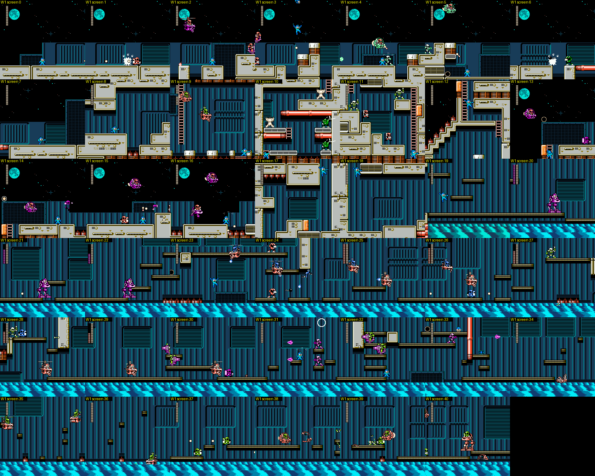
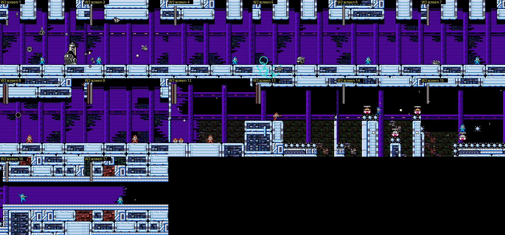
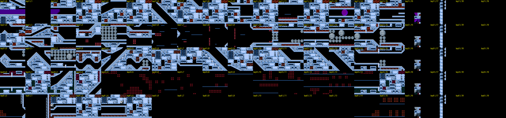
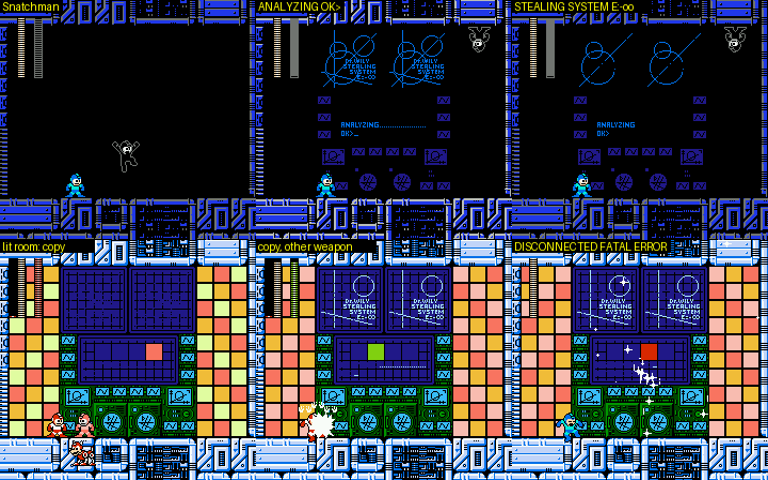
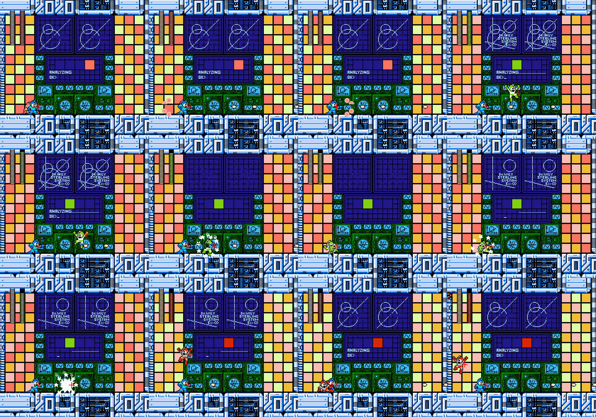
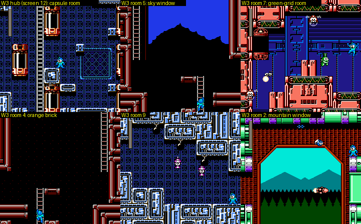
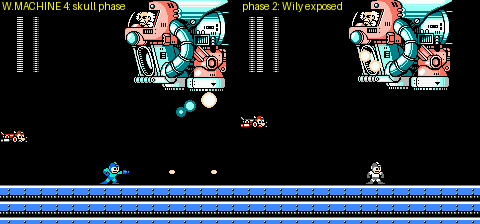

# 4MI Wily Castle stages 1-4 and the ending (r4mi-wily)

Status: IN PROGRESS (this file is rewritten as the investigation proceeds).

Scope: Rockman 4 Minus Infinity v1.01 (`roms/r4mi_mmc5.nes`), Wily stages 1-4 (`$22` = 12, 13, 14, 15): route
screen by screen, gimmicks, enemies, mid-bosses, hidden rooms, pickups, HARD differences, the bosses (patterns,
vanilla comparison, weapon damage), the scripted final battle, the escape, the ending and RESULT, and the jokes.
Played with godmode (`cheats.godmode()`), so the "intended challenge" notes are a reading of the design.

Tags: **[seen]** emulator, **[code]** disassembly/data, **[text]** in-game text, **[doc]** readme, **[guess]**.

## 0. Method

(pending)

## 1. Wily 1 (`$22` = 12) -FATAL MISCALCULATION-

**In one line:** the outside of Wily's castle under a full moon, a climbing shaft of gun turrets, Eddie's stop, and
then a long interior over a **cyan "sea" that is not a pit but a wrap-around**: fall in and you drop back in from the
top of the same screen. Along it you **hijack enemy vehicles**: walk into a Sniper-Joe-piloted purple walker and the
Joe is thrown out and you drive it; later you take over a Joe's **pink hover-copter**. The boss is **JOE NI-NIN VA
ALL**, a tag team of two Joes (a green jet-pack Joe and a white shield Joe).

*Wily 1, one frame per screen (0-40) in route order, from my godmode run. 0-18 outside / shaft, 19-40 the interior over
the wrap-around floor.*

### 1.1 Structure [code + seen]

| Section | Global screens | Contents |
|---|---|---|
| A | 0-18 | moonlit exterior (0-7), turret shaft climbing up (8 → 13), exterior again (13-16), drop into the castle (16 → 18) |
| B | 19-47 | interior over the wrap-around floor (19-40), boss door (40), corridor (41-42, checkpoint 2), boss room (44) |

Vertical links (bank `$71` table, `r4mi_links.py 12`): 8 up 9 up 10 up 11 up 12 up 13, then 16 down 17 down 18, and
18 → 19 changes section. Checkpoints: cp1 = screen 17, cp2 = screen 42.

### 1.2 Route, screen by screen [seen unless tagged]

| Screen | What happens |
|---|---|
| 0-2 | Start on a walkway outside the castle, starfield and a **full moon**. Pink **Sniper Joes in heli-pods** fly in and drop shots; small Joes walk the deck. |
| 3-7 | Raised walkways and gaps. **Green dome UFOs** carrying a little robot, **Skeleton Joes** that throw bones, a white starburst mine. A red horizontal **laser bar** spans the gap on screen 6-7. |
| 8-12 | **The shaft**: a 5-screen climb up ladders on alternating sides, past wall-mounted gun turrets (object `$08`/`$09` spawners; the room is full of cannons that fire balls across the ladders), red laser bars, spikes at the bottom of each room. |
| 13 | Top of the shaft, outside again: arrive on a ladder top next to a 1-tile gap, so you must jump right at once or fall back down. |
| 14-16 | Walkways with spike pits and heli-Joes; a big purple walker stands on 15-16. |
| 16 → 17 | Drop into the castle. |
| 17 | **Checkpoint 1.** A room with a **1UP** on a ledge (object `$7C`) and an orange item (object `$31`). Exit through the floor at the bottom left, under the 1UP ledge. |
| 18 | **Eddie** (object `$33` at x 228). See 1.4. |
| 19 | Section B begins: thin platforms over the cyan floor. A **purple walker** (a Sniper Armor with a Joe inside) patrols. **Walk into it and you take it over**: the screen flashes white, the Joe is thrown out (he keeps running and shooting at you on foot), the life bar turns purple (the vehicle's own energy, in a hidden 15th energy byte `$BE`, set to `$98` = owned + 24), and you drive the walker: it walks, jumps and fires big white balls [seen + RAM]. |
| 20-23 | More walkers and Joes; Joes on **pink hover-copters**, hammer Joes. |
| 24 | Touch a copter and you switch vehicles (white flash again). The copter flies freely with the D-pad (UP/DOWN to climb or sink). |
| 25-31 | Long flight over the floor; pillars hang from the ceiling, spike blocks on stubs, Skeleton Joes on the upper platforms, Joes with shields. The copter was shot down around screen 30-31 in my run (`$BE` bit 7 cleared). |
| 32 | A red pipe column from the ceiling blocks the way, with a **1UP** above it and a pink crystal-throwing Joe beside it (see 1.5). |
| 33-39 | On foot: more copter Joes, walkers, **Skeleton Joes that burst into a cloud of bones** and reassemble (38). |
| 40 | The boss door ("W" shutter). Green Joes in pink walkers keep coming out of it. |
| 41-42 | Boss corridor between two shutters (checkpoint 2). |
| 44 | Boss room: a black void with a single metal floor. |

**The floor of section B wraps** [seen]: the cyan zone (collision type 6, rows 12-14 of every screen) is not a pit.
With the FAIL-SAFE items removed (`$7839 = 0`) and only HP frozen, Rockman fell into it on screen 40 and his Y went
180 → 214 → 15 → 69 → 125 → 181 → 237 → 53 … for 200 frames, at full falling speed, with lives unchanged: he falls out
of the bottom and back in at the top, forever, until you steer onto a platform. So the whole interior is a looping
vertical space. This is the "fatal miscalculation" [guess on the joke: a castle built over a bottomless drop that does
not kill].

### 1.3 Vehicles: "give the weapons to the enemies" [doc + seen]

limited.txt, for a buster-only run: *"Wily 1: the weapons that are placed there, give them to the enemies"*
(`置いてある武器は、敵にあげましょう`), and for a no-kill run: *"the second half is easier if you push through on the
machine's HP"* (`後半は、マシンの体力でごり押すと楽かも`). These "weapons" are the vehicles the Joes are riding. Taking one
gives you a stronger body with its own energy bar (`$BE`), and the dispossessed Joe becomes an ordinary enemy on foot.
`$A0` and the EXWP byte `$78CB` stay 0 while you drive; the vehicle is driven by its own object (slot 7, type `$84`/`$86`,
which the player position follows) [seen]. EXWP 3 (R.ARMOR) and 4 (R.COPTER) in EXTRA CONFIG are these same two
machines, which is why the scout saw a purple walking mech when he set EXWP = 3 [seen in cheats.md + here].

### 1.4 Eddie (screen 18) [seen + text]

Eddie stands at the bottom right of screen 18 and hops in place. The FLAG byte (`$7898`) was still `$00` after my
run passed him (I fired the buster the whole way, and he was in the line of fire). Proto Man's debrief has an entry
for this outcome: *"YOUR ROOKIE ... EDDY. IT'S REGRETTABLE ABOUT HIM. … HIS CORE HAVE NOT FOUND IN THE RUIN OF WILY'S
FORTRESS … HIS SIGNAL DISAPPEARED NEAR YOU, YOU SAW HIS LAST MOMENT"* [text]. Combined with the Energy Splitter's
"YOU SEEM TO HEAR SOMETHING IN THIS UNIT", the reading is that Eddie can be lost here [guess]; what sets FLAG bit7 (EDDY)
is code in bank `$41` (cheats.md) and was not traced.

### 1.5 Open points in Wily 1

- **Screen 32's red column**: none of the 11 weapons removed it, and killing every enemy on the screen (HP poked to 0)
  did not open it. I teleported past it. Something on the copter route probably avoids it [guess]; not solved.
- **The boss door on screen 40**: Rockman stops at x = 216, one tile short of the shutter, while green walker Joes keep
  pouring out. Killing them did not help either. I reached the boss through checkpoint 2.

### 1.6 Boss: JOE NI-NIN VA ALL (fight `$0C`) [seen + measured]

The roster name (bank `$6F`) is *JOE NI-NIN VA ALL*: two Joes (*ni-nin*, 二人) against all [text; reading from
text.md]. In a black void on a single girder floor, a **green jet-pack Sniper Joe** (flies up, swoops and sprays pink
shots) and a **white shield Joe** (walks in behind a shield, fires straight) take turns: one is on screen at a time,
and they share one 28-point life bar (slot 23, type `$80`, HP `$0467`). Vanilla RM4's Wily 1 boss is **Metall Daddy**
(a giant Met), so this fight is entirely new; Sniper Joes do not appear in vanilla RM4 at all, so the whole stage is
built from imported MM2/MM3-style Joes, Sniper Armors and Skeleton Joes [guess from memory of RM4's enemy roster].

Damage per hit and boss invincibility after a hit (MY ARENA state `fight_0c_wily1`, criticals off, `dmg.py`) [measured]:

| Weapon | Damage | Boss i-frames | Notes |
|---|---|---|---|
| Rock Buster | 1 | 126 | the buster rule: 6 hits in 15 s |
| **Water Cutter (Dive)** | **2** | **17** | **the weakness**: 14 hits, dead in 348 frames (6 s) |
| Recycle Inhaler (Dust) | 2 | 47 | |
| Toad | 2 | 126 | |
| Hell Wheel (Skull) | 2 | 47 | hard to land (3 hits) |
| Ring, Drill, Pharaoh, Bright | 1 | 47 | |
| Wish Star, Rush Cannon | - | - | did not connect with my teleport-and-fire method |

## 2. Wily 2 (`$22` = 13) -RUSHED OUT PRODUCTS-

**In one line:** a purple factory where every other screen is a **locked arena that mass-produces grey, unpainted
copies of classic enemies**, then a space-station section with slopes that **reuses the same nine screen numbers four
times with a new layout streamed in on every lap**, and a boss, **SNATCHMAN**, whose defeat reveals the **"Dr.WILY
STEALING SYSTEM E:-∞"**: it **steals the weapons you equip, five of them, and they stay stolen into Wily 3**, then
sends out copies of Rockman armed with them. The subtitle is the joke: the enemies are "products rushed out" of the
factory, so they have no colours yet.

*Wily 2 screens 1-24 (one frame each; 1, 3, 5, 7, 9 are the arenas; 16-24 is the first lap of the looping section).*

### 2.1 Structure [code + seen]

| Section | Global screens | Contents |
|---|---|---|
| A | 0-15 | factory corridor: arenas on 1, 3, 5, 7, 9 with item corridors between them (2, 4, 6, 8, 10), a drop at 11 → 12 (checkpoint 1), 12-15 |
| B | 16-35 | the space station: screens 16-24 played **four times**, then 17-18 → 35 |
| C | 36-47 | boss corridor (36, checkpoint 2) and boss room (37) |

Links (bank `$71`): 11 down → 12, 12 → 13, 15 → 16 (new section), 18 → 36. The enemy table (bank `$2D`) is almost empty:
screens 2, 4, 6, 8 and 10 hold only items (`$7C` 1UP, `$5A`/`$7A` energy, `$56`), and everything else is spawned by
arena code [code].

### 2.2 The arenas: grey "products" [seen]

Screens 1, 3, 5, 7 and 9 lock the camera (RIGHT stops at x = 240) and a grey **generator machine with two eyes**
(object `$60`, 12 HP) starts the wave. The waves are greyscale copies of old enemies: Metalls (on screen 9 a whole floor
of hiding Metalls), Shield Attackers, Springers, ring throwers, heli-bombs, grey Rockman-like figures, mines. 28
different object types died in the first arena alone during my clearing run. The current arena's screen number is kept
in S.VAL 15 (`$782F` = 1, 3, 7, 9 as you go) [seen]. Killing the generator alone does **not** open the arena; the
camera unlocked only after a long stretch of killing (about 2,000 frames per arena with HP-poking), and on screen 9 my
automation never made it unlock, so I used checkpoint 1. limited.txt confirms the design: *"Wily 2, first half: you
have to defeat almost all the enemies"* (`前半、ほとんどのザコを倒す必要があります`) and *"an enemy appears in a spot that
only a charge shot can reach (a Wall Blaster, a big wall cannon)"* [doc].

### 2.3 The looping space station (screens 16-24) [seen + RAM]

After checkpoint 1 the stage becomes a space station of blue girders, **diagonal slopes** (4MI's slope code, credited
to Rock5easily's RM3 slope patch), grey sphere blocks and red mine clusters in black space. Walking right, the screen
counter goes 16, 17, … 24 and then **back to 16**, four times (frames 0-919, 927-1884, 2008-2946, 3066-4016 of my run),
and the fifth time 17 → 18 → **35** → 36. The tiles and metatiles in WRAM stay the same, but the **screen layout block
(`$6900-$6EBF`) has a different checksum on every lap** (`34c043b0`, `454d3565`, `2860006e`, `6953d159`, `eb86323f`), so
each lap is new terrain: lap 1 plain girders, lap 2 sphere blocks and mine columns, lap 3 slopes and sphere walls,
lap 4 mostly black space with red mine clusters. The stage is longer than its screen numbers, because 4MI streams new
layouts into a ring of nine screen slots.

*The section B layouts as stored in WRAM on each lap (rows = lap 1-4 and the final pass; columns = local screen
index). Same tiles, different layouts.*

### 2.4 Boss: SNATCHMAN and the Dr. Wily Stealing System (fight `$0D`) [seen + measured]

**Phase 1, SNATCHMAN**: a black Rockman silhouette with a white outline drops in on a parachute, then runs, jumps,
slides and grabs (contact costs 1-2 HP per touch). He has 28 HP (slot 23, type `$AD`-`$AF`).

**Phase 2, the Stealing System** [seen + RAM]: when Snatchman dies, the room turns into a computer: "ANALYZING… OK>",
then two schematics labelled **"Dr.WILY STEALING SYSTEM E:-∞"** (the hack's own "minus infinity" in the model number)
and a progress line. **Every weapon you equip now is stolen**: the moment I selected Ring, the system knocked Rockman
back, cleared Ring's owned bit (`$B8` `$94` → `$13`), drained the energy through the hidden 15th slot `$BE`, and forced
the buster back on (`$A0` = 0). Equipping Bright Man's weapon did the same (`$BC` `$9C` → `$1C`) [seen]. With the buster
equipped the analysis just loops forever (4,000 frames tested), which explains limited.txt's note for a buster-only
run: *"at the Wily 2 boss you must equip another weapon; you only need to equip it, not fire it"* [doc]. After the
**fifth** stolen weapon (Ring, Bright, Toad, Drill, Pharaoh in my run) the lights come on: chequered walls, a big
monitor that shows a coloured square for the weapon in use, and **a copy of Rockman comes out and fights you with the
stolen weapons**, changing colour with each one.

**Phase 3, the end**: when the copy dies, the screen flashes, the monitor reads "DISCONNECTED" and then
"DISCONNECTED FATAL ERROR", and the room dissolves into static and stars. **The five weapons stay stolen**: they were
still missing from the pause menu (owned bits clear) at the start of Wily 3 [seen]. Where they come back is in 3.x.

*Snatchman, the analysis screen, the Stealing System schematic, the lit room with a Rockman copy, a copy with another
weapon, and "DISCONNECTED FATAL ERROR".*

*The Rockman copy in phase 2 (2×, the red cross marks the boss slot).*

Damage (MY ARENA `fight_0d_wily2` for Snatchman, and the phase 2 copy in-stage; criticals off) [measured]:

| Weapon | Snatchman | Copy | Boss i-frames |
|---|---|---|---|
| Rock Buster | 1 | 1 | **39** (not the usual 126) |
| Rush Cannon | **28 (one shot)** | **28 (one shot)** | |
| Toad, Water Cutter, Ring, Drill, Dust, Pharaoh, Bright, Skull | 2 | 2 | 39-40 |
| Wish Star | - | - | did not connect |

There is no weakness: every special weapon does 2 with the same 39 i-frames, and even the buster gets the short
i-frames. In the arena version (MY ARENA) the theft never shows because the arena keeps your weapons; the stage version
is the real story beat (my arena test froze the energy bytes, so the owned bits were restored at once).

## 3. Wily 3 (`$22` = 14) -WILY'S LABYRINTH-

**In one line:** a story scene in space (Rockman refuses Dr. Light's warp because Kalinka is "inside this space"), then
a **Zelda-style dungeon in "disturbed space"**: one 48-screen section in which the exits of a room lead to different
rooms depending on the row you leave by, rooms dressed in other tile sets, a MAPPING UNIT, a COMPASS UNIT and a WARP
SENSOR to find, four "labyrinth Robot Masters" whose defeats are counted in S.VAL, a fake Roll guarding Kalinka, and
finally **Wily Machine 4**, whose skull armour regenerates unless you burst it down.

Scope note: this is the stage I covered least. I mapped the part of the maze reachable from the hub by walking and
found how its flags work in the code, but I did not find the four lairs, the units or Kalinka in play. What follows is
labelled accordingly.

### 3.1 Opening and structure [seen + code]

- `wily3_cp0` (and a natural arrival from Wily 2) opens on Rockman floating in a starfield while Dr. Light (**DR.RIGHT**
  in EN) talks on the radio (script 11; full text in text.md §3). After "I HAVE IMPORTANT THING TO DO." the screen
  flashes white and Rockman lands in the hub (screen 12), where script 12 plays: "IS IT INSIDE DISTURBED SPACE … ?",
  "COMMUNICATION UNIT IS DISABLED!? BUT I'LL GO.", "KALINKA IS INSIDE THIS SPACE!" [seen].
- **One section, 48 screens**, but only 29 distinct layouts: the `$B500` table maps globals 22 and 31-47 all to the
  same local screen 16 [code]. Every labyrinth room (screens 1-16) has the same room-controller object `$88` with
  parameter 1; screens 18, 19, 20 and 22 have parameters 2-5 and hold the special rooms: 18 has three `$5A` energy
  items, **19 is a treasure room with six 1UPs (`$7C`) and five `$56` items**, 21 holds object `$32`, 23 is the boss
  [code: enemy table]. The vertical links 18 ↓ 19 ↓ 20 ↓ 21 ↓ 22 ↓ 23 are the descent to the boss; checkpoint 1 =
  hub 12, checkpoint 2 = 21.
- **The maze graph** (BFS explorer from the hub, `explore.py`, godmode) [seen]: from 12, leaving left by rows 3-7 goes
  to 11 but by rows 8-10 goes to 4; leaving right goes to 13 or to 4 depending on the row; 4 ↔ 3 ↔ 10 ↔ 9 ↔ 17 ↔ 8 ↔
  7 ↔ 15 ↔ 14 ↔ 13 ↔ 5 … 14 screens in all (3, 4, 5, 7-17). The same edge of the same room leads to different rooms,
  which is the "disturbed space" the WARP SENSOR is for ("YOU CAN SEE WHERE THE DISTURBED ZONE ARE … A TONE WILL TELL
  YOU IF YOU PASS IT") [text].
- **Rooms in other dress** [seen]: room 4 is orange brick with orange pipes, room 5 a window onto a blue sky and a
  mountain, room 7/8 a green grid with grey and yellow pipes and red crab robots, room 2 a window onto mountains and
  pine trees. A random walker (`rwalk.py`, 80,000 frames) even saw `$22` switch to 13, 2, 9, 3 and 6 (Wily 2, Drill,
  Cossack 2, Pharaoh, Dive) with the screen black, so the maze borrows rooms from other stages' data; I could not tell
  whether those black visits are intended or a side effect of the TRAMPOLINE pit-bounce [seen; interpretation open].

*The hub (capsule room), and labyrinth rooms 5, 7, 4, 9 and 2: each in a different tile set.*

### 3.2 The dungeon logic, from the code (bank `$4F` at `$A000`) [code]

- The four **labyrinth bosses** share one death routine (`$A353`): it ORs a bit from the table at `$A420`
  (`01 08 04 02`) into **`$782F`** (S.VAL 15) and increments **`$782D`** (S.VAL 13), the number beaten. The COMPASS
  UNIT text says what they are: "PINPOINT THE LAIR OF THE LABYRINTH'S ROBOT MASTERS". The staff roll's FABRICATED
  ENEMIES list ends with **PETIT ROBOT MASTERS** [text], which fits.
- Text boxes inside the labyrinth are started by `$A46E`: when the player state `$30` is `$0A` (frozen) and **`$782A`
  (S.VAL 10) is non-zero, its value is the script number** (`STA $7722`). So each pickup sets `$782A` to 4 (MAPPING
  UNIT), 9 (COMPASS), 10 (WARP SENSOR) or 13 (Kalinka) and freezes Rockman. The Wily 3 opening (script 11) is started
  from bank `$56` (`LDA #$0B / STA $7722`).
- PROG (`$7890`) was `$80` on arrival from Wily 2, and bank `$4F` compares it with `$40` on entry [code].

### 3.3 Kalinka, the fake Roll, and the weapons stolen in Wily 2 [text + guess]

Script 13 (text.md §3) is the story payoff: a **Roll copy** has been looking after Kalinka, beats Rockman up ("OUCH! STOP
BEATING!"), is destroyed ("...ROLL, I'M SORRY!"), and while dying gives him "THE KEY TO WILY". Kalinka fits her
father's **energy amplifying unit** to Rush and Rush carries her out. I did not reach this scene. The five weapons the
Stealing System took in Wily 2 were still missing on arrival in Wily 3 [seen], and limited.txt's Wily 3 warning is
*"other weapons get equipped on you, so be careful not to fire them by mistake; it looks as if you need the Balloon and
such, but you can get through without them at all"* [doc]. My reading: the four lair bosses hold weapons [guess].

### 3.4 Boss: W.MACHINE 4 (fight `$0E`) [seen + measured]

The vanilla RM4 Wily Machine 4 (the skull tank) in two phases: the **skull** front, then the broken machine with Wily
in the open cockpit firing fireballs, plus a red crawler and a floor-hugging energy wave [seen]. The new rule is in
phase 1: **the skull's bar regenerates**. Hit it with the Recycle Inhaler (14 per hit) and the bar goes 28 → 14 and,
30 frames later, back to 28, again and again (frames 0-420 of my log), until two hits land inside one window and it
breaks; the second phase then refills to 28 [seen, `$BF`]. So phase 1 is a burst-damage check.

| Weapon | Phase 1 damage (bar) | Phase 2 damage | Notes |
|---|---|---|---|
| Rock Buster | 6, then 1s | none landed | |
| Rush Cannon | **28 (one shot)** | **28 (one shot)** | |
| Recycle Inhaler | 14 | none landed | the regen test above |
| Toad | 10 | 1 | |
| Hell Wheel | 9-14 | **2** (every 25 frames) | phase 1 broken in 12 frames |
| Drill | 3-4 rapid | 1 | phase 1 broken in 14 frames |
| Pharaoh | 7, then 2s | 1 | |
| Spark Manbow (Bright) | 6 (1 every 5th) | **2** (every 25 frames) | |
| Ring | 3-4 | 1 | |
| Water Cutter | 1-2 rapid | 1 | |

My teleport-and-fire harness puts Rockman at the boss slot's height, which is not always the weak point, so phase 2
numbers are a lower bound [method caveat].

*W.MACHINE 4: the skull phase and the exposed second phase.*

## 4. Wily 4 (`$22` = 15) -FINAL FARCE-

(pending)

## 5. The ending and RESULT

(pending)

## 6. Lessons for Rockman 6 GP

(pending)
