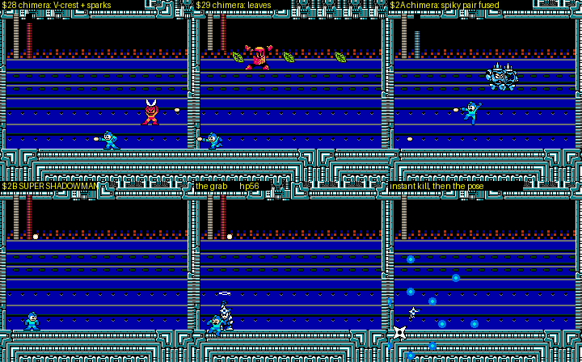
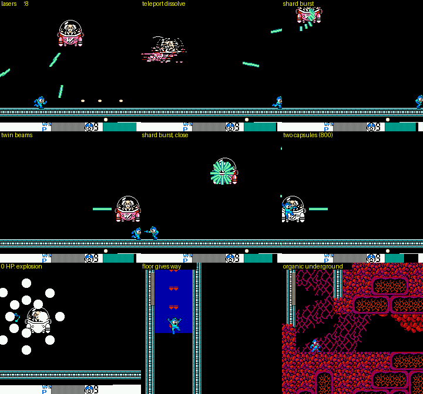
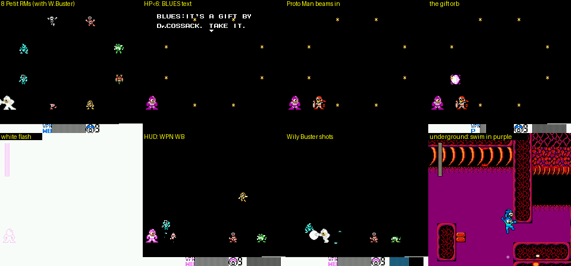
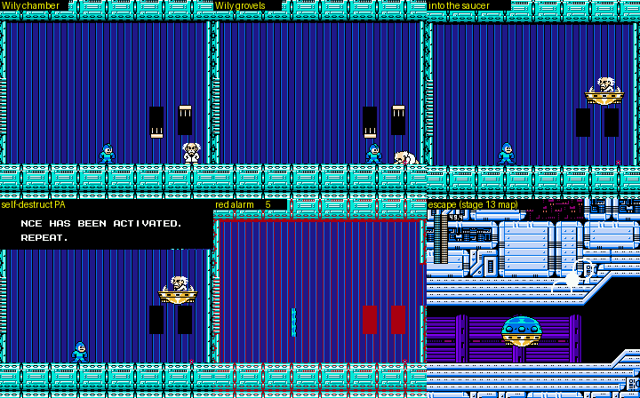
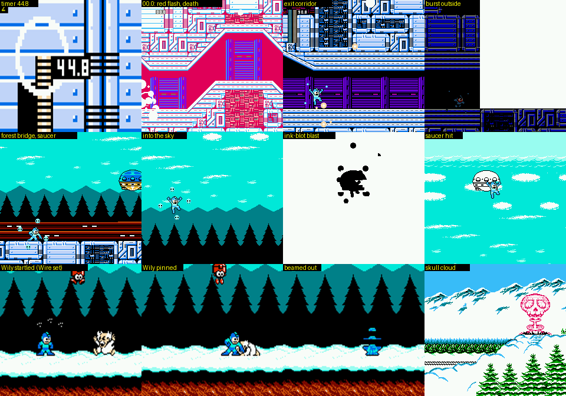
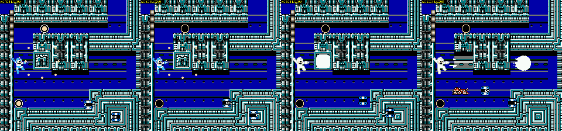
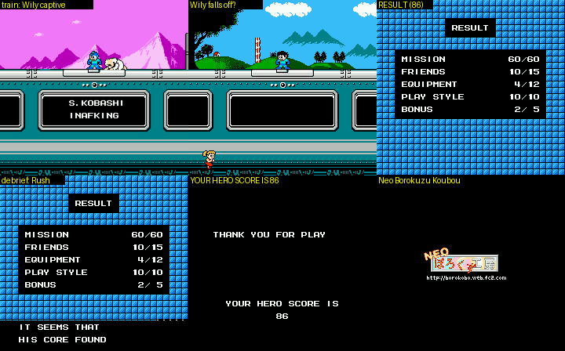

# 4MI Wily Castle stages 1-4 and the ending (r4mi-wily)

Status: complete for Wily 1-4, the final battle, the escape and the ending; open points are listed per stage.

Scope: Rockman 4 Minus Infinity v1.01 (`roms/r4mi_mmc5.nes`), Wily stages 1-4 (`$22` = 12, 13, 14, 15): route
screen by screen, gimmicks, enemies, mid-bosses, hidden rooms, pickups, HARD differences, the bosses (patterns,
vanilla comparison, weapon damage), the scripted final battle, the escape, the ending and RESULT, and the jokes.
Played with godmode (`cheats.godmode()`), so the "intended challenge" notes are a reading of the design.

Tags: **[seen]** emulator, **[code]** disassembly/data, **[text]** in-game text, **[doc]** readme, **[guess]**.

## Highlights: how crazy it gets

- **Wily 1** is a castle over a bottomless drop that does not kill (you fall out of the bottom and back in at the
  top), and you **hijack Sniper Joes' walkers and copters**; the boss is a Joe tag team.
- **Wily 2**'s factory arenas mass-produce **unpainted grey copies of classic enemies**, its space station
  **re-streams four different layouts into the same nine screen numbers**, and its boss's **"Dr.WILY STEALING SYSTEM
  E:-∞" steals every weapon you equip** (five of them stay stolen) and sends Rockman copies armed with them.
- **Wily 3** is a **Zelda dungeon** with a MAPPING UNIT, COMPASS UNIT and WARP SENSOR, rooms that lead to different
  rooms depending on the row you leave by, and a regenerating Wily Machine 4 skull.
- **Wily 4**: three **CHIMERABOT** halls; a no-death secret **SUPER SHADOWMAN** whose grab kills even through
  godmode; a 56-HP **OPTICAL CAPSULE** whose death collapses the floor into the **fortress's living, fleshy insides**;
  **Rush sealed in a wall** you must shoot through; an "impossible" battle against **eight chibi Robot Masters** that
  ends when **Proto Man barges in at HP < 6 and swaps your buster for the WILY BUSTER**; Wily grovelling; a
  **self-destruct escape whose timer secretly grows from 50 to 90 s after three failures**; and **Wily captured in the
  snow and carried off on the credits train**.

## 0. Method

- States: the scout's `wily1..4_cp0/1/2` (EXTRA CONFIG warps; they carry PROG `$00` and all weapons) and MY ARENA
  `fight_0c/0d/0e/0f/28-2c` states; godmode (`cheats.godmode`: frozen HP, lives and player i-frames + SHOCK GUARD,
  TRAMPOLINE, BEAT). Drivers in `build/research/r4mi/r4mi-wily/` (`nav.py` route driver with teleports, `brawl.py`
  autoplayer, `dmg.py`/`dmgbar.py` damage tables, `explore.py`/`rwalk.py` maze explorers, `secmap.py` section renders).
- New tool: **`tools/analysis/r4mi/r4mi_dis.py`**, a 4MI-aware disassembler. It decodes the inline-argument far calls
  (`JSR $DF8C` + hi, lo, bank = FARCALL; `JSR $DF66`/`$DF5F` = FARJMP) and `JSR $C4B8` jump tables, which break a
  plain linear disassembly, and maps a bank at `$A000` (where most 4MI object code runs).
- Finding an object's code: id `$5E` objects keep their `$A000` bank in `$7618+slot`; read it live, disassemble that
  bank from `$A001`.
- Damage: teleport beside the target each frame, fire every 6 frames, log `$0450+slot` drops and `$05B8+slot`
  (i-frames), criticals off (`$78C9 = 1`, `$78F6 = 1`).
- Savestates added to `build/research/r4mi/r4mi-wily/r2/` (all need godmode): `cap_17800` (capsule mid-fight),
  `capk_end` (capsule at 0 HP), `post_capsule_s12` (underground), `cp2/s26` (Petit RM void, Wily Buster already given
  by the cp2 respawn), `w4_final_nogift` / `w4_gift_text` (meddling about to trigger, set `$7722 = 0` and HP < 6),
  `w4_final_gifted2`, `petit_dead`, `escape_start` (first escape attempt), `esc_attempt2`, `esc2/s00..s32` (every escape
  screen), `esc_outside`, `esc_sky`, `esc_capture`, `ending_train`, `end_20000`, `end_31500` (RESULT), `rush_found`. Copies for other agents in
  `build/research/r4mi/states/`: `wily4_capsule_mid`, `wily4_capsule_0hp`, `wily4_underground_s12`,
  `wily4_petit_rms_nogift` (poke HP < 6 to trigger Proto Man), `wily4_petit_rms_dead`, `wily4_escape_start`,
  `wily4_escape_capture`, `ending_train_wily_captive`, `ending_result_86`.

## 1. Wily 1 (`$22` = 12) -FATAL MISCALCULATION-

**In one line:** the outside of Wily's castle under a full moon, a climbing shaft of gun turrets, Eddie's stop, and
then a long interior over a **cyan "sea" that is not a pit but a wrap-around**: fall in and you drop back in from the
top of the same screen. Along it you **hijack enemy vehicles**: walk into a Sniper-Joe-piloted purple walker and the
Joe is thrown out and you drive it; later you take over a Joe's **pink hover-copter**. The boss is **JOE NI-NIN VA
ALL**, a tag team of two Joes (a green jet-pack Joe and a white shield Joe).

*Wily 1, one frame per screen (0-40) in route order, from my godmode run. 0-18 outside / shaft, 19-40 the interior over
the wrap-around floor.*

### 1.1 Structure [code + seen]

| Section | Global screens | Contents |
|---|---|---|
| A | 0-18 | moonlit exterior (0-7), turret shaft climbing up (8 → 13), exterior again (13-16), drop into the castle (16 → 18) |
| B | 19-47 | interior over the wrap-around floor (19-40), boss door (40), corridor (41-42, checkpoint 2), boss room (44) |

Vertical links (bank `$71` table, `r4mi_links.py 12`): 8 up 9 up 10 up 11 up 12 up 13, then 16 down 17 down 18, and
18 → 19 changes section. Checkpoints: cp1 = screen 17, cp2 = screen 42.

### 1.2 Route, screen by screen [seen unless tagged]

| Screen | What happens |
|---|---|
| 0-2 | Start on a walkway outside the castle, starfield and a **full moon**. Pink **Sniper Joes in heli-pods** fly in and drop shots; small Joes walk the deck. |
| 3-7 | Raised walkways and gaps. **Green dome UFOs** carrying a little robot, **Skeleton Joes** that throw bones, a white starburst mine. A red horizontal **laser bar** spans the gap on screen 6-7. |
| 8-12 | **The shaft**: a 5-screen climb up ladders on alternating sides, past wall-mounted gun turrets (object `$08`/`$09` spawners; the room is full of cannons that fire balls across the ladders), red laser bars, spikes at the bottom of each room. |
| 13 | Top of the shaft, outside again: arrive on a ladder top next to a 1-tile gap, so you must jump right at once or fall back down. |
| 14-16 | Walkways with spike pits and heli-Joes; a big purple walker stands on 15-16. |
| 16 → 17 | Drop into the castle. |
| 17 | **Checkpoint 1.** A room with a **1UP** on a ledge (object `$7C`) and an orange item (object `$31`). Exit through the floor at the bottom left, under the 1UP ledge. |
| 18 | **Eddie** (object `$33` at x 228). See 1.4. |
| 19 | Section B begins: thin platforms over the cyan floor. A **purple walker** (a Sniper Armor with a Joe inside) patrols. **Walk into it and you take it over**: the screen flashes white, the Joe is thrown out (he keeps running and shooting at you on foot), the life bar turns purple (the vehicle's own energy, in a hidden 15th energy byte `$BE`, set to `$98` = owned + 24), and you drive the walker: it walks, jumps and fires big white balls [seen + RAM]. |
| 20-23 | More walkers and Joes; Joes on **pink hover-copters**, hammer Joes. |
| 24 | Touch a copter and you switch vehicles (white flash again). The copter flies freely with the D-pad (UP/DOWN to climb or sink). |
| 25-31 | Long flight over the floor; pillars hang from the ceiling, spike blocks on stubs, Skeleton Joes on the upper platforms, Joes with shields. The copter was shot down around screen 30-31 in my run (`$BE` bit 7 cleared). |
| 32 | A red pipe column from the ceiling blocks the way, with a **1UP** above it and a pink crystal-throwing Joe beside it (see 1.5). |
| 33-39 | On foot: more copter Joes, walkers, **Skeleton Joes that burst into a cloud of bones** and reassemble (38). |
| 40 | The boss door ("W" shutter). Green Joes in pink walkers keep coming out of it. |
| 41-42 | Boss corridor between two shutters (checkpoint 2). |
| 44 | Boss room: a black void with a single metal floor. |

**The floor of section B wraps** [seen]: the cyan zone (collision type 6, rows 12-14 of every screen) is not a pit.
With the FAIL-SAFE items removed (`$7839 = 0`) and only HP frozen, Rockman fell into it on screen 40 and his Y went
180 → 214 → 15 → 69 → 125 → 181 → 237 → 53 … for 200 frames, at full falling speed, with lives unchanged: he falls out
of the bottom and back in at the top, forever, until you steer onto a platform. So the whole interior is a looping
vertical space. This is the "fatal miscalculation" [guess on the joke: a castle built over a bottomless drop that does
not kill].

### 1.3 Vehicles: "give the weapons to the enemies" [doc + seen]

limited.txt, for a buster-only run: *"Wily 1: the weapons that are placed there, give them to the enemies"*
(`置いてある武器は、敵にあげましょう`), and for a no-kill run: *"the second half is easier if you push through on the
machine's HP"* (`後半は、マシンの体力でごり押すと楽かも`). These "weapons" are the vehicles the Joes are riding. Taking one
gives you a stronger body with its own energy bar (`$BE`), and the dispossessed Joe becomes an ordinary enemy on foot.
`$A0` and the EXWP byte `$78CB` stay 0 while you drive; the vehicle is driven by its own object (slot 7, type `$84`/`$86`,
which the player position follows) [seen]. EXWP 3 (R.ARMOR) and 4 (R.COPTER) in EXTRA CONFIG are these same two
machines, which is why the scout saw a purple walking mech when he set EXWP = 3 [seen in cheats.md + here].

### 1.4 Eddie (screen 18) [seen + text]

Eddie stands at the bottom right of screen 18 and hops in place. The FLAG byte (`$7898`) was still `$00` after my
run passed him (I fired the buster the whole way, and he was in the line of fire). Proto Man's debrief has an entry
for this outcome: *"YOUR ROOKIE ... EDDY. IT'S REGRETTABLE ABOUT HIM. … HIS CORE HAVE NOT FOUND IN THE RUIN OF WILY'S
FORTRESS … HIS SIGNAL DISAPPEARED NEAR YOU, YOU SAW HIS LAST MOMENT"* [text]. Combined with the Energy Splitter's
"YOU SEEM TO HEAR SOMETHING IN THIS UNIT", the reading is that Eddie can be lost here [guess]; what sets FLAG bit7 (EDDY)
is code in bank `$41` (cheats.md): `$41:$AC10` sets it inside a general item-drop routine when the chosen item value is 0 [code], but I did not trace which Eddie encounter reaches it.

### 1.5 Open points in Wily 1

- **Screen 32's red column**: none of the 11 weapons removed it, and killing every enemy on the screen (HP poked to 0)
  did not open it. I teleported past it. Something on the copter route probably avoids it [guess]; not solved.
- **The boss door on screen 40**: Rockman stops at x = 216, one tile short of the shutter, while green walker Joes keep
  pouring out. Killing them did not help either. I reached the boss through checkpoint 2.

### 1.6 Boss: JOE NI-NIN VA ALL (fight `$0C`) [seen + measured]

The roster name (bank `$6F`) is *JOE NI-NIN VA ALL*: two Joes (*ni-nin*, 二人) against all [text; reading from
text.md]. In a black void on a single girder floor, a **green jet-pack Sniper Joe** (flies up, swoops and sprays pink
shots) and a **white shield Joe** (walks in behind a shield, fires straight) take turns: one is on screen at a time,
and they share one 28-point life bar (slot 23, type `$80`, HP `$0467`). Vanilla RM4's Wily 1 boss is **Metall Daddy**
(a giant Met), so this fight is entirely new; Sniper Joes do not appear in vanilla RM4 at all, so the whole stage is
built from imported MM2/MM3-style Joes, Sniper Armors and Skeleton Joes [guess from memory of RM4's enemy roster].

Damage per hit and boss invincibility after a hit (MY ARENA state `fight_0c_wily1`, criticals off, `dmg.py`) [measured]:

| Weapon | Damage | Boss i-frames | Notes |
|---|---|---|---|
| Rock Buster | 1 | 126 | the buster rule: 6 hits in 15 s |
| **Water Cutter (Dive)** | **2** | **17** | **the weakness**: 14 hits, dead in 348 frames (6 s) |
| Recycle Inhaler (Dust) | 2 | 47 | |
| Toad | 2 | 126 | |
| Hell Wheel (Skull) | 2 | 47 | hard to land (3 hits) |
| Ring, Drill, Pharaoh, Bright | 1 | 47 | |
| Wish Star, Rush Cannon | - | - | did not connect with my teleport-and-fire method |

## 2. Wily 2 (`$22` = 13) -RUSHED OUT PRODUCTS-

**In one line:** a purple factory where every other screen is a **locked arena that mass-produces grey, unpainted
copies of classic enemies**, then a space-station section with slopes that **reuses the same nine screen numbers four
times with a new layout streamed in on every lap**, and a boss, **SNATCHMAN**, whose defeat reveals the **"Dr.WILY
STEALING SYSTEM E:-∞"**: it **steals the weapons you equip, five of them, and they stay stolen into Wily 3**, then
sends out copies of Rockman armed with them. The subtitle is the joke: the enemies are "products rushed out" of the
factory, so they have no colours yet.

*Wily 2 screens 1-24 (one frame each; 1, 3, 5, 7, 9 are the arenas; 16-24 is the first lap of the looping section).*

### 2.1 Structure [code + seen]

| Section | Global screens | Contents |
|---|---|---|
| A | 0-15 | factory corridor: arenas on 1, 3, 5, 7, 9 with item corridors between them (2, 4, 6, 8, 10), a drop at 11 → 12 (checkpoint 1), 12-15 |
| B | 16-35 | the space station: screens 16-24 played **four times**, then 17-18 → 35 |
| C | 36-47 | boss corridor (36, checkpoint 2) and boss room (37) |

Links (bank `$71`): 11 down → 12, 12 → 13, 15 → 16 (new section), 18 → 36. The enemy table (bank `$2D`) is almost empty:
screens 2, 4, 6, 8 and 10 hold only items (`$7C` 1UP, `$5A`/`$7A` energy, `$56`), and everything else is spawned by
arena code [code].

### 2.2 The arenas: grey "products" [seen]

Screens 1, 3, 5, 7 and 9 lock the camera (RIGHT stops at x = 240) and a grey **generator machine with two eyes**
(object `$60`, 12 HP) starts the wave. The waves are greyscale copies of old enemies: Metalls (on screen 9 a whole floor
of hiding Metalls), Shield Attackers, Springers, ring throwers, heli-bombs, grey Rockman-like figures, mines. 28
different object types died in the first arena alone during my clearing run. The current arena's screen number is kept
in S.VAL 15 (`$782F` = 1, 3, 7, 9 as you go) [seen]. Killing the generator alone does **not** open the arena; the
camera unlocked only after a long stretch of killing (about 2,000 frames per arena with HP-poking), and on screen 9 my
automation never made it unlock, so I used checkpoint 1. limited.txt confirms the design: *"Wily 2, first half: you
have to defeat almost all the enemies"* (`前半、ほとんどのザコを倒す必要があります`) and *"an enemy appears in a spot that
only a charge shot can reach (a Wall Blaster, a big wall cannon)"* [doc].

### 2.3 The looping space station (screens 16-24) [seen + RAM]

After checkpoint 1 the stage becomes a space station of blue girders, **diagonal slopes** (4MI's slope code, credited
to Rock5easily's RM3 slope patch), grey sphere blocks and red mine clusters in black space. Walking right, the screen
counter goes 16, 17, … 24 and then **back to 16**, four times (frames 0-919, 927-1884, 2008-2946, 3066-4016 of my run),
and the fifth time 17 → 18 → **35** → 36. The tiles and metatiles in WRAM stay the same, but the **screen layout block
(`$6900-$6EBF`) has a different checksum on every lap** (`34c043b0`, `454d3565`, `2860006e`, `6953d159`, `eb86323f`), so
each lap is new terrain: lap 1 plain girders, lap 2 sphere blocks and mine columns, lap 3 slopes and sphere walls,
lap 4 mostly black space with red mine clusters. The stage is longer than its screen numbers, because 4MI streams new
layouts into a ring of nine screen slots.

*The section B layouts as stored in WRAM on each lap (rows = lap 1-4 and the final pass; columns = local screen
index). Same tiles, different layouts.*

### 2.4 Boss: SNATCHMAN and the Dr. Wily Stealing System (fight `$0D`) [seen + measured]

**Phase 1, SNATCHMAN**: a black Rockman silhouette with a white outline drops in on a parachute, then runs, jumps,
slides and grabs (contact costs 1-2 HP per touch). He has 28 HP (slot 23, type `$AD`-`$AF`).

**Phase 2, the Stealing System** [seen + RAM]: when Snatchman dies, the room turns into a computer: "ANALYZING… OK>",
then two schematics labelled **"Dr.WILY STEALING SYSTEM E:-∞"** (the hack's own "minus infinity" in the model number)
and a progress line. **Every weapon you equip now is stolen**: the moment I selected Ring, the system knocked Rockman
back, cleared Ring's owned bit (`$B8` `$94` → `$13`), drained the energy through the hidden 15th slot `$BE`, and forced
the buster back on (`$A0` = 0). Equipping Bright Man's weapon did the same (`$BC` `$9C` → `$1C`) [seen]. With the buster
equipped the analysis just loops forever (4,000 frames tested), which explains limited.txt's note for a buster-only
run: *"at the Wily 2 boss you must equip another weapon; you only need to equip it, not fire it"* [doc]. After the
**fifth** stolen weapon (Ring, Bright, Toad, Drill, Pharaoh in my run) the lights come on: chequered walls, a big
monitor that shows a coloured square for the weapon in use, and **a copy of Rockman comes out and fights you with the
stolen weapons**, changing colour with each one.

**Phase 3, the end**: when the copy dies, the screen flashes, the monitor reads "DISCONNECTED" and then
"DISCONNECTED FATAL ERROR", and the room dissolves into static and stars. **The five weapons stay stolen**: they were
still missing from the pause menu (owned bits clear) at the start of Wily 3 [seen]. Where they come back is in 3.x.

*Snatchman, the analysis screen, the Stealing System schematic, the lit room with a Rockman copy, a copy with another
weapon, and "DISCONNECTED FATAL ERROR".*

*The Rockman copy in phase 2 (2×, the red cross marks the boss slot).*

Damage (MY ARENA `fight_0d_wily2` for Snatchman, and the phase 2 copy in-stage; criticals off) [measured]:

| Weapon | Snatchman | Copy | Boss i-frames |
|---|---|---|---|
| Rock Buster | 1 | 1 | **39** (not the usual 126) |
| Rush Cannon | **28 (one shot)** | **28 (one shot)** | |
| Toad, Water Cutter, Ring, Drill, Dust, Pharaoh, Bright, Skull | 2 | 2 | 39-40 |
| Wish Star | - | - | did not connect |

There is no weakness: every special weapon does 2 with the same 39 i-frames, and even the buster gets the short
i-frames. In the arena version (MY ARENA) the theft never shows because the arena keeps your weapons; the stage version
is the real story beat (my arena test froze the energy bytes, so the owned bits were restored at once).

## 3. Wily 3 (`$22` = 14) -WILY'S LABYRINTH-

**In one line:** a story scene in space (Rockman refuses Dr. Light's warp because Kalinka is "inside this space"), then
a **Zelda-style dungeon in "disturbed space"**: one 48-screen section in which the exits of a room lead to different
rooms depending on the row you leave by, rooms dressed in other tile sets, a MAPPING UNIT, a COMPASS UNIT and a WARP
SENSOR to find, four "labyrinth Robot Masters" whose defeats are counted in S.VAL, a fake Roll guarding Kalinka, and
finally **Wily Machine 4**, whose skull armour regenerates unless you burst it down.

Scope note: this is the stage I covered least. I mapped the part of the maze reachable from the hub by walking and
found how its flags work in the code, but I did not find the four lairs, the units or Kalinka in play. What follows is
labelled accordingly.

### 3.1 Opening and structure [seen + code]

- `wily3_cp0` (and a natural arrival from Wily 2) opens on Rockman floating in a starfield while Dr. Light (**DR.RIGHT**
  in EN) talks on the radio (script 11; full text in text.md §3). After "I HAVE IMPORTANT THING TO DO." the screen
  flashes white and Rockman lands in the hub (screen 12), where script 12 plays: "IS IT INSIDE DISTURBED SPACE … ?",
  "COMMUNICATION UNIT IS DISABLED!? BUT I'LL GO.", "KALINKA IS INSIDE THIS SPACE!" [seen].
- **One section, 48 screens**, but only 29 distinct layouts: the `$B500` table maps globals 22 and 31-47 all to the
  same local screen 16 [code]. Every labyrinth room (screens 1-16) has the same room-controller object `$88` with
  parameter 1; screens 18, 19, 20 and 22 have parameters 2-5 and hold the special rooms: 18 has three `$5A` energy
  items, **19 is a treasure room with six 1UPs (`$7C`) and five `$56` items**, 21 holds object `$32`, 23 is the boss
  [code: enemy table]. The vertical links 18 ↓ 19 ↓ 20 ↓ 21 ↓ 22 ↓ 23 are the descent to the boss; checkpoint 1 =
  hub 12, checkpoint 2 = 21.
- **The maze graph** (BFS explorer from the hub, `explore.py`, godmode) [seen]: from 12, leaving left by rows 3-7 goes
  to 11 but by rows 8-10 goes to 4; leaving right goes to 13 or to 4 depending on the row; 4 ↔ 3 ↔ 10 ↔ 9 ↔ 17 ↔ 8 ↔
  7 ↔ 15 ↔ 14 ↔ 13 ↔ 5 … 14 screens in all (3, 4, 5, 7-17). The same edge of the same room leads to different rooms,
  which is the "disturbed space" the WARP SENSOR is for ("YOU CAN SEE WHERE THE DISTURBED ZONE ARE … A TONE WILL TELL
  YOU IF YOU PASS IT") [text].
- **Rooms in other dress** [seen]: room 4 is orange brick with orange pipes, room 5 a window onto a blue sky and a
  mountain, room 7/8 a green grid with grey and yellow pipes and red crab robots, room 2 a window onto mountains and
  pine trees. A random walker (`rwalk.py`, 80,000 frames) even saw `$22` switch to 13, 2, 9, 3 and 6 (Wily 2, Drill,
  Cossack 2, Pharaoh, Dive) with the screen black, so the maze borrows rooms from other stages' data; I could not tell
  whether those black visits are intended or a side effect of the TRAMPOLINE pit-bounce [seen; interpretation open].

*The hub (capsule room), and labyrinth rooms 5, 7, 4, 9 and 2: each in a different tile set.*

### 3.2 The dungeon logic, from the code (bank `$4F` at `$A000`) [code]

- The four **labyrinth bosses** share one death routine (`$A353`): it ORs a bit from the table at `$A420`
  (`01 08 04 02`) into **`$782F`** (S.VAL 15) and increments **`$782D`** (S.VAL 13), the number beaten. The COMPASS
  UNIT text says what they are: "PINPOINT THE LAIR OF THE LABYRINTH'S ROBOT MASTERS". The staff roll's FABRICATED
  ENEMIES list ends with **PETIT ROBOT MASTERS** [text], which fits.
- Text boxes inside the labyrinth are started by `$A46E`: when the player state `$30` is `$0A` (frozen) and **`$782A`
  (S.VAL 10) is non-zero, its value is the script number** (`STA $7722`). So each pickup sets `$782A` to 4 (MAPPING
  UNIT), 9 (COMPASS), 10 (WARP SENSOR) or 13 (Kalinka) and freezes Rockman. The Wily 3 opening (script 11) is started
  from bank `$56` (`LDA #$0B / STA $7722`).
- PROG (`$7890`) was `$80` on arrival from Wily 2, and bank `$4F` compares it with `$40` on entry [code].

### 3.3 Kalinka, the fake Roll, and the weapons stolen in Wily 2 [text + guess]

Script 13 (text.md §3) is the story payoff: a **Roll copy** has been looking after Kalinka, beats Rockman up ("OUCH! STOP
BEATING!"), is destroyed ("...ROLL, I'M SORRY!"), and while dying gives him "THE KEY TO WILY". Kalinka fits her
father's **energy amplifying unit** to Rush and Rush carries her out. I did not reach this scene. The five weapons the
Stealing System took in Wily 2 were still missing on arrival in Wily 3 [seen], and limited.txt's Wily 3 warning is
*"other weapons get equipped on you, so be careful not to fire them by mistake; it looks as if you need the Balloon and
such, but you can get through without them at all"* [doc]. My reading: the four lair bosses hold weapons [guess].

### 3.4 Boss: W.MACHINE 4 (fight `$0E`) [seen + measured]

The vanilla RM4 Wily Machine 4 (the skull tank) in two phases: the **skull** front, then the broken machine with Wily
in the open cockpit firing fireballs, plus a red crawler and a floor-hugging energy wave [seen]. The new rule is in
phase 1: **the skull's bar regenerates**. Hit it with the Recycle Inhaler (14 per hit) and the bar goes 28 → 14 and,
30 frames later, back to 28, again and again (frames 0-420 of my log), until two hits land inside one window and it
breaks; the second phase then refills to 28 [seen, `$BF`]. So phase 1 is a burst-damage check.

| Weapon | Phase 1 damage (bar) | Phase 2 damage | Notes |
|---|---|---|---|
| Rock Buster | 6, then 1s | none landed | |
| Rush Cannon | **28 (one shot)** | **28 (one shot)** | |
| Recycle Inhaler | 14 | none landed | the regen test above |
| Toad | 10 | 1 | |
| Hell Wheel | 9-14 | **2** (every 25 frames) | phase 1 broken in 12 frames |
| Drill | 3-4 rapid | 1 | phase 1 broken in 14 frames |
| Pharaoh | 7, then 2s | 1 | |
| Spark Manbow (Bright) | 6 (1 every 5th) | **2** (every 25 frames) | |
| Ring | 3-4 | 1 | |
| Water Cutter | 1-2 rapid | 1 | |

My teleport-and-fire harness puts Rockman at the boss slot's height, which is not always the weak point, so phase 2
numbers are a lower bound [method caveat].

*W.MACHINE 4: the skull phase and the exposed second phase.*

## 4. Wily 4 (`$22` = 15) -FINAL FARCE-

**In one line:** the subtitle is a promise. Three teal halls of new **chimera robots**, a secret **SUPER SHADOWMAN**
who **kills you in one grab**, and the **OPTICAL CAPSULE**, 56 HP over two bars. Beat the capsule and the floor
collapses, dropping Rockman into the **organic underground of the fortress** (ribs, blood drops, a purple liquid to
swim through). From there a black void where **eight chibi "Petit Robot Masters"** attack at once. That fight is the
"impossible game": **as soon as Rockman's HP drops below 6, Proto Man warps in ("BLUES: IT'S A GIFT BY Dr.COSSACK.
TAKE IT.") and swaps the buster for the WILY BUSTER**, which melts them. Then Wily grovels and flees in his saucer, the
self-destruct starts a **timed escape** (50 s, quietly **90 s after three failures**), Rockman bursts out into a
forest and the sky, Wily's saucer crashes in the snow (and Rush can be freed from a wall on the way, §5), and **Rockman pins Wily and carries him off: Wily rides the
ending train as a captive**.

### 4.1 Structure [code + seen]

| Section | Global screens | Contents |
|---|---|---|
| A | 0-7 | hub corridor (0), teal halls (1, 3, 5) with corridors between (2, 4), a cannon corridor (6), the capsule approach (7, checkpoint 1) |
| B | 8-10 | the capsule room (9) |
| C | 11-28 | the organic underground (11-24), the teal machine room (25, checkpoint 2), the Petit RM void (26), Wily's chamber (27-28) |
| escape | stage 13's map | screens 1-32, then a second section (0-2), the outdoor run (6-16), the snow clearing (17) |

Links (bank `$71`, `r4mi_links.py 15`): 0 → 1 → … → 7 → 9, 10 ↓ 11, 11 ↓ 12, 13 → 14, 17 ↓ 18, 22 ↓ 23, 23 → 24, 25 → 26.
The placement table (bank `$2F`, `stagemap.enemy_table(15)`) puts a **room controller (type `$88`) at x = 8 on screens
0, 2, 7, 11, 12, 14, 18, 23 and 25**, whose y value selects its script (bank `$56`: y 1 → `$A02C`, 2 → `$A182`,
3 → `$A17E`, 4 → `$A140`, 5+ → `$40:$AFDB`) [code].

**PROG (`$7890`)** tracks the stage: `$A0` at cp0, `$A2` after hall 1, `$A4` after hall 2, **`$A6`** written by the
SUPER SHADOWMAN object's init (bank `$57`, so a death in that fight cannot bring him back), **`$B0`** once the capsule
is dead [code + seen]. **4MI's new objects all have id `$5E`**; the real routine is the `$A000` bank stored in
**`$7618+slot`** (sprite bank in `$7600+slot`), entered at `$A001` [code]. That is how every boss below was traced.

### 4.2 Route, halls and the secret boss [seen]

| Screen | What happens |
|---|---|
| 0 | Hub corridor of teal pipework with "W" shutters; small Joes and hopping robots. |
| 1 | **Teal hall, chimera #1** (fight `$28`): a red robot with a white V crest and red/white body, sparks. |
| 2 | Corridor with W blocks, ledges over a blue void, small robots. |
| 3 | **Teal hall, chimera #2** (fight `$29`): a big round red robot that throws **Leaf Shield-style leaves**. |
| 4 | Corridor: green hopping robots with scythes, W blocks. |
| 5 | **Teal hall, chimera #3** (fight `$2A`): two blue spiky robots that fuse into one spiked ball. Then, **only if you have not died**, a silver ninja drops in: **SUPER SHADOWMAN** (fight `$2B`). |
| 6 | A one-tile-high corridor blocked by a **red cannon robot on a pedestal** (object anim `$1F`, 32 HP) that opens its visor to fire white plasma balls. |
| 7 | Capsule approach, checkpoint 1; a row of small pellets (object `$7C` ×6) at the right. |
| 9 | The capsule room. |

The staff roll lists **CHIMERABOT #1-#3** among the FABRICATED ENEMIES, and the fight-name roster ends `… CHIMERABOT
#1-#3, SUPER SHADOWMAN, ???, COCKROACH, -O M E G A-` [text]. The chimeras look like mash-ups of MM2/MM3 masters (a
Quick Man-like body with sparks, Hard Man-like body with Wood Man's leaves, Needle Man-like spikes) [guess].

**SUPER SHADOWMAN** (bank `$57` at `$A000`, fight `$2B`) [seen + code]:
- 56 HP (two bars; `$0450+22` climbs to 56). He leaps around the hall, then **grabs Rockman** with a shuriken spinning
  over his head; a white flash later the player state is set to `$07` (death) directly, so **the grab is an instant
  kill that even godmode does not stop**. After the kill he poses while blue bubbles fall.
- When his slot-6 body dies, `$57:$B073` does `$7898 |= $02`: the **SHADOWMAN** friend/bonus flag [code].
- Proto Man's debrief explains the gate. EN placeholder: *"IN ORDER TO COMBAT THE SECRET BOSS, YOU SHOULD ARRIVE AT
  THE CERTAIN PLACE OF WILY LEVEL 4 WITHOUT DYING."* JP: a smudged *yabumi* (arrow letter) stuck to a wall, readable
  as 「拙者の本当の力を見たければ、一度もやられることなく、Dr.ワイリーの基地の最深部まで…」 ("if you want to see my true power,
  [come] to the deepest part of Dr. Wily's base without being beaten once…"), with Proto Man's "what does that mean?
  I have no idea" [text; reconstruction of the smudged characters is mine]. The predecessor's godmode run (no deaths
  from `wily4_cp0`) met him on screen 5 and was killed by the grab [seen].

*The three chimera halls (fights `$28`, `$29`, `$2A`) and SUPER SHADOWMAN (`$2B`): his entrance, the grab, and the
pose after the instant kill.*

Damage (MY ARENA fight states, criticals off, `dmg.py`; values > 1 hit that equal the remaining HP were fight resets
and are dropped) [measured]:

| Weapon | Chimera #1 (`$28`, 28 HP, 61 i-fr) | Chimera #2 (`$29`, 28 HP, 14 i-fr) | Super Shadowman (56 HP, 39 i-fr) |
|---|---|---|---|
| Rock Buster | 2 | 1 | – (grabbed first) |
| Rush Cannon | **28 (one shot)** | one shot | – |
| Wish Star | **28 (one shot)** | one shot | – |
| Toad | 2 | 1 | 1 |
| Water Cutter (Dive) | 2 | ? | – |
| **Ring** | **4** | 1 | 1 |
| **Drill** | **4** | 1 | 1 |
| Dust | 2 | 1 | – |
| Pharaoh | 2 | 2 | – |
| Spark Manbow (Bright) | 2 | 2 | 1 |
| Hell Wheel (Skull) | 2 | ? | – |

### 4.3 OPTICAL CAPSULE (fight `$0F`) [seen + measured + code]

- **Object `$5E`, AI in bank `$45` at `$A000`.** The init (`$A01F`) branches on `PROG >= $B0`. The death handler
  (`$AEC0` → `$AEF5`) plays sound `$E4`, sets **`$780A = stage | $20`** and **PROG = `$B0`**, and fades the room; in MY
  ARENA (`$78C6` set) it farjumps to the arena result code (`$4C:$BA01`) instead. Attacks come from the sequence
  table at `$A29E` (cursor `$6988`); **on HARD (`BIT $78DE`) the cursor starts at `$12`**, further down the list. The
  19 attack routines are dispatched by two jump tables (`$A223` setup, `$A262` run) [code].
- **56 HP shown as two bars**: `$0467` starts at `$B8` (bit 7 = boss bar). The bar `$BF` shows HP-28 while HP > 28,
  then refills to 28 with a white flash at HP 28 and extra beam emitters (object `$5E`, AI bank `$48`) join in.
- **Attacks seen**: it **teleports** with a horizontal scanline "dissolve", fires **long teal laser beams** in pairs
  (horizontal, then diagonals that sweep the room), sprays a **burst of teal shards** that rains down, throws an
  expanding ring of beads, small white pellets, and at times **splits into two capsules**.
- A HUD sits at the bottom of the screen from this room on: `WPN` + weapon code, a horizontal weapon gauge,
  Rockman's face with the lives, and a second gauge (the boss or target bar).
- **At 0 HP**: a white-orb explosion, the capsule sits flashing on the floor, and the moment Rockman stands on the
  ground PROG becomes `$B0` and **the floor gives way**: he drops down a shaft into the underground. A later attempt
  (PROG already `$B0`) opens the floor as soon as the room loads [seen].
- Vanilla RM4's Wily Capsule teleports and fires a spread of energy balls; 4MI keeps the teleport and the dome but
  gives it a whole new beam/shard repertoire and doubles its HP [guess on vanilla, from memory].

Damage (MY ARENA `fight_0f_wily4`, criticals off) [measured]:

| Weapon | Damage | Notes |
|---|---|---|
| Rock Buster | 1 | min gap 41 frames; in-stage, 59 frames of boss invincibility (`$05B8+23`) |
| **Rush Cannon** | **14** | 4 shots kill it |
| Water Cutter (Dive) | 1 | min gap 13 frames: the best sustained damage |
| Drill | 1 | min gap 12 frames |
| Toad, Ring, Dust, Bright, Skull | 1 | |
| Pharaoh, Wish Star | – | never connected |

*OPTICAL CAPSULE: lasers, the teleport "dissolve", shard bursts, twin beams, two capsules; the 0-HP explosion, the
floor giving way, and the first screen of the underground.*

### 4.4 The organic underground (screens 11-24) [seen]

Red fleshy rock with veins and fat-like blobs, **ribs along the ceiling**, dripping **blood drops**, **flames**, orange
crawling blobs, orange claw-like vents, and pools of a **purple liquid** (collision type 6) that Rockman swims through
(screens 19-22). Screen 24 holds a red organic "tree" or heart. The fortress is literally alive below the capsule
room [guess on intent]. Screen 25 (checkpoint 2) is a teal machine room with tiny drones and a shutter on the right.
(My automated route stalled at the screen 22 drop, so I reached 25 from `wily4_cp2`; the screen-by-screen layout of
11-24 is in `build/research/r4mi/r4mi-wily/r2/w4C_sec.png`.)

### 4.5 The final battle: the Petit Robot Masters and Proto Man's meddling (screen 26) [seen + code]

- A black void with the bottom HUD. **Eight chibi Robot Masters** (Skull, Ring, Dive, Toad, Bright, Pharaoh, Drill,
  Dust in their RM4 colours; objects `$5E` with AI bank `$46`, anims `$60`-`$67`, **28 HP each, 224 in all**) swarm
  the floor and the air. The staff roll calls them **PETIT ROBOT MASTERS** [text]. The HUD's right gauge shows the bar
  of the one you last hit.
- **The meddling** (bank `$46`, `$AB35`): every 8 frames the controller checks **`$7722` (the super-special weapon in
  use) = 0 and `$B0 < $86` (HP < 6)**. When both hold, the screen goes black with yellow sparkles, sound `$F1` and the
  music change, and dialogue script 14 plays (`FARCALL $2D:8BF6` with Y = `$0E`): **"BLUES: IT'S A GIFT BY
  Dr.COSSACK. TAKE IT."** Proto Man beams down, throws a pink orb, the screen flashes white, and **`LDY #$0B / FARCALL
  $49:AA7C`** gives **EXWP 11, the WILY BUSTER**: `$7722 = $0B`, its energy `$BE = $9C`, HP refilled from max
  (`$7944`), `$7800 = 2`. The HUD then reads **`WPN WB`** and Rockman fires big white plasma balls.
- This is limited.txt's `某人のおせっかいでバスターが使えなくなります` ("a certain someone's meddling makes the buster unusable")
  and `より完璧に縛りを行いたい場合は、１回目の挑戦で無理ゲーを突破する必要があります` ("for a perfect buster-only run you must clear
  the impossible game on the first try") [doc]: the only way to finish buster-only is to kill all eight (224 HP at 1
  per hit) without ever dropping below 6 HP.
- `$49:$AA7C` is the generic "receive a super-special weapon" routine (also used for the Wily 1 vehicles and the
  Dive/Drill weapons); `$49:$AB90` takes it away. `$56:$B6D5` re-gives the Wily Buster when you respawn (player state
  `$0A`) at Wily 4's later checkpoints, so dying after the gift keeps it [code]. **Correction to text.md §3:** the
  `LDA #$0B / STA $7722` in bank `$56` is this Wily Buster re-give, not a trigger of script 11.
- **Wily Buster vs Petit RMs: 4 damage per hit, 7 frames of invincibility**, so 7 hits each; all eight died in 593
  frames [measured].

*The eight Petit Robot Masters; at HP < 6 the screen blacks out, "BLUES: IT'S A GIFT BY Dr.COSSACK. TAKE IT.", Proto Man
beams in, throws the gift, white flash; the HUD now reads WPN WB and the Wily Buster's plasma shots clear the room. Last
tile: swimming in the underground's purple liquid.*

### 4.6 Wily's surrender and the self-destruct (screens 26-28) [seen + text]

When the eighth dies the Wily Buster is taken back (`$7722 = 0`), the void lights up into Wily's blue chamber, and
**Wily kneels and grovels** (the series' traditional begging scene) between two monitors. An explosion knocks Rockman
back, Wily jumps into his yellow-rimmed saucer, and the PA (script 15) plays: *"ANNOUNCE: THE SELF-DESTRUCT SEQUE-NCE
HAS BEEN ACTIVATED. REPEAT. … THIS SEQUENCE MAY NOT BE ABORTED. Dr.WILY PROCEED TO THE EMERGENCY PLANE AT THE SECRET
PASSAGE."* Wily flies off, the room strobes red (alarm), Rockman runs through screens 27-28, and the game loads
**stage 13's map** for the escape.

*Wily's chamber, the grovel, the saucer, the self-destruct announcement, the red alarm, the first escape screen.*

### 4.7 The escape [seen + RAM + text]

- A countdown sits above the life bar in seconds and tenths, three digits at **`$7689` (tenths), `$768A` (ones),
  `$768B` (tens)**, drawn as sprites. At 00.0 the screen flashes red, then white, and Rockman dies whatever his HP.
- **Time limit per attempt: 50 s, 50 s, 50 s, then 90 s from the fourth attempt on** (read at each respawn: 49.3,
  49.3, then 89.3 every time) [seen]. Proto Man's JP debrief entry 13 explains it: *"This time was close. If the
  self-destruct's output had stayed high, we would both have shared the base's fate. Who lowered the output? …heh, who
  knows."* He quietly makes the escape easier after you fail three times. The EN placeholder says the BONUS needs the
  escape done *"BY FEW CHALLENGES"* [text + seen].
- Route: a light-blue fortress interior full of explosions (white orb clusters), slopes, purple doors, red mine lines
  and drop-offs (screens 1-32; a green-leafed background from 16). A purple exit corridor (new section, 0-2), a white
  flash with Rockman in black silhouette as he bursts out, a **pine forest with a red-railed bridge** while
  **Wily's blue saucer flies overhead** (6-8), a leap into **open sky above the clouds** after the saucer (10-16),
  a white flash with a black ink-blot blast, the saucer hit and smoking, and a landing in a snowy clearing (17).
- **Screen 17, the capture**: the camera locks and Rockman's controls freeze, the game **forces `A0` = 5 (WIRE)**,
  Wily lies in the snow next to his wreck, and a red helper (Eddie?) and a blue one (Beat?) hover above. When the
  countdown reaches zero, Wily jumps up in fright, **Rockman tackles and pins him and beams out holding him**. This is
  limited.txt's `その後の流れで、ある武器を強制利用することになりますが、不可避です` ("in the flow after that you are forced to use a
  certain weapon; it cannot be avoided") [doc + seen; that the Wire is what ties Wily up is my reading].
- The stage then ends with player state `$13` and the ending (stage id 20) starts.

*The countdown, time-out, the exit corridor, the burst outside, the forest bridge under Wily's saucer, the sky, the
ink-blot blast, the saucer hit, Wily startled in the snow with the Wire forced on, Wily pinned, beamed out, and the
skull cloud that opens the ending.*

## 5. The ending and RESULT [seen]

The ending itself (skull mushroom cloud, vanilla's train credits, the RM cards with WINS/LOSSES, "A WEEK LATER", the
4MI staff roll, RECORDS with real times and deaths, FABRICATED ENEMIES, the RESULT panel and Proto Man's debrief) is
documented in **text.md §6-§7**. What my natural run adds:

- **Wily is a captive on the train.** For the whole train-credits ride he lies flat on the roof next to Rockman
  (vanilla RM4's train ride is Rockman alone [guess, from memory]). Near the end of the ride he seems to drop off
  the train [seen, small sprite; unclear].
- **RESULT of this run** (from the EXTRA CONFIG `wily4_cp2` state, not a full playthrough): **MISSION 60/60, FRIENDS
  10/15, EQUIPMENT 4/12, PLAY STYLE 10/10, BONUS 2/5 → "YOUR HERO SCORE IS 86"**, then "THANK YOU FOR PLAYING!",
  "THERE'S MORE...", CAPCOM PRESENTS, the **Neo Borokuzu Koubou logo with its URL (`borokobo.web.fc2.com`)**, "AD 200X"
  and the game's JP intro story.
- Proto Man's debrief picked the **Rush** hint: *"YOUR DOG ... RUSH. I HAVE GOOD NEWS ABOUT HIM. IT SEEMS THAT HIS CORE
  FOUND IN THE RUIN OF WILY'S FORTRESS. SO I THINK HE'LL BE YOUR BEST PARTNER AGAIN. PAINFUL MEMORIES MIGHT HAVE
  REMAINED IN HIM. WILY HAD NO TIME TO HIDE HIM. HE MIGHT HAD BEEN NEAR WILY."* **Found: Rush is sealed in the wall of
  Wily 4's checkpoint-2 machine room (screen 25), right before the Petit RM void ("near Wily").** A patterned panel
  sits in the wall at about x 80, y 112. It is a hidden target (object `$7B`, AI bank `$56`, state 9, `$B6E5`-`$B73C`):
  shoot it **through the wall from the left-hand shaft** and it flashes, breaks (sound `$D3`), Rush drops out lying on
  the floor below, and `$7898 |= $08` (**RUSH**) [seen + code]. Weapons that break it (measured with `$7722` cleared):
  **Rush Cannon, Water Cutter, Ring, Drill, Pharaoh, Spark Manbow, and the Wily Buster**; the plain buster (tapped or
  charged), Toad, Dust, Hell Wheel and Wish Star do nothing. Since the cp2 respawn hands back the Wily Buster
  (`$56:$B6D5`), a player who dies after the gift and returns here can also free him with it.

*Screen 25: shooting the panel through the wall (here with the Wily Buster the cp2 state carries), the panel breaking,
and Rush lying on the lower floor with the RUSH flag set.*

*The train with Wily captive, the end of the ride, RESULT 86, the Rush debrief, the Hero Score, and the Neo Borokuzu
Koubou logo.*

## 6. Hidden rooms, HARD mode and secrets across the Wily stages

- **Hidden rooms**: hint.txt says `最初の８ステージには、隠し部屋がそれぞれあります … 隠し部屋は、必ず1画面分のマップになっています`
  ("the first eight stages each have a hidden room … always exactly one screen") [doc]. The Wily stages are not part of
  that rule. The nearest thing is Wily 3's **treasure room (screen 19: six 1UPs and five `$56` items)** on the descent to
  the boss [code: enemy table], and Wily 1's 1UPs on screens 17 and 32 [seen].
- **HARD** (`$78CD` = 1 → `$78DE` bit 7): the capsule starts its attack list at entry `$12` instead of 0 [code]; bank
  `$56`'s Wily 4 controller sets `$7827` to 4 on HARD instead of `$2C` (`$A02F`-`$A03B`) [code]. I did not compare Wily layouts on HARD (the
  Cossack and RM investigators found HARD mostly changes enemy placement).
- **Secrets**: SUPER SHADOWMAN (no deaths → Wily 4 screen 5), the Rush rescue (the panel in Wily 4 screen 25's wall), the escape BONUS (escape in
  the first three tries), Eddie in Wily 1 (screen 18; the EDDY flag is set in bank `$41` `$AC17`, not traced), Kalinka
  and the fake Roll in Wily 3 (KALINKA flag, bank `$50` `$A4DB`).

## 7. Lessons for Rockman 6 GP

- **An unwinnable fight with a story rescue is a great climax, and 4MI makes it fair**: the trigger is concrete
  (HP < 6, no super weapon), it refills your HP, and a skilled player can still win "pure". The text and the
  readme both acknowledge the purist route. RM6 GP could gate a cameo the same way.
- **Hidden mercy beats a difficulty menu**: the escape quietly grows from 50 s to 90 s after three failures, and the
  debrief later reveals who did it. Rubber-banding with an in-fiction excuse.
- **Spend the ending on a punchline**: Wily captured, pinned in the snow and riding the credits train is cheap (reused
  sprites) and memorable.
- **One generic object id with a per-object code bank** (`$5E` + `$7618`) let the author add dozens of bosses without
  touching the vanilla dispatch tables. A clean pattern for an MMC5 expansion.
- **Two-bar HP (56) via "bar = HP - 28"** doubles a boss's life without a new HUD. The bottom horizontal HUD in Wily 4
  shows how a late-game HUD swap can signal "this is different".
- **Secret bosses need a written hint somewhere**: 4MI hides SUPER SHADOWMAN behind "no deaths" and hints it only in
  the post-game debrief (EN placeholder, JP riddle).
- **Reuse a stage slot for set pieces**: the escape runs on stage 13's map id with its own sections; the "rooms" of
  Wily 3 borrow other stages' data. Cheap content multiplication.
