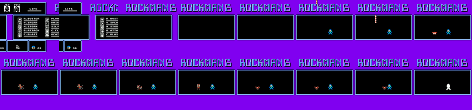
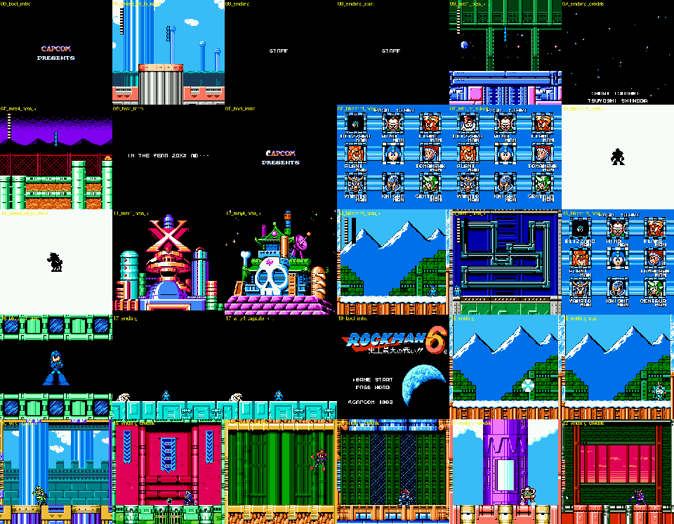
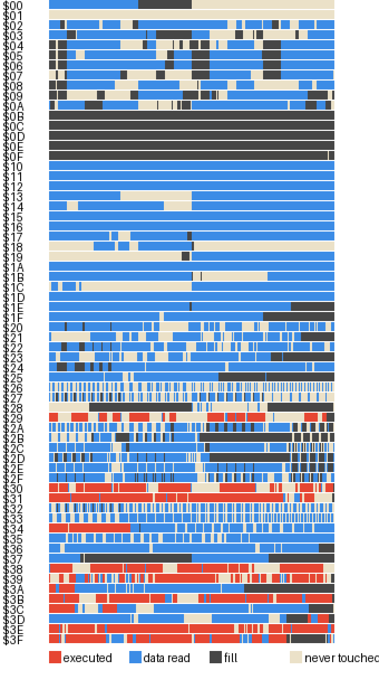
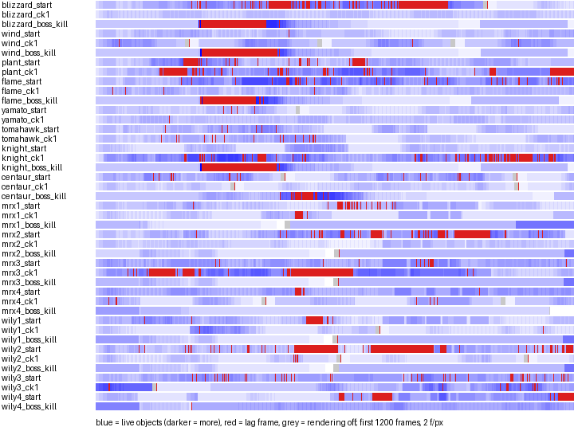

# Rockman 6 (J) engine tables (rm6-engine)

Status: **complete** (second run of rm6-engine; the first was killed by a container restart after 24 tool
calls and only its leads were recoverable). Tags as in the field guide: **[seen]** emulator, **[code]** disassembly / ROM data, **[guess]**.
Addresses are `bank:addr` with the bank mapped where the game maps it (AI banks are mapped at `$8000` with
`$CBC0`, so an odd bank such as `$29` or `$31` appears at `$8000-$9FFF` there). Fixed banks: `$3E` = `$C000`,
`$3F` = `$E000`. RAM names follow `ram.md`.

New tool: **`tools/analysis/rm6/shadow6.py`**, a frame-exact code/data logger and cycle profiler (section 6).
Scripts in `build/research/rm6/rm6-engine/`: `r6.py` (ROM access + py65 disassembler with explicit bank pairs),
`objtypes.py` (256-type dump `objtypes.txt/json`), `dmgmap.py` (damage routine per type), `wtest.py` (weapon
damage/energy), `phys.py`, `punch.py`, `adapt3.py` (adaptor physics/transform), `snd.py`, `songdec.py`
(sound table and song decoder), `sndcensus.py`, `sndshots.py` (which id plays where), `tour.py` (coverage tour,
`cov/*.pkl`), `covreport.py`, `untouched.py`, `covimg.py` (coverage), `lagirq.py`, `lagfind.py`, `prof*.py`,
`profsum.py`, `lagimg.py` (lag and IRQ statistics).

Contents: 1. object system - 2. collision and damage - 3. weapons and adaptors - 4. IRQ effects - 5. sound
driver - 6. code coverage - 7. password - 8. lag - Lessons - Appendix: object type table.

---

## 1. Object system

### 1.1 Object table and the AI loop [code]

23 slots x 29 arrays at `$03A0-$063A` (see `ram.md`). Slot 0 = Rockman, 1-3 = buster/weapon shots
(allocator `$3F:$E514` searches 3..0), 4 = Beat / Rush, 5-7 special, 8-$15 = enemies, items and bosses
(allocator `$3F:$E59F` searches $15..8, `$E5AF` = allocate + init), $16 = the screen script (type `$80`).

- Object loop `$3F:$E438`: X = $16 down to 0; empty slots (`$03A0` = 0) are skipped; for a live slot it maps the
  AI bank pair `$0441,X` / `+1` with `$CBC0` and does `JMP ($0413/$042A)` (via `$E486`).
- AIs are **coroutines**: `JSR $E46C` = yield (stores the return address back into `$0413/$042A`, restores the
  stack from `$90`, next slot); `JMP $E45A` = delete self (type 0, `$03FC` = `$FF`, HP `$FF`); `$E47B` = end
  this slot's turn without changing the resume address.
- Off-screen test `$E489` (carry set = off screen: Y screen != 0, Y >= $F8, or not on the camera's screen).
- Motion `$E4CF` / `$E4D5`: add `$EB/$ED` (X speed lo/hi) and `$EC/$EE` (Y speed) to the slot's position.
- Animation start `$E526` (Y = animation id, from the sprite bank `$0458,X` tables `$8600/$8700`), `$E561`
  restarts only if different.

### 1.2 Type tables (`$3A:$82C9`) [code]

Indexed by type id t (0-$FF), all in bank `$3A`:

| Table | Meaning |
|---|---|
| `$82C9+t` | AI entry address, low byte |
| `$83C9+t` | AI entry address, high byte |
| `$84C9+t` | AI bank (the `$8000` bank of the pair; `$0441`) |
| `$85C9+(t>>4)` | sprite / animation bank for the 16 types of a row (`$0458`): $20 for 0-$4F, $22 for $50-$8F, $A0-$AF and $C0-$DF, $24 for $90-$9F, $B0-$BF and $E0-$FF |

Init `$3A:$81F0` (far-call `$41` = bank `$3A` function 1, Y = type, X = slot) copies these and clears
`$0583/$056C/$04B4` and four AI variables. **Free type ids** (AI pointer `$0000`, or pointing at bank
filler/`$8000` with an `FF` header): `$42`, `$7B-$7E`, `$BA-$BF`, `$CE`, `$CF`, `$D2`, `$D7`, `$DB-$DF`,
`$F4-$FF`: **32 unused ids** for GP's new enemies (`$00` = empty slot, not usable).

Type families by AI bank [code] (`objtypes.txt`):

| Bank (at $8000) | Types | What |
|---|---|---|
| `$38` (+`$39`) | `$04-$0F`, `$81-$89`, `$8D`, `$8E`, `$DA`, `$E4` | Rockman (`$04` = AI `$802D`), buster shots, the ten weapons and their child objects |
| `$30` (+`$31`) | `$10-$4F` mostly | normal enemies, Flame/Knight/Blizzard groups, power blocks |
| `$29` (+`$2A`) | `$3D-$3F`, `$59-$78`, `$A0-$AD`, `$C0-$CD` | normal enemies (Wind/Plant/Tomahawk/Yamato/fortress) |
| `$31` (+`$32`) | `$90-$B5`, `$8A`, `$8F`, `$B8`, `$B9` | **Robot Masters and their projectiles**, boss-room controller `$93`/`$94` |
| `$3B` (+`$3C`) | items (`$1D`, `$37-$39`, `$49`, `$4A`, `$7F`), respawn beam `$03`, `$50-$57` gorilla tank, Mr. X 1 riders `$B6/$B7`, misc | |
| `$39` (+`$3A`) | `$80` screen script interpreter (`$824D`), `$D0-$F3` fortress bosses (Mr. X 3/4, Wily 2/4 machines, capsule) | |

### 1.3 The AI header (6 bytes before the entry point) [code]

Almost every AI starts with `JSR $EBD5`, which reads the 6 bytes in front of its own entry address:

| Byte | Goes to | Meaning |
|---|---|---|
| AI-6 | `$E526` | first animation id |
| AI-5 | `$C9EF` | sprite palette program (0 = none) |
| AI-4 | (read by `$3A:$826F`) | **sprite CHR set** queued when the camera enters the screen |
| AI-3 | `$059A` | **hit box id** (size table used by `$F72A`) |
| AI-2 | `$03E5` | **HP** (dies when it goes negative, so HP n takes n+1 damage; `$7F`/`$FF` = never hurt in practice) |
| AI-1 | `$0583` | **attack byte**: high nibble = class, low nibble = contact damage / shot power |

The header is the whole "enemy stats" table: there is no separate HP or damage table. Types without
`JSR $EBD5` (`-` in `objtypes.txt`) set these fields in code.

### 1.4 Spawning [code]

- Level objects: `$3A:$8120` (function 0, every frame) walks the stage's object list (`levels.md` section 8)
  and spawns into `$15..8` with `$03FC` = list index; the kill bitfield `$0650+` (set by `$3F:$ED25`) stops
  respawns of killed enemies and taken items.
- Child objects: `LDY #type / JSR $E5AF` (allocate in `$15..8` + init) or `JSR $E514` (shots, 3..0), or an
  explicit slot `LDX #slot / LDY #type / JSR $CB28 .byte $41` (bosses go to slot 8: `$3F:$FA74` spawns the
  Robot Master controller `$93`).
- Robot Master rooms: script `$0A` (`$3F:$F94A`) -> `$FA07` (music `$0C`, shutter checkpoint) -> `$FA63`:
  loads the boss sprite CHR set `$FA5B[stage & 7]` = `36 3F 45 43 3E 44 39 46`, waits 60 frames, spawns type
  `$93` into slot 8. `$93` (`$31:$98AA`) spawns the room controller `$94` into slot 9, plays the intro pose
  (`$F200` animation, `$F218` palette by stage), fills the bar (`$EF2D`) and replaces itself with the boss type
  from **`$31:$9D43[stage & 7]`**.

**Boss AI entry points** [code][seen] (all HP `$1B`; header byte = attack byte, low nibble = contact damage):

| Boss | Type | AI | Attack byte | Boss | Type (slot 8) | AI | Parts |
|---|---|---|---|---|---|---|---|
| Blizzard Man | `$90` | `$31:$8006` | `$F5` | Mr. X 1 riders | `$B7` (bar) | `$3B:$81D1` | riders `$B6` `$3B:$8006`, shells `$B8`, bombs `$B9` |
| Wind Man | `$99` | `$31:$8A9C` | `$F5` | Mr. X 2 pods | `$EB` | `$39:$978D` | rocks `$EC` |
| Plant Man | `$B2` | `$31:$95D0` | `$F5` | Mr. X 3 tank | `$E8` | `$39:$95EB` | `$E9` boxes |
| Flame Man | `$9C` | `$31:$9050` | `$F4` | Mr. X 4 machine | `$D3` | `$39:$98DF` | `$D1`, `$D2` boxes |
| Yamato Man | `$98` | `$31:$870E` | `$F4` | Wily 1 dinosaur | `$E0` | `$39:$92B6` | `$E1` head/body boxes |
| Tomahawk Man | `$9F` | `$31:$938C` | `$F4` | Wily 2 walker | `$E5` | `$39:$942F` | `$E6` |
| Knight Man | `$95` | `$31:$8324` | **`$34`** (class 3 = shield) | Wily Machine 1 / 2 | `$EF` / `$F1` | `$39:$9AFE` / `$9CD6` | six / three `$E9` boxes |
| Centaur Man | `$9B` | `$31:$8D76` | `$F0` | Wily Capsule | `$F2` | `$39:$9CE7` | shots `$F3` |

Robot Masters share the per-frame routine `$31:$997D` (blink, damage, death); fortress bosses share
`$3F:$EF2D` (bar fill: `$F1` = stop SFX, then sound `$31` per point) and `$3F:$EF64` (damage). Knight Man's
class-3 attack byte makes shots from the side he faces bounce off (shield handler, section 2.2) [code]. **Power-punch rebound**: in Wily 1 (`$39:$93B0`) and in one
more fight (`$39:$8229`) an enemy projectile hit by the full punch (`$14`) is replaced by a player-side object
`$E4` / `$DA` (attack `$1A`) flying back; Wily 1's head box `$E1` (`$39:$9288`) reacts to `$1A` by writing a
1-damage hit (`$11`) into the controller's latch [code]. How the buster and the other weapons that `fortress.md`
measured against Wily 1 reach the controller is not resolved here (section 2.5).

### 1.5 Metasprite (sprite mapping) format (added by critic) [code][seen]

Decoded from the OAM builder `$3F:$E1E1-$E41B` and checked by rebuilding the OAM of every drawn object from ROM
data in five scenes (Blizzard start, Knight Man intro, Tomahawk start, Wily Machine, Plant Man refight):
**118 of 118 predicted sprites were present in the live OAM** (the other OAM entries are the HUD bars,
drawn elsewhere). Script: `build/research/rm6/rm6-critic/spritefmt.py`.

- Per object: sprite bank pair `B = $0458` (mapped with `$CBC0`: B at `$8000`, B+1 at `$A000`; `$3A:$85C9`
  picks `$20`, `$22` or `$24` by type row), animation pointer `$0527/$053E` (hi/lo), frame index x2 `$0510`,
  frame timer `$0555`, frame count x2 `$04F9`, flags `$03B7` (b6 h-flip, b7 v-flip, b5 priority; b0 hidden,
  b1 not drawn). Screen position = `$0486 - $F7`, `$04CB - $F9`; objects with Y screen `$04B4` != 0 or less
  than 4 px from the left edge are skipped.
- Tables in each sprite bank: `$8000+i` / `$8200+i` = frame pointer lo / hi for frames 0-255, `$8100+i` /
  `$8300+i` for frames 256-511; `$8400+i` / `$8500+i` = layout pointer lo / hi; `$8600+i` / `$8700+i` =
  animation pointer lo / hi (`$E526`, Y = animation id).
- **Animation**: byte 0 bit 7 = which frame-table half; then `[frame id][duration]` pairs. Each time the
  timer runs out, `$0510` advances by 2 and wraps at `$04F9`.
- **Frame**: `[n-1][layout id]` then n x `[tile][attribute]`. **Layout**: n x `[dy][dx]`, signed offsets
  from the object's position. A frame and its layout are separate, so many frames share one layout (pose
  geometry) with different tiles.
- Flips: `$E2A2` picks one of four emitters by `$03B7` bits 7-6: none `$E320` (attribute OR flags), h-flip
  `$E357` (x = X - 8 - dx, attribute EOR flags), v-flip `$E395`, both `$E3D4`. Sprites that would wrap past a
  screen edge are dropped by sign checks. The OAM order list `$07D9` is reversed on odd frames (flicker).
- Census: bank pair `$20/$21` has 202 animations, 417 frames, 251 layouts (Rockman, Rush, items, most
  enemies); `$22/$23` 197 / 331 / 199; `$24/$25` 134 / 205 / 140 (bosses). Fill-like free bytes: 1,196 /
  2,319 / 4,297. Each table maxes at 256 entries per pair (512 frames), so new sprites mostly need a new
  sprite bank pair, which `$85C9` assigns per 16-type row.

---

## 2. Collision and damage

### 2.1 The attack byte (`$0583`) and the hit latch (`$056C`) [code]

Every object's `$0583` = `CCCC DDDD`: class C (0-F) and power D. When a player shot touches an enemy, the
shot's `$0583` is copied into the **enemy's** `$056C` (hit latch). The enemy's own AI then calls one of the
damage routines below, which reads `$056C`, subtracts HP and clears it. So the damage a weapon does is decided
by **the victim's damage routine**, with the shot's byte as input.

Classes of the player's shots [code] (shot type = `$80 + $0699` for weapons, `$38:$856A` handler table):

| Class | Shot byte | Weapon | Shot object(s) | Energy per use |
|---|---|---|---|---|
| 1 | `$11` | R.BUSTER (`$09`), half charge `$0A` | `$38:$8C9D` | - |
| 1 | `$13` | full charge (`$0B`) | | - |
| 1 | `$12` / `$13` / `$14` | Power Rockman punch: tap `$0C`, half `$0E`, **full `$0F` = `$14`** | | - |
| 1 | `$11` | Jet Rockman buster (`$09` always: Jet cannot charge, `$38:$854A` row 1) | | - |
| 5 | `$52` | Y.SPEAR (`$81`) | `$38:$9AC1` | 1 |
| 6 | `$62` | W.STORM (`$82`) | `$38:$9B22` | 1 |
| 7 | `$72` | B.ATTACK (`$83` spawns 4 x `$8E`) | `$38:$9B8D` | 3 |
| 8 | `$84` | F.BLAST (`$84`) | `$38:$9C28` | 1 |
| 9 | `$94` | PLANT.B (`$85` spawns 4 x `$8D`) | `$38:$9D08` | 4 |
| A | `$A3` | KNIGHT.C (`$86`) | `$38:$9DB1` | 1 |
| B | `$B3` | SILVER.T (`$87`) | `$38:$9E26` | 1 |
| C | `$C4` | C.FLASH (`$88`): writes `$C4` straight into `$056C` of **every** object of class 1, 3 or F | `$38:$9E52` | 4 |
| D | `$DF` | BEAT (`$89`/`$0D`, slot 4) | `$38:$9EB8` | HP of the victim + 1 |

Energy: `$38:$9E8E` adds A (signed) to `$0688+$0699`; a weapon whose energy is negative kills its shot at
once. [Charge thresholds] `$9E` counts up while B is held: >= `$24` = half charge, >= `$06AB` (= `$5A`) = full
(`$38:$8651`); table `$38:$854A` = shot type by form x level (`09 0A 0B / 09 09 09 / 0C 0E 0F`).

### 2.2 Shot meets enemy: what happens to the shot [code]

`$38:$8FDF` (called by every shot each frame) tests the shot against slots $15..8 (`$3F:$ECC8`, box sizes
from `$059A`) and dispatches on the **enemy's** class through `$38:$8FBF/$8FCF`:

| Enemy class | Handler | Effect on the shot |
|---|---|---|
| 0 | `$9021` | passes through, enemy latches the hit (multi-part bosses' hit boxes) |
| 1, 9, A, B, E, F | `$9067` | normal hit: latch; the shot vanishes **unless its power kills the enemy** (it then flies on). PLANT.B (`$94`) vanishes with all four leaves (`$9034`); BEAT (`$DF`) see below |
| 2, 6, 8 | `$90D6` | **reflected** ("dink", sound `$27`): the shot loses its attack byte and bounces back up-left/right |
| 3 | `$90A2` | **shielded**: reflected if it comes from the side the enemy faces; the charged punch (`$14`) always hits; type `$A2` special-cased |
| 4 | `$9028` | enemy bullets: shots pass; **PLANT.B deletes the bullet** (and the barrier) |
| 5, 7, D | `$9027` | no interaction |
| C | (`$9119`, unused) | no enemy has class C |

Player contact (`$38:$8EA0`, skipped while `$A2` != 0) dispatches on the enemy class through `$38:$8F46`:
0 and A harmless, 2/5/9 = **solid platform** (`$8F96`, stand on it), 7 = touch flag only (`$8F6C`: items,
Rush), 8 = hurt **and** solid, every other class hurts for the low nibble (`$8F72`, sets `$A2`).

### 2.3 Damage routines (the victim side) [code]

| Routine | Users (`dmgmap.txt`) | Rule |
|---|---|---|
| `$3F:$E9D7` | ~35 normal enemies (most of bank `$29`/`$30`) | **damage = low nibble of the shot byte**; death -> becomes type `$17` (explosion + item drop) |
| `$3F:$EA20` | 5 types (`$10`, `$59`, `$A2`, `$C5`, `$CA`) | same, death -> type `$25` |
| `$3F:$EA6E` | 62 types | immune: clears the latch (armour, projectiles, invulnerable phases) |
| `$3F:$EA99` | `$15`, `$18` (Metall), `$24`, `$A3` | **only the full-charge Power punch (`$14`) hurts** (via `$E9D7`) |
| `$3F:$EA80` | `$2E`, `$2F` | immune: clears the latch, deletes itself off screen (`$E489`) |
| `$3F:$EAB7` (A = table) | `$1E`, `$2A`, `$2C`, `$2D`, `$4D`, `$75` | per-class table `$EB46` / `$EB56` / `$EB66`; class 1 = low nibble; `$80` = instant kill |
| `$31:$997D` | the 8 Robot Masters | per-boss table `$31:$9A45 + 16 * (stage & 7)` (2.4) |
| `$3F:$EF64` | fortress bosses (slot 8) | per-class x fortress-stage table `$3F:$EFE4` (2.5) |

Damage to normal enemies by weapon (the `$E9D7` rule) [code]: buster 1, half charge 1, full charge 3,
Y.SPEAR 2, W.STORM 2, B.ATTACK 2 (per flake), F.BLAST 4, PLANT.B 4, KNIGHT.C 3, SILVER.T 3, C.FLASH 4 (to every
class 1/3/F object on screen), punch 2 / 3 / 4, BEAT = kills any class-1 enemy outright and costs `HP + 1`
BEAT energy (`$38:$9088` -> `$9E8E`).

Enemy tables (`$EAB7`), index = shot class:

| Table | Used by | 5 SPEAR | 6 STORM | 7 B.ATK | 8 F.BLAST | 9 PLANT | A KNIGHT | B SILVER | C FLASH | D BEAT |
|---|---|---|---|---|---|---|---|---|---|---|
| 0 `$EB46` | `$2D`, `$75` (Knight's blue hall) | 0 | 0 | **kill** | 0 | 0 | 0 | 0 | 0 | 0 |
| 1 `$EB56` | `$1E`, `$4D` (Blizzard walkers, snow robot) | 2 | 2 | 1 | **kill** | 3 | 3 | 4 | 4 | 3 |
| 2 `$EB66` | `$2A`, `$2C` (Flame juggler, Fire Telly) | 2 | 2 | **kill** | 1 | 3 | 3 | 3 | 4 | 3 |

(Buster/punch, class 1, use the low nibble in tables 1 and 2; table 0 ignores the buster.) [seen] `tabtest.py`
(enemy poked in with HP 15): snow robot `$4D` dies to one F.BLAST and takes SILVER.T 4, Y.SPEAR 2; the flame
juggler `$2A` dies to one B.ATTACK flake and takes F.BLAST 1, SILVER.T 3. So a few enemies have **thematic
one-shot weaknesses** (fire melts the snow robot, ice puts out the fire robots).

### 2.4 Robot Master weakness table `$31:$9A45` [code][seen]

`$31:$997D` is the Robot Masters' per-frame damage + blink routine. Rules: no damage while the boss blinks
(`$0640` = `$3C` frames after a hit), while its own class is A or 6, or for latch `$30`. Class 1 (buster) =
low nibble; **latch `$14` (full punch) = 2** and only when `$063E` != 0 (`$9AD6`); every other class looks up
`$9A45 + 16*(stage&7) + class`:

| Boss (`$063D`) | 5 Y.SPEAR | 6 W.STORM | 7 B.ATTACK | 8 F.BLAST | 9 PLANT.B | A KNIGHT.C | B SILVER.T | C C.FLASH |
|---|---|---|---|---|---|---|---|---|
| 0 Blizzard | 1 | 1 | 1 | **4** | 0 | 1 | 1 | 0 |
| 1 Wind | 1 | 1 | 1 | 1 | 0 | 1 | 1 | **4** |
| 2 Plant | 1 | 1 | **4** | 2 | 0 | 1 | 1 | 0 |
| 3 Flame | 1 | **4** | 1 | 1 | 0 | 1 | 1 | 0 |
| 4 Yamato | 1 | 1 | 1 | 1 | 0 | 1 | **4** | 0 |
| 5 Tomahawk | 1 | 1 | 1 | 1 | **4** | 1 | 1 | 0 |
| 6 Knight | **4** | 1 | 1 | 1 | 0 | 1 | 1 | 0 |
| 7 Centaur | 1 | 1 | 1 | 1 | 0 | **4** | 1 | 0 |

Classes 0-4 and D-F are `$FF` (never reached: BEAT never latches on a class-F boss, so "BEAT 1" in the
measured tables is the buster shot that BEAT mode also fires, `$38:$85D0`). Every value matches the measured
tables in `stages_a.md` / `stages_b.md` [seen], including Plant Man's F.BLAST 2. Death: `$ED42` (explosion,
sound `$26`); Centaur also runs `$8F74`.

### 2.5 Fortress boss table `$3F:$EFE4` [code][seen]

`$3F:$EF64` (slot 8 only): stage >= 8 and class != 1 -> `damage = $EFE4[class*8 + (stage-8)] & $0F`; 32
frames of flashing (`$05DF`, palette `$BB`) after a hit; death restores palette `$0624,X`.

| Class | Mr. X 1 | Mr. X 2 | Mr. X 3 | Mr. X 4 | Wily 1 | Wily 2 | Wily 3 | Wily 4 |
|---|---|---|---|---|---|---|---|---|
| 5 Y.SPEAR | 0 | 2 | 1 | 1 | *4* | 2 | 0 | 1 |
| 6 W.STORM | 0 | 1 | 1 | 1 | 1 | **4** | 0 | 1 |
| 7 B.ATTACK | 0 | 1 | **3** | 1 | 1 | 1 | 0 | 1 |
| 8 F.BLAST | 0 | 1 | 1 | **4** | 1 | 1 | 0 | 1 |
| 9 PLANT.B | 0 | 1 | 1 | 1 | 1 | 1 | 0 | 1 |
| A KNIGHT.C | 0 | 2 | 1 | 1 | 1 | 1 | 0 | 2 |
| B SILVER.T | 0 | **3** | 1 | 1 | 1 | 1 | 0 | **4** |
| C, D | 0 | 0 | 0 | 0 | 0 | 0 | 0 | 0 |

Matches `fortress.md` section 11 for Mr. X 2-4, Wily 2 and the Wily Machine / Capsule (Wily 4). Mr. X 1's
riders (`$3B:$8006`) have their own copy of the low-nibble rule (`$3B:$827A`, which skips classes C and D, so
C.FLASH and BEAT do nothing, and calls `$8138` on a full punch), hence their 2/2/2/4/4/3/3 row; Wily 3 uses the
Robot Master tables. **Wily 1's column says Y.SPEAR 4, but play gives 0** (`fortress.md`): the table is live (poking a
Y.SPEAR latch `$52` into slot 8 takes 4 HP [seen]), yet shots never reach the controller's own box; even shots
glued onto its position latch onto the `$E1` boxes in slots `$0A`/`$0C` instead [seen]. So Wily 1's intended
weakness is unreachable in vanilla. Class 1 (buster, punch) = low nibble, which is
why the full Power punch does **4** to every fortress boss but only 2 to Robot Masters.

### 2.6 Measured check: every weapon against a normal enemy [seen]

`wtest.py` pokes a type-`$10` enemy (HP 15, class 1, `$EA20` rule) into slot 9 in front of Rockman in
Blizzard Man's stage (all weapons, godmode), pins it there, fires, and logs every HP drop and the energy used:

| Weapon | Damage per hit | Energy per use (of 28) |
|---|---|---|
| R.BUSTER / Jet buster | 1 | 0 |
| full charge (B held 100 f) | 3 (a half charge gives 1) | 0 |
| Y.SPEAR | 2 | 1 |
| W.STORM | 2 | 1 |
| B.ATTACK | 2 per flake | 3 |
| F.BLAST | 4 | 1 |
| PLANT.B (enemy 12 px away) | 4, and the barrier vanishes | 4 |
| KNIGHT.C | 3 | 1 |
| SILVER.T | 3 | 1 |
| C.FLASH | 4 (screen-wide) | 4 |
| BEAT | 15 (= kills); costs the victim's HP + 1, so the 2nd kill emptied a full bar (energy `$FF`) | see left |
| Power punch tap / full charge | 2 / 4 | 0 |

Every value is what section 2.3 predicts from the code.

---

## 3. Weapons and adaptors

### 3.1 Firing [code]

The player AI (bank `$38`, entry `$38:$802D`, type `$04`) calls `$38:$856A` when B is pressed: a jump table
`$38:$8556/$8560` by `$0699`:

| `$0699` | Weapon | Fire routine | Rule |
|---|---|---|---|
| 0 | R.BUSTER | `$862C` | charge logic below; shot type from `$854A[form*4 + level]` into a free slot 3..0 (`$E514`) |
| 1, 2, 4 | Y.SPEAR, W.STORM, F.BLAST | `$8582` | type `$80+w`, one at a time (slot 3) |
| 3, 5, 8 | B.ATTACK, PLANT.B, C.FLASH | `$85D9` | only if slots 1-4 are all empty; spawns `$80+w` into slot 1 |
| 6 | KNIGHT.C | `$857E` | slots 2-3 (two on screen) |
| 7 | SILVER.T | `$857A` | slots 2-3 |
| 9 | BEAT | `$85AE` | spawns Beat (`$0D`) into slot 4 if not out and energy >= 0, **and always fires a buster shot** |

`$8605`: may the player shoot in this state? (`$E130[form*8 + $94]`, negative = no). `$8615`: shot inherits
the facing, shoot-pose timers `$97` = $10, `$98` = $18.

Weapon behaviour code (all bank `$38`, header via `$EBD5`, energy via `$9E8E` on the first frame):

| Weapon | Object | Code | Notes |
|---|---|---|---|
| Y.SPEAR | `$81` | `$9AC1` | |
| W.STORM | `$82` | `$9B22` | |
| B.ATTACK | `$83` -> 4 x `$8E` | `$9B8D` / `$9C07` | four flakes, `$063B` = spread index |
| F.BLAST | `$84` | `$9C28` | |
| PLANT.B | `$85` -> 4 x `$8D` | `$9D08` / `$9D58` | leaves orbit Rockman; one hit removes all four (`$9034`) |
| KNIGHT.C | `$86` | `$9DB1` | |
| SILVER.T | `$87` | `$9E26` | |
| C.FLASH | `$88` | `$9E52` | no projectile: latches `$C4` into every class-1/3/F object, flashes, 16-frame wait |
| BEAT | `$89` / `$0D` | `$9EB8` | homes on the nearest class-1 object (`$9F71`), uses `$8FDF` like a shot |

### 3.2 Charge and adaptor physics [seen][code]

`phys.py` (Blizzard start, godmode; values per frame):

| | Normal | Jet Rockman (`$9B` = 1) | Power Rockman (`$9B` = 2) |
|---|---|---|---|
| walk | 1.297 px (`$01.4C`) | same | same |
| jump | vy0 = -4.95 px (`$FB.0C`), gravity 0.25 px/f², peak 51 px, 42 f airtime. **(critic)** the stored jump speed is `$FA.CC` (-5.20, `$38:$80E5`; `$FB.CC` off oil type 9); `$FB.0C` is the value after the first gravity step | same start, then **flight** while A is held | same as normal |
| slide (DOWN+A) | 2.5 px/f (40 px in 16 f) | none | none |
| charge `$9E` | +1 per frame; half at `$24`, full at `$5A` (= `$06AB`, 90 f) | **no charge** (always `$09`) | **+2 per frame** (full in 45 f); punch shots `$0C/$0E/$0F` |
| B weapon energy | weapons cost energy | buster only | punch only |

- **Rush Jet fuel** `$9C` [seen][code]: `$13` (19) when full. Holding A while not rising (`$05C8` >= 0) and
  `$9C` >= 0 enters flight (`$38:$8180`); `$38:$825D` takes 1 unit every 4 frames (`$9D` sub-counter), so a full
  tank flies 76 frames; at -1 flight stops (sound `$3F`) and Rockman falls. The HUD routine `$3E:$CF90` refills
  it by **1 every 2 frames whenever Rockman is not flying**, even in mid-air, so it is a stamina bar, not
  ammunition. In flight he rises (166 -> 43 px in ~50 f) and then holds height; X speed from `$38:$800F/$8012`.
- **Adaptors never use weapon energy** [seen]: all ten `$0688-$0691` stayed $1B through the Jet and Power runs.
  The Jet fuel bar is drawn in the weapon bar position when `$9B` = 1 (`$3E:$CF90`).
- **Power punch reach** [seen] (`punch.py`): the fist object appears 6 frames after B at +21 px, flies out
  at 4 px/frame to +81 px (15 frames), holds there ~10 frames and is gone 32 frames after the press; it hit a
  pinned enemy at every distance from 16 to 80 px.
- **Power punch** vs bosses: class 1, so `$12` = 2 and the full charge `$14` = 4 by the low-nibble rule; Robot
  Masters special-case `$14` to a fixed 2 and only while their AI sets `$063E` (`$31:$9AD6`); shield enemies
  (class 3) and the "punch-only" routine `$EA99` (Metall `$18`, `$15`, `$24`, `$A3`) accept only `$14`.
- Adaptor ownership is derived from boss flags (Jet = Plant Man, Power = Flame Man; `ram.md`); the menu builds
  `$0625/$0626` from them (`$38:$931D`).
- **Changing form** [seen][code]: closing the pause menu with `$9B` != 0 (`$38:$93F7`) resets `$0699` to the
  buster, plays sound `$33` and runs `$38:$965F`: the menu halves slide apart horizontally (IRQ chain 4 at line
  `$42`, 8 px per frame, until the scroll wraps), then a "ROCKMAN 6" screen where Rush beams in and docks onto
  Rockman. Only this sequence loads the form's sprite CHR (sets `$04-$07`, **bank `$01`**, 2,048 bytes read for
  Power), which is why poking `$9B` alone shows mixed sprites (`cheats.md`).

*Closing the menu with Power selected: the split slide-out (chain 4), then Rush's docking sequence (every 12 frames).*

---

## 4. IRQ (raster split) effects [code][seen]

### 4.1 Mechanism

- Per frame the NMI (`$3E:$C066-$C077`) copies `$0677` -> `$0676` (current handler index), writes the latch
  `$0672` to `$C000` and `$C001` (reload), and `STA $E000,Y` with Y = `$F4`, so `$F4` = 0 disables and 1 enables
  the MMC3 IRQ (`$E000`/`$E001`).
- IRQ entry `$3E:$C14C`: acknowledge (`$E000`, `$E001`), `JSR $C104` = `JMP (table $C116 + 2*$0676)`, then
  `INC $0676`. So a **chain** is a run of consecutive handlers: each one may set the next latch (`$C000`) and
  return; the next IRQ runs handler+1; the last one writes `$E000`. A handler that `DEC $0676`s repeats itself
  (per-line effects). `$C163` = delay loop (X x 5 cycles) to hide the write in h-blank.
- If the IRQ is on and the latch is below `$70`, the sound update moves from the NMI into the handlers that
  `JMP $C1D7` (`JSR $C8C1`).
- Who turns it on: screen-script inits (`$39`), a few fixed-bank routines, and every screen exit resets it
  (`$F4` = 0 in `$D6F5` path, `levels.md` section 9).

### 4.2 The 27 handlers (`$3E:$C116`, index = `$0676`)

| # | Addr | What it does | Chain start set by (latch) | Used in [seen = `$0677` observed in the tour] |
|---|---|---|---|---|
| 0 | `$C167` | `$2006` = `$0671`:00, BG pattern table `$1000`, sprites off, IRQ off | bank `$28` only (`$BE`) | the dead SOUND PLAYER only |
| 1 | `$C18C` | split at `$0673`: `$2006` = `$28E0`; next latch `$8D - $0673` | `$3E:$D4BF` (`$2F`) | Blizzard ship deck bobbing (`stages_a.md`; not reached by the tour's autoplayer) |
| 2 | `$C1AB` | `$2006` = `$20E0`, X scroll, sound | (chain 1) | |
| 3 | `$C1DB` | `$2006` = `$2300` (NT0 row 24), IRQ off | (chain 1) | |
| 4 | `$C1FB` | latch `$68`, X scroll = -`$F7`, other nametable, sound | `$38:$966D` (`$42`) | **adaptor change**: the pause menu slides apart [seen] |
| 5 | `$C218` | restore scroll and PPUCTRL, IRQ off | (chain 4) | |
| 6 | `$C229` | latch `$AE`, X scroll `$0675`, sound | **nobody** | dead handler (5 turns the IRQ off) |
| 7 | `$C23A` | `$2006` = `$2300`, scroll 0, IRQ off: **fixed floor strip from NT0 row 24** | `$39:$855D`, `$39:$941F` (`$C1`; Mr. X 2 moves it, `$39:$97DF`) | Plant gorilla room 0E, Mr. X 2 / Mr. X 3 / Wily 2 boss rooms [seen] |
| 8 | `$C258` | latch `$05B4`, prepares 9 | `$3E:$D135` (`$01`) | opening story [seen: boot] |
| 9 | `$C27A` | **every line**: `$2006` = `$05C9:$05E0`, scroll 0, repeats `$0678` lines | (chain 8) | opening story |
| A | `$C2A8` | latch `$30`, nametable 1, scroll `$05E0` | `$3E:$D10F` (`$82`) | opening story [seen: boot] |
| B | `$C2BE` | nametable 0, scroll `$05F7`, IRQ off | (chain A) | |
| C | `$C2D7` | latch `$30`, X scroll = camera / 2: **parallax** | `$39:$86C4` (`$2E`) | Tomahawk desert 00-02 [seen] |
| D | `$C2F0` | X scroll = camera, IRQ off, sound | (chain C) | |
| E | `$C2FF` | scroll 0, 20 lines of wobble from `$F3` | `$39:$85E1` (`$1F`) | Tomahawk sunset 0A-0C [seen] |
| F | `$C31B` | **every 2nd line** X scroll 0/1 alternating (heat shimmer), 20 times | (chain E) | |
| 10 | `$C2F0` | = D | (chain E) | |
| 11 | `$C337` | **Knight's spike ceiling**: moves the ceiling (`$069C`, sounds `$55/$56/$57`) inside the IRQ, next latch `$B0 - $069C` | `$39:$884E` (`$B0`) | Knight 03-06 [seen, latch $71-$78] |
| 12, 13 | `$C3B8` | `$2006` = `$22E0` (row 23), IRQ off | (chains 11, 16) | |
| 14 | `$C3D8` | **Centaur's tide**: moves `$069C` and every type-`$72` object to the water line, inside the IRQ | `$39:$8A7A` (`$6D`) | Centaur 0A-0B [seen, latch $30-$37] |
| 15 | `$C453` | `$2006` = `$21E0` (row 15), IRQ off, sound | (chain 14) | |
| 16 | `$C475` | latch `$0B`, `$2006` = `$2000`, jumps the chain to `$12` | `$39:$98FC` (`$AE`) | Mr. X 4 machine room `$15` and the Mr. X reveal [seen] |
| 17 | `$C48F` | latch `$6E`, X scroll `$0678`, sound | `$3B:$9D60` (`$40`) | **weapon-get screen** [seen in all 5 boss kills, latch $40] |
| 18 | `$C4A3` | scroll 0, IRQ off | (chain 17) | |
| 19 | `$C4B2` | Wily Machine floor: `$2006` = `$23xx`, scroll `$0678` (+`$0679` drift) | `$39:$9B20` (`$C1`) | Wily 4 room 06, all three phases, into the ending [seen] |
| 1A | `$C4F2` | Mr. X 3 tank floor strip | `$39:$9651` (`$C1`) | Mr. X 3 boss room `$11` [seen] |

Stages without any split [seen, other agents' per-screen scans]: Wind, Flame, Yamato, Mr. X 1, Wily 1, Wily 3; the
fortress stages use splits only in their boss rooms (`fortress.md`). Every stage effect is a special case keyed to
a screen script, and three of them (Knight, Centaur, Wily Machine floor) run game logic inside the IRQ handler.

---

## 5. Sound driver [code][seen]

### 5.1 Calling it

- **Request**: game code stores an id in `$DC` (`LDA #id / STA $DC`, about 190 sites); the scheduler (`$3E:$C61B`,
  at every yield) moves it into the ring `$B0-$BF` with `$C8B2` (write index `$D9`) and sets `$DC` = `$FF`.
- **Service**: `$3E:$C8C1` maps banks `$34` (`$8000`) and `$35` (`$A000`), sends every queued id to
  `$8003` (read index `$DB`), calls `$8000` once (the per-frame update), then restores `$4A/$4B/$4C`. It runs in
  the NMI (`$C0B4`) unless an IRQ split is active with a latch below `$70`; then the IRQ handler calls it
  (`$C1D7`, used by chains 2, 4, 6, `$D`/`$10`, `$15`, `$17`) so the sound update does not delay the split.
- Driver entry points (bank `$34`): `$8000` = `JMP $806C` (update), `$8003` = `JMP $80FE` (play id in A).
  Work RAM: zero page `$C0-$D8`, `$0700-$07EF` (four music channels x 4 + SFX state).

### 5.2 The track table

| Address | Content |
|---|---|
| `$34:$8A40` | **track count = `$66` (102)**; ids >= 102 and < `$F0` wrap modulo 102 (`$810D`) |
| `$34:$8A41/$8A42` | instrument table pointer, big-endian = `$8B0F`, 8 bytes per instrument (`INST n`: `$866E`) |
| `$34:$8A43` | **102 big-endian pointers** (hi, lo) |

The pointers live in a 24 KB "sound address space": `$8000-$9FFF` = bank `$34`, `$A000-$BFFF` = bank `$35`,
`$C000-$DFFF` = **bank `$36`**, which the byte reader `$803A` maps into `$A000` for the one read and then maps
`$35` back. So the music data spans three banks.

- First byte 0 = **music**: then 4 big-endian channel pointers in the order pulse 1, pulse 2, triangle,
  noise (channel X = 3..0, APU register `(3-X)*4`, `$80D8`). No DPCM. The channel data starts right after the
  9-byte header.
- First byte != 0 = **sound effect**: bits 0-6 = priority (a new SFX plays only if its priority >= the
  current one, `$8133`), bit 7 = channel flag; one register stream follows (player `$8251`).
- **Ids `$00-$22` and `$39` are music (36), `$23-$65` are SFX (65).** Ids `$F0-$F7` are commands (`$81AD`):
  `$F0` stop everything, `$F1` stop SFX, `$F2` stop music, `$F3` pause music, `$F4` resume, `$F5`/`$F6` fade
  (speed in Y) [guess for the fade direction], `$F7` = set `$D8`; `$FF` = no request.

Which id plays where (`sndcensus.py`: every id queued during the coverage tour, section 6) [seen][code]:

| Id | Where | Id | Where |
|---|---|---|---|
| 00 | Wind Man stage (`$DFA5`) | 0F | stage select |
| 01 | Blizzard Man | 10 | boss intro (silhouette on white, before every stage) |
| 02 | Yamato Man | 11 | Mr. X fortress map |
| 03 | Flame Man (`$DFA5`) | 12 | Wily fortress map |
| 04 | Plant Man (`$DFA5`) | 13 | boss defeated (`$F982`) |
| 05 | Centaur Man | 16 | weapon get (YOU GET room) |
| 06 | Tomahawk Man (`$DFA5`) | 15 | after the weapon get, before the stage select; a looping tune. **(critic)** the password / continue screen music: requested by `$3F:$F2C6` (post-stage password) and `$3C:$801D`/`$8043` (game over / continue) [code][seen] |
| 07 | Knight Man (`$DFA5`) | 17 | Wily defeated, start of the ending |
| 08 | ending "STAFF" roll | 18 | Wily Machine (Wily 4 boss, `$FA19`) |
| 09 | Mr. X Fortress stages | 0E | CAPCOM PRESENTS; 0D "IN THE YEAR 20XX AD..." opening; 19 title |
| 0A | final credits (starfield) | 1B-22 | ending: one track per Robot Master scene (`$3B:$8D10` = `1B 21 1F 1D 22 20 1E 1C`) |
| 0B | Wily Fortress stages | 0C | fortress boss (`$FA0F`) |
| 14 | a short one-shot jingle (channels end with `END`), not heard in the tour. **(corrected by critic)** it is the **GAME OVER jingle**: `$3C:$8029` requests it when `$A9` has gone negative, just before script $18 GAME OVER; a death with 0 lives queued `$14` and, 255 frames later, `$15` [seen, `rm6-critic/gameover_snd.py`] | 1A | **never requested**: an empty 4-channel stub (15 bytes) |

*90 frames after each music id was first queued in the tour (label = id, scene).*

SFX never requested by a literal `LDA #id / STA $DC` and not heard in the tour: `$3D`, `$3E`, `$4D`, `$51`
(candidates for unused effects; some ids are requested via `LDY #id / STY $DC`, e.g. `$40/$41` at
`$3E:$D522`).

### 5.3 Music command format (decoded from the channel interpreter `$34:$83CC`) [code]

A byte `>= $20` is a **note**: bits 7-5 = length index 1-7 -> 3, 6, 12, 24, 48, 96, 192 ticks (`$8923`; triplet
mode uses `$891C` = 2, 4, 8, ..., 128; dotted = x1.5), bits 4-0 = pitch (0 = rest, else semitone above the
current octave base). A byte `< $20` is a command (jump table `$84A6`); commands `$04` and up read one parameter
byte first (`$8496`):

| Cmd | Name | Params | Effect |
|---|---|---|---|
| 00 | triplet | - | toggle flag `$20` of `$0730,X` |
| 01 | tie | - | toggle `$40` (legato into the next note) |
| 02 | dot | - | next note x1.5 (flag `$10`, cleared after use) |
| 03 | octave+ | - | toggle `$08` |
| 04 | flags | 1 | `$0730 = $0730 & $97 | p` |
| 05 | tempo | 2 (hi, lo) | `$C9/$CA` (16-bit tick increment per frame) |
| 06 | gate | 1 | note-on fraction `$073C` (x note length / 256 -> `$0740`) |
| 07 | volume | 1 | `$070C` low bits |
| 08 | instrument | 1 | envelope/instrument p (table `$8B0F + 8p`) |
| 09 | octave | 1 | low 3 bits of `$0730` |
| 0A | global transpose | 1 | `$CB` |
| 0B | transpose | 1 | `$0734,X` |
| 0C | detune | 1 | `$0714,X` |
| 0D | slide | 1 | `$0718,X` (portamento speed) |
| 0E-11 | loop 1-4 | count, hi, lo | repeat: jump back count times |
| 12-15 | break 1-4 | count, hi, lo | jump out on the last pass of loop n |
| 16 | jump | hi, lo | (the end of every looping channel) |
| 17 | end | (1 ignored) | channel off |
| 18 | duty | 1 | pulse duty bits 6-7 |

Example (`songdec.py 01`), **Blizzard Man**, header `$9167` (bank `$34`): channels at `$9170` / `$9281` /
`$9394` / `$945E`, sizes 272 / 274 / 201 / 137 bytes, each ending in `JUMP`. Pulse 1 begins:
`TEMPO $0216  VOL $0B  INST $0F  FLAGS $08  GATE $E1  DUTY $C0  OCT 1  FLAGS $08  n08/24 rest/48 n11/24 rest/48
TIE n15/12 INST $13 DOT TIE n15/24 INST $0F rest/24 SLIDE $64 TIE n18/24 ...  BREAK1 x8 -> $91BB ... LOOP1 x1 ->
$917F`. The noise channel is drums as pitches (`n05`, `n10`, `n15`) with `TRIPLET` fills.

### 5.4 Free sound space [code]

Banks `$34` and `$35` have no fill at all; bank `$36` ends with **449 bytes** of fill (sound address `$DE3F-$DFFF`,
file `0x6DE4F-0x6E00F`). The driver code itself is `$34:$8000-$8A3F` (2.6 KB). Music for GP must go elsewhere:
every data byte goes through one reader, `$34:$803A`, which already swaps a third bank in for sound addresses
>= `$C000` (`CMP #$C0`, then `LDA #$36 / STA $8001` at `$8051`). Teaching it one more range (say `$E000-$FFFF` ->
a free bank such as `$0B`) is a few bytes of code and adds 8 KB per range without touching the pointer format.

---

## 6. Code coverage [seen]

### 6.1 Method

1. **End-of-frame PC sampling** (`e.cpu()` after every frame, as asked). This turned out to be a poor coverage
   tool: a retro frame ends just before the NMI, so in **96%** of frames the PC is in the scheduler's idle loop
   `$3E:$C581/$C583` (`LDA $F2 / BEQ`). The other 4% are lag or loading frames (OAM builder `$3F:$E2xx`, CHR
   copy `$3E:$CAFE`). It answers "where does the game overrun the frame", not "what code runs".
2. **Shadow re-execution of every frame** (new tool `tools/analysis/rm6/shadow6.py`): from each frame's
   savestate (CPU registers, 2 KB RAM, MMC3 registers) py65 re-runs the frame with MMC3 PRG banking, the scanline
   IRQ counter, NMI at vblank, the joypad, OAM-DMA timing and stubbed PPU/APU, and logs every opcode fetch and
   every ROM data read with the 8 KB bank mapped at that moment. **Fidelity check: after each shadow frame, RAM is
   compared with the real emulator's RAM; it matched byte for byte** (0 differing bytes in the 60-frame test and
   in spot checks), so the trace is the real execution. Cost ~11 ms per frame, so every frame of the tour was
   traced, not a sample.

The tour (`tour.py`, resumable, `cov/<scene>.pkl`): power-on boot through the intro and title (3,000 f), title
idle/attract (2,400), title -> stage select -> boss intro -> stage (1,500), password entry, the all-clear stage
select -> Mr. X map -> Mr. X 1, every Robot Master stage from its start, mid checkpoint and boss shutter with an
autoplayer (godmode, buster + every owned weapon cycled, all three forms), every Robot Master and fortress boss
killed (victory, weapon get, YOU GET, password, stage select, fortress maps), all 16 stages, the eight Wily 3
refights and the capsule hub, the pause menu (cursor and weapon changes; the Jet/Power form change was traced separately), a death and respawn, a game over and
continue, the Mr. X reveal, the Wily Machine phase 2 and capsule kills, and the whole ending and staff roll.

### 6.2 Results (71 scenes, **139,200 frames** = 39 minutes of play, all traced)

*Every 8 KB bank as one row, 1 px = 32 bytes: red = an instruction was executed there, blue = read as data,
grey = Capcom fill (32 x `FF` / 32 x `00`), beige = never touched in the tour.*

- **Banks `$0B-$0F`: 0 instructions executed, 0 bytes read** in 139,200 frames. Their contents are 8,157-8,189
  fill bytes each plus 3-35 stray bits ("dirty" fill: single set bits in the `00` blocks). [code] support:
  no CHR set (`$37:$8000`, 256 entries) has a source bank in `$0B-$0F` and none of the sets in bank `$0A` runs
  past its end into `$0B`; every bank number the game uses comes from tables (AI banks `$29/$30/$31/$38/$39/$3B`,
  far-call banks `$3A/$3C`, level/tileset banks, sprite banks `$20-$25`, sound `$34-$36`, palettes `$37/$28`)
  and none of them is in `$0B-$0F`. **Free: confirmed.**
- **`$3F:$FAC0-$FF1F`: 0 executed, 0 read.** It is `FF`/`00` fill with two 32-byte noise blocks (`$FB00`,
  `$FF00`) and stray bits, none referenced. The code before it ends at `$FAA8` (a fortress boss routine);
  `$FF20-$FF3F` is zero, and the RESET code and its tables start at `$FF40`/`$FF50`/`$FF70`. **Free: confirmed**
  (the fixed bank has ~1.1 KB for trampolines).
- Code actually executed: **41,677 bytes** of instructions in 12 banks: `$3E` 6,427, `$31` 5,947 (Robot
  Masters), `$3B` 5,283, `$38` 4,742 (player, weapons, menu), `$3F` 4,567, `$30` 4,295, `$29` 3,306, `$39`
  3,118, `$34` 2,080 (sound driver), `$3C` 1,004 and `$3D` 320 (text/menus), `$3A` 588. Every other bank was only
  ever read as data (243 KB read in total): `$00-$0A` and `$10-$1F` CHR graphics, `$20-$25` sprite/animation
  data, `$26/$27/$2A-$2F/$32/$33` level data, `$35/$36` music, `$37` CHR-set table and palettes, `$28` revisit
  palettes (78 bytes; its dead SOUND PLAYER code never ran).
- "Never touched" is not "unused": the tour missed paths a player can reach. Examples found by the byte map
  (`untouched.txt`): bank `$01` (the Jet/Power sprite CHR, read only by the form-change sequence: a separate
  trace of it read 2,048 bytes there), `$3E:$D4BF` (Blizzard's ship, the autoplayer never got there),
  `$3E:$D547-$D8AE` (the backward exit types 3/4/6 and their scroll-ins: the autoplayer only went forward),
  IRQ handlers 0-3 and 5-6 (`$C167-$C239`), the RESET path, and the password tables of the variants not used.
- **End-of-frame PC sampling** over the same frames: 95.6% in the idle loop `$C581/$C583`; of the other 6,108
  samples, 3,072 are in the OAM builder `$3F:$E1E1-$E437`, 674 in the CHR copy `$3E:$CAA4-$CB05`, 331 in the
  nametable painter `$3E:$D1FF-$D3FF`; only 812 distinct PCs in total. It is a lag probe, not a coverage tool.

---

## 7. Password system [code][seen] (codec by rm6-scout, `cheats.py pw_encode/pw_decode`)

- Grid RAM `$0300-$0323` (36 cells, A1 = `$0300`, row-major), cursor `$05B1`/`$05C8`.
- Decoder `$3F:$F3D0`: the key cells E5 (`$1C`), E6 (`$1D`), F5 (`$22`), F6 (`$23`) form a 4-bit index into
  `$F573` (16 bytes; exactly one key cell must be lit, else `$FF` = error) -> variant 0-3; `$F583[v]` = offset
  into the two 144-byte tables `$F593` (cell -> progress byte 0-3, `$FF` = not a data cell) and `$F623` (cell ->
  3-bit value); `$F587[v]` = Energy Balancer bit -> `$0696`. Each of the 4 bytes must be hit exactly once.
- Capacity: 4 variants x 4 bytes x 8 cells: **every one of the 8 x 8 x 8 x 8 x 2 = 8192 states is encodable, each
  in 2 ways** (two variants per Energy-Balancer value; the display `$3F:$F477` picks one by `$F3` bit 1, so the
  same save can show two passwords). Always exactly 5 orbs.
- Not saved: lives, E-tanks, weapon energy, fortress progress, Rush/Beat (derived from the boss bits).
- All clear with Energy Balancer: `A4 C2 C6 E4 E5` or `A6 C4 E2 E4 F6` [code, codec].

---

## 8. Lag [seen]

### 8.1 How the game lags

The NMI (`$3E:$C005`) tests `$F2`: the main thread sets it to 0 when every thread has yielded (`$C57D`). If it is
still non-zero the frame is a **lag frame**: the NMI skips OAM DMA, PPU updates, the frame counter `$F3` and the
joypad read, but still runs the sound (`$C8C1`) and the RNG (`$C88D`). So the game slows down but **the music
keeps its tempo**. A lag frame is detected as "`$F3` did not advance while rendering was on".

### 8.2 Where it lags (`lagirq.py` over the whole tour)

*First 1,200 frames of every stage scene: blue shade = live objects, red = lag frame.*

| Live objects (slots in use) | <= 5 | 6 | 7-8 | 9-10 | 11-15 | 16-23 |
|---|---|---|---|---|---|---|
| lag frames | < 1% | 2% | 6-7% | 9-10% | 25-40% | 30-50% (half speed) |

Scenes with the most lag (autoplayer firing constantly, godmode): Mr. X 3 mid-section 25% (stage 10 screens
08-09, up to 41%), Plant 21% from the checkpoint (screens 09-0D) and 10% from the start (screen 01), Wily 2 start 16% (screens
01-03), Mr. X 2 start 15% (screens 02-06), Blizzard start 15% (screens 02-03: the snow robots `$4D` throwing
snowballs `$4E` beside a burst of `$19`/`$24`/`$26` objects), Wily 3 14% (screens 02-03, 0A-0E), Knight mid 14%
(screens 0B-0C, `$2E` + `$3D/$3E` pairs). Wind, Yamato and Knight's first half are almost lag-free.

**Every boss death lags**: the death explosion (`$ED42`) fills the slots, giving 100-180 frames at half speed
in every Robot Master kill and Wily 3 refight (the solid red blocks in the strips). Screen transitions with
rendering off (CHR copy `$CACA`, 30-row repaint `$DC91`) cost whole frames too, but the screen is blank then.

### 8.3 Where the cycles go (`shadow6` profiler)

Mean over 12,000 autoplay frames (`prof2.py`; 1,440 frames around real lag moments in `prof4.py` agree within
2 points): **~21,000 of 29,780 CPU cycles per frame** are busy; in lag stretches a game frame needs ~29,000.

| Share | Cycles/frame | Where |
|---|---|---|
| 23% | 4,800 | OAM builder `$3F:$E1E1-$E437` (every object every frame; order list `$07D9` reversed on odd frames = flicker) |
| 18% | 3,700-3,900 | **sound driver** (bank `$34`; its 8x8 multiply `$8006` is the hottest loop) |
| 12-13% | 2,700 | **bank switching** `$CB91/$CBC0/$CBDA/$CBE9` (stack-juggling helpers, called per object per frame) |
| 7% | 1,400 | terrain collision `$3E:$DA6C` |
| 7% | 1,400 | object loop + motion `$3F:$E438-$E513` |
| 5-8% | 1,100-1,900 | hit-box overlap `$3F:$F72A` (shots x enemies) |
| 4% | 800-950 | object-vs-object scan `$3F:$ECC8` |
| 4% | 850 | player + weapons (bank `$38`) |
| 7% | 1,400 | NMI + PPU update routines |

The enemy AI code itself (banks `$29/$30/$3B`) takes under 1% (0.5-0.7% together): enemies are cheap, **drawing and colliding them
is expensive**, at ~1,800 cycles per extra object (linear fit `busy = 10,900 + 1,760 x objects` on non-lag
frames), so about 10 live objects fill the frame.

---

## 9. Porting checklist (added by critic) [code]

From `build/research/rm6/rm6-critic/static_checks.py` (pattern scan of all 64 banks, filtered by the
instructions this doc's 139,200-frame tour actually executed; RESET is added by hand, since the tour starts
after it).

- **MMC3 register writes that run** (every other pattern hit is data):
  - `$8000`/`$8001` bank select/data: helpers `$3E:$CBB3-$CBBA` (`$CB91`/`$CBAF`), `$CBC4-$CBD6` (`$CBC0`),
    `$CBE1/$CBE5` (`$CBDA`), `$CBF2-$CC09` (`$CBE9`, the restore helper); the sound service `$C8C3-$C901`;
    the NMI's PPU-transfer bank `$C7AF/$C7B4`; **the sound driver's own reader `$34:$804E-$8060`** (maps bank
    `$36` at `$A000` for one byte, then `$35` back); RESET `$FFCE/$FFD4` (CHR R5..R0 from `$FF50` =
    `00 02 04 05 06 07`, an identity map that nothing changes later).
  - `$A000` mirroring: NMI `$3E:$C021` (from `$FB`), pause menu `$38:$9295` and `$38:$95BA`, RESET `$3F:$FFC9`.
    No `$A001` write anywhere (PRG-RAM never enabled).
  - IRQ `$C000`/`$C001`/`$E000`/`$E001`: the NMI in two paths (`$C06F-$C077` and `$C0CD-$C0D5`), the handler
    entry `$C151/$C154`, the chain handlers `$C188-$C4EE` (19 sites), init `$C51A`, RESET `$FF96`.
- **Fixed-bank numbers used as data**: `LDA #$3E / JSR $CB91` at `$3F:$E204` (OAM builder) and `$3F:$E430`
  (object loop) map bank `$3E` into the `$8000` window as a placeholder before each object's own bank is
  mapped. Nothing reads that window in between, but in a 1 MB layout where `$3E` becomes new space these two
  bytes should become `$7E`. No other immediate `$3E`/`$3F` reaches a bank helper, and no bank table (AI
  banks `$3A:$84C9` = `29 30 31 38 39 3B`, sprite banks `$20-$24`, far-call `$CB5F` = `3C 3A 38 36`) holds them.
- **Stage-id assumptions** (`rm6-critic/stage_id_sites.txt`, 45 executed reads of `$51`): five `AND #$08`
  "fortress?" tests (`$38:$916B`, `$3C:$805F`, `$3F:$F0FB`, `$3F:$F9A0`, and `ORA #$08` at `$3B:$BB74`),
  three `CPY #$08` (`$3F:$EF6B` boss damage, `$F4EB` plate flags, `$F96A`), 14 `CMP #n` stage specials in
  enemy AIs and the engine, `stage & 7` (`$063D`) for the Robot Master tables, `stage - 8` for `$3F:$EFE4`,
  and 8-entry tables indexed by `$51` (boss intro `$3F:$F200/$F208/$F210/$F218`, panel `$3C:$8606`, YOU GET
  `$60 + $51`, plates `$F518`, flags `$F6B3/$F6BB/$F6C3`). The 16-entry stage table (`$3E:$DF25`, 9 x 16),
  object-list pointers (`$3A:$80BF/$80CF/$80DF`) and collision groups (`$3E:$DB03`) are packed back to back.
  A stage id of 16 or more fails every `AND #$08` test (bit 3 clear), so more stages need either the
  tests rewritten or ids kept below 16 with a separate "venue" variable.

---

## Images

| File | Caption |
|---|---|
| `img/engine_music_ids.png` | 90 frames after each music id was first queued in the tour (id + scene) |
| `img/engine_adaptor_transform.png` | closing the menu with Power selected: chain-4 slide-out, then Rush docking |
| `img/engine_coverage_map.png` | coverage of all 64 banks over 139,200 traced frames (executed / data / fill / untouched) |
| `img/engine_lag_strips.png` | live objects and lag frames over the first 1,200 frames of every stage scene |

---

## Lessons for Rockman 6 GP

- **Enemy stats are the 6-byte AI header, damage rules live in the victim.** A weapon rebalance is three small
  tables (`$31:$9A45` Robot Masters, `$3F:$EFE4` fortress, `$3F:$EB46-$EB75` special enemies) plus the attack
  bytes in the weapon AI headers (`$38`). The common "damage = low nibble of the shot byte" rule makes normal-enemy
  damage a per-weapon constant; GP can keep it and add weaknesses with the table routine `$EAB7` where needed.
- **32 type ids are free** (`$42`, `$7B-$7E`, `$BA-$BF`, `$CE/$CF`, `$D2`, `$D7`, `$DB-$DF`, `$F4-$FF`); a new
  enemy is an AI (with its 6-byte header) in a free bank plus three bytes in `$3A:$82C9/$83C9/$84C9`. The 16-type
  rows share one sprite bank (`$85C9`), which constrains where new ids go.
- **Fix or exploit the oddities**: Wily 1's table weakness (Y.SPEAR 4) is unreachable; C.FLASH is filtered to
  classes 1/3/F in code (`$38:$9E61`) and zero in every boss table except Wind Man; Beat silently fires a buster
  shot too and cannot touch bosses; the charged punch is special-cased in three places (`$EA99`, `$90A2`,
  `$31:$9AD6`). The punch-rebound objects `$DA/$E4` (attack `$1A`) are a ready-made "parry" mechanic to reuse.
- **Adaptors**: Jet fuel is a regenerating stamina bar (19 units, -1 per 4 f of flight, +1 per 2 f otherwise),
  no adaptor uses weapon energy, and a form change must load its sprite CHR (bank `$01` sets `$04-$07`) or the
  sprite is garbled; GP form changes (or a SELECT quick-swap) should call the same loader without the menu slide.
- **IRQ effects are 27 hand-written handler chains** (`$3E:$C116`), started by screen-script inits with three
  stores (`$0672`, `$0677`, `$F4`). Handler 6 is dead and handler 0 serves only the dead SOUND PLAYER, so two
  slots are free; index `$1B` would read past the table. Three handlers (Knight ceiling, Centaur tide, Wily
  Machine floor) run game logic inside the IRQ, and several call the sound update from the IRQ; an MMC5 port has
  to translate the chain logic (one `$5203` line compare instead of MMC3 reloads) and keep those side effects.
- **Sound**: 102-entry big-endian table at `$34:$8A40`, MML-like command set (section 5.3), data in banks
  `$34-$36` with only 449 bytes free. GP music needs new banks; the single data reader `$34:$803A`, which
  already maps a third bank for addresses >= `$C000`, is the cheapest hook. Id `$1A` is an empty stub and SFX `$3D/$3E/$4D/$51` look unused, so a few ids can be
  recycled without growing the table.
- **Free space is confirmed by execution, not just by pattern**: banks `$0B-$0F` and `$3F:$FAC0-$FF1F` were never
  executed or read in 139,200 traced frames, and no table points there. `tools/analysis/rm6/shadow6.py` can
  re-run the same tour on any GP build to prove that new code paths run and that RAM matches frame by frame.
- **Lag budget**: about 10 live objects fill a frame. The costs are the OAM builder (23%), the sound driver (18%)
  and bank switching (13%), not the enemy AIs. GP's MMC5 move makes bank switches a single register write; a
  leaner OAM builder and sound update would buy back several objects per frame. Boss deaths and crowded rooms
  (Mr. X 3, Plant's gorilla area, Wily 2/3) are the places to test. Lag never slows the music.
- **Passwords are full** (8,192 states, two passwords each); new progress needs a new scheme or save RAM.

---

## Appendix: object type table [code]

Every type id whose AI pointer is valid (`objtypes.txt` has all 256). HP / Atk / CHR / Box are the AI header
bytes (section 1.3; "(code)" = the AI sets them itself). Damage rule = the damage routines its code calls
(`dmgmap.py`, attribution by nearest AI entry, so shared code can show on a neighbour): `std` `$E9D7`, `std25`
`$EA20`, `immune` `$EA6E`, `immune2` `$EA80`, `punch-only` `$EA99`, `table(n)` `$EAB7`, `RM` `$31:$997D`, `fortress`
`$EF64`; `-` = none (projectiles, items, controllers, effects). Placed in = stages whose object list places it
(child objects spawned by others show no stage).

| Type | AI | HP | Atk | CHR | Box | Damage rule | Placed in |
|---|---|---|---|---|---|---|---|
| `01` | `3B:9981` | (code) | (code) |  |  | - |  |
| `02` | `3B:8E52` | (code) | (code) |  |  | - |  |
| `03` | `3B:8DE2` | (code) | (code) |  |  | - |  |
| `04` | `38:802D` | (code) | (code) |  |  | - |  |
| `05` | `38:8E61` | (code) | (code) |  |  | - |  |
| `06` | `38:8E56` | (code) | (code) |  |  | - |  |
| `07` | `3B:8E0D` | (code) | (code) |  |  | - |  |
| `08` | `3B:8E29` | (code) | (code) |  |  | - |  |
| `09` | `38:8C9D` | 01 | 11 | 00 | 14 | - |  |
| `0A` | `38:8CBC` | 02 | 11 | 00 | 15 | - |  |
| `0B` | `38:8CD0` | 03 | 13 | 00 | 16 | - |  |
| `0C` | `38:8D28` | 02 | 12 | 00 | 11 | - |  |
| `0D` | `38:9EB8` | 04 | DF | 00 | 14 | - |  |
| `0E` | `38:8D13` | 03 | 13 | 00 | 12 | - |  |
| `0F` | `38:8CFE` | 04 | 14 | 00 | 13 | - |  |
| `10` | `30:8006` | 0F | 14 | 08 | 02 | std25 | Bli Cen W1 |
| `11` | `30:80C8` | 01 | 12 | 00 | 01 | - |  |
| `12` | `3B:870A` | 03 | 34 | 09 | 0A | std | Bli Tom X4 W2 |
| `13` | `30:8234` | 03 | 14 | 0A | 05 | std | Bli Yam Tom |
| `14` | `30:8312` | 00 | 42 | 01 | 01 | std |  |
| `15` | `30:849D` | 00 | 63 | 0B | 07 | punch-only, std |  |
| `16` | `30:812B` | 01 | 12 | 00 | 00 | std |  |
| `17` | `30:81C7` | (code) | (code) |  |  | - |  |
| `18` | `30:8611` | 00 | 63 | 0B | 07 | punch-only, std | Fla Tom X2 W1 |
| `19` | `30:8747` | 00 | 20 | 10 | 17 | immune | Bli |
| `1A` | `30:86F1` | 00 | 41 | 01 | 01 | immune |  |
| `1B` | `30:8851` | 02 | 14 | 0F | 05 | std | Win X1 X3 W1 |
| `1C` | `30:8983` | 00 | 12 | 0F | 07 | std |  |
| `1D` | `3B:93BD` | (code) | (code) |  |  | - | Bli Win Fla Yam Tom Kni X1 X3 X4 W1 W2 W3 |
| `1E` | `30:8A17` | 02 | 13 | 11 | 05 | immune, table(1) | Bli W2 |
| `1F` | `30:8B4E` | 05 | 14 | 1C | 02 | std | Bli |
| `20` | `30:8B38` | 05 | 14 | 1C | 02 | - | Bli W1 |
| `21` | `30:8705` | 00 | 20 | 10 | 0F | - | Bli |
| `22` | `30:871B` | 00 | 20 | 10 | 0F | - |  |
| `23` | `30:8731` | 00 | 20 | 10 | 17 | - |  |
| `24` | `30:8C73` | 02 | 33 | 19 | 0D | punch-only, std | Bli Pla Yam |
| `25` | `30:8C49` | (code) | (code) |  |  | immune |  |
| `26` | `30:8CEF` | 03 | 00 | 19 | 01 | immune |  |
| `27` | `30:8D0F` | 05 | 14 | 27 | 10 | std | Win |
| `28` | `30:8D83` | 03 | 42 | 27 | 01 | immune |  |
| `29` | `30:8DCF` | 02 | 13 | 13 | 05 | std | Win Tom Kni |
| `2A` | `30:8ED6` | 03 | 13 | 14 | 05 | table(2) | Fla |
| `2B` | `30:8FEF` | 00 | 63 | 1B | 06 | - | Fla Cen X3 |
| `2C` | `30:93AE` | 01 | 13 | 1A | 07 | table(2) | Fla X3 W1 |
| `2D` | `30:953B` | 00 | 63 | 26 | 1C | table(0) | Win Kni X1 X3 W1 |
| `2E` | `30:9332` | 00 | 43 | 1B | 01 | immune2 |  |
| `2F` | `30:8F3B` | 02 | 42 | 14 | 01 | immune2 |  |
| `30` | `30:9455` | 02 | 42 | 16 | 01 | std | Fla |
| `31` | `30:97B7` | 01 | 13 | 25 | 09 | - |  |
| `32` | `30:9827` | 00 | 13 | 25 | 08 | - |  |
| `33` | `30:9739` | 02 | 00 | 25 | 01 | immune | X4 |
| `34` | `30:98D1` | 02 | 00 | 1F | 08 | immune | Win X1 W1 |
| `35` | `30:9968` | 02 | 50 | 1F | 18 | - |  |
| `36` | `30:9999` | 02 | 00 | 28 | 18 | immune | Win W1 |
| `37` | `3B:9416` | (code) | (code) |  |  | - | Bli Win Pla Fla Yam Kni X1 X3 X4 W1 |
| `38` | `3B:9226` | (code) | (code) |  |  | - | Bli Win Pla Fla Yam Tom Kni X3 X4 W1 |
| `39` | `3B:93EA` | (code) | (code) |  |  | - | Bli Win Pla Fla Yam Tom Cen X1 X3 X4 W1 W2 W3 |
| `3A` | `30:99CE` | 02 | 00 | 26 | 01 | - |  |
| `3B` | `30:9A1A` | 02 | 00 | 28 | 18 | immune |  |
| `3C` | `30:9A57` | 00 | 13 | 20 | 08 | std | Kni X4 |
| `3D` | `29:9CB4` | 01 | 84 | 0D | 4F | immune | Kni |
| `3E` | `29:9DAE` | 01 | 84 | 0D | 50 | immune |  |
| `3F` | `29:9DD6` | 00 | 14 | 0D | 51 | immune |  |
| `40` | `3B:9647` | 00 | 00 | 00 | 00 | - |  |
| `41` | `30:9988` | 02 | 00 | 28 | 18 | - | W1 |
| `43` | `30:83CC` | 0E | 00 | 0B | 68 | immune |  |
| `44` | `3B:99FC` | 00 | 00 | 12 | 00 | - | Fla |
| `45` | `30:9B3C` | (code) | (code) |  |  | - |  |
| `46` | `30:9B42` | 02 | 00 | 25 | 08 | immune |  |
| `47` | `30:9B6E` | 02 | 00 | 25 | 01 | immune |  |
| `48` | `30:9BA2` | (code) | (code) |  |  | - |  |
| `49` | `3B:944B` | (code) | (code) |  |  | - | Pla X1 X2 X4 W1 |
| `4A` | `3B:9473` | (code) | (code) |  |  | - | Bli Win Pla Yam Tom X1 X2 X4 W1 W2 W3 W4 |
| `4B` | `30:9BC7` | 00 | 50 | 22 | 1F | immune |  |
| `4C` | `30:9C38` | 00 | 50 | 00 | 1F | - |  |
| `4D` | `30:9C4C` | 04 | 13 | 2C | 20 | table(1) | Bli |
| `4E` | `30:9CBF` | 02 | 42 | 2C | 21 | immune |  |
| `4F` | `30:8412` | 0E | A0 | 0B | 68 | - | Tom W4 |
| `50` | `3B:9685` | 18 | 00 | 2B | 00 | - |  |
| `51` | `3B:97CD` | 00 | 86 | 00 | 22 | - |  |
| `52` | `3B:9822` | 17 | E6 | 00 | 00 | - |  |
| `53` | `3B:98A1` | 00 | 64 | 00 | 05 | - |  |
| `54` | `30:9D33` | 02 | 13 | 2E | 23 | std | Pla Yam X4 W4 |
| `55` | `30:9E8D` | 02 | 43 | 2E | 01 | immune |  |
| `56` | `3B:967C` | (code) | (code) |  |  | - | Pla |
| `57` | `3B:9620` | 00 | 00 | 30 | 00 | - | Pla |
| `58` | `30:9EA5` | 02 | 90 | 2F | 24 | immune | Pla |
| `59` | `29:8006` | 0B | 15 | 32 | 26 | std25 | Win Pla Tom |
| `5A` | `29:80FF` | 00 | 13 | 30 | 27 | std |  |
| `5B` | `30:9F16` | 00 | 00 | 41 | 01 | immune | Pla |
| `5C` | `29:821B` | 00 | 00 | 41 | 01 | immune |  |
| `5D` | `30:9F4A` | 00 | 00 | 32 | 01 | immune |  |
| `5E` | `30:9F69` | 00 | 00 | 30 | 01 | immune | Yam |
| `5F` | `29:81C7` | 00 | 00 | 31 | 01 | immune | Pla Yam |
| `60` | `29:8286` | 00 | 13 | 33 | 28 | std | Pla X1 |
| `61` | `29:836A` | 01 | 00 | 34 | 2A | immune, std | Pla |
| `62` | `29:8462` | 01 | 13 | 35 | 2A | std | Pla |
| `63` | `29:8D95` | 00 | 82 | 64 | 57 | immune |  |
| `64` | `29:86FA` | 00 | 00 | 4B | 01 | immune |  |
| `65` | `29:85A3` | 02 | 34 | 37 | 33 | std | Kni X1 W1 W2 |
| `66` | `29:8672` | 00 | 13 | 4B | 40 | std | Tom X1 X2 |
| `67` | `29:873B` | 01 | 12 | 3A | 32 | std | Tom Kni X1 X2 |
| `68` | `29:865A` | 02 | 43 | 37 | 01 | immune |  |
| `69` | `29:8814` | 01 | 13 | 3C | 30 | std | Yam |
| `6A` | `29:8870` | 00 | 14 | 3C | 01 | std |  |
| `6B` | `29:88C2` | 00 | 13 | 3C | 01 | immune |  |
| `6C` | `29:8918` | 05 | 14 | 3D | 2F | std | Tom X4 |
| `6D` | `29:89B7` | 00 | 43 | 3D | 01 | immune |  |
| `6E` | `29:89D2` | 04 | 15 | 40 | 31 | immune | Tom Kni X2 |
| `6F` | `29:8B59` | 00 | 20 | 66 | 5B | immune | X3 |
| `70` | `29:8479` | 03 | 00 | 0E | 01 | immune | Pla Tom Kni Cen W4 |
| `71` | `29:8FDF` | 01 | 42 | 00 | 01 | immune |  |
| `72` | `29:91D8` | 00 | 00 | 15 | 00 | immune | Cen W3 |
| `73` | `30:952F` | 00 | 63 | 26 | 1C | - | Fla |
| `74` | `29:8B46` | (code) | (code) |  |  | - |  |
| `75` | `3B:8358` | 02 | 63 | 26 | 1C | table(0) | Win Yam Kni |
| `76` | `29:9E9F` | 00 | 00 | 17 | 01 | immune |  |
| `77` | `31:8FD1` | 00 | 43 | 01 | 01 | immune |  |
| `78` | `29:9CAB` | (code) | (code) |  |  | - |  |
| `79` | `30:83B0` | 00 | 86 | 00 | 67 | - |  |
| `7A` | `30:8C36` | (code) | (code) |  |  | - |  |
| `7F` | `3B:9539` | (code) | (code) |  |  | - |  |
| `80` | `39:824D` | (code) | (code) |  |  | - | Bli Win Pla Fla Yam Tom Kni Cen X1 X2 X3 X4 W1 W2 W3 W4 |
| `81` | `38:9AC1` | 02 | 52 | 00 | 14 | - |  |
| `82` | `38:9B22` | 02 | 62 | 00 | 14 | - |  |
| `83` | `38:9B8D` | (code) | (code) |  |  | - |  |
| `84` | `38:9C28` | 04 | 84 | 00 | 14 | - |  |
| `85` | `38:9D08` | (code) | (code) |  |  | - |  |
| `86` | `38:9DB1` | 04 | A3 | 00 | 14 | - |  |
| `87` | `38:9E26` | 04 | B3 | 00 | 14 | - |  |
| `88` | `38:9E52` | (code) | (code) |  |  | - |  |
| `89` | `38:9EB8` | 04 | DF | 00 | 14 | - |  |
| `8A` | `31:9DB0` | 03 | 00 | 5E | 2A | std | Tom |
| `8B` | `30:9F9F` | 00 | 50 | 65 | 5C | immune | X2 |
| `8C` | `30:9F82` | 00 | 70 | 5F | 62 | - |  |
| `8D` | `38:9D58` | 00 | 94 | 00 | 05 | - |  |
| `8E` | `38:9C07` | 02 | 72 | 00 | 15 | - |  |
| `8F` | `31:9F2A` | 03 | 00 | 68 | 58 | immune | W2 |
| `90` | `31:8006` | 1B | F5 | 36 | 2B | RM |  |
| `91` | `31:8288` | 1A | D3 | 00 | 01 | immune |  |
| `92` | `31:82FE` | 1A | 00 | 00 | 01 | - |  |
| `93` | `31:98AA` | (code) | (code) |  |  | - |  |
| `94` | `31:9958` | 1A | 00 | 00 | 01 | RM, immune |  |
| `95` | `31:8324` | 1B | 34 | 39 | 2D | RM |  |
| `96` | `31:85D4` | 1A | D5 | 39 | 01 | immune |  |
| `97` | `31:89B7` | 1A | D4 | 3E | 01 | immune |  |
| `98` | `31:870E` | 1B | F4 | 3E | 2E | RM |  |
| `99` | `31:8A9C` | 1B | F5 | 3F | 2C | RM |  |
| `9A` | `31:8D46` | 00 | D4 | 00 | 01 | immune |  |
| `9B` | `31:8D76` | 1B | F0 | 46 | 34 | RM |  |
| `9C` | `31:9050` | 1B | F4 | 43 | 35 | RM |  |
| `9D` | `31:92F3` | 1A | D3 | 00 | 36 | immune |  |
| `9E` | `31:9311` | 1A | 64 | 00 | 37 | - |  |
| `9F` | `31:938C` | 1B | F4 | 44 | 39 | RM |  |
| `A0` | `29:8C7F` | 00 | 50 | 3B | 55 | immune | Tom |
| `A1` | `29:8CC5` | 00 | 20 | 64 | 56 | immune | Tom X4 |
| `A2` | `29:8DBB` | 0B | 34 | 42 | 3E | std25 | Yam X3 W1 |
| `A3` | `29:8E2E` | 0F | 62 | 42 | 3F | punch-only |  |
| `A4` | `29:8722` | 00 | 43 | 4B | 01 | immune |  |
| `A5` | `29:8E42` | 04 | 13 | 4E | 41 | std | Cen |
| `A6` | `29:8FB4` | 01 | 00 | 4E | 01 | immune |  |
| `A7` | `29:9060` | 02 | 13 | 4D | 42 | immune | Yam |
| `A8` | `29:9129` | 02 | 13 | 4D | 43 | std |  |
| `A9` | `29:9514` | 00 | 00 | 48 | 46 | immune, std | Cen |
| `AA` | `29:9630` | 00 | 43 | 48 | 01 | immune |  |
| `AB` | `29:91FA` | 01 | 13 | 47 | 44 | std | Cen |
| `AC` | `29:9296` | 00 | 00 | 47 | 01 | immune |  |
| `AD` | `29:92BB` | 01 | 13 | 47 | 45 | - |  |
| `AE` | `3B:9608` | 00 | 00 | 4C | 00 | - |  |
| `AF` | `3B:9614` | 00 | 00 | 4C | 00 | - | Kni |
| `B0` | `31:9586` | 1A | D5 | 44 | 3A | immune |  |
| `B1` | `31:95B1` | 1A | D4 | 44 | 3B | - |  |
| `B2` | `31:95D0` | 1B | F5 | 45 | 3C | RM |  |
| `B3` | `31:978C` | 1A | 00 | 00 | 01 | immune |  |
| `B4` | `31:8A5D` | 1A | D4 | 3E | 01 | - |  |
| `B5` | `31:97E4` | 1A | 00 | 00 | 01 | immune |  |
| `B6` | `3B:8006` | 0D | F4 | 4A | 59 | immune |  |
| `B7` | `3B:81D1` | (code) | (code) |  |  | - |  |
| `B8` | `31:9D7D` | 0D | 64 | 4A | 5A | - |  |
| `B9` | `31:9D53` | 0D | 42 | 4A | 01 | immune |  |
| `C0` | `29:941D` | 02 | 13 | 49 | 47 | std | Fla X1 X4 W3 |
| `C1` | `29:9644` | 00 | 13 | 53 | 63 | std | Cen W3 |
| `C2` | `29:968D` | 03 | 14 | 54 | 64 | std | Yam |
| `C3` | `29:9700` | 00 | 13 | 54 | 01 | - |  |
| `C4` | `3B:855C` | 04 | 14 | 51 | 00 | std | Cen |
| `C5` | `29:9844` | 04 | 13 | 4F | 65 | std25 | Yam |
| `C6` | `29:9928` | 04 | 14 | 50 | 48 | immune, std | Kni W2 |
| `C7` | `29:9BED` | 00 | 00 | 50 | 01 | immune |  |
| `C8` | `29:9C4C` | 00 | 00 | 50 | 01 | immune |  |
| `C9` | `29:940C` | 02 | 13 | 49 | 47 | - | Fla Cen X1 X4 W3 |
| `CA` | `3B:82DC` | 04 | 14 | 62 | 5F | std25 | W3 |
| `CB` | `29:9E12` | 00 | 00 | 6E | 60 | immune | X4 |
| `CC` | `29:9811` | 02 | 00 | 51 | 4B | immune |  |
| `CD` | `29:9EBD` | 00 | 00 | 77 | 01 | - |  |
| `D0` | `39:8024` | 0E | E5 | 00 | 02 | - |  |
| `D1` | `39:8006` | (code) | (code) |  |  | - |  |
| `D3` | `39:98DF` | 1B | E6 | 00 | 0C | fortress |  |
| `D4` | `3B:8FCE` | 1B | 42 | 00 | 0B | - |  |
| `D5` | `3B:9A1A` | 00 | 00 | 71 | 00 | - | W3 W4 |
| `D6` | `39:9198` | (code) | (code) |  |  | - |  |
| `D8` | `39:8189` | 0F | 43 | 00 | 25 | std |  |
| `D9` | `39:81A2` | 7F | E2 | 00 | 0B | - |  |
| `DA` | `38:8C76` | 0F | 1A | 00 | 0B | - |  |
| `E0` | `39:92B6` | 1B | E6 | 00 | 05 | fortress |  |
| `E1` | `39:9288` | (code) | (code) |  |  | - |  |
| `E2` | `3B:8F15` | 00 | 43 | 00 | 05 | std |  |
| `E3` | `39:936E` | 00 | 22 | 00 | 4E | std |  |
| `E4` | `38:8C6A` | 0F | 1A | 00 | 0B | - |  |
| `E5` | `39:942F` | 1B | E6 | 00 | 02 | fortress |  |
| `E6` | `39:954A` | (code) | (code) |  |  | - |  |
| `E7` | `3B:8F90` | 00 | 13 | 00 | 05 | std |  |
| `E8` | `39:95EB` | 1B | E6 | 00 | 02 | fortress |  |
| `E9` | `39:954E` | (code) | (code) |  |  | - |  |
| `EA` | `3B:901F` | 00 | 44 | 00 | 0B | immune |  |
| `EB` | `39:978D` | 1B | E6 | 00 | 02 | fortress |  |
| `EC` | `39:9861` | 00 | 42 | 00 | 0B | immune |  |
| `ED` | `3B:8E85` | 00 | 14 | 00 | 05 | - |  |
| `EE` | `3B:8DAF` | 00 | 00 | 00 | 01 | immune |  |
| `EF` | `39:9AFE` | 1B | E6 | 00 | 5C | - |  |
| `F0` | `39:9E07` | 00 | 43 | 00 | 05 | std |  |
| `F1` | `39:9E1B` | 1B | E6 | 00 | 5C | - |  |
| `F2` | `39:9E89` | 0D | A0 | 00 | 5D | - |  |
| `F3` | `3B:9090` | 00 | 43 | 00 | 05 | std |  |
