> **RESUME NOTE (for the rm6-fortress agent):** a previous attempt at this task was killed by a container restart. This file is its partial output, so keep and extend it rather than starting over. Its transcript is `/root/.claude/projects/-home-user-Rockman-6-ROM-Hack/a09240aa-db93-50a5-a9e2-d80dec84cb86/subagents/workflows/wf_db7e2da8-dc7/agent-aaeb7864f3ca8b231.jsonl` (JSONL; extract the assistant texts and tool results). Remove this note when you finish.

# Rockman 6 (J) fortresses: Mr. X Fortress 1-4, Wily Fortress 1-4, boss rush, Wily Machine, ending (rm6-fortress)

Status: **v1, complete for the requested fields** (all eight stages, the boss rush, the Wily Machine and Capsule, the reveal and the ending; open points at the end). Tags: **[seen]** emulator, **[code]**
disassembly/data, **[text]** in-game text, **[doc]** manual/readme, **[guess]** unverified.
Scripts: `build/research/rm6/rm6-fortress/` (listed at the end). Static decoder and map renderer:
`tools/analysis/rm6/rm6_stagemap.py` (storage format: `stages_a.md` section 0). States: the scout's
`build/research/rm6/states/` (`mrx1..4`, `wily1..4`, `*_ck1`, `*_ck2`, `*_boss`) plus the new ones listed in
section 12. Text of the cutscenes is transcribed in `text.md` 5.5/5.6; this doc covers what happens on screen.

Boss names: the game never names its fortress bosses (no text, no boss panel) [text]. Names below such as
"Rounder II" or "Wily Machine 6" are the usual English-manual names, tagged **[doc]** and not verified here.

## 0. Overview

| $51 | Stage | Screens | BG CHR set (source) | Palette | Music | Mid checkpoint | Boss room | Boss (all 27 HP) |
|---|---|---|---|---|---|---|---|---|
| 8 | Mr. X 1 | 22 (00-15) | $9D (bank $18+$1000) | $68 | $09 | 0E | 11 | rail riders on a pipe lattice ("Rounder II" [doc]) |
| 9 | Mr. X 2 | 18 (00-11) | $A4 (bank $1A+$0000) | $88 | $09 | 08 | 11 | wall pod column, BG-drawn |
| 10 | Mr. X 3 | 18 (00-11) | $B1 (bank $1B+$0000) | $AB | $09 | 08 | 11 | pilot pod + tank, BG-drawn ("Tank CSII" [doc]) |
| 11 | Mr. X 4 | 25 (00-18) | $C3 (bank $1C+$1000) | $C8 | $09 | 09 | 15 | Mr. X Machine, BG-drawn |
| 12 | Wily 1 | 24 (00-17) | $89 (bank $14+$1000) | $7C | $0B | 0E | 13 | long-necked dinosaur, static BG ("Mechazaurus" [doc]) |
| 13 | Wily 2 | 19 (00-12) | $A2 (bank $19+$1000) | $89 | $0B | 0A | 0F | walking cannon, BG-drawn |
| 14 | Wily 3 | 17 (00-10) | $A2 (same set as Wily 2) | $96 | $0B | 08 (hub) | 09-10 | **boss rush**: the 8 Robot Masters behind 8 teleporters |
| 15 | Wily 4 | 7 (00-06) | $BA (bank $1B+$1000) | $18 | $0B | - | 06 | **Wily Machine 6** (2 phases) then the **Wily Capsule**, same room |

[code] per-stage tables $3E:$DF25-$DFA5 (`rm6_stagemap.stage_params`); screen counts from the object/script
lists; [seen] every room in the emulator (tours `tour_<stage>.png`).

Flow [code][seen]: the centre portrait on the stage select (all 8 Robot Masters beaten) shows the Mr. X
Fortress map (`img/scout_mrx_map.png`), then Mr. X 1. A fortress boss awards nothing: its death sets `$F0` = 1,
the main loop does `INC $51` and shows the fortress map path to the next stage. After Mr. X 4 comes the Mr. X
reveal and the Wily Fortress picture (section 9), after Wily 4 the ending (section 10). Passwords never store
fortress progress (`cheats.md`); a game over in a fortress offers CONTINUE only (`text.md` 5.4).

**No Beat plate and no Energy Balancer in any fortress stage** [code]: none of the eight object lists contains
the Balancer dropper $8A or item $8C, and the plate rule (`$3F:$F518`, second boss room) only exists for
stages 4-7. The fortress "alternate exits" are shortcuts and item pockets opened by adaptors or weapons
(Mr. X 1, Wily 1, Wily 2), all listed here:

| Stage | Where | Needs | Gives |
|---|---|---|---|
| Mr. X 1 | screen 06 glass door -> 12-15 -> 0F | **charged** Power punch [seen] | skips 07-0E; 6 small + 2 big WE, big HP, **four 1-ups** |
| Mr. X 1 | screen 0C | Power block | E-tank |
| Mr. X 3 | 08, 09, 0B, 0E | Power blocks | small HP, **E-tank** (09), 2 small HP, big HP |
| Mr. X 4 | 03, 04 | Power blocks | big HP + big WE, small WE + small HP |
| Mr. X 4 | 09 -> 16-18 -> 0F | nothing (open) | skips 0A-0E (and the 1-up at 0E) |
| Wily 1 | 01 | Power block | 1-up |
| Wily 1 | 09 -> 14-17 -> 0E | Power blocks [code] | skips 0A-0D; E-tank, 8 small HP, 3 big WE |
| Wily 2 | 00 | Power block | E-tank |
| Wily 2 | 04 -> 10-12 -> 0A | F.BLAST plug [seen: it breaks] | skips 05-09, straight to the checkpoint |

Music [seen] (sound queue `$B0-$BF` logged while walking into each boss room, `music.py`): stage tracks $09
(Mr. X) and $0B (Wily); on entering a fortress boss room the game requests $30 (shutter), **$0C (fortress boss
theme)** for all six ordinary fortress bosses and **$18 for the Wily Machine** (Wily 4), then $24, $F1 and the
$31 bar-fill blips.

Collision remap [code]: the attribute's collision nibble is remapped per stage group (`$3E:$DB03[$51]` picks a
16-byte row of `$DB13`). Group 3 = Mr. X 1-4: **D -> $1B** (big Power-punch wall, handler $38:$8DF8 breaks a
whole 32x32 block), 5 -> $1D, 9 -> 1. Group 1 = Wily 3 (and Plant): **D -> $1F, E -> $10** (teleporter pad
floor and inside, tested by `$064B` = $1F in $39:$89A5/$8E47), 5 -> $11. Group 0 = Wily 1, 2, 4: identity
(B = Power block, D = Flame-Blast block, F = deadly, 8 = water).

Raster/IRQ [seen]: `$F4` = 0 on every non-boss screen of all eight stages (`tour_*.json`). The IRQ split is
used only by the BG-drawn bosses (section 11).

## Common fortress enemies (identified once, referenced by type below) [seen]

Strips: `img/fortress_enemies_mrx.png` (Mr. X 1-4, top to bottom) and `img/fortress_enemies_wily.png` (Wily 1-4):
first instance of every placed type followed 160 frames from its screen (crop every 16 frames, `fstrips.py`).
HP = the stored value at spawn (the object dies when it goes negative, so HP n takes n+1 buster shots). Types
shared with the Robot Master stages keep the names used in `stages_a.md`/`stages_b.md`.

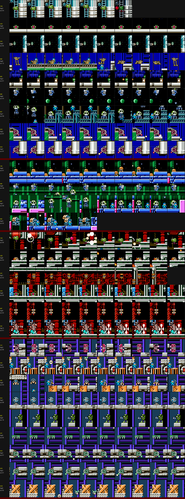
*Enemy strips of Mr. X 1 (rows 1-9), Mr. X 2 (10-13), Mr. X 3 (14-19), Mr. X 4 (20-28); label = type, HP, screen.*

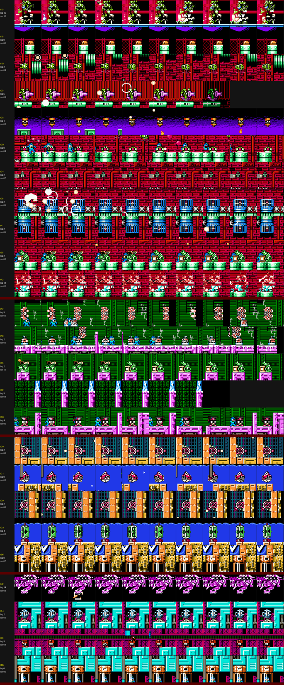
*Enemy strips of Wily 1 (rows 1-11), Wily 2 (12-16), Wily 3 (17-21), Wily 4 (22-25).*

| Type | HP | What it is / does | Stages |
|---|---|---|---|
| $18 | 0 | Metall (hard hat), hides and fires $14 | Mr. X 2, Wily 1 |
| $1B (+$1C, $25) | 2 | green propeller bomber, bobs and drops red balls | Mr. X 1, 3, Wily 1 |
| $1E | 2 | small capped walker | Wily 2 |
| $10 (+$11, $16) | 15 | giant jester head (Blizzard's), throws heads and cubes | Wily 1 scr 10 |
| $12 | 3 | pink striped totem walker | Mr. X 4 scr 09, Wily 2 |
| $20 | 5 | green robot riding a pink cannon (Blizzard's ship rider) | Wily 1 0B, 11 |
| $2B | 0 | dome turret in the wall, fires $2E | Mr. X 3 |
| $2C (+$30) | 1 | Fire-Telly canister drone dropping fire | Mr. X 3, Wily 1 |
| $2D | 0 | spiked stomper on a girder | Mr. X 1, 3, Wily 1 |
| $33 (+$31/$32, $46/$47) | 2 | orange cage cylinder on the floor; white pod and green bird drones come out of it | Mr. X 4 |
| $34 (+$35) | 2 | small flying shield-car | Mr. X 1 06, Wily 1 07 |
| $36 / $41 | 2 / 2 | blue cage canisters on the shaft walls with spiked balls around them | Wily 1 05, 06, 0A |
| $3C | 0 | white dome "spider" that drops from the ceiling and hops over the crates | Mr. X 4 0A-0E |
| $4F (+$15, $14, $79) | 14 | dome dispenser (Tomahawk's), drops hard-hat walkers and rocks | Wily 4 03 |
| $54 (+$55) | 2 | walking eye cannon | Mr. X 4 08, Wily 4 01 |
| $60 | 0 | yellow grasshopper robot, long hops toward Rockman | Mr. X 1 12-15 |
| $65 (+$68, $2E) | 2 | green skeleton robot behind a crate, throws | Mr. X 1 01-02, Wily 1 03, Wily 2 11-12 |
| $66 (+$64, $A4) | 0 | propeller skull drone dropping bombs | Mr. X 1 0A-0D, Mr. X 2 0B-0D |
| $67 | 1 | skull walker, hops | Mr. X 1, Mr. X 2 |
| $6C (+$6D) | 5 | green cowboy gunner on a crate, fires left | Mr. X 4 16-18 |
| $6E | 4 | drill tank, charges | Mr. X 2 |
| $6F | 0 | small valve turret on the red pistons | Mr. X 3 |
| $70 | 3 | red skull spearman on a ledge | Wily 4 04 |
| $8F | 3 | white/blue jets that shoot up out of pink pillars (11 of them) | Wily 2 04 |
| $A1 (+$63) | 0 | green spiked ceiling unit | Mr. X 4 00 |
| $A2 (+$A3) | 11 | samurai spearman robot with a shield (stationary, throws the spear $A3, HP 15) | Mr. X 3 01, Wily 1 0F |
| $C0 / $C9 | 2 | green wheel cannon, floor / wall version, fires $14 | Mr. X 1 0F, Mr. X 4, Wily 3 06 |
| $C1 | 0 | red piranha robot swimming | Wily 3 01-05 |
| $C6 (+$C8) | 4 | red rider throwing white balls | Wily 2 06-0D |
| $CA | 4 | green clam capsule in the water; releases $C1 piranhas | Wily 3 01-05 |
| $CB | 0 | orange X crate that releases drones ($31-$33, $46/$47) | Mr. X 4 05, 06, 11 |
| $D5 | 0 | teleporter pad / beam object [guess] | Wily 3 07-08, Wily 4 00 |
| $72 | - | invisible (Y=$00) [guess: spawner] | Wily 3 00 |
| $8B | - | not spawned by a warp (AI $30:$9F9F, next to the Energy Balancer item code $30:$9F82) [guess: item or trigger] | Mr. X 2 05 |

Items (types $37 1-up, $38 small / $39 big life, $49 small / $4A big weapon energy, $1D E-tank) are listed per
stage below [code: object lists].

---

## 1. Mr. X Fortress 1 (stage 8)

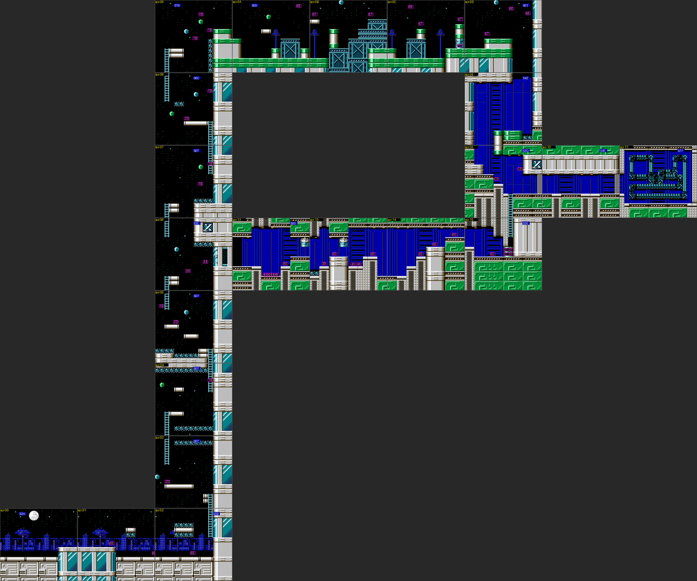
*Mr. X 1, all 22 screens at half scale (magenta = object type, blue = screen script). Start bottom left; the
shaft 03-09 climbs the outside of the tower; the Power-gated branch 12-15 runs right from 06 and rejoins at 0F.*

### Route [code: screen scripts][seen: tour]

| Scr | Entered | Content |
|---|---|---|
| 00-02 | start, scroll | Night city: blue skyline with a moon, white stone-block rooftop. Skeleton robots $65 behind crates (01, 02) |
| 02 -> 03-09 | up (script 3B/07) | **Outer tower climb in space**: starfield with planets, floating white girder platforms, spike rows, ladders. Bombers $1B (04-09), spiked stompers $2D (03, 05, 08), shield-cars $34 (06). Screen 08's up exit loads CHR $B9 (23 tiles) |
| 09 -> 0A-0D | right, scroll | Top of the tower: green-capped pillars, teal steel crates, antennas. Skull drones $66 bombing, skull walkers $67. **E-tank at 0C inside a Power block** (B, x $E0-$FF, y $80-$9F) |
| 0D -> 0E -> 0F | down, down | Blue machinery interior. **Checkpoint 1 = 0E** (script 42 init $39:$8879 = `LDA #$0E / JMP $8416`; scout: 0E / B9 / 6C). Wheel cannons $C0/$C9 at 0F |
| 0F -> 10 -> 11 | shutters | 10 corridor (init $8942 loads sprite set $4A, BG set $D7 = 28 tiles at $0230, palette $F6), 11 boss room (init $8FE4: palette $CC, spawns $B7) |

**Alternate route (shortcut + reward)** [seen][code]: in shaft screen 06 the tower pillar has a glass door
(collision D, remapped to $1B in the Mr. X group) at x $C0-$CF, y $60-$9F, under a spike ledge. A **charged
Power punch** breaks it (`$0340` flag byte 7 changes) and Rockman walks into screen 12; a normal punch,
the buster, F.BLAST and Jet did nothing (`door.py`, `img/fortress_mrx1_door.png`). 12-15 is blue/green
machinery with grasshopper robots $60, more Power blocks (12, 13, 15) and the stage's whole reward stash:
**6 small + 2 big weapon energy, 1 big life energy and four 1-ups** (15). Screen 15's exit (up*, target $10)
climbs into 0F, skipping 07-0E. So it needs **Rush Power** (from Flame Man).

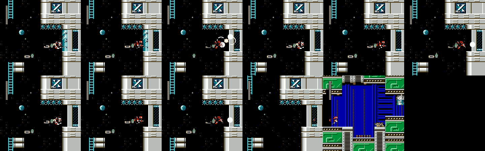
*Screen 06: Power Rockman's charged punch breaks the glass door in the pillar; walking right enters screen 12.*

Items: E-tank 0C (Power block); branch: 12 6x small WE, 13 big HP + 2 big WE, 15 four 1-ups.

### Gimmicks and hazards

Spike rows on the climb (F tiles, 01-09, 0E, 13), bottomless space below the platforms, the dark-blue machinery
pits of 12-15. Nothing else (no conveyors, no water). `$F4` = 0 everywhere [seen].

### Boss: rail riders ("Rounder II" [doc]), room 11

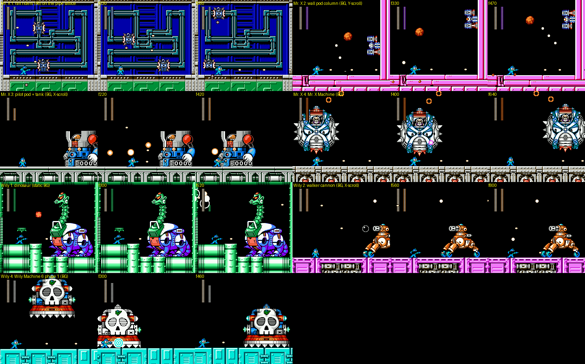
*All six ordinary fortress bosses plus Wily Machine phase 1, three frames each (godmode, firing).*

[seen] The room is a blue panel wall with a teal pipe lattice drawn in the BG (set $D7). Two riders ($B6, HP 13
each, defence class $F4) run along the pipes in opposite directions, each with a shell part ($B8, class $64 =
reflects shots) on its front; they drop bombs ($B9). The bar is the controller $B7 (slot 8, no sprite) and
shows the riders' total. **Shots only hurt a rider from behind**: gluing shots 16 px behind the rider hits,
on the rider itself they are reflected by the shell (`hitzone.py`). Measured per hit (rider side): buster 1,
Y.SPEAR 2, W.STORM 2, B.ATTACK 2, **F.BLAST 4, PLANT.B 4**, KNIGHT.C 3, SILVER.T 3, BEAT 1, C.FLASH 0,
Power punch 2 (charged 4); full table in section 11.

### Tileset, palettes, music

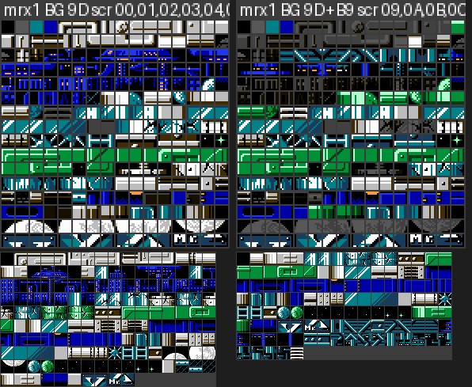
*BG pattern table per CHR configuration (dimmed = not referenced on those screens) and the metatiles used.*

| Config | Screens | Tiles | Blocks / metatiles / tiles used |
|---|---|---|---|
| $9D | 00-08, 12-15 | bank $18+$1000 (256) | 154 / 154 / 242 |
| $9D+$B9 | 09-11 | tiles $23-$39 replaced by bank $14+$0CD0 (23) | 139 / 117 / 174 |
| + $D7 (boss) | 10-11 | tiles $23-$3E from bank $1F+$0AA0 (28): the pipe lattice | - |

Art: night city skyline and moon, white stone rooftop blocks, starfield with two planet balls, white girder
platforms, grey tower pillar with glass windows and the "Mr. X" emblem panel, spike rows, green-capped
pillars, teal steel crates, antennas, blue machinery walls, green circuit floor, pipe lattice. Whole stage
uses 249 of 256 blocks [code]. Palette $68, music $09.

---

## 2. Mr. X Fortress 2 (stage 9)

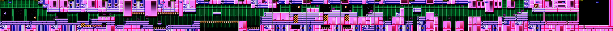
*Mr. X 2, 18 screens in one horizontal line (half scale).*

### Route

| Scr | Content |
|---|---|
| 00-04 | Pink and blue machine blocks over a dark-green pipe wall, windows to space. Metalls $18 (01-04), drill tanks $6E (03-04). Script 79 init `$39:$9236` clears per-screen flags `$0358-$035A`. Items: 3 small WE at 02 (on type-6 tiles), big WE at 03 |
| 04 -> 05-07 | (exit right at 04, 07, 0A, 0D = camera-locked screen boundaries, mode 2) |
| 06 | **Falling bell row** [seen]: a row of orange bells (collision 5, remapped to **$1D** in the Mr. X group) is the only floor across the screen; Rockman can stand on it, but bells drop away under him as he walks (`bells.png`), so the row must be run across. Below is a pit |
| 08 | **Checkpoint 1** (script 7C init `$9257` = `LDA #$08 / JMP $8416`; scout 08 / 00 / 00) |
| 09-0A | Metalls, drill tank, spike rows top and bottom |
| 0B-0D | Skull drones $66 and skull walkers $67 |
| 0D -> 0E | exit loads CHR $B3 (16 tiles at $0800) |
| 0E-0F | Metalls; 0F = shutter |
| 10 -> 11 | 10 corridor (init `$8B0B`: palette $B9, sprite set $63), 11 boss room (init `$8BE9`: `$064F` = $B8) |

No alternate route and no adaptor-gated items [code: object list, collision]. Object $8B (AI $30:$9F9F) is
placed once at 05 and shows up on 06 [seen: tour log]; [guess] it belongs to the bell row.

### Boss: wall pod column, room 11

[seen] A dark room with a pink frame. On the right wall a column of three pods (controller $EB in slot 8,
parts $EC-$EE) slides up and down; it throws orange rocks that burst into white pellets across the room. The
column is **BG-drawn** in the second nametable (`img/fortress_boss_nametables.png`: the pods sit at the left
edge of NT1 next to the wall) and moved by the **vertical** scroll above an IRQ split at line $BE-$C0 (`$F9`
changes, IRQ chain `$0677` = 7, handler $3E:$C23A points the PPU back to NT0 row 24 for the floor). BG tiles
$80-$8F of the boss room differ from the stage set (the pods). Weakness [seen]: **SILVER.T 3**, Y.SPEAR 2,
KNIGHT.C 2, Power punch 2 (charged 4); others 1, C.FLASH 0.

### Tileset

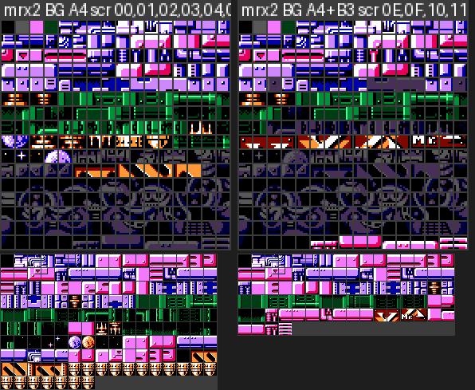
*Mr. X 2 BG set $A4 (bank $1A+$0000) and with $B3 from screen 0E.*

| Config | Screens | Tiles | Blocks / metatiles / tiles used |
|---|---|---|---|
| $A4 | 00-0D | bank $1A+$0000 (256) | 197 / 151 / 157 |
| $A4+$B3 | 0E-11 | tiles $80-$8F from bank $18+$1F00 | 71 / 84 / 132 |

Art: pink machine panels with vent slats, blue pipe girders and joints, green pipe walls, hazard-striped
orange/black blocks, space windows with stars and a planet, orange bell platforms, spike rows. Only 157 of
the 256 tiles are referenced: **about 100 tiles of this set are free or belong to the boss** (the metatile
bank $2F is shared with Mr. X 3 at pages $89/$92). Palette $88, music $09.

---

## 3. Mr. X Fortress 3 (stage 10)

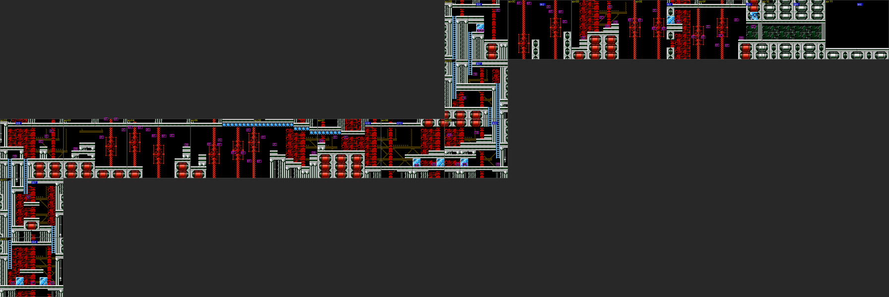
*Mr. X 3: up from 00 to 02, right 03-08, up 09-0B, right 0C-11.*

### Route

| Scr | Entered | Content |
|---|---|---|
| 00 | start | Red gear machinery behind grey pipe columns and ladders, a **pulsing warning light** (effect threads $0E/$0F started by init `$8A47`; BG colour 5 cycles $0F-$00-$10-$20 [seen]). 1-up at the bottom (84,B7); Power blocks (8 tiles) |
| 00 -> 01 -> 02 | up | **Samurai spearman $A2** (HP 11) guards 01; E-tank at 02 (3B,97); Fire-Telly drones $2C |
| 02 -> 03-07 | scroll | Dark machine hall with red pistons and gears: drones $2C (23 in the stage), wall dome turrets $2B, valve turrets $6F (24), spike rows (05-07) |
| 07 -> 08 | right | **Checkpoint 1 = 08** (script 7D `CKPT@here`); small HP behind Power blocks |
| 08 -> 09 -> 0A -> 0B | up | bombers $1B, stompers $2D; **E-tank at 09 behind Power blocks** (51,B7); 2 small HP behind Power blocks at 0B |
| 0B -> 0C-0F | scroll | Mixed hall: screens 0C/0E use mode 3 (camera scrolls both ways) with their own scripts (init `$8AFA`/`$8AF3`, per-frame `$A9B1`/`$A9B4`); 0E reloads the stage CHR `$064F` = $B1, palette $B9, sprite set $63; big HP behind Power blocks at 0E |
| 0F -> 10 -> 11 | shutters | 10 corridor (sprite set $69, `$064F` = $B1), 11 boss room (`$064F` = $B8) |

No alternate route. **Power Rockman opens five item pockets** (00, 08, 09, 0B, 0E) [code: collision B around
the items].

### Boss: pilot pod + tank ("Tank CSII" [doc]), room 11

[seen] An orange robot in a glass dome flies in from above and docks on top of a big blue tank; the tank then
rolls back and forth along the floor and lobs orange cannonballs ($EA) in arcs. The tank is **BG-drawn** in
NT1 together with a copy of the floor girder, positioned by the horizontal scroll above an IRQ split at line
$C1 (chain `$0677` = $1A, handler $3E:$C4F2). That handler also scrolls the strip below the split by `$0678`
every 4th frame while slot 8 is alive [code] ([guess] the treads/floor). The tank's art lives in the stage's
own BG set $B1 (only 4 tiles differ in the fight) [seen]. Weakness: **B.ATTACK 3**; others 1, C.FLASH 0,
Power 2/4.

### Tileset

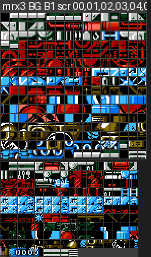
*Mr. X 3 uses one BG set ($B1, bank $1B+$0000) for the whole stage and the boss.*

One configuration: $B1 (bank $1B+$0000), 256 blocks (the block table is full), 169 metatiles, 255 tiles used.
Art: red gear-and-chain machinery, grey fluted pipe columns with capitals, blue ladders, red pistons,
girder catwalks, blue glass blocks (the Power blocks), spike rows, the tank. Palette $AB, music $09.

---

## 4. Mr. X Fortress 4 (stage 11)

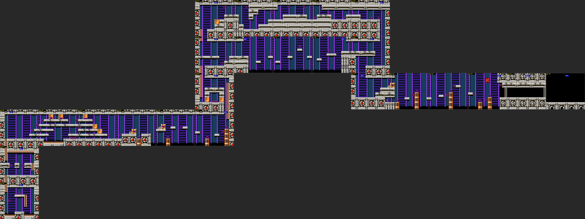
*Mr. X 4: up 00-02, right 03-07, up 08-0A, right 0B-0E, down 0F-10, right 11-15; the branch 16-18 leaves 09
to the right and rejoins at 0F.*

### Route

| Scr | Entered | Content |
|---|---|---|
| 00 | start | Grey stone and metal blocks with red lights over purple stripes. Green spiked ceiling unit $A1. Exit up loads CHR $C4 (49 tiles at $0900). Big WE |
| 00 -> 01 -> 02 | up | wheel cannons $C0/$C9 on platforms, orange spike rows on floor and ceiling |
| 02 -> 03-07 | scroll | Orange X crates $CB that release drones, orange cage cylinders $33, wall cannons. **03-04: big HP, big WE, small WE + small HP behind Power blocks**; E-tank at 04 (0C,77) |
| 07 -> 08 -> 09 | up | eye cannon $54 (08, 3 small HP), totem walkers $12 (09). **Checkpoint 1 = 09** (script 4C `CKPT@here`) |
| 09 -> 0A-0E | up, scroll | ceiling "spiders" $3C hopping over crates (10 of them). **1-up at 0E** (12,57) |
| 09 -> 16-18 | right (branch) | **Alternate route**: open to the right of 09, three screens with cowboy gunners $6C on crates; 18's exit (right, target $0E) lands in 0F, skipping 0A-0E. No gate in the collision; [guess] it is just the harder/shorter path without the 1-up |
| 0E -> 0F -> 10 | down | **E-tank at 10** (E8,B7) |
| 10 -> 11-13 | scroll | crates and cages again |
| 13 -> 14 -> 15 | shutters | 14 corridor (init `$8B93`: sprite set $6B = 96 tiles, palette $D0, `$064F` = 0), 15 boss room |

### Boss: Mr. X Machine, room 15

[seen] A huge spiked sphere with Mr. X in a glass cockpit floats around the room (moving left/right and
bobbing), dropping orange rings from its top and firing pink and white balls. It is **BG-drawn** in NT0 (the
whole sphere is nametable art, `img/fortress_boss_nametables.png`), moved by scrolling above a split (IRQ
latch $AE, chain `$0677` = $16: handler $3E:$C475 sets a second IRQ 11 lines later and repoints the PPU to
$2000, a multi-split). The art is in the stage's own BG set $C3: no tile differs from the base set in the fight
[seen]. Hit boxes $D1/$D2 ride on it; the controller is $D3. Weakness: **F.BLAST 4**; others 1, C.FLASH 0,
Power 2/4. Its death starts the reveal cutscene (section 9).

### Tileset

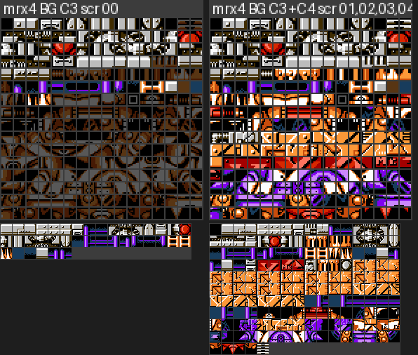
*Mr. X 4 BG set $C3 (bank $1C+$1000) at screen 00, then with $C4 (bank $1F+$0790, tiles $90-$C0) for the rest.*

| Config | Screens | Blocks / metatiles / tiles used |
|---|---|---|
| $C3 | 00 | 29 / 38 / 78 |
| $C3+$C4 | 01-18 | 153 / 165 / 253 |

Art: grey riveted stone blocks with red warning lights, purple/blue striped walls, grey metal ledges, orange
X crates, orange cage cylinders, orange ladders, orange spike rows, and the Mr. X Machine sphere. Palette $C8,
music $09.

---

## 5. Wily Fortress 1 (stage 12)

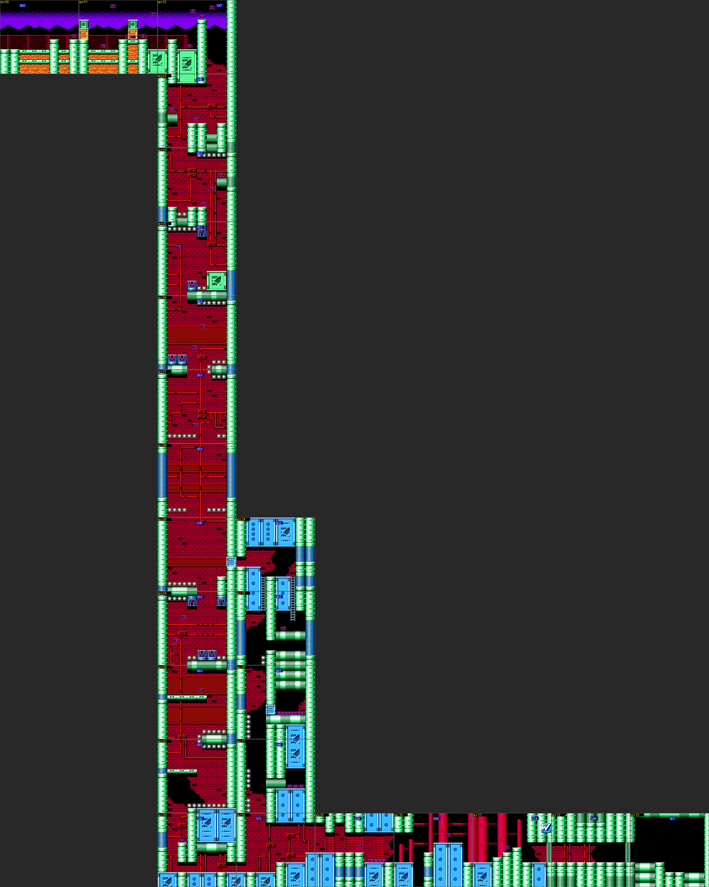
*Wily 1: outdoor 00-02, the long drop 03-0D, right 0E-13; the Power-gated pocket 14-17 hangs off 09.*

### Route

| Scr | Entered | Content |
|---|---|---|
| 00-02 | start, scroll | Outside the castle at night: purple mountains, red chain fence, green pipe pillars, orange rubble ground. Metalls $18, Fire-Telly drones $2C. **1-up at 01 behind Power blocks** |
| 02 -> 03 -> ... -> 0D | down x 11 | **The long fall**: a vertical shaft of red brick and red pipes between green pipe pillars, spike strips on ledges and walls, bombers $1B, stompers $2D, shield-car $34 (07), blue cage canisters $36/$41 with spiked balls (05, 06, 0A), skeleton $65 at 03, cannon rider $20 at 0B. Exits 02/03 load palettes $80/$81. Big HP at 04 |
| 09 -> 14-17 | right (Power blocks) | **Alternate pocket**: a 2x2 Power-block plug (collision B, cols 14-15 rows 8-9 of screen 09) opens a side passage: E-tank (15), **eight small life energies** (16), three big WE (17); 17's exit (down*, target $0F) drops back into 0E. [code: collision + object list; the emulator test did not get Rockman into 09 in 80k frames, `block.py`] |
| 0D -> 0E-11 | right (sprite set $61) | Blue riveted blocks and green pipes. **Checkpoint 1 = 0E** (script 7E `CKPT@here`). Samurai spearman $A2 + 4 small items at 0F, **giant jester head $10** (HP 15) at 10, cannon rider $20 at 11 |
| 11 -> 12 -> 13 | shutters | 12 corridor (init `$88F1`: sprite set $55, palette $B9, `$064F` = $8B = **162 BG tiles at $0500** for the dinosaur), 13 boss |

Collision types A, C and E line the canister columns in 05, 06 and 0A [code] (the player code tests A/C while
climbing, $38:$8BA2, and E while airborne, $38:$8205) [guess: rails/updraft for the canisters].

### Boss: dinosaur ("Mechazaurus" [doc]), room 13

[seen] A big purple-and-green sauropod robot fills the right half of the room; the head on the long neck
spits orange fireballs ($E3) and it launches small green flyers ($E2). It does not move: the whole body and
neck are **BG tiles drawn into NT0** (no IRQ split, `$F4` = 0), loaded as set $8B (bank $19+$0000, 162
tiles $50-$F1). Only the hit box part $E1 in slot $0C (class 0, at the head, X $98 Y $37) takes damage; the
body parts $E1 (class $86) reflect. Damage: buster 1, W.STORM, F.BLAST, KNIGHT.C, SILVER.T, BEAT 1, Power 2/4;
**Y.SPEAR, B.ATTACK, PLANT.B, C.FLASH and the charged buster do nothing** [seen, two methods]. No 2-4x weakness
was found.

### Tileset

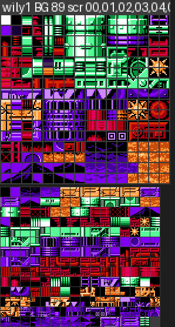
*Wily 1 BG set $89 (bank $14+$1000) for the whole stage.*

One BG configuration ($89); set $61 (sprites) arrives at 0D. 255 of 256 blocks used, 223 metatiles, 254 tiles.
Art: purple mountain skyline, red chain fence, orange rubble, green pipe pillars and pipe blocks, red brick
with red pipes and valve wheels, blue riveted blocks with a "W" emblem, spike strips, blue cage canisters.
Palettes $7C, $80, $81. Music $0B.

---

## 6. Wily Fortress 2 (stage 13)

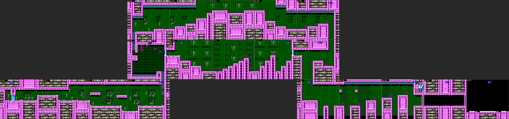
*Wily 2: right 00-03, up 04-05, right 05-09, down 0A, right 0B-0F; the Flame-Blast branch 10-12 runs from 04
to the checkpoint screen 0A.*

### Route

| Scr | Entered | Content |
|---|---|---|
| 00-03 | start, scroll | Pink machine blocks on a green circuit wall. **E-tank at 00 behind Power blocks**; totem walkers $12, capped walkers $1E |
| 03 -> 04 | up | **Disappearing-block room** [seen]: a big dark-green mesh hall over a spike floor; eleven block objects $8F at fixed grid points (X $28-$C8, Y $38-$B8) appear and vanish in sequence (`w2_04.png`); climb them to the exit at the top |
| 04 -> 10-12 | right (Flame-Blast blocks) | **Alternate route**: a 1x2 plug of D blocks (Flame Blast, group 0) at the upper right of 04 (x $E0-$EF, y $40-$5F); F.BLAST breaks it (`$0340` flag byte 4 changes [seen], `block.py`); the Power punch does not. 10-12 have skeleton robots $65; 12 ends in another D plug and its exit (right, target $09) enters 0A, skipping 05-09 |
| 05-09 | scroll | red riders $C6 throwing balls; E-tank at 09 |
| 09 -> 0A | down (CHR $A3, palette $79) | **Checkpoint 1 = 0A** (script 50 `CKPT@here`); big WE |
| 0B-0D | scroll | riders $C6; big WE and big HP at 0C |
| 0D -> 0E -> 0F | shutters | 0E corridor (palette $B9, sprite set $60), 0F boss (`$064F` = $B8) |

### Boss: walking cannon, room 0F

[seen] An orange two-legged walker with a cannon on its back strides in from the right edge, pushes toward
Rockman and fires white rings that bounce around. It is **BG-drawn** in NT1 together with its own copy of the
floor (`img/fortress_boss_nametables.png`) and moved by the horizontal scroll above the line-$C1 split (chain
`$0677` = 7, the same handler as Mr. X 2). 94 BG tiles ($70-$CD) differ from the stage set in the fight (set
$B2 at $0800 and others). Weakness: **W.STORM 4**, Y.SPEAR 2; others 1, C.FLASH 0, Power 2/4.

### Tileset

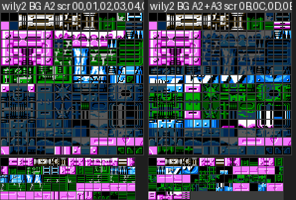
*Wily 2 BG set $A2 (bank $19+$1000), and with $A3 (16 tiles at $0700) from 0A on.*

| Config | Screens | Blocks / metatiles / tiles used |
|---|---|---|
| $A2 | 00-0A, 10-12 | 189 / 80 / 141 |
| $A2+$A3 | 0B-0F | 83 / 69 / 157 |

**The same 256-tile set $A2 is also Wily 3's base set** (the dimmed tiles in each sheet are the other stage's).
Art: pink riveted machine blocks with grey vent grilles, green circuit-board walls, dark mesh, blue ladders,
spike floors, disappearing blocks. Palette $89, music $0B.

---

## 7. Wily Fortress 3 (stage 14): water castle and the boss rush

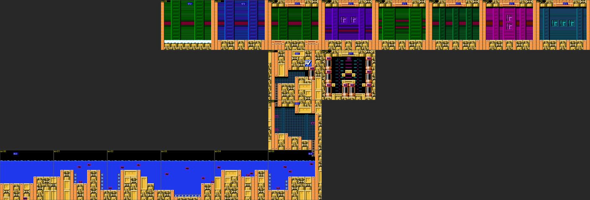
*Wily 3: underwater 00-05, up 06-07 (teleporter), hub 08 and the eight refight rooms 09-10 (drawn above the
hub with their own palettes $9A+stage).*

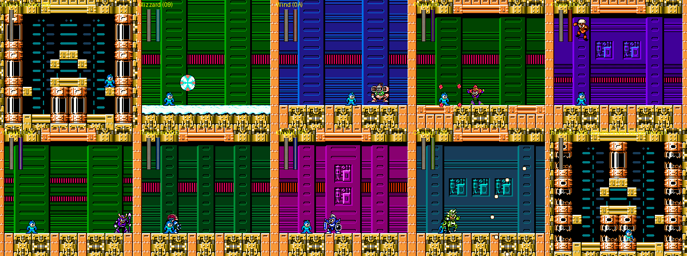
*The hub, the eight refight rooms (in room order 09-10), and the hub after all eight wins.*

### Route

| Scr | Entered | Content |
|---|---|---|
| 00-05 | start, scroll | **Underwater castle**: gold and orange brick walls under a blue water surface; the whole area is collision type 8 (water: higher, floatier jumps; bubbles). Red piranhas $C1 and green clam capsules $CA that release them; spike pits (01-03, 05). Items: big WE 01, E-tank 02, big WE 03, big WE 04, big HP 05. Effect thread $0D (scripts 53/54, `$39:$897F`) [guess: water shimmer] |
| 05 -> 06 -> 07 | up (CHR $A8) | wheel cannons $C0/$C9; 07 is a **teleporter pad** (collision D -> $1F): standing on it (`$064B` = $1F, $39:$89A5) beams Rockman out, loads CHR $A9 and puts him in the hub 08 (music $0B restarted) |
| 08 | teleport | **The hub** (script 71, init `$8E31`): `LDA #$08 / JSR $8416` = **checkpoint 08**, and effect thread $13 = blinking hub lights (palette entries 2-3 and 9-11 cycle [seen]). Eight teleporter alcoves (D floor / E inside) |
| 09-10 | teleport | one refight room per Robot Master (script 72, init `$8EE7` requests music $0C) |

### The boss rush [seen][code]

Standing in an alcove for about 30 frames teleports Rockman into a refight (`hub3.py`, `img/fortress_boss_rush.png`).
The hub's per-frame routine `$39:$8E3B` reads the touched metatile, looks up the boss in `$8ED2` and the
X position in `$8EC8`, sets `$063D` = the boss's stage id, loads palette `$9A + id`, and redraws screen
`$09 + id`:

| Alcove | Boss | Room | Alcove | Boss | Room |
|---|---|---|---|---|---|
| right top | Blizzard Man | 09 | left top | Yamato Man | 0D |
| right middle | Flame Man | 0C | left middle | Plant Man | 0B |
| right bottom | Tomahawk Man | 0E | left bottom | Knight Man | 0F |
| centre left | Centaur Man | 10 | centre right | Wind Man | 0A |

Each room is one screen of the Wily 3 set: a machine wall in the boss's colours (palette $9A-$A1) with a
stage-specific floor (snow for Blizzard, window panels for Flame, Knight and Centaur). The room starts dark and
lights up when the boss has dropped in [seen]. The refights use the same boss objects and AI as the stages
($90 Blizzard ... ), full 27 HP, so the weaknesses are those of `stages_a.md`/`stages_b.md` (checked: F.BLAST
does 4 to the Blizzard refight). **This is the only place where Robot Masters can be fought again**; the
stage boss rooms refuse rematches (`ram.md`).

After a refight the boss drops a **big life energy capsule** ($39); touching it returns Rockman to the hub
about 60 frames later, standing at the alcove he used. Each win swaps that alcove's metatiles through the
`$0340` bitfield (bytes 8-$0B fill up: $F0, $FF, ...; table `$8EDC` = 44 58 48 4C 40 5C 50 54 gives each
boss's metatile group), turning the alcove into a closed capsule (collision E -> 6). **After the eighth win
byte $0C is set too and a ninth teleporter opens at the top centre of the hub** (collision E/D at columns 7-8,
rows 3-5); standing on it sets `$F0` = 1, the Wily Fortress picture is shown and Wily 4 starts with Rockman
arriving in a capsule [seen: `rushall.py` completed all eight refights in order, then the exit; state
`wily3_rush_done`]. The refights can be taken in any order.

### Tileset

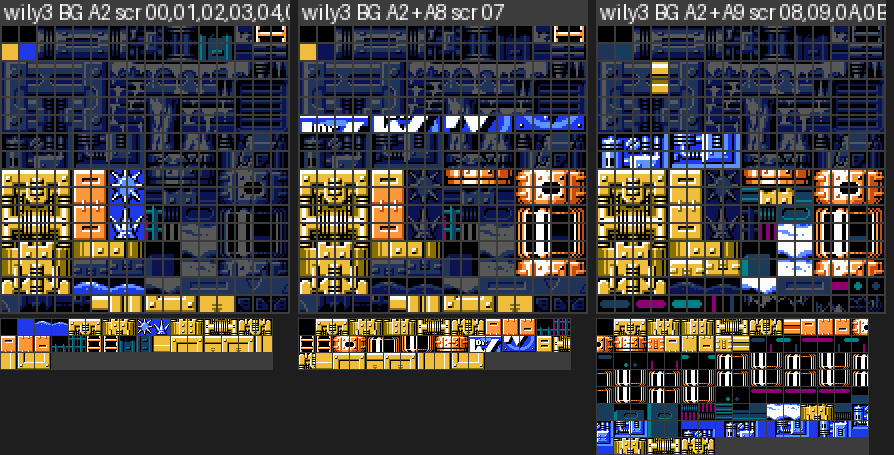
*Wily 3: base set $A2 (shared with Wily 2), +$A8 at 07, +$A9 (19 tiles at $0ED0) for the hub and the rooms.*

| Config | Screens | Blocks / metatiles / tiles used |
|---|---|---|
| $A2 | 00-06 | 86 / 35 / 71 |
| $A2+$A8 | 07 | 45 / 43 / 97 |
| $A2+$A9 | 08-10 | 157 / 119 / 123 |

Art: gold/orange castle bricks with carved panels, water surface and bubbles, spike pits, the hub machine with
teleporter alcoves and striped light panels, eight refight-room walls (green, blue, purple, magenta, teal
panels with window frames and floor variants). Palettes $96 (+$9A-$A1 per refight). Music $0B.

---

## 8. Wily Fortress 4 (stage 15): Wily Machine 6 and the Wily Capsule

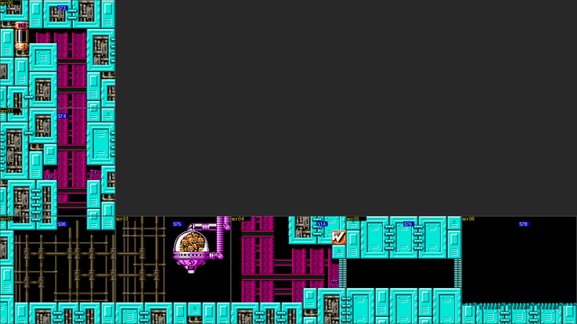
*Wily 4: seven screens, down 00-02, right 02-06.*

### Route

| Scr | Entered | Content |
|---|---|---|
| 00 | start | Teal metal castle. Script 73 init `$8F95` waits until Rockman's Y = $77 then places him at X $30, Y $53 (scripted arrival through the teleporter capsule at the left, collision 6/7) [code]. Object $D5 |
| 00 -> 01 -> 02 | down | eye cannon $54, big WE; exit of 01 loads BG set $BC (107 tiles at $0900) and palette $3E |
| 02 -> 03 | right (sprite set $61) | dome dispenser $4F (HP 14) dropping hard-hat walkers; script 75 init `$8FBC` |
| 03 -> 04 | right (BG set $BD, palette $18) | red skull spearman $70 (an E-tank object $1D appears with it [seen: tour log, strip children]); shutter |
| 04 -> 05 -> 06 | shutters | 05 corridor (init `$8FCF`: sprite set $6A, palette $D0, `$064F` = **$BE = 202 BG tiles at $0360**: the Wily Machine), 06 boss room (init `$8FF5`: palette $CC, spawns $EF). Music $18 |

No mid-stage checkpoint (a death restarts at 05, the shutter rule). No branch.

### Boss: Wily Machine 6 and the Wily Capsule, room 06

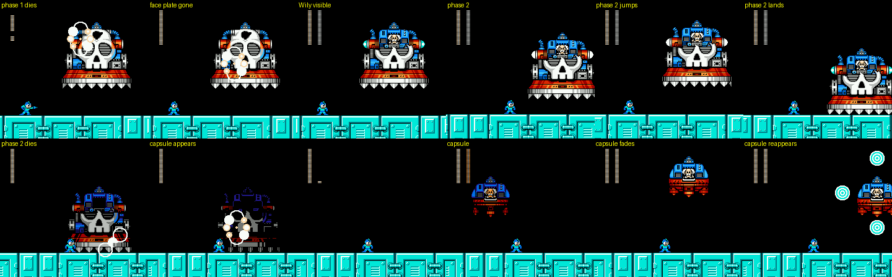
*Phase 1 dies (the skull face plate bursts), phase 2 with Wily visible, then the capsule (fading teleports).*

[seen] Three 27-HP bars in one room, no break in between:

1. **Wily Machine, skull face** ($EF + six $E9 hit boxes, all hittable): a big skull-faced machine on a
   spiked base hops around the room and fires cyan ring shots ($F0). **BG-drawn** in NT1 (set $BE), moved by
   the scroll above the line-$BF split (chain `$0677` = $19, handler $3E:$C4B2, which also scrolls the floor
   strip by `$0678` + `$0679` every other frame).
2. **Wily Machine, face plate gone** ($F1, refilled to 27): the plate explodes away and Wily is visible in
   the cockpit; same moves, more jumping.
3. **Wily Capsule** ($F2, refilled to 27): the machine blows up and the small capsule rises. It is a
   **sprite** boss (nothing in the nametables), fades out and reappears elsewhere (palette fade), and fires
   rings that split.

Weakness, all three: **SILVER.T 4**, KNIGHT.C 2; others 1, C.FLASH 0, Power 2/4. Killing the capsule starts
the ending (section 10).

### Tileset

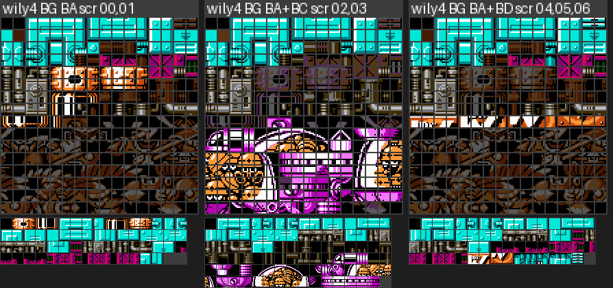
*Wily 4: base set $BA (bank $1B+$1000), +$BC (bank $17+$0000) for 02-03, +$BD for 04-06.*

| Config | Screens | Blocks / metatiles / tiles used |
|---|---|---|
| $BA | 00-01 | 80 / 62 / 109 |
| $BA+$BC | 02-03 | 95 / 95 / 199 |
| $BA+$BD | 04-06 | 57 / 63 / 101 |
| + $BE (boss) | 05-06 | 202 tiles at $0360 from bank $1C+$0360: the Wily Machine art |

Art: teal riveted castle plates with pipe joints, magenta lattice pillars, grey machinery panels, the
teleporter capsule, dark machine rooms; boss room is black with a teal floor. Palettes $18/$3E. Music $0B,
boss $18.

---

## 9. Between the fortresses: Mr. X's reveal and the Wily Fortress picture

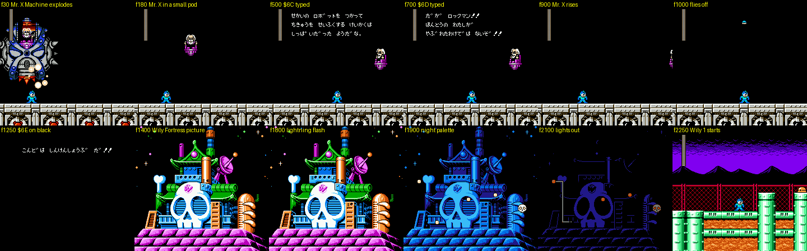
*After the Mr. X Machine: Mr. X in a small pod, speeches $6C/$6D, he flies off, $6E on black, the Wily
Fortress picture with lightning and a night palette, then Wily 1 (frame numbers from the kill).*

[seen] (`kill.py` on the Mr. X 4 fight, 3,600 frames): the machine explodes; Mr. X sits in a small hovering
pod in the empty room while `$6C` and `$6D` are typed at the top of the screen (text in `text.md` 5.5); he
rises and flies off; black screen with `$6E` ("こんどは しんけんしょうぶ だ!!"); then a **full-screen BG
picture of the Wily Fortress** (a skull-faced castle with a pagoda roof, satellite dish, chimneys and
cylinders on a pink rock base) flashes white (lightning), turns to a blue night palette, its lights go out,
and Wily 1 starts at about frame 2,160 (`$51` = 12). [code] `$39:$ACD4-$ADFE` drives it and ends with `$F0` =
1. The Mr. X Fortress has an equivalent map screen before Mr. X 1 and between its stages
(`img/scout_mrx_map.png`).

---

## 10. The ending

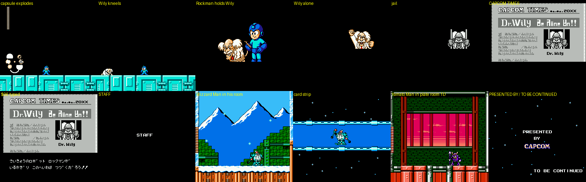
*The ending: capsule explodes, Wily kneels, Rockman holds Wily, Wily alone, Wily in jail, the CAPCOM TIMES,
STAFF, each Robot Master in its boss room plus its card strip, the staff roll, PRESENTED BY CAPCOM / TO BE
CONTINUED.*

[seen] (`kill.py` on the capsule, then `rec.py`, about 20,000 frames in all):

1. The capsule explodes in room 06; **Wily falls out and kneels, begging** (the classic Wily bow).
2. Black screen: **Rockman stands holding Wily by the collar** (big sprite art, about frames 540-720).
3. Wily alone, then **Wily behind bars** (frames ~840-960).
4. **CAPCOM TIMES** newspaper (masthead, headline "Dr.Wily" + stylised glyphs, a picture of Wily in a cell);
   lines $92-$96 typed below one after another with fades (`text.md` 5.6: Wily arrested, may be building a
   jailbreak robot, peace lasts as long as Rockman is here).
5. `STAFF`, then for each Robot Master, **in alphabetical order of the English names**: the boss plays its
   real AI **in its own boss room, loaded by the normal stage engine** (`$51` = its stage id), for about
   1,000 frames with no Rockman, then a horizontal blue **card strip** where the boss walks in and its card is
   typed (DWNB-41..48 + DESIGNER name). Rooms used: Blizzard stage 0 screen $18, Centaur 7/$17 (the plate
   room), Flame 3/$17, Knight 6/$17, Plant 2/$17, Tomahawk 5/$17, Wind 1/$15, Yamato 4/$1D (the plate room)
   [seen: `$51`/`$57` log in `rec.py`].
6. The scrolling staff roll on a starfield (contest entrants, then the staff by role), `PRESENTED BY CAPCOM`,
   and `TO BE CONTINUED`; the game waits for START and resets (`JMP $FF70`, `text.md` 4.5).

There is no Proto Man (Blues) scene, no Dr. Light scene and no Rush/Beat cameo in the ending [seen].

---

## 11. Fortress bosses: how they are built, and measured damage

### How the big bosses are drawn [seen][code]

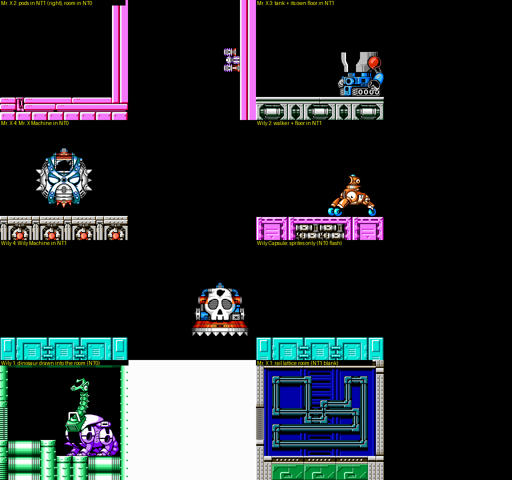
*Both nametables during each fight (left NT0, right NT1): the big bosses are BG art, positioned by scrolling.*

| Boss | Drawn as | Where the art lives | Movement / split |
|---|---|---|---|
| Mr. X 1 rail riders | sprites ($B6 + shell $B8) on a BG pipe lattice | lattice = BG set $D7 (28 tiles, loaded in the corridor) | no split |
| Mr. X 2 wall pods | **BG** (NT1, next to the wall) | 16 tiles $80-$8F loaded for the room | vertical scroll above the IRQ split at line ~$BF (chain 7) |
| Mr. X 3 tank | **BG** (NT1, with its own floor copy) + sprite pilot | inside the stage set $B1 | horizontal scroll above the line-$C1 split (chain $1A; floor strip also scrolled) |
| Mr. X 4 Mr. X Machine | **BG** (NT0) | inside the stage set $C3 | scroll, multi-split (chain $16) |
| Wily 1 dinosaur | **BG** (NT0, static) + sprite projectiles | set $8B, 162 tiles at $0500 | none: it never moves |
| Wily 2 walker | **BG** (NT1, with floor copy) | ~94 tiles incl. set $B2 (78 at $0800) | horizontal scroll above the line-$C1 split (chain 7) |
| Wily 4 Wily Machine | **BG** (NT1) | set $BE, 202 tiles at $0360 | scroll above the line-$BF split (chain $19; floor strip scrolled by `$0678`/`$0679`) |
| Wily Capsule | sprites | sprite sets | palette fades for its teleport |
| Boss rush | the Robot Masters' own sprite objects | their sprite sets | none |

The technique [code] (IRQ handlers at $3E:$C116 table, `$0676` = handler index, `$0677` = first handler,
`$0672` = latch): the frame's scroll registers (`$F7`/`$F9`/`$F8`) show the boss nametable scrolled so the
boss appears at its position; at the split line the handler writes `$2006` = $23xx (NT0 row 24) and `$2005`
= 0 (or `$0678`), so the floor strip comes from NT0 unscrolled. The boss's hit boxes are invisible objects
($D1-$D3, $E9, $E1 ...) moved in step with the scroll. Every BG boss sits above a flat floor for this reason.

### Damage per hit (measured) [seen]

Method (`fdmg.py`, results `fdmg_*p.json`): from the fight state (bar full, godmode), per weapon: select it by
poking `$0699` (and `$9B` for the forms), fire every 20 frames (charge: hold 105 of 130 frames) for 480
frames while Rockman is pinned 40 px from the hit box and his live shots are glued onto it; log every drop of
`$03ED`. The pause-menu route used first silently failed in two fights (the menu stayed open), so all values
below are from the poke runs; where both worked they agree. Values are the most common drop; 0 = no HP change
in 8 s.

| Weapon | Mr. X 1 riders | Mr. X 2 pods | Mr. X 3 tank | Mr. X 4 machine | Wily 1 dino | Wily 2 walker | Wily Machine 1 | Wily Machine 2 | Wily Capsule |
|---|---|---|---|---|---|---|---|---|---|
| R.BUSTER | 1 | 1 | 1 | 1 | 1 | 1 | 1 | 1 | 1 |
| charged buster | 1 | 3 | 3 | 3 | **0** | 3 | 3 | 3 | 3 |
| Y.SPEAR | 2 | 2 | 1 | 1 | **0** | 2 | 1 | 1 | 1 |
| W.STORM | 2 | 1 | 1 | 1 | 1 | **4** | 1 | 1 | 1 |
| B.ATTACK | 2 | 1 | **3** | 1 | **0** | 1 | 1 | 1 | 1 |
| F.BLAST | **4** | 1 | 1 | **4** | 1 | 1 | 1 | 1 | 1 |
| PLANT.B | **4** | 1 | 1 | 1 | **0** | 1 | 1 | 1 | 1 |
| KNIGHT.C | 3 | 2 | 1 | 1 | 1 | 1 | 2 | 2 | 2 |
| SILVER.T | 3 | **3** | 1 | 1 | 1 | 1 | **4** | **4** | **4** |
| C.FLASH | 0 | 0 | 0 | 0 | 0 | 0 | 0 | 0 | 0 |
| BEAT | 1 | 1 | 1 | 1 | 1 | 1 | 1 | 1 | 1 |
| Jet buster | 1 | 1 | 1 | 1 | 1 | 1 | 1 | 1 | 1 |
| Power punch / charged | 2 / 4 | 2 / 4 | 2 / 4 | 2 / 4 | 2 / 4 | 2 / 4 | 2 / 4 | 2 / 4 | 2 / 4 |

Notes: Mr. X 1 values are per rider hit from behind (each rider has 13 HP; the bar is their sum). The
**charged Power punch does 4 to every fortress boss** (2 to Robot Masters, `stages_a.md`), which makes Rush
Power the fortress weapon of choice. C.FLASH never hurts a fortress boss. Refights in Wily 3 use the Robot
Master tables. Fortress bosses award nothing [seen: no YOU GET; the stage just advances].

### Patterns (summary) [seen]

See `img/fortress_bosses.png` (three frames per boss, Rockman firing) and the per-stage sections.

- Mr. X 1: two riders circle the pipe lattice in opposite directions with front shells, dropping bombs.
- Mr. X 2: the pod column slides up and down the right wall, throws rocks that burst into pellets.
- Mr. X 3: a pilot pod docks into the tank; the tank rolls back and forth and lobs cannonballs.
- Mr. X 4: the spiked Mr. X Machine floats around, drops rings and fires balls.
- Wily 1: the static dinosaur spits fireballs from its head and launches small flyers.
- Wily 2: the walker strides in, presses toward Rockman and fires bouncing rings.
- Wily 4: the skull machine hops around firing rings; phase 2 the same with Wily exposed; the capsule fades,
  reappears and fires splitting rings.

---

## 12. Checkpoints, states and scripts

### Checkpoints [code][seen]

Mid-stage checkpoints come from the screen scripts' `$8416` routine (`CKPT@screen`); entering any boss room
sets `$0684` = boss room - 1 (the shutter corridor). Values = screen / CHR set / palette (`cheats.md` has the
warp values the scout measured).

| Stage | Mid checkpoint (set by) | Boss shutter checkpoint |
|---|---|---|
| Mr. X 1 | 0E (script 42 init $8879; 0E / B9 / 6C) | 10 |
| Mr. X 2 | 08 (script 7C init $9257; 08 / 00 / 00) | 10 |
| Mr. X 3 | 08 (script 7D, here) | 10 |
| Mr. X 4 | 09 (script 4C, here) | 14 |
| Wily 1 | 0E (script 7E, here) | 12 |
| Wily 2 | 0A (script 50, here) | 0E |
| Wily 3 | 08 = the hub (script 71 init $8E31) | (refights return to the hub) |
| Wily 4 | none | 05 |

### Savestates added to `build/research/rm6/states/` (all verified to load, `$51`/`$57`/slot 8 checked)

| File | What |
|---|---|
| `mrx1_boss`, `mrx4_boss`, `wily2_boss`, `wily4_boss` | boss intro, bar filling (the scout had mrx2/mrx3/wily1) |
| `mrx1_ck2`, `mrx4_ck2`, `wily2_ck2`, `wily4_ck2` | shutter corridor (RAM warp with the walker's CHR/palette) |
| `mrx1_door` | Mr. X 1 screen 06 next to the Power door of the shortcut |
| `wily3_hub` | the boss-rush hub, playable |
| `wily3_rush_<boss>` x8 | each refight, bar full (blizzard, wind, plant, flame, yamato, tomahawk, knight, centaur) |
| `wily3_rush_done` | the hub after all eight refights, exit teleporter open |
| `wily4_machine2`, `wily4_capsule` | Wily Machine phase 2 start, Wily Capsule start |
| `mrx4_reveal` | Mr. X Machine just killed: the reveal cutscene follows |
| `ending` | Wily Capsule just killed: the whole ending follows |
| `ending_credits` | in the credits (Flame Man playing in his room) |

### Scripts (`build/research/rm6/rm6-fortress/`)

`static.py` (per-stage tables, scripts, object types), `screens.py` (per-screen summary: script, exits,
checkpoint routine, enemies, items), `tour.py` (warp to every screen, screenshots + object/IRQ log),
`bossget.py` (reach a boss from its corridor, save states, record the fight), `fdmg.py` (damage per weapon;
options `shield`, `poke`), `hitzone.py` (grid search of a boss's hit zone), `kill.py` (kill the boss, record
what follows), `rec.py` (record a long cutscene with a stage/screen log), `bossnt.py` (nametables, CHR, IRQ
shadows in a fight), `hub.py`/`hub2.py`/`hub3.py` (boss-rush teleporters), `fstrips.py` (enemy strips),
`ftiles.py` (tileset sheets), `maps.py` (stitched maps), `music.py` (sound requests), `door.py`/`block.py`/
`altx.py` (gate tests), `curate.py` (the contact sheets in img/).

---

## Lessons for Rockman 6 GP

**Reusing the fortress art (what exists):**

- Eight distinct fortress looks, but only **seven BG base sets**: Wily 2 and Wily 3 share set $A2 (pink
  machinery + gold water castle in one 4 KB bank). Each set is a full 256-tile, 4 KB half pattern table;
  stages swap 16-107 tiles in on screen exits ($B9, $B3, $C4, $A3, $A8, $A9, $BC, $BD). A redesign that keeps
  a stage's look should keep its base set and the exit-loaded extras together, and remember that the
  extras are cumulative in CHR-RAM: a sprite-set exit ($61) does not undo an earlier BG extra (Wily 4 03).
- **Free tile space**: Mr. X 2 references only 157 of its 256 tiles (the rest are boss/unused), Wily 3 71-123,
  Wily 4 101-199, Wily 2 141-157. Mr. X 3 (255) and Wily 1 (254) are full. Block tables are nearly full in
  Mr. X 1 (249), Mr. X 3 (256), Wily 1 (255), Wily 3 (251): new layouts there must reuse existing blocks.
- The big bosses' art is BG tiles: Wily Machine = set $BE (202 tiles), dinosaur = set $8B (162 tiles),
  walker ~94 tiles, tank and Mr. X Machine inside their stage sets. These are large, self-contained art
  packs a GP boss can reuse (or replace) as long as its room keeps the "boss in NT1, floor strip from NT0"
  layout.

**Engine techniques worth keeping:**

- **BG bosses = scroll the boss nametable + one IRQ split for the floor** (`$0677` chain id, handlers at
  $3E:$C116). A new big boss needs only a nametable picture, hit-box objects that follow the scroll, and a
  flat floor at the split line. Five vanilla bosses prove the pattern (Mr. X 2-4, Wily 2, Wily 4).
- **Multi-phase bosses refill the same bar** (Wily Machine -> phase 2 -> Capsule, three 27-HP bars with no
  room change). Cheap way to make a longer final fight.
- **The boss rush is data-driven**: one hub screen, eight one-screen rooms (`$09 + stage id`), tables
  `$39:$8EC8/$8ED2/$8EDC` (X, stage id, alcove metatiles), palette `$9A + id`, and the Robot Masters' normal
  AI. GP can reorder, add or remove refights by editing those tables and rooms. It is also the only place
  where vanilla allows rematches.
- **Per-group collision remap** (`$DB03`/`$DB13`) gives the fortresses their special tiles without new code:
  crumbling bells ($1D) and big Power walls ($1B) in the Mr. X group, teleporter pads ($1F/$10) in Wily 3,
  Flame-Blast plugs (D) in Wily 2. New GP stages can pick a group to get these behaviours.

**Design takeaways:**

- Vanilla fortresses use adaptors and weapons as **route keys for shortcuts and rewards**, not as hard
  gates: Mr. X 1's charged-punch door (shortcut + four 1-ups), Wily 1's Power pocket (E-tank, 8 small HP),
  Wily 2's Flame-Blast plug (skips the rider section), plus Power-block item pockets in Mr. X 1, 3, 4 and
  Wily 1, 2. GP can expand this "keys open shortcuts" idea.
- No fortress has a Beat plate or the Energy Balancer (those are only in the Robot Master stages); fortress
  bosses award nothing.
- Weakness variety is thin (C.FLASH useless, many bosses 1 across the board) and the **charged Power punch
  does 4 to every fortress boss**; Wily 1 is immune to four weapons with no weakness at all. A GP rebalance
  should give each fortress boss a clear weakness and reconsider the charged punch.
- Stage lengths vary a lot (Wily 4 is 7 screens, Mr. X 4 is 25); Wily 3 is mostly the rush. Checkpoints are
  sparse (Wily 4 has none before the three-phase final fight).
- The ending reuses the real boss rooms with the real AI as a credits show. GP can do the same for new
  bosses for free (set `$51`/screen and let the engine play them).

## Open points

- Wily 1's Power pocket (09 -> 14-17) and the full pass through Wily 2's Flame-Blast branch were confirmed
  from collision and object data only (the plug breaks, but the walk-through was not completed); Mr. X 4's
  branch 16-18 has no gate in the data.
- Collision types 6/7 (used around doors and pipes) and A/C/E (Wily 1 canister columns) are not pinned down.
- Fortress boss names are from the English manual, not verified.
