# Rockman 6 (J) stages, part A: Blizzard Man, Flame Man, Knight Man, Centaur Man (rm6-stages-a)

Status: **v1, complete** for the requested fields (route, enemies, items, alternate exits, checkpoints, bosses with
measured damage, tilesets, palettes, music, raster effects for all four stages). Open points are in the last
section. Reusable tool: `tools/analysis/rm6/rm6_stagemap.py` (decoder + route walker + map renderer).

Tags: **[seen]** emulator, **[code]** disassembly/data, **[text]** in-game text, **[guess]** unverified.
Scripts: `build/research/rm6/rm6-stages-a/`: `lvl.py` (level decoder + renderer), `mapper.py` (route walker +
stitched maps), `objs.py` (object lists, screen scripts), `tiles.py` (tileset sheets), `dmg.py` (boss damage
harness), `strips.py` (enemy behaviour strips), `census.py`, `items.py`, `fxwatch.py`, `irqscan.py`,
`ship.py`, `act.py`/`act2.py` (scripted inputs), `altroute*.py`. States used: the scout's
`build/research/rm6/states/` (`stage_*`, `*_ck1`, `*_ck2`, `*_boss`).

Contents: 0. storage format (all stages) - boss damage table - 1. Blizzard - 2. Flame - 3. Knight - 4. Centaur -
Lessons for Rockman 6 GP.

## 0. How a Rockman 6 stage is stored (all stages) [code][seen]

Decoded from the stage init ($3E:$DBDC), the address maths ($3E:$D8AF/$D904), the row/column painters
($3E:$D1FF/$D322) and the collision lookup ($3E:$DA6C). The static renderer built from this reproduces the
live nametable exactly (12 states compared tile for tile: start, mid-stage checkpoint and boss shutter of the
four stages; `v1.py`, `v2.py`).

Per-stage tables in the fixed bank $3E, indexed by stage id `$51`:

| Table | RAM | Meaning |
|---|---|---|
| $DF55 | `$6E` | 8 KB bank at $8000 with the metatile and block tables |
| $DF25 | `$6F` | 8 KB bank at $A000 with the layout |
| $DF35/$DF45 | `$52/$53` | layout base (lo byte, page) |
| $DF65 | `$63` | first page of the metatile tables (5 pages: TL tile, TR, BL, BR, attribute) |
| $DF75 | `$67` | first page of the block table (4 pages: 256 blocks x 4 metatiles) |
| $DF85 | `$064E` | base CHR set (BG) |
| $DF95 | `$069E` | palette id |
| $DFA5 | `$DC` | music id (sound request at stage start) |

| Stage | $6E | $6F | layout | metatiles | blocks | BG CHR set (source, file offset) | palette | music |
|---|---|---|---|---|---|---|---|---|
| 0 Blizzard | $2E | $32 | $A000 | $8000 | $8500 | $82 (bank $12+$0000, 0x24010) | $15 | $01 |
| 3 Flame | $2F | $32 | $B800 | $8000 | $8500 | $86 (bank $13+$1000, 0x27010) | $1E | $03 |
| 6 Knight | $2D | $33 | $B000 | $8000 | $8500 | $9E (bank $15+$0000, 0x2A010) | $74 | $07 |
| 7 Centaur | $2D | $33 | $B800 | $8900 | $8E00 | $AA (bank $1A+$1000, 0x35010) | $A6 | $05 |

- **Layout**: 8 rows x 256 columns of **32x32 blocks**: byte at `(($53 + row) << 8) + col`, with
  `col = screen*8 + x/32`. A stage is at most **32 screens** of 8x8 blocks (7.5 rows show: 240 px). The
  screen number is linear along the path: the code adds the X screen and the Y screen ($D904), so vertical
  shafts are simply the next screens of the same array.
- **Block** (4 bytes): metatile ids TL, TR, BL, BR. **Metatile** (16x16): 4 tile ids from 4 pages plus an
  attribute byte: bits 0-1 = BG palette, bits 4-7 = collision type.
- One 8 KB metatile bank holds three stage sets at pages $80, $89, $92 (9 pages each) plus a shared
  **alternate set at $9B00-$9F00**: a metatile whose bit is set in the 32-byte bitfield `$0340` (indexed by
  metatile id) is drawn and collided from the alternate tables instead (broken/melted blocks).
- **Collision types** (attribute high nibble). Odd = solid (`AND #1` tests, [code] $38:$9CAD). [code][seen]:
  0 air, 1 solid, 3 ladder top, 4 ladder, 5 solid (every ice/snow surface in Blizzard; **slippery: answered by critic** [code][seen]: a type-5 floor latches `$A7` = 5 and runs the momentum code `$38:$8B0F`, so after letting go Rockman slides 24-36 px in ~19 frames; `ram.md` `$A7`), 8 water (Centaur; skipped by the floor probe at $38:$837C), **$B = breakable by Power
  Rockman's punch** (attack code $14, $38:$8D67 -> $8D9D), **$D = destroyed by Flame Blast** (the F.BLAST
  shot, type $84, probes for $0D at $38:$9CA9 and calls $8DB5), $F = deadly (spikes, bottomless sea).
  Flame's oil uses 2/6/9: entering 6 or 9 plays sound $50 and spawns a splash ($38:$88CC); jumping off
  type 9 starts with Y speed $FB instead of $FA (a lower jump, $38:$80D7) [code]. 7 is another solid type
  (Blizzard's ship deck, the "DANGER" drums in Flame) [guess: special floor]. Stage groups remap types
  through $3E:$DB03/$DB13 (identity for all four stages here).
- **CHR sets** (bank $37, $8000 + id*4): tile count (0 = 256), PPU address/16, source offset/16, flags (b7 =
  PPU +$1000, b0 = source +$1000, b1-6 = 8 KB bank). `$CAA4` copies one set. Stage BG = base set `$064E`
  plus an optional extra set `$064F` loaded by screen exits (checkpoints snapshot both). Enemy sprite sets
  are queued per screen by $3A:$826F from the types about to spawn.
- **Palettes** (bank $37, pointers $9000/$9100 + id; **bank $28 when `$06A0` = stage already cleared**):
  a start index, then colour bytes (b6 = write $0F first, b7 = last). They are **partial**: an exit's
  palette id only rewrites a few entries of the 32-byte buffer `$0360`, so they must be applied cumulatively
  along the route (`mapper.walk` does this; verified against the live palettes at the checkpoints). A warp
  with palette id 0 loads palette 0, not "unchanged" (colours in warped test shots can be wrong).
- **Object list** (bank $3A, pointers $80BF/$80CF, count $80DF): four parallel arrays screen, X, Y, type
  (sorted, spawned as the camera reaches them, window `$0649/$064A`). Type $80 = **screen script**, its Y
  byte is the script index (bank $39, pointer tables $82EB/$836B). Other types map to AI code by $3A:$82C9
  (lo) / $83C9 (hi) / $84C9 (bank pair) and a sprite bank $85C9[type>>4].
- **Screen scripts** ([code] $39:$824D): [init routine (if b0 bit 7)], mode, per-frame routine, exits.
  Mode bit 0 = the camera may scroll right past this screen, bit 1 = left (0 = locked single screen).
  Exit = direction (1 down, 2 up, 5 right, 6 left = forward; 3 down*, 4 up* = back), CHR set, palette id,
  optional target (b7). Forward exits go to `target + 1` (default: this screen + 1), back exits to
  `target - 1`. Routine $8416 (`CMP $57`) = "set the checkpoint when the camera is on screen A";
  $8480/$848E = boss shutter (next screen to the right); ~~mode $FF = boss room~~ **(corrected by critic,
  per `levels.md` section 0/9)**: the boss room is script `$0A`, whose pointer leads into the fixed bank
  (`$3F:$F947` = init `$F94A`, mode 0); reading that address from bank $3A gave the `FF FF FF` that looked
  like "mode $FF". Init routines can start a
  **stage effect thread** with `LDX #n / JSR $C5C7` (table $3E:$C632/$C64D/$C668/$C683; thread 2 is the
  effect thread). Many effect threads are palette cyclers ($3B:$911C, a delay byte then palette ids).
- **Items** ([seen]: each type spawned next to Rockman with low HP/energy, `items.py`): $37 1-up,
  $38 small life energy (+2), $39 large life energy (+10), $1D E-tank, $49 small weapon energy (+2),
  $4A large weapon energy (+10). Items have HP $7F (untouchable).
- **Enemy HP**: an object dies when its HP goes negative, so stored HP n = n+1 damage (HP 0 = one buster
  shot). HP values below are the stored value at spawn [seen].
- Every boss room also holds object $94 (HP 26, AI $31:$9975) [seen]; [guess] the boss-room controller.
- **Stage-wide budget** [code] (`tiles.py`, counting what the reachable screens reference): Blizzard uses
  255 of 256 blocks and 245 metatiles, Flame 254 / 178, Knight 255 / 155, Centaur 250 / 176. **The block
  tables are full**; metatiles have some spare ids.

## Boss damage (the four bosses, measured) [seen]

Method (`dmg.py`): from each `<name>_boss` state, with the other seven bosses marked beaten, wait until the
bar is full, then every frame pin Rockman 44 px from the boss at the boss's height, select the weapon by
poking `$0699` (and the form `$9B`), fire every 14 frames (charge: hold 100 frames) and log every drop of
the boss HP `$03ED`. Three hits per weapon, all identical. Boss HP = 27 ($1B) for all four.

| Weapon | Blizzard Man | Flame Man | Knight Man | Centaur Man |
|---|---|---|---|---|
| R.BUSTER | 1 | 1 | 1 | 1 |
| charged buster | 3 | 3 | 3 | 3 |
| Y.SPEAR | 1 | 1 | **4** | 1 |
| W.STORM | 1 | **4** | 1 | 1 |
| B.ATTACK | 1 | 1 | 1 | 1 |
| F.BLAST | **4** | 1 | 1 | 1 |
| PLANT.B | 0 | 0 | 0 | 0 |
| KNIGHT.C | 1 | 1 | 1 | **4** |
| SILVER.T | 1 | 1 | 1 | 1 |
| C.FLASH | 0 | 0 | 0 | 0 |
| BEAT | 1 | 1 | 1 | 1 |
| Jet Rockman buster | 1 | 1 | 1 | 1 |
| Power punch (tap or charged) | 2 | 2 | 2 | 2 |

- Zeros were checked by eye: Centaur Flash flashes the screen and does nothing; the Plant Barrier forms and
  vanishes on contact (`pbtest.py`). Control: the same harness gives Wind Man 4 from C.FLASH.
- The charged punch reaches full charge (`$9E` counts to $5A) but still does 2; the buster charge is `$9E`
  too (+1 per frame) [seen].
- Weakness chain for this half: **Flame Blast -> Blizzard, Wind Storm -> Flame, Yamato Spear -> Knight,
  Knight Crusher -> Centaur**. Every other weapon does 1 (Plant Barrier and Centaur Flash 0).

| Boss | Awarded [text] (YOU GET script) |
|---|---|
| Blizzard Man | B.ATTACK ($5F/$60) |
| Flame Man | F.BLAST **and RUSH POWER ADAPTOR** ($63) (Power = `$0694` bit 0) |
| Knight Man | KNIGHT.C ($66); in boss room $1A also **BEAT A-PARTS** ($6A) |
| Centaur Man | C.FLASH ($67, spelled "C.FLRSH"); in boss room $17 also **BEAT T-PARTS** ($6B) |

The plate is decided when the boss dies: `$3F:$F4EB` sets bit 2 of the progress byte as well when the camera
screen `$57` equals `$3F:$F518[stage]` (= $1A Knight, $17 Centaur) [code].

## At a glance [code][seen]

| | Blizzard | Flame | Knight | Centaur |
|---|---|---|---|---|
| Screens (reachable) | 25 (00-18) | 24 (00-17) | 27 (00-1A) | 27 (00-1A) |
| Checkpoint 1 (screen / CHR / pal) | 0D / 85 / 1A | 0E / 87 / 1F | 0B / 00 / 78 | 0A / 00 / A7 |
| Checkpoint 2 (shutter corridor) | 17 | 16 | 16 (plate route 19) | 16 (other route 19) |
| Boss room(s) | 18 | 17 | 17, plate room **1A** | plate room **17**, 1A |
| Alternate exit | none | none | Beat **A** behind Power blocks (charged punch) | Beat **T** across a gap (Rush Jet) |
| Adaptor-gated items | 1-up 06, big HP 0B (inside Power blocks); E-tank 09 (Flame Blast ice or a slide, from the collision grid) | 1-up 02 (inside a Power block) | 1-up 01 (next to a Power block [guess: gated]) | none |
| Raster effect | rocking ship (0E-13) | none | descending spike ceiling (03-06) | moving water surface (0A-0D) |
| Palette / CHR animation | none | oil cycle $22-$24 | torch CHR (08-09), palette cycle $75-$77 | 32 animated tiles [guess: water] |
| Weakness / award | F.BLAST / B.ATTACK | W.STORM / F.BLAST + Rush Power | Y.SPEAR / KNIGHT.C (+A) | KNIGHT.C / C.FLASH (+T) |
| Music id | $01 | $03 | $07 | $05 |

Neither the Energy Balancer nor a plate is in Blizzard's or Flame's stage: the Balancer item (type $8C,
AI $30:$9F82, `STA $0696`) is dropped by object $8A (AI $31:$9DB0), which is placed only in **Tomahawk
Man's stage, screen $1C** [code] (rm6-stages-b's half).

---

## 1. Blizzard Man (stage 0, "FROZEN ISLAND", MASTER OF SNOW)

Map: `img/stagesa_blizzard_map.png` (all 25 screens stitched by the walker; magenta boxes = object type
ids, blue = screen scripts). Music $01. 13 + 7 + 5 screens on three BG configurations.

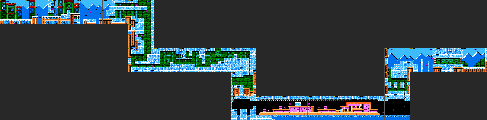
*Blizzard Man's stage, screens 00-18, start at the top left, boss room at the far right.*

### Route

| Scr | Entered by | Content [seen in tour shots / map] |
|---|---|---|
| 00-02 | start, scroll | Snow ledges over blue rock in front of green steel scaffolds with red girders and snowy mountains. Crouching snow robots ($4D) on the ledges; 1-up and big weapon energy at 02 |
| 03 | scroll | **Pit crossed on floating "3" count bombs** ($19) under red propeller drones ($24) [seen: a missed jump is a pit death] |
| 04-05 | scroll | Ice blocks start; ceiling drill turrets ($13); wall-mounted pod ($21); big life energy at 05 (top left) |
| 05 -> 06 -> 07 | down (scripts 01/02/03) | Ice-block shaft. 1-up at 06 **inside a Power-punch block** (type $B at x $40-$5F, y $60-$7F) |
| 07-0B | scroll | Ice cave on green brick: small walker robots ($1E), sliding pink wall cannons ($12). **E-tank at 09** in an alcove that opens through **Flame-Blast ice** (type $D at x $10-$3F, y $40-$5F, from screen 08's side) or a 16-px gap (slide) from the right [code: collision grid]. Big life energy at 0B inside a Power block (x $20-$3F, y $40-$5F) |
| 0B -> 0C -> 0D | down (01, 04) | Second shaft; the giant jester-head turret ($10, HP 15) at 0C. Script 04 sets **checkpoint 1 = screen 0D** (CHR $85, palette $1A) |
| 0D -> 0E | right (flip) | 0D: ice room over water pits (type $F); exit right at floor level |
| 0E-13 | scroll | **The icebreaker ship**: pink/orange deck over the icy sea under an ice ceiling, cannon riders ($20, $1F); the deck **bobs up and down** (IRQ, below). Power blocks on deck (0F, 11), three small life energies at 11, E-tank at 12 |
| 13 -> 14 -> 15 | up (06, 07) | Climb out of the ship (CHR $84 restores the cave tiles, palette $1C, IRQ off) |
| 15-16 | right (19) | Second jester head at 15; bomb pods ($19, $21) at 16 |
| 16 -> 17 -> 18 | shutters | 17 = boss corridor (**checkpoint 2**, `$0684` = 17), 18 = boss room (snowy mountain backdrop, ladder on the right) |

No Beat plate and no Energy Balancer in this stage [code: object list]. No adaptor is required to finish;
Power Rockman opens the two item blocks (06, 0B), Flame Blast or a slide reaches the E-tank at 09.

### Enemies and objects

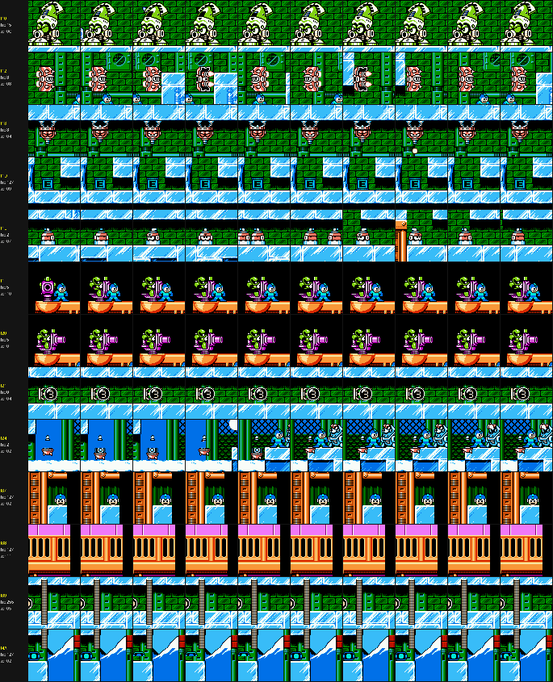
*One row per placed type: the first instance followed for 160 frames (crop every 16 frames), with its HP.*

| Type | n | Where | HP | What it is / does [seen unless tagged] |
|---|---|---|---|---|
| $4D | 4 | 00-02 | 4 | Big ice-blue robot crouching on snow ledges, lobs snowballs ($4E, HP 2) and blocks the ledge [seen] |
| $19 | 16 | 00-04, 12-16 | 0 | **Count bomb**: a round pod showing "3"; when Rockman passes it, its AI goes $8755 -> $87AA -> $8810 -> $8828, the digit counts down and it explodes, then is gone [seen, `bomb.py`]. Used as floating platforms over the pit at 03 and in the climb 13-16 |
| $21 | 3 | 04, 05, 16 | 0 | Sideways version of the "3" pod (same AI $30:$8755), wall-mounted |
| $24 | 5 | 02-06 | 2 | Red propeller drone, flies around; related $26 (HP 3) |
| $13 | 2 | 04, 05 | 3 | Ceiling drill turret, drops $14 pellets |
| $1E | 6 | 07-0B | 2 | Small capped walker on the ice floors (paces x 40-216) |
| $12 | 6 | 08-0B | 3 | Pink twin-barrel wall cannon that slides along the wall and fires |
| $10 | 2 | 0C, 15 | 15 | Giant green-crested jester head (static, 16 hits); throws $11 heads (HP 1) and $16 ice cubes (HP 1). Also used in Centaur's stage |
| $20, $1F | 1+2 | 0F, 10 | 5 | Green robot riding a pink deck cannon; $1F fires $14 shots |
| items | | | | big WE 02, 1-up 02, big HP 05, 1-up 06 (Power block), E-tank 09 (ice), big HP 0B (Power block), 3x small HP 11, E-tank 12 |

### Boss: Blizzard Man (type $90, AI bank $31)

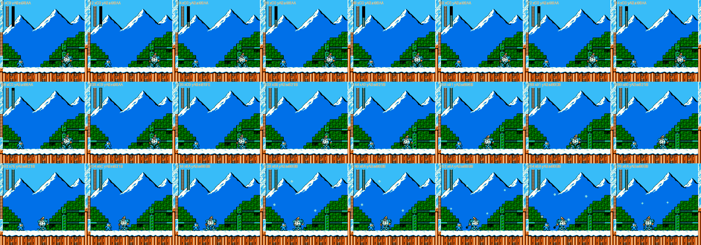
*Blizzard Man with Rockman standing still (godmode), one frame every 12 frames from the end of the intro.*

[seen] He skis toward Rockman on the snow floor and stops, throws Blizzard Attack (four snowflakes, type
$91, falling in a spread), and curls up into a big rolling snowball that crosses the room. Weak to
**F.BLAST (4)**; awards **B.ATTACK**. Room: one screen, snow floor, mountain backdrop.

### Tileset, palettes, music

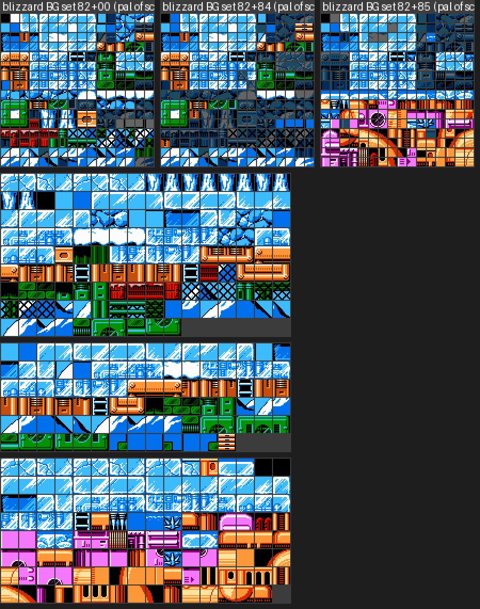
*BG pattern tables of the three configurations (dimmed = not referenced by any metatile on those screens),
then the metatiles each configuration uses.*

| Config | Screens | Tiles $00-$7F | Tiles $80-$FF | Blocks / metatiles / tiles used |
|---|---|---|---|---|
| $82 | 00-0C | bank $12+$0000 | bank $12+$0800 | 124 / 138 / 223 |
| $82+$85 | 0D-13 (ship) | same | **bank $13+$0800** (ship hull, deck, sea, porthole art) | 89 / 127 / 198 |
| $82+$84 | 14-18 | same | bank $12+$0800 again | 107 / 93 / 153 |

Art that exists: ice blocks (plain, cracked, with frozen machinery), snow caps, blue cobble rock, red-girder
steel scaffolds with mesh, snowy mountain skyline, icicles, ladders, green brick and pipe backgrounds; the ship
set (orange hull, pink superstructure, portholes, railings, waves). Palette $15 (blue/cyan, red/brown, green)
for the outdoor part, $1A for the ship (pink/orange), $1C for the climb; normal and revisit palettes are
identical. No palette cycling.

### RAM / IRQ effects

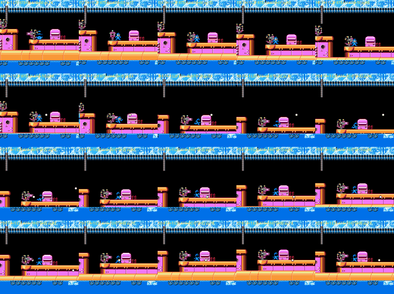
*The ship section with its effect thread running: the deck and hull rise and fall while the ice ceiling
stays put (labels: IRQ latch, `$0673` split position, `$067B` collision offset).*

- **Rocking ship** [code][seen]: script 05 (screen 0D) starts effect thread 3 (`$3E:$D4BF`) when the camera
  reaches 0E. It sets the MMC3 IRQ latch `$0672` = $2F (split at line 47 under the ice ceiling), IRQ chain
  `$0677` = 1 (handler `$C18C`: second split from `$0673`), and moves `$0673` by 1 every other frame between
  9 and $3C (51 px of travel), playing sounds $41/$40 at the turns. `$067B` = `$0673` - 10 is added to
  collision Y inside the band Y $38-$C0 (`$3E:$DA1C`, stage 0 only), and Rockman's Y is moved with the deck
  when he stands on solid or type-6 tiles. Screen 13's script (`$39:$8449`) turns it off (`$F4` = 0,
  `$067B` = 0, palette $1C, kill thread 2).
- No other split in the stage [seen: `irqscan.py`, `$F4` = 0 on every other screen].

---

## 2. Flame Man (stage 3, "OIL FIELD", MASTER OF FLAME)

Map: `img/stagesa_flame_map.png`. Music $03. 24 screens on two BG configurations.

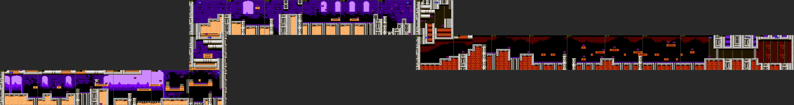
*Flame Man's stage, screens 00-17.*

### Route

| Scr | Entered by | Content |
|---|---|---|
| 00-02 | start (script 18), scroll | Oil field at dusk: purple dunes and arches, steel pipes, wavy orange **oil pools** (types 6/2/9), "DANGER" oil drums. Metalls ($18) on pipes; 1-up at 02 **inside a Power block** (x $80-$9F, y $40-$5F); small life energies |
| 03-05 | scroll | Open oil field under the sky with **Fire Telly drones** ($2C) dropping fire ($30) [seen]; spike strips (type $F); big life energy at 05 |
| 05 -> 06 -> 07 | up (0D, 07, 08) | Pipe shaft with green wheel cannons ($C0, $C9) |
| 07-0C | scroll | Purple brick refinery with arches; dome turrets in the walls ($2B); more Fire Tellies; big life energy at 08 |
| 0C-0D, 0D -> 0E | scroll, down (0E) | Screen 0C's script init (`$39:$849B`) loads palette $1F and queues CHR set $87 for the next screen change. **Checkpoint 1 = 0E** (CHR $87, palette $1F); wheel cannons at 0D |
| 0E-15 | scroll | **Burning oil cave**: dark red rock with flames, oil channels, small orange platforms over the oil, green fire-juggling robots ($2A) and walking mines ($73). Big life energy and E-tank at 12 |
| 15 -> 16 -> 17 | shutters | 16 corridor (**checkpoint 2**), 17 boss room (red pistons, oil-pipe floor) |

No Beat plate and no Energy Balancer [code]. Nothing is adaptor-gated except the 1-up block at 02 (Power).

### Enemies and objects

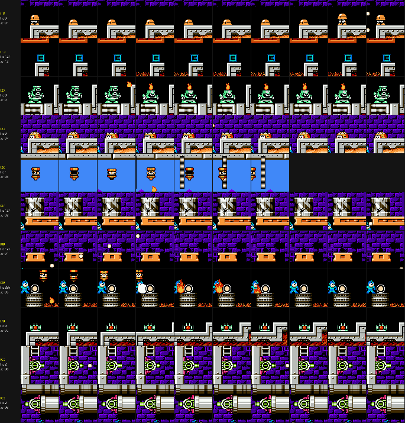
*Flame Man's stage enemies (first instance of each placed type).*

| Type | n | Where | HP | What it is / does |
|---|---|---|---|---|
| $18 | 3 | 01, 02 | 0 | Metall (hard hat): hides, peeks, fires $14 [seen] |
| $2C | 13 | 03-05, 0A-0C | 1 | Fire Telly-style canister drone: drifts across the sky and drops $30 fireballs that burn on the ground for a moment [seen] |
| $30 | 3 | 02, 07, 0C (Y=$FF) | 2 | The fire drop; placed at Y=$FF it falls from the top of the screen [guess] |
| $2B | 6 | 07-0B | 0 | Dome turret peeking out of the brick/oil wall, fires $2E [seen] |
| $C0, $C9 | 3+2 | 06, 0D | 2 | Green wheel cannon mounted on pipes (floor / wall), fires $14 [seen] |
| $73 | 4 | 0E-13 | 0 | Small walking mine with a red light (paces x 169-214) [seen] |
| $2A | 10 | 0F-15 | 3 | Green stocky robot that juggles a flame on its head and throws it ($2F, HP 2); also spawns $48, a ring [seen] |
| $44 | 1 | 00 (Y=$01) | 0 | Special object in slot 6 (AI $3B:$99FC); [guess] stage helper (oil/fire handler) |
| items | | | | small HP 01, 1-up 02 (Power block), small HP 02, big HP 05, big HP 08, big HP 12, E-tank 12 |

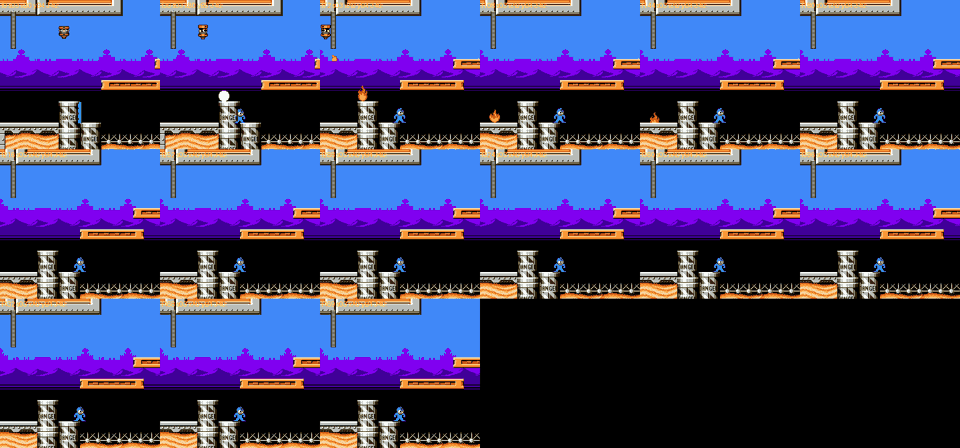
*Screen 03: a Fire Telly drops a fireball that burns on the floor beside the "DANGER" drums and the spike
strip.*

### Boss: Flame Man (type $9C)

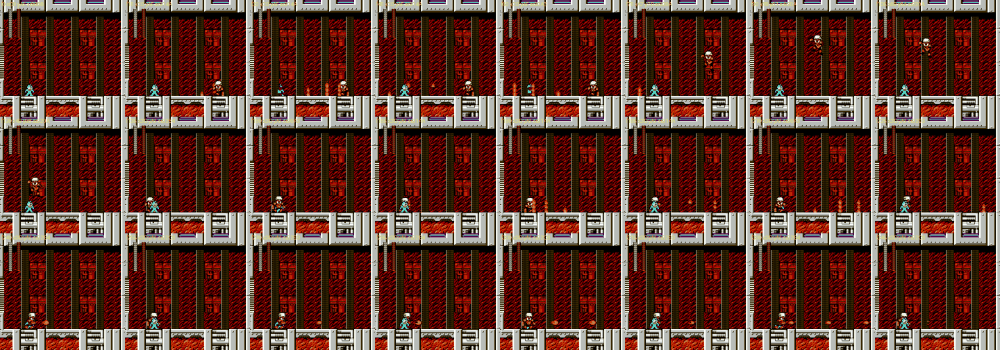
*Flame Man's pattern with Rockman idle.*

[seen] Fires shots along the floor that rise into **pillars of fire** ($9E), then jumps high across the room
and lands near Rockman; repeats. Weak to **W.STORM (4)**; awards **F.BLAST + RUSH POWER**.

### Tileset, palettes, music

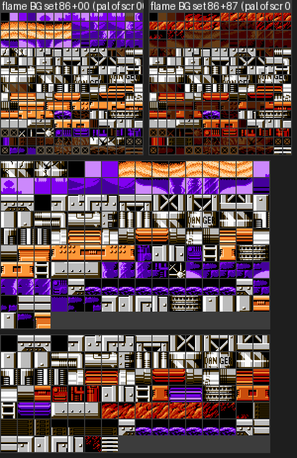
*Flame's BG pattern tables (base, and with set $87) and the metatiles used.*

| Config | Screens | Tiles | Blocks / metatiles / tiles used |
|---|---|---|---|
| $86 | 00-0C | bank $13+$1000 (256) | 157 / 147 / 221 |
| $86+$87 | 0D-17 | tiles $04-$23 replaced by bank $14+$0000 (32 tiles: red rock / fire) | 128 / 103 / 166 |

Art that exists: steel pipes and pipe joints, riveted grey girders, "DANGER" drums, wavy oil (animated by
palette), purple desert dunes and arches, purple brick refinery walls with arched windows, spike strips,
ladders, red cave rock with flame tufts, boss-room pistons. Palette $1E; **palette cycling** (effect thread 4,
`$3B:$90FC`, started by scripts 18/0E/26): palettes $22 -> $23 -> $24 every 8 frames rotate BG palette 2
(colours $27/$17/$06), the oil shimmer. Revisit palettes identical.

### RAM / IRQ effects

- No raster split [seen: `$F4` = 0 on every screen]. Effects are the palette cycle above and the oil
  collision types (splash sound/object, lower jump from type 9).
- **The oil ignites (added by critic)** [code][seen]: the oil *surface* metatiles (collision 2, ids
  $98-$A6...) have alternates with **collision $F (deadly)** and flame tiles $E6-$E9. When a fire
  projectile lands on type 2 (the Fire Telly drop `$30`: `$30:$94A1`; the juggler's thrown flame `$2F`:
  `$30:$8FA9`) it calls `$3E:$DDFC`, which sets the `$0340` bit of that metatile id, repaints the column and
  starts effect thread 4. Because the flag is per metatile id, **every oil tile with that id catches fire at
  once**, and like a broken block it stays lit through deaths until the stage is started again [code, per
  the `$0340` rule in `fortress.md`]. On an ordinary solid floor the drop just burns for
  about 1 s ($83/$84/$C3 animations). Walking on oil: 0.5 px/frame (`$38:$8BF6`) instead of 1.3.
  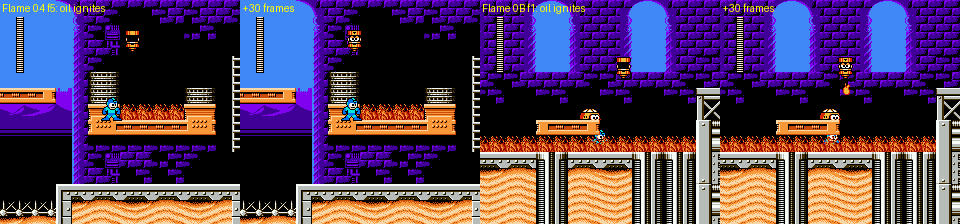
  *Flame screens 04 and 0B: a Fire Telly's drop lands on oil, and that oil metatile id flips to its
  burning alternate (`$0340` bits for $9C and $A4).*

---

## 3. Knight Man (stage 6, "CAPITAL OF SCIENCE", MASTER OF MACE BALL)

Map: `img/stagesa_knight_map.png`. Music $07. 27 screens; the castle uses one BG set ($9E) all the way;
set $61 (exit of screen 02) adds 80 **sprite** tiles at PPU $1A00 for the castle's enemies.

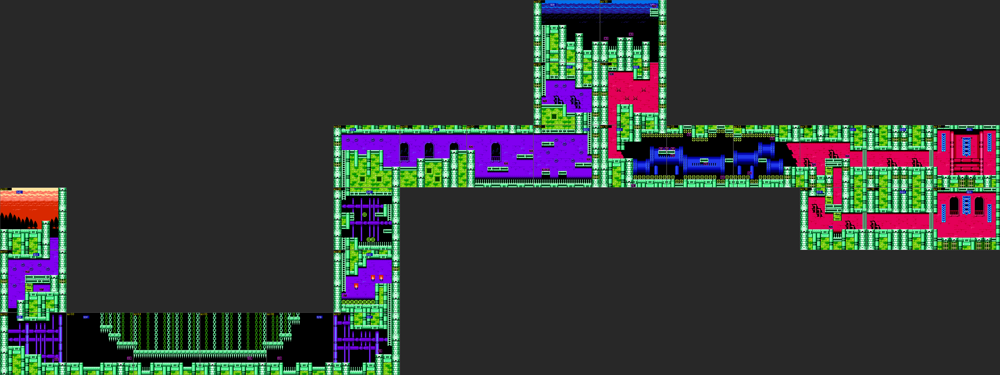
*Knight Man's stage. The bottom-right branch (18-1A) is the Beat-plate route.*

### Route

| Scr | Entered by | Content |
|---|---|---|
| 00 -> 01 -> 02 | start (script 42), down, down | Drop down a castle tower under a red sunset sky; green stone, purple walls. 1-up at 01 next to a **Power block** (x $60-$7F, y $80-$9F; the 1-up is at x $9F, so [guess] the block closes its alcove) and an armadillo robot ($29) |
| 02 -> 03 | right (36; loads sprite set $61) | Into the castle |
| 03-06 | scroll | **Descending spiked ceiling**: spiked platforms on chains lower from the top (IRQ split, below) while lance knights ($6E) attack; palette cycling (thread $0B: palettes $75-$77) |
| 06 -> 07 | right | |
| 07 -> 08 -> 09 -> 0A | up (07, 43, 43, 08) | Tower climb past **wall torches** whose flames are animated by loading CHR sets $9F/$A0/$A1 (4 tiles at PPU $0F40) every 4 frames (`$39:$888A`); the green ring blocks on the floors of 08-09 are type $D (Flame Blast) [code] |
| 0A-0D | scroll | **Checkpoint 1 = 0B** (script 51, palette $78); hexagon pods ($3D); two small life energies at 0D |
| 0D -> 0E -> 0F | up | Red spearman ($70) |
| 0F-10, 10 -> 11 -> 12 | scroll, down (40 pal $82, 68 pal $CD) | E-tank high up at 10 (y $17); bird riders ($C6) |
| 12-15 | scroll | Blue machine hall with pipes; blue-section enemies ($75, $2D, $3A); small life energies |
| 15 -> 16 -> 17 | shutter | Normal route: walk over the arch platform in 15 (the shaft runs underneath) to the shutter. 16 corridor (**checkpoint 2**), 17 boss room (red hall, blue banners) |
| 15 -> 18 -> 19 -> 1A | down (41, target 17 -> 18), shutters | **Plate route**: the shaft at x $80-$9F of 15 runs under the arch platform and is entered from the dip at x $40-$5F through a **Power block pillar** (x $60-$7F, y $A0-$BF). In 18 two more Power blocks wall the way (x $60-$7F, y $20-$3F beside the landing ledge, and x $80-$9F, y $60-$7F over a spike pit); 19 corridor, **1A boss room = BEAT A-PARTS** |

Plate A therefore needs **Power Rockman** (Flame Man beaten), and specifically the **charged** punch [seen,
`kn18.py` from `stagesa_knight15.state`]: in the dip of 15, tapped punches leave the pillar intact; a punch
released after holding B for 100 frames sets a `$0340` bit, the pillar disappears and walking right drops
Rockman into screen 18 (landing at x $98, y $34). The same input in normal form does nothing. The two
walls in 18 are the same block type [code].

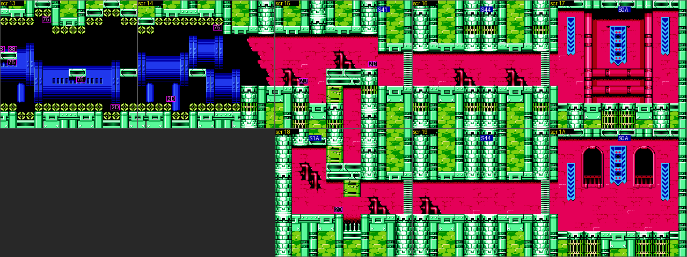
*Knight screens 13-1A: the normal route along the top (15 -> 16 -> 17) and the plate route below (18 ->
19 -> 1A), with the green Power blocks in 15 and 18.*

### Enemies and objects

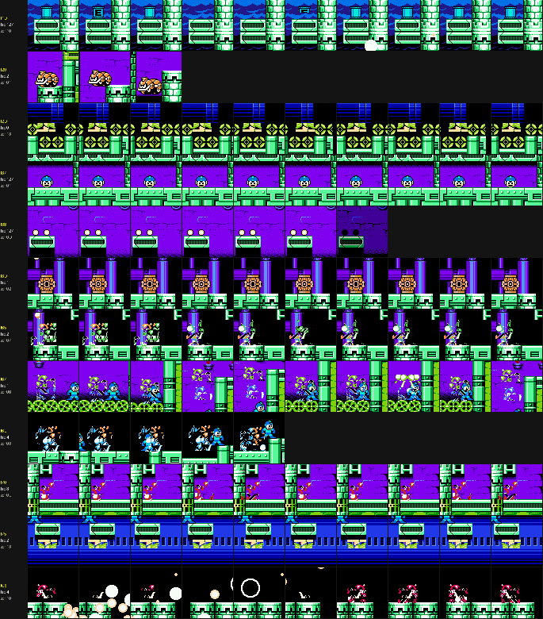
*Knight Man's stage enemies (first instance of each placed type).*

| Type | n | Where | HP | What it is / does |
|---|---|---|---|---|
| $29 | 1 | 01 | 2 | Orange armadillo robot that rolls/drops down the tower (y 181-247) [seen] |
| $3D | 5 | 02, 0C, 0D | 1 | Orange hexagon pod on the floor; spawns $3E (HP 1) [seen] |
| $6E | 3 | 03, 05, 06 | 4 | Blue lance knight: jumps and thrusts (x 108-197) [seen] |
| $65 | 1 | 07 | 2 | Green skeleton-like robot; throws $68 [seen] |
| $67 | 1 | 08 | 1 | Green robot that swoops along the stairs (x 79-143, y 138-175) [seen] |
| $70 | 1 | 0E | 3 | Red spearman standing guard (also in Centaur's stage) [seen] |
| $C6 | 2 | 10 | 4 | Red rider that throws white balls ($C8) [seen] |
| $75 | 4 | 13, 14 | 2 | Blue-hall enemy on the platforms; spawns $2D [seen] |
| $2D | 5 | 13-15, 18 | 0 | (AI $30:$953B) [guess: falling block / crusher piece] |
| $3A | - | 14, 15, 18 | 2 | Spiked mine with a red light (spawned) [seen] |
| $3C, $AF | 1+1 | 11, 12 (Y=$F2) | | Not seen in the tour [guess: generators] |
| items | | | | 1-up 01 (beside a Power block), 2x small HP 0D, E-tank 10 (high), small HP 12, 2x small HP 13 |

### Boss: Knight Man (type $95)

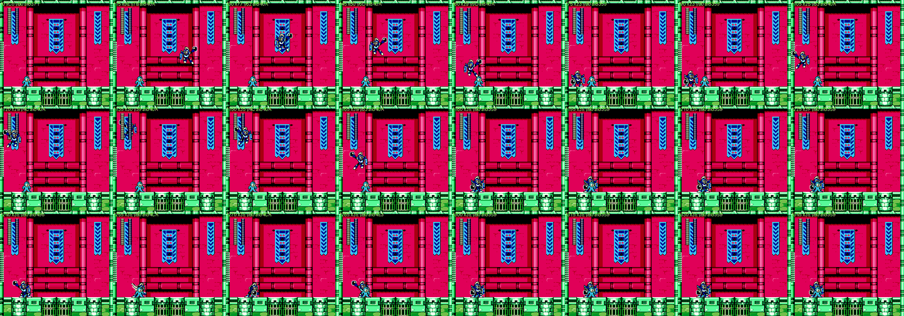
*Knight Man with Rockman idle.*

[seen] High jumps toward Rockman, swings the mace on its chain (type $96) across the floor, and holds his
shield up between attacks. Weak to **Y.SPEAR (4)**; awards **KNIGHT.C** (+ BEAT A-PARTS in room 1A).

### Tileset, palettes, music

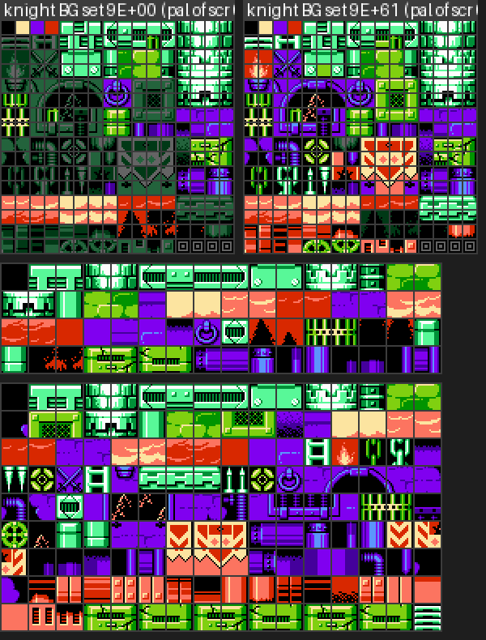
*Knight's BG pattern table ($9E; only screens 00-02 use it without sprite set $61, which does not touch BG)
and the metatiles used.*

One BG set **$9E** (bank $15+$0000) for all 27 screens: 255 blocks, 155 metatiles, 240 of 256 tiles used
(only 16 unused). Art that exists: green stone castle walls and battlements, purple and red hall walls with
cracks, arched windows, chains, spiked chandeliers/ceilings, blue banners, the blue machine hall (pipes,
grilles), gates and portcullises, ladders. Palette $74 (green/olive, orange, purple, red); later
$78/$82/$CD/$7B by exits. **Revisit palettes differ** ($74 -> greens become orange/brown, $78/$7B shift):
a free alternate colour scheme. Palette cycling on 03-06 and 08-09 (thread $0B: $75/$76/$77 every 8 frames,
BG palette 3).

### RAM / IRQ effects

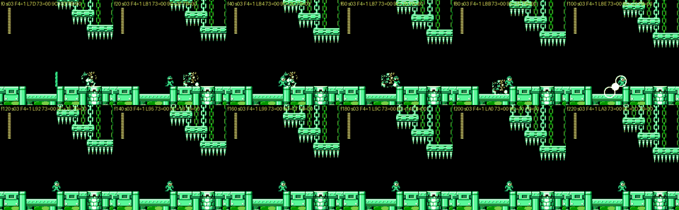
*Screen 03: the spiked ceiling lowers frame by frame (labels show the IRQ latch rising).*

- **Descending spike ceiling** [seen][code]: script 3F's init (`$39:$8833`) sets `$069C` = 0, IRQ chain
  `$0677` = $11 (handler `$C337`), latch `$0672` = $B0, `$F4` = 1, and starts the palette thread. The latch
  climbs ($7D -> $A3 in 220 frames) while `$069C` counts down: the upper split (spiked platforms on chains)
  is scrolled down over the hall. Collision follows it: for stage 6 the code adds `$069C` to Y for points
  above the latch (`$3E:$DA40`).
- **CHR animation** on 08-09 (sets $9F-$A1 cycled every 4 frames).

---

## 4. Centaur Man (stage 7, "ANCIENT CITY", ABILITY UNKNOWN)

Map: `img/stagesa_centaur_map.png`. Music $05. 27 screens, one BG set ($AA) all the way.

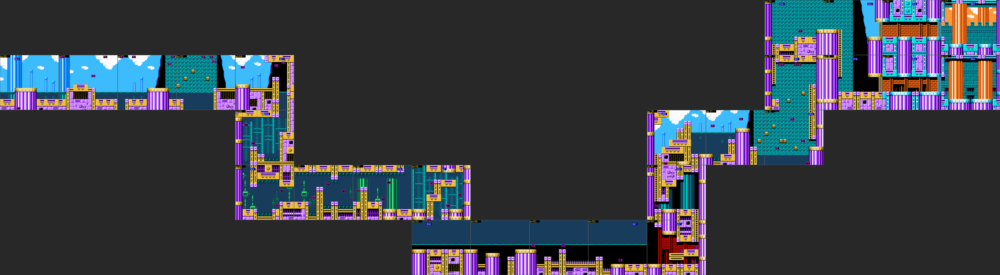
*Centaur Man's stage. Two boss rooms on the right: 17 (top, T plate) and 1A (bottom).*

### Route

| Scr | Entered by | Content |
|---|---|---|
| 00-04 | start (script 5A), scroll | Ruins under a bright sky with clouds: purple fluted columns with gold capitals. Cloud spawners ($A9) release pelican-like bomber birds ($AB) |
| 04 -> 05 -> 06 | down (01, 59) | Down into flooded ruins: **water** (type 8) with piranha robots ($C1) and wall cannons ($C9) |
| 06-09 | scroll | Underwater corridor (palette $A7) |
| 09 -> 0A | right (02) | **Checkpoint 1 = 0A** |
| 0A-0D | scroll | **Moving water surface** (IRQ split, below); seahorse robots ($C4) in the water |
| 0D -> 0E -> 0F -> 10 | right (57, pal $CA), up (07, 5C) | Waterfall room with dome turrets ($2B), big life energy, red spearman ($70) |
| 10-12 | scroll | Waterfall wall enemies ($A5) |
| 12 -> 13 -> 14 -> 15 | up (0D, 07, 19), right | Cloud spawners again, jester head ($10) at 14 |
| 15 -> 16 -> 17 | shutter | **Rush Jet route**: cross the 112-px gap of screen 15 (from the floor at x $00-$3F, y $80 to the floor at x $C0-$FF, y $A0) to reach the shutter; 16 corridor, **17 boss room = BEAT T-PARTS** (orange sky, battlements) |
| 15 -> 18 -> 19 -> 1A | down (5E, target 17 -> 18), shutter | Falling into the gap leads down to 18 (back exit up* -> 15), 19 corridor (**checkpoint 2** in the scout's state), **1A boss room** (no plate) |

The gap in 15 is 7 metatiles wide with the far floor 32 px lower [code: collision grid]. So plate T needs
**Rush Jet** (Plant Man beaten) [seen, `cross.py` from `stagesa_centaur15_left.state`]: in normal form every
jump (A held 6-130 frames, with or without a run-up) falls into 18; as Jet Rockman, holding A for 100+
frames while holding RIGHT hovers across and reaches screen 16 (the shutter route to room 17).

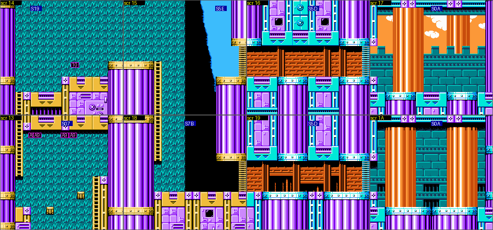
*Centaur screens 14-1A: the gap in 15, the upper route 16 -> 17 and the lower route 18 -> 19 -> 1A.*

### Enemies and objects

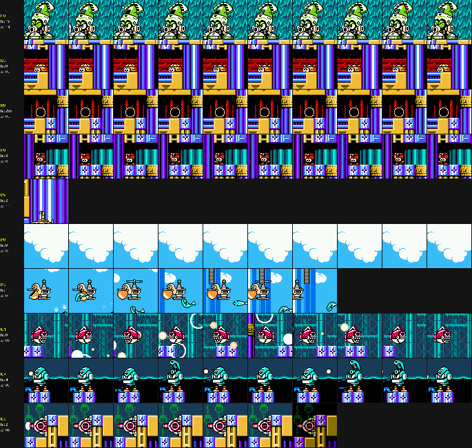
*Centaur Man's stage enemies (first instance of each placed type).*

| Type | n | Where | HP | What it is / does |
|---|---|---|---|---|
| $A9 | 12 | 01-04, 13 | 0 | Invisible spawner in the clouds; releases $AB / $AC / $AD / $17 [seen] |
| $AB | 5 | 01-04 | 1 | Pelican-like bird robot carrying a turret, drops things ($AC, $AD fish) [seen] |
| $C1 | 10 | 05-09 | 0 | Red piranha robot swimming (x 39-129), bubbles $08 [seen] |
| $C9 | 4 | 06-09 | 2 | Wall pipe cannon (same type as Flame's) [seen] |
| $C4 | 3 | 0C, 0D | 4 | Cyan seahorse robot in the water, fires $14 and $CC (HP 2) [seen] |
| $2B | 2 | 0E | 0 | Dome turret in the wall (same as Flame's) [seen] |
| $70 | 1 | 0F | 3 | Red spearman (same as Knight's) [seen] |
| $A5 | 5 | 11, 12 | 2 | Waterfall enemy, falls with the water (y 139-245), spawns $A6 [seen] |
| $10 | 1 | 14 | 15 | Giant jester head (same as Blizzard's) [seen] |
| $72 | 4 | 00, 0A, 10, 12 | 0 | Not seen in the tour; Y = $00/$FF [guess: spawner] |
| items | | | | big HP 0E (the only item in the stage) |

### Boss: Centaur Man (type $9B)

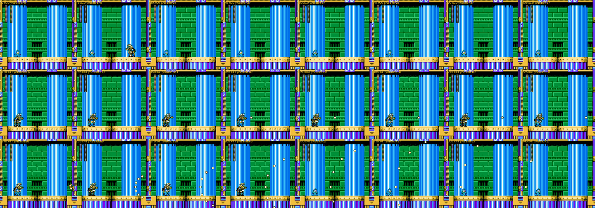
*Centaur Man with Rockman idle (room 1A).*

[seen] Teleports (vanishes and reappears next to Rockman), fires a shot that bursts into a spread of
pellets, and uses Centaur Flash (screen flash). Weak to **KNIGHT.C (4)**; awards **C.FLASH** (+ BEAT T-PARTS
in room 17).

### Tileset, palettes, music

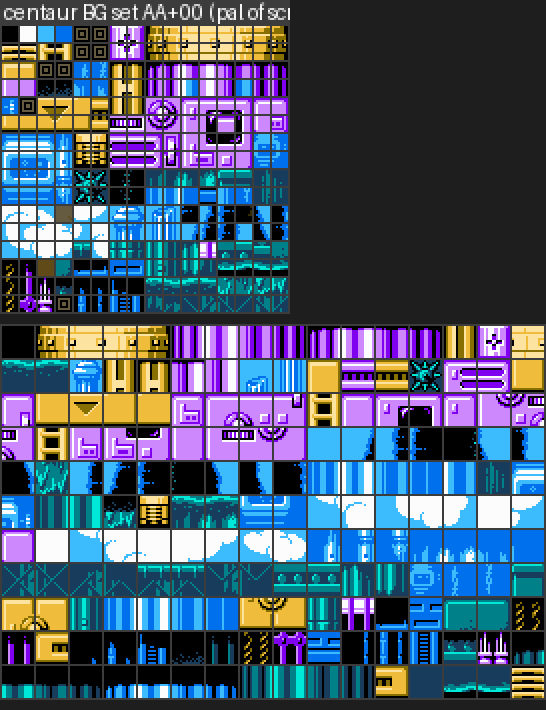
*Centaur's BG pattern table ($AA) and the metatiles used.*

One BG set **$AA** (bank $1A+$1000): 250 blocks, 176 metatiles, 245 of 256 tiles used. 32 tiles change at
runtime (`v2.py` found 32 differing tiles at checkpoint 1) [guess: animated water]. Art that exists: purple
fluted columns with gold capitals and bases, gold lintels with triangles, sky and clouds, water (surface and
body), waterfalls, teal stonework, red/orange castle (boss room 17: orange sky, battlements, round towers),
ladders. Palette $A6, then $A7/$A8/$CA/$A9 by exits, $B8 for the boss corridors. **Revisit palettes differ**
($A6: gold becomes orange-brown, the blue tones grey).

### RAM / IRQ effects

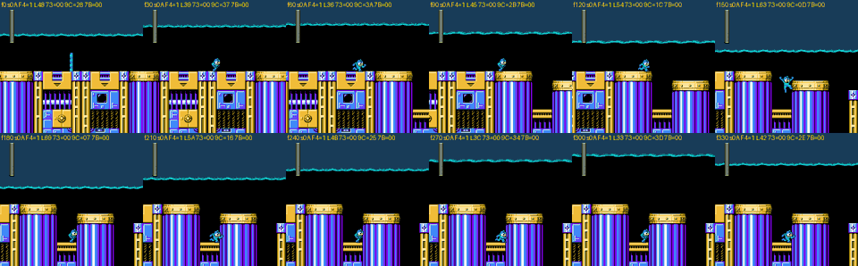
*Screen 0A: the water surface rises and falls (labels show the IRQ latch).*

- **Tide** [seen][code]: script 5B's init (`$39:$8A70`, screen 0A) sets `$069C` = 3, latch `$0672` = $6D,
  IRQ chain `$0677` = $14 (handler `$3E:$C3D8`), `$F4` = 1, starts effect thread $10, and sets **checkpoint 1
  = 0A** (`LDA #$0A / JMP $8416`). The handler re-points the PPU at nametable $2800 (the water layer) for the
  rest of the frame and moves `$069C` by 1 every other frame between 3 and $40, so the water surface rises and
  falls about 60 px (the latch was seen between $33 and $69). For stage 7 the collision of points above the
  split is offset by `$069C` (`$3E:$DA56`).

---

## Lessons for Rockman 6 GP

Technical:
- **Reusing a tileset is cheap, reusing its blocks is not.** All four stages use 250-255 of their 256 block
  ids (metatiles 155-245 of 256, tiles 223-245 of 256 on the busiest configuration). A redesign that keeps a
  stage's CHR and metatiles can rewrite the layout freely, but new block shapes have to replace unused ones
  or reuse existing 32x32 combinations; budget block ids early. Knight and Centaur share one metatile bank
  ($2D, pages $80 and $89) and the alternate set at $9B00, so changing one can break the other.
- **The layout is a fixed 8 x 256 array** (32 screens). Vertical shafts are just consecutive screens joined by
  `up`/`down` exits, so a GP stage can mix horizontal and vertical freely, but the 32-screen cap includes
  both routes of a branching stage (Knight and Centaur already use 27).
- **Exits own CHR and palettes**: the extra CHR set and the partial palette ids ride on the screen-script exits
  and checkpoints snapshot them. New areas with different art (Blizzard's ship, Flame's red cave) cost one
  exit entry plus a CHR set; remember the back exit that restores the previous set.
- **Alternate exits are just data**: a forward exit with a target byte (`down >17` = go to 18) plus the plate
  table `$3F:$F518` (boss screen that grants the plate). GP can add branches to any stage by adding a second
  boss room and a table entry (stages 0-3 have $FF there today).
- **Gating uses three mechanisms**: collision type $B (Power charged punch), type $D (Flame Blast) and pure
  geometry (a gap only Rush Jet crosses). All three need no code to reuse: place the metatiles.
  The breakable metatiles redraw from the shared alternate set, so the "broken" look must exist there.
- **Raster gimmicks are per-stage special cases**: the ship ($3E:$D4BF), the spike ceiling ($39:$8833 + IRQ
  chain $11) and the tide ($39:$8A70 + chain $14) all work by an IRQ split plus a collision offset that
  `$3E:$DA1C-$DA6A` applies **only for stage ids 0, 6 and 7**. Moving one of these gimmicks to another stage
  (or adding a new one) means extending that stage check; the IRQ handler chain table at `$3E:$C116` has
  ~~24~~ **27 entries ($00-$1A; corrected by critic, see `engine.md` 4.2)** to pick from.
- **Stage effect threads are a generic hook** (`LDX #n / JSR $C5C7`, thread 2): palette cyclers are pure data
  at `$3B:$9143` (delay + palette id list), so new animated palettes (lava, water, alarms) are cheap.
- **Revisit palettes** (bank $28, used when `$06A0` = stage cleared) already give Knight and Centaur a second
  colour scheme: GP can use that for night/alt versions of a reused stage without new data.
- **Warp caveat for testers**: respawning on a non-checkpoint screen beams Rockman in at x $80, which can be
  over a pit (Centaur 15, Knight 15); and checkpoint palette id 0 really loads palette 0. Use real
  checkpoints, or the autoplayer from one, to reach a screen.

Design:
- Vanilla's routes in this half are short and linear (24-27 screens, 2 vertical shafts each) with one
  signature gimmick per stage, placed after checkpoint 1 (ship, burning oil cave, spike ceiling, tide).
  That leaves room in GP for a second gimmick in the first half of each stage.
- Items are generous in Blizzard (10 items, two E-tanks), moderate in Flame and Knight (7 each, one E-tank)
  and nearly absent in Centaur (one big life energy). Three items (two 1-ups, one big life energy) sit inside
  Power blocks and one E-tank behind Flame-Blast ice: rewards for revisiting with new tools are an
  established vanilla pattern.
- The plate routes are cheap side doors near the end of the stage (one screen before the boss), with the
  boss duplicated in a second room. For GP, branching earlier (and giving the branch its own art via an
  exit CHR set) would make the alternate exits feel like real alternate stages.
- Enemies are recycled across stages (jester head $10 in Blizzard and Centaur, wall cannons $C9 in Flame and
  Centaur, dome turret $2B in Flame and Centaur, red spearman $70 in Knight and Centaur): a redesigned
  stage can borrow any of these as long as their sprite CHR set is queued for the screen.

## Open points

- Enemy names are descriptive, not official; several spawner/helper types ($44 Flame, $72 Centaur, $3C/$AF
  Knight, $2D Knight) were never seen on screen and are tagged [guess].
- Collision types 2/6/7/9 (oil, special floors) were read from code paths, not tested one by one.
- Knight's second and third Power walls (screen 18) and the screen 18 spike pit were read from the collision
  grid; only the first wall (screen 15) was broken in the emulator.
- Boss patterns are described from idle-Rockman recordings; their reactions to shooting or jumping (Knight's
  shield blocking, Centaur's teleport timing) were not studied.

## Scripts and states

- `tools/analysis/rm6/rm6_stagemap.py`: stage decoder, route walker (cumulative palettes, CHR per screen,
  exits), stitched map renderer, collision grid, object lists, screen scripts.
- `build/research/rm6/rm6-stages-a/`: `dmg.py` (boss damage), `pbtest.py`, `pwtest.py`, `bosswatch.py`,
  `census.py`, `strips.py`, `items.py`, `tiles.py`, `irqscan.py`, `fxwatch.py`, `ship.py`, `bomb.py`,
  `act.py`/`act2.py`, `cross.py`, `kn18.py`, `altroute*.py`, `mkimg.py`; JSON outputs `dmg_*.json`,
  `census_*.json`, `strips_*.json`, `tiles_*.json`.
- New states in `build/research/rm6/states/`: `stagesa_centaur15_left.state` (Jet Rockman on the left floor of
  Centaur screen 15, before the gap), `stagesa_knight15.state` (Power Rockman at the left of Knight screen
  15, before the Power pillar).
