# Rockman 6 (J) stages, part B: Plant Man, Tomahawk Man, Wind Man, Yamato Man (rm6-stages-b)

Status: **v2 (final for this run)**. Maps, routes, enemies, alternate exits, checkpoints, bosses (patterns, measured damage, awards),
tilesets and raster effects are covered for all four stages. Tags: **[seen]** emulator, **[code]** disassembly or
ROM data, **[text]** in-game text, **[guess]** unverified.

Tools written for this work (in `build/research/rm6/rm6-stages-b/`, run from the repo root with `python3 -I`):

| Script | What it does |
|---|---|
| `lv.py` | static level decoder: layout, 32x32 blocks, 16x16 tiles, CHR-set loader, palette loader, screen scripts, screen renderer, collision overlay |
| `tools/analysis/rm6/rm6_level.py` | the same decoder published for other agents (self-contained copy of `lv.py`) |
| `geom.py` | builds the screen graph from the screen scripts (scroll modes, exits, shutters) and renders a whole stage (`geom.py map 1 2 4 5`) |
| `cgrid.py` | prints a screen's collision as a 16x15 text grid (`.` air, `#` solid, `4` ladder, `3` ladder top, `B` breakable, `F` spikes) |
| `objdump.py` | dumps every stage's object list (bank $3A) to `objlists.json` |
| `census.py`, `strips.py`, `sheet.py`, `behav.py` | RAM-warp to each screen, list spawned objects (type, HP, AI pointer), isolate each sprite (remove-and-diff), record behaviour strips, 300-frame motion traces |
| `bossprep.py`, `fight.py` | savestates: shutter corridor, boss intro, fight start (HP full) for the four bosses and both plate rooms |
| `dmg.py` | damage per weapon: equips the weapon through the pause menu, glues the boss to the player's shot, logs every HP drop |
| `bosswatch.py`, `award.py` | 12-second boss pattern watch; kill the boss and record the award screen and flags |
| `alt*.py`, `altx.py` | alternate-exit experiments (teleport + macro, or Go-Explore per form) |
| `tiles.py`, `irqscan.py` | tileset sheets per CHR/palette state; per-screen scan of the MMC3 IRQ split |

New savestates (all in the scratch dir): `shutter_<b>.state`, `bossintro_<b>.state`, `fight_<b>.state` for
b = plant, wind, yamato, yamato_alt (room 1D), tomahawk, tomahawk_alt (room 1F); `altx_y0B_j.state` (Yamato plate
route, screen 18, Jet).

## 1. How a stage is stored (applies to all four)

The decoder was checked by rendering screens from ROM data and comparing them with the live PPU: CHR-RAM matched
byte for byte and the palettes matched on every screen tested [seen].

### Per-stage table (fixed bank $3E, indexed by `$51`) [code] $3E:$DBDB-$DC1C

| Stage | $51 | layout: bank `$6F` at $A000, page `$53` | tileset: bank `$6E` at $8000, 16x16 base `$63`, 32x32 base `$67` | base BG CHR set `$064E` | start palette | music id (`$DC`) |
|---|---|---|---|---|---|---|
| Wind | 1 | $32, $A800 | $2C, $80, $85 | $83 = bank $12 +$1000 (file 0x25010) | $17 | $00 |
| Plant | 2 | $32, $B000 | $2E, $92, $97 | $90 = bank $16 +$0000 (0x2C010) | $32 | $04 |
| Yamato | 4 | $33, $A000 | $2E, $89, $8E | $97 = bank $17 +$1000 (0x2F010) | $57 | $02 |
| Tomahawk | 5 | $33, $A800 | $2C, $89, $8E | $94 = bank $16 +$1000 (0x2D010) | $50 | $06 |

### Layout, blocks, tiles

- **Layout**: 2 KB per stage, 8 rows x 256 bytes. The byte for block row r, column c is at `$53+r : c`, where
  c = screen*8 + x/32. Each byte is a 32x32 block id. A stage is therefore **one linear strip of up to 32
  screens** ($00-$1F) of 8 x 7.5 blocks. Vertical sections are not a 2D grid: going up or down simply moves to
  another screen index, and the screen scripts say in which direction it is entered [code] $3E:$D904, $DA6C.
- **32x32 blocks**: in the tileset bank at `$67<<8 + id*4`, four 16x16 tile ids (TL, TR, BL, BR).
- **16x16 tiles**: five 256-byte pages from `$63`: CHR tile TL, TR, BL, BR, then an attribute byte (bits 0-1
  palette, bits 4-7 collision) [code] $3E:$D288-$D2E5. Banks $2C (Wind, Tomahawk) and $2E (Blizzard, Yamato,
  Plant) hold three stage sets each, so a stage never shares 16x16 or 32x32 definitions with its bank-mates.
- **Alternate tiles**: pages $9B-$9F of the tileset bank are a second graphics + attribute set for every tile
  id. A tile id is drawn from it when its bit is set in the 256-bit array `$0340-$035F` [code] $3E:$D2B2,
  $DAC6. This is how **breakable blocks vanish**: each breakable 32x32 block uses four tile ids of its own whose
  alternate is empty air, and breaking it sets those four bits ($38:$8D9D -> `$80` -> $3E:$DB98). [seen] the
  charged Power punch on Yamato screen 02 set bits $38-$3B. Boss shutters use the same mechanism.
- **Collision** nibble, remapped per stage by $3E:$DB13 (selected by $DB03): Plant 5->$11, $D->$1F, $E->$10;
  Yamato/Tomahawk 5->$13, 7->$15, 9->$17, $D->$19; Wind unchanged. Odd values are solid (`AND #1`, $38:$8312).
  Seen in the overlays: 0 air, 1 solid, 3 ladder top, 4 ladder, **$B breakable** (also tested as $1B,
  $38:$8D67), **$A updraft (Wind)**, $C fan base (Wind), $F spikes. The few 5/6/7/9/$D tiles are stage
  specials (Plant 6/7: the spike-flower beds on screen 0B) [seen overlay], meaning not pinned down.
- **CHR sets** (bank $37 table at $8000, 4 bytes: tile count (0 = 256), PPU address / 16, source tile index,
  bank) [code] $3E:$C95C. A stage loads one 4 KB BG set into $0000-$0FFF; screen exits and script inits overwrite
  parts of it later (tables per stage below). Sprites live in $1000-$1FFF.
- **Palettes** (bank $37, or bank $28 when the stage was already cleared, `$06A0`) [code] $3E:$C9EF: pointer
  table $9000/$9100; data = start index into the `$0360` buffer, then colours (bit 6 = insert $0F first, bit
  7 = last). These are partial updates, so a screen's palette is the start palette plus every update on the way.
- **Object list** (bank $3A, pointer table $80BF/$80CF, four parallel arrays: screen, X, Y, type). Type `$80` is
  a **screen script** (its Y byte is the script id). Items: `$37` 1-up, `$38` small energy, `$39` large energy,
  `$49` small weapon energy, `$4A` large weapon energy, `$1D` E-tank, `$8A` Energy Balancer [seen].
- **Screen scripts** (bank $39, pointers $82EB/$836B) [code] $39:$824D: `[init hi lo] mode [per-frame hi lo]
  {exit type, CHR set, palette, [$80|target]} 0`. `mode` bit 0 = the camera may scroll right into the next screen,
  bit 1 = may scroll left ($3E:$DCFC, $DD5A), 0 = locked. Exit types (handlers $39:$9A88): 1 down to target+1,
  2 up to target+1 (needs the ladder state `$94` = 4 and Y < $0B), 3 down to target-1, 4 up to target-1,
  5 right (X >= $F0) to target+1, 6 left (X < $11) to target-1. The target defaults to the current screen; an
  explicit target is how a branch jumps to the high screen numbers ($18-$1F) where the alternate routes live
  [seen] teleport tests: Yamato 02 right (target $0B) -> $0C, Yamato 09 down (target $0E) -> $0F, Tomahawk 13
  right (target $1C) -> $1D, Tomahawk 13 left (target $1D) -> $1C, Tomahawk 1C right (target $12) -> $13.
  Per-frame routines $8480 / $848E are boss shutters 1 / 2, script $0A is the boss room, and `LDA #s / JMP $8416`
  sets checkpoint s. An init routine can do anything: load CHR or palettes, start an IRQ split, spawn a mid-boss
  and wait for it.
- **Kill rule**: an object dies when its HP byte goes negative, so HP n takes n+1 buster shots. HP $7F = item
  or invulnerable part.

## 2. Summary of the four stages

| | Plant Man | Tomahawk Man | Wind Man | Yamato Man |
|---|---|---|---|---|
| Screens used | 00-17 | 00-17 + 18-1F | 00-15 | 00-17 + 18-1D |
| Mid-stage checkpoint [code][seen] | 09 (set in both gorilla rooms 08 and 0E) | 0A (sunset, script $21 init) | 08 | 0A (set on 09) |
| Boss shutter checkpoint | 16 | 16 (plate route 1E) | 14 | 16 (plate route 1C) |
| Alternate exit | none | **B plate** room 1F via the right-hand ladder of 12 and 13's right edge (no adaptor); **Energy Balancer** room 1C via 13 left (breakable block, charged Power punch); sky bypass 18-1B via a ladder high on 0A (**Rush Jet**; entry found by the critic, see below) | none | **E plate** room 1D via 0B up (**Rush Jet**); lower bypass 0C-0F via 02 right (**charged Power punch**) |
| Mid-boss | gorilla tank, twice (08, 0E) | dome dispenser (05, 10) | none | dark-room rider tank (0E, bypass only) |
| Raster split | gorilla rooms (mode 7) | desert parallax (mode $C), sunset shimmer (mode $E) | none | none |
| Boss weakness [seen] | B.ATTACK (4) | PLANT.B (4) | C.FLASH (4) | SILVER.T (4) |
| Award [text] | PLANT.B + RUSH JET ADAPTOR | SILVER.T (+ BEAT B-PARTS in 1F) | W.STORM | Y.SPEAR (+ BEAT E-PARTS in 1D) |
| Intro panel [text] (from text.md) | FORGOTTEN AREA, FLOWER FANCIER | RESTRICTED AREA, MASTER OF TOMAHAWK | MECHANICAL TOWER, MASTER OF WIND | IMPREGNABLE FORTRESS, MASTER OF SPEAR |

## 3. Plant Man (stage 2)

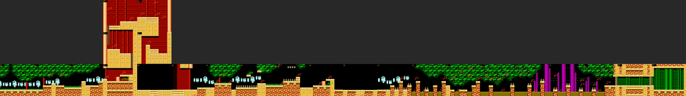

`img/stages_b_map_plant.png`: the whole stage rendered from ROM data at 1/2 scale (top row screens 00-09, bottom
row 0A-17). Screen numbers in yellow; red labels are enemy types, green are items, at their object-list positions.

### Route

| Screens | Layout and gimmicks | Enemies / items |
|---|---|---|
| 00-03 | horizontal jungle floor: dense canopy, pale tree trunks, yellow bamboo-pipe floor over orange rock | `$61` propeller pods dive out of the canopy; `$60` grasshoppers on the floor; `$5B` falling debris |
| 03 | entrance to a red curtain-wood building; a low tunnel with a breakable block (tiles $28-$2B) [code grid] | a 1-up `$37` and a large energy `$39` sit in the sealed pocket behind the block |
| 03-05 | ladder climb up two screens inside the building | `$59` big blue armoured robot on 04 |
| 05-06 | horizontal at the top | `$24`/`$26` propeller lanterns, `$54` walking eye cannons |
| 06-07 | down a shaft; the exit loads CHR $91 + palette $33: the building goes **dark** | |
| 08 | **gorilla tank mid-boss #1**, locked screen. Script $1C init: IRQ split at line $C1 (mode 7), Y offset `$069C` = $FE, spawns the gorilla (types $50-$53, 24 + 23 HP), waits until slot $0A is empty, then palette $32 ("lights on") and the exit opens | the per-frame routine sets checkpoint 09 |
| 09-0D | back into the jungle (exit loads CHR $92 = the jungle canopy again): open ground, spike beds, a yellow spring `$57`, a second breakable block on 0D (tiles $2C-$2F) sealing a pocket under an overhang | `$60`, `$61`, items `$38`, `$49`; two large weapon energies `$4A` behind the 0D block |
| 0D-0E | right exit loads CHR $91 + palette $34: **gorilla tank #2** (same script $1C) | its routine sets checkpoint **09** again, so a death after the second gorilla restarts before it [code] |
| 0F-14 | jungle again; script $1F (10) loads palette $32 + CHR $BB, script $1E (11) palette $35 + CHR $93: magenta flowers in the canopy, purple stalks, narrow rock pillars with spring flowers on top over a low swamp floor | `$54`, `$5F` spring flowers, `$58` eye drones, `$5A` hornets, `$62` (trigger) |
| 15-16 | shutters | |
| 17 | Plant Man (green bamboo room, flat floor) | |

No branch targets exist in Plant's scripts: **no alternate exit** [code].

### Enemies [seen]

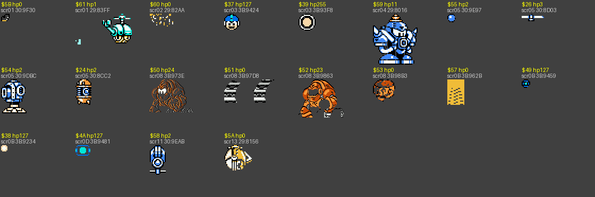

`img/stages_b_enemies_plant.png`: every object type spawned in the stage, isolated from a live frame (type, HP
byte, first screen, AI bank:address).

| Type | HP | Look and behaviour (motion trace, 300 frames, player idle) | Screens |
|---|---|---|---|
| $61 | 1 | propeller pod hidden in the canopy; swoops out and along the screen (dx 0..+89, dy 0..+52, 14 turns) | 01, 0A, 0C |
| $60 | 0 | grasshopper bug; long hops toward the player (dx +94, dy -79) | 02-03, 0A-0D |
| $5B | 0 | falling leaf / debris | 00, 03, 09, 0C |
| $59 | 11 | big blue horned armoured robot; jumps 78 px and fires `$5D` (also in Wind 0E and Tomahawk 0F) | 04 |
| $24 + $26 | 2 / 3 | propeller lantern (body + rotor): drifts down-left (dx -66, dy -38), drops `$55` blue balls | 05-06 |
| $54 / $55 | 2 / 2 | walking eye cannon / its ball | 05-06, 0F-15 |
| $50-$53 | 24 / 0 / 23 / 0 | **gorilla tank**: gorilla on tank treads (body, treads, arm, head parts), rolls in 53 px, throws rocks `$14` | 08, 0E (spawner `$56`) |
| $57 | 0 | yellow spring pad | 09, 0F |
| $5F | 0 | spring flower on stalk tops | 10-15 |
| $58 | 2 | hovering blue eye drone (stationary) | 11-13 |
| $5A | 0 | yellow hornet | 13 |
| $62, $70 | - | not spawned by a warp (trigger-type entries) | 10-15, 07 |

### Boss: Plant Man (object $B2, AI $31:$95EF)

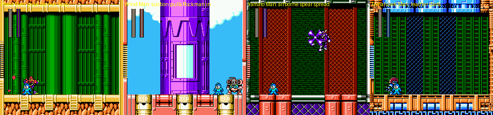

`img/stages_b_bosses.png`: the four bosses in their rooms (Plant, Wind, Yamato, Tomahawk), from the fight-start
states with an idle, invincible Rockman.

- Pattern [seen] (12 s watch): raises a ring of petals (Plant Barrier, objects $B3 x4 + $B5), leaps high across the
  room (up to y $60), lands next to Rockman and throws the petals out at him; repeats. A hit costs Rockman 4 HP.
- Weakness: **B.ATTACK, 4 per hit** (7 hits). Damage table in section 7.
- Award [text][seen]: "YOU GET PLANT.B AND RUSH JET ADAPTOR"; killing him sets `$0695` bit 0, which is also the
  Rush Jet flag.

### Tileset, palettes, music

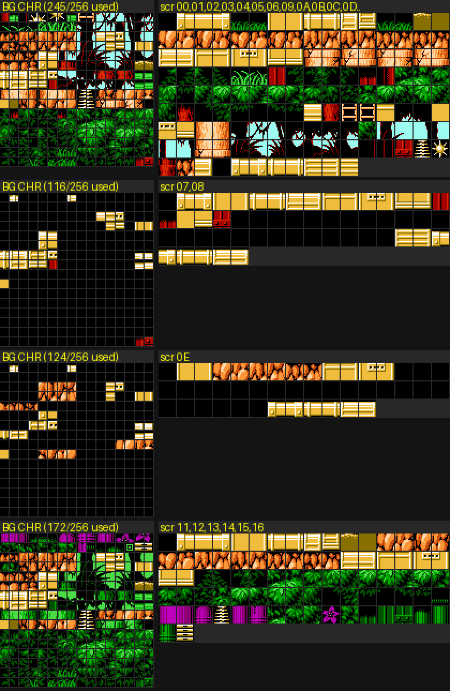

`img/stages_b_tiles_plant.png`: for each CHR/palette state of the stage, the raw BG CHR ($0000-$0FFF, each tile in
the palette it is used with) and every 16x16 tile the screens of that state use.

| CHR set | Tiles | PPU | Source | Where |
|---|---|---|---|---|
| $90 | 256 | $0000-$0FFF | bank $16 +$0000 | stage start: jungle canopy, trunks, grass, rock, bamboo pipe floors, red curtain-wood building, ladders, spikes |
| $91 | 96 | $0A00-$0FFF | bank $13 +$0000 | dark gorilla rooms 07-08, 0E (replaces the canopy third of the set) |
| $92 | 96 | $0A00-$0FFF | bank $16 +$0A00 | restores the canopy after each gorilla room |
| $BB / $93 | 32 / 32 | $0000-$01FF | bank $16 +$0000 / bank $13 +$0600 | flower section 10-14 (magenta flowers, purple stalks) |

Palettes: $32 jungle, $33 and $34 dark rooms (BG colour sets 0 and 2 black), $35 flower section. Music id $04.
**Reusable art**: a full jungle (canopy that can frame the top of the screen, trunks, grass tufts, rock ground,
bamboo pipe platforms), an interior of red curtain walls with yellow crates, and a flower/stalk variant that
only needs CHR $93 + palette $35. The gorilla tank is a large multi-object sprite.

### Raster effects

Only the gorilla rooms: script $1C enables the MMC3 split (`$F4` = 1) at line $C1 with IRQ mode 7 ($3E:$C23A:
at the split it points the PPU at $2300 and zeroes the scroll), so the bottom strip stays fixed while the area
above is drawn with the `$069C` Y offset ($FE). [seen] `irqscan.py`: split active only on 08 and 0E.

## 4. Tomahawk Man (stage 5)

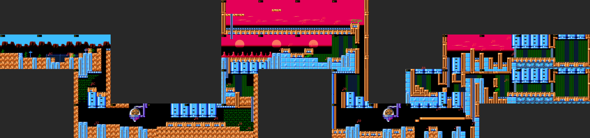

`img/stages_b_map_tomahawk.png`: the whole stage at 1/2 scale with object labels. The upper-left island (18-1B) is
the sky bypass; the lower-right rooms are 1C (Energy Balancer, left of 13) and 1D-1F (plate route).

### Route

| Screens | Layout and gimmicks | Enemies / items |
|---|---|---|
| 00-02 | desert: red mesa band on a blue sky, cacti, signposts, rock ground, blue metal pillars; **parallax split** (below) | `$6C` cowboy gunners on crates fire `$6D` bullets; breakable blocks: 01 has two that share tile ids $1C-$1F (one in the floor next to a pit, one holding a small energy `$38`), 02 has two ($20-$27), and the **E-tank `$1D` on 02 is inside one of them** [code grid] |
| 02-04 | down a shaft (exit to 04 loads CHR $96 + palette $51: cave) | `$12` red totem walker on 04 |
| 05 | locked screen with the **dome dispenser** `$4F` (14 HP) hanging from a pipe: it drops hard-hat walkers `$15` (spawner `$79`) and rocks `$14` | |
| 06-08 | horizontal cave (CHR $95 + palette $95), then up | `$6E` drill tanks, `$18` hard-hat turrets |
| 09 | up a dark mesh shaft | `$70` red skull bot |
| 0A-0C | **sunset**: pink sky, setting sun, red rock spires, blue metal ground; **shimmer split** (below); checkpoint 0A | `$67` skull walkers |
| 0A | a ladder hangs from the top of the screen (column 4, rows $00-$1F), 128 px above the ground: the up exit to the **sky bypass 18-1B** | |
| 0D-12 | down, right; the dome dispenser again on 10; `$13` red flying claws, `$12` totems | |
| 12-13 | two ladders lead up from 12: the middle one (column 9) to 13's central corridor, the right one (column D) to a separate pocket in 13's top-right corner | |
| 13 | **junction** [code grid][seen teleport]: central corridor -> left ladder up to 14 (main route); top-right pocket -> right edge -> **1D** (plate route); left end of the corridor is a breakable block (tiles $28-$2B) over a spike pit -> left edge -> **1C** | |
| 14-16 | up into the sunset again, shutters | `$64`/`$66` propeller drones dropping `$A4`, `$67` |
| 17 | Tomahawk Man (blue/green mesh room) | |
| 18-1B | sky bypass: small lifts `$A0` bob over a floor of spikes, white bubbles `$08` rise; 1B holds an E-tank `$1D`, large weapon energy `$4A` and large energy `$39`, and drops down a shaft into **0D** | |
| 1C | small pipe room; holds the **Energy Balancer** (`$8A`, appears only while `$0696` = 0; touching it sets `$0696` = 1) [seen]; right edge returns to 13. **What it does (added by critic)** [seen, `rm6-critic/emuchecks.py`]: with the buster equipped, a weapon-energy pickup goes to the weapon with the **lowest** energy (big = +10, small = +2; B.ATTACK 3 -> 13 while Y.SPEAR 20 and W.STORM 6 stayed); without the Balancer the same pickup is wasted; with a weapon equipped the pickup refills that weapon either way | |
| 1D-1F | plate route: one corridor, shutters, the second Tomahawk Man room (1F); beating him there sets `$0692` bits 1+2 and shows "YOU GET SILVER.T AND BEAT B-PARTS" [seen][text] | |

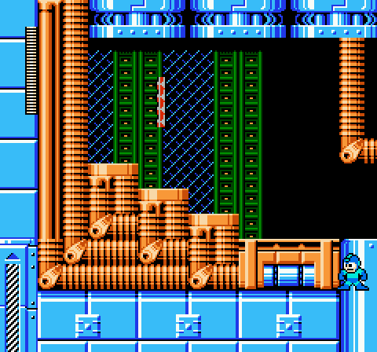

`img/stages_b_tomahawk_balancer.png`: room 1C entered from screen 13 with `$0696` = 0: the Energy Balancer item
(the small striped object in mid-air) is waiting; touching it set `$0696` = 1.

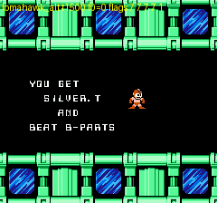

`img/stages_b_bplate_get.png`: the award screen after the plate-room fight: "YOU GET SILVER.T AND BEAT B-PARTS".

Requirements, from the collision grids [code] plus tests [seen]:
- **Energy Balancer (1C)**: break the block at the left end of 13's corridor. Breaking needs the **charged
  Power punch** (shown on Yamato 02: tapped punch and charged buster do nothing, a charged punch removes the
  block). The block sits above the corridor's spike pit, so the punch is thrown from the pit edge. The
  13 -> 1C transition and the item pickup were confirmed by teleport.
- **B plate (1D-1F)**: take the right-hand ladder in 12 (its bottom is 32 px above the lower corridor floor, a
  jump + UP). Its pocket in 13 is walled off from the rest of the room, so this is a choice of ladder, not an
  adaptor gate. [seen] normal Rockman on that ladder, holding UP then RIGHT: 12 -> 13 -> 1D.
- **Sky bypass (18-1B)**: the only way in is the ladder hanging at the top of 0A (rows $00-$1F, about 128 px above
  the floor). Jet Rockman gains about 86 px from the ground and then hovers (y $94 -> $3E, fuel frozen or not)
  [seen], which is not enough, and the higher platform on 0B (y $60) cannot be used because 0B's script locks
  the camera against scrolling back left (mode 1). How the bypass is meant to be entered is **open**; screen 18's
  own down exit leads back to 0A, so it is at least the way out.
  **Answered by critic** [seen, `rm6-critic/skybypass.py`, `skybypass2.py`]: it is a **Rush Jet** route. From
  0A's floor, standing under the hanging ladder (x $44-$4C), holding A *and* UP makes Jet Rockman fly up past
  y $3E to y $09 and grab the ladder (55-90 frames; 7 of the 19 fuel units used, so frozen fuel is not
  needed). Climbing on goes 0A -> 18. Normal and Power Rockman peak at y $60. The 86-px limit above came from
  a test that did not keep flying long enough.
  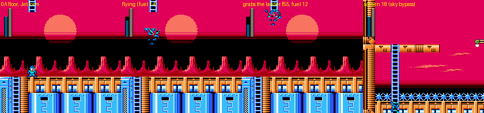
  *Tomahawk 0A: Jet Rockman (form poked without the menu, hence the garbled sprite) flies up, grabs the
  hanging ladder and climbs into screen 18, the sky bypass.*

### Enemies [seen]

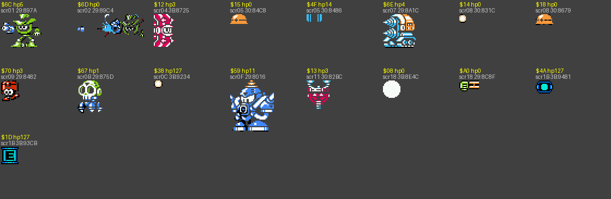

`img/stages_b_enemies_tomahawk.png`: isolated sprites of every object type in the stage.

| Type | HP | Look and behaviour | Screens |
|---|---|---|---|
| $6C / $6D | 5 / 0 | green cowboy gunner on a crate; stays put, fires a bullet left every ~50 frames (bullet travels 84-127 px) | 01-03 |
| $12 | 3 | pink striped totem walker; paces back and forth (-50..+78 px) | 04, 11-12 |
| $4F (+$79, $15, $14) | 14 | dome dispenser on a pipe; drops hard-hat walkers `$15` and rocks `$14` | 05, 10 |
| $6E | 4 | drill tank; charges at the player | 07 |
| $18 | 0 | orange hard-hat turret; flips and shoots `$14` pellets | 08 |
| $70 | 3 | red skull bot, stationary | 09 |
| $67 | 1 | skull walker; hops (±37 px) | 0B-0C, 14-15 |
| $59 | 11 | big blue horned robot, jumps and fires `$5D` | 0F |
| $13 | 3 | red flying claw; hovers, drops `$14` | 11-12 |
| $64 / $66 (+$A4) | 0 | propeller drones over the sunset; drop `$A4` bombs | 15 |
| $A0 | 0 | small yellow lift in the sky bypass; bobs up and down (-40..+24 px) | 18-1B |
| $08 | 0 | rising white bubble (sky bypass hazard, -97 px in 200 frames) | 18-1D |

### Boss: Tomahawk Man (object $9F, AI $31:$93EA)

- Pattern [seen]: leaps at Rockman (x $38-$BE), throws Silver Tomahawks in arcs (`$B0`), and shakes his
  headdress to shoot three feather darts along the floor (`$B1`).
- Weakness: **PLANT.B, 4 per hit**. Plant Barrier does nothing to the other three bosses here.
- Award [text]: "YOU GET SILVER.T"; in room 1F "... AND BEAT B-PARTS". The flag is `$0692` bit 1 (bit 2 = plate).

### Tileset, palettes, music

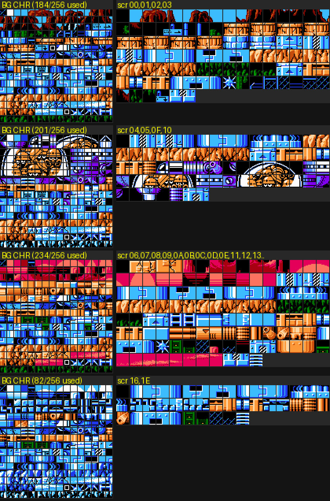

`img/stages_b_tiles_tomahawk.png`: BG CHR and used 16x16 tiles per CHR/palette state.

| CHR set | Tiles | PPU | Source | Where |
|---|---|---|---|---|
| $94 | 256 | $0000-$0FFF | bank $16 +$1000 | desert, mesas, cacti, signposts, blue metal pillars, orange pipes, mesh walls |
| $96 | 84 | $0040-$057F | bank $17 +$0000 | cave section 03-05 (palette $51) |
| $61 | 80 | $1A00-$1EFF (sprites) | bank $09 +$0A00 | loaded on the way into the dispenser screens 05 and 10 (also used by Yamato 0D) |
| $95 | 84 | $0040-$057F | bank $14 +$0650 | restores the outdoor set after the dispenser (palette $95: the sunset colours) |
| $D7 | 28 | $0230-$03EF | bank $1F +$0AA0 | boss corridor (`$064F` = $D7 at the shutter checkpoint [seen]) |

Palettes: $50 desert, $51 cave, $95 sunset. Music id $06. **Reusable art**: two outdoor moods from one CHR set (blue
desert noon and pink sunset with a sun disc), a mesa skyline strip made for parallax, cave rock, and an industrial
pipe-and-mesh interior with blue machine pillars.

### Raster effects [code][seen]

- **Desert parallax**, screens 00-01: script $29 init sets `$0672` = $2E, `$0677` = $0C. IRQ mode $C ($3E:$C2D7)
  at line 46 sets the next latch ($30) and an X scroll of (`$06A8:$06A7`) / 2, so the mesa band scrolls at half
  speed. [seen] active on 00. Warping straight to 01 skips the init, so the split is only on when the stage is
  entered from screen 00.
- **Sunset shimmer**, screens 0A-0B: script $21 init sets latch $1F, mode $0E. IRQ mode $E ($3E:$C2FF) at line 31
  zeroes the X scroll (the sky and sun stay put), then mode $F every 2 lines for 20 iterations alternates the X
  scroll between 0 and 1, phase from `$F3` bit 2: a heat-haze wobble over the sky. The same init writes
  checkpoint 0A.

## 5. Wind Man (stage 1)

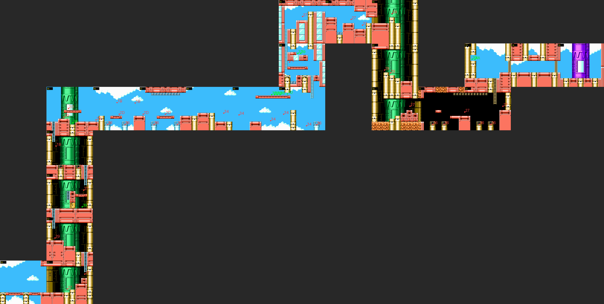

`img/stages_b_map_wind.png`: the whole stage at 1/2 scale with object labels.

### Route

| Screens | Layout and gimmicks | Enemies / items |
|---|---|---|
| 00 | sky: coral-pink girders on gold pillars, clouds | |
| 01-05 | **climb a green tower shaft** (4 screens of ladders); the exit into 02 loads CHR $8C | `$27` white panda robots on red drums (5 HP) throw `$28` balls; `$29` blue crawler tank; breakable block on 03 (tiles $0C-$0F) sealing a pocket with a large energy `$39` |
| 05-07 | horizontal at the top of the sky: **updraft columns** (collision $A) above fans ($C) lift Rockman; ceiling spikes on 07 | `$1B` green propeller bombers drop `$1C` red balls; `$36` hovering spinning tops; `$2D` spiked stompers on girders |
| 07-0A | the exit right loads CHR $8D; open sky with floating girders (checkpoint 08) | `$34` flying shield-cars |
| 0A-0D | climb (ladder screens 0A-0C), then right | `$75` beetle walker, 1-up `$37`, large energy |
| 0E-12 | second tower, then down through it; CHR $83 back, then CHR $8E + palette $87 for the dark tower base (10-12) | `$59` big blue robot on 0E |
| 12-14 | up to the boss corridor (palette $3D), shutters | |
| 15 | Wind Man (purple tower in the sky, gold pillar floor) | |

No branch targets in Wind's scripts: **no alternate exit** [code].

### Enemies [seen]

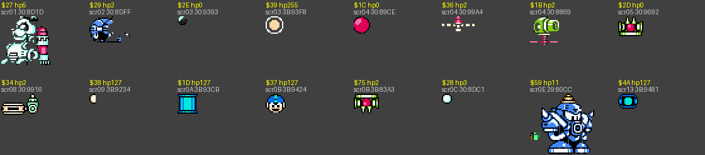

`img/stages_b_enemies_wind.png`: isolated sprites of every object type in the stage.

| Type | HP | Look and behaviour | Screens |
|---|---|---|---|
| $27 / $28 | 5 / 3 | white panda robot on a red drum; throws a ball | 01, 03, 0C-0D, 10, 12 |
| $29 | 2 | blue crawler tank; patrols about 40 px | 02, 0F |
| $1B / $1C | 2 / 0 | green propeller bomber; bobs ±24 px and drops red balls (6 in 5 s) | 04, 06 |
| $36 | 2 | hovering spinning top / propeller mine | 04-07, 0A, 11-12 |
| $2D | 0 | spiked stomper sliding along girders (±40 px) | 05-07 |
| $34 | 2 | flying shield-car | 08-0A |
| $75 | 2 | red-green beetle walker (±50 px) | 0B |
| $59 | 11 | big blue horned robot | 0E |

### Boss: Wind Man (object $99, AI $31:$8AFC)

- Pattern [seen]: he keeps to the right third of the room (x $C0-$E1) and runs his fans so Rockman is pulled
  toward him (an idle Rockman drifted from x $32 to $BE), then hops or hovers (up to y $6B). No projectiles
  appeared in 12 s of watching an idle player.
- Weakness: **C.FLASH, 4 per hit**; he is the only one of the four that Centaur Flash hurts. W.STORM registered only
  one 1-point hit in 7 s of glued shots (the others got six).
- Award [text]: "YOU GET W.STORM". Flag `$0693` bit 0.

### Tileset, palettes, music

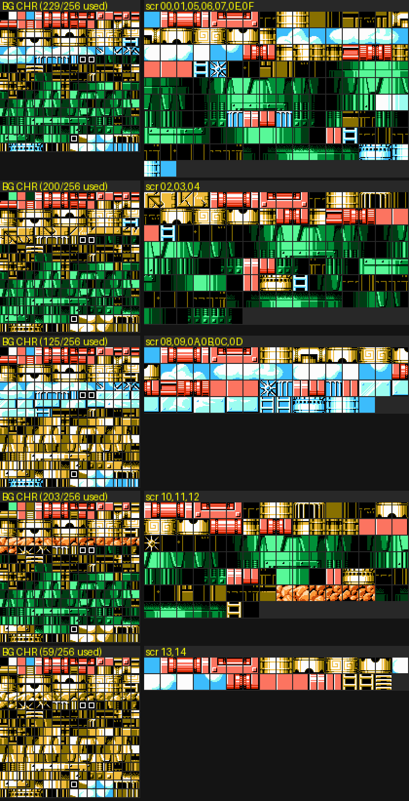

`img/stages_b_tiles_wind.png`: BG CHR and used 16x16 tiles per CHR/palette state.

| CHR set | Tiles | PPU | Source | Where |
|---|---|---|---|---|
| $83 | 256 | $0000-$0FFF | bank $12 +$1000 | sky, clouds, coral girders, gold pillars, green tower, fans and updrafts |
| $8C | 20 | $0400-$053F | bank $14 +$0200 | tower climb 02-04 |
| $8D | 27 | $05B0-$075F | bank $14 +$0340 | open sky after the checkpoint (07 ->) |
| $8E | 22 | $0400-$055F | bank $14 +$04F0 | dark tower base 10-12 and the boss corridor |

Palettes: $17 sky, $87 dark tower base, $3D boss corridor. Music id $00. **Reusable art**: a sky stage kit (clouds
as BG, pink girder platforms, gold pillars), two styles of tower interior (green cylindrical shaft and dark base),
fan + updraft tiles with their own collision type.

### Raster effects

None: `$F4` stayed 0 on every screen [seen]. The updrafts are collision tiles, not an IRQ effect.

## 6. Yamato Man (stage 4)

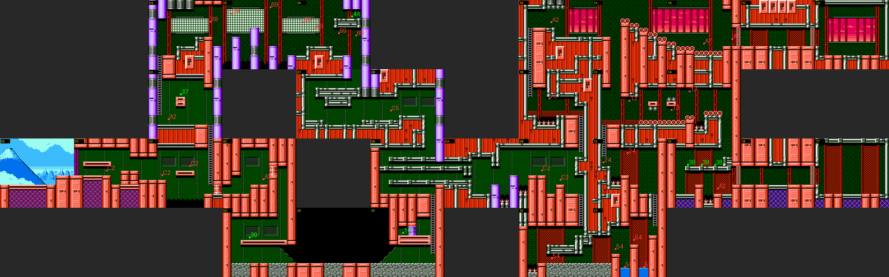

`img/stages_b_map_yamato.png`: the whole stage at 1/2 scale with object labels. The top-right strip (18-1D) is the
plate route; 0C-0F (bottom left) is the lower bypass.

### Route

| Screens | Layout and gimmicks | Enemies / items |
|---|---|---|
| 00 | Mt. Fuji over a Japanese castle-town skyline (this one screen only), then red castle walls | |
| 01-02 | red metal castle walls on green panels | `$C2` hooded lantern robots |
| 02 | junction: ladder **up** to 03 (main) or **right** through a breakable block (tiles $38-$3B) to 0C | |
| 03-08 | up (exit loads CHR $98 + palette $58), rooms with shoji screens, then down | `$A2` samurai spear robot (11 HP) throwing `$A3` spears; `$69` hopping shuriken robots; 1-up `$37` on 03 |
| 09 | down to 0F or right to 0A; checkpoint 0A | |
| 0A-0B | horizontal | `$C2` |
| 0B | junction: ladder **down** (bottom right) to 10 (main) or ladder **up** (top right, rows $00-$2F, above a ledge at y $40 that the floor is 64 px below) to **18** (plate route) | |
| 0C-0F | lower bypass: 0E is a **dark room** (script $37 init) with a mid-boss (`$D0`-`$D8`: green dragon-like tank with a rider, 14 + 15 HP, invulnerable part `$D1`), CHR $99 + palette $B9, sprite CHR $61; 0F holds an E-tank `$1D` in a pocket sealed by another breakable block (tiles $3C-$3F); its up exit returns to 09 | |
| 10-14 | main: down, right, up, up | `$54` eye cannons, `$5F`/`$5E` springs, `$24`/`$26` lanterns, `$13` red claws |
| 15-17 | shutters (15 has three small energies and a samurai), Yamato Man in room 17 | |
| 18-1D | plate route: `$75` beetle, `$A2` samurai, `$A7` spring-necked robots on a stair of pipe-ends; 1A can also drop back to 13; shutters 1B-1C; second Yamato Man room 1D -> "YOU GET Y.SPEAR AND BEAT E-PARTS" (text.md) | |

Requirements [seen]:
- **E plate (0B up)**: needs **Rush Jet**. The Go-Explore autoplayer reached screen 18 in 4 s as Jet Rockman and
  never in 60,000 frames as normal Rockman (highest point y $61) (`altx_y0B_j.state`).
- **Lower bypass (02 right)**: needs the **charged Power punch** [seen]: standing next to the block, a charged
  punch set tile flags $38-$3B and walking right then went 02 -> 0C; a tapped punch and a charged buster did nothing.

### Enemies [seen]

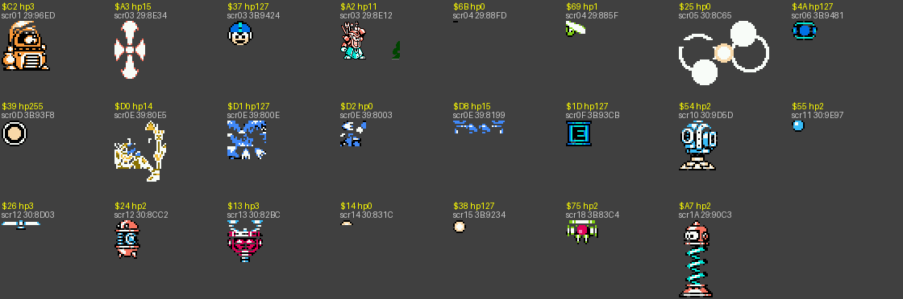

`img/stages_b_enemies_yamato.png`: isolated sprites of every object type in the stage.

| Type | HP | Look and behaviour | Screens |
|---|---|---|---|
| $C2 (+$C3, $17) | 3 | hooded lantern robot on a ledge; throws fireballs (`$C3`, 4 in 5 s) | 01-02, 0B |
| $A2 / $A3 | 11 / 15 | samurai robot with a spear (stationary) / the thrown spear | 03, 0C, 15, 19 |
| $69 / $6B | 1 / 0 | small hopping robot / its shuriken | 04-06 |
| $25 | 0 | white bubble cluster | 05 |
| $D0 $D1 $D2 $D8 | 14, 127, 0, 15 | dark-room mid-boss (rider tank; `$D8` = its low shot, travels 135 px) | 0E |
| $54 / $55, $5F | 2 / 2, 0 | eye cannon + ball, spring flower | 10-11 |
| $24 / $26 | 2 / 3 | propeller lantern | 12 |
| $13 / $14 | 3 / 0 | red flying claw; drops rocks | 13-14 |
| $75 | 2 | beetle walker | 18 |
| $A7 | 2 | spring-necked robot; bounces (dx up to 174 px, dy -24..+48) | 1A-1B |

### Boss: Yamato Man (object $98, AI $31:$8930)

- Pattern [seen]: runs back and forth across the whole room (x $21-$DE) with his spear, leaps high (to y $38) and
  throws a three-way spread of spearheads (`$B4` x3) down at Rockman; `$97` (3 spawns in 12 s) is a second
  projectile [guess: the thrown spear tip].
- Weakness: **SILVER.T, 4 per hit**.
- Award [text]: "YOU GET Y.SPEAR"; in room 1D "... AND BEAT E-PARTS". Flag `$0693` bit 1 (bit 2 = plate).

### Tileset, palettes, music

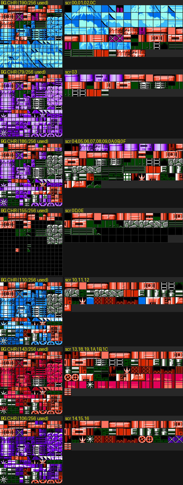

`img/stages_b_tiles_yamato.png`: BG CHR and used 16x16 tiles per CHR/palette state.

| CHR set | Tiles | PPU | Source | Where |
|---|---|---|---|---|
| $97 | 256 | $0000-$0FFF | bank $17 +$1000 | Mt. Fuji and skyline, red castle walls, green panels, pipes, shoji screens |
| $98 | 96 | $0A00-$0FFF | bank $18 +$0A00 | from 03 on (replaces the Fuji/skyline third with interior tiles) |
| $99 | 80 | $0B00-$0FFF | bank $18 +$0000 | lower bypass 0C-0F (dark room) |
| $61 | 80 | $1A00-$1EFF (sprites) | bank $09 +$0A00 | loaded at 0D for the dark-room mid-boss |

Palettes: $57 start, $58/$59 interior, $5B-$5E later rooms, $B9 dark bypass. Music id $02. **Reusable art**: a
Japanese-castle kit (red riveted walls, green panelling, pipes, shoji screens, purple pillars), plus a one-screen
Fuji/skyline vista whose tiles are swapped out by CHR $98, so a GP redesign can only show it near the start
unless it keeps that third of the CHR.

### Raster effects

None [seen]: `$F4` stayed 0 on every screen.

## 7. Boss damage table (measured) [seen]

Method (`dmg.py`): fight-start state, Rockman invincible, weapon equipped through the pause menu (open, set the
cursor `$0699`, close), then for 420 frames one shot every 24 frames (or a 110-frame charge) with the boss
teleported onto the shot each frame. Every HP drop was logged. Values are damage per hit; boss HP starts at $1B
and the boss dies when it goes negative (28 points). **0** = no HP change in 7 s although the weapon works
on another boss with the same method (immune).

| Weapon | Plant Man | Wind Man | Yamato Man | Tomahawk Man |
|---|---|---|---|---|
| R.BUSTER | 1 | 1 | 1 | 1 |
| charged buster | 3 | 3 | 3 | 3 |
| Y.SPEAR | 1 | 1 | 1 | 1 |
| W.STORM | 1 | 1 (one hit only) | 1 | 1 |
| B.ATTACK | **4** | 1 | 1 | 1 |
| F.BLAST | 2 | 1 | 1 | 1 |
| PLANT.B | 0 | 0 | 0 | **4** |
| KNIGHT.C | 1 | 1 | 1 | 1 |
| SILVER.T | 1 | 1 | **4** | 1 |
| C.FLASH | 0 | **4** | 0 | 0 |
| BEAT | 1 | 1 | 1 | 1 |
| Power punch (tap / charged) | 2 / 2 | 2 / 2 | 2 / 2 | 2 / 2 |
| Jet buster | 1 | 1 | 1 | 1 |

The weakness chain among these four: Plant <- Blizzard (B.ATTACK), Wind <- Centaur (C.FLASH), Yamato <- Tomahawk
(SILVER.T), Tomahawk <- Plant (PLANT.B). A Plant Man hit costs Rockman 4 HP [seen].

## 8. Checkpoints [code][seen]

| Stage | Mid-stage | Set by | Boss shutter (`$0684` = boss room - 1) | CHR at the shutter (`$064F`) [seen] |
|---|---|---|---|---|
| Plant | 09 / 92 / 32 | script $1C per-frame routine $39:$8592, in **both** gorilla rooms (08 and 0E) | 16 | $93 |
| Tomahawk | 0A / 95 / 95 | script $21 init $39:$85D8 (sunset) | 16; plate route 1E | $D7 |
| Wind | 08 / 8D / 17 | script $14 per-frame $39:$850E (screen 07) | 14 | $8E |
| Yamato | 0A / 98 / 5B | script $2F per-frame $39:$86FA (screen 09) | 16; plate route 1C | $98 |

Quirk: Plant's second gorilla room re-writes checkpoint 09, so dying anywhere in 0E-15 restarts at 09 and the
second gorilla must be beaten again.

## Images

| File | Caption |
|---|---|
| `img/stages_b_map_plant.png` | Plant Man stage map (1/2 scale, two rows), object labels |
| `img/stages_b_map_tomahawk.png` | Tomahawk Man stage map with the sky bypass, Energy Balancer room and plate route |
| `img/stages_b_map_wind.png` | Wind Man stage map |
| `img/stages_b_map_yamato.png` | Yamato Man stage map with the plate route and lower bypass |
| `img/stages_b_enemies_<stage>.png` (4) | isolated sprite of every object type, with HP byte and AI pointer |
| `img/stages_b_tiles_<stage>.png` (4) | BG CHR + used 16x16 tiles per CHR/palette state |
| `img/stages_b_bosses.png` | the four bosses in their rooms |
| `img/stages_b_tomahawk_balancer.png` | the Energy Balancer item in Tomahawk room 1C |
| `img/stages_b_bplate_get.png` | "YOU GET SILVER.T AND BEAT B-PARTS" |

## Open questions

- The meaning of the stage-special collision values (Plant 6/7 = spike-flower beds?, Yamato/Tomahawk $13-$19).
- Wind Man's full pattern against a moving player (W.Storm tornado not seen with an idle player), and why W.STORM
  landed only once on him.
- The trigger-type objects that a warp does not spawn: Plant `$56` (gorilla spawner), `$62`, `$70`; Yamato `$5E`,
  `$C5`; Tomahawk `$29`, `$39` in 1B/1D.
- How Tomahawk's sky bypass (18-1B) is entered: its ladder on 0A is higher than Jet Rockman's measured climb
  from the floor. A different Jet technique, or a lift/enemy to stand on, may be the answer.
  **Answered by critic**: Rush Jet, flying up under the ladder while holding UP (section 4).
- The Energy Balancer block in Tomahawk 13 was not broken in play (the item was reached by teleporting past it);
  the charged-punch rule comes from the Yamato 02 test.
- Enemy names: none are in the ROM text; the descriptions above are by look.

## Lessons for Rockman 6 GP

- **A stage is a 32-screen strip plus scripts.** Redesigning a stage on the same tileset means rewriting 2 KB of
  layout (8 rows x 256 block ids), the 32x32 block table (1 KB) and the screen scripts, and nothing else. The
  16x16 tiles and CHR stay. The `lv.py` / `geom.py` decoder can be inverted into an encoder for a GP level
  editor, and its renderer is a cheap preview of an edited stage.
- **Branches are only exits with explicit targets.** An alternate route lives in the high screen numbers and is
  reached by an exit with a target byte; the plate rooms are found by `$3F:$F518`. GP can add its own branches
  (for the secret exits in PLAN 2.6) without code, as long as the 32-screen budget holds: Yamato and Tomahawk
  already use 30-32 screens.
- **Gates are layout plus form, not code.** The vanilla gates are geometry (Yamato 0B's ladder above an
  unreachable ledge = Rush Jet; Tomahawk 13's walled-off pocket = choose your ladder in 12) and breakable tiles (charged Power punch). GP's adaptor overhaul (PLAN
  2.2) changes what those gates mean: if Jet or Power change, every ladder height and every `$B` tile in the
  four stages has to be re-checked. `cgrid.py` makes that a text diff.
- **Breakable blocks cost four tile ids each**, from a shared 256-bit flag array, and blocks that reuse the same
  ids vanish together (Tomahawk 01 has two blocks on ids $1C-$1F [code]; not tested in play). Vanilla uses them
  mostly as item lockers (1-up, energies, an E-tank inside a block). A stage with many breakable
  walls runs out of unique tile ids quickly; a GP feature with many destructible tiles needs a different
  mechanism (per-position flags).
- **CHR is swapped in thirds.** Each stage's 4 KB BG set has a third ($0A00-$0FFF) that is replaced mid-stage
  (Plant dark rooms, Yamato interior, Wind tower), and some art exists only in one state (Yamato's Fuji vista,
  Plant's canopy during the gorilla rooms). A redesign must place screens with the CHR state that holds their
  art, or merge the needed tiles into one set.
- **Free raster effects to reuse**: the desert parallax (mode $C) and sunset shimmer (mode $E) in Tomahawk, and
  the fixed-floor split of Plant's gorilla rooms (mode 7), are table-driven IRQ modes switched on by a screen
  script init (`$0672`, `$0677`, `$F4`). A GP stage can turn them on with the same three stores. The MMC5 port
  must convert these latches (PLAN 6.1).
- **Weakness chain**: Plant <- Blizzard, Wind <- Centaur, Yamato <- Tomahawk, Tomahawk <- Plant, all 4 per hit
  and immunities (0) to Plant Barrier and Centaur Flash on the others. GP's weapon rebalance should keep the
  measured baseline in `dmg.py` as a regression test.
- **The checkpoint re-write quirk** (Plant 0E sets 09) is a cheap difficulty knob: GP can give the second room
  its own checkpoint by changing one byte in the script.
- **The Energy Balancer is a normal object (`$8A`) in Tomahawk room 1C** that only spawns while `$0696` = 0. GP's
  shop/chip items can reuse the same pattern: an object guarded by a progress flag.
