# Rockman 6 (J): all text, the text engines, fonts and tables

Agent `rm6-text`. ROM: `roms/rm6j.nes` (vanilla Rockman 6 (J), MMC3 TGROM, 512 KB PRG, 8 KB CHR-RAM).
Scratch work and savestates: `build/research/rm6/rm6-text/` (scripts listed at the end). Tables: `docs/research/rm6/tables/`.

> Status: final (v3). All text found has been transcribed; all engines are documented from disassembly and checked in the
> emulator; an English test line was injected and displayed by the unmodified engine.

## 1. Summary (the short version)

- **All story and menu text is stored in ONE place**: a table of **168 "PPU scripts"** in banks **$3C/$3D** (CPU
  $8000-$BFFF when bank $3C is at $8000 and $3D at $A000). Pointer table: low bytes at **$3C:$8787**, high bytes at
  **$3C:$882F** (168 entries each, file 0x78797 / 0x7883F). Script data runs **$88D7-$BA8C** (file 0x788E7-0x7BA9C).
  Strings are *not* separate from layout: each script is a list of nametable write commands, and text is just the
  literal-tile payload of those commands. [code]
- The interpreter is **$3C:$8631** ("draw PPU script A"), reached through the far-call trampoline
  `LDA #id / JSR $CB28 / .byte $00`. [code]
- There are **no in-string control codes**. A new line is a new write command with its own nametable address. Clearing a
  text box is a separate script of RLE writes ($6F, $97). Waits, speaker changes and page turns are done by the
  *caller* (cutscene bytecode or 6502 code), not by the text. The speaker is written as a plain text line above the
  quote (`ロック`, `Mr.X`) and the speech is wrapped in 「 」. [code][seen]
- **Typewriter mode** is a flag, not a different engine: when `$069F` is non-zero, $8631 splits its output into
  single-tile writes, waits `$06AC` frames per tile and plays sound `$06A6` (if non-zero) per tile. [code][seen]
- Only two other text *engines* exist: the **boss-intro data panel** (9 FF-terminated fields per boss at
  $3C:$832E-$85ED, typed by $3C:$81B1) and the hidden **debug sound player** (bank $28, ASCII-coded). [code]
  A few words are pure graphics: the logo, the newspaper headline, the boss-panel labels, the password-grid labels and
  the READY sprite. [seen]
- The Japanese text uses **hiragana + 16 katakana + Latin capitals + digits**. **There is no kanji in any text**;
  the only kanji in the game are the logo art 史上最大の戦い!!. Dakuten/handakuten are separate tiles in their own cell
  after the kana. [seen]
- Fonts are per-screen CHR sets copied into CHR-RAM, so the **same byte means different letters on different
  screens**: the main font is "A=$0B", the stage-select/credit-card font "A=$2B", the pause font "A=$20", the staff
  roll role headers "A=$80", the Mr. X speech "A=$8B". Eleven .tbl files cover every font. [seen]
- Fun facts: the Centaur Man weapon is spelled **`C.FLRSH`** in the YOU GET data, but the bold YOU GET font draws R
  and A almost identically, so it looks like "C.FLASH" on screen (and "RUSH" looks like "AUSH"). The pause font has no
  O, so the game writes **`N0R`, `P0W`, `W.ST0RM`** with a zero. The game ends on **"TO BE CONTINUED"**. Blizzard Man's
  energy source is "SOLAR ENERGY" and Centaur Man's is a "DRY BATTERY". [seen][text]

## 2. Where the text lives

| What | Where (CPU) | File offset | Notes |
|---|---|---|---|
| PPU-script pointer table, low bytes | $3C:$8787-$882E | 0x78797 | 168 entries [code] |
| PPU-script pointer table, high bytes | $3C:$882F-$88D6 | 0x7883F | [code] |
| PPU-script data | $3C:$88D7-$3D:$BA8C | 0x788E7-0x7BA9C | script $00 first, $A5-$A7 last [code] |
| Boss-intro panel strings | $3C:$832E-$85ED | 0x7833E-0x785FD | 8 records x 88 bytes, see §4.4 [code] |
| Boss-intro panel layout tables | $3C:$85EE (delay), $85F6/$85FE (PPU lo/hi), $8606/$860E (record lo/hi) | 0x785FE | [code] |
| Intro cutscene bytecode | $3D:$BD7C-$BE2C | 0x7BD8C | run by $3D:$BD00, see §4.3 [code] |
| Debug sound-player labels | script $08/$09 | 0x78BB2 | ASCII bytes [code] |
| Main font CHR (A=$0B) | bank $10 +$1000 | 0x21010-0x217FF | 121 tiles, CHR set $81 (and $D2 at tile $80) [code] |

Free space inside the text banks (all 00/FF fill, nothing points there) [code]:
`$3C:$9D16-$9FE1` (716 bytes, between script $42 and $43; keep $9FE2-$9FFF, it holds a 4-byte-stride pattern), `$3D:$BA8D-$BCFF` (627 bytes, after script $A7),
`$3D:$BF42-$BFFF` (190 bytes, after the intro bytecode handlers).

## 3. Script index (all 168 PPU scripts)

Scripts that carry text are listed with their text in §5. The others are pictures/layouts (no text).

| ID | Purpose | Text? |
|---|---|---|
| $00 | Title screen (logo + GAME START / PASS WORD / ©CAPCOM 1993). Caller $3E:$D0E1 | yes |
| $01-$06 | Title/boot layouts and logo pieces [guess]; $01 caller $3E:$D05A | no |
| $07 | **Unused** US-style copyright screen: "© CAPCOM CO., LTD. 1993 / © CAPCOM U.S.A., INC. 1993 / LICENSED BY NINTENDO", in its own tile layout (`rm6_license07.tbl`); no caller found | yes |
| $08-$09 | Hidden debug **SOUND PLAYER** labels (SEQ COL TBL TMR SOUND PLAYER), bank $28 code | yes |
| $0A-$10 | Pause-menu frame (7 pointers to the same data): NOR, LIFE, R.BUSTER, Beat slots | yes |
| $11 | Pause screen, second page (drawn with `$F1`=$04, i.e. at $24xx). Caller $38:$92B8 | no |
| $12 | Stage select (PUSH START + 8 boss names). Caller $3F:$F070 | yes |
| $13 | Boss-intro data panel frame (labels are baked into CHR). Caller $3C:$81A2 | no (labels in CHR) |
| $14 | **Password screen** layout: grid with column labels 1-6, row labels A-F, the END button and the message box (labels are layout tiles, not font). Caller $3B:$BF8C | labels only |
| $15 | Small layout | no |
| $16 | PASS WORD ERROR. Caller $3F:$F467 | yes |
| $17 | Clears the message line (after $16 / game over) | no |
| $18 | GAME OVER. Caller $3C:$802F | yes |
| $19 | STAGE SELECT / CONTINUE (continue menu). Caller $3C:$8067 | yes |
| $1A | CONTINUE (in the fortresses, no stage select). Caller $3C:$80AF | yes |
| $1B-$1E | Small layouts | no |
| $1F | Boot copyright screen "© CAPCOM CO.,LTD. 1993 / © CAPCOM USA,INC. 1993 / LICENSED BY NINTENDO" | yes |
| $20-$2C | Tiny tile/attribute pokes (password dots and cursor: $38:$945A draws $2A then $20+n) | no |
| $2D-$37 | Small layouts; $2F = the "00" counters | digits only |
| $38-$40 | Pause-menu weapon entries (icon + name + energy bar), drawn as $37+n by $38:$99F4: Y.SPEAR W.ST0RM B.ATTACK F.BLAST PLANT.B KNIGHT.C SILVER.T C.FLASH BEAT | yes |
| $41-$42 | Big layouts (callers $3B:$BAAA/$BB13) | no |
| $43 | YOU GET screen frame (pipes). Caller $3B:$BD43 | no |
| $44-$47 | Small layouts; $47 clears the Rockman area of the YOU GET screen | no |
| $48 | Intro: Rock and Rush picture | no |
| $49-$4A | Intro: Rock's last two lines | yes |
| $4B-$50 | Intro: IN THE YEAR 20XX AD (6 pointers, same data) | yes |
| $51-$52 | Intro narration pages 1-2 | yes |
| $53-$5B, $5D | Intro pictures (robots, tournament, Mr. X) | no |
| $5C, $5E | Intro: Mr. X narration and dialogue | yes |
| $5F-$6B | YOU GET texts: ID = $60 + stage `$51` + `$06A5` (4 when the stage's Beat plate was taken). $5F is unused | yes |
| $6C-$6E | Mr. X / Wily speech after the Mr. X fortress | yes |
| $6F | Clears the Mr. X speech box | no |
| $70 | Ending: STAFF | yes |
| $71-$80 | Ending: Robot Master cards (DWNB-41..48 + DESIGNER name), 2 per boss | yes |
| $81-$87 | Ending: scrolling staff roll, PRESENTED BY CAPCOM | yes |
| $88 | Ending: TO BE CONTINUED | yes |
| $89-$8A | Pause-menu labels JET and P0W (Rush adaptors) | yes |
| $8B-$91 | Fortress/ending pictures ($8B/$8C/$8E via `$0682`, drawn on page $28xx) | no |
| $92-$96 | Ending: CAPCOM TIMES newspaper text | yes |
| $97 | Clears the newspaper text box | no |
| $98-$A7 | Ending pictures ($A5-$A7 share data) | no |

## 4. The text engines

### 4.1 Far call `$CB28`

`JSR $CB28` is followed by one inline byte `fn`. The top two bits of `fn` choose a bank pair from the table at
`$CB5F` = `$3C,$3A,$38,$36` (loaded at $8000 with the next bank at $A000); the low six bits index that bank's
dispatch table at `$8000`. A and X are passed through (`$15`/`$16`); the caller's banks are pushed and restored
on return. For bank $3C the dispatch table is at $3C:$8015 (lo) / $8019 (hi) [code]:

| fn | Target | Use |
|---|---|---|
| $00 | $3C:$8631 | **Draw PPU script A** (58 call sites) |
| $01 | $3D:$BD00 | Run the intro cutscene bytecode (caller $3E:$CCC9) |
| $02 | $3C:$801D | Game over / continue screens |
| $03 | $3C:$80C5 | Boss intro (data panel) |

So a text call in the game always looks like `A9 id 20 28 CB 00`. 18 of the 58 call sites take A from RAM or
arithmetic instead of an immediate (YOU GET, staff roll, ending loops, pause entries, password dots).

### 4.2 PPU-script interpreter `$3C:$8631`

Input: A = script ID. It reads the pointer from $8787/$882F, then decodes commands into the VRAM buffer at
`$0780` (write index `$47`). Command format [code; `rm6_ppuscript.py selftest` parses and re-encodes all 168 scripts byte-identically]:

```
byte0:  0 = end of script
        bits 0-5 = count n (1..63), bit 6 = CONTINUE (no address: write right after the previous write),
        bit 7 = SEQUENCE (payload is 1 byte s; writes s, s+1, s+2, ... n tiles)
if bit 6 clear, byte1:
        bit 6 = SKIP: address = end of previous write + (byte1 & $3F)        (no byte2)
        else      : address hi = (byte1 & $3F) | $F1, byte2 = address lo      (absolute)
        bit 7 = RLE: payload is 1 byte, repeated n times
payload: n literal tile bytes (default), or 1 byte (SEQUENCE / RLE)
```

- `$F1` is ORed into every absolute high byte, so the caller can redirect a script to another nametable
  ($F1 = $08 sends $20xx writes to $28xx; the ending uses this to draw on the off-screen page and the staff roll
  toggles it every page). [code]
- Addresses $23C0+ / $27C0+ are attribute writes and $3F00+ are palette writes in the same format. [code]
- When the buffer passes 48 bytes it is flushed: directly to the PPU (`$C6D7`) if rendering is off (`$FD` = 0),
  otherwise the thread yields one frame (`$C62B`) and the NMI copies it. The buffer entry format is
  `[count|$80 for vertical] [hi] [lo] [tiles...]`. The buffer must stay below $07F0, where the CHR-set load queue
  ($07F0-$07F7, indices $07F8/$07F9) starts. [code]
- **Typewriter**: if `$069F` != 0, `$8723` rewrites each buffered entry into 1-tile entries. Before each tile it
  stores `$06A6` to the sound request `$DC` (when non-zero) and waits `$06AC` frames (`$C5F6`). Spaces cost the same
  time as letters. `$06A6` is cleared afterwards. Observed settings: intro and Mr. X speech `$06AC` = 2 frames/tile,
  no sound; newspaper `$06A6` = $27 (typing blip); TO BE CONTINUED `$06AC` = 4. [code][seen]

What a translator needs to know: **line breaks, centring and spacing are all baked into the command addresses**.
Each text line is one command; a longer EN line just needs a bigger count (max 63 per command) and possibly a
smaller start column. Nothing else in the engine depends on string length.

### 4.3 Intro cutscene bytecode `$3D:$BD00`

The intro (and only the intro) is a little bytecode program: `(op, arg)` byte pairs at **$3D:$BD7C**, ended by a
byte >= $80. Handler table: lo $3D:$BD5E, hi $3D:$BD6D (15 ops) [code]:

| op | Handler | Meaning |
|---|---|---|
| 0 | $C9BF | Screen off, clear nametable |
| 1 | $C9EF | Load palette `arg` (bank $37 tables $9000/$9100) |
| 2 | $8631 | Draw PPU script `arg` (instant) |
| 3 | $CAA4 | Load CHR set `arg` (bank $37 table at $8000, 4 bytes per set) |
| 4 | $CA89 | Fade the screen in (rendering on) |
| 5 | $BE35 | Wait `arg` frames; **any button aborts the whole intro** |
| 6 | $BE2D | Fade out, screen off, far call $42 |
| 7 | $DEA7 | Save the palette as the fade target |
| 8/9 | $BEF4/$BEED | Fade in palettes 0-3 / 0-7 |
| A/B | $BF27/$BF20 | Fade out palettes 0-3 / 0-7 |
| C | $BE87 | Show the Mr. X sprite (alternates two sprite lists) |
| D | $BE50 | **Draw PPU script `arg` with typewriter** (`$069F` = 1) |
| E | $BE5E | Show the Rush scene sprites |

Full decoded program: `build/research/rm6/rm6-text/introcmd.py` (output reproduced in §5.1). The typing speed is
set by the caller: `$3E:$CCB1` stores 2 into `$06AC` before calling far fn $01.

### 4.4 Boss-intro data panel typer `$3C:$81B1`

After the panel frame (script $13) and CHR set $8F are drawn, $81B1 types one record per boss, chosen by the stage
number `$51` from the pointer tables at $8606/$860E. A record is 9 fields, each ended by a byte with bit 7 set
($FF). Fields are written tile by tile with their own 1-tile buffer entries. [code][seen]

| Field | PPU address | Frames/tile | Content |
|---|---|---|---|
| 1 | $206A | 1 | HEIGHT value (3 chars) |
| 2 | $2079 | 2 | WEIGHT value |
| 3 | $20AA | 2 | ATTACK value |
| 4 | $20B9 | 2 | DEFENCE value |
| 5 | $20EA | 2 | MOBILE value |
| 6 | $20F1 | 2 | Energy source (13 chars) |
| 7 | $2126 | 2 | Location (20 chars) |
| 8 | $22E6 | 2 | Specialty (19 chars) |
| 9 | $22AA | 8 | Name (12 chars), with sound $27 per letter |

The per-field address/delay tables are read backwards (`$0624` counts 8..0). The labels (HEIGHT, WEIGHT, ATTACK,
DEFENCE, MOBILE) are not text: they are drawn by script $13 from 16 letter tiles baked into the panel CHR
(`rm6_bossintro_labels.tbl`). The values use main-font codes (`rm6_main.tbl`) but the panel CHR has its own bold
glyphs for them.

### 4.5 Other drivers (callers that sequence the text)

- **Ending** ($3B:$A886-$AB60): newspaper headline $92 typed on page $28xx (`$F1`=8, sound $27), then for each of
  $93-$96: fade (`$8B94`), clear with $97, re-show, type, wait 90 frames. Then STAFF ($70), the 16 robot cards
  ($71-$80, typed, `$069F` = script ID), the scrolling roll ($81-$87, one page per scroll step, `$F1` toggles
  $00/$08), then TO BE CONTINUED ($88, typed at 4 frames/tile) and a wait for START, then `JMP $FF70` (reset). [code][seen]
- **Mr. X fortress end** ($39:$ACD4-$ADFE): type $6C, wait 90, clear ($6F), type $6D, wait, clear; Mr. X takes off
  the disguise (he is Dr. Wily) and flies off [doc]; fade to black; type $6E; wait 90; `$F0`=1 (next stage). [code][seen]
- **YOU GET** ($3B:$BD1B-$BE13): frame $43, then the text `$60 + $51 + $06A5` typed at **4 frames/tile with sound $37**
  (`$06AC` = 4, `$06A6` = $37), wait 90 frames, clear with $47. [code][seen]
- **Game over / continue** ($3C:$801D): $18 GAME OVER, then $19 (STAGE SELECT/CONTINUE) or $1A (CONTINUE only
  in the fortresses). [code][seen]

## 5. Full transcript (game order)

Conventions: JP is quoted as displayed (dakuten merged for readability; in the data they are separate tiles, e.g.
`ば` = `は` + `゛` = `$59 $3E`). `[translation]` lines are this agent's literal English renderings for the bilingual
plan. Row/column = nametable position of the line (r00-r29, c00-c31).

### 5.1 Boot, title and intro

Boot (script $1F): `© CAPCOM CO.,LTD. 1993` / `© CAPCOM USA,INC. 1993` / `LICENSED BY NINTENDO` [text]

Intro (bytecode §4.3; "type" = typewriter):

| Step | Script | Row | JP (as shown) | [translation] |
|---|---|---|---|---|
| 1 | $50 | r14 | IN THE YEAR 20XX AD・・・ | (English in the original; the dots are an RLE of `・`) |
| 2 | $51 | r20 | 8つの ちいきから えらびぬかれた | The strongest robots, |
|   |     | r22 | さいきょうの ロボット たち。 | chosen from eight regions of the world. |
| 3 | $53-$56 | | (4 pictures, 2 robots each, 88 frames each) | |
| 4 | $52 | r20 | へいわの ための | For the sake of peace: |
|   |     | r22 | だい1かい せかいロボット せんしゅけん。 | the 1st World Robot Championship. |
|   |     | r24 | しかし・・・ | However... |
| 5 | $57-$5A | | (4 pictures: the tournament, Mr. X) | |
| 6 | $5C (type) | r04 | たいかいの しゅさいしゃ | The tournament's sponsor, |
|   |     | r06 | Mr.X は そのロボットたちを うばい | Mr. X, seized those robots |
|   |     | r08 | せかい せいふくに のりだしたの だった!! | and set out to conquer the world!! |
|   |     | r21 | ロック | Rock |
|   |     | r22 | 「Mr.X!! | "Mr. X!! |
|   |     | r24 | なぜ あなたが!?」 | Why would *you*...!?" |
| 7 | $5E (type) | r03 | Mr.X | Mr. X |
|   |     | r04 | 「いまこそ ほんとうのことを あかそう。 | "Now I shall reveal the truth. |
|   |     | r06 | わたしこそ Dr.ワイリーを あやつる | I am the shadow ruler |
|   |     | r08 | かげの しはいしゃ なのだよ!! | who has been pulling Dr. Wily's strings!! |
|   |     | r22 | もはや Dr.ワイリーを あやつるまでも ない。 | I no longer need to work through Dr. Wily. |
|   |     | r24 | しょうぶだ!! ロックマン!!」 | Fight me!! Rockman!!" |
| 8 | $49 (type) | r22 | 「そんなことは させないぞ!! | (Rock) "I won't let you do that!! |
|   | $4A (type) | r24 | ゆくぞ!! ラッシュ!」 | Let's go!! Rush!" |

Title (script $00): `GAME START`, `PASS WORD`, `©CAPCOM 1993` (letters are scattered tiles of the title CHR,
`rm6_title.tbl`). The logo subtitle **史上最大の戦い!!** ("The Greatest Battle in History!!") is the only kanji in the
game, and it is logo art, not font. [seen]

Stage start: **READY** is five sprite tiles ($99-$9D of the sprite table, one letter each) blinking at y=115. [seen]

### 5.2 Stage select, boss intros, YOU GET

Stage select ($12, font A=$2B): `PUSH  START` and the eight names in two lines each:
`BLIZZARD MAN`, `WIND MAN`, `FLAME MAN` / `PLANT MAN`, `TOMAHAWK MAN` / `YAMATO MAN`, `KNIGHT MAN`, `CENTAUR MAN`. [seen]

Boss-intro data panels (record order = stage number `$51`) [text][seen]:

| $51 | Name | HEIGHT | WEIGHT | ATTACK | DEFENCE | MOBILE | Energy | Location | Specialty |
|---|---|---|---|---|---|---|---|---|---|
| 0 | BLIZZARDMAN | 163 | 167 | 88 | 42 | 113 | SOLAR ENERGY | FROZEN ISLAND | MASTER OF SNOW |
| 1 | WINDMAN | 169 | 173 | 66 | 129 | 51 | WIND ENERGY | MECHANICAL TOWER | MASTER OF WIND |
| 2 | PLANTMAN | 143 | 111 | 42 | 103 | 98 | SOLAR ENERGY | FORGOTTEN AREA | FLOWER FANCIER |
| 3 | FLAMEMAN | 155 | 98 | 84 | 93 | 88 | THERMAL POWER | OIL FIELD | MASTER OF FLAME |
| 4 | YAMATOMAN | 161 | 149 | 199 | 185 | 31 | SOLAR POWER | IMPREGNABLE FORTRESS | MASTER OF SPEAR |
| 5 | TOMAHAWKMAN | 177 | 87 | 157 | 71 | 149 | SOLAR POWER | RESTRICTED AREA | MASTER OF TOMAHAWK |
| 6 | KNIGHTMAN | 158 | 146 | 121 | 204 | 60 | SOLAR POWER | CAPITAL OF SCIENCE | MASTER OF MACE BALL |
| 7 | CENTAURMAN | 155 | 172 | 35 | 47 | 205 | DRY BATTERY | ANCIENT CITY | ABILITY UNKNOWN |

(The panel text is English even in the Japanese game. Note "DEFENCE" (British spelling) and that only Centaur
Man's specialty is "ABILITY UNKNOWN".)

YOU GET screens (font: bold Latin, same codes as `rm6_main.tbl`; hyphen = tile $B8 of that screen) [text][seen]:

| Script | Text |
|---|---|
| $5F, $60 | YOU GET / B.ATTACK |
| $61 | YOU GET / W.STORM |
| $62 | YOU GET / PLANT.B / AND / RUSH JET / ADAPTOR |
| $63 | YOU GET / F.BLAST / AND / RUSH POWER / ADAPTOR |
| $64 | YOU GET / Y.SPEAR |
| $65 | YOU GET / SILVER.T |
| $66 | YOU GET / KNIGHT.C |
| $67 | YOU GET / **C.FLRSH** (shows as "C.FLASH") |
| $68 | YOU GET / Y.SPEAR / AND / BEAT E-PARTS |
| $69 | YOU GET / SILVER.T / AND / BEAT B-PARTS |
| $6A | YOU GET / KNIGHT.C / AND / BEAT A-PARTS |
| $6B | YOU GET / C.FLRSH / AND / BEAT T-PARTS |

So the Beat letters are tied to bosses: **B = Tomahawk, E = Yamato, A = Knight, T = Centaur**; the Rush Jet comes
with Plant Man and Rush Power with Flame Man. [text]

### 5.3 Pause menu (font A=$20, no D/O/Q/Z) [seen]

Frame ($0A): `N0R` (Rockman's normal form; `JET` $89 / `P0W` $8A replace it for the adaptors), `LIFE`,
`R.BUSTER`, four Beat-plate slots, E-tank and lives counters ("00"). Weapon entries ($38-$40, two columns):
`Y.SPEAR`, `W.ST0RM`, `B.ATTACK`, `F.BLAST` | `PLANT.B`, `KNIGHT.C`, `SILVER.T`, `C.FLASH`, `BEAT`.

Weapon names: the short form is in the ROM [text]; the long form is not in the ROM and is given from common usage [doc]:

| Short (pause) | Weapon | Boss |
|---|---|---|
| B.ATTACK | Blizzard Attack | Blizzard Man |
| C.FLASH | Centaur Flash | Centaur Man |
| F.BLAST | Flame Blast | Flame Man |
| KNIGHT.C | Knight Crush (JP ナイトクラッシャー) | Knight Man |
| PLANT.B | Plant Barrier | Plant Man |
| SILVER.T | Silver Tomahawk | Tomahawk Man |
| W.ST0RM | Wind Storm | Wind Man |
| Y.SPEAR | Yamato Spear | Yamato Man |
| BEAT | Beat (after B-E-A-T) | |
| R.BUSTER | Rock Buster | |

### 5.4 Password, game over, continue [seen]

`PASS WORD ERROR` ($16, r24), `GAME OVER` ($18), `STAGE SELECT` / `CONTINUE` ($19), `CONTINUE` ($1A, in the
fortresses). These messages appear in the box under the password grid (layout $14, whose 1-6 / A-F / END labels
are layout tiles); `$17` clears the box. The grid dots are drawn by $38:$945A with scripts $2A and $20+n.

### 5.5 Mr. X fortress ending [text][seen]

| Script | JP | [translation] |
|---|---|---|
| $6C (type) | せかいの ロボットを つかって / ちきゅうを せいふくする けいかくは / しっぱいだった ようだな。 | So my plan to conquer the Earth with the world's robots has failed, it seems. |
| $6D (type) | だが ロックマン!! / ほんとうの わたしが / やぶれたわけでは ないぞ!! | But Rockman!! The real me has not been beaten yet!! |
| (no text) | Mr. X's disguise comes off: he is Dr. Wily, who escapes [doc]. Code: object animations via $39:$8DE9, flight path table $39:$8E04 [code]. Our thread-hijacked run showed the text but not these sprites | |
| $6E (type, black screen) | こんどは しんけんしょうぶ だ!! | This time it's a real fight!! |

Note: in the Japanese text Mr. X never says "I am Wily"; the reveal is left to the animation. [text]

### 5.6 Ending [text][seen]

Newspaper: masthead `CAPCOM TIMES  ●▲.●▲.20XX` and a headline `Dr.Wily` + stylised glyphs (reads roughly "Be Aline Un!!";
the glyphs are picture tiles, not font, and the reading is uncertain [seen]). The body text below is typed with a blip:

| Script | JP | [translation] |
|---|---|---|
| $92 | 「せかいせいふくの つみで Dr.ワイリー / ついに たいほされる!!」 | "Dr. Wily finally arrested for the crime of world conquest!!" |
| $93 | ロックマンの かつやくによって / Dr.ワイリーは たいほされた!! | Thanks to Rockman's efforts, Dr. Wily has been arrested!! |
| $94 | しかし ろうやのなかで だつごくよう / ロボットを つくっているのかもしれない。 | But he may be building a jailbreak robot inside his cell. |
| $95 | しかし へいわを あいする こころと / あくに まけない ちからを もった | But with a heart that loves peace and the strength never to lose to evil... (one sentence across $95-$96) |
| $96 | さいきょうのロボット ロックマンが / いるかぎり このへいわは つづくだろう!! | ...as long as the strongest robot, Rockman, is here, this peace will surely last!! |

Then `STAFF` ($70), and the Robot Master cards (font A=$2B), each typed: the left card is the boss, the right card
the contest designer:

| Card | Boss | DESIGNER |
|---|---|---|
| $71/$72 | DWNB-41 BLIZZARD-MAN | HIROFUMI OGAWA |
| $73/$74 | DWNB-42 CENTAUR-MAN | KAZUKI KIDOGUCHI |
| $75/$76 | DWNB-43 FLAMEMAN | NORITSUGU KUROKAWA |
| $77/$78 | DWNB-44 KNIGHTMAN | DANIEL VALLIE |
| $79/$7A | DWNB-45 PLANTMAN | NOBUHIRO HOSHINO |
| $7B/$7C | DWNB-46 TOMAHAWK-MAN | YOSHINOBU SUDA |
| $7D/$7E | DWNB-47 WINDMAN | MICHAEL LEADER |
| $7F/$80 | DWNB-48 YAMATOMAN | RAI ICHIKAWA |

(The cards really say `DWNB-41`..`DWNB-48` (tile $2C = B in this font) [seen]; they are in alphabetical order of the
English names, not in stage order.)

Scrolling roll ($81-$83, no header; presumably more boss-design contest entrants [guess]):
SAORI TSUBAKI, TSUYOSHI SHINODA, TOMOAKI HIROSE, MIKI KAWASHIMA, SATOSHI SAKAMOTO, TOMOKO MIYAMOTO,
MITSUMASA NAGAYA, TOMOHIKO SATO, WAKA MAEDA, KENJI TSUJIMOTO, TAKAKO ASAMI, YASUKO WATANABE, SEIICHI HONMA,
SHIGEHARU KAGAWA, AKIO OFUJI, KENICHIRO UEDA, KATSUKI MUGISHIMA, YUICHIRO HARUYAMA, AYA HATTORI, SHUNJI TERAUCHI,
LUC MIRON, DAVID DUNN, POL SANTAMANS BACART, NICOLAS FELS, MARCO VARGA, NATHAN CAMPBELL, PELLE LÖVHOLM,
JUSON SOULE, SHIN KYUNG BONG, ARON BUNDELS, LEE KONSTANTINOU, PATRICK NAHON.

Staff ($84-$86; role headers in the cyan A=$80 font):
`-PLANNER-` TURKEYー613 · `-HELPER-` BAMBEE, MIZU. · `-OBJECT DESIGNER-` KAZUSHI・I, TOSHIーCHAN, INAFKING, TOMーPON ·
`-SCROLL DESIGNER-` BANDY, DAI, DONCHAN · `-PROGRAMMER-` MICHAELLE, SHIMITAN · `-SOUND COMPOSER-` YUKO ·
`-ADVISOR-` PATARIRO, HYPER MICKEY · `-SUPER TEST PLAYER-` PUKUCHI · `-SPECIAL THANKS-` HYPER BENGIE, RYO, DUKE,
MOKUOーIWAO · `AND CAPCOM ALL STAFF`.

($87) `PRESENTED` (one 10-tile wide word, tiles $9C-$A5) / `BY` / CAPCOM logo (tiles $E6-$F5).
($88, typed) `TO BE CONTINUED`. The game then waits for START and resets. [seen]

### 5.7 What is NOT in the text

Checked by searching every PPU script and the whole PRG for the katakana words in both encodings [code]:
**Dr. Light (ライト), Roll, Blues/Proto Man (ブルース), Beat (ビート in kana), the Energy Balancer and the Wily
Fortress have no text at all** in vanilla Rockman 6 (J). Wily "speaks" only as Mr. X ($5E, $6C, $6D) and in the
black-screen line $6E. Item pickups (Energy Balancer, E/M tanks, Beat plates) show no message; the Beat plates only
appear as "AND BEAT x-PARTS" on the YOU GET screen. There are no boss pre-fight lines and no stage names outside the
boss panel's "location" field.

### 5.8 Hidden debug sound player (bank $28)

Scripts $08/$09 draw `SEQ`, `COL`, `TBL`, `TMR`, `SOUND`, `PLAYER` in an ASCII-ordered copy of the font
(CHR sets $FC-$FF, `rm6_debug_ascii.tbl`). The predecessor reached it only by hijacking a thread
(`sndplayer_hijack.state`); no normal input path was found. [code][seen]

## 6. Text tables (`docs/research/rm6/tables/`)

| File | "A=" | Used on | Notes |
|---|---|---|---|
| `rm6_main.tbl` | $0B | intro, Mr. X speech (lo), newspaper, YOU GET, game over/continue, password error, boss panel values, staff names | 0-9, A-Z, `.ー゜?!「」':,`, blank $2F, `・` `Ö`, `r.` ligature ($32), `。`, 10+6 katakana, `゛` `、`, 46 hiragana, `©`, small ゃゅょっ, frame tiles $79-$7C |
| `rm6_main_hi.tbl` | $8B | Mr. X speech after the fortress (font loaded at $80) | same font +$80; space stays $00 |
| `rm6_stagesel.tbl` | $2B | stage select, ending robot cards | 0-9, `.`, A-Z, `-`; $10 = blank |
| `rm6_pause.tbl` | $20 | pause menu | no D, O, Q, Z (those slots are icons) |
| `rm6_staffroll_roles.tbl` | $80 | staff-roll headers | cyan copy of A-Z, `.` `-`, PRESENTED |
| `rm6_bossintro_labels.tbl` | - | boss panel labels | 16 letters only |
| `rm6_bosspanel.tbl` | $0B | whole boss panel | bold values/names ($00-$25) + labels ($30-$47) |
| `rm6_youget.tbl` | $0B | YOU GET screens | bold $00-$25, `-` = $B8 |
| `rm6_title.tbl` | - | title | scattered letters |
| `rm6_license07.tbl` | - | unused copyright screen $07 | solved from the text [guess] |
| `rm6_debug_ascii.tbl` | ASCII | debug sound player | |

Main-font katakana inventory: **イ ク シ ス ト フ ホ マ ラ リ ル ロ ワ ン ッ ュ** (+ `ー`). That is exactly enough for
ロックマン, ロボット, ラッシュ, Dr.ワイリー, plus ス/フ/ル which no surviving text uses. [seen]

## 7. Font tiles and free CHR during text scenes

How CHR is managed [code]: the game has 8 KB of CHR-RAM. RESET writes the MMC3 CHR registers once with an identity map
(R0-R5 = $00,$02,$04,$05,$06,$07 from $FF50) and never touches them again. Every screen copies "CHR sets" into
CHR-RAM with `$CAA4` (A = set ID; table in bank $37 at $8000, 4 bytes per set: tile count, PPU address/16, source
offset/16, source bank and flags). The text fonts are sets **$81** (256 tiles from bank $10+$1000 to PPU $0000, the
first 121 are the font) and **$D2** (the same 121 tiles to PPU $0800 = tile $80). During every text scene the BG uses
pattern table $0000 and sprites use $1000 (PPUCTRL $88/$8A). [code][seen]

Measured live from the savestates listed below (`chrfree3.py`): "free" = BG tiles outside the font that neither
nametable references, and sprite-table tiles that no sprite uses in that frame. [seen]

| Scene | Font at | Free BG tiles outside the font | Sprite tiles used | Free sprite tiles |
|---|---|---|---|---|
| Intro "IN THE YEAR 20XX AD" | $00 | 131 ($7D-$FF) | 0 | 256 |
| Intro, 8 robots | $00 | 74 ($7D-$86, $C0-$FF) | 0 | 256 |
| Intro, tournament ("しかし") | $00 | 68 ($7D-$BF, $FF) | 0 | 256 |
| Intro, Mr. X narration (5C) | $00 | 20 ($7D-$7F, $EF-$FF) | 16 | 240 |
| Intro, Mr. X reveal (5E) | $00 | 65 ($7D-$7F, $C2-$FF) | 11 | 245 |
| Intro, Rock + Rush (49/4A) | $00 | 10 ($7D-$7F, $F9-$FF) | 38 | 218 |
| Mr. X fortress speech (6C/6D) | $80 | 49 (scattered in $0D-$7F) | 15 | 241 |
| Black screen (6E) | $80 | 127 ($01-$7F) | 0 | 256 |
| Newspaper | $00 | 9 ($F7-$FF) | 0 | 256 |
| Staff roll | $00 | 114 | 2 | 254 |
| PRESENTED BY / TO BE CONTINUED | $00 | 94 | 2 | 254 |
| Game over / continue / password error | $00 | 26 ($E6-$FF) | 1-2 | 254 |
| YOU GET | (bold font, own set) | 193 | 9 | 247 |
| Boss-intro panel | (own set) | 87 ($B8-$FF + a few) | 25 | 231 |
| Ending robot cards | (A=$2B set) | 217 | 25 | 231 |
| Stage select | (A=$2B set) | 66 | 45 | 211 |
| Pause menu | (A=$20 set) | 108 | 11 | 245 |

Font tile map of the main font (A=$0B), as loaded [seen]:

| Tiles | Content |
|---|---|
| $00 | space |
| $01-$0A | 0-9 |
| $0B-$24 | A-Z (bold-ish capitals) |
| $25-$33 | `. ー ゜ ? ! 「 」 ' : , (blank) ・ Ö r. 。` |
| $34-$3D | katakana イ ク シ ス ト フ ホ マ ラ リ |
| $3E-$3F | `゛` `、` |
| $40-$6D | 46 hiragana あ..ん in gojūon order |
| $6E | © |
| $6F-$72 | small ゃ ゅ ょ っ |
| $73-$78 | katakana ル ロ ワ ン ッ ュ |
| $79-$7C | picture-frame pieces |
| $7D-$7F | free in the font set (overwritten by pictures) |

What this means for bilingual JP/EN text:

- **An all-caps English translation needs no new tiles at all.** A-Z, 0-9 and `. ? ! ' : ,` and 「 」 are already in
  every main-font scene, with the same codes everywhere the main font is used.
- **Mixed-case English needs 26 lowercase tiles** (plus maybe `"` `-` `;`). There is no room for them *next to*
  the kana in the busiest scenes (newspaper: 9 free BG tiles; Rock + Rush: 10). Two clean options:
  1. **Language-specific font set**: load an EN font set instead of $81/$D2 when EN is selected, putting lowercase
     in the kana slots $34-$3D/$3F-$78 (69 tiles). Same codes for A-Z/0-9, so only the strings change.
  2. **Show both languages at once** (JP line + EN line): put the second font in the **sprite pattern table**,
     which is 87-100% free in every text scene, and switch the BG pattern table for the text rows with a mid-frame
     PPUCTRL write from the MMC3 scanline IRQ (the game already drives that IRQ through `$0672`/`$F4`). [guess:
     not tested]
- The intro text rows (r20-r24, double spaced) and the speech rows (r03-r09 / r21-r25) are fixed by the command
  addresses, not by the engine, so an EN version can use single spacing (r20-r27) for its longer lines.

## 8. Lessons for Rockman 6 GP

Technical:

1. **Write all new text as PPU scripts.** The format is tiny and expressive (literal / RLE / incrementing runs,
   absolute or relative addresses, palette and attribute writes), the interpreter already supports typing, a per-letter
   sound and nametable redirection (`$F1`). `tools/analysis/rm6/rm6_ppuscript.py` already encodes `row, col, "text"`
   into commands and re-encodes all 168 vanilla scripts byte-identically. **Tested**: `entest.py` re-pointed intro
   script $51 to three English lines (63 bytes at $3C:$9D16) and the unmodified game drew them on screen
   (`img/text_en_poc.png`). [seen]
2. **Bilingual text = a second pointer table.** Every text call passes through `$3C:$8631` with A = script ID. One
   hook at `$8636` (or in the far-call dispatch) that picks the EN pointer table when the language flag is set gives a
   language switch for the whole game. EN scripts must be readable while $3C/$3D are mapped, so either keep them in the
   free space of $3C/$3D (about 1.5 KB: $9D16-$9FE1, $BA8D-$BCFF, $BF42-$BFFF) or copy the ~370-byte interpreter
   into a free bank pair ($0C/$0D). The far-call bank table at `$CB5F` has only 4 slots and all are used
   ($3C/$3A/$38/$36), so the copy has to be reached with the bank helpers ($CB91/$CBDA) from a small stub in the
   fixed bank's free space ($3F:$FAC0-$FF20).
3. **The boss panel and the debug player are separate engines**; the panel's field addresses/delays are tables at
   $3C:$85EE-$8615, so its layout can be re-flowed without code changes. The panel labels are CHR art.
4. **Line length is only limited by the screen** (32 columns). Keep each command at <= 32 tiles: the VRAM buffer is
   $0780-$07EF (the CHR-set queue lives at $07F0-$07F9) and is only flushed once it passes 48 bytes, so a command
   longer than ~61 tiles could overrun into the queue, and big buffers also stretch the NMI copy. Text timing is fixed waits after typing (intro `WAIT` args $58-$B4,
   ending 90 frames), so longer EN lines lengthen scenes rather than overflowing them.
5. **Typing speed and sound are variables** (`$06AC` frames per tile, `$06A6` sound ID). We can give dialogue a
   per-speaker blip by setting `$06A6` per line, as the newspaper ($27) and YOU GET ($37) already do.
6. **Fonts differ per screen.** Keep one canonical encoding in our tools (the main A=$0B table) and convert to the
   screen's encoding at build time (stage select A=$2B, pause A=$20, staff roles A=$80, Mr. X speech +$80).
7. Free CHR during text scenes is mostly in the **sprite table** (200+ tiles); BG room ranges from 9 to 131 tiles.
   Portraits or a speaker-name box for new dialogue scenes should be planned per scene with `chrfree3.py`.

Design/content:

8. Vanilla text is short: the whole story is about 30 lines. RM6 GP can add a lot of dialogue without fighting
   existing data. The Japanese uses no kanji (only the logo has 史上最大の戦い!!), so new JP lines must stay
   kana-only unless we add a kanji set.
9. Keep the jokes and quirks that are actually there: the tournament framing ("1st World Robot Championship for the
   sake of peace"), Mr. X's "I am the shadow ruler who pulls Dr. Wily's strings", "ABILITY UNKNOWN" for Centaur Man,
   Blizzard Man running on solar power, the fan-designer credit cards, and the cliffhanger "TO BE CONTINUED".
10. Fix or keep the `C.FLRSH` typo deliberately: with a new font it would become visible.

## 9. Images

| Image | Caption |
|---|---|
| 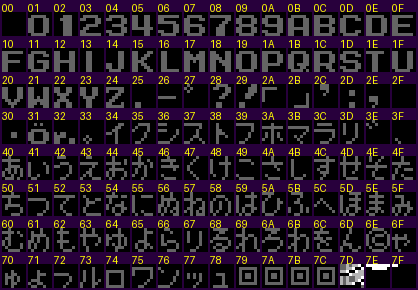 `img/text_font_main.png` | Main font (A=$0B) as loaded in CHR-RAM during the intro, tiles $00-$7F. |
| 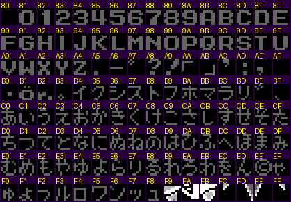 `img/text_font_main_hi.png` | The same font loaded at $80 (A=$8B) for the Mr. X fortress speech. |
| 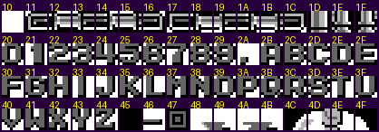 `img/text_font_stagesel.png` | Stage-select / robot-card font (A=$2B), tiles $10-$4F. |
| 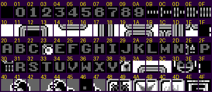 `img/text_font_pause.png` | Pause font (A=$20): no D, O, Q, Z; icons in their slots. |
| 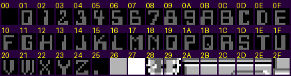 `img/text_font_youget.png` | YOU GET bold font: R ($1C) and A ($0B) nearly identical. |
| 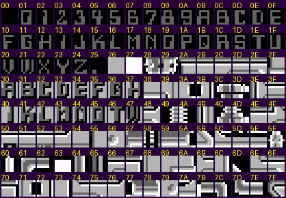 `img/text_font_bosspanel.png` | Boss-panel CHR: bold digits/letters plus the 16 label letters. |
| 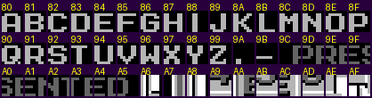 `img/text_font_staffroles.png` | Staff-roll role font (A=$80) and the wide PRESENTED word ($9C-$A5). |
| 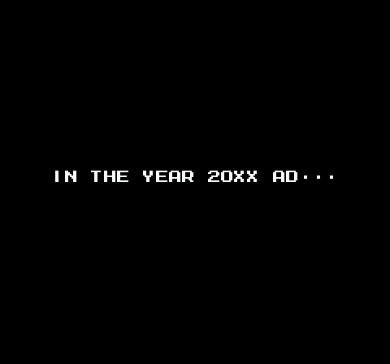 `img/text_intro_1_20xx.png` | Intro step 1: IN THE YEAR 20XX AD・・・ |
| 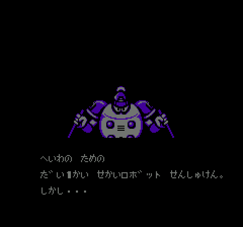 `img/text_intro_3_peace.png` | Intro step 4: the 1st World Robot Championship, しかし・・・ |
| 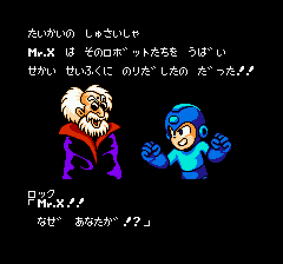 `img/text_intro_4_mrx_host.png` | Intro step 6: Mr. X steals the robots; Rock's line with the speaker label ロック. |
| 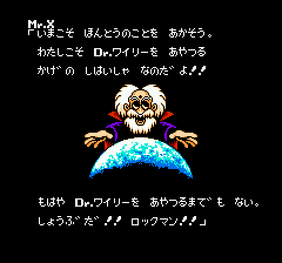 `img/text_intro_5_mrx_reveal.png` | Intro step 7: Mr. X claims to be the shadow ruler behind Dr. Wily. |
| 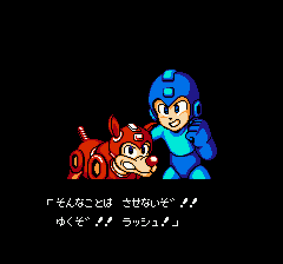 `img/text_intro_6_rush.png` | Intro step 8: Rock and Rush. |
| 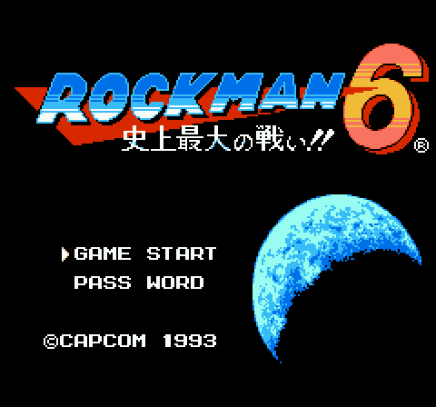 `img/text_title.png` | Title: the only kanji (史上最大の戦い!!) are logo art. |
| 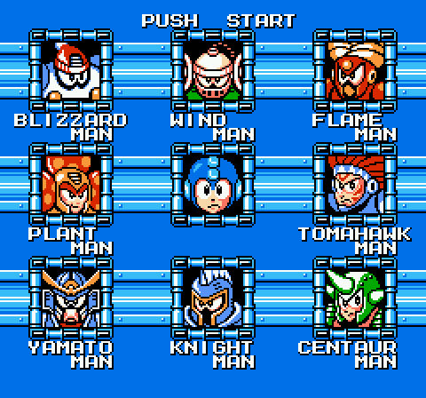 `img/text_stageselect.png` | Stage select (A=$2B font). |
| 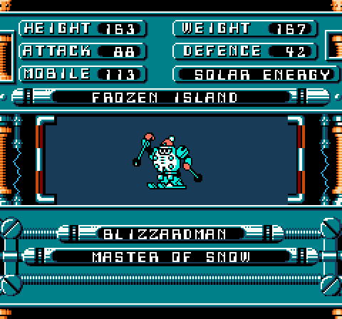 `img/text_bossintro_panel.png` | Boss-intro data panel after typing (Blizzard Man). |
| 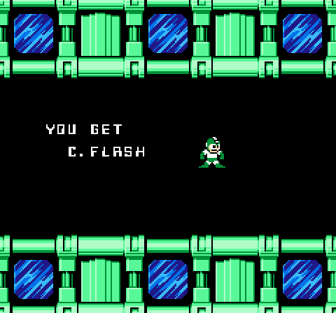 `img/text_youget_cflrsh.png` | YOU GET: the data says C.FLRSH, the screen shows "C.FLASH". |
| 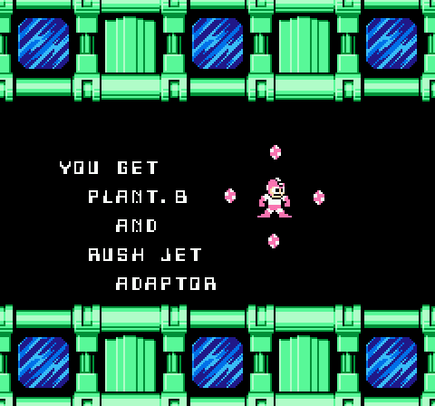 `img/text_youget_rushjet.png` | YOU GET PLANT.B AND RUSH JET ADAPTOR ("RUSH" looks like "AUSH"). |
| 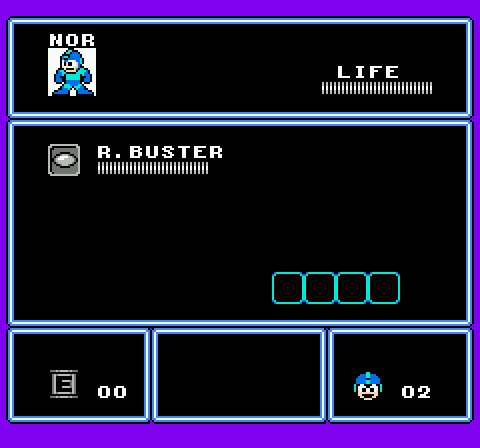 `img/text_pause.png` | Pause menu: N0R, LIFE, R.BUSTER, the four Beat slots, counters. |
| 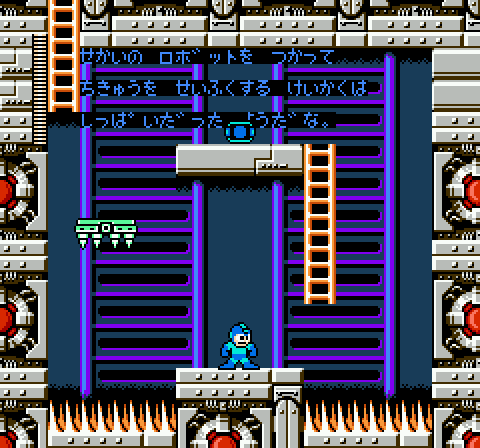 `img/text_mrx_fortress_6C.png` | Mr. X speech after his fortress, typed with the font at $80. |
| 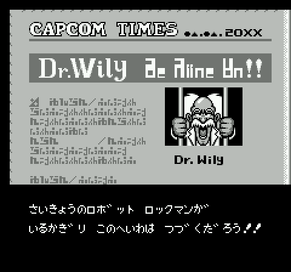 `img/text_ending_newspaper.png` | Ending: CAPCOM TIMES newspaper, graphic headline + typed body text. |
| 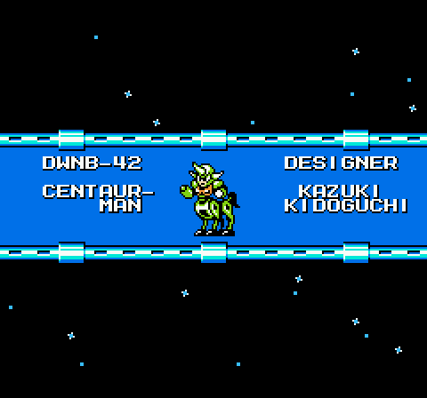 `img/text_ending_card.png` | Ending: robot card DWNB-42 CENTAUR-MAN / DESIGNER KAZUKI KIDOGUCHI. |
| 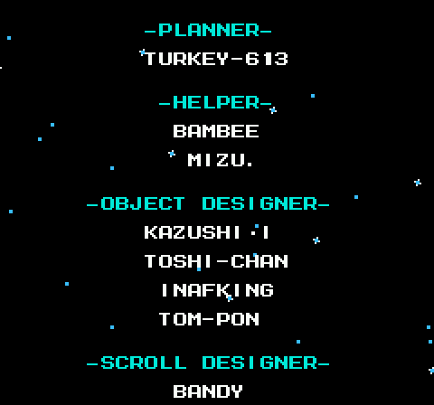 `img/text_ending_staffroll.png` | Ending: staff roll with cyan role headers. |
| 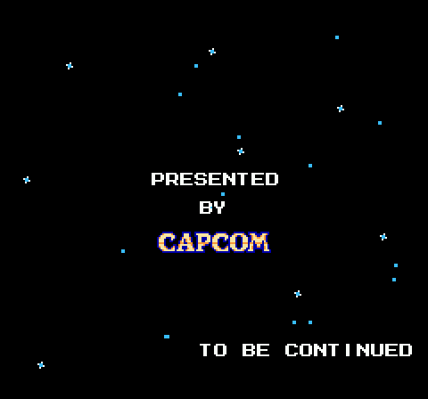 `img/text_ending_tobecontinued.png` | Final screen: PRESENTED BY CAPCOM ... TO BE CONTINUED. |
| 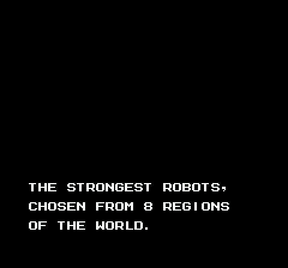 `img/text_en_poc.png` | Proof of concept: script $51 re-pointed to new English commands in free space (`entest.py`), shown by the unmodified engine. |
| 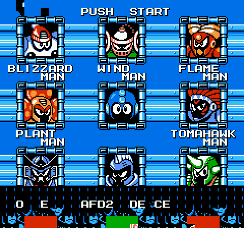 `img/text_debug_overlay.png` | Hidden debug overlay (bank $28) over the stage select, ASCII-coded hex. |

## 10. Scripts and savestates (for other agents)

Scripts in `build/research/rm6/rm6-text/` (run with `python3 -I`):

| Script | Purpose |
|---|---|
| `lib.py` | shared helpers (single Emu instance, `capture()` = screenshot + NT dump + CHR sheets + state) |
| `scripts.py` | parse the 168 PPU scripts (`parse(id)`), pointer table, `decode()`, `load_tbl()` |
| `transcript.py` | dump all text with the right table per script |
| `jp.py` | text lines per script with dakuten merged |
| `introcmd.py` | decode the intro bytecode at $3D:$BD7C |
| `callers.py` | list every `JSR $CB28` far call by function byte |
| `render_script.py` | render a script onto a blank canvas with any CHR dump |
| `chrfree2.py`, `chrfree3.py` | free CHR measurements per capture |

Reusable tool: `tools/analysis/rm6/rm6_ppuscript.py` (decode/encode/dump PPU scripts, see its docstring).

Savestates (all in `build/research/rm6/rm6-text/`): `cap_<scene>.state` for every scene above (intro_20xx,
intro_8robots, intro_peace, intro_mrx_host, intro_mrx_reveal, intro_rush, title, stagesel, bossintro, wget_centaur,
wget_plant, wget_yamato_beat, pause_blizzard, gameover, continue_menu, continue_fortress, pw_error, mrx_6C, mrx_6D,
mrx_6E, newspaper, credits_dwn, staff, staffroll, presented, sound_player, debug_opt1, ready); `ss2.state` (stage
select, also copied to `build/research/rm6/states/rm6text_stage_select.state`), `blizzard_stage.state` (in stage),
`mrx_hijack.state` (Mr. X speech via thread hijack), `ending_hijack.state` / `end_00..99.state` (ending every 300
frames), `sndplayer_hijack.state` (debug player), `password.state`.

Copies for other agents in `build/research/rm6/states/`: `rm6text_stage_select`, `rm6text_ending_start`,
`rm6text_mrx_speech`, `rm6text_debug_soundplayer`, `rm6text_bossintro_blizzard`, `rm6text_ending_newspaper`,
`rm6text_password` (`.state`).

How the hijacks work [code]: the game runs cooperative threads (state `$21-$24`, saved S `$29-$2C`, saved banks
`$34-$3B`). Poking a new return address into thread 0's stack and its saved banks starts any routine, e.g. the ending
at $3B:$A76D: `s=peek($29); poke($100+s+4,$6D); poke($100+s+5,$A7); poke($34,$3A); poke($38,$3B)` from `ss2.state`.
